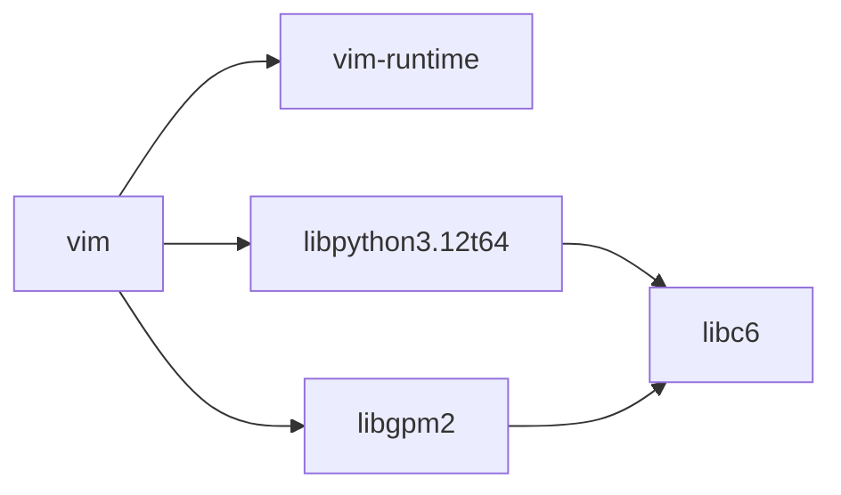
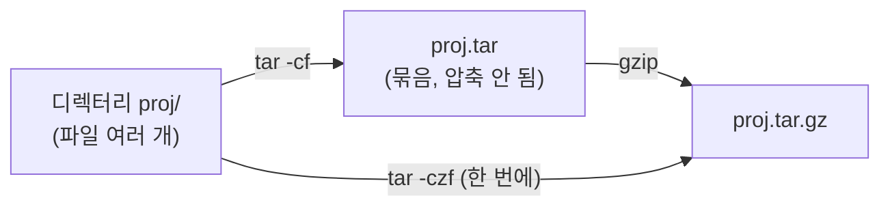

# 9장 — 소프트웨어 관리

[레포지토리 안내](../../README.ko.md) | [English](Concepts_Lecture.md) | [한국어](Concepts_Lecture.ko.md)

> **최종 수정일:** 2026-11-19

> **학습 목표:**
> 1. 패키지와 의존성의 개념을 설명하고 패키지 파일의 이름과 상태 표시를 해석할 수 있다
> 2. `dpkg`와 `apt`의 역할을 구분하고 저장소 설정 파일의 구성을 설명할 수 있다
> 3. `apt`로 패키지를 검색, 설치, 갱신, 삭제하고 `remove`, `purge`, `autoremove`의 차이를 설명할 수 있다
> 4. 소스 코드에서 프로그램을 설치하는 과정과 패키지를 쓰는 편이 나은 이유를 설명할 수 있다
> 5. `tar`로 아카이브를 만들고 풀며, 압축 방식의 압축률과 속도를 비교하여 고를 수 있다

---

## 목차

- [1. 패키지와 의존성](#1-패키지와-의존성)
  - [1.1 패키지의 구성](#11-패키지의-구성)
  - [1.2 의존성](#12-의존성)
  - [1.3 패키지 파일의 이름](#13-패키지-파일의-이름)
- [2. dpkg와 apt](#2-dpkg와-apt)
  - [2.1 두 도구의 역할](#21-두-도구의-역할)
  - [2.2 dpkg로 설치된 패키지 조사하기](#22-dpkg로-설치된-패키지-조사하기)
  - [2.3 저장소와 sources 파일](#23-저장소와-sources-파일)
  - [2.4 apt의 주요 명령](#24-apt의-주요-명령)
  - [2.5 remove, purge, autoremove의 차이](#25-remove-purge-autoremove의-차이)
  - [2.6 흔한 오류와 해결](#26-흔한-오류와-해결)
  - [2.7 스냅 패키지](#27-스냅-패키지)
- [3. 소스 코드로 설치하기](#3-소스-코드로-설치하기)
  - [3.1 configure, make, make install](#31-configure-make-make-install)
  - [3.2 패키지를 쓰는 편이 나은 이유](#32-패키지를-쓰는-편이-나은-이유)
- [4. 파일 아카이브와 압축](#4-파일-아카이브와-압축)
  - [4.1 아카이브와 압축의 구분](#41-아카이브와-압축의-구분)
  - [4.2 tar의 사용법](#42-tar의-사용법)
  - [4.3 gzip, bzip2, xz, zip](#43-gzip-bzip2-xz-zip)
  - [4.4 압축 방식의 비교와 선택](#44-압축-방식의-비교와-선택)
- [개념 적용](#개념-적용)
- [요약](#요약)
- [점검 문제](#점검-문제)
- [참고 문헌](#참고-문헌)

---

<br>

## 1. 패키지와 의존성

### 1.1 패키지의 구성

> **용어 정의:** **패키지(package)** 는 프로그램을 설치하는 데 필요한 파일과, 그 파일을 어디에 어떻게 설치할지에 관한 정보를 하나로 묶은 설치 단위이다.

Debian 계열(1주차 4.3절)의 패키지 파일은 확장자가 `.deb`이며, 안에 세 가지가 들어 있다.

| 구성 요소 | 내용 |
|:-----|:-----|
| 데이터 | 설치될 파일들과 그 경로 (`/usr/bin/프로그램`, `/usr/share/man/...`, `/etc/설정 파일`) |
| 제어 정보 | 패키지 이름, 버전, 아키텍처, 설명, 의존하는 다른 패키지의 목록 |
| 관리자 스크립트 | 설치 전후와 삭제 전후에 실행할 스크립트 (사용자 계정 만들기, 서비스 시작 등) |

*표 1. .deb 패키지의 구성 요소*

패키지 관리 시스템은 설치한 패키지와 각 패키지가 설치한 파일의 목록을 데이터베이스(`/var/lib/dpkg/`)에 기록한다. 그래서 어떤 파일이 어느 패키지에서 왔는지, 패키지를 지울 때 어떤 파일을 지워야 하는지를 정확히 알 수 있다. 소스 코드로 직접 설치한 프로그램(3절)에는 이런 기록이 없다.

`/etc` 아래의 설정 파일은 **conffile**로 따로 표시된다. 관리자가 고쳤을 수 있는 파일이므로, 패키지를 갱신하거나 지울 때 덮어쓰거나 지우지 않고 남겨 두는 것이 기본이다(2.5절).

### 1.2 의존성

대부분의 프로그램은 다른 프로그램이나 라이브러리가 있어야 동작한다. 패키지 A가 패키지 B를 필요로 하는 관계를 **의존성(dependency)** 이라 하며, A의 제어 정보에 `Depends: B`로 적힌다. 의존성은 여러 단계로 이어지므로, 프로그램 하나를 설치하려면 그 의존성의 의존성까지 모두 설치해야 한다.



*그림 1. 패키지 의존성의 예 (일부)*

의존성을 손으로 하나씩 찾아 설치하는 것은 매우 번거롭고, 필요한 버전이 서로 충돌하면 해결하기도 어렵다. 2절의 `apt`는 저장소의 정보로 필요한 패키지를 모두 계산하여 한 번에 설치한다. 의존성의 종류에는 반드시 있어야 하는 `Depends` 말고도 함께 설치하기를 권하는 `Recommends`, 있으면 좋은 `Suggests`, 함께 설치할 수 없는 `Conflicts` 등이 있으며, `apt`는 기본적으로 `Depends`와 `Recommends`를 함께 설치한다.

### 1.3 패키지 파일의 이름

`.deb` 파일의 이름은 `패키지이름_버전_아키텍처.deb` 형식이다. 예를 들어 `mytool_1.4.2-1ubuntu1_amd64.deb`는 다음과 같이 읽는다.

```text
mytool _ 1.4.2 - 1ubuntu1 _ amd64 .deb
  │       │        │          └─ 아키텍처: amd64(x86-64), arm64, all(아키텍처와 무관)
  │       │        └──────────── 배포판의 패키지 수정 번호 (Debian 1, Ubuntu 수정 1)
  │       └───────────────────── 원저작자(upstream)의 버전
  └───────────────────────────── 패키지 이름
```

*그림 2. .deb 패키지 파일 이름의 구성*

같은 원저작자 버전이라도 배포판이 패치를 더하면 수정 번호가 올라간다. 1주차 5.3절의 커널 버전처럼, Ubuntu 패키지의 버전은 원저작자의 최신 버전보다 낮아 보여도 보안 수정이 반영되어 있을 수 있다.

---

<br>

## 2. dpkg와 apt

### 2.1 두 도구의 역할

| 구분 | `dpkg` | `apt` |
|:-----|:-----|:-----|
| 다루는 대상 | 이미 받은 `.deb` 파일 | 저장소의 패키지 이름 |
| 의존성 | 검사만 하고 해결하지 않음 | 필요한 패키지를 계산하여 함께 설치 |
| 다운로드 | 하지 않음 | 저장소에서 내려받음 |
| 주된 용도 | 설치된 패키지의 조사, 개별 `.deb` 설치 | 일상적인 설치, 갱신, 삭제 |

*표 2. dpkg와 apt의 비교*

`apt`는 내부적으로 `dpkg`를 불러 실제 설치를 맡긴다. 즉 `dpkg`가 낮은 수준의 설치기이고, `apt`는 그 위에서 저장소와 의존성을 다루는 높은 수준의 도구이다. `apt`는 사람이 대화형으로 쓰기 위한 명령이어서 출력 형식이 판마다 바뀔 수 있으므로, 스크립트에서는 같은 기능을 하는 `apt-get`과 `apt-cache`를 쓰는 것이 권장된다 [1].

### 2.2 dpkg로 설치된 패키지 조사하기

`dpkg`의 주요 옵션은 다음과 같다 [2].

| 옵션 | 기능 |
|:-----|:-----|
| `-i 파일.deb` | `.deb` 파일을 설치 |
| `-r 패키지` | 패키지를 삭제하되 conffile은 남김 |
| `-P 패키지` | conffile까지 모두 삭제(purge) |
| `-l [패턴]` | 패키지 목록과 상태 |
| `-L 패키지` | 그 패키지가 설치한 파일의 목록 |
| `-S 파일 경로` | 그 파일을 설치한 패키지 찾기 |
| `-s 패키지` | 패키지의 상태와 정보 |

*표 3. dpkg의 주요 옵션*

```text
$ dpkg -S /usr/bin/sort
coreutils: /usr/bin/sort
$ dpkg -L coreutils | grep 'bin/sort$'
/usr/bin/sort
```

`dpkg -l`의 각 줄 앞의 두 글자는 패키지의 상태이다. 첫 글자는 관리자가 원하는 상태(`i` 설치, `r` 삭제, `p` 완전 삭제), 둘째 글자는 실제 상태(`i` 설치됨, `c` 설정 파일만 남음, `n` 설치되지 않음)이다. 따라서 `ii`는 정상적으로 설치된 패키지이고, `rc`는 삭제했지만 설정 파일이 남아 있는 패키지이다.

### 2.3 저장소와 sources 파일

**저장소(repository)** 는 패키지 파일과 그 목록(색인)을 모아 둔 서버이다. `apt`가 어느 저장소를 쓸지는 `/etc/apt/sources.list.d/` 아래의 파일이 정한다. Ubuntu 24.04는 여러 줄로 된 deb822 형식의 `ubuntu.sources`를 쓴다 [3].

```text
Types: deb
URIs: http://kr.archive.ubuntu.com/ubuntu/
Suites: noble noble-updates noble-backports
Components: main restricted universe multiverse
Signed-By: /usr/share/keyrings/ubuntu-archive-keyring.gpg

Types: deb
URIs: http://security.ubuntu.com/ubuntu/
Suites: noble-security
Components: main restricted universe multiverse
Signed-By: /usr/share/keyrings/ubuntu-archive-keyring.gpg
```

| 필드 | 뜻 |
|:-----|:-----|
| `Types` | `deb`는 실행 패키지, `deb-src`는 소스 패키지 |
| `URIs` | 저장소 서버의 주소 (`kr.archive`는 한국의 미러 서버) |
| `Suites` | 배포판 코드명(1주차 4.4절)과 갈래. `noble`은 출시 때의 패키지, `-updates`는 버그 수정, `-security`는 보안 수정, `-backports`는 새 판의 기능을 옮겨 온 패키지 |
| `Components` | 저장소 안의 구역. `main`은 Canonical이 지원하는 자유 소프트웨어, `restricted`는 장치 드라이버와 코덱 같은 비공개 소프트웨어, `universe`는 커뮤니티가 관리하는 자유 소프트웨어, `multiverse`는 오픈 소스의 요건을 모두 갖추지 못한 소프트웨어 [4] |
| `Signed-By` | 저장소의 서명을 검사할 공개 키 |

*표 4. deb822 형식 저장소 항목의 필드*

`apt`는 저장소의 색인에 붙은 전자 서명을 `Signed-By`의 키로 검사하여, 중간에서 바뀐 패키지 목록을 받아들이지 않는다. 예전 형식의 한 줄짜리 `/etc/apt/sources.list`(`deb http://... noble main restricted`)도 계속 읽는다 [5].

### 2.4 apt의 주요 명령

| 명령 | 동작 |
|:-----|:-----|
| `apt update` | 설정된 모든 저장소에서 패키지 정보(색인)를 내려받음. 패키지 자체는 바꾸지 않음 |
| `apt upgrade` | 설치된 패키지를 새 판으로 갱신. 필요하면 새 패키지를 설치하지만 기존 패키지는 지우지 않음 |
| `apt full-upgrade` | `upgrade`와 같되, 시스템 전체를 갱신하는 데 필요하면 기존 패키지도 지움 |
| `apt install 패키지` | 패키지와 그 의존성을 설치. 이미 있으면 새 판으로 갱신 |
| `apt remove 패키지` | 패키지를 삭제하되 설정 파일은 남김 |
| `apt purge 패키지` | 설정 파일까지 삭제 |
| `apt autoremove` | 의존성 때문에 자동으로 설치되었지만 이제 필요 없는 패키지를 삭제 |
| `apt search 정규식` | 패키지 이름과 설명에서 검색 |
| `apt show 패키지` | 의존성, 크기, 설명 같은 상세 정보 |
| `apt list --installed` | 설치된 패키지의 목록 |

*표 5. apt의 주요 명령*

`update`와 `upgrade`는 이름이 비슷하지만 하는 일이 다르다. `update`는 "무엇이 새로 나왔는지"의 목록만 갱신하고, `upgrade`가 그 목록에 따라 실제 패키지를 갱신한다. 그래서 갱신은 언제나 `sudo apt update && sudo apt upgrade`의 순서로 실행한다. 패키지를 설치하는 과정은 다음과 같다(출력 예, 일부 줄 생략).

```text
$ sudo apt update
Hit:1 http://kr.archive.ubuntu.com/ubuntu noble InRelease
Get:2 http://security.ubuntu.com/ubuntu noble-security InRelease [126 kB]
...
Reading package lists... Done
12 packages can be upgraded. Run 'apt list --upgradable' to see them.
$ apt search '^tree$'
tree/noble 2.1.1-2ubuntu3 amd64
  displays an indented directory tree, in color
$ sudo apt install tree
...
The following NEW packages will be installed:
  tree
...
Setting up tree (2.1.1-2ubuntu3) ...
$ tree --noreport proj
proj
├── README
└── src
    └── main.c
```

`Hit`은 색인이 바뀌지 않았다는 뜻이고 `Get`은 새 색인을 받았다는 뜻이다. `apt search`의 인자는 정규 표현식이므로 `'^tree$'`처럼 감싸면 이름이 정확히 `tree`인 패키지만 찾는다.

### 2.5 remove, purge, autoremove의 차이

`apt`는 사용자가 직접 설치를 요청한 패키지(수동 설치)와 의존성 때문에 함께 설치된 패키지(자동 설치)를 구분하여 기록한다. 이 구분이 세 삭제 명령의 차이를 만든다. 패키지 A가 B에 의존하고, 사용자가 A만 설치를 요청했다고 하자.

| 단계 | A의 상태 | B의 상태 | 남은 것 |
|:-----|:-----|:-----|:-----|
| `apt install A` | 수동 설치 (`ii`) | 자동 설치 (`ii`) | |
| `apt remove A` | 삭제, 설정 파일 남음 (`rc`) | 그대로 설치됨 (`ii`) | A의 conffile, B 전체 |
| `apt autoremove` | `rc` 그대로 | 이제 필요 없으므로 삭제 | A의 conffile, B의 conffile |
| `apt purge A` | 완전 삭제 | | B의 conffile |

*표 6. A가 B에 의존할 때 삭제 명령에 따른 상태 변화*

- `remove`는 설정 파일을 남기므로 나중에 다시 설치하면 이전 설정이 그대로 쓰인다. 설정을 처음부터 다시 하고 싶으면 `purge`를 쓴다.
- 자동 설치된 B는 A를 지워도 남는다. 다른 패키지가 B를 쓰지 않으면 `autoremove`가 지운다. `apt autoremove --purge`는 이때 설정 파일까지 지운다.
- 수동, 자동 표시는 `apt-mark showmanual`, `apt-mark showauto`로 보고, `apt-mark manual B`로 바꿀 수 있다. 사용자가 직접 쓰는 패키지가 자동으로 표시되어 있으면 `autoremove`가 지워 버리므로, `autoremove`가 지울 목록은 실행 전에 반드시 확인한다 [1].

### 2.6 흔한 오류와 해결

| 증상 | 원인 | 해결 |
|:-----|:-----|:-----|
| `E: Unable to locate package 이름` | 색인이 오래되었거나 이름이 틀림, 해당 구역(`universe` 등)이 꺼져 있음 | `sudo apt update` 뒤 `apt search`로 정확한 이름 확인 |
| `dpkg -i`로 설치한 뒤 `dependency problems` | `dpkg`는 의존성을 해결하지 않음 | `sudo apt -f install`로 빠진 의존성을 설치, 처음부터 `sudo apt install ./파일.deb`로 설치 |
| `Could not get lock /var/lib/dpkg/lock-frontend` | 자동 업데이트 등 다른 패키지 작업이 실행 중 | 그 작업이 끝날 때까지 기다림 (잠금 파일을 지우지 않음) |
| 내려받기 중 `404 Not Found` | 색인이 서버의 실제 파일과 맞지 않음 | `sudo apt update` 뒤 다시 실행 |

*표 7. 패키지 관리의 흔한 오류*

`sudo apt install ./파일.deb`처럼 경로(`./`)를 붙이면 `apt`가 그 파일을 설치하면서 의존성도 저장소에서 해결한다. 경로 없이 이름만 쓰면 `apt`는 저장소의 패키지 이름으로 해석한다.

### 2.7 스냅 패키지

Ubuntu는 `.deb` 말고도 Canonical이 만든 **스냅(snap)** 패키지를 함께 쓴다. 스냅은 프로그램과 그 프로그램이 쓰는 라이브러리를 모두 한 파일에 담으므로 배포판의 판과 관계없이 같은 패키지가 설치되고, 시스템의 다른 부분과 격리된 환경에서 실행된다. 스냅은 `snapd` 데몬이 관리하며, 설치한 스냅은 압축된 파일 시스템 이미지 그대로 `/snap/이름/리비전` 아래에 읽기 전용으로 마운트된다.

| 명령 | 동작 |
|:-----|:-----|
| `snap find 이름` | 스토어에서 스냅을 검색 |
| `sudo snap install 이름` | 스냅을 설치 |
| `snap list` | 설치된 스냅과 그 판, 리비전을 출력 |
| `sudo snap refresh` | 설치된 스냅을 새 리비전으로 갱신 |
| `sudo snap revert 이름` | 직전 리비전으로 되돌림 |
| `sudo snap remove 이름` | 스냅을 삭제 |

*표 8. snap의 주요 명령*

`.deb` 패키지는 관리자가 `apt upgrade`를 실행해야 갱신되지만, 스냅은 `snapd`가 기본적으로 하루에 네 번 새 리비전을 확인하여 자동으로 갱신한다 [6]. 이전 리비전을 함께 보관하므로 갱신한 뒤 문제가 생기면 `snap revert`로 되돌릴 수 있고, 특정 스냅의 자동 갱신은 `snap refresh --hold 이름`으로 미룰 수 있다 [6]. 의존성을 모두 담으므로 같은 프로그램의 `.deb`보다 크고 처음 실행할 때 느릴 수 있으며, 같은 프로그램을 `.deb`와 스냅으로 모두 설치하면 서로 다른 두 사본이 생긴다.

---

<br>

## 3. 소스 코드로 설치하기

### 3.1 configure, make, make install

저장소에 없는 프로그램이나 더 새로운 판이 필요하면 원저작자가 배포하는 소스 코드를 받아 직접 컴파일한다. GNU 도구들이 쓰는 전형적인 순서는 다음과 같다.

```bash
sudo apt install build-essential           # gcc, make 등 빌드 도구
tar -xf program-1.0.tar.gz                 # 소스 아카이브 풀기 (4.2절)
cd program-1.0
./configure --prefix=/usr/local            # 시스템을 검사하여 Makefile 생성
make                                       # 컴파일
sudo make install                          # /usr/local 아래에 설치
```

1. `build-essential`은 C 컴파일러 `gcc`, 빌드 도구 `make`, 표준 라이브러리의 헤더 같은 컴파일에 필요한 패키지를 한 번에 설치하는 메타 패키지이다.
2. `./configure`는 컴파일러, 필요한 라이브러리, 운영체제의 기능을 검사하고 이 시스템에 맞는 `Makefile`을 만든다. 필요한 라이브러리가 없으면 여기서 오류가 나므로, 그 라이브러리의 개발용 패키지(이름이 보통 `-dev`로 끝남)를 `apt`로 설치한 뒤 다시 실행한다. `--prefix`는 설치할 위치이다.
3. `make`는 `Makefile`에 적힌 규칙에 따라 소스 파일을 컴파일한다. 일반 사용자 권한으로 실행한다.
4. `sudo make install`은 만든 파일을 `--prefix` 아래(`/usr/local/bin`, `/usr/local/lib` 등)에 복사한다. 시스템 디렉터리에 쓰므로 root 권한이 필요하다.

> **[시스템프로그래밍]** 시스템프로그래밍에서 배우는 링킹으로 보면, `./configure`가 찾는 라이브러리는 컴파일할 때 쓰는 헤더 파일(`.h`)과 링커가 참조하는 공유 라이브러리(`.so`)로 이루어진다. Ubuntu는 이를 두 패키지로 나누어, 실행에 필요한 공유 라이브러리(`libfoo.so.1`)는 `libfoo1` 같은 런타임 패키지에, 헤더와 링크용 `libfoo.so` 링크는 `libfoo-dev` 같은 개발 패키지에 담는다. 그래서 소스를 빌드할 때는 `-dev` 패키지가 있어야 하고, 빌드한 프로그램을 실행할 때는 동적 링커가 런타임 패키지의 공유 라이브러리를 찾아 메모리에 올린다.

`/usr/local`은 그 컴퓨터에서 직접 설치한 프로그램을 두는 곳으로, 패키지 관리자가 건드리지 않는다(3주차 2.3절). `PATH`에서 `/usr/local/bin`이 `/usr/bin`보다 앞에 있으므로 같은 이름의 프로그램이 둘 다 있으면 직접 설치한 쪽이 실행된다(6주차 2.6절).

### 3.2 패키지를 쓰는 편이 나은 이유

| 항목 | 패키지 (`apt`) | 소스에서 설치 |
|:-----|:-----|:-----|
| 의존성 | 자동으로 계산하여 설치 | 직접 찾아 설치 |
| 보안 수정 | `apt upgrade`로 자동 반영 | 직접 새 판을 받아 다시 빌드 |
| 삭제 | `apt remove`가 설치한 파일을 정확히 지움 | 기록이 없어 직접 찾아 지워야 함 (`make uninstall`이 없는 경우도 많음) |
| 출처 검증 | 저장소의 서명으로 검증 | 내려받은 파일을 직접 검증 |
| 장점 | 관리가 쉬움 | 최신 판, 원하는 빌드 옵션 |

*표 9. 패키지 설치와 소스 설치의 비교*

소스에서 설치한 프로그램은 보안 수정이 나와도 자동으로 갱신되지 않고, 어떤 파일을 설치했는지 기록이 없어 깔끔하게 지우기도 어렵다. 그래서 저장소에 있는 프로그램은 패키지로 설치하고, 소스 설치는 반드시 필요한 경우에만 `/usr/local`이나 홈 디렉터리 같은 분리된 위치에만 한다.

---

<br>

## 4. 파일 아카이브와 압축

### 4.1 아카이브와 압축의 구분

**아카이브(archive)** 는 여러 파일과 디렉터리를 그 구조, 권한, 소유자, 시간 정보와 함께 하나의 파일로 묶은 것이고, **압축(compression)** 은 파일 하나의 크기를 줄이는 것이다. Linux에서는 두 일을 서로 다른 도구가 나누어 맡는 경우가 많다. `tar`가 디렉터리를 하나의 `.tar` 파일로 묶고, `gzip`, `bzip2`, `xz`가 그 파일 하나를 압축한다. `.tar.gz`(또는 `.tgz`), `.tar.bz2`, `.tar.xz`는 묶은 뒤 압축한 파일이다.



*그림 3. 아카이브와 압축의 관계*

반면 `zip`은 묶기와 압축을 한 번에 하며, 파일마다 따로 압축하여 하나의 파일로 담는다. Windows와 파일을 주고받을 때 흔히 쓴다.

### 4.2 tar의 사용법

`tar`의 옵션은 하나의 동작과 여러 보조 옵션으로 이루어진다.

| 옵션 | 뜻 |
|:-----|:-----|
| `-c` | 아카이브를 만든다 (create) |
| `-x` | 아카이브를 푼다 (extract) |
| `-t` | 아카이브의 내용을 나열한다 (list) |
| `-f 파일` | 아카이브 파일의 이름. 바로 뒤에 이름이 와야 함 |
| `-v` | 처리하는 파일의 이름을 출력 |
| `-z`, `-j`, `-J` | gzip, bzip2, xz로 압축하거나 푼다 |
| `-C 디렉터리` | 그 디렉터리로 옮겨 가서 작업 (주로 풀 위치 지정) |
| `--exclude=패턴` | 패턴에 맞는 파일을 뺀다 |

*표 10. tar의 주요 옵션*

```text
$ tar -czf proj.tar.gz proj
$ tar -tf proj.tar.gz
proj/
proj/README
proj/src/
proj/src/main.c
$ mkdir /tmp/restore
$ tar -xf proj.tar.gz -C /tmp/restore
$ ls /tmp/restore/proj
README  src
```

- `-czf`는 `-c -z -f`를 묶은 것이다. 인자를 받는 `-f`는 묶음의 맨 끝에 두어야 하므로, `-cfz proj.tar.gz`처럼 쓰면 `z`가 파일 이름으로 해석된다 [7].
- 아카이브 안의 이름은 만들 때 준 경로 그대로 저장된다. `proj`를 주었으므로 풀면 현재 디렉터리(또는 `-C`의 위치)에 `proj/`가 다시 생긴다.
- GNU `tar`는 풀 때 압축 방식을 스스로 알아내므로 `-xf`만으로 `.tar.gz`, `.tar.bz2`, `.tar.xz`를 모두 풀 수 있다. 만들 때는 `-z`, `-j`, `-J`를 직접 주거나, `-a`로 이름의 확장자에 맞추게 한다 [7].
- `tar -cf backup.tar /etc`처럼 절대 경로를 주면 GNU `tar`는 ``Removing leading `/' from member names`` 메시지를 내고 앞의 `/`를 떼어 `etc/...`로 저장한다 [7]. 풀 때 시스템의 `/etc`를 덮어쓰는 사고를 막기 위해서이다.

> **주의:** `tar -xf`는 같은 이름의 파일이 있으면 묻지 않고 덮어쓴다. 받은 아카이브는 먼저 `tar -tf`로 내용을 확인하고, 안의 파일이 하나의 디렉터리에 담겨 있지 않으면 빈 디렉터리를 만들어 `-C`로 그 안에 푼다.

### 4.3 gzip, bzip2, xz, zip

| 명령 | 압축 | 풀기 | 확장자 | 특징 |
|:-----|:-----|:-----|:-----|:-----|
| `gzip` | `gzip 파일` | `gunzip 파일.gz`, `gzip -d` | `.gz` | 빠름, 가장 널리 쓰임 |
| `bzip2` | `bzip2 파일` | `bunzip2 파일.bz2`, `bzip2 -d` | `.bz2` | gzip보다 작게, 더 느림 |
| `xz` | `xz 파일` | `unxz 파일.xz`, `xz -d` | `.xz` | 대체로 가장 작게, 압축이 가장 느림 |
| `zip` | `zip 결과.zip 파일...` | `unzip 결과.zip` | `.zip` | 여러 파일을 묶어 압축, 원본 유지 |

*표 11. 압축 명령의 비교*

`gzip`, `bzip2`, `xz`는 파일 하나를 압축하고, 압축이 끝나면 **원본을 지우고** `.gz` 같은 확장자가 붙은 파일로 바꾼다 [8]. 원본을 남기려면 `-k`(keep)를 주고, 표준 출력으로 내보내려면 `-c`를 준다. `-1`부터 `-9`까지의 숫자는 압축 수준으로, 클수록 작게 압축하지만 느려진다. 압축된 텍스트 파일은 풀지 않고 `zcat`, `zless`, `zgrep`(xz는 `xzcat`, `xzgrep`)으로 읽을 수 있다.

```text
$ ls -l manual.txt
-rw-r--r-- 1 user1 user1 1079464 Mar 21 15:00 manual.txt
$ gzip manual.txt
$ ls manual.txt*
manual.txt.gz
$ gzip -l manual.txt.gz
         compressed        uncompressed  ratio uncompressed_name
             268815             1079464  75.1% manual.txt
$ gunzip manual.txt.gz
```

`gzip -l`의 ratio는 줄어든 비율 1 - 268815 ÷ 1079464 ≈ 75.1%이다.

### 4.4 압축 방식의 비교와 선택

약 1 MB(1,079,464바이트)의 영어 텍스트 파일 하나(GNU coreutils의 info 매뉴얼)를 각 방식으로 압축한 결과는 다음과 같다. 크기는 구현과 판에 따라 몇 바이트씩 다를 수 있고, 시간은 같은 컴퓨터에서 잰 상대적인 값이다.

| 방식 | 압축한 크기 (바이트) | 원본 대비 크기 | 압축 시간 | 풀기 시간 |
|:-----|-----:|-----:|-----:|-----:|
| `gzip -1` | 329,593 | 30.5% | 12 ms | |
| `gzip -6` (기본) | 268,815 | 24.9% | 30 ms | 6 ms |
| `gzip -9` | 266,723 | 24.7% | 58 ms | |
| `zip -9` | 267,061 | 24.7% | 57 ms | |
| `bzip2 -9` (기본) | 206,131 | 19.1% | 51 ms | 21 ms |
| `xz -6` (기본) | 208,316 | 19.3% | 191 ms | 14 ms |

*표 12. 1,079,464바이트 텍스트 파일의 압축 결과*

이 결과에서 다음을 읽을 수 있다.

- `gzip`은 수준을 `-1`에서 `-6`으로 올리면 크기가 30.5%에서 24.9%로 크게 줄지만, `-9`로 더 올려도 0.2%포인트밖에 줄지 않고 시간은 두 배가 된다. 압축 수준을 올릴수록 얻는 것은 빠르게 줄어든다.
- `zip`은 `gzip`과 같은 deflate 방식이므로 크기가 거의 같다.
- `bzip2`와 `xz`는 `gzip`보다 약 4분의 1 더 작다(24.9%에서 약 19%로). 이 텍스트에서는 `bzip2`가 `xz`보다 조금 작았지만, 일반적으로는 `xz`가 더 작게 압축하는 파일이 많다. 압축률은 자료의 성질에 따라 달라지므로 실제 자료로 비교해야 한다.
- `xz`는 압축이 가장 느리지만 풀기는 `bzip2`보다 빠르다. 한 번 압축하여 여러 사람이 여러 번 푸는 배포용 아카이브(소스 코드, 패키지)에 `xz`가 많이 쓰이는 이유이다.

따라서 자주 만들고 푸는 백업이나 로그는 빠른 `gzip`, 한 번 만들어 오래 보관하거나 배포하는 파일은 작은 `xz`, Windows 사용자와 주고받는 파일은 `zip`을 고른다. 이미 압축된 자료(JPEG 사진, MP4 동영상, `.deb`, `.zip`)는 다시 압축해도 거의 줄지 않는다.

---

<br>

## 개념 적용

**T/F 점검:**

| 문장 | 판단과 근거 |
|:-----|:-----|
| `sudo apt update`는 설치된 패키지를 새 판으로 바꾼다. | **F.** `update`는 저장소의 패키지 정보만 갱신하고, 실제 갱신은 `upgrade`가 한다. |
| `dpkg -i`는 필요한 의존성을 저장소에서 내려받아 함께 설치한다. | **F.** `dpkg`는 의존성을 검사만 하며, 해결은 `apt -f install`이나 `apt install ./파일.deb`가 한다. |
| `apt remove`로 지운 패키지는 `dpkg -l`에서 `rc`로 보일 수 있다. | **T.** `remove`는 conffile을 남기므로 상태가 "삭제됨, 설정 파일 남음"이 된다. |
| `apt upgrade`는 갱신에 필요하면 설치된 패키지를 지운다. | **F.** 기존 패키지를 지우지 않으며, 지워야 하는 갱신은 `full-upgrade`가 한다. |
| `gzip file`을 실행한 뒤에도 `file`은 그대로 남는다. | **F.** 원본을 지우고 `file.gz`로 바꾸므로, 원본을 남기려면 `-k`를 준다. |
| `tar -cfz a.tar.gz dir`은 gzip으로 압축된 아카이브를 만든다. | **F.** `-f` 바로 뒤의 `z`가 파일 이름으로 해석되므로 `-czf a.tar.gz dir`로 써야 한다. |
| 압축 수준을 `-6`에서 `-9`로 올리면 크기가 `-1`에서 `-6`으로 올릴 때만큼 줄어든다. | **F.** 표 12처럼 높은 수준에서는 크기가 조금만 줄고 시간이 크게 는다. |

---

<br>

## 요약

| 개념 | 핵심 요약 |
|------|-----------|
| 패키지 | 설치할 파일, 이름과 버전과 의존성을 담은 제어 정보, 관리자 스크립트를 묶은 설치 단위이며, 설치 기록이 데이터베이스에 남는다. |
| 의존성 | 패키지가 필요로 하는 다른 패키지이며, `apt`가 저장소 정보로 계산하여 함께 설치한다. |
| dpkg와 apt | `dpkg`는 `.deb` 파일을 설치하고 조사하는 낮은 수준의 도구, `apt`는 저장소와 의존성을 다루는 높은 수준의 도구이다. |
| 저장소 설정 | Ubuntu 24.04는 `/etc/apt/sources.list.d/ubuntu.sources`의 deb822 형식으로 URI, Suites, Components, 서명 키를 정한다. |
| 스냅 | 프로그램과 의존성을 한 이미지에 담아 격리된 환경에서 실행하는 패키지로, `snapd`가 자동으로 갱신하고 `snap revert`로 이전 리비전에 되돌릴 수 있다. |
| apt 명령 | `update`는 색인 갱신, `upgrade`는 패키지 갱신, `remove`는 설정을 남긴 삭제, `purge`는 완전 삭제, `autoremove`는 필요 없는 자동 설치 패키지 삭제이다. |
| 소스 설치 | `./configure`, `make`, `sudo make install`의 순서이며, 자동 갱신과 삭제 기록이 없어 저장소의 패키지를 먼저 쓴다. |
| tar | `-c`, `-x`, `-t`로 만들고 풀고 나열하며, `-z`, `-j`, `-J`로 압축 방식을 정하고 `-f`는 묶음의 끝에 둔다. |
| 압축 방식 | gzip은 빠르고, bzip2와 xz는 더 작으며, xz는 압축은 느리지만 풀기가 빨라 배포용에 쓰인다. |

---

<br>

## 점검 문제

1. **패키지 이름 해석:** `libfoo2_3.1.0-2ubuntu0.1_arm64.deb`에서 패키지 이름, 원저작자 버전, 배포판 수정 번호, 아키텍처를 쓰라.

   <details>
   <summary>정답</summary>

   `_`로 나누면 패키지 이름은 `libfoo2`, 버전은 `3.1.0-2ubuntu0.1`, 아키텍처는 `arm64`이다. 버전의 마지막 `-` 앞의 `3.1.0`이 원저작자 버전이고, 뒤의 `2ubuntu0.1`이 배포판의 수정 번호(Debian 수정 2를 바탕으로 한 Ubuntu의 수정)이다. `arm64`이므로 64비트 ARM 컴퓨터용이다.

   </details>

2. **파일의 출처:** `/usr/bin/vim.basic`이 어느 패키지에서 왔는지 알아내는 명령과, 그 패키지가 설치한 파일을 모두 보는 명령을 쓰라.

   <details>
   <summary>정답</summary>

   `dpkg -S /usr/bin/vim.basic`이 그 파일을 설치한 패키지 이름을 출력한다. 그 이름이 `vim`이면 `dpkg -L vim`이 그 패키지가 설치한 파일의 목록을 출력한다.

   </details>

3. **삭제 명령의 차이:** 웹 서버 패키지를 설정을 바꾸어 쓰다가 처음 상태로 다시 설치하려 한다. `remove`와 `purge` 가운데 무엇을 쓴 뒤 다시 설치해야 하며, 그 이유는 무엇인가?

   <details>
   <summary>정답</summary>

   `purge`를 쓴다. `remove`는 `/etc`의 설정 파일(conffile)을 남기므로 다시 설치하면 바꾼 설정이 그대로 쓰인다. `purge`는 설정 파일까지 지우므로 다시 설치하면 패키지의 기본 설정 파일이 새로 설치된다.

   </details>

4. **autoremove의 대상:** 사용자가 `apt install A`로 A를 설치하면서 의존성 B, C가 함께 설치되었다. 그 뒤 사용자가 C를 직접 쓰기 시작했고, A를 `apt remove A`로 지웠다. `apt autoremove`를 실행하면 무엇이 지워지는가? C를 지키려면 어떻게 해야 하는가?

   <details>
   <summary>정답</summary>

   B와 C는 자동 설치로 표시되어 있고 이제 A가 없으므로 다른 패키지가 쓰지 않는 한 둘 다 지워진다. 사용자가 C를 직접 쓰더라도 표시는 자동 그대로이므로 지워진다. `sudo apt-mark manual C`로 C를 수동 설치로 바꾸면 `autoremove`의 대상에서 빠진다.

   </details>

5. **tar 명령 작성:** 홈 디렉터리의 `project` 디렉터리를 `build` 하위 디렉터리를 빼고 xz로 압축한 `project.tar.xz`로 만드는 명령과, 이를 `/tmp/test` 아래에 푸는 명령을 쓰라.

   <details>
   <summary>정답</summary>

   `tar -cJf project.tar.xz --exclude=project/build project`로 만든다. 풀 때는 `mkdir -p /tmp/test` 뒤 `tar -xf project.tar.xz -C /tmp/test`를 실행한다. GNU `tar`는 풀 때 압축 방식을 스스로 알아내므로 `-J`를 주지 않아도 된다.

   </details>

6. **압축률 계산:** 표 12에서 `xz -6`은 원본의 몇 바이트를 줄였으며, `gzip -6`과 비교하여 압축한 크기가 몇 퍼센트 더 작은가?

   <details>
   <summary>정답</summary>

   줄인 크기는 1,079,464 - 208,316 = 871,148바이트이다. `gzip -6`의 268,815바이트에 비하면 (268,815 - 208,316) ÷ 268,815 ≈ 22.5% 더 작다.

   </details>

7. **압축 방식 선택:** 매시간 만드는 데이터베이스 백업과, 한 번 만들어 수천 명이 내려받을 소스 코드 배포 파일에 각각 어떤 압축 방식이 알맞은지 표 12를 근거로 설명하라.

   <details>
   <summary>정답</summary>

   매시간 만드는 백업은 압축 시간이 짧아야 하므로 `gzip`(기본 수준)이 알맞다. 배포 파일은 한 번만 압축하고 여러 번 내려받아 풀므로, 압축이 느려도 크기가 작고 풀기가 빠른 `xz`가 알맞다. 압축률은 자료에 따라 다르므로 실제 자료로 한 번 비교해 보고 정하는 것이 좋다.

   </details>

---

<br>

## 참고 문헌

1. "apt(8), Ubuntu noble manual page," *APT*. [Online]. Available: https://manpages.ubuntu.com/manpages/noble/man8/apt.8.html
2. "dpkg(1), Ubuntu noble manual page," *dpkg*. [Online]. Available: https://manpages.ubuntu.com/manpages/noble/man1/dpkg.1.html
3. Canonical, "Ubuntu 24.04 LTS (Noble Numbat) release notes," [Online]. Available: https://documentation.ubuntu.com/release-notes/24.04/
4. Ubuntu, "Repositories," *Ubuntu Wiki*. [Online]. Available: https://wiki.ubuntu.com/Repositories
5. "sources.list(5), Ubuntu noble manual page," *APT*. [Online]. Available: https://manpages.ubuntu.com/manpages/noble/man5/sources.list.5.html
6. Canonical, "Manage updates," *Snap documentation*. [Online]. Available: https://snapcraft.io/docs/how-to-guides/manage-snaps/manage-updates/
7. "tar(1), Ubuntu noble manual page," *GNU tar*. [Online]. Available: https://manpages.ubuntu.com/manpages/noble/man1/tar.1.html
8. "gzip(1), Ubuntu noble manual page," *GNU gzip*. [Online]. Available: https://manpages.ubuntu.com/manpages/noble/man1/gzip.1.html
