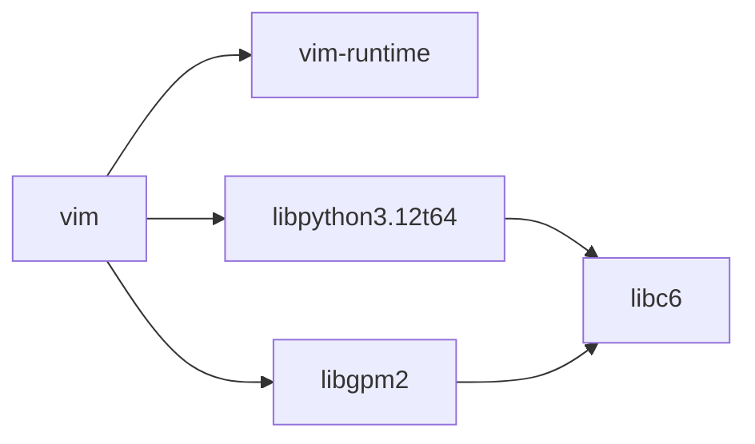
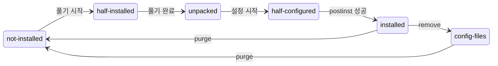
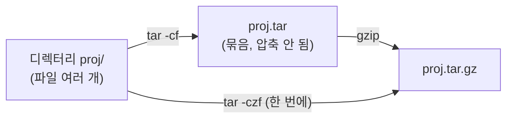

# 9장 — 소프트웨어 관리

[레포지토리 안내](../../README.ko.md) | [English](Concepts_Lecture.md) | [한국어](Concepts_Lecture.ko.md)

> **최종 수정일:** 2026-11-27

> **학습 목표:**
> 1. 패키지와 의존성의 개념을 설명하고 패키지 파일의 이름과 상태 표시를 해석할 수 있다
> 2. `dpkg`와 `apt`의 역할을 구분하고 저장소 설정 파일의 구성을 설명할 수 있다
> 3. `apt`로 패키지를 검색, 설치, 갱신, 삭제하고 `remove`, `purge`, `autoremove`의 차이를 설명할 수 있다
> 4. 소스 코드에서 프로그램을 설치하는 과정과 패키지를 쓰는 편이 나은 이유를 설명할 수 있다
> 5. `tar`로 아카이브를 만들고 풀며, 압축 방식의 압축률과 속도를 비교하여 고를 수 있다
> 6. 버전 비교 규칙, 저장소의 우선순위와 서명으로 `apt`가 설치할 판을 정하는 과정을 설명할 수 있다

---

## 목차

- [1. 패키지와 의존성](#1-패키지와-의존성)
  - [1.1 패키지의 구성](#11-패키지의-구성)
  - [1.2 의존성](#12-의존성)
  - [1.3 패키지 파일의 이름](#13-패키지-파일의-이름)
  - [1.4 제어 정보와 관계 필드](#14-제어-정보와-관계-필드)
  - [1.5 버전 번호의 구조와 비교](#15-버전-번호의-구조와-비교)
  - [1.6 .deb 파일의 내부](#16-deb-파일의-내부)
- [2. dpkg와 apt](#2-dpkg와-apt)
  - [2.1 두 도구의 역할](#21-두-도구의-역할)
  - [2.2 dpkg로 설치된 패키지 조사하기](#22-dpkg로-설치된-패키지-조사하기)
  - [2.3 저장소와 sources 파일](#23-저장소와-sources-파일)
  - [2.4 apt의 주요 명령](#24-apt의-주요-명령)
  - [2.5 remove, purge, autoremove의 차이](#25-remove-purge-autoremove의-차이)
  - [2.6 흔한 오류와 해결](#26-흔한-오류와-해결)
  - [2.7 스냅 패키지](#27-스냅-패키지)
  - [2.8 dpkg 데이터베이스와 패키지 상태](#28-dpkg-데이터베이스와-패키지-상태)
  - [2.9 apt, apt-get, apt-cache와 갱신 명령](#29-apt-apt-get-apt-cache와-갱신-명령)
  - [2.10 설치할 판의 선택: 우선순위와 고정](#210-설치할-판의-선택-우선순위와-고정)
  - [2.11 저장소의 서명과 신뢰의 사슬](#211-저장소의-서명과-신뢰의-사슬)
  - [2.12 외부 저장소와 PPA](#212-외부-저장소와-ppa)
- [3. 소스 코드로 설치하기](#3-소스-코드로-설치하기)
  - [3.1 configure, make, make install](#31-configure-make-make-install)
  - [3.2 패키지를 쓰는 편이 나은 이유](#32-패키지를-쓰는-편이-나은-이유)
  - [3.3 설치 위치와 DESTDIR, 직접 만든 패키지](#33-설치-위치와-destdir-직접-만든-패키지)
- [4. 파일 아카이브와 압축](#4-파일-아카이브와-압축)
  - [4.1 아카이브와 압축의 구분](#41-아카이브와-압축의-구분)
  - [4.2 tar의 사용법](#42-tar의-사용법)
  - [4.3 gzip, bzip2, xz, zip](#43-gzip-bzip2-xz-zip)
  - [4.4 압축 방식의 비교와 선택](#44-압축-방식의-비교와-선택)
  - [4.5 tar의 함정과 안전한 사용](#45-tar의-함정과-안전한-사용)
  - [4.6 압축의 원리](#46-압축의-원리)
- [개념 적용](#개념-적용)
- [요약](#요약)
- [점검 문제](#점검-문제)
- [참고 문헌](#참고-문헌)

---

<br>

## 1. 패키지와 의존성

### 1.1 패키지의 구성

> **용어 정의:** **패키지(package)** 는 프로그램을 설치하는 데 필요한 파일과, 그 파일을 어디에 어떻게 설치할지에 관한 정보를 하나로 묶은 설치 단위이다.

Debian 계열(1주차 4.3절)의 패키지 파일은 확장자가 `.deb`이며, 안에 세 가지가 들어 있다.

| 구성 요소 | 내용 |
|:-----|:-----|
| 데이터 | 설치될 파일들과 그 경로 (`/usr/bin/프로그램`, `/usr/share/man/...`, `/etc/설정 파일`) |
| 제어 정보 | 패키지 이름, 버전, 아키텍처, 설명, 의존하는 다른 패키지의 목록 |
| 관리자 스크립트 | 설치 전후와 삭제 전후에 실행할 스크립트 (사용자 계정 만들기, 서비스 시작 등) |

*표 1. .deb 패키지의 구성 요소*

패키지 관리 시스템은 설치한 패키지와 각 패키지가 설치한 파일의 목록을 데이터베이스(`/var/lib/dpkg/`)에 기록한다. 그래서 어떤 파일이 어느 패키지에서 왔는지, 패키지를 지울 때 어떤 파일을 지워야 하는지를 정확히 알 수 있다. 소스 코드로 직접 설치한 프로그램(3절)에는 이런 기록이 없다.

`/etc` 아래의 설정 파일은 **conffile**로 따로 표시된다. 관리자가 고쳤을 수 있는 파일이므로, 패키지를 갱신하거나 지울 때 덮어쓰거나 지우지 않고 남겨 두는 것이 기본이다(2.5절).

### 1.2 의존성

대부분의 프로그램은 다른 프로그램이나 라이브러리가 있어야 동작한다. 패키지 A가 패키지 B를 필요로 하는 관계를 **의존성(dependency)** 이라 하며, A의 제어 정보에 `Depends: B`로 적힌다. 의존성은 여러 단계로 이어지므로, 프로그램 하나를 설치하려면 그 의존성의 의존성까지 모두 설치해야 한다.



*그림 1. 패키지 의존성의 예 (일부)*

의존성을 손으로 하나씩 찾아 설치하는 것은 매우 번거롭고, 필요한 버전이 서로 충돌하면 해결하기도 어렵다. 2절의 `apt`는 저장소의 정보로 필요한 패키지를 모두 계산하여 한 번에 설치한다. 의존성의 종류에는 반드시 있어야 하는 `Depends` 말고도 함께 설치하기를 권하는 `Recommends`, 있으면 좋은 `Suggests`, 함께 설치할 수 없는 `Conflicts` 등이 있으며, `apt`는 기본적으로 `Depends`와 `Recommends`를 함께 설치한다. 각 필드의 정확한 뜻과 문법은 1.4절에서 다룬다.

### 1.3 패키지 파일의 이름

`.deb` 파일의 이름은 `패키지이름_버전_아키텍처.deb` 형식이다. 예를 들어 `mytool_1.4.2-1ubuntu1_amd64.deb`는 다음과 같이 읽는다.

```text
mytool _ 1.4.2 - 1ubuntu1 _ amd64 .deb
  │       │        │          └─ architecture: amd64 (x86-64), arm64, all (architecture-independent)
  │       │        └──────────── the distribution's package revision (Debian 1, Ubuntu revision 1)
  │       └───────────────────── the upstream version
  └───────────────────────────── package name
```

*그림 2. .deb 패키지 파일 이름의 구성*

같은 원저작자 버전이라도 배포판이 패치를 더하면 수정 번호가 올라간다. 1주차 5.3절의 커널 버전처럼, Ubuntu 패키지의 버전은 원저작자의 최신 버전보다 낮아 보여도 보안 수정이 반영되어 있을 수 있다.

### 1.4 제어 정보와 관계 필드

패키지의 제어 정보는 `필드: 값` 형식의 줄로 이루어진 텍스트이고, 저장소의 색인(2.3절)에도 같은 형식의 항목이 패키지마다 하나씩 들어 있다 [1]. 다음은 Ubuntu 24.04 저장소의 `noble/main` 색인에 있는 `openssh-server` 항목에서 몇 줄과 `Depends`의 뒷부분을 줄인 것이다 [2].

```text
Package: openssh-server
Architecture: amd64
Version: 1:9.6p1-3ubuntu13
Section: net
Source: openssh
Installed-Size: 2101
Provides: ssh-server
Pre-Depends: init-system-helpers (>= 1.54~)
Depends: adduser, libpam-modules, libpam-runtime, lsb-base, openssh-client (= 1:9.6p1-3ubuntu13), openssh-sftp-server, procps, ucf, debconf (>= 0.5) | debconf-2.0, libaudit1 (>= 1:2.2.1), libc6 (>= 2.38), ...
Recommends: default-logind | logind | libpam-systemd, ncurses-term, xauth, ssh-import-id
Suggests: molly-guard, monkeysphere, ssh-askpass, ufw
Conflicts: sftp, ssh-socks, ssh2
Replaces: openssh-client (<< 1:7.9p1-8), ssh, ssh-krb5
Filename: pool/main/o/openssh/openssh-server_9.6p1-3ubuntu13_amd64.deb
Size: 509904
SHA256: 6fe2467aff7aa8ed1cbe91a3521df69a41b90122143392f94037d4225a7098cb
Description: secure shell (SSH) server, for secure access from remote machines
```

앞의 줄들은 패키지를 알아보는 정보이다. `Version`은 1.5절의 형식을 따르고, `Source`는 이 바이너리 패키지를 만든 소스 패키지(`openssh`)이며, `Installed-Size`는 설치한 파일이 차지할 대략의 크기를 KiB 단위로 적은 값이다 [1]. `Filename`, `Size`, `SHA256`은 저장소의 색인에 붙는 필드로, 내려받을 `.deb` 파일의 위치, 바이트 단위의 크기, 해시이다(2.11절). 그 사이의 `Provides`부터 `Replaces`까지가 다른 패키지와의 관계를 나타내는 **관계 필드**이다.

| 필드 | 뜻 | 패키지 관리자의 처리 |
|:-----|:-----|:-----|
| `Pre-Depends` | 이 패키지를 풀기 전에 설치와 설정이 끝나 있어야 하는 패키지 | 먼저 설치하고 설정까지 마침 |
| `Depends` | 동작에 반드시 필요한 패키지 | 없으면 설치를 허용하지 않음 |
| `Recommends` | 특별한 설치가 아니면 함께 쓰는 패키지 | `apt`는 기본으로 함께 설치 |
| `Suggests` | 있으면 쓸모가 커지는 패키지 | 설치하지 않음 |
| `Breaks` | 함께 있으면 버그가 드러나는 다른 패키지의 판 | 나열된 패키지는 새 판으로 갱신되기 전까지 설정하지 않음 |
| `Conflicts` | 같은 이름의 파일을 갖는 것처럼 동시에 설치할 수 없는 패키지 | 한쪽을 지워야 다른 쪽을 설치 |
| `Replaces` | 이 패키지가 파일을 덮어써도 되는 패키지 | 두 패키지의 파일이 겹쳐도 오류로 보지 않음 |
| `Provides` | 이 패키지가 대신하는 가상 패키지의 이름 | 그 이름에 대한 의존성을 이 패키지로 만족 |

*표 2. 관계 필드의 종류*

`Depends` 같은 필드의 값은 쉼표로 나눈 묶음의 목록이고, 한 묶음 안에서는 `|`로 대안을 나열한다. 쉼표는 "그리고", `|`는 "또는"으로 읽으며 `|`가 쉼표보다 강하게 묶는다. 패키지 이름 뒤의 괄호에는 버전 조건을 쓰며, 연산자는 `<<`(미만), `<=`, `=`, `>=`, `>>`(초과)이다 [1]. 위 항목을 이 규칙으로 읽으면 다음과 같다.

- `openssh-client (= 1:9.6p1-3ubuntu13)`: 클라이언트 패키지가 정확히 같은 판이어야 한다. 그래서 서버만 따로 갱신할 수 없고, 두 패키지는 언제나 함께 갱신된다.
- `debconf (>= 0.5) | debconf-2.0`: 판 0.5 이상의 `debconf`가 있거나, `debconf-2.0`이라는 이름을 제공하는 다른 패키지가 있으면 만족된다.
- `Recommends`의 첫 묶음은 세 패키지 가운데 하나를, 나머지 묶음은 각각을 권한다. `apt`는 이것들도 기본으로 설치하므로, 반드시 필요한 의존성만 설치하려면 `apt-get install --no-install-recommends`를 쓴다 [3].
- `Replaces: openssh-client (<< 1:7.9p1-8)`: 판 `1:7.9p1-8`보다 낮은 클라이언트 패키지가 갖고 있던 파일을 이 패키지가 넘겨받았다는 뜻이다. 파일이 한 패키지에서 다른 패키지로 옮겨 간 경우에 쓴다.
- `Provides: ssh-server`: 이 패키지를 설치하면 `ssh-server`에 의존하는 패키지의 의존성이 만족된다.

> **용어 정의:** **가상 패키지(virtual package)** 는 그 이름의 `.deb` 파일은 없고, 같은 기능을 하는 여러 패키지가 `Provides`로 함께 내세우는 이름이다. `sendmail`과 `exim`이 모두 `mail-transport-agent`를 제공하듯이, 다른 패키지는 이 이름에 의존하여 구현 가운데 어느 것이 설치되어 있어도 동작할 수 있다 [1].

`Breaks`와 `Conflicts`의 값에서는 쉼표를 "또는"으로 읽는다. 나열한 패키지 가운데 어느 하나라도 설치되어 있으면 관계가 성립하기 때문이다 [1]. 두 필드는 막는 정도가 다르다. `Conflicts`는 두 패키지가 동시에 설치되는 것을 막지만, `Breaks`는 두 패키지가 함께 풀려 있는 것은 허용하고, 나열된 패키지(깨지는 쪽)가 새 판으로 갱신되기 전까지 그 패키지의 설정만 막는다 [1].

### 1.5 버전 번호의 구조와 비교

패키지의 버전은 `[에포크:]원저작자버전[-수정번호]`의 세 부분으로 이루어진다 [4]. 1.3절의 파일 이름에는 뒤의 두 부분만 보였지만, 비교에는 세 부분이 모두 쓰인다.

- **에포크(epoch)** 는 작은 정수이며, 생략하면 0으로 본다. 원저작자가 번호 체계를 바꾸어 새 판의 번호가 옛 판보다 작아 보이게 되었을 때 그 문제를 넘기려고 붙인다. 1.4절의 `openssh-server`는 판이 `1:9.6p1-3ubuntu13`으로 에포크가 1이지만, `Filename`의 파일 이름 `openssh-server_9.6p1-3ubuntu13_amd64.deb`에는 에포크가 나타나지 않는다.
- 원저작자 버전은 반드시 있어야 하며, 숫자로 시작하는 것이 관례이다.
- 수정 번호는 문자열의 **마지막** `-` 뒤의 부분이다. 그래서 원저작자 버전 안에도 `-`가 들어갈 수 있다. 수정 번호가 없는 판은 수정 번호가 있는 판보다 앞선다.

두 판은 에포크를 수로 먼저 비교하고, 같으면 원저작자 버전을, 그것도 같으면 수정 번호를 같은 방법으로 비교한다. 그 방법은 문자열의 왼쪽부터 다음 두 단계를 번갈아 되풀이하는 것이다 [4].

1. 맨 앞의 숫자가 아닌 문자들을 떼어 사전 순서로 비교한다. 이때 글자는 글자가 아닌 문자보다 앞서고, `~`는 모든 것보다, 부분의 끝보다도 앞선다. 따라서 `~~`, `~~a`, `~`, 빈 부분, `a`의 순서가 된다.
2. 이어지는 숫자들을 떼어 수로 비교한다. 숫자가 없으면 0으로 본다.

`1:9.6p1-3ubuntu13.20`과 `1:9.6p1-3ubuntu13`을 비교하는 과정은 다음과 같다.

| 단계 | 왼쪽 | 오른쪽 | 결과 |
|:-----|:-----|:-----|:-----|
| 에포크 (수) | 1 | 1 | 같음 |
| 원저작자 버전 | `9.6p1` | `9.6p1` | 같음 |
| 수정 번호: 숫자 | 3 | 3 | 같음 |
| 수정 번호: 숫자가 아닌 부분 | `ubuntu` | `ubuntu` | 같음 |
| 수정 번호: 숫자 | 13 | 13 | 같음 |
| 수정 번호: 숫자가 아닌 부분 | `.` | (끝) | `.`은 글자가 아니므로 끝보다 뒤 |

*표 3. 두 버전을 비교하는 과정*

따라서 `1:9.6p1-3ubuntu13.20`이 더 새로운 판이다. 이 판은 `noble-updates`와 `noble-security`에 올라온 수정판이고, `1:9.6p1-3ubuntu13`은 출시 때의 `noble`에 있는 판이다 [2]. 같은 규칙으로 판정한 예는 다음과 같다.

| 비교 | 더 새로운 판 | 결정한 단계 |
|:-----|:-----|:-----|
| `1.2.10-1`과 `1.2.9-1` | `1.2.10-1` | 숫자 10과 9를 수로 비교 (문자열로 비교하면 반대) |
| `1.0~rc1-1`과 `1.0-1` | `1.0-1` | `~`는 끝보다 앞서므로 출시 전 판에 쓰임 |
| `1.0+dfsg-1`과 `1.0-1` | `1.0+dfsg-1` | `+`는 글자가 아니므로 끝보다 뒤 |
| `1:0.9-1`과 `2.0-1` | `1:0.9-1` | 에포크 1과 0 |
| `1.4.2-1ubuntu1`과 `1.4.2-1` | `1.4.2-1ubuntu1` | 글자 `u`가 수정 번호의 끝보다 뒤 |
| `2.1.1-2build1`과 `2.1.1-2ubuntu3` | `2.1.1-2ubuntu3` | 글자 `b`가 `u`보다 앞 |

*표 4. 버전 비교의 예*

다섯째 줄의 규칙 때문에 Ubuntu가 Debian의 패키지에 패치를 더한 판(`-1ubuntu1`)은 바탕이 된 Debian 판(`-1`)보다 새로운 판으로 취급된다. Ubuntu에서는 `dpkg --compare-versions 1.0~rc1-1 lt 1.0-1`처럼 두 판을 직접 비교할 수 있으며, 조건이 성립하면 종료 상태 0을 돌려준다 [5].

> **주의:** 버전은 문자열로 비교하지 않는다. 사전 순서로는 `1.2.10`이 `1.2.9`보다 앞에 오지만 패키지 관리자는 반대로 판정한다. 또 `apt install 패키지=버전`으로 판을 지정할 때는 `openssh-server=1:9.6p1-3ubuntu13.20`처럼 에포크까지 포함한 전체 문자열을 쓴다.

### 1.6 .deb 파일의 내부

`.deb` 파일은 `ar` 형식의 아카이브이며, 정해진 순서의 세 멤버를 담는다 [6]. 첫째 `debian-binary`는 형식의 판(현재 `2.0`)을 적은 한 줄짜리 파일이고, 둘째 `control.tar`는 제어 정보 영역, 셋째 `data.tar`는 설치될 파일들이다. 뒤의 두 멤버는 압축되지 않거나 gzip, xz, zstd 등으로 압축되며, 확장자가 그 방식을 나타낸다. 1.4절의 `openssh-server` 패키지를 열어 보면 다음과 같다.

```text
$ ar t openssh-server_9.6p1-3ubuntu13_amd64.deb
debian-binary
control.tar.zst
data.tar.zst
$ ar x openssh-server_9.6p1-3ubuntu13_amd64.deb
$ cat debian-binary
2.0
$ zstd -dc control.tar.zst | tar -tf -
./
./conffiles
./config
./control
./md5sums
./postinst
./postrm
./preinst
./prerm
./templates
$ zstd -dc control.tar.zst | tar -xOf - ./conffiles
/etc/default/ssh
/etc/init.d/ssh
/etc/pam.d/sshd
/etc/ssh/moduli
/etc/ufw/applications.d/openssh-server
$ zstd -dc data.tar.zst | tar -tf - | grep -E 'sbin/sshd$|sshd_config'
./etc/ssh/sshd_config.d/
./usr/sbin/sshd
./usr/share/man/man5/sshd_config.5.gz
./usr/share/openssh/sshd_config
./usr/share/openssh/sshd_config.md5sum
```

| 제어 영역의 파일 | 내용 |
|:-----|:-----|
| `control` | 1.4절의 제어 정보 (반드시 있음) |
| `conffiles` | conffile로 다룰 파일의 목록 (1.1절) |
| `md5sums` | 설치될 파일마다의 MD5 해시 |
| `preinst`, `postinst` | 풀기 전과 설정할 때 실행하는 관리자 스크립트 |
| `prerm`, `postrm` | 지우기 전과 지운 뒤에 실행하는 관리자 스크립트 |
| `config`, `templates` | 설치 중에 관리자에게 질문할 때 쓰는 debconf의 스크립트와 문구 |

*표 5. 제어 영역에 들어 있는 파일*

`data.tar`의 이름은 `./usr/sbin/sshd`처럼 `./`로 시작하므로, `dpkg`는 이를 루트 디렉터리 아래에 풀어 `/usr/sbin/sshd`를 만든다. 이 패키지의 `conffiles`에 `/etc/ssh/sshd_config`가 없다는 점에 주의할 필요가 있다. 그 파일은 `data.tar`에 들어 있지 않고, `postinst`가 `/usr/share/openssh/sshd_config`를 복사하여 만든 뒤 `ucf`라는 별도의 도구로 관리한다. 같은 `postinst`가 호스트 키가 없으면 `ssh-keygen`으로 만든다(12장 2.2절). 즉 `/etc` 아래의 파일이라도 패키지의 파일 목록에 없고 스크립트가 만드는 파일이 있다.

`dpkg -i`가 패키지를 설치하는 단계는 다음과 같으며, 관리자 스크립트가 실행되는 시점을 보여 준다 [5].

1. 새 패키지의 제어 영역을 꺼낸다.
2. 같은 패키지의 옛 판이 설치되어 있으면 옛 판의 `prerm`을 실행한다.
3. 새 판의 `preinst`를 실행한다.
4. 새 파일을 풀면서 옛 파일을 백업하여, 실패하면 되돌릴 수 있게 한다.
5. 옛 판이 있었으면 옛 판의 `postrm`을 실행한다.
6. 패키지를 설정한다. conffile을 풀고 `postinst`를 실행하는 단계이다.

---

<br>

## 2. dpkg와 apt

### 2.1 두 도구의 역할

| 구분 | `dpkg` | `apt` |
|:-----|:-----|:-----|
| 다루는 대상 | 이미 받은 `.deb` 파일 | 저장소의 패키지 이름 |
| 의존성 | 검사만 하고 해결하지 않음 | 필요한 패키지를 계산하여 함께 설치 |
| 다운로드 | 하지 않음 | 저장소에서 내려받음 |
| 주된 용도 | 설치된 패키지의 조사, 개별 `.deb` 설치 | 일상적인 설치, 갱신, 삭제 |

*표 6. dpkg와 apt의 비교*

`apt`는 내부적으로 `dpkg`를 불러 실제 설치를 맡긴다. 즉 `dpkg`가 낮은 수준의 설치기이고, `apt`는 그 위에서 저장소와 의존성을 다루는 높은 수준의 도구이다. `apt`는 사람이 대화형으로 쓰기 위한 명령이어서 출력 형식이 판마다 바뀔 수 있으므로, 스크립트에서는 같은 기능을 하는 `apt-get`과 `apt-cache`를 쓰는 것이 권장된다 [7].

### 2.2 dpkg로 설치된 패키지 조사하기

`dpkg`의 주요 옵션은 다음과 같다 [5].

| 옵션 | 기능 |
|:-----|:-----|
| `-i 파일.deb` | `.deb` 파일을 설치 |
| `-r 패키지` | 패키지를 삭제하되 conffile은 남김 |
| `-P 패키지` | conffile까지 모두 삭제(purge) |
| `-l [패턴]` | 패키지 목록과 상태 |
| `-L 패키지` | 그 패키지가 설치한 파일의 목록 |
| `-S 파일 경로` | 그 파일을 설치한 패키지 찾기 |
| `-s 패키지` | 패키지의 상태와 정보 |

*표 7. dpkg의 주요 옵션*

```text
$ dpkg -S /usr/bin/sort
coreutils: /usr/bin/sort
$ dpkg -L coreutils | grep 'bin/sort$'
/usr/bin/sort
```

`dpkg -l`의 각 줄 앞의 두 글자는 패키지의 상태이다. 첫 글자는 관리자가 원하는 상태(`i` 설치, `r` 삭제, `p` 완전 삭제), 둘째 글자는 실제 상태(`i` 설치됨, `c` 설정 파일만 남음, `n` 설치되지 않음)이다. 따라서 `ii`는 정상적으로 설치된 패키지이고, `rc`는 삭제했지만 설정 파일이 남아 있는 패키지이다. 상태의 전체 목록과 셋째 글자는 2.8절에서 다룬다.

### 2.3 저장소와 sources 파일

**저장소(repository)** 는 패키지 파일과 그 목록(색인)을 모아 둔 서버이다. `apt`가 어느 저장소를 쓸지는 `/etc/apt/sources.list.d/` 아래의 파일이 정한다. Ubuntu 24.04는 여러 줄로 된 deb822 형식의 `ubuntu.sources`를 쓴다 [8].

```text
Types: deb
URIs: http://kr.archive.ubuntu.com/ubuntu/
Suites: noble noble-updates noble-backports
Components: main restricted universe multiverse
Signed-By: /usr/share/keyrings/ubuntu-archive-keyring.gpg

Types: deb
URIs: http://security.ubuntu.com/ubuntu/
Suites: noble-security
Components: main restricted universe multiverse
Signed-By: /usr/share/keyrings/ubuntu-archive-keyring.gpg
```

| 필드 | 뜻 |
|:-----|:-----|
| `Types` | `deb`는 실행 패키지, `deb-src`는 소스 패키지 |
| `URIs` | 저장소 서버의 주소 (`kr.archive`는 한국의 미러 서버) |
| `Suites` | 배포판 코드명(1주차 4.4절)과 갈래. `noble`은 출시 때의 패키지, `-updates`는 버그 수정, `-security`는 보안 수정, `-backports`는 새 판의 기능을 옮겨 온 패키지 |
| `Components` | 저장소 안의 구역. `main`은 Canonical이 지원하는 자유 소프트웨어, `restricted`는 장치 드라이버와 코덱 같은 비공개 소프트웨어, `universe`는 커뮤니티가 관리하는 자유 소프트웨어, `multiverse`는 오픈 소스의 요건을 모두 갖추지 못한 소프트웨어 [9] |
| `Signed-By` | 저장소의 서명을 검사할 공개 키 |

*표 8. deb822 형식 저장소 항목의 필드*

`apt`는 저장소의 색인에 붙은 전자 서명을 `Signed-By`의 키로 검사하여, 중간에서 바뀐 패키지 목록을 받아들이지 않는다. 예전 형식의 한 줄짜리 `/etc/apt/sources.list`(`deb http://... noble main restricted`)도 계속 읽는다 [10].

### 2.4 apt의 주요 명령

| 명령 | 동작 |
|:-----|:-----|
| `apt update` | 설정된 모든 저장소에서 패키지 정보(색인)를 내려받음. 패키지 자체는 바꾸지 않음 |
| `apt upgrade` | 설치된 패키지를 새 판으로 갱신. 필요하면 새 패키지를 설치하지만 기존 패키지는 지우지 않음 |
| `apt full-upgrade` | `upgrade`와 같되, 시스템 전체를 갱신하는 데 필요하면 기존 패키지도 지움 |
| `apt install 패키지` | 패키지와 그 의존성을 설치. 이미 있으면 새 판으로 갱신 |
| `apt remove 패키지` | 패키지를 삭제하되 설정 파일은 남김 |
| `apt purge 패키지` | 설정 파일까지 삭제 |
| `apt autoremove` | 의존성 때문에 자동으로 설치되었지만 이제 필요 없는 패키지를 삭제 |
| `apt search 정규식` | 패키지 이름과 설명에서 검색 |
| `apt show 패키지` | 의존성, 크기, 설명 같은 상세 정보 |
| `apt list --installed` | 설치된 패키지의 목록 |

*표 9. apt의 주요 명령*

`update`와 `upgrade`는 이름이 비슷하지만 하는 일이 다르다. `update`는 "무엇이 새로 나왔는지"의 목록만 갱신하고, `upgrade`가 그 목록에 따라 실제 패키지를 갱신한다. 그래서 갱신은 언제나 `sudo apt update && sudo apt upgrade`의 순서로 실행한다. 패키지를 설치하는 과정은 다음과 같다(출력 예, 일부 줄 생략).

```text
$ sudo apt update
Hit:1 http://kr.archive.ubuntu.com/ubuntu noble InRelease
Get:2 http://security.ubuntu.com/ubuntu noble-security InRelease [126 kB]
...
Reading package lists... Done
12 packages can be upgraded. Run 'apt list --upgradable' to see them.
$ apt search '^tree$'
tree/noble 2.1.1-2ubuntu3 amd64
  displays an indented directory tree, in color
$ sudo apt install tree
...
The following NEW packages will be installed:
  tree
...
Setting up tree (2.1.1-2ubuntu3) ...
$ tree --noreport proj
proj
├── README
└── src
    └── main.c
```

`Hit`은 색인이 바뀌지 않았다는 뜻이고 `Get`은 새 색인을 받았다는 뜻이다. `apt search`의 인자는 정규 표현식이므로 `'^tree$'`처럼 감싸면 이름이 정확히 `tree`인 패키지만 찾는다.

### 2.5 remove, purge, autoremove의 차이

`apt`는 사용자가 직접 설치를 요청한 패키지(수동 설치)와 의존성 때문에 함께 설치된 패키지(자동 설치)를 구분하여 기록한다. 이 구분이 세 삭제 명령의 차이를 만든다. 패키지 A가 B에 의존하고, 사용자가 A만 설치를 요청했다고 하자.

| 단계 | A의 상태 | B의 상태 | 남은 것 |
|:-----|:-----|:-----|:-----|
| `apt install A` | 수동 설치 (`ii`) | 자동 설치 (`ii`) | |
| `apt remove A` | 삭제, 설정 파일 남음 (`rc`) | 그대로 설치됨 (`ii`) | A의 conffile, B 전체 |
| `apt autoremove` | `rc` 그대로 | 이제 필요 없으므로 삭제 | A의 conffile, B의 conffile |
| `apt purge A` | 완전 삭제 | | B의 conffile |

*표 10. A가 B에 의존할 때 삭제 명령에 따른 상태 변화*

- `remove`는 설정 파일을 남기므로 나중에 다시 설치하면 이전 설정이 그대로 쓰인다. 설정을 처음부터 다시 하고 싶으면 `purge`를 쓴다.
- 자동 설치된 B는 A를 지워도 남는다. 다른 패키지가 B를 쓰지 않으면 `autoremove`가 지운다. `apt autoremove --purge`는 이때 설정 파일까지 지운다.
- 수동, 자동 표시는 `apt-mark showmanual`, `apt-mark showauto`로 보고, `apt-mark manual B`로 바꿀 수 있다. 사용자가 직접 쓰는 패키지가 자동으로 표시되어 있으면 `autoremove`가 지워 버리므로, `autoremove`가 지울 목록은 실행 전에 반드시 확인한다 [7].

### 2.6 흔한 오류와 해결

| 증상 | 원인 | 해결 |
|:-----|:-----|:-----|
| `E: Unable to locate package 이름` | 색인이 오래되었거나 이름이 틀림, 해당 구역(`universe` 등)이 꺼져 있음 | `sudo apt update` 뒤 `apt search`로 정확한 이름 확인 |
| `dpkg -i`로 설치한 뒤 `dependency problems` | `dpkg`는 의존성을 해결하지 않음 | `sudo apt -f install`로 빠진 의존성을 설치, 처음부터 `sudo apt install ./파일.deb`로 설치 |
| `Could not get lock /var/lib/dpkg/lock-frontend` | 자동 업데이트 등 다른 패키지 작업이 실행 중 | 그 작업이 끝날 때까지 기다림 (잠금 파일을 지우지 않음) |
| 내려받기 중 `404 Not Found` | 색인이 서버의 실제 파일과 맞지 않음 | `sudo apt update` 뒤 다시 실행 |
| `E: dpkg was interrupted, ...` | 설치 도중 작업이 끊겨 패키지가 `unpacked`나 `half-configured` 상태로 남음 (2.8절) | `sudo dpkg --configure -a`로 남은 설정을 마친 뒤 다시 실행 |
| `update`가 `NO_PUBKEY`를 내고 그 저장소를 쓰지 않음 | 저장소의 서명을 검사할 공개 키가 없거나 `Signed-By`의 경로가 틀림 (2.11절) | 저장소가 배포하는 키를 받아 `Signed-By`에 적은 경로에 둠 |
| `The following packages have been kept back:` | 새 판이 새 패키지의 설치나 기존 패키지의 삭제를 요구하여 갱신이 보류됨 (2.9절) | 보류된 이유를 확인한 뒤 `apt full-upgrade`나 `apt install 패키지` |
| 특정 패키지만 갱신되지 않음 | 그 패키지가 보류(hold)로 표시됨 (2.10절) | `apt-mark showhold`로 확인, `sudo apt-mark unhold 패키지` |

*표 11. 패키지 관리의 흔한 오류*

`sudo apt install ./파일.deb`처럼 경로(`./`)를 붙이면 `apt`가 그 파일을 설치하면서 의존성도 저장소에서 해결한다. 경로 없이 이름만 쓰면 `apt`는 저장소의 패키지 이름으로 해석한다.

### 2.7 스냅 패키지

Ubuntu는 `.deb` 말고도 Canonical이 만든 **스냅(snap)** 패키지를 함께 쓴다. 스냅은 프로그램과 그 프로그램이 쓰는 라이브러리를 모두 한 파일에 담으므로 배포판의 판과 관계없이 같은 패키지가 설치되고, 시스템의 다른 부분과 격리된 환경에서 실행된다. 스냅은 `snapd` 데몬이 관리하며, 설치한 스냅은 압축된 파일 시스템 이미지 그대로 `/snap/이름/리비전` 아래에 읽기 전용으로 마운트된다.

| 명령 | 동작 |
|:-----|:-----|
| `snap find 이름` | 스토어에서 스냅을 검색 |
| `sudo snap install 이름` | 스냅을 설치 |
| `snap list` | 설치된 스냅과 그 판, 리비전을 출력 |
| `sudo snap refresh` | 설치된 스냅을 새 리비전으로 갱신 |
| `sudo snap revert 이름` | 직전 리비전으로 되돌림 |
| `sudo snap remove 이름` | 스냅을 삭제 |

*표 12. snap의 주요 명령*

`.deb` 패키지는 관리자가 `apt upgrade`를 실행해야 갱신되지만, 스냅은 `snapd`가 기본적으로 하루에 네 번 새 리비전을 확인하여 자동으로 갱신한다 [11]. 이전 리비전을 함께 보관하므로 갱신한 뒤 문제가 생기면 `snap revert`로 되돌릴 수 있고, 특정 스냅의 자동 갱신은 `snap refresh --hold 이름`으로 미룰 수 있다 [11]. 의존성을 모두 담으므로 같은 프로그램의 `.deb`보다 크고 처음 실행할 때 느릴 수 있으며, 같은 프로그램을 `.deb`와 스냅으로 모두 설치하면 서로 다른 두 사본이 생긴다.

> **참고:** **Flatpak.** 스냅과 비슷한 목적의 도구로 Flatpak이 있다. 응용 프로그램을 배포판과 독립적으로 만들어 배포하고, 실행할 때 호스트 시스템과 어느 정도 격리한다는 점은 같지만, 여러 응용 프로그램이 함께 쓰는 라이브러리 묶음을 **런타임(runtime)** 으로 따로 설치하여 공유한다 [12]. 시스템 전체에 설치한 것과 사용자별로 `~/.local/share/flatpak/`에 설치한 것을 따로 관리하며, `flatpak remote-add`로 저장소를 등록한 뒤 `flatpak install`로 설치한다 [12]. Ubuntu 24.04에서는 저장소의 `flatpak` 패키지를 `apt`로 설치하여 쓴다 [13].

### 2.8 dpkg 데이터베이스와 패키지 상태

`dpkg`는 패키지마다의 상태와 파일 목록을 `/var/lib/dpkg/` 아래에 기록한다(1.1절). 주요 파일은 다음과 같다.

| 경로 | 내용 |
|:-----|:-----|
| `/var/lib/dpkg/status` | 설치된 적이 있는 패키지마다의 제어 정보와 `Status:` 줄 |
| `/var/lib/dpkg/info/패키지.list` | 그 패키지가 설치한 파일과 디렉터리의 목록 (`dpkg -L`, `dpkg -S`가 읽음) |
| `/var/lib/dpkg/info/패키지.md5sums`, `패키지.conffiles` | `.deb`의 `md5sums`, `conffiles`를 옮겨 둔 것 |
| `/var/lib/dpkg/info/패키지.prerm` 등 | 관리자 스크립트 (나중에 지울 때 실행하려고 보관) |
| `/var/log/dpkg.log` | 설치와 삭제의 기록 [14] |

*표 13. dpkg 데이터베이스의 주요 파일*

`dpkg -l`의 줄 앞에는 최대 세 글자가 붙는다. 첫 글자는 원하는 상태(`i` 설치, `r` 삭제, `h` 보류 등), 둘째 글자는 실제 상태(`i` 설치됨, `c` 설정 파일만 남음, `U` 풀림 등), 셋째 글자는 오류 표시이며, 상태나 오류의 글자가 대문자이면 심각한 문제가 있을 가능성이 크다는 뜻이다 [15]. 흔히 보는 `ii`는 정상적으로 설치된 패키지, `rc`는 삭제했지만 설정 파일이 남은 패키지이다. 출력은 다음과 같다(출력 예, Ubuntu 24.04).

```text
$ dpkg -l openssh-server tree
Desired=Unknown/Install/Remove/Purge/Hold
| Status=Not/Inst/Conf-files/Unpacked/halF-conf/Half-inst/trig-aWait/Trig-pend
|/ Err?=(none)/Reinst-required (Status,Err: uppercase=bad)
||/ Name           Version              Architecture Description
+++-==============-====================-============-=================================
ii  openssh-server 1:9.6p1-3ubuntu13.20 amd64        secure shell (SSH) server, for secure access from remote machines
rc  tree           2.1.1-2ubuntu3       amd64        displays an indented directory tree, in color
```

실제 상태는 설치 단계(1.6절)를 따라 바뀐다. 각 상태의 뜻은 `dpkg`의 정의를 따른다 [5].



*그림 3. 패키지의 실제 상태가 바뀌는 과정 (트리거 상태 생략)*

설치가 중간에 끊기면 패키지는 `half-installed`, `unpacked`, `half-configured` 가운데 하나에 머문다. 예를 들어 `postinst`가 실패하면 파일은 모두 풀렸지만 설정이 끝나지 않은 `half-configured`가 된다. 이 상태가 남아 있으면 `apt`가 표 11의 `E: dpkg was interrupted`를 내며 새 작업을 거부할 수 있으므로, 먼저 `sudo dpkg --configure -a`로 풀려 있지만 설정되지 않은 모든 패키지의 설정을 마친다 [5]. `sudo dpkg --audit`는 이런 불완전한 패키지를 찾아 보여 준다 [5].

`dpkg -S`는 설치된 패키지의 `.list` 파일만 찾는다. 그래서 1.6절의 `/etc/ssh/sshd_config`나 호스트 키처럼 관리자 스크립트가 설치 중에 만든 파일은 찾지 못하고 [14], 아직 설치하지 않은 패키지의 파일도 찾지 못한다. 설치하지 않은 패키지까지 찾으려면 저장소의 파일 목록 색인(`Contents`)을 쓰는 `apt-file`을 쓴다 [16]. 다음은 그 예이다(출력 예).

```text
$ sudo apt install apt-file
$ sudo apt-file update
$ apt-file search /usr/include/zlib.h
zlib1g-dev: /usr/include/zlib.h
```

이 예처럼 컴파일 중에 `zlib.h: No such file or directory`가 나면, 그 헤더를 담은 개발용 패키지(`zlib1g-dev`)를 찾아 설치하면 된다(3.1절). `Contents` 색인에는 디렉터리가 없으므로, 찾는 패턴은 파일 이름의 일부여야 한다 [16].

### 2.9 apt, apt-get, apt-cache와 갱신 명령

`apt`는 사람이 대화형으로 쓰기 편하도록 `apt-get`과 `apt-cache`의 자주 쓰는 기능을 모은 명령이다(2.1절) [7]. 대응은 다음과 같다.

| 하는 일 | `apt` | 스크립트에서 쓰는 명령 |
|:-----|:-----|:-----|
| 색인 갱신 | `apt update` | `apt-get update` |
| 설치, 삭제 | `apt install`, `apt remove`, `apt purge` | `apt-get install`, `apt-get remove`, `apt-get purge` |
| 갱신 | `apt upgrade` | `apt-get upgrade --with-new-pkgs` |
| 전체 갱신 | `apt full-upgrade` | `apt-get dist-upgrade` |
| 검색과 정보 | `apt search`, `apt show` | `apt-cache search`, `apt-cache show` |
| 후보 판과 우선순위 | `apt policy` | `apt-cache policy` |
| 의존 관계 조사 | `apt depends 패키지`, `apt rdepends 패키지` | `apt-cache depends 패키지`, `apt-cache rdepends 패키지` |

*표 14. apt와 apt-get, apt-cache의 대응*

세 갱신 명령은 새 판이 다른 패키지의 설치 상태를 바꾸어야 할 때의 처리가 다르다. `apt-get upgrade`는 설치된 패키지를 지우지도, 설치되지 않은 패키지를 새로 설치하지도 않으며, 그래야만 갱신할 수 있는 패키지는 현재 판에 남겨 둔다 [3]. `apt upgrade`는 의존성을 만족하는 데 필요하면 새 패키지를 설치하지만 기존 패키지는 지우지 않는다 [7]. `apt full-upgrade`(`apt-get dist-upgrade`와 같음)는 시스템 전체를 갱신하는 데 필요하면 기존 패키지도 지운다 [7]. 설치된 패키지 A와 B에 새 판이 나왔고, A의 새 판은 새 패키지 C에 의존하며, B의 새 판은 설치된 패키지 D와 충돌한다고 하자.

| 명령 | A | B | 바뀌는 것 |
|:-----|:-----|:-----|:-----|
| `apt-get upgrade` | 보류 | 보류 | 없음 ("kept back"으로 표시) |
| `apt upgrade` | 갱신 | 보류 | C 설치 |
| `apt full-upgrade` | 갱신 | 갱신 | C 설치, D 삭제 |

*표 15. 세 갱신 명령의 처리 차이*

실제로 이런 일이 가장 자주 일어나는 것은 커널의 갱신이다. Ubuntu에서 커널은 판마다 이름이 다른 패키지이고, 메타 패키지 `linux-image-generic`이 그 판의 커널 패키지에 의존한다. 예를 들어 `noble-updates`의 `linux-image-generic` 판 `6.8.0-149.149`는 `linux-image-6.8.0-149-generic` 등에 의존한다 [2]. 새 커널 패키지는 아직 설치되지 않은 패키지이므로 `apt-get upgrade`는 메타 패키지를 보류하고, `apt upgrade`는 새 커널 패키지를 설치하며 메타 패키지를 갱신한다. 옛 커널 패키지는 더 이상 메타 패키지가 의존하지 않는 자동 설치 패키지가 되므로, `apt autoremove`로 정리할 수 있는 대상이 된다(2.5절). 다만 apt는 지금 부팅에 쓴 커널과, 그 밖에 버전이 가장 높은 커널을 합쳐 기본적으로 두 판을 자동 삭제에서 보호한다. 따라서 `autoremove`가 지우는 것은 나머지 옛 커널뿐이다.

`full-upgrade`가 패키지를 지울 때는 지울 목록을 보여 주고 확인을 묻는다. 지울 목록에 필요한 패키지가 있으면 진행하지 않고, `apt-cache rdepends 패키지`로 그 패키지에 의존하는 패키지를 확인하여 원인을 찾는다.

### 2.10 설치할 판의 선택: 우선순위와 고정

같은 패키지의 판이 여러 곳에 있을 수 있다. 1.5절의 `openssh-server`는 `noble`에 `1:9.6p1-3ubuntu13`이, `noble-updates`와 `noble-security`에 `1:9.6p1-3ubuntu13.20`이 있다. `apt`는 각 판에 **우선순위(pin priority)** 라는 정수를 매기고 다음 규칙으로 설치할 판, 곧 후보 판(candidate)을 고른다 [17].

1. 우선순위가 1000을 넘는 판이 없으면 설치된 판보다 낮은 판으로 내리지 않는다.
2. 우선순위가 가장 높은 판을 고른다.
3. 우선순위가 같으면 버전이 가장 높은 판(1.5절)을 고른다.

설정 파일이 따로 없으면 우선순위는 다음과 같이 정해진다 [17].

| 판의 출처 | 우선순위 | Ubuntu 24.04의 예 |
|:-----|-----:|:-----|
| 설치되어 있는 판 | 100 | `/var/lib/dpkg/status` |
| 저장소의 일반 판 | 500 | `noble`, `noble-updates`, `noble-security` |
| `Release`에 `NotAutomatic: yes`와 `ButAutomaticUpgrades: yes`가 있는 저장소 | 100 | `noble-backports`, `noble-proposed` |
| `Release`에 `NotAutomatic: yes`만 있는 저장소 | 1 | (Debian의 experimental) |
| 대상 배포판(`-t`로 지정)의 판 | 990 | `apt install -t noble-backports 패키지` |

*표 16. 기본 우선순위*

`noble-backports`와 `noble-proposed`의 `InRelease`에는 실제로 `NotAutomatic: yes`와 `ButAutomaticUpgrades: yes`가 들어 있다 [2]. 그래서 이 갈래의 판은 처음에는 저절로 설치되지 않고, `-t`로 고른 뒤에는 같은 갈래의 새 판으로 자동 갱신된다. 후보 판은 `apt-cache policy`로 확인한다(출력 예).

```text
$ apt-cache policy openssh-server
openssh-server:
  Installed: 1:9.6p1-3ubuntu13
  Candidate: 1:9.6p1-3ubuntu13.20
  Version table:
     1:9.6p1-3ubuntu13.20 500
        500 http://kr.archive.ubuntu.com/ubuntu noble-updates/main amd64 Packages
        500 http://security.ubuntu.com/ubuntu noble-security/main amd64 Packages
 *** 1:9.6p1-3ubuntu13 500
        500 http://kr.archive.ubuntu.com/ubuntu noble/main amd64 Packages
        100 /var/lib/dpkg/status
```

`***`가 설치된 판이다. 설치된 판도 `noble`에 있으므로 500을 받고, 두 판의 우선순위가 같으므로 규칙 3에 따라 버전이 높은 `1:9.6p1-3ubuntu13.20`이 후보가 된다. `apt upgrade`는 후보가 설치된 판과 다른 패키지를 갱신한다.

우선순위를 바꾸려면 `/etc/apt/preferences.d/` 아래에 파일을 둔다. 다음은 외부 저장소의 모든 패키지를 100으로 낮추어, 공식 저장소에 있는 패키지를 외부 저장소의 판이 덮어쓰지 않게 하는 설정이다 [18].

```text
Package: *
Pin: origin repo.example.com
Pin-Priority: 100
```

우선순위 값의 범위에는 정해진 뜻이 있다. 1000 이상인 판은 판을 내리는 일이 되더라도 설치되고, 0보다 크고 100보다 작은 판은 설치된 판이 없을 때만 설치되며, 0보다 작은 판은 설치되지 않는다 [17].

판을 고르는 대신 지금의 판에 묶어 두려면 **보류(hold)** 를 쓴다. `sudo apt-mark hold 패키지`로 보류한 패키지는 직접 요청하지 않는 한 설치, 갱신, 삭제가 자동으로 이루어지지 않으며, `apt-mark showhold`로 목록을 보고 `apt-mark unhold`로 푼다 [19]. 보류는 `dpkg`의 원하는 상태 `h`(2.8절)로 기록된다.

> **주의:** 보류한 패키지는 보안 수정판도 받지 않는다. 특정 판의 호환성 때문에 잠시 보류하더라도, 이유가 사라지면 곧 풀어야 한다.

### 2.11 저장소의 서명과 신뢰의 사슬

`apt update`가 내려받는 `InRelease`는 저장소 전체를 설명하는 `Release` 파일에 아카이브 키로 서명한 것이다. `Release`에는 갈래의 이름과 날짜, 그리고 그 갈래에 있는 모든 색인 파일의 해시가 들어 있고, 색인(`Packages`)에는 1.4절처럼 `.deb` 파일마다의 해시가 들어 있다. 이 세 단계가 하나의 **신뢰의 사슬**을 이룬다 [20].


*그림 4. 저장소의 신뢰의 사슬*

`noble`의 실제 파일로 사슬을 따라가면 다음과 같다 [2].

```text
$ head -13 noble.InRelease
-----BEGIN PGP SIGNED MESSAGE-----
Hash: SHA512

Origin: Ubuntu
Label: Ubuntu
Suite: noble
Version: 24.04
Codename: noble
Date: Thu, 25 Apr 2024 15:10:33 UTC
Architectures: amd64 arm64 armhf i386 ppc64el riscv64 s390x
Components: main restricted universe multiverse
Description: Ubuntu Noble 24.04
MD5Sum:
$ gpgv --keyring /usr/share/keyrings/ubuntu-archive-keyring.gpg noble.InRelease
gpgv: Signature made Thu Apr 25 15:11:21 2024 UTC
gpgv:                using RSA key F6ECB3762474EDA9D21B7022871920D1991BC93C
gpgv: Good signature from "Ubuntu Archive Automatic Signing Key (2018) <ftpmaster@ubuntu.com>"
$ sed -n '/^SHA256:/,$p' noble.InRelease | grep 'main/binary-amd64/Packages.xz$'
 2a6a199e1031a5c279cb346646d594993f35b1c03dd4a82aaa0323980dd92451          1401160 main/binary-amd64/Packages.xz
$ sha256sum Packages.xz
2a6a199e1031a5c279cb346646d594993f35b1c03dd4a82aaa0323980dd92451  Packages.xz
$ sha256sum openssh-server_9.6p1-3ubuntu13_amd64.deb
6fe2467aff7aa8ed1cbe91a3521df69a41b90122143392f94037d4225a7098cb  openssh-server_9.6p1-3ubuntu13_amd64.deb
```

1. `gpgv`가 `InRelease`의 서명을 Ubuntu 아카이브 키로 검사하여 "Good signature"를 확인한다. `apt`도 내부적으로 이와 같은 검사를 한다.
2. 서명이 맞으므로 `InRelease`의 내용을 믿을 수 있고, 그 안의 `Packages.xz` 해시(크기 1,401,160바이트)가 내려받은 색인의 해시와 같으므로 색인도 믿을 수 있다.
3. 색인의 `openssh-server` 항목에 적힌 `SHA256`(1.4절)이 내려받은 `.deb`의 해시와 같으므로 패키지 파일도 바뀌지 않았다.

이 사슬 덕분에 중간에서 통신을 가로채는 공격이나 미러 서버를 장악한 공격으로 패키지를 바꾸어도, 서명 키 없이는 `InRelease`를 다시 서명할 수 없으므로 `apt`가 알아챈다. 다만 서명하는 주 서버나 서명 키 자체가 뚫린 경우는 막지 못하며, 저장소를 믿는다는 것은 그 패키지에 악성 코드가 없다는 보증이 아니라 저장소 관리자를 믿는다는 뜻이다 [20].

`Signed-By`(2.3절)는 그 저장소의 서명을 검사할 키를 정한다. 예전에는 `apt-key`로 모든 저장소가 함께 쓰는 키링에 키를 넣었지만, 그러면 한 외부 저장소의 키가 공식 저장소의 서명까지 대신할 수 있다. 그래서 지금은 키 파일을 따로 두고 `Signed-By`로 그 저장소에만 쓰게 하는 방식이 권장된다 [18]. 서명이 없거나 검사할 수 없는 저장소는 `apt`가 기본적으로 쓰지 않는다 [20].

### 2.12 외부 저장소와 PPA

공식 저장소에 없는 소프트웨어의 개발자가 자체 저장소를 제공하기도 한다. 이런 외부 저장소는 다음 순서로 추가한다 [18].

1. 저장소의 공개 키를 받아 `/usr/share/keyrings/` 아래에 둔다. deb822 형식에서는 ASCII 형식(`.asc`)의 키를 그대로 쓸 수 있지만, Ubuntu 22.04 이전의 한 줄 형식은 이진 형식만 받으므로 그때는 `gpg --dearmor`로 바꾼 이진 형식(`.gpg`)을 쓴다.
2. `/etc/apt/sources.list.d/` 아래에 저장소 항목을 만든다.
3. 공식 패키지를 덮어쓰지 않도록 우선순위를 100으로 낮춘다(2.10절).
4. `sudo apt update` 뒤 설치한다.

같은 저장소를 두 형식으로 쓰면 다음과 같다. 위는 `/etc/apt/sources.list.d/example.sources`, 아래는 `/etc/apt/sources.list.d/example.list`이다.

```text
Types: deb
URIs: https://repo.example.com/ubuntu
Suites: noble
Components: main
Signed-By: /usr/share/keyrings/example-archive-keyring.asc

deb [signed-by=/usr/share/keyrings/example-archive-keyring.gpg] https://repo.example.com/ubuntu noble main
```

**PPA(Personal Package Archive)** 는 Launchpad가 사용자나 팀마다 제공하는 `apt` 저장소이다 [21]. 소유자가 올린 소스 패키지를 Launchpad가 빌드하여 배포하고, 소유자마다 고유한 서명 키를 만들어 쓴다 [21]. `sudo add-apt-repository ppa:소유자/이름`은 키와 저장소 항목을 한 번에 설정하지만 우선순위는 바꾸지 않으며, PPA와 그 패키지를 함께 되돌리려면 `ppa-purge ppa:소유자/이름`을 쓴다 [18].

> **주의:** 패키지의 관리자 스크립트는 설치할 때 root 권한으로 실행된다(1.6절). 외부 저장소나 PPA를 추가하는 것은 그 저장소의 관리자에게 시스템의 root 권한을 맡기는 일이며, 그 저장소는 Ubuntu의 보안 지원을 받지 않고 배포판을 올릴 때 자주 깨진다 [18].

---

<br>

## 3. 소스 코드로 설치하기

### 3.1 configure, make, make install

저장소에 없는 프로그램이나 더 새로운 판이 필요하면 원저작자가 배포하는 소스 코드를 받아 직접 컴파일한다. GNU 도구들이 쓰는 전형적인 순서는 다음과 같다.

```bash
sudo apt install build-essential           # build tools such as gcc and make
tar -xf program-1.0.tar.gz                 # extract the source archive (Section 4.2)
cd program-1.0
./configure --prefix=/usr/local            # check the system and generate a Makefile
make                                       # compile
sudo make install                          # install under /usr/local
```

1. `build-essential`은 C 컴파일러 `gcc`, 빌드 도구 `make`, 표준 라이브러리의 헤더 같은 컴파일에 필요한 패키지를 한 번에 설치하는 메타 패키지이다.
2. `./configure`는 컴파일러, 필요한 라이브러리, 운영체제의 기능을 검사하고 이 시스템에 맞는 `Makefile`을 만든다. 필요한 라이브러리가 없으면 여기서 오류가 나므로, 그 라이브러리의 개발용 패키지(이름이 보통 `-dev`로 끝남)를 `apt`로 설치한 뒤 다시 실행한다. `--prefix`는 설치할 위치이다.
3. `make`는 `Makefile`에 적힌 규칙에 따라 소스 파일을 컴파일한다. 일반 사용자 권한으로 실행한다.
4. `sudo make install`은 만든 파일을 `--prefix` 아래(`/usr/local/bin`, `/usr/local/lib` 등)에 복사한다. 시스템 디렉터리에 쓰므로 root 권한이 필요하다.

> **[시스템프로그래밍]** 시스템프로그래밍에서 배우는 링킹으로 보면, `./configure`가 찾는 라이브러리는 컴파일할 때 쓰는 헤더 파일(`.h`)과 링커가 참조하는 공유 라이브러리(`.so`)로 이루어진다. Ubuntu는 이를 두 패키지로 나누어, 실행에 필요한 공유 라이브러리(`libfoo.so.1`)는 `libfoo1` 같은 런타임 패키지에, 헤더와 링크용 `libfoo.so` 링크는 `libfoo-dev` 같은 개발 패키지에 담는다. 그래서 소스를 빌드할 때는 `-dev` 패키지가 있어야 하고, 빌드한 프로그램을 실행할 때는 동적 링커가 런타임 패키지의 공유 라이브러리를 찾아 메모리에 올린다.

`/usr/local`은 그 컴퓨터에서 직접 설치한 프로그램을 두는 곳으로, 패키지 관리자가 건드리지 않는다(3주차 2.3절). `PATH`에서 `/usr/local/bin`이 `/usr/bin`보다 앞에 있으므로 같은 이름의 프로그램이 둘 다 있으면 직접 설치한 쪽이 실행된다(6주차 2.6절).

### 3.2 패키지를 쓰는 편이 나은 이유

| 항목 | 패키지 (`apt`) | 소스에서 설치 |
|:-----|:-----|:-----|
| 의존성 | 자동으로 계산하여 설치 | 직접 찾아 설치 |
| 보안 수정 | `apt upgrade`로 자동 반영 | 직접 새 판을 받아 다시 빌드 |
| 삭제 | `apt remove`가 설치한 파일을 정확히 지움 | 기록이 없어 직접 찾아 지워야 함 (`make uninstall`이 없는 경우도 많음) |
| 출처 검증 | 저장소의 서명으로 검증 | 내려받은 파일을 직접 검증 |
| 장점 | 관리가 쉬움 | 최신 판, 원하는 빌드 옵션 |

*표 17. 패키지 설치와 소스 설치의 비교*

소스에서 설치한 프로그램은 보안 수정이 나와도 자동으로 갱신되지 않고, 어떤 파일을 설치했는지 기록이 없어 깔끔하게 지우기도 어렵다. 그래서 저장소에 있는 프로그램은 패키지로 설치하고, 소스 설치는 반드시 필요한 경우에만 `/usr/local`이나 홈 디렉터리 같은 분리된 위치에만 한다.

### 3.3 설치 위치와 DESTDIR, 직접 만든 패키지

`./configure`의 `--prefix`는 설치할 모든 경로의 기준이며, 파일의 종류마다 그 아래의 하위 디렉터리가 정해진다. GNU의 `configure` 스크립트는 기본값 `/usr/local` 아래의 `bin`에 실행 파일을, `lib`에 라이브러리를, `etc`에 설정 파일을 두는 식으로 경로를 정하며, 각 경로는 `--bindir=DIR`, `--sysconfdir=DIR`처럼 따로 바꿀 수 있다.

따라서 `--prefix=/usr/local`로 빌드한 프로그램은 설정 파일을 `/etc`가 아니라 `/usr/local/etc`에서 찾는다. 시스템의 `/etc`를 쓰게 하려면 `--sysconfdir=/etc`를 함께 준다.

**DESTDIR.** `make install`은 파일을 곧바로 시스템 디렉터리에 복사한다. 대부분의 Makefile은 모든 설치 경로 앞에 붙일 경로 `DESTDIR`을 받으므로, 이를 주면 설치될 파일을 임시 디렉터리 아래에 모아 볼 수 있다. 다음은 `PREFIX`와 `DESTDIR`을 따르는 작은 Makefile이다.

```make
PREFIX ?= /usr/local
BINDIR = $(PREFIX)/bin

hello: hello.c
	$(CC) -O2 -o hello hello.c

install: hello
	install -d $(DESTDIR)$(BINDIR)
	install -m 755 hello $(DESTDIR)$(BINDIR)/hello
```

- 1행: 명령행에서 `PREFIX`를 주지 않으면 `/usr/local`을 쓴다(`?=`는 값이 없을 때만 대입).
- 2행: 실행 파일을 넣을 디렉터리를 `PREFIX` 아래로 정한다.
- 4\~5행: `hello`는 `hello.c`보다 오래되었거나 없을 때만 다시 컴파일된다. 명령 줄은 탭으로 시작해야 한다.
- 7\~9행: `install -d`가 디렉터리를 만들고 `install -m 755`가 권한을 정하여 복사한다. 두 경로 앞에 `$(DESTDIR)`이 붙어 있다.

```text
$ make
cc -O2 -o hello hello.c
$ make -s install DESTDIR=$PWD/stage
$ find stage | sort
stage
stage/usr
stage/usr/local
stage/usr/local/bin
stage/usr/local/bin/hello
$ ./stage/usr/local/bin/hello
hello 1.0
```

`DESTDIR`은 복사할 때만 앞에 붙는 경로이고, 프로그램은 여전히 `PREFIX`(`/usr/local`)에 설치되는 것으로 빌드된다. 그래서 `stage` 아래의 트리는 시스템에 설치될 모습 그대로이며, 이것을 패키지로 만들 수 있다.

**직접 빌드한 프로그램의 패키지.** 3.2절의 문제인 설치 기록의 부재는, 설치할 트리를 `.deb`로 만들어 `dpkg`로 설치하면 해결된다. `dpkg-deb --build`는 디렉터리 트리로 `.deb`를 만들며, 그 디렉터리에는 제어 정보를 담은 `DEBIAN` 하위 디렉터리가 있어야 한다 [22]. 과정은 다음과 같다(출력 예, Ubuntu 24.04).

```text
$ mkdir -p stage/DEBIAN
$ cat stage/DEBIAN/control
Package: hello-local
Version: 1.0-1
Architecture: amd64
Maintainer: User One <user1@example.com>
Description: locally built hello program
$ dpkg-deb --build stage hello-local_1.0-1_amd64.deb
dpkg-deb: building package 'hello-local' in 'hello-local_1.0-1_amd64.deb'.
$ sudo apt install ./hello-local_1.0-1_amd64.deb
$ dpkg -L hello-local
/.
/usr
/usr/local
/usr/local/bin
/usr/local/bin/hello
```

이제 `dpkg -L`과 `dpkg -S`가 이 파일들을 알고, `sudo apt remove hello-local`이 설치한 파일을 정확히 지운다. 다른 패키지가 같은 경로의 파일을 설치하려 하면 `dpkg`가 파일의 충돌을 알려 주므로, 직접 설치한 프로그램이 모르는 사이에 덮어써지는 일도 없다. 빌드와 이 포장 과정을 한 번에 해 주는 도구로 Ubuntu 저장소의 `checkinstall`이 있다 [23].

소스 설치에서 흔히 하는 실수는 다음과 같다.

- `make`를 root로 실행한다. 빌드 중에 실행되는 스크립트와 명령이 모두 root 권한을 갖게 되므로, root 권한은 복사 단계인 `make install`에만 쓴다.
- `--prefix=/usr`로 설치한다. 패키지 관리자가 관리하는 파일을 덮어쓰고, 다음 갱신 때 패키지가 그 파일을 다시 덮어써 둘이 뒤섞인다.
- 공유 라이브러리를 설치한 뒤 동적 링커의 캐시를 갱신하지 않는다. `/etc/ld.so.conf`에 나열된 디렉터리에 라이브러리를 새로 설치했으면 `sudo ldconfig`로 캐시(`/etc/ld.so.cache`)를 다시 만들어야 프로그램이 그 라이브러리를 찾는다 [24].

---

<br>

## 4. 파일 아카이브와 압축

### 4.1 아카이브와 압축의 구분

**아카이브(archive)** 는 여러 파일과 디렉터리를 그 구조, 권한, 소유자, 시간 정보와 함께 하나의 파일로 묶은 것이고, **압축(compression)** 은 파일 하나의 크기를 줄이는 것이다. Linux에서는 두 일을 서로 다른 도구가 나누어 맡는 경우가 많다. `tar`가 디렉터리를 하나의 `.tar` 파일로 묶고, `gzip`, `bzip2`, `xz`가 그 파일 하나를 압축한다. `.tar.gz`(또는 `.tgz`), `.tar.bz2`, `.tar.xz`는 묶은 뒤 압축한 파일이다.



*그림 5. 아카이브와 압축의 관계*

반면 `zip`은 묶기와 압축을 한 번에 하며, 파일마다 따로 압축하여 하나의 파일로 담는다. Windows와 파일을 주고받을 때 흔히 쓴다.

### 4.2 tar의 사용법

`tar`의 옵션은 하나의 동작과 여러 보조 옵션으로 이루어진다.

| 옵션 | 뜻 |
|:-----|:-----|
| `-c` | 아카이브를 만든다 (create) |
| `-x` | 아카이브를 푼다 (extract) |
| `-t` | 아카이브의 내용을 나열한다 (list) |
| `-f 파일` | 아카이브 파일의 이름. 바로 뒤에 이름이 와야 함 |
| `-v` | 처리하는 파일의 이름을 출력 |
| `-z`, `-j`, `-J` | gzip, bzip2, xz로 압축하거나 푼다 |
| `-C 디렉터리` | 그 디렉터리로 옮겨 가서 작업 (주로 풀 위치 지정) |
| `--exclude=패턴` | 패턴에 맞는 파일을 뺀다 |

*표 18. tar의 주요 옵션*

```text
$ tar -czf proj.tar.gz proj
$ tar -tf proj.tar.gz
proj/
proj/README
proj/src/
proj/src/main.c
$ mkdir /tmp/restore
$ tar -xf proj.tar.gz -C /tmp/restore
$ ls /tmp/restore/proj
README  src
```

- `-czf`는 `-c -z -f`를 묶은 것이다. 인자를 받는 `-f`는 묶음의 맨 끝에 두어야 하므로, `-cfz proj.tar.gz`처럼 쓰면 `z`가 파일 이름으로 해석된다 [25].
- 아카이브 안의 이름은 만들 때 준 경로 그대로 저장된다. `proj`를 주었으므로 풀면 현재 디렉터리(또는 `-C`의 위치)에 `proj/`가 다시 생긴다.
- GNU `tar`는 풀 때 압축 방식을 스스로 알아내므로 `-xf`만으로 `.tar.gz`, `.tar.bz2`, `.tar.xz`를 모두 풀 수 있다. 만들 때는 `-z`, `-j`, `-J`를 직접 주거나, `-a`로 이름의 확장자에 맞추게 한다 [25].
- `tar -cf backup.tar /etc`처럼 절대 경로를 주면 GNU `tar`는 ``Removing leading `/' from member names`` 메시지를 내고 앞의 `/`를 떼어 `etc/...`로 저장한다 [25]. 풀 때 시스템의 `/etc`를 덮어쓰는 사고를 막기 위해서이다.

> **주의:** `tar -xf`는 같은 이름의 파일이 있으면 묻지 않고 덮어쓴다. 받은 아카이브는 먼저 `tar -tf`로 내용을 확인하고, 안의 파일이 하나의 디렉터리에 담겨 있지 않으면 빈 디렉터리를 만들어 `-C`로 그 안에 푼다.

### 4.3 gzip, bzip2, xz, zip

| 명령 | 압축 | 풀기 | 확장자 | 특징 |
|:-----|:-----|:-----|:-----|:-----|
| `gzip` | `gzip 파일` | `gunzip 파일.gz`, `gzip -d` | `.gz` | 빠름, 가장 널리 쓰임 |
| `bzip2` | `bzip2 파일` | `bunzip2 파일.bz2`, `bzip2 -d` | `.bz2` | gzip보다 작게, 더 느림 |
| `xz` | `xz 파일` | `unxz 파일.xz`, `xz -d` | `.xz` | 대체로 가장 작게, 압축이 가장 느림 |
| `zip` | `zip 결과.zip 파일...` | `unzip 결과.zip` | `.zip` | 여러 파일을 묶어 압축, 원본 유지 |

*표 19. 압축 명령의 비교*

`gzip`, `bzip2`, `xz`는 파일 하나를 압축하고, 압축이 끝나면 **원본을 지우고** `.gz` 같은 확장자가 붙은 파일로 바꾼다 [26]. 원본을 남기려면 `-k`(keep)를 주고, 표준 출력으로 내보내려면 `-c`를 준다. `-1`부터 `-9`까지의 숫자는 압축 수준으로, 클수록 작게 압축하지만 느려진다. 압축된 텍스트 파일은 풀지 않고 `zcat`, `zless`, `zgrep`(xz는 `xzcat`, `xzgrep`)으로 읽을 수 있다.

```text
$ ls -l manual.txt
-rw-r--r-- 1 user1 user1 1079464 Mar 21 15:00 manual.txt
$ gzip manual.txt
$ ls manual.txt*
manual.txt.gz
$ gzip -l manual.txt.gz
         compressed        uncompressed  ratio uncompressed_name
             268815             1079464  75.1% manual.txt
$ gunzip manual.txt.gz
```

`gzip -l`의 ratio는 줄어든 비율 1 - 268815 ÷ 1079464 ≈ 75.1%이다.

### 4.4 압축 방식의 비교와 선택

약 1 MB(1,079,464바이트)의 영어 텍스트 파일 하나(GNU coreutils의 info 매뉴얼)를 각 방식으로 압축한 결과는 다음과 같다. 크기는 구현과 판에 따라 몇 바이트씩 다를 수 있고, 시간은 같은 컴퓨터에서 잰 상대적인 값이다.

| 방식 | 압축한 크기 (바이트) | 원본 대비 크기 | 압축 시간 | 풀기 시간 |
|:-----|-----:|-----:|-----:|-----:|
| `gzip -1` | 329,593 | 30.5% | 12 ms | |
| `gzip -6` (기본) | 268,815 | 24.9% | 30 ms | 6 ms |
| `gzip -9` | 266,723 | 24.7% | 58 ms | |
| `zip -9` | 267,061 | 24.7% | 57 ms | |
| `bzip2 -9` (기본) | 206,131 | 19.1% | 51 ms | 21 ms |
| `xz -6` (기본) | 208,316 | 19.3% | 191 ms | 14 ms |
| `zstd -3` (기본) | 263,891 | 24.4% | 8 ms | 6 ms |
| `zstd -19` | 214,262 | 19.8% | 210 ms | 6 ms |

*표 20. 1,079,464바이트 텍스트 파일의 압축 결과*

이 결과에서 다음을 읽을 수 있다.

- `gzip`은 수준을 `-1`에서 `-6`으로 올리면 크기가 30.5%에서 24.9%로 크게 줄지만, `-9`로 더 올려도 0.2%포인트밖에 줄지 않고 시간은 두 배가 된다. 압축 수준을 올릴수록 얻는 것은 빠르게 줄어든다.
- `zip`은 `gzip`과 같은 deflate 방식이므로 크기가 거의 같다.
- `bzip2`와 `xz`는 `gzip`보다 약 4분의 1 더 작다(24.9%에서 약 19%로). 이 텍스트에서는 `bzip2`가 `xz`보다 조금 작았지만, 일반적으로는 `xz`가 더 작게 압축하는 파일이 많다. 압축률은 자료의 성질에 따라 달라지므로 실제 자료로 비교해야 한다.
- `xz`는 압축이 가장 느리지만 풀기는 `bzip2`보다 빠르다. 한 번 압축하여 여러 사람이 여러 번 푸는 배포용 아카이브(소스 코드, 패키지)에 `xz`가 많이 쓰이는 이유이다.
- `zstd`는 기본 수준(`-3`) [27]에서 `gzip -6`보다 조금 작으면서 압축이 세 배 이상 빠르고, `-19`에서는 `xz`에 가까운 크기가 되지만 압축 시간도 `xz`만큼 길어진다. 풀기는 수준과 관계없이 빠르다. 1.6절의 `openssh-server` 패키지도 두 멤버를 zstd로 압축해 담으며, GNU `tar`는 `--zstd`로 이 방식을 쓴다 [25].

따라서 자주 만들고 푸는 백업이나 로그는 빠른 `gzip`, 한 번 만들어 오래 보관하거나 배포하는 파일은 작은 `xz`, Windows 사용자와 주고받는 파일은 `zip`을 고른다. 이미 압축된 자료(JPEG 사진, MP4 동영상, `.deb`, `.zip`)는 다시 압축해도 거의 줄지 않는다.

### 4.5 tar의 함정과 안전한 사용

**맨 위 디렉터리가 없는 아카이브.** 4.2절의 `proj.tar.gz`는 모든 이름이 `proj/`로 시작하므로 풀면 디렉터리 하나만 생긴다. 반면 디렉터리 안에 들어가 내용만 묶은 아카이브는 이름에 공통의 맨 위 디렉터리가 없다.

```text
$ (cd proj && tar -czf ../flat.tar.gz README src)
$ tar -tf flat.tar.gz
README
src/
src/main.c
```

이 아카이브를 홈 디렉터리에서 풀면 `README`와 `src/`가 홈 디렉터리에 흩어지고, 같은 이름의 파일이 있으면 묻지 않고 덮어쓴다(4.2절). 그래서 받은 아카이브는 `tar -tf`로 이름을 먼저 확인하고, 맨 위 디렉터리가 하나로 모여 있지 않으면 빈 디렉터리를 만들어 `-C`로 그 안에 푼다.

**이름의 일부만 풀기.** `--strip-components=N`은 풀 때 이름의 앞에서 N개의 구성 요소를 떼어 내고 [25], 아카이브 뒤에 멤버의 이름을 주면 그 멤버만 푼다.

```text
$ mkdir out1 && tar -xf proj.tar.gz -C out1 --strip-components=1
$ find out1 | sort
out1
out1/README
out1/src
out1/src/main.c
$ mkdir out2 && tar -xf proj.tar.gz -C out2 proj/src/main.c
$ find out2 | sort
out2
out2/proj
out2/proj/src
out2/proj/src/main.c
```

첫 명령은 `proj/README`를 `README`로, `proj/src/main.c`를 `src/main.c`로 바꾸어 풀었다. 둘째 명령은 멤버 하나만 풀되, 그 멤버의 경로(`proj/src/`)는 그대로 만든다.

**소유자와 권한.** 아카이브에는 파일마다 소유자와 권한이 기록된다(4.1절). GNU `tar`는 root가 풀 때는 기록된 소유자를 그대로 되살리고(`--same-owner`), 일반 사용자가 풀 때는 푸는 사용자의 소유로 만든다(`--no-same-owner`) [25]. 따라서 다른 컴퓨터에서 받은 아카이브를 `sudo`로 풀면, 파일이 이 시스템에 없는 사용자 번호나 의도하지 않은 사용자의 소유가 될 수 있다. 시스템 백업을 되살리는 경우가 아니면 일반 사용자로 푼다.

**표준 입출력으로 잇기.** `-f -`는 아카이브를 파일 대신 표준 출력이나 표준 입력으로 쓴다는 뜻이다. 그래서 파이프로 다른 명령과 이을 수 있고, 12장의 `ssh`와 이으면 중간 파일 없이 디렉터리를 다른 컴퓨터로 옮길 수 있다.

```text
$ ssh lab 'mkdir -p /tmp/restore'
$ tar -czf - proj | ssh lab 'tar -xzf - -C /tmp/restore'
$ ssh lab 'find /tmp/restore | sort'
/tmp/restore
/tmp/restore/proj
/tmp/restore/proj/README
/tmp/restore/proj/src
/tmp/restore/proj/src/main.c
```

로컬의 `tar`가 표준 출력으로 내보낸 압축 아카이브가 SSH 연결을 지나 원격의 `tar`의 표준 입력으로 들어가며, 원격의 `tar`는 그것을 바로 푼다.

| 실수 | 결과 | 올바른 방법 |
|:-----|:-----|:-----|
| `tar -cfz a.tar.gz dir` | `z`가 아카이브의 이름이 됨 (4.2절) | `tar -czf a.tar.gz dir` |
| `tar -cf a.tar.gz dir` | 압축되지 않은 tar가 `.gz` 이름으로 만들어짐 | `-z`를 주거나, `-a`로 확장자에 맞추게 함 [25] |
| 맨 위 디렉터리가 없는 아카이브를 현재 디렉터리에 풂 | 파일이 흩어지고 같은 이름의 파일을 덮어씀 | `-tf`로 확인한 뒤 빈 디렉터리에 `-C`로 풂 |
| 남에게서 받은 아카이브를 `sudo`로 풂 | 아카이브에 적힌 소유자가 그대로 적용됨 | 일반 사용자로 풀거나 `--no-same-owner`를 줌 |
| 기존 파일이 있는 디렉터리에 풂 | 묻지 않고 덮어씀 | `-k`(`--keep-old-files`)로 기존 파일을 남김 [25] |

*표 21. tar의 흔한 실수*

### 4.6 압축의 원리

압축할 수 있는 것은 자료에 되풀이되는 부분과 자주 나오는 기호가 있기 때문이다. gzip과 zip이 쓰는 deflate 방식은 이 두 가지를 차례로 줄이는 LZ77과 Huffman 부호를 함께 쓴다 [28].

**LZ77: 되풀이를 앞의 위치로 바꾸기.** 이미 나온 문자열이 다시 나오면, 그 문자열 대신 "몇 바이트 앞에서 몇 바이트를 복사하라"는 (길이, 거리)의 쌍을 쓴다. deflate는 32 KiB 안의 앞부분만 가리킬 수 있고, 한 번에 복사하는 길이는 3~258바이트이다 [28]. 문자열 `abcabcabcabc`(12바이트)는 다음과 같이 바뀐다.

```text
Input:   a  b  c  a  b  c  a  b  c  a  b  c
Output:  a  b  c  <length 9, distance 3>
```

*그림 6. LZ77이 되풀이를 (길이, 거리)로 바꾸는 예*

복사는 한 바이트씩 앞에서 뒤로 진행하므로, 거리 3에서 길이 9를 복사하면 방금 복사한 바이트를 다시 복사하면서 `abc`가 세 번 이어진다. 그래서 길이가 거리보다 길어도 된다.

**Huffman 부호: 자주 나오는 기호를 짧게.** LZ77이 남긴 기호들은 빈도에 따라 길이가 다른 비트열로 바꾼다. 빈도가 높은 기호에 짧은 부호를 주되, 어떤 부호도 다른 부호의 앞부분이 되지 않게 하면 구분자 없이 이어 써도 하나로만 풀린다. 문자열 `aaaabbc`는 기호가 세 가지이므로 고정 길이로는 기호마다 2비트, 모두 14비트가 든다. 빈도는 a가 4, b가 2, c가 1이다. 가장 드문 두 기호 b와 c를 묶어 빈도 3의 마디를 만들고 그것을 다시 a와 묶으면 a=`0`, b=`10`, c=`11`의 부호를 얻는다. 전체 길이는 4×1 + 2×2 + 1×2 = 10비트로, 고정 길이보다 4비트 짧다.

> **[알고리즘]** 알고리즘에서 배우는 탐욕 알고리즘으로 보면, Huffman 부호는 빈도가 가장 낮은 두 마디를 되풀이하여 합치는 탐욕적 선택으로 만들어지며, 기호의 빈도가 주어졌을 때 접두어 부호 가운데 평균 길이가 가장 짧은 부호를 낸다.

**bzip2와 xz.** bzip2는 블록마다 Burrows-Wheeler 변환으로 같은 문자가 모이도록 바꾼 뒤 Huffman 부호로 줄인다 [29]. xz는 LZMA2 방식을 쓰며, 되풀이를 찾는 범위인 사전(dictionary)이 기본 수준 `-6`에서 8 MiB이다 [30]. deflate의 32 KiB보다 훨씬 멀리 떨어진 되풀이까지 찾으므로 더 작게 압축하지만, 찾는 데 시간이 더 든다(표 20).

**자료에 따른 차이.** 압축률은 방식보다 자료에 더 크게 좌우된다. 같은 1,000,000바이트라도 내용에 따라 결과가 다음과 같이 달라진다.

| 자료 (1,000,000바이트) | `gzip -6` | `bzip2 -9` | `xz -6` |
|:-----|-----:|-----:|-----:|
| 무작위 바이트 | 1,000,337 | 1,004,607 | 1,000,116 |
| `abcdefgh`를 125,000번 되풀이한 텍스트 | 1,504 | 119 | 292 |

*표 22. 자료의 성질에 따른 압축 결과 (바이트)*

- 무작위 자료에는 되풀이도 치우친 빈도도 없으므로 어느 방식으로도 줄지 않고, 압축 형식의 머리와 블록 정보만큼 조금 커진다. deflate는 줄지 않는 블록을 압축하지 않은 채 담으므로 늘어나는 양이 블록마다 몇 바이트에 그친다 [28].
- 되풀이가 많은 자료는 원래 크기의 0.2%보다도 작아진다. 같은 8바이트가 계속 되풀이되므로 LZ77의 (길이, 거리) 쌍 몇 개로 표현되기 때문이다.
- 이미 압축된 파일(JPEG, MP4, `.deb`, `.zip`)은 무작위 자료와 성질이 비슷하므로 다시 압축해도 줄지 않는다(4.4절).

**무결성 검사.** `gzip -t 파일.gz`는 파일을 풀어 보며 손상 여부를 검사한다 [26].

---

<br>

## 개념 적용

**T/F 점검:**

| 문장 | 판단과 근거 |
|:-----|:-----|
| `sudo apt update`는 설치된 패키지를 새 판으로 바꾼다. | **F.** `update`는 저장소의 패키지 정보만 갱신하고, 실제 갱신은 `upgrade`가 한다. |
| `dpkg -i`는 필요한 의존성을 저장소에서 내려받아 함께 설치한다. | **F.** `dpkg`는 의존성을 검사만 하며, 해결은 `apt -f install`이나 `apt install ./파일.deb`가 한다. |
| `apt remove`로 지운 패키지는 `dpkg -l`에서 `rc`로 보일 수 있다. | **T.** `remove`는 conffile을 남기므로 상태가 "삭제됨, 설정 파일 남음"이 된다. |
| `apt upgrade`는 갱신에 필요하면 설치된 패키지를 지운다. | **F.** 기존 패키지를 지우지 않으며, 지워야 하는 갱신은 `full-upgrade`가 한다. |
| `gzip file`을 실행한 뒤에도 `file`은 그대로 남는다. | **F.** 원본을 지우고 `file.gz`로 바꾸므로, 원본을 남기려면 `-k`를 준다. |
| `tar -cfz a.tar.gz dir`은 gzip으로 압축된 아카이브를 만든다. | **F.** `-f` 바로 뒤의 `z`가 파일 이름으로 해석되므로 `-czf a.tar.gz dir`로 써야 한다. |
| 압축 수준을 `-6`에서 `-9`로 올리면 크기가 `-1`에서 `-6`으로 올릴 때만큼 줄어든다. | **F.** 표 20처럼 높은 수준에서는 크기가 조금만 줄고 시간이 크게 는다. |
| `1.2.10-1`은 사전 순서로 `1.2.9-1`보다 앞서므로 더 오래된 판으로 취급된다. | **F.** 숫자 부분은 수로 비교하므로 10이 9보다 크고, `1.2.10-1`이 더 새로운 판이다. |
| `Depends: a \| b, c`는 "a, 또는 b와 c"를 뜻한다. | **F.** `\|`가 쉼표보다 강하게 묶으므로 "(a 또는 b) 그리고 c"이다. |
| `noble`에서 설치한 패키지의 새 판이 `noble-backports`에 나오면 `apt upgrade`가 그 판으로 갱신한다. | **F.** backports의 판은 우선순위가 100이고 `noble`의 설치된 판은 500이므로 후보가 되지 않는다. `-t noble-backports`로 직접 골라야 한다. |
| Ubuntu 24.04에서 외부 저장소의 키는 `apt-key`로 추가하는 것이 권장된다. | **F.** 키 파일을 따로 두고 `Signed-By`로 그 저장소에만 쓰게 하는 방식이 권장된다. |
| `make install DESTDIR=/tmp/stage`로 모은 프로그램은 `/tmp/stage/usr/local`에서 실행되도록 빌드된다. | **F.** `DESTDIR`은 복사할 때만 붙는 경로이며, 프로그램은 여전히 `/usr/local`에 설치되는 것으로 빌드된다. |
| 무작위 자료도 `xz`처럼 압축률이 높은 방식을 쓰면 크기가 줄어든다. | **F.** 되풀이가 없는 자료는 어떤 방식으로도 줄지 않고, 표 22처럼 머리 정보만큼 조금 커진다. |

---

<br>

## 요약

| 개념 | 핵심 요약 |
|------|-----------|
| 패키지 | 설치할 파일, 이름과 버전과 의존성을 담은 제어 정보, 관리자 스크립트를 묶은 설치 단위이며, 설치 기록이 데이터베이스에 남는다. |
| 의존성 | 패키지가 필요로 하는 다른 패키지이며, `apt`가 저장소 정보로 계산하여 함께 설치한다. |
| dpkg와 apt | `dpkg`는 `.deb` 파일을 설치하고 조사하는 낮은 수준의 도구, `apt`는 저장소와 의존성을 다루는 높은 수준의 도구이다. |
| 저장소 설정 | Ubuntu 24.04는 `/etc/apt/sources.list.d/ubuntu.sources`의 deb822 형식으로 URI, Suites, Components, 서명 키를 정한다. |
| 스냅 | 프로그램과 의존성을 한 이미지에 담아 격리된 환경에서 실행하는 패키지로, `snapd`가 자동으로 갱신하고 `snap revert`로 이전 리비전에 되돌릴 수 있다. |
| apt 명령 | `update`는 색인 갱신, `upgrade`는 패키지 갱신, `remove`는 설정을 남긴 삭제, `purge`는 완전 삭제, `autoremove`는 필요 없는 자동 설치 패키지 삭제이다. |
| 소스 설치 | `./configure`, `make`, `sudo make install`의 순서이며, 자동 갱신과 삭제 기록이 없어 저장소의 패키지를 먼저 쓴다. |
| tar | `-c`, `-x`, `-t`로 만들고 풀고 나열하며, `-z`, `-j`, `-J`로 압축 방식을 정하고 `-f`는 묶음의 끝에 둔다. |
| 압축 방식 | gzip은 빠르고, bzip2와 xz는 더 작으며, xz는 압축은 느리지만 풀기가 빨라 배포용에 쓰인다. |
| 관계 필드 | `Pre-Depends`, `Depends`, `Recommends`, `Suggests`, `Breaks`, `Conflicts`, `Replaces`, `Provides`로 다른 패키지와의 관계를 적으며, 쉼표는 "그리고", `\|`는 "또는"이다. |
| 버전 비교 | `에포크:원저작자버전-수정번호`를 앞에서부터 비교하며, 숫자는 수로, 나머지는 글자가 앞서는 사전 순서로, `~`는 끝보다도 앞서게 비교한다. |
| .deb의 내부 | `debian-binary`, `control.tar`, `data.tar`를 담은 `ar` 아카이브이며, 제어 영역에 `control`, `conffiles`, `md5sums`, 관리자 스크립트가 있다. |
| dpkg의 상태 | `/var/lib/dpkg/`에 상태와 파일 목록을 기록하며, 설치가 끊기면 `unpacked`나 `half-configured`에 남으므로 `dpkg --configure -a`로 마친다. |
| 갱신 명령의 차이 | `apt-get upgrade`는 설치와 삭제를 하지 않고, `apt upgrade`는 새 패키지를 설치할 수 있으며, `full-upgrade`는 기존 패키지도 지울 수 있다. |
| 우선순위 | 설치된 판은 100, 저장소의 판은 500, backports와 proposed는 100이며, 우선순위가 가장 높은 판 가운데 가장 새로운 판이 후보가 된다. |
| 신뢰의 사슬 | 아카이브 키가 `InRelease`에 서명하고, `InRelease`가 색인의 해시를, 색인이 `.deb`의 해시를 담는다. |
| 외부 저장소와 PPA | 키를 따로 두고 `Signed-By`로 묶으며 우선순위를 낮추어 공식 패키지를 지킨다. PPA는 Launchpad가 제공하는 개인 저장소이다. |
| DESTDIR | 설치할 파일을 임시 디렉터리 아래에 모으는 변수이며, 모은 트리를 `dpkg-deb --build`로 패키지로 만들면 설치 기록과 삭제가 가능해진다. |
| tar의 함정 | 맨 위 디렉터리가 없는 아카이브, `sudo`로 푼 아카이브의 소유자, 압축 옵션 없이 붙인 확장자에 주의한다. |
| 압축의 원리 | 되풀이를 (길이, 거리)로 바꾸는 LZ77과 자주 나오는 기호에 짧은 부호를 주는 Huffman 부호를 쓰며, 되풀이가 없는 자료는 줄지 않는다. |

---

<br>

## 점검 문제

1. **패키지 이름 해석:** `libfoo2_3.1.0-2ubuntu0.1_arm64.deb`에서 패키지 이름, 원저작자 버전, 배포판 수정 번호, 아키텍처를 쓰라.

   <details>
   <summary>정답</summary>

   `_`로 나누면 패키지 이름은 `libfoo2`, 버전은 `3.1.0-2ubuntu0.1`, 아키텍처는 `arm64`이다. 버전의 마지막 `-` 앞의 `3.1.0`이 원저작자 버전이고, 뒤의 `2ubuntu0.1`이 배포판의 수정 번호(Debian 수정 2를 바탕으로 한 Ubuntu의 수정)이다. `arm64`이므로 64비트 ARM 컴퓨터용이다.

   </details>

2. **파일의 출처:** `/usr/bin/vim.basic`이 어느 패키지에서 왔는지 알아내는 명령과, 그 패키지가 설치한 파일을 모두 보는 명령을 쓰라.

   <details>
   <summary>정답</summary>

   `dpkg -S /usr/bin/vim.basic`이 그 파일을 설치한 패키지 이름을 출력한다. 그 이름이 `vim`이면 `dpkg -L vim`이 그 패키지가 설치한 파일의 목록을 출력한다.

   </details>

3. **삭제 명령의 차이:** 웹 서버 패키지를 설정을 바꾸어 쓰다가 처음 상태로 다시 설치하려 한다. `remove`와 `purge` 가운데 무엇을 쓴 뒤 다시 설치해야 하며, 그 이유는 무엇인가?

   <details>
   <summary>정답</summary>

   `purge`를 쓴다. `remove`는 `/etc`의 설정 파일(conffile)을 남기므로 다시 설치하면 바꾼 설정이 그대로 쓰인다. `purge`는 설정 파일까지 지우므로 다시 설치하면 패키지의 기본 설정 파일이 새로 설치된다.

   </details>

4. **autoremove의 대상:** 사용자가 `apt install A`로 A를 설치하면서 의존성 B, C가 함께 설치되었다. 그 뒤 사용자가 C를 직접 쓰기 시작했고, A를 `apt remove A`로 지웠다. `apt autoremove`를 실행하면 무엇이 지워지는가? C를 지키려면 어떻게 해야 하는가?

   <details>
   <summary>정답</summary>

   B와 C는 자동 설치로 표시되어 있고 이제 A가 없으므로 다른 패키지가 쓰지 않는 한 둘 다 지워진다. 사용자가 C를 직접 쓰더라도 표시는 자동 그대로이므로 지워진다. `sudo apt-mark manual C`로 C를 수동 설치로 바꾸면 `autoremove`의 대상에서 빠진다.

   </details>

5. **tar 명령 작성:** 홈 디렉터리의 `project` 디렉터리를 `build` 하위 디렉터리를 빼고 xz로 압축한 `project.tar.xz`로 만드는 명령과, 이를 `/tmp/test` 아래에 푸는 명령을 쓰라.

   <details>
   <summary>정답</summary>

   `tar -cJf project.tar.xz --exclude=project/build project`로 만든다. 풀 때는 `mkdir -p /tmp/test` 뒤 `tar -xf project.tar.xz -C /tmp/test`를 실행한다. GNU `tar`는 풀 때 압축 방식을 스스로 알아내므로 `-J`를 주지 않아도 된다.

   </details>

6. **압축률 계산:** 표 20에서 `xz -6`은 원본의 몇 바이트를 줄였으며, `gzip -6`과 비교하여 압축한 크기가 몇 퍼센트 더 작은가?

   <details>
   <summary>정답</summary>

   줄인 크기는 1,079,464 - 208,316 = 871,148바이트이다. `gzip -6`의 268,815바이트에 비하면 (268,815 - 208,316) ÷ 268,815 ≈ 22.5% 더 작다.

   </details>

7. **압축 방식 선택:** 매시간 만드는 데이터베이스 백업과, 한 번 만들어 수천 명이 내려받을 소스 코드 배포 파일에 각각 어떤 압축 방식이 알맞은지 표 20을 근거로 설명하라.

   <details>
   <summary>정답</summary>

   매시간 만드는 백업은 압축 시간이 짧아야 하므로 `gzip`(기본 수준)이 알맞다. 배포 파일은 한 번만 압축하고 여러 번 내려받아 풀므로, 압축이 느려도 크기가 작고 풀기가 빠른 `xz`가 알맞다. 압축률은 자료에 따라 다르므로 실제 자료로 한 번 비교해 보고 정하는 것이 좋다.

   </details>

8. **버전의 순서:** `2:1.0-1`, `1:3.5-2`, `1:3.5-2ubuntu1`, `1:3.5~beta1-1`을 오래된 판부터 순서대로 늘어놓고, 각 비교를 결정한 단계를 쓰라.

   <details>
   <summary>정답</summary>

   순서는 `1:3.5~beta1-1`, `1:3.5-2`, `1:3.5-2ubuntu1`, `2:1.0-1`이다. `2:1.0-1`은 에포크가 2이므로 원저작자 버전이 작아도 가장 새롭다. 에포크가 1인 셋 가운데 `3.5~beta1`과 `3.5`는 `3.5` 다음의 `~beta`와 끝을 비교하게 되는데, `~`는 끝보다도 앞서므로 `3.5~beta1`이 오래되었다. `1:3.5-2`와 `1:3.5-2ubuntu1`은 수정 번호의 숫자 2가 같고, 그다음의 끝과 글자 `u`를 비교하면 글자가 끝보다 뒤이므로 `2ubuntu1`이 새롭다.

   </details>

9. **후보 판:** 패키지 `foo`는 `noble`의 `1.0-1`이 설치되어 있고, `noble-updates`에 `1.0-1ubuntu0.1`, `noble-backports`에 `1.2-1`이 있다. 표 16의 기본 우선순위로 각 판의 우선순위를 쓰고, `apt upgrade`가 고르는 판과 `apt install -t noble-backports foo`가 고르는 판을 쓰라.

   <details>
   <summary>정답</summary>

   `1.0-1`은 `noble`에 있으므로 500(설치된 판으로서의 100보다 높음), `1.0-1ubuntu0.1`은 500, `1.2-1`은 `NotAutomatic`과 `ButAutomaticUpgrades`가 있는 backports이므로 100이다. `apt upgrade`는 우선순위가 가장 높은 500의 두 판 가운데 버전이 높은 `1.0-1ubuntu0.1`을 고른다. `-t noble-backports`를 주면 대상 배포판의 판인 `1.2-1`이 990을 받아 가장 높으므로 `1.2-1`이 설치된다. 그 뒤에는 설치된 판과 backports의 새 판이 모두 100이므로 backports의 새 판이 나오면 자동으로 갱신된다.

   </details>

10. **신뢰의 사슬:** 공격자가 미러 서버를 장악하여 `openssh-server`의 `.deb`를 악성 파일로 바꾸고, `Packages.xz`의 해시도 그에 맞게 고쳤다. `apt`가 이를 알아채는 단계와 그 이유, 그리고 이 방식으로 막지 못하는 경우를 쓰라.

    <details>
    <summary>정답</summary>

    `Packages.xz`를 고쳤으므로 그 해시가 `InRelease`에 적힌 해시와 달라진다. 이를 감추려면 `InRelease`의 해시까지 고쳐야 하지만, 그러면 서명이 맞지 않게 되고 아카이브의 개인 키 없이는 다시 서명할 수 없다. 따라서 `apt`는 `InRelease`의 서명 검사나 색인의 해시 비교 단계에서 이를 거부한다. 다만 서명하는 주 서버나 서명 키 자체가 뚫린 경우는 막지 못하며, 서명은 저장소 관리자를 믿는다는 뜻일 뿐 패키지에 악성 코드가 없다는 보증은 아니다.

    </details>

---

<br>

## 참고 문헌

1. "deb-control(5), Ubuntu noble manual page," *dpkg*. [Online]. Available: https://manpages.ubuntu.com/manpages/noble/man5/deb-control.5.html
2. Canonical, "Ubuntu archive index files, dists/noble, noble-updates, and noble-backports," [Online]. Available: http://archive.ubuntu.com/ubuntu/dists/
3. "apt-get(8), Ubuntu noble manual page," *APT*. [Online]. Available: https://manpages.ubuntu.com/manpages/noble/man8/apt-get.8.html
4. "deb-version(7), Ubuntu noble manual page," *dpkg*. [Online]. Available: https://manpages.ubuntu.com/manpages/noble/man7/deb-version.7.html
5. "dpkg(1), Ubuntu noble manual page," *dpkg*. [Online]. Available: https://manpages.ubuntu.com/manpages/noble/man1/dpkg.1.html
6. "deb(5), Ubuntu noble manual page," *dpkg*. [Online]. Available: https://manpages.ubuntu.com/manpages/noble/man5/deb.5.html
7. "apt(8), Ubuntu noble manual page," *APT*. [Online]. Available: https://manpages.ubuntu.com/manpages/noble/man8/apt.8.html
8. Canonical, "Ubuntu 24.04 LTS (Noble Numbat) release notes," [Online]. Available: https://documentation.ubuntu.com/release-notes/24.04/
9. Ubuntu, "Repositories," *Ubuntu Wiki*. [Online]. Available: https://wiki.ubuntu.com/Repositories
10. "sources.list(5), Ubuntu noble manual page," *APT*. [Online]. Available: https://manpages.ubuntu.com/manpages/noble/man5/sources.list.5.html
11. Canonical, "Manage updates," *Snap documentation*. [Online]. Available: https://snapcraft.io/docs/how-to-guides/manage-snaps/manage-updates/
12. "flatpak(1), Ubuntu noble manual page," *Flatpak*. [Online]. Available: https://manpages.ubuntu.com/manpages/noble/man1/flatpak.1.html
13. Canonical, "Package: flatpak (noble)," *Ubuntu Packages*. [Online]. Available: https://packages.ubuntu.com/noble/flatpak
14. Canonical, "Install and manage packages," *Ubuntu Server documentation*. [Online]. Available: https://documentation.ubuntu.com/server/how-to/software/package-management/
15. "dpkg-query(1), Ubuntu noble manual page," *dpkg*. [Online]. Available: https://manpages.ubuntu.com/manpages/noble/man1/dpkg-query.1.html
16. "apt-file(1), Ubuntu noble manual page," *apt-file*. [Online]. Available: https://manpages.ubuntu.com/manpages/noble/man1/apt-file.1.html
17. "apt_preferences(5), Ubuntu noble manual page," *APT*. [Online]. Available: https://manpages.ubuntu.com/manpages/noble/man5/apt_preferences.5.html
18. Canonical, "Third party repository usage," *Ubuntu Server documentation*. [Online]. Available: https://documentation.ubuntu.com/server/explanation/software/third-party-repository-usage/
19. "apt-mark(8), Ubuntu noble manual page," *APT*. [Online]. Available: https://manpages.ubuntu.com/manpages/noble/man8/apt-mark.8.html
20. "apt-secure(8), Ubuntu noble manual page," *APT*. [Online]. Available: https://manpages.ubuntu.com/manpages/noble/man8/apt-secure.8.html
21. Canonical, "Personal Package Archive," *Launchpad manual*. [Online]. Available: https://documentation.ubuntu.com/launchpad/en/latest/user/reference/packaging/ppas/ppa/
22. "dpkg-deb(1), Ubuntu noble manual page," *dpkg*. [Online]. Available: https://manpages.ubuntu.com/manpages/noble/man1/dpkg-deb.1.html
23. Canonical, "Package: checkinstall (noble)," *Ubuntu Packages*. [Online]. Available: https://packages.ubuntu.com/noble/checkinstall
24. M. Kerrisk et al., "ldconfig(8), Linux manual page," *The Linux man-pages project*. [Online]. Available: https://man7.org/linux/man-pages/man8/ldconfig.8.html
25. "tar(1), Ubuntu noble manual page," *GNU tar*. [Online]. Available: https://manpages.ubuntu.com/manpages/noble/man1/tar.1.html
26. "gzip(1), Ubuntu noble manual page," *GNU gzip*. [Online]. Available: https://manpages.ubuntu.com/manpages/noble/man1/gzip.1.html
27. "zstd(1), Ubuntu noble manual page," *Zstandard*. [Online]. Available: https://manpages.ubuntu.com/manpages/noble/man1/zstd.1.html
28. P. Deutsch, "DEFLATE Compressed Data Format Specification version 1.3," RFC 1951, May 1996. [Online]. Available: https://www.rfc-editor.org/rfc/rfc1951
29. "bzip2(1), Ubuntu noble manual page," *bzip2*. [Online]. Available: https://manpages.ubuntu.com/manpages/noble/man1/bzip2.1.html
30. "xz(1), Ubuntu noble manual page," *XZ Utils*. [Online]. Available: https://manpages.ubuntu.com/manpages/noble/man1/xz.1.html
