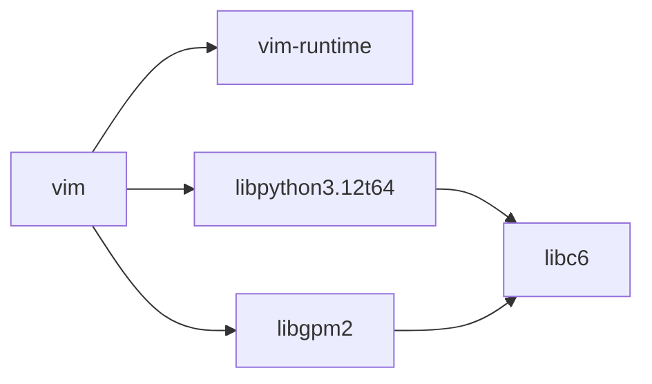
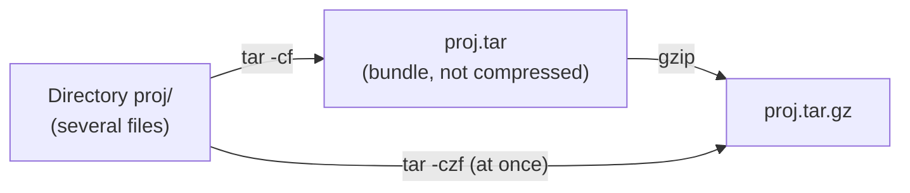

# Chapter 9 — Software Management

[Repository Guide](../../README.md) | [English](Concepts_Lecture.md) | [한국어](Concepts_Lecture.ko.md)

> **Last Updated:** 2026-11-19

> **Learning Objectives:**
> 1. Explain the concepts of packages and dependencies and interpret package file names and status markers
> 2. Distinguish the roles of `dpkg` and `apt` and explain the structure of repository configuration files
> 3. Search, install, upgrade, and remove packages with `apt` and explain the differences among `remove`, `purge`, and `autoremove`
> 4. Explain the process of installing a program from source code and why packages are preferable
> 5. Create and extract archives with `tar`, and compare and choose compression methods by ratio and speed

---

## Table of Contents

- [1. Packages and Dependencies](#1-packages-and-dependencies)
  - [1.1 Structure of a Package](#11-structure-of-a-package)
  - [1.2 Dependencies](#12-dependencies)
  - [1.3 Names of Package Files](#13-names-of-package-files)
- [2. dpkg and apt](#2-dpkg-and-apt)
  - [2.1 Roles of the Two Tools](#21-roles-of-the-two-tools)
  - [2.2 Inspecting Installed Packages with dpkg](#22-inspecting-installed-packages-with-dpkg)
  - [2.3 Repositories and sources Files](#23-repositories-and-sources-files)
  - [2.4 Main Commands of apt](#24-main-commands-of-apt)
  - [2.5 Differences Among remove, purge, and autoremove](#25-differences-among-remove-purge-and-autoremove)
  - [2.6 Common Errors and Remedies](#26-common-errors-and-remedies)
  - [2.7 Snap Packages](#27-snap-packages)
- [3. Installing from Source Code](#3-installing-from-source-code)
  - [3.1 configure, make, make install](#31-configure-make-make-install)
  - [3.2 Why Packages Are Preferable](#32-why-packages-are-preferable)
- [4. File Archives and Compression](#4-file-archives-and-compression)
  - [4.1 Archiving Versus Compression](#41-archiving-versus-compression)
  - [4.2 Using tar](#42-using-tar)
  - [4.3 gzip, bzip2, xz, zip](#43-gzip-bzip2-xz-zip)
  - [4.4 Comparing and Choosing Compression Methods](#44-comparing-and-choosing-compression-methods)
- [Concept Applications](#concept-applications)
- [Summary](#summary)
- [Self-Check Questions](#self-check-questions)
- [References](#references)

---

<br>

## 1. Packages and Dependencies

### 1.1 Structure of a Package

> **Definition:** A **package** is an installation unit that bundles the files needed to install a program together with information on where and how to install those files.

Package files of the Debian family (Week 1, Section 4.3) have the extension `.deb` and contain three things.

| Component | Contents |
|:-----|:-----|
| Data | The files to be installed and their paths (`/usr/bin/program`, `/usr/share/man/...`, `/etc/config file`) |
| Control information | Package name, version, architecture, description, and the list of other packages it depends on |
| Maintainer scripts | Scripts run before and after installation and removal (creating user accounts, starting services, and so on) |

*Table 1. Components of a .deb package*

The package management system records the installed packages and the list of files each package installed in a database (`/var/lib/dpkg/`). It can therefore tell exactly which package a file came from and which files must be removed when a package is removed. Programs installed directly from source code (Section 3) have no such record.

Configuration files under `/etc` are marked separately as **conffiles**. Because the administrator may have edited them, they are by default kept rather than overwritten or deleted when the package is upgraded or removed (Section 2.5).

### 1.2 Dependencies

Most programs need other programs or libraries to work. The relation in which package A needs package B is called a **dependency**, and it is written as `Depends: B` in the control information of A. Dependencies chain over several levels, so installing one program requires installing the dependencies of its dependencies as well.



*Figure 1. An example of package dependencies (partial)*

Finding and installing dependencies one by one by hand is very tedious, and conflicts between required versions are hard to resolve. The `apt` of Section 2 computes all the required packages from the repository information and installs them at once. Besides `Depends`, which must be present, dependency types include `Recommends`, which is recommended to be installed together, `Suggests`, which is nice to have, and `Conflicts`, which cannot be installed together; by default `apt` installs both `Depends` and `Recommends`.

### 1.3 Names of Package Files

The name of a `.deb` file has the form `packagename_version_architecture.deb`. For example, `mytool_1.4.2-1ubuntu1_amd64.deb` is read as follows.

```text
mytool _ 1.4.2 - 1ubuntu1 _ amd64 .deb
  │       │        │          └─ architecture: amd64 (x86-64), arm64, all (architecture-independent)
  │       │        └──────────── the distribution's package revision (Debian 1, Ubuntu revision 1)
  │       └───────────────────── the upstream version
  └───────────────────────────── package name
```

*Figure 2. Structure of a .deb package file name*

Even for the same upstream version, the revision number rises when the distribution adds patches. As with the kernel version of Week 1, Section 5.3, an Ubuntu package may contain security fixes even if its version looks older than the latest upstream version.

---

<br>

## 2. dpkg and apt

### 2.1 Roles of the Two Tools

| Aspect | `dpkg` | `apt` |
|:-----|:-----|:-----|
| What it handles | `.deb` files already obtained | Package names in repositories |
| Dependencies | Only checks them, does not resolve them | Computes the required packages and installs them together |
| Downloading | Does not download | Downloads from repositories |
| Main use | Inspecting installed packages, installing individual `.deb` files | Everyday installation, upgrades, and removal |

*Table 2. Comparison of dpkg and apt*

`apt` internally calls `dpkg` to perform the actual installation. That is, `dpkg` is the low-level installer, and `apt` is the high-level tool on top of it that handles repositories and dependencies. `apt` is a command meant for interactive use by people, so its output format may change between versions; for scripts, `apt-get` and `apt-cache`, which provide the same functions, are recommended [1].

### 2.2 Inspecting Installed Packages with dpkg

The main options of `dpkg` are as follows [2].

| Option | Function |
|:-----|:-----|
| `-i file.deb` | Install a `.deb` file |
| `-r package` | Remove a package but keep its conffiles |
| `-P package` | Remove everything including conffiles (purge) |
| `-l [pattern]` | List packages and their states |
| `-L package` | List the files installed by that package |
| `-S file path` | Find the package that installed that file |
| `-s package` | Status and information of a package |

*Table 3. Main options of dpkg*

```text
$ dpkg -S /usr/bin/sort
coreutils: /usr/bin/sort
$ dpkg -L coreutils | grep 'bin/sort$'
/usr/bin/sort
```

The two letters at the start of each line of `dpkg -l` are the package's state. The first letter is the state desired by the administrator (`i` install, `r` remove, `p` purge), and the second is the actual state (`i` installed, `c` only configuration files remain, `n` not installed). `ii` is therefore a normally installed package, and `rc` a package that was removed but whose configuration files remain.

### 2.3 Repositories and sources Files

A **repository** is a server that collects package files and their lists (indexes). Which repositories `apt` uses is determined by the files under `/etc/apt/sources.list.d/`. Ubuntu 24.04 uses `ubuntu.sources` in the multiline deb822 format [3].

```text
Types: deb
URIs: http://kr.archive.ubuntu.com/ubuntu/
Suites: noble noble-updates noble-backports
Components: main restricted universe multiverse
Signed-By: /usr/share/keyrings/ubuntu-archive-keyring.gpg

Types: deb
URIs: http://security.ubuntu.com/ubuntu/
Suites: noble-security
Components: main restricted universe multiverse
Signed-By: /usr/share/keyrings/ubuntu-archive-keyring.gpg
```

| Field | Meaning |
|:-----|:-----|
| `Types` | `deb` for binary packages, `deb-src` for source packages |
| `URIs` | Address of the repository server (`kr.archive` is a mirror server in Korea) |
| `Suites` | The release code name (Week 1, Section 4.4) and its branches. `noble` holds the packages at release, `-updates` bug fixes, `-security` security fixes, and `-backports` packages carrying features from newer releases |
| `Components` | Sections within the repository. `main` is free software supported by Canonical, `restricted` closed-source software such as device drivers and codecs, `universe` free software maintained by the community, and `multiverse` software that does not meet all the requirements of open source [4] |
| `Signed-By` | The public key for checking the repository's signature |

*Table 4. Fields of a repository entry in deb822 format*

`apt` checks the digital signature attached to a repository's index with the key in `Signed-By`, so it does not accept package lists that were altered on the way. The older one-line `/etc/apt/sources.list` (`deb http://... noble main restricted`) is still read as well [5].

### 2.4 Main Commands of apt

| Command | Action |
|:-----|:-----|
| `apt update` | Download package information (indexes) from all configured repositories. Does not change the packages themselves |
| `apt upgrade` | Upgrade installed packages to new versions. Installs new packages if needed but never removes existing ones |
| `apt full-upgrade` | Like `upgrade`, but removes existing packages if needed to upgrade the system as a whole |
| `apt install package` | Install a package and its dependencies. Upgrades it if already installed |
| `apt remove package` | Remove a package but keep its configuration files |
| `apt purge package` | Remove including configuration files |
| `apt autoremove` | Remove packages that were installed automatically for dependencies but are no longer needed |
| `apt search regex` | Search package names and descriptions |
| `apt show package` | Detailed information such as dependencies, size, and description |
| `apt list --installed` | List installed packages |

*Table 5. Main commands of apt*

`update` and `upgrade` have similar names but do different things. `update` refreshes only the list of "what is new", and `upgrade` upgrades the actual packages according to that list. Upgrades are therefore always run in the order `sudo apt update && sudo apt upgrade`. Installing a package proceeds as follows (example output, some lines omitted).

```text
$ sudo apt update
Hit:1 http://kr.archive.ubuntu.com/ubuntu noble InRelease
Get:2 http://security.ubuntu.com/ubuntu noble-security InRelease [126 kB]
...
Reading package lists... Done
12 packages can be upgraded. Run 'apt list --upgradable' to see them.
$ apt search '^tree$'
tree/noble 2.1.1-2ubuntu3 amd64
  displays an indented directory tree, in color
$ sudo apt install tree
...
The following NEW packages will be installed:
  tree
...
Setting up tree (2.1.1-2ubuntu3) ...
$ tree --noreport proj
proj
├── README
└── src
    └── main.c
```

`Hit` means that an index has not changed, and `Get` that a new index was downloaded. The argument of `apt search` is a regular expression, so quoting it as `'^tree$'` finds only the package whose name is exactly `tree`.

### 2.5 Differences Among remove, purge, and autoremove

`apt` records separately the packages the user explicitly asked to install (manually installed) and the packages installed along with them because of dependencies (automatically installed). This distinction creates the differences among the three removal commands. Suppose package A depends on B and the user asked to install only A.

| Step | State of A | State of B | What remains |
|:-----|:-----|:-----|:-----|
| `apt install A` | Manually installed (`ii`) | Automatically installed (`ii`) | |
| `apt remove A` | Removed, configuration files remain (`rc`) | Still installed (`ii`) | A's conffiles, all of B |
| `apt autoremove` | Still `rc` | Removed because no longer needed | A's conffiles, B's conffiles |
| `apt purge A` | Completely removed | | B's conffiles |

*Table 6. State changes under the removal commands when A depends on B*

- `remove` keeps the configuration files, so reinstalling later uses the previous configuration as it is. To redo the configuration from scratch, use `purge`.
- The automatically installed B remains when A is removed. If no other package uses B, `autoremove` removes it. `apt autoremove --purge` also removes the configuration files in this case.
- The manual and automatic marks are shown with `apt-mark showmanual` and `apt-mark showauto`, and can be changed with `apt-mark manual B`. If a package the user relies on directly is marked automatic, `autoremove` removes it, so always check the list `autoremove` will remove before running it [1].

### 2.6 Common Errors and Remedies

| Symptom | Cause | Remedy |
|:-----|:-----|:-----|
| `E: Unable to locate package name` | The index is outdated, the name is wrong, or the component (`universe` and so on) is disabled | Run `sudo apt update`, then check the exact name with `apt search` |
| `dependency problems` after installing with `dpkg -i` | `dpkg` does not resolve dependencies | Install the missing dependencies with `sudo apt -f install`, or install with `sudo apt install ./file.deb` from the start |
| `Could not get lock /var/lib/dpkg/lock-frontend` | Another package operation, such as automatic updates, is running | Wait until that operation finishes (do not delete the lock files) |
| `404 Not Found` during download | The index does not match the actual files on the server | Run `sudo apt update` and try again |

*Table 7. Common errors in package management*

With a path attached (`./`), as in `sudo apt install ./file.deb`, `apt` installs that file while resolving its dependencies from the repositories. With only a name and no path, `apt` interprets it as a package name in the repositories.

### 2.7 Snap Packages

Besides `.deb`, Ubuntu also uses **snap** packages made by Canonical. A snap bundles a program and all the libraries it uses in one file, so the same package installs regardless of the distribution release, and it runs in an environment isolated from the rest of the system. Snaps are managed by the `snapd` daemon, and an installed snap is mounted read-only, as a compressed file system image, under `/snap/name/revision`.

| Command | Action |
|:-----|:-----|
| `snap find name` | Search the store for a snap |
| `sudo snap install name` | Install a snap |
| `snap list` | List installed snaps with their versions and revisions |
| `sudo snap refresh` | Update installed snaps to new revisions |
| `sudo snap revert name` | Go back to the previous revision |
| `sudo snap remove name` | Remove a snap |

*Table 8. Main commands of snap*

A `.deb` package is updated only when the administrator runs `apt upgrade`, whereas `snapd` by default checks for new revisions four times a day and updates snaps automatically [6]. Previous revisions are kept as well, so if a problem appears after an update the snap can be rolled back with `snap revert`, and automatic updates of a particular snap can be postponed with `snap refresh --hold name` [6]. Because it contains all its dependencies, a snap is larger than the `.deb` of the same program and may start slowly the first time, and installing the same program both as a `.deb` and as a snap creates two separate copies.

---

<br>

## 3. Installing from Source Code

### 3.1 configure, make, make install

When a program is not in the repositories or a newer version is needed, the source code distributed by the upstream author is downloaded and compiled directly. The typical sequence used by GNU tools is as follows.

```bash
sudo apt install build-essential           # build tools such as gcc and make
tar -xf program-1.0.tar.gz                 # extract the source archive (Section 4.2)
cd program-1.0
./configure --prefix=/usr/local            # check the system and generate a Makefile
make                                       # compile
sudo make install                          # install under /usr/local
```

1. `build-essential` is a meta package that installs at once the packages needed for compilation, such as the C compiler `gcc`, the build tool `make`, and the headers of the standard library.
2. `./configure` checks the compiler, the required libraries, and the features of the operating system and generates a `Makefile` suited to this system. If a required library is missing, an error occurs here, so install that library's development package (whose name usually ends in `-dev`) with `apt` and run it again. `--prefix` is the installation location.
3. `make` compiles the source files according to the rules in the `Makefile`. It is run with ordinary user privileges.
4. `sudo make install` copies the built files under `--prefix` (`/usr/local/bin`, `/usr/local/lib`, and so on). It writes to system directories, so it needs root privileges.

> **[Systems Programming]** In terms of the linking taught in Systems Programming, a library that `./configure` looks for consists of header files (`.h`) used at compile time and a shared library (`.so`) referenced by the linker. Ubuntu splits these into two packages: the shared library needed at run time (`libfoo.so.1`) goes into a runtime package such as `libfoo1`, and the headers and the `libfoo.so` link used for linking go into a development package such as `libfoo-dev`. Building from source therefore requires the `-dev` package, and when the built program runs, the dynamic linker finds the shared library of the runtime package and loads it into memory.

`/usr/local` is the place for programs installed locally on that computer, and the package manager does not touch it (Week 3, Section 2.3). In `PATH`, `/usr/local/bin` comes before `/usr/bin`, so if a program of the same name exists in both, the locally installed one runs (Week 6, Section 2.6).

### 3.2 Why Packages Are Preferable

| Aspect | Package (`apt`) | Installation from source |
|:-----|:-----|:-----|
| Dependencies | Computed and installed automatically | Found and installed manually |
| Security fixes | Applied automatically by `apt upgrade` | A new version must be downloaded and rebuilt manually |
| Removal | `apt remove` deletes exactly the installed files | No record, so files must be found and deleted manually (often there is no `make uninstall`) |
| Verification of origin | Verified by the repository's signature | The downloaded file must be verified manually |
| Advantage | Easy to manage | The newest version, the desired build options |

*Table 9. Comparison of package installation and installation from source*

A program installed from source is not updated automatically when security fixes are released, and with no record of which files it installed, it is hard to remove cleanly. Programs available in the repositories are therefore installed as packages, and installation from source is done only when it is necessary, in separate locations such as `/usr/local` or the home directory.

---

<br>

## 4. File Archives and Compression

### 4.1 Archiving Versus Compression

An **archive** bundles several files and directories into one file together with their structure, permissions, owners, and times, while **compression** reduces the size of a single file. On Linux, the two jobs are often split between different tools. `tar` bundles a directory into a single `.tar` file, and `gzip`, `bzip2`, or `xz` compresses that one file. `.tar.gz` (or `.tgz`), `.tar.bz2`, and `.tar.xz` are files that were bundled and then compressed.



*Figure 3. Relation between archiving and compression*

`zip`, on the other hand, bundles and compresses at once, compressing each file separately and storing them in one file. It is commonly used for exchanging files with Windows.

### 4.2 Using tar

The options of `tar` consist of one operation and several auxiliary options.

| Option | Meaning |
|:-----|:-----|
| `-c` | Create an archive |
| `-x` | Extract an archive |
| `-t` | List the contents of an archive |
| `-f file` | Name of the archive file; the name must follow immediately |
| `-v` | Print the names of the files processed |
| `-z`, `-j`, `-J` | Compress or decompress with gzip, bzip2, or xz |
| `-C directory` | Change to that directory before working (mainly to set the extraction location) |
| `--exclude=pattern` | Leave out files matching the pattern |

*Table 10. Main options of tar*

```text
$ tar -czf proj.tar.gz proj
$ tar -tf proj.tar.gz
proj/
proj/README
proj/src/
proj/src/main.c
$ mkdir /tmp/restore
$ tar -xf proj.tar.gz -C /tmp/restore
$ ls /tmp/restore/proj
README  src
```

- `-czf` is a cluster of `-c -z -f`. `-f`, which takes an argument, must be placed at the end of the cluster, so writing `-cfz proj.tar.gz` makes `z` be interpreted as the file name [7].
- Names inside the archive are stored with the paths given at creation. `proj` was given, so extracting recreates `proj/` in the current directory (or the location of `-C`).
- GNU `tar` detects the compression method by itself when extracting, so `-xf` alone extracts `.tar.gz`, `.tar.bz2`, and `.tar.xz`. When creating, give `-z`, `-j`, or `-J` directly, or let `-a` match the extension of the name [7].
- When an absolute path is given, as in `tar -cf backup.tar /etc`, GNU `tar` prints the message ``Removing leading `/' from member names`` and stores the names as `etc/...` without the leading `/` [7]. This prevents the accident of overwriting the system's `/etc` on extraction.

> **Caution:** `tar -xf` overwrites files of the same name without asking. Check the contents of a received archive first with `tar -tf`, and if its files are not contained in a single directory, create an empty directory and extract into it with `-C`.

### 4.3 gzip, bzip2, xz, zip

| Command | Compress | Decompress | Extension | Characteristics |
|:-----|:-----|:-----|:-----|:-----|
| `gzip` | `gzip file` | `gunzip file.gz`, `gzip -d` | `.gz` | Fast, the most widely used |
| `bzip2` | `bzip2 file` | `bunzip2 file.bz2`, `bzip2 -d` | `.bz2` | Smaller than gzip, slower |
| `xz` | `xz file` | `unxz file.xz`, `xz -d` | `.xz` | Usually the smallest, slowest to compress |
| `zip` | `zip out.zip files...` | `unzip out.zip` | `.zip` | Bundles and compresses several files, keeps the originals |

*Table 11. Comparison of compression commands*

`gzip`, `bzip2`, and `xz` compress a single file and, when compression finishes, **delete the original** and replace it with a file that has an extension such as `.gz` [8]. To keep the original, give `-k` (keep), and to write to standard output, give `-c`. The numbers `-1` to `-9` are compression levels; larger numbers compress smaller but more slowly. Compressed text files can be read without decompressing them with `zcat`, `zless`, and `zgrep` (`xzcat` and `xzgrep` for xz).

```text
$ ls -l manual.txt
-rw-r--r-- 1 user1 user1 1079464 Mar 21 15:00 manual.txt
$ gzip manual.txt
$ ls manual.txt*
manual.txt.gz
$ gzip -l manual.txt.gz
         compressed        uncompressed  ratio uncompressed_name
             268815             1079464  75.1% manual.txt
$ gunzip manual.txt.gz
```

The ratio of `gzip -l` is the fraction saved, 1 - 268815 ÷ 1079464 ≈ 75.1%.

### 4.4 Comparing and Choosing Compression Methods

The results of compressing a single English text file of about 1 MB (1,079,464 bytes), the info manual of GNU coreutils, with each method are as follows. Sizes may differ by a few bytes between implementations and versions, and the times are relative values measured on the same computer.

| Method | Compressed size (bytes) | Size relative to original | Compression time | Decompression time |
|:-----|-----:|-----:|-----:|-----:|
| `gzip -1` | 329,593 | 30.5% | 12 ms | |
| `gzip -6` (default) | 268,815 | 24.9% | 30 ms | 6 ms |
| `gzip -9` | 266,723 | 24.7% | 58 ms | |
| `zip -9` | 267,061 | 24.7% | 57 ms | |
| `bzip2 -9` (default) | 206,131 | 19.1% | 51 ms | 21 ms |
| `xz -6` (default) | 208,316 | 19.3% | 191 ms | 14 ms |

*Table 12. Results of compressing a text file of 1,079,464 bytes*

The following can be read from these results.

- For `gzip`, raising the level from `-1` to `-6` reduces the size greatly, from 30.5% to 24.9%, but raising it further to `-9` saves only 0.2 percentage points while doubling the time. The gain from higher compression levels shrinks quickly.
- `zip` uses the same deflate method as `gzip`, so the sizes are almost the same.
- `bzip2` and `xz` are about a quarter smaller than `gzip` (from 24.9% to about 19%). On this text `bzip2` was slightly smaller than `xz`, but in general there are many files that `xz` compresses smaller. The compression ratio depends on the nature of the data, so comparisons should be made with the actual data.
- `xz` is the slowest to compress but faster to decompress than `bzip2`. This is why `xz` is widely used for distribution archives (source code, packages) that are compressed once and decompressed many times by many people.

Accordingly, the fast `gzip` is chosen for backups and logs that are created and extracted often, the small `xz` for files that are created once and kept for a long time or distributed, and `zip` for files exchanged with Windows users. Data that is already compressed (JPEG photos, MP4 videos, `.deb`, `.zip`) hardly shrinks when compressed again.

---

<br>

## Concept Applications

**True/False Check:**

| Statement | Judgment and Reason |
|:-----|:-----|
| `sudo apt update` changes installed packages to new versions. | **F.** `update` refreshes only the package information of the repositories; the actual upgrade is done by `upgrade`. |
| `dpkg -i` downloads the required dependencies from the repositories and installs them together. | **F.** `dpkg` only checks dependencies; they are resolved by `apt -f install` or `apt install ./file.deb`. |
| A package removed with `apt remove` may appear as `rc` in `dpkg -l`. | **T.** `remove` keeps the conffiles, so the state becomes "removed, configuration files remain". |
| `apt upgrade` removes installed packages if the upgrade needs it. | **F.** It never removes existing packages; upgrades that require removal are done by `full-upgrade`. |
| After `gzip file`, `file` still remains as it was. | **F.** The original is deleted and replaced by `file.gz`; to keep the original, give `-k`. |
| `tar -cfz a.tar.gz dir` creates an archive compressed with gzip. | **F.** The `z` right after `-f` is interpreted as the file name, so it must be written `-czf a.tar.gz dir`. |
| Raising the compression level from `-6` to `-9` reduces the size as much as raising it from `-1` to `-6`. | **F.** As in Table 12, at high levels the size shrinks only slightly while the time grows greatly. |

---

<br>

## Summary

| Concept | Key Summary |
|---------|-------------|
| Package | It is an installation unit that bundles the files to install, control information with name, version, and dependencies, and maintainer scripts, and its installation is recorded in a database. |
| Dependency | It is another package that a package needs, and `apt` computes it from repository information and installs it together. |
| dpkg and apt | `dpkg` is a low-level tool that installs and inspects `.deb` files, and `apt` a high-level tool that handles repositories and dependencies. |
| Repository configuration | Ubuntu 24.04 sets the URIs, Suites, Components, and signing key in the deb822 format of `/etc/apt/sources.list.d/ubuntu.sources`. |
| Snap | It is a package that bundles a program and its dependencies in one image and runs it in an isolated environment; `snapd` updates it automatically, and `snap revert` returns it to the previous revision. |
| apt commands | `update` refreshes indexes, `upgrade` upgrades packages, `remove` deletes while keeping settings, `purge` deletes completely, and `autoremove` deletes automatically installed packages no longer needed. |
| Installation from source | The order is `./configure`, `make`, `sudo make install`, and because there are no automatic updates or removal records, repository packages are used first. |
| tar | `-c`, `-x`, and `-t` create, extract, and list; `-z`, `-j`, and `-J` choose the compression method; and `-f` goes at the end of the cluster. |
| Compression methods | gzip is fast, bzip2 and xz are smaller, and xz, slow to compress but fast to decompress, is used for distribution. |

---

<br>

## Self-Check Questions

1. **Interpreting a package name:** In `libfoo2_3.1.0-2ubuntu0.1_arm64.deb`, write the package name, the upstream version, the distribution revision, and the architecture.

   <details>
   <summary>Answer</summary>

   Splitting at `_` gives the package name `libfoo2`, the version `3.1.0-2ubuntu0.1`, and the architecture `arm64`. `3.1.0`, before the last `-` of the version, is the upstream version, and `2ubuntu0.1`, after it, is the distribution revision (an Ubuntu revision based on Debian revision 2). It is `arm64`, so it is for 64-bit ARM computers.

   </details>

2. **Origin of a file:** Write the command that finds which package `/usr/bin/vim.basic` came from and the command that shows all the files that package installed.

   <details>
   <summary>Answer</summary>

   `dpkg -S /usr/bin/vim.basic` prints the name of the package that installed the file. If that name is `vim`, `dpkg -L vim` prints the list of files the package installed.

   </details>

3. **Difference between removal commands:** A web server package was used with modified settings, and now it is to be reinstalled in its initial state. Should `remove` or `purge` be used before reinstalling, and why?

   <details>
   <summary>Answer</summary>

   Use `purge`. `remove` keeps the configuration files (conffiles) in `/etc`, so reinstalling uses the modified settings as they are. `purge` also deletes the configuration files, so reinstalling installs the package's default configuration files anew.

   </details>

4. **Targets of autoremove:** When the user installed A with `apt install A`, the dependencies B and C were installed together. Later the user started using C directly and removed A with `apt remove A`. What does `apt autoremove` remove? What must be done to keep C?

   <details>
   <summary>Answer</summary>

   B and C are marked as automatically installed, and A is now gone, so both are removed unless another package uses them. Even though the user uses C directly, its mark is still automatic, so it is removed. Changing C to manually installed with `sudo apt-mark manual C` takes it out of the targets of `autoremove`.

   </details>

5. **Writing tar commands:** Write the command that creates `project.tar.xz`, an xz-compressed archive of the directory `project` in the home directory excluding its `build` subdirectory, and the command that extracts it under `/tmp/test`.

   <details>
   <summary>Answer</summary>

   Create it with `tar -cJf project.tar.xz --exclude=project/build project`. To extract, run `mkdir -p /tmp/test` and then `tar -xf project.tar.xz -C /tmp/test`. GNU `tar` detects the compression method by itself on extraction, so `-J` is not needed.

   </details>

6. **Computing compression:** In Table 12, how many bytes did `xz -6` save from the original, and by what percentage is its compressed size smaller than that of `gzip -6`?

   <details>
   <summary>Answer</summary>

   The bytes saved are 1,079,464 - 208,316 = 871,148. Compared with the 268,815 bytes of `gzip -6`, it is (268,815 - 208,316) ÷ 268,815 ≈ 22.5% smaller.

   </details>

7. **Choosing a compression method:** Explain on the basis of Table 12 which compression method suits a database backup made every hour and a source code distribution file made once and downloaded by thousands of people.

   <details>
   <summary>Answer</summary>

   A backup made every hour needs a short compression time, so `gzip` (at the default level) suits it. A distribution file is compressed once and downloaded and extracted many times, so `xz`, which is small and fast to decompress though slow to compress, suits it. The compression ratio depends on the data, so it is good to compare once with the actual data before deciding.

   </details>

---

<br>

## References

1. "apt(8), Ubuntu noble manual page," *APT*. [Online]. Available: https://manpages.ubuntu.com/manpages/noble/man8/apt.8.html
2. "dpkg(1), Ubuntu noble manual page," *dpkg*. [Online]. Available: https://manpages.ubuntu.com/manpages/noble/man1/dpkg.1.html
3. Canonical, "Ubuntu 24.04 LTS (Noble Numbat) release notes," [Online]. Available: https://documentation.ubuntu.com/release-notes/24.04/
4. Ubuntu, "Repositories," *Ubuntu Wiki*. [Online]. Available: https://wiki.ubuntu.com/Repositories
5. "sources.list(5), Ubuntu noble manual page," *APT*. [Online]. Available: https://manpages.ubuntu.com/manpages/noble/man5/sources.list.5.html
6. Canonical, "Manage updates," *Snap documentation*. [Online]. Available: https://snapcraft.io/docs/how-to-guides/manage-snaps/manage-updates/
7. "tar(1), Ubuntu noble manual page," *GNU tar*. [Online]. Available: https://manpages.ubuntu.com/manpages/noble/man1/tar.1.html
8. "gzip(1), Ubuntu noble manual page," *GNU gzip*. [Online]. Available: https://manpages.ubuntu.com/manpages/noble/man1/gzip.1.html
