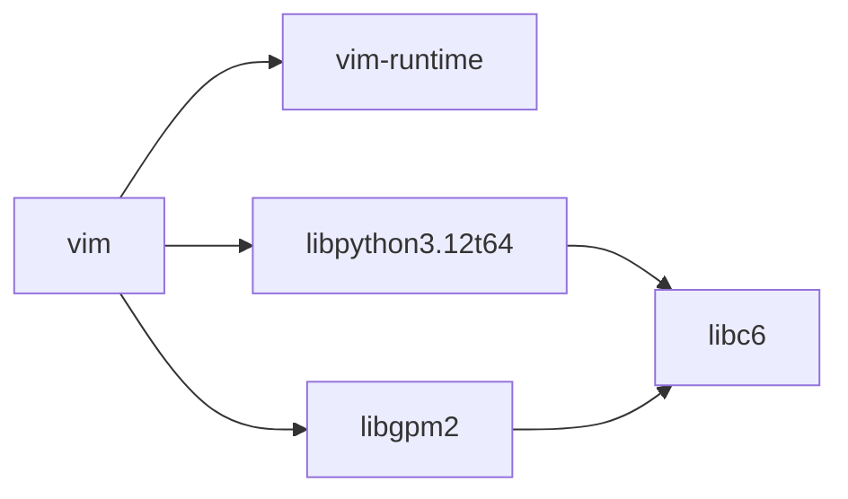
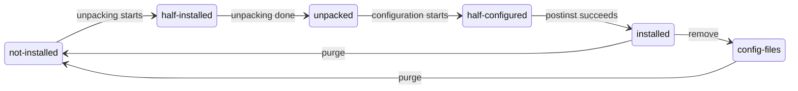
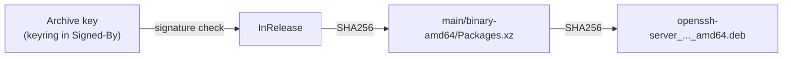
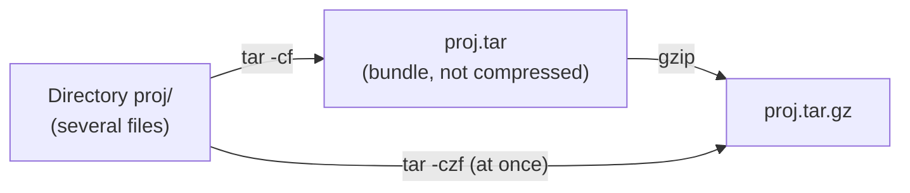

# Chapter 9 — Software Management

[Repository Guide](../../README.md) | [English](Concepts_Lecture.md) | [한국어](Concepts_Lecture.ko.md)

> **Last Updated:** 2026-11-19

> **Learning Objectives:**
> 1. Explain the concepts of packages and dependencies and interpret package file names and status markers
> 2. Distinguish the roles of `dpkg` and `apt` and explain the structure of repository configuration files
> 3. Search, install, upgrade, and remove packages with `apt` and explain the differences among `remove`, `purge`, and `autoremove`
> 4. Explain the process of installing a program from source code and why packages are preferable
> 5. Create and extract archives with `tar`, and compare and choose compression methods by ratio and speed
> 6. Explain how `apt` decides which version to install from the version comparison rules, repository priorities, and signatures

---

## Table of Contents

- [1. Packages and Dependencies](#1-packages-and-dependencies)
  - [1.1 Structure of a Package](#11-structure-of-a-package)
  - [1.2 Dependencies](#12-dependencies)
  - [1.3 Names of Package Files](#13-names-of-package-files)
  - [1.4 Control Information and Relationship Fields](#14-control-information-and-relationship-fields)
  - [1.5 Structure and Comparison of Version Numbers](#15-structure-and-comparison-of-version-numbers)
  - [1.6 Inside a .deb File](#16-inside-a-deb-file)
- [2. dpkg and apt](#2-dpkg-and-apt)
  - [2.1 Roles of the Two Tools](#21-roles-of-the-two-tools)
  - [2.2 Inspecting Installed Packages with dpkg](#22-inspecting-installed-packages-with-dpkg)
  - [2.3 Repositories and sources Files](#23-repositories-and-sources-files)
  - [2.4 Main Commands of apt](#24-main-commands-of-apt)
  - [2.5 Differences Among remove, purge, and autoremove](#25-differences-among-remove-purge-and-autoremove)
  - [2.6 Common Errors and Remedies](#26-common-errors-and-remedies)
  - [2.7 Snap Packages](#27-snap-packages)
  - [2.8 The dpkg Database and Package States](#28-the-dpkg-database-and-package-states)
  - [2.9 apt, apt-get, apt-cache, and the Upgrade Commands](#29-apt-apt-get-apt-cache-and-the-upgrade-commands)
  - [2.10 Choosing the Version to Install: Priorities and Pinning](#210-choosing-the-version-to-install-priorities-and-pinning)
  - [2.11 Repository Signatures and the Chain of Trust](#211-repository-signatures-and-the-chain-of-trust)
  - [2.12 Third-Party Repositories and PPAs](#212-third-party-repositories-and-ppas)
- [3. Installing from Source Code](#3-installing-from-source-code)
  - [3.1 configure, make, make install](#31-configure-make-make-install)
  - [3.2 Why Packages Are Preferable](#32-why-packages-are-preferable)
  - [3.3 Installation Locations, DESTDIR, and Self-Built Packages](#33-installation-locations-destdir-and-self-built-packages)
- [4. File Archives and Compression](#4-file-archives-and-compression)
  - [4.1 Archiving Versus Compression](#41-archiving-versus-compression)
  - [4.2 Using tar](#42-using-tar)
  - [4.3 gzip, bzip2, xz, zip](#43-gzip-bzip2-xz-zip)
  - [4.4 Comparing and Choosing Compression Methods](#44-comparing-and-choosing-compression-methods)
  - [4.5 Pitfalls of tar and Safe Use](#45-pitfalls-of-tar-and-safe-use)
  - [4.6 How Compression Works](#46-how-compression-works)
- [Concept Applications](#concept-applications)
- [Summary](#summary)
- [Self-Check Questions](#self-check-questions)
- [References](#references)

---

<br>

## 1. Packages and Dependencies

### 1.1 Structure of a Package

> **Definition:** A **package** is an installation unit that bundles the files needed to install a program together with information on where and how to install those files.

Package files of the Debian family (Week 1, Section 4.3) have the extension `.deb` and contain three things.

| Component | Contents |
|:-----|:-----|
| Data | The files to be installed and their paths (`/usr/bin/program`, `/usr/share/man/...`, `/etc/config file`) |
| Control information | Package name, version, architecture, description, and the list of other packages it depends on |
| Maintainer scripts | Scripts run before and after installation and removal (creating user accounts, starting services, and so on) |

*Table 1. Components of a .deb package*

The package management system records the installed packages and the list of files each package installed in a database (`/var/lib/dpkg/`). It can therefore tell exactly which package a file came from and which files must be removed when a package is removed. Programs installed directly from source code (Section 3) have no such record.

Configuration files under `/etc` are marked separately as **conffiles**. Because the administrator may have edited them, they are by default kept rather than overwritten or deleted when the package is upgraded or removed (Section 2.5).

### 1.2 Dependencies

Most programs need other programs or libraries to work. The relation in which package A needs package B is called a **dependency**, and it is written as `Depends: B` in the control information of A. Dependencies chain over several levels, so installing one program requires installing the dependencies of its dependencies as well.



*Figure 1. An example of package dependencies (partial)*

Finding and installing dependencies one by one by hand is very tedious, and conflicts between required versions are hard to resolve. The `apt` of Section 2 computes all the required packages from the repository information and installs them at once. Besides `Depends`, which must be present, dependency types include `Recommends`, which is recommended to be installed together, `Suggests`, which is nice to have, and `Conflicts`, which cannot be installed together; by default `apt` installs both `Depends` and `Recommends`. The exact meaning and syntax of each field are covered in Section 1.4.

### 1.3 Names of Package Files

The name of a `.deb` file has the form `packagename_version_architecture.deb`. For example, `mytool_1.4.2-1ubuntu1_amd64.deb` is read as follows.

```text
mytool _ 1.4.2 - 1ubuntu1 _ amd64 .deb
  │       │        │          └─ architecture: amd64 (x86-64), arm64, all (architecture-independent)
  │       │        └──────────── the distribution's package revision (Debian 1, Ubuntu revision 1)
  │       └───────────────────── the upstream version
  └───────────────────────────── package name
```

*Figure 2. Structure of a .deb package file name*

Even for the same upstream version, the revision number rises when the distribution adds patches. As with the kernel version of Week 1, Section 5.3, an Ubuntu package may contain security fixes even if its version looks older than the latest upstream version.

### 1.4 Control Information and Relationship Fields

The control information of a package is text made of lines of the form `Field: value`, and the repository index (Section 2.3) contains one entry of the same form for each package [1]. The following is the `openssh-server` entry in the `noble/main` index of the Ubuntu 24.04 repository, with some lines and the tail of `Depends` shortened [2].

```text
Package: openssh-server
Architecture: amd64
Version: 1:9.6p1-3ubuntu13
Section: net
Source: openssh
Installed-Size: 2101
Provides: ssh-server
Pre-Depends: init-system-helpers (>= 1.54~)
Depends: adduser, libpam-modules, libpam-runtime, lsb-base, openssh-client (= 1:9.6p1-3ubuntu13), openssh-sftp-server, procps, ucf, debconf (>= 0.5) | debconf-2.0, libaudit1 (>= 1:2.2.1), libc6 (>= 2.38), ...
Recommends: default-logind | logind | libpam-systemd, ncurses-term, xauth, ssh-import-id
Suggests: molly-guard, monkeysphere, ssh-askpass, ufw
Conflicts: sftp, ssh-socks, ssh2
Replaces: openssh-client (<< 1:7.9p1-8), ssh, ssh-krb5
Filename: pool/main/o/openssh/openssh-server_9.6p1-3ubuntu13_amd64.deb
Size: 509904
SHA256: 6fe2467aff7aa8ed1cbe91a3521df69a41b90122143392f94037d4225a7098cb
Description: secure shell (SSH) server, for secure access from remote machines
```

The first lines identify the package. `Version` follows the format of Section 1.5, `Source` is the source package (`openssh`) from which this binary package was built, and `Installed-Size` is the approximate size of the installed files in KiB [1]. `Filename`, `Size`, and `SHA256` are fields added in the repository index: the location, the size in bytes, and the hash of the `.deb` file to download (Section 2.11). The lines from `Provides` to `Replaces` in between are the **relationship fields**, which describe relations with other packages.

| Field | Meaning | Handling by the package manager |
|:-----|:-----|:-----|
| `Pre-Depends` | Packages that must be installed and configured before this package is unpacked | Installs and configures them first |
| `Depends` | Packages strictly required for operation | Refuses installation without them |
| `Recommends` | Packages used together in all but unusual installations | `apt` installs them together by default |
| `Suggests` | Packages that make this one more useful | Does not install them |
| `Breaks` | Versions of other packages whose bugs are exposed when installed together | Does not configure the listed packages until they are upgraded |
| `Conflicts` | Packages that cannot be installed at the same time, for example because they contain files of the same name | Installs one only after removing the other |
| `Replaces` | Packages whose files this package may overwrite | Does not treat overlapping files of the two packages as an error |
| `Provides` | Names of virtual packages that this package stands for | Satisfies dependencies on those names with this package |

*Table 2. Kinds of relationship fields*

The value of a field such as `Depends` is a list of groups separated by commas, and within a group alternatives are listed with `|`. A comma is read as "and" and `|` as "or", with `|` binding more tightly than the comma. A version condition goes in parentheses after a package name, and the operators are `<<` (less than), `<=`, `=`, `>=`, and `>>` (greater than) [1]. Reading the entry above with these rules gives the following.

- `openssh-client (= 1:9.6p1-3ubuntu13)`: the client package must be exactly the same version. The server therefore cannot be upgraded alone, and the two packages are always upgraded together.
- `debconf (>= 0.5) | debconf-2.0`: satisfied if `debconf` of version 0.5 or later is present, or if another package providing the name `debconf-2.0` is present.
- The first group of `Recommends` recommends one of three packages, and each remaining group recommends its package. `apt` installs these by default as well, so to install only the strictly required dependencies use `apt-get install --no-install-recommends` [3].
- `Replaces: openssh-client (<< 1:7.9p1-8)`: this package has taken over files that client packages older than version `1:7.9p1-8` used to contain. It is used when files move from one package to another.
- `Provides: ssh-server`: installing this package satisfies the dependencies of packages that depend on `ssh-server`.

> **Definition:** A **virtual package** is a name for which no `.deb` file exists and which several packages with the same function jointly declare with `Provides`. Just as `sendmail` and `exim` both provide `mail-transport-agent`, other packages can depend on this name and work whichever implementation is installed [1].

In the values of `Breaks` and `Conflicts`, a comma is read as "or", because the relation holds if any one of the listed packages is installed [1]. The two fields differ in how much they block. `Conflicts` prevents the two packages from being installed at the same time, whereas `Breaks` allows both to be unpacked and only blocks the configuration of the listed (broken) package until it is upgraded to a new version [1].

### 1.5 Structure and Comparison of Version Numbers

A package version consists of three parts, `[epoch:]upstream-version[-revision]` [4]. Only the last two parts appeared in the file name of Section 1.3, but all three are used in comparison.

- The **epoch** is a small integer, taken as 0 when omitted. It is added to get past the problem when the upstream author changes the numbering scheme so that a new version's number looks smaller than an old one. The `openssh-server` of Section 1.4 has version `1:9.6p1-3ubuntu13` with epoch 1, but the epoch does not appear in the file name `openssh-server_9.6p1-3ubuntu13_amd64.deb` of `Filename`.
- The upstream version is mandatory and conventionally starts with a digit.
- The revision is the part after the **last** `-` in the string, so the upstream version may itself contain `-`. A version without a revision precedes a version with one.

Two versions are compared by first comparing the epochs as numbers, then, if equal, the upstream versions, and, if those are also equal, the revisions, both by the same method. The method repeats the following two steps alternately from the left of the strings [4].

1. Take the leading characters that are not digits and compare them in lexical order. Here letters precede non-letters, and `~` precedes everything, even the end of the part. The order is therefore `~~`, `~~a`, `~`, the empty part, `a`.
2. Take the digits that follow and compare them as numbers. No digits count as 0.

Comparing `1:9.6p1-3ubuntu13.20` with `1:9.6p1-3ubuntu13` proceeds as follows.

| Step | Left | Right | Result |
|:-----|:-----|:-----|:-----|
| Epoch (number) | 1 | 1 | Equal |
| Upstream version | `9.6p1` | `9.6p1` | Equal |
| Revision: digits | 3 | 3 | Equal |
| Revision: non-digit part | `ubuntu` | `ubuntu` | Equal |
| Revision: digits | 13 | 13 | Equal |
| Revision: non-digit part | `.` | (end) | `.` is not a letter, so it sorts after the end |

*Table 3. The process of comparing two versions*

`1:9.6p1-3ubuntu13.20` is therefore the newer version. It is the update published in `noble-updates` and `noble-security`, and `1:9.6p1-3ubuntu13` is the version in `noble` at release [2]. Examples decided by the same rules are as follows.

| Comparison | Newer version | Deciding step |
|:-----|:-----|:-----|
| `1.2.10-1` and `1.2.9-1` | `1.2.10-1` | The digits 10 and 9 compared as numbers (the opposite as strings) |
| `1.0~rc1-1` and `1.0-1` | `1.0-1` | `~` precedes the end, so it is used for pre-release versions |
| `1.0+dfsg-1` and `1.0-1` | `1.0+dfsg-1` | `+` is not a letter, so it sorts after the end |
| `1:0.9-1` and `2.0-1` | `1:0.9-1` | Epochs 1 and 0 |
| `1.4.2-1ubuntu1` and `1.4.2-1` | `1.4.2-1ubuntu1` | The letter `u` sorts after the end of the revision |
| `2.1.1-2build1` and `2.1.1-2ubuntu3` | `2.1.1-2ubuntu3` | The letter `b` precedes `u` |

*Table 4. Examples of version comparison*

Because of the rule in the fifth row, a version in which Ubuntu added patches to a Debian package (`-1ubuntu1`) is treated as newer than the Debian version it is based on (`-1`). On Ubuntu two versions can be compared directly, as in `dpkg --compare-versions 1.0~rc1-1 lt 1.0-1`, which returns exit status 0 when the condition holds [5].

> **Caution:** Versions are not compared as strings. In lexical order `1.2.10` comes before `1.2.9`, but the package manager judges the opposite. Also, when choosing a version with `apt install package=version`, write the full string including the epoch, as in `openssh-server=1:9.6p1-3ubuntu13.20`.

### 1.6 Inside a .deb File

A `.deb` file is an archive in `ar` format holding three members in a fixed order [6]. The first, `debian-binary`, is a one-line file giving the format version (currently `2.0`), the second, `control.tar`, is the control information area, and the third, `data.tar`, holds the files to be installed. The last two members are either uncompressed or compressed with gzip, xz, zstd, and so on, and the extension indicates the method. Opening the `openssh-server` package of Section 1.4 gives the following.

```text
$ ar t openssh-server_9.6p1-3ubuntu13_amd64.deb
debian-binary
control.tar.zst
data.tar.zst
$ ar x openssh-server_9.6p1-3ubuntu13_amd64.deb
$ cat debian-binary
2.0
$ zstd -dc control.tar.zst | tar -tf -
./
./conffiles
./config
./control
./md5sums
./postinst
./postrm
./preinst
./prerm
./templates
$ zstd -dc control.tar.zst | tar -xOf - ./conffiles
/etc/default/ssh
/etc/init.d/ssh
/etc/pam.d/sshd
/etc/ssh/moduli
/etc/ufw/applications.d/openssh-server
$ zstd -dc data.tar.zst | tar -tf - | grep -E 'sbin/sshd$|sshd_config'
./etc/ssh/sshd_config.d/
./usr/sbin/sshd
./usr/share/man/man5/sshd_config.5.gz
./usr/share/openssh/sshd_config
./usr/share/openssh/sshd_config.md5sum
```

| File in the control area | Contents |
|:-----|:-----|
| `control` | The control information of Section 1.4 (mandatory) |
| `conffiles` | The list of files to be handled as conffiles (Section 1.1) |
| `md5sums` | The MD5 hash of each file to be installed |
| `preinst`, `postinst` | Maintainer scripts run before unpacking and at configuration |
| `prerm`, `postrm` | Maintainer scripts run before and after removal |
| `config`, `templates` | The debconf script and texts used to ask the administrator questions during installation |

*Table 5. Files in the control area*

The names in `data.tar` start with `./`, as in `./usr/sbin/sshd`, so `dpkg` unpacks them under the root directory and creates `/usr/sbin/sshd`. Note that `/etc/ssh/sshd_config` is not in this package's `conffiles`. That file is not contained in `data.tar`; `postinst` creates it by copying `/usr/share/openssh/sshd_config` and then manages it with a separate tool, `ucf`. The same `postinst` creates the host keys with `ssh-keygen` if they are missing (Chapter 12, Section 2.2). Even under `/etc`, then, some files are not in the package's file list but are created by scripts.

The steps by which `dpkg -i` installs a package are as follows, and they show when the maintainer scripts run [5].

1. Extract the control area of the new package.
2. If an old version of the same package is installed, run the old version's `prerm`.
3. Run the new version's `preinst`.
4. Unpack the new files while backing up the old ones, so that they can be restored on failure.
5. If there was an old version, run its `postrm`.
6. Configure the package: unpack the conffiles and run `postinst`.

---

<br>

## 2. dpkg and apt

### 2.1 Roles of the Two Tools

| Aspect | `dpkg` | `apt` |
|:-----|:-----|:-----|
| What it handles | `.deb` files already obtained | Package names in repositories |
| Dependencies | Only checks them, does not resolve them | Computes the required packages and installs them together |
| Downloading | Does not download | Downloads from repositories |
| Main use | Inspecting installed packages, installing individual `.deb` files | Everyday installation, upgrades, and removal |

*Table 6. Comparison of dpkg and apt*

`apt` internally calls `dpkg` to perform the actual installation. That is, `dpkg` is the low-level installer, and `apt` is the high-level tool on top of it that handles repositories and dependencies. `apt` is a command meant for interactive use by people, so its output format may change between versions; for scripts, `apt-get` and `apt-cache`, which provide the same functions, are recommended [7].

### 2.2 Inspecting Installed Packages with dpkg

The main options of `dpkg` are as follows [5].

| Option | Function |
|:-----|:-----|
| `-i file.deb` | Install a `.deb` file |
| `-r package` | Remove a package but keep its conffiles |
| `-P package` | Remove everything including conffiles (purge) |
| `-l [pattern]` | List packages and their states |
| `-L package` | List the files installed by that package |
| `-S file path` | Find the package that installed that file |
| `-s package` | Status and information of a package |

*Table 7. Main options of dpkg*

```text
$ dpkg -S /usr/bin/sort
coreutils: /usr/bin/sort
$ dpkg -L coreutils | grep 'bin/sort$'
/usr/bin/sort
```

The two letters at the start of each line of `dpkg -l` are the package's state. The first letter is the state desired by the administrator (`i` install, `r` remove, `p` purge), and the second is the actual state (`i` installed, `c` only configuration files remain, `n` not installed). `ii` is therefore a normally installed package, and `rc` a package that was removed but whose configuration files remain. The full list of states and the third letter are covered in Section 2.8.

### 2.3 Repositories and sources Files

A **repository** is a server that collects package files and their lists (indexes). Which repositories `apt` uses is determined by the files under `/etc/apt/sources.list.d/`. Ubuntu 24.04 uses `ubuntu.sources` in the multiline deb822 format [8].

```text
Types: deb
URIs: http://kr.archive.ubuntu.com/ubuntu/
Suites: noble noble-updates noble-backports
Components: main restricted universe multiverse
Signed-By: /usr/share/keyrings/ubuntu-archive-keyring.gpg

Types: deb
URIs: http://security.ubuntu.com/ubuntu/
Suites: noble-security
Components: main restricted universe multiverse
Signed-By: /usr/share/keyrings/ubuntu-archive-keyring.gpg
```

| Field | Meaning |
|:-----|:-----|
| `Types` | `deb` for binary packages, `deb-src` for source packages |
| `URIs` | Address of the repository server (`kr.archive` is a mirror server in Korea) |
| `Suites` | The release code name (Week 1, Section 4.4) and its branches. `noble` holds the packages at release, `-updates` bug fixes, `-security` security fixes, and `-backports` packages carrying features from newer releases |
| `Components` | Sections within the repository. `main` is free software supported by Canonical, `restricted` closed-source software such as device drivers and codecs, `universe` free software maintained by the community, and `multiverse` software that does not meet all the requirements of open source [9] |
| `Signed-By` | The public key for checking the repository's signature |

*Table 8. Fields of a repository entry in deb822 format*

`apt` checks the digital signature attached to a repository's index with the key in `Signed-By`, so it does not accept package lists that were altered on the way. The older one-line `/etc/apt/sources.list` (`deb http://... noble main restricted`) is still read as well [10].

### 2.4 Main Commands of apt

| Command | Action |
|:-----|:-----|
| `apt update` | Download package information (indexes) from all configured repositories. Does not change the packages themselves |
| `apt upgrade` | Upgrade installed packages to new versions. Installs new packages if needed but never removes existing ones |
| `apt full-upgrade` | Like `upgrade`, but removes existing packages if needed to upgrade the system as a whole |
| `apt install package` | Install a package and its dependencies. Upgrades it if already installed |
| `apt remove package` | Remove a package but keep its configuration files |
| `apt purge package` | Remove including configuration files |
| `apt autoremove` | Remove packages that were installed automatically for dependencies but are no longer needed |
| `apt search regex` | Search package names and descriptions |
| `apt show package` | Detailed information such as dependencies, size, and description |
| `apt list --installed` | List installed packages |

*Table 9. Main commands of apt*

`update` and `upgrade` have similar names but do different things. `update` refreshes only the list of "what is new", and `upgrade` upgrades the actual packages according to that list. Upgrades are therefore always run in the order `sudo apt update && sudo apt upgrade`. Installing a package proceeds as follows (example output, some lines omitted).

```text
$ sudo apt update
Hit:1 http://kr.archive.ubuntu.com/ubuntu noble InRelease
Get:2 http://security.ubuntu.com/ubuntu noble-security InRelease [126 kB]
...
Reading package lists... Done
12 packages can be upgraded. Run 'apt list --upgradable' to see them.
$ apt search '^tree$'
tree/noble 2.1.1-2ubuntu3 amd64
  displays an indented directory tree, in color
$ sudo apt install tree
...
The following NEW packages will be installed:
  tree
...
Setting up tree (2.1.1-2ubuntu3) ...
$ tree --noreport proj
proj
├── README
└── src
    └── main.c
```

`Hit` means that an index has not changed, and `Get` that a new index was downloaded. The argument of `apt search` is a regular expression, so quoting it as `'^tree$'` finds only the package whose name is exactly `tree`.

### 2.5 Differences Among remove, purge, and autoremove

`apt` records separately the packages the user explicitly asked to install (manually installed) and the packages installed along with them because of dependencies (automatically installed). This distinction creates the differences among the three removal commands. Suppose package A depends on B and the user asked to install only A.

| Step | State of A | State of B | What remains |
|:-----|:-----|:-----|:-----|
| `apt install A` | Manually installed (`ii`) | Automatically installed (`ii`) | |
| `apt remove A` | Removed, configuration files remain (`rc`) | Still installed (`ii`) | A's conffiles, all of B |
| `apt autoremove` | Still `rc` | Removed because no longer needed | A's conffiles, B's conffiles |
| `apt purge A` | Completely removed | | B's conffiles |

*Table 10. State changes under the removal commands when A depends on B*

- `remove` keeps the configuration files, so reinstalling later uses the previous configuration as it is. To redo the configuration from scratch, use `purge`.
- The automatically installed B remains when A is removed. If no other package uses B, `autoremove` removes it. `apt autoremove --purge` also removes the configuration files in this case.
- The manual and automatic marks are shown with `apt-mark showmanual` and `apt-mark showauto`, and can be changed with `apt-mark manual B`. If a package the user relies on directly is marked automatic, `autoremove` removes it, so always check the list `autoremove` will remove before running it [7].

### 2.6 Common Errors and Remedies

| Symptom | Cause | Remedy |
|:-----|:-----|:-----|
| `E: Unable to locate package name` | The index is outdated, the name is wrong, or the component (`universe` and so on) is disabled | Run `sudo apt update`, then check the exact name with `apt search` |
| `dependency problems` after installing with `dpkg -i` | `dpkg` does not resolve dependencies | Install the missing dependencies with `sudo apt -f install`, or install with `sudo apt install ./file.deb` from the start |
| `Could not get lock /var/lib/dpkg/lock-frontend` | Another package operation, such as automatic updates, is running | Wait until that operation finishes (do not delete the lock files) |
| `404 Not Found` during download | The index does not match the actual files on the server | Run `sudo apt update` and try again |
| `E: dpkg was interrupted, ...` | An operation was cut off during installation, leaving packages in the `unpacked` or `half-configured` state (Section 2.8) | Finish the remaining configuration with `sudo dpkg --configure -a` and run again |
| `update` reports `NO_PUBKEY` and does not use that repository | The public key for checking the repository's signature is missing or the path in `Signed-By` is wrong (Section 2.11) | Obtain the key the repository distributes and place it at the path given in `Signed-By` |
| `The following packages have been kept back:` | The new version requires installing new packages or removing existing ones, so the upgrade was held back (Section 2.9) | Check why it was held back, then `apt full-upgrade` or `apt install package` |
| Only a particular package is never upgraded | That package is marked as held (Section 2.10) | Check with `apt-mark showhold`, then `sudo apt-mark unhold package` |

*Table 11. Common errors in package management*

With a path attached (`./`), as in `sudo apt install ./file.deb`, `apt` installs that file while resolving its dependencies from the repositories. With only a name and no path, `apt` interprets it as a package name in the repositories.

### 2.7 Snap Packages

Besides `.deb`, Ubuntu also uses **snap** packages made by Canonical. A snap bundles a program and all the libraries it uses in one file, so the same package installs regardless of the distribution release, and it runs in an environment isolated from the rest of the system. Snaps are managed by the `snapd` daemon, and an installed snap is mounted read-only, as a compressed file system image, under `/snap/name/revision`.

| Command | Action |
|:-----|:-----|
| `snap find name` | Search the store for a snap |
| `sudo snap install name` | Install a snap |
| `snap list` | List installed snaps with their versions and revisions |
| `sudo snap refresh` | Update installed snaps to new revisions |
| `sudo snap revert name` | Go back to the previous revision |
| `sudo snap remove name` | Remove a snap |

*Table 12. Main commands of snap*

A `.deb` package is updated only when the administrator runs `apt upgrade`, whereas `snapd` by default checks for new revisions four times a day and updates snaps automatically [11]. Previous revisions are kept as well, so if a problem appears after an update the snap can be rolled back with `snap revert`, and automatic updates of a particular snap can be postponed with `snap refresh --hold name` [11]. Because it contains all its dependencies, a snap is larger than the `.deb` of the same program and may start slowly the first time, and installing the same program both as a `.deb` and as a snap creates two separate copies.

> **Note:** **Flatpak.** Flatpak is a tool with a purpose similar to snap. Like snap, it builds and distributes applications independently of the distribution and isolates them from the host system to some degree when they run, but it installs bundles of libraries shared by several applications separately as **runtimes** and shares them [12]. It manages system-wide installations and per-user installations in `~/.local/share/flatpak/` separately; a repository is registered with `flatpak remote-add` and software is installed with `flatpak install` [12]. On Ubuntu 24.04 it is used by installing the `flatpak` package from the repositories with `apt` [13].

### 2.8 The dpkg Database and Package States

`dpkg` records each package's state and file list under `/var/lib/dpkg/` (Section 1.1). The main files are as follows.

| Path | Contents |
|:-----|:-----|
| `/var/lib/dpkg/status` | The control information and `Status:` line of each package that has ever been installed |
| `/var/lib/dpkg/info/package.list` | The list of files and directories that package installed (read by `dpkg -L` and `dpkg -S`) |
| `/var/lib/dpkg/info/package.md5sums`, `package.conffiles` | Copies of the `.deb`'s `md5sums` and `conffiles` |
| `/var/lib/dpkg/info/package.prerm` and others | Maintainer scripts (kept so they can run at removal later) |
| `/var/log/dpkg.log` | The log of installations and removals [14] |

*Table 13. Main files of the dpkg database*

A line of `dpkg -l` starts with up to three letters: the desired state (`i` install, `r` remove, `h` hold, and others), the actual state (`i` installed, `c` config files only, `U` unpacked, and others), and an error flag; an uppercase status or error letter means that the package is likely to cause severe problems [15]. The common `ii` marks a package installed normally, and `rc` a package that was removed but whose configuration files remain. The output looks as follows (example output, Ubuntu 24.04).

```text
$ dpkg -l openssh-server tree
Desired=Unknown/Install/Remove/Purge/Hold
| Status=Not/Inst/Conf-files/Unpacked/halF-conf/Half-inst/trig-aWait/Trig-pend
|/ Err?=(none)/Reinst-required (Status,Err: uppercase=bad)
||/ Name           Version              Architecture Description
+++-==============-====================-============-=================================
ii  openssh-server 1:9.6p1-3ubuntu13.20 amd64        secure shell (SSH) server, for secure access from remote machines
rc  tree           2.1.1-2ubuntu3       amd64        displays an indented directory tree, in color
```

The actual state changes along the installation steps (Section 1.6). The meaning of each state follows the definitions of `dpkg` [5].



*Figure 3. How the actual state of a package changes (trigger states omitted)*

If installation is cut off midway, the package stays in one of `half-installed`, `unpacked`, and `half-configured`. For example, if `postinst` fails, the package becomes `half-configured`: all files have been unpacked but configuration has not finished. While such a state remains, `apt` may refuse new operations with the `E: dpkg was interrupted` of Table 11, so first finish configuring all unpacked but unconfigured packages with `sudo dpkg --configure -a` [5]. `sudo dpkg --audit` finds and shows such incomplete packages [5].

`dpkg -S` searches only the `.list` files of installed packages. It therefore cannot find files that maintainer scripts created during installation, such as the `/etc/ssh/sshd_config` and host keys of Section 1.6 [14], nor the files of packages not yet installed. To search packages that are not installed as well, use `apt-file`, which uses the repository's file-list index (`Contents`) [16]. An example follows (example output).

```text
$ sudo apt install apt-file
$ sudo apt-file update
$ apt-file search /usr/include/zlib.h
zlib1g-dev: /usr/include/zlib.h
```

As in this example, when compilation fails with `zlib.h: No such file or directory`, finding and installing the development package that contains the header (`zlib1g-dev`) resolves it (Section 3.1). The `Contents` index contains no directories, so the search pattern must be part of a file name [16].

### 2.9 apt, apt-get, apt-cache, and the Upgrade Commands

`apt` is a command that gathers the frequently used functions of `apt-get` and `apt-cache` for convenient interactive use (Section 2.1) [7]. The correspondence is as follows.

| Task | `apt` | Command used in scripts |
|:-----|:-----|:-----|
| Refresh indexes | `apt update` | `apt-get update` |
| Install, remove | `apt install`, `apt remove`, `apt purge` | `apt-get install`, `apt-get remove`, `apt-get purge` |
| Upgrade | `apt upgrade` | `apt-get upgrade --with-new-pkgs` |
| Full upgrade | `apt full-upgrade` | `apt-get dist-upgrade` |
| Search and information | `apt search`, `apt show` | `apt-cache search`, `apt-cache show` |
| Candidate version and priorities | `apt policy` | `apt-cache policy` |
| Inspecting dependency relations | `apt depends package`, `apt rdepends package` | `apt-cache depends package`, `apt-cache rdepends package` |

*Table 14. Correspondence among apt, apt-get, and apt-cache*

The three upgrade commands differ in how they handle a new version that requires changing the installation state of other packages. `apt-get upgrade` neither removes installed packages nor installs packages that are not installed, and leaves at the current version any package that can be upgraded only that way [3]. `apt upgrade` installs new packages if needed to satisfy dependencies but never removes existing ones [7]. `apt full-upgrade` (the same as `apt-get dist-upgrade`) also removes existing packages if needed to upgrade the system as a whole [7]. Suppose new versions have appeared for installed packages A and B, the new A depends on a new package C, and the new B conflicts with an installed package D.

| Command | A | B | What changes |
|:-----|:-----|:-----|:-----|
| `apt-get upgrade` | Held back | Held back | Nothing (shown as "kept back") |
| `apt upgrade` | Upgraded | Held back | C installed |
| `apt full-upgrade` | Upgraded | Upgraded | C installed, D removed |

*Table 15. How the three upgrade commands differ*

In practice this happens most often with kernel upgrades. On Ubuntu each kernel version is a package with a different name, and the meta package `linux-image-generic` depends on the kernel package of that version. For example, version `6.8.0-149.149` of `linux-image-generic` in `noble-updates` depends on `linux-image-6.8.0-149-generic` and others [2]. The new kernel package is not installed yet, so `apt-get upgrade` holds the meta package back, while `apt upgrade` installs the new kernel package and upgrades the meta package. The old kernel package becomes an automatically installed package on which the meta package no longer depends, so it becomes a target that `apt autoremove` can clean up (Section 2.5). However, apt protects two kernel versions from automatic removal by default: the kernel currently booted and, apart from it, the kernel with the highest version. So `autoremove` removes only the remaining old kernels.

When `full-upgrade` removes packages, it shows the list to be removed and asks for confirmation. If that list contains a needed package, do not proceed; instead find the cause by checking which packages depend on it with `apt-cache rdepends package`.

### 2.10 Choosing the Version to Install: Priorities and Pinning

Versions of the same package may exist in several places. For the `openssh-server` of Section 1.5, `noble` has `1:9.6p1-3ubuntu13`, and `noble-updates` and `noble-security` have `1:9.6p1-3ubuntu13.20`. `apt` assigns each version an integer called its **pin priority** and chooses the version to install, the candidate version, by the following rules [17].

1. Unless some version has a priority above 1000, never downgrade below the installed version.
2. Choose the version with the highest priority.
3. If priorities are equal, choose the highest version (Section 1.5).

Without separate configuration files, priorities are assigned as follows [17].

| Origin of the version | Priority | Example on Ubuntu 24.04 |
|:-----|-----:|:-----|
| The installed version | 100 | `/var/lib/dpkg/status` |
| An ordinary version in a repository | 500 | `noble`, `noble-updates`, `noble-security` |
| A repository whose `Release` has `NotAutomatic: yes` and `ButAutomaticUpgrades: yes` | 100 | `noble-backports`, `noble-proposed` |
| A repository whose `Release` has only `NotAutomatic: yes` | 1 | (Debian's experimental) |
| A version of the target release (given with `-t`) | 990 | `apt install -t noble-backports package` |

*Table 16. Default priorities*

The `InRelease` files of `noble-backports` and `noble-proposed` do contain `NotAutomatic: yes` and `ButAutomaticUpgrades: yes` [2]. Versions in these branches are therefore not installed on their own at first, but once chosen with `-t` they are upgraded automatically to newer versions of the same branch. The candidate version is checked with `apt-cache policy` (example output).

```text
$ apt-cache policy openssh-server
openssh-server:
  Installed: 1:9.6p1-3ubuntu13
  Candidate: 1:9.6p1-3ubuntu13.20
  Version table:
     1:9.6p1-3ubuntu13.20 500
        500 http://kr.archive.ubuntu.com/ubuntu noble-updates/main amd64 Packages
        500 http://security.ubuntu.com/ubuntu noble-security/main amd64 Packages
 *** 1:9.6p1-3ubuntu13 500
        500 http://kr.archive.ubuntu.com/ubuntu noble/main amd64 Packages
        100 /var/lib/dpkg/status
```

`***` marks the installed version. The installed version is also in `noble`, so it receives 500; the two versions have the same priority, so by rule 3 the higher version `1:9.6p1-3ubuntu13.20` becomes the candidate. `apt upgrade` upgrades the packages whose candidate differs from the installed version.

To change priorities, place a file under `/etc/apt/preferences.d/`. The following setting lowers all packages of a third-party repository to 100, so that versions from that repository do not overwrite packages that are in the official repositories [18].

```text
Package: *
Pin: origin repo.example.com
Pin-Priority: 100
```

Ranges of priority values have fixed meanings. A version with a priority of 1000 or more is installed even if this means a downgrade, one greater than 0 and less than 100 is installed only if no version is installed, and one below 0 is never installed [17].

To tie a package to its current version instead of choosing among versions, use a **hold**. A package held with `sudo apt-mark hold package` is not automatically installed, upgraded, or removed unless explicitly requested; the list is shown with `apt-mark showhold`, and the hold is released with `apt-mark unhold` [19]. A hold is recorded as the desired state `h` of `dpkg` (Section 2.8).

> **Caution:** A held package does not receive security updates either. Even if a package is held for a while because of compatibility with a particular version, the hold must be released as soon as the reason disappears.

### 2.11 Repository Signatures and the Chain of Trust

The `InRelease` downloaded by `apt update` is the `Release` file, which describes the whole repository, signed with the archive key. `Release` contains the branch's name and date together with the hashes of all index files in that branch, and an index (`Packages`) contains the hash of each `.deb` file, as in Section 1.4. These three steps form a single **chain of trust** [20].



*Figure 4. The chain of trust of a repository*

Following the chain with the actual files of `noble` gives the following [2].

```text
$ head -13 noble.InRelease
-----BEGIN PGP SIGNED MESSAGE-----
Hash: SHA512

Origin: Ubuntu
Label: Ubuntu
Suite: noble
Version: 24.04
Codename: noble
Date: Thu, 25 Apr 2024 15:10:33 UTC
Architectures: amd64 arm64 armhf i386 ppc64el riscv64 s390x
Components: main restricted universe multiverse
Description: Ubuntu Noble 24.04
MD5Sum:
$ gpgv --keyring /usr/share/keyrings/ubuntu-archive-keyring.gpg noble.InRelease
gpgv: Signature made Thu Apr 25 15:11:21 2024 UTC
gpgv:                using RSA key F6ECB3762474EDA9D21B7022871920D1991BC93C
gpgv: Good signature from "Ubuntu Archive Automatic Signing Key (2018) <ftpmaster@ubuntu.com>"
$ sed -n '/^SHA256:/,$p' noble.InRelease | grep 'main/binary-amd64/Packages.xz$'
 2a6a199e1031a5c279cb346646d594993f35b1c03dd4a82aaa0323980dd92451          1401160 main/binary-amd64/Packages.xz
$ sha256sum Packages.xz
2a6a199e1031a5c279cb346646d594993f35b1c03dd4a82aaa0323980dd92451  Packages.xz
$ sha256sum openssh-server_9.6p1-3ubuntu13_amd64.deb
6fe2467aff7aa8ed1cbe91a3521df69a41b90122143392f94037d4225a7098cb  openssh-server_9.6p1-3ubuntu13_amd64.deb
```

1. `gpgv` checks the signature of `InRelease` with the Ubuntu archive key and confirms "Good signature". `apt` performs the same check internally.
2. Because the signature is valid, the contents of `InRelease` can be trusted, and because the hash of `Packages.xz` in it (size 1,401,160 bytes) equals the hash of the downloaded index, the index can be trusted too.
3. The `SHA256` in the index's `openssh-server` entry (Section 1.4) equals the hash of the downloaded `.deb`, so the package file has not been altered either.

Thanks to this chain, even if an attack that intercepts the communication or an attack that takes over a mirror server replaces a package, `apt` notices, because `InRelease` cannot be re-signed without the signing key. It does not, however, protect against a compromise of the master server that signs or of the signing key itself, and trusting a repository means trusting its maintainer, not a guarantee that its packages contain no malicious code [20].

`Signed-By` (Section 2.3) sets the key for checking the signature of that repository. Formerly `apt-key` put keys into a keyring shared by all repositories, but then a third-party repository's key could stand in for the signature of the official repositories as well. The recommended way now is therefore to keep the key file separately and make it apply only to that repository with `Signed-By` [18]. By default `apt` does not use repositories that are unsigned or whose signatures cannot be checked [20].

### 2.12 Third-Party Repositories and PPAs

Developers of software not in the official repositories sometimes provide their own repositories. Such a third-party repository is added in the following order [18].

1. Obtain the repository's public key and place it under `/usr/share/keyrings/`. The deb822 format can use an ASCII-armored key (`.asc`) as it is, but the one-line format of Ubuntu 22.04 and earlier accepts only the binary form, so there the binary form (`.gpg`) converted with `gpg --dearmor` is used.
2. Create the repository entry under `/etc/apt/sources.list.d/`.
3. Lower its priority to 100 so that it does not overwrite official packages (Section 2.10).
4. Run `sudo apt update` and then install.

The same repository in the two formats looks as follows. The upper one is `/etc/apt/sources.list.d/example.sources` and the lower one `/etc/apt/sources.list.d/example.list`.

```text
Types: deb
URIs: https://repo.example.com/ubuntu
Suites: noble
Components: main
Signed-By: /usr/share/keyrings/example-archive-keyring.asc

deb [signed-by=/usr/share/keyrings/example-archive-keyring.gpg] https://repo.example.com/ubuntu noble main
```

A **PPA (Personal Package Archive)** is an `apt` repository that Launchpad provides for each user or team [21]. Launchpad builds and publishes the source packages uploaded by the owner, and creates and uses a unique signing key for each owner [21]. `sudo add-apt-repository ppa:owner/name` sets up the key and the repository entry at once but does not change priorities, and `ppa-purge ppa:owner/name` reverts the PPA together with its packages [18].

> **Caution:** The maintainer scripts of a package run with root privileges at installation (Section 1.6). Adding a third-party repository or a PPA hands root privileges over the system to that repository's maintainer, and such a repository receives no Ubuntu security support and often breaks when the distribution is upgraded [18].

---

<br>

## 3. Installing from Source Code

### 3.1 configure, make, make install

When a program is not in the repositories or a newer version is needed, the source code distributed by the upstream author is downloaded and compiled directly. The typical sequence used by GNU tools is as follows.

```bash
sudo apt install build-essential           # build tools such as gcc and make
tar -xf program-1.0.tar.gz                 # extract the source archive (Section 4.2)
cd program-1.0
./configure --prefix=/usr/local            # check the system and generate a Makefile
make                                       # compile
sudo make install                          # install under /usr/local
```

1. `build-essential` is a meta package that installs at once the packages needed for compilation, such as the C compiler `gcc`, the build tool `make`, and the headers of the standard library.
2. `./configure` checks the compiler, the required libraries, and the features of the operating system and generates a `Makefile` suited to this system. If a required library is missing, an error occurs here, so install that library's development package (whose name usually ends in `-dev`) with `apt` and run it again. `--prefix` is the installation location.
3. `make` compiles the source files according to the rules in the `Makefile`. It is run with ordinary user privileges.
4. `sudo make install` copies the built files under `--prefix` (`/usr/local/bin`, `/usr/local/lib`, and so on). It writes to system directories, so it needs root privileges.

> **[Systems Programming]** In terms of the linking taught in Systems Programming, a library that `./configure` looks for consists of header files (`.h`) used at compile time and a shared library (`.so`) referenced by the linker. Ubuntu splits these into two packages: the shared library needed at run time (`libfoo.so.1`) goes into a runtime package such as `libfoo1`, and the headers and the `libfoo.so` link used for linking go into a development package such as `libfoo-dev`. Building from source therefore requires the `-dev` package, and when the built program runs, the dynamic linker finds the shared library of the runtime package and loads it into memory.

`/usr/local` is the place for programs installed locally on that computer, and the package manager does not touch it (Week 3, Section 2.3). In `PATH`, `/usr/local/bin` comes before `/usr/bin`, so if a program of the same name exists in both, the locally installed one runs (Week 6, Section 2.6).

### 3.2 Why Packages Are Preferable

| Aspect | Package (`apt`) | Installation from source |
|:-----|:-----|:-----|
| Dependencies | Computed and installed automatically | Found and installed manually |
| Security fixes | Applied automatically by `apt upgrade` | A new version must be downloaded and rebuilt manually |
| Removal | `apt remove` deletes exactly the installed files | No record, so files must be found and deleted manually (often there is no `make uninstall`) |
| Verification of origin | Verified by the repository's signature | The downloaded file must be verified manually |
| Advantage | Easy to manage | The newest version, the desired build options |

*Table 17. Comparison of package installation and installation from source*

A program installed from source is not updated automatically when security fixes are released, and with no record of which files it installed, it is hard to remove cleanly. Programs available in the repositories are therefore installed as packages, and installation from source is done only when it is necessary, in separate locations such as `/usr/local` or the home directory.

### 3.3 Installation Locations, DESTDIR, and Self-Built Packages

The `--prefix` of `./configure` is the base of all installation paths, and a subdirectory under it is fixed for each kind of file. Under the default `/usr/local`, GNU `configure` scripts place programs in `bin`, libraries in `lib`, configuration files in `etc`, and so on, and each path can be changed separately, as in `--bindir=DIR` or `--sysconfdir=DIR`.

A program built with `--prefix=/usr/local` therefore looks for its configuration files in `/usr/local/etc`, not `/etc`. To make it use the system's `/etc`, give `--sysconfdir=/etc` as well.

**DESTDIR.** `make install` copies the files directly into system directories. Most Makefiles accept a path `DESTDIR` to prefix to every installation path, so giving it collects the files to be installed under a temporary directory for inspection. The following is a small Makefile that follows `PREFIX` and `DESTDIR`.

```make
PREFIX ?= /usr/local
BINDIR = $(PREFIX)/bin

hello: hello.c
	$(CC) -O2 -o hello hello.c

install: hello
	install -d $(DESTDIR)$(BINDIR)
	install -m 755 hello $(DESTDIR)$(BINDIR)/hello
```

- Line 1: if `PREFIX` is not given on the command line, `/usr/local` is used (`?=` assigns only when there is no value).
- Line 2: the directory for executables is set under `PREFIX`.
- Lines 4-5: `hello` is recompiled only when it is missing or older than `hello.c`. Command lines must start with a tab.
- Lines 7-9: `install -d` creates the directory, and `install -m 755` copies with the given permissions. `$(DESTDIR)` is prefixed to both paths.

```text
$ make
cc -O2 -o hello hello.c
$ make -s install DESTDIR=$PWD/stage
$ find stage | sort
stage
stage/usr
stage/usr/local
stage/usr/local/bin
stage/usr/local/bin/hello
$ ./stage/usr/local/bin/hello
hello 1.0
```

`DESTDIR` is a path prefixed only when copying, and the program is still built as if installed under `PREFIX` (`/usr/local`). The tree under `stage` is therefore exactly what will be installed on the system, and it can be turned into a package.

**Packages of self-built programs.** The problem of Section 3.2, the lack of an installation record, is solved by turning the tree to be installed into a `.deb` and installing it with `dpkg`. `dpkg-deb --build` builds a `.deb` from a directory tree, and that directory must contain a `DEBIAN` subdirectory holding the control information [22]. The process is as follows (example output, Ubuntu 24.04).

```text
$ mkdir -p stage/DEBIAN
$ cat stage/DEBIAN/control
Package: hello-local
Version: 1.0-1
Architecture: amd64
Maintainer: User One <user1@example.com>
Description: locally built hello program
$ dpkg-deb --build stage hello-local_1.0-1_amd64.deb
dpkg-deb: building package 'hello-local' in 'hello-local_1.0-1_amd64.deb'.
$ sudo apt install ./hello-local_1.0-1_amd64.deb
$ dpkg -L hello-local
/.
/usr
/usr/local
/usr/local/bin
/usr/local/bin/hello
```

Now `dpkg -L` and `dpkg -S` know these files, and `sudo apt remove hello-local` removes exactly the installed files. If another package tries to install a file at the same path, `dpkg` reports the file conflict, so the locally installed program is not overwritten unnoticed either. A tool that performs the build and this packaging at once is `checkinstall` in the Ubuntu repositories [23].

Common mistakes in installing from source are as follows.

- Running `make` as root. All scripts and commands run during the build then have root privileges, so root privileges are used only for the copying step, `make install`.
- Installing with `--prefix=/usr`. This overwrites files managed by the package manager, and at the next upgrade the package overwrites those files again, mixing the two.
- Not updating the dynamic linker's cache after installing a shared library. After installing a new library in a directory listed in `/etc/ld.so.conf`, the cache (`/etc/ld.so.cache`) must be rebuilt with `sudo ldconfig` for programs to find the library [24].

---

<br>

## 4. File Archives and Compression

### 4.1 Archiving Versus Compression

An **archive** bundles several files and directories into one file together with their structure, permissions, owners, and times, while **compression** reduces the size of a single file. On Linux, the two jobs are often split between different tools. `tar` bundles a directory into a single `.tar` file, and `gzip`, `bzip2`, or `xz` compresses that one file. `.tar.gz` (or `.tgz`), `.tar.bz2`, and `.tar.xz` are files that were bundled and then compressed.



*Figure 5. Relation between archiving and compression*

`zip`, on the other hand, bundles and compresses at once, compressing each file separately and storing them in one file. It is commonly used for exchanging files with Windows.

### 4.2 Using tar

The options of `tar` consist of one operation and several auxiliary options.

| Option | Meaning |
|:-----|:-----|
| `-c` | Create an archive |
| `-x` | Extract an archive |
| `-t` | List the contents of an archive |
| `-f file` | Name of the archive file; the name must follow immediately |
| `-v` | Print the names of the files processed |
| `-z`, `-j`, `-J` | Compress or decompress with gzip, bzip2, or xz |
| `-C directory` | Change to that directory before working (mainly to set the extraction location) |
| `--exclude=pattern` | Leave out files matching the pattern |

*Table 18. Main options of tar*

```text
$ tar -czf proj.tar.gz proj
$ tar -tf proj.tar.gz
proj/
proj/README
proj/src/
proj/src/main.c
$ mkdir /tmp/restore
$ tar -xf proj.tar.gz -C /tmp/restore
$ ls /tmp/restore/proj
README  src
```

- `-czf` is a cluster of `-c -z -f`. `-f`, which takes an argument, must be placed at the end of the cluster, so writing `-cfz proj.tar.gz` makes `z` be interpreted as the file name [25].
- Names inside the archive are stored with the paths given at creation. `proj` was given, so extracting recreates `proj/` in the current directory (or the location of `-C`).
- GNU `tar` detects the compression method by itself when extracting, so `-xf` alone extracts `.tar.gz`, `.tar.bz2`, and `.tar.xz`. When creating, give `-z`, `-j`, or `-J` directly, or let `-a` match the extension of the name [25].
- When an absolute path is given, as in `tar -cf backup.tar /etc`, GNU `tar` prints the message ``Removing leading `/' from member names`` and stores the names as `etc/...` without the leading `/` [25]. This prevents the accident of overwriting the system's `/etc` on extraction.

> **Caution:** `tar -xf` overwrites files of the same name without asking. Check the contents of a received archive first with `tar -tf`, and if its files are not contained in a single directory, create an empty directory and extract into it with `-C`.

### 4.3 gzip, bzip2, xz, zip

| Command | Compress | Decompress | Extension | Characteristics |
|:-----|:-----|:-----|:-----|:-----|
| `gzip` | `gzip file` | `gunzip file.gz`, `gzip -d` | `.gz` | Fast, the most widely used |
| `bzip2` | `bzip2 file` | `bunzip2 file.bz2`, `bzip2 -d` | `.bz2` | Smaller than gzip, slower |
| `xz` | `xz file` | `unxz file.xz`, `xz -d` | `.xz` | Usually the smallest, slowest to compress |
| `zip` | `zip out.zip files...` | `unzip out.zip` | `.zip` | Bundles and compresses several files, keeps the originals |

*Table 19. Comparison of compression commands*

`gzip`, `bzip2`, and `xz` compress a single file and, when compression finishes, **delete the original** and replace it with a file that has an extension such as `.gz` [26]. To keep the original, give `-k` (keep), and to write to standard output, give `-c`. The numbers `-1` to `-9` are compression levels; larger numbers compress smaller but more slowly. Compressed text files can be read without decompressing them with `zcat`, `zless`, and `zgrep` (`xzcat` and `xzgrep` for xz).

```text
$ ls -l manual.txt
-rw-r--r-- 1 user1 user1 1079464 Mar 21 15:00 manual.txt
$ gzip manual.txt
$ ls manual.txt*
manual.txt.gz
$ gzip -l manual.txt.gz
         compressed        uncompressed  ratio uncompressed_name
             268815             1079464  75.1% manual.txt
$ gunzip manual.txt.gz
```

The ratio of `gzip -l` is the fraction saved, 1 - 268815 ÷ 1079464 ≈ 75.1%.

### 4.4 Comparing and Choosing Compression Methods

The results of compressing a single English text file of about 1 MB (1,079,464 bytes), the info manual of GNU coreutils, with each method are as follows. Sizes may differ by a few bytes between implementations and versions, and the times are relative values measured on the same computer.

| Method | Compressed size (bytes) | Size relative to original | Compression time | Decompression time |
|:-----|-----:|-----:|-----:|-----:|
| `gzip -1` | 329,593 | 30.5% | 12 ms | |
| `gzip -6` (default) | 268,815 | 24.9% | 30 ms | 6 ms |
| `gzip -9` | 266,723 | 24.7% | 58 ms | |
| `zip -9` | 267,061 | 24.7% | 57 ms | |
| `bzip2 -9` (default) | 206,131 | 19.1% | 51 ms | 21 ms |
| `xz -6` (default) | 208,316 | 19.3% | 191 ms | 14 ms |
| `zstd -3` (default) | 263,891 | 24.4% | 8 ms | 6 ms |
| `zstd -19` | 214,262 | 19.8% | 210 ms | 6 ms |

*Table 20. Results of compressing a text file of 1,079,464 bytes*

The following can be read from these results.

- For `gzip`, raising the level from `-1` to `-6` reduces the size greatly, from 30.5% to 24.9%, but raising it further to `-9` saves only 0.2 percentage points while doubling the time. The gain from higher compression levels shrinks quickly.
- `zip` uses the same deflate method as `gzip`, so the sizes are almost the same.
- `bzip2` and `xz` are about a quarter smaller than `gzip` (from 24.9% to about 19%). On this text `bzip2` was slightly smaller than `xz`, but in general there are many files that `xz` compresses smaller. The compression ratio depends on the nature of the data, so comparisons should be made with the actual data.
- `xz` is the slowest to compress but faster to decompress than `bzip2`. This is why `xz` is widely used for distribution archives (source code, packages) that are compressed once and decompressed many times by many people.
- At its default level (`-3`) [27], `zstd` is slightly smaller than `gzip -6` while compressing more than three times faster, and at `-19` its size approaches that of `xz`, but the compression time also grows to that of `xz`. Decompression is fast regardless of the level. The `openssh-server` package of Section 1.6 also stores its two members compressed with zstd, and GNU `tar` uses this method with `--zstd` [25].

Accordingly, the fast `gzip` is chosen for backups and logs that are created and extracted often, the small `xz` for files that are created once and kept for a long time or distributed, and `zip` for files exchanged with Windows users. Data that is already compressed (JPEG photos, MP4 videos, `.deb`, `.zip`) hardly shrinks when compressed again.

### 4.5 Pitfalls of tar and Safe Use

**Archives without a top-level directory.** In the `proj.tar.gz` of Section 4.2 every name starts with `proj/`, so extracting it creates only one directory. An archive made from inside a directory with only its contents, on the other hand, has no common top-level directory in its names.

```text
$ (cd proj && tar -czf ../flat.tar.gz README src)
$ tar -tf flat.tar.gz
README
src/
src/main.c
```

Extracting this archive in the home directory scatters `README` and `src/` across the home directory and overwrites files of the same name without asking (Section 4.2). A received archive is therefore checked first with `tar -tf`, and if its names are not gathered under a single top-level directory, an empty directory is created and the archive is extracted into it with `-C`.

**Extracting only part of the names.** `--strip-components=N` removes N leading components from names on extraction [25], and giving member names after the archive extracts only those members.

```text
$ mkdir out1 && tar -xf proj.tar.gz -C out1 --strip-components=1
$ find out1 | sort
out1
out1/README
out1/src
out1/src/main.c
$ mkdir out2 && tar -xf proj.tar.gz -C out2 proj/src/main.c
$ find out2 | sort
out2
out2/proj
out2/proj/src
out2/proj/src/main.c
```

The first command extracted `proj/README` as `README` and `proj/src/main.c` as `src/main.c`. The second extracts only one member, but creates the member's path (`proj/src/`) as it is.

**Owners and permissions.** An archive records the owner and permissions of each file (Section 4.1). GNU `tar` restores the recorded owners when root extracts (`--same-owner`), and makes the files owned by the extracting user when an ordinary user extracts (`--no-same-owner`) [25]. Extracting an archive received from another computer with `sudo` can therefore leave files owned by user numbers that do not exist on this system or by unintended users. Unless restoring a system backup, extract as an ordinary user.

**Connecting through standard input and output.** `-f -` means using standard output or standard input for the archive instead of a file. It can therefore be connected to other commands through pipes, and connected with the `ssh` of Chapter 12 it moves a directory to another computer without an intermediate file.

```text
$ ssh lab 'mkdir -p /tmp/restore'
$ tar -czf - proj | ssh lab 'tar -xzf - -C /tmp/restore'
$ ssh lab 'find /tmp/restore | sort'
/tmp/restore
/tmp/restore/proj
/tmp/restore/proj/README
/tmp/restore/proj/src
/tmp/restore/proj/src/main.c
```

The compressed archive written to standard output by the local `tar` passes through the SSH connection into the standard input of the remote `tar`, which extracts it at once.

| Mistake | Result | Correct way |
|:-----|:-----|:-----|
| `tar -cfz a.tar.gz dir` | `z` becomes the archive's name (Section 4.2) | `tar -czf a.tar.gz dir` |
| `tar -cf a.tar.gz dir` | An uncompressed tar is created under a `.gz` name | Give `-z`, or let `-a` match the extension [25] |
| Extracting an archive without a top-level directory in the current directory | Files are scattered and files of the same name are overwritten | Check with `-tf`, then extract into an empty directory with `-C` |
| Extracting an archive received from others with `sudo` | The owners recorded in the archive are applied as they are | Extract as an ordinary user, or give `--no-same-owner` |
| Extracting into a directory with existing files | Overwrites them without asking | Keep existing files with `-k` (`--keep-old-files`) [25] |

*Table 21. Common mistakes with tar*

### 4.6 How Compression Works

Data can be compressed because it contains repeated parts and frequently occurring symbols. The deflate method used by gzip and zip combines LZ77 and Huffman coding, which reduce these two in turn [28].

**LZ77: replacing repetitions with earlier positions.** When a string that has already appeared appears again, a (length, distance) pair meaning "copy so many bytes from so many bytes back" is written instead of the string. deflate can refer only to the preceding 32 KiB, and the length copied at once is 3-258 bytes [28]. The string `abcabcabcabc` (12 bytes) becomes the following.

```text
Input:   a  b  c  a  b  c  a  b  c  a  b  c
Output:  a  b  c  <length 9, distance 3>
```

*Figure 6. An example of LZ77 replacing a repetition with (length, distance)*

Copying proceeds one byte at a time from front to back, so copying length 9 from distance 3 copies again the bytes just copied, and `abc` continues three times. The length may therefore exceed the distance.

**Huffman coding: making frequent symbols short.** The symbols left by LZ77 are replaced by bit strings whose lengths depend on frequency. If frequent symbols receive short codes and no code is the beginning of another code, the codes decode in only one way even when written one after another without separators. The string `aaaabbc` has three symbols, so a fixed-length code needs 2 bits per symbol, 14 bits in all. The frequencies are 4 for a, 2 for b, and 1 for c. Joining the two rarest symbols b and c into a node of frequency 3 and joining that with a gives the codes a=`0`, b=`10`, c=`11`. The total length is 4×1 + 2×2 + 1×2 = 10 bits, 4 bits shorter than the fixed-length code.

> **[Algorithms]** In terms of the greedy algorithms taught in Algorithms, a Huffman code is built by the greedy choice of repeatedly merging the two nodes of lowest frequency, and for given symbol frequencies it yields the prefix code with the shortest average length.

**bzip2 and xz.** bzip2 transforms each block with the Burrows-Wheeler transform so that identical characters gather, and then reduces it with Huffman coding [29]. xz uses the LZMA2 method, and its dictionary, the range searched for repetitions, is 8 MiB at the default level `-6` [30]. It finds repetitions much farther apart than deflate's 32 KiB and so compresses smaller, but the search takes more time (Table 20).

**Differences by data.** The compression ratio depends more on the data than on the method. Even for the same 1,000,000 bytes, the results differ with the contents as follows.

| Data (1,000,000 bytes) | `gzip -6` | `bzip2 -9` | `xz -6` |
|:-----|-----:|-----:|-----:|
| Random bytes | 1,000,337 | 1,004,607 | 1,000,116 |
| Text repeating `abcdefgh` 125,000 times | 1,504 | 119 | 292 |

*Table 22. Compression results by the nature of the data (bytes)*

- Random data has neither repetitions nor skewed frequencies, so no method shrinks it, and it grows slightly by the format's headers and block information. deflate stores blocks that do not shrink without compressing them, so the growth is only a few bytes per block [28].
- Highly repetitive data becomes smaller than 0.2% of its original size, because the same 8 bytes repeat throughout and are represented by a few LZ77 (length, distance) pairs.
- Files that are already compressed (JPEG, MP4, `.deb`, `.zip`) resemble random data, so they do not shrink when compressed again (Section 4.4).

**Integrity checks.** `gzip -t file.gz` trial-decompresses the file to check whether it is damaged [26].

---

<br>

## Concept Applications

**True/False Check:**

| Statement | Judgment and Reason |
|:-----|:-----|
| `sudo apt update` changes installed packages to new versions. | **F.** `update` refreshes only the package information of the repositories; the actual upgrade is done by `upgrade`. |
| `dpkg -i` downloads the required dependencies from the repositories and installs them together. | **F.** `dpkg` only checks dependencies; they are resolved by `apt -f install` or `apt install ./file.deb`. |
| A package removed with `apt remove` may appear as `rc` in `dpkg -l`. | **T.** `remove` keeps the conffiles, so the state becomes "removed, configuration files remain". |
| `apt upgrade` removes installed packages if the upgrade needs it. | **F.** It never removes existing packages; upgrades that require removal are done by `full-upgrade`. |
| After `gzip file`, `file` still remains as it was. | **F.** The original is deleted and replaced by `file.gz`; to keep the original, give `-k`. |
| `tar -cfz a.tar.gz dir` creates an archive compressed with gzip. | **F.** The `z` right after `-f` is interpreted as the file name, so it must be written `-czf a.tar.gz dir`. |
| Raising the compression level from `-6` to `-9` reduces the size as much as raising it from `-1` to `-6`. | **F.** As in Table 20, at high levels the size shrinks only slightly while the time grows greatly. |
| `1.2.10-1` precedes `1.2.9-1` in lexical order, so it is treated as the older version. | **F.** Digit parts are compared as numbers, so 10 is greater than 9 and `1.2.10-1` is the newer version. |
| `Depends: a \| b, c` means "a, or b and c". | **F.** `\|` binds more tightly than the comma, so it means "(a or b) and c". |
| If a newer version of a package installed from `noble` appears in `noble-backports`, `apt upgrade` upgrades to it. | **F.** The backports version has priority 100 and the installed version in `noble` has 500, so it does not become the candidate. It must be chosen explicitly with `-t noble-backports`. |
| On Ubuntu 24.04 the recommended way to add a third-party repository's key is `apt-key`. | **F.** The recommended way is to keep the key file separately and make it apply only to that repository with `Signed-By`. |
| A program collected with `make install DESTDIR=/tmp/stage` is built to run from `/tmp/stage/usr/local`. | **F.** `DESTDIR` is a path added only when copying, and the program is still built as if installed in `/usr/local`. |
| Random data also shrinks if a method with a high compression ratio such as `xz` is used. | **F.** Data without repetitions shrinks under no method, and as in Table 22 it grows slightly by the header information. |

---

<br>

## Summary

| Concept | Key Summary |
|---------|-------------|
| Package | It is an installation unit that bundles the files to install, control information with name, version, and dependencies, and maintainer scripts, and its installation is recorded in a database. |
| Dependency | It is another package that a package needs, and `apt` computes it from repository information and installs it together. |
| dpkg and apt | `dpkg` is a low-level tool that installs and inspects `.deb` files, and `apt` a high-level tool that handles repositories and dependencies. |
| Repository configuration | Ubuntu 24.04 sets the URIs, Suites, Components, and signing key in the deb822 format of `/etc/apt/sources.list.d/ubuntu.sources`. |
| Snap | It is a package that bundles a program and its dependencies in one image and runs it in an isolated environment; `snapd` updates it automatically, and `snap revert` returns it to the previous revision. |
| apt commands | `update` refreshes indexes, `upgrade` upgrades packages, `remove` deletes while keeping settings, `purge` deletes completely, and `autoremove` deletes automatically installed packages no longer needed. |
| Installation from source | The order is `./configure`, `make`, `sudo make install`, and because there are no automatic updates or removal records, repository packages are used first. |
| tar | `-c`, `-x`, and `-t` create, extract, and list; `-z`, `-j`, and `-J` choose the compression method; and `-f` goes at the end of the cluster. |
| Compression methods | gzip is fast, bzip2 and xz are smaller, and xz, slow to compress but fast to decompress, is used for distribution. |
| Relationship fields | `Pre-Depends`, `Depends`, `Recommends`, `Suggests`, `Breaks`, `Conflicts`, `Replaces`, and `Provides` record relations with other packages, with the comma read as "and" and `\|` as "or". |
| Version comparison | `epoch:upstream-revision` is compared from the front, digits as numbers, the rest in a lexical order where letters come first, and `~` sorting even before the end. |
| Inside a .deb | It is an `ar` archive holding `debian-binary`, `control.tar`, and `data.tar`, with `control`, `conffiles`, `md5sums`, and maintainer scripts in the control area. |
| dpkg states | States and file lists are recorded in `/var/lib/dpkg/`, and an interrupted installation leaves packages `unpacked` or `half-configured`, which `dpkg --configure -a` finishes. |
| Differences among upgrade commands | `apt-get upgrade` neither installs nor removes, `apt upgrade` may install new packages, and `full-upgrade` may also remove existing packages. |
| Priorities | The installed version gets 100, repository versions 500, and backports and proposed 100, and the newest of the highest-priority versions becomes the candidate. |
| Chain of trust | The archive key signs `InRelease`, `InRelease` holds the hashes of the indexes, and the indexes hold the hashes of the `.deb` files. |
| Third-party repositories and PPAs | The key is kept separately and bound with `Signed-By`, and the priority is lowered to protect official packages. A PPA is a personal repository provided by Launchpad. |
| DESTDIR | It is a variable that collects the files to be installed under a temporary directory, and turning the collected tree into a package with `dpkg-deb --build` enables an installation record and removal. |
| Pitfalls of tar | Watch for archives without a top-level directory, owners in archives extracted with `sudo`, and extensions given without a compression option. |
| How compression works | It uses LZ77, which replaces repetitions with (length, distance), and Huffman coding, which gives short codes to frequent symbols, and data without repetitions does not shrink. |

---

<br>

## Self-Check Questions

1. **Interpreting a package name:** In `libfoo2_3.1.0-2ubuntu0.1_arm64.deb`, write the package name, the upstream version, the distribution revision, and the architecture.

   <details>
   <summary>Answer</summary>

   Splitting at `_` gives the package name `libfoo2`, the version `3.1.0-2ubuntu0.1`, and the architecture `arm64`. `3.1.0`, before the last `-` of the version, is the upstream version, and `2ubuntu0.1`, after it, is the distribution revision (an Ubuntu revision based on Debian revision 2). It is `arm64`, so it is for 64-bit ARM computers.

   </details>

2. **Origin of a file:** Write the command that finds which package `/usr/bin/vim.basic` came from and the command that shows all the files that package installed.

   <details>
   <summary>Answer</summary>

   `dpkg -S /usr/bin/vim.basic` prints the name of the package that installed the file. If that name is `vim`, `dpkg -L vim` prints the list of files the package installed.

   </details>

3. **Difference between removal commands:** A web server package was used with modified settings, and now it is to be reinstalled in its initial state. Should `remove` or `purge` be used before reinstalling, and why?

   <details>
   <summary>Answer</summary>

   Use `purge`. `remove` keeps the configuration files (conffiles) in `/etc`, so reinstalling uses the modified settings as they are. `purge` also deletes the configuration files, so reinstalling installs the package's default configuration files anew.

   </details>

4. **Targets of autoremove:** When the user installed A with `apt install A`, the dependencies B and C were installed together. Later the user started using C directly and removed A with `apt remove A`. What does `apt autoremove` remove? What must be done to keep C?

   <details>
   <summary>Answer</summary>

   B and C are marked as automatically installed, and A is now gone, so both are removed unless another package uses them. Even though the user uses C directly, its mark is still automatic, so it is removed. Changing C to manually installed with `sudo apt-mark manual C` takes it out of the targets of `autoremove`.

   </details>

5. **Writing tar commands:** Write the command that creates `project.tar.xz`, an xz-compressed archive of the directory `project` in the home directory excluding its `build` subdirectory, and the command that extracts it under `/tmp/test`.

   <details>
   <summary>Answer</summary>

   Create it with `tar -cJf project.tar.xz --exclude=project/build project`. To extract, run `mkdir -p /tmp/test` and then `tar -xf project.tar.xz -C /tmp/test`. GNU `tar` detects the compression method by itself on extraction, so `-J` is not needed.

   </details>

6. **Computing compression:** In Table 20, how many bytes did `xz -6` save from the original, and by what percentage is its compressed size smaller than that of `gzip -6`?

   <details>
   <summary>Answer</summary>

   The bytes saved are 1,079,464 - 208,316 = 871,148. Compared with the 268,815 bytes of `gzip -6`, it is (268,815 - 208,316) ÷ 268,815 ≈ 22.5% smaller.

   </details>

7. **Choosing a compression method:** Explain on the basis of Table 20 which compression method suits a database backup made every hour and a source code distribution file made once and downloaded by thousands of people.

   <details>
   <summary>Answer</summary>

   A backup made every hour needs a short compression time, so `gzip` (at the default level) suits it. A distribution file is compressed once and downloaded and extracted many times, so `xz`, which is small and fast to decompress though slow to compress, suits it. The compression ratio depends on the data, so it is good to compare once with the actual data before deciding.

   </details>

8. **Order of versions:** Arrange `2:1.0-1`, `1:3.5-2`, `1:3.5-2ubuntu1`, and `1:3.5~beta1-1` from oldest to newest, and write the step that decides each comparison.

   <details>
   <summary>Answer</summary>

   The order is `1:3.5~beta1-1`, `1:3.5-2`, `1:3.5-2ubuntu1`, `2:1.0-1`. `2:1.0-1` has epoch 2, so it is the newest even though its upstream version is small. Among the three with epoch 1, comparing `3.5~beta1` with `3.5` comes down to `~beta` against the end after `3.5`, and `~` precedes even the end, so `3.5~beta1` is older. `1:3.5-2` and `1:3.5-2ubuntu1` have the same revision digits 2, and comparing the end with the following letter `u`, the letter sorts after the end, so `2ubuntu1` is newer.

   </details>

9. **Candidate version:** For the package `foo`, `1.0-1` from `noble` is installed, `noble-updates` has `1.0-1ubuntu0.1`, and `noble-backports` has `1.2-1`. Write the priority of each version under the default priorities of Table 16, and the version chosen by `apt upgrade` and by `apt install -t noble-backports foo`.

   <details>
   <summary>Answer</summary>

   `1.0-1` is in `noble`, so it gets 500 (higher than its 100 as the installed version), `1.0-1ubuntu0.1` gets 500, and `1.2-1` gets 100 because backports has `NotAutomatic` and `ButAutomaticUpgrades`. `apt upgrade` chooses `1.0-1ubuntu0.1`, the higher version of the two with the highest priority 500. With `-t noble-backports`, `1.2-1`, a version of the target release, receives 990, the highest, so `1.2-1` is installed. After that, the installed version and newer backports versions both have 100, so a new backports version is upgraded to automatically.

   </details>

10. **Chain of trust:** An attacker took over a mirror server, replaced the `.deb` of `openssh-server` with a malicious file, and changed the hash in `Packages.xz` to match. Write the step at which `apt` notices this and why, and the cases this mechanism does not protect against.

    <details>
    <summary>Answer</summary>

    Because `Packages.xz` was changed, its hash no longer matches the hash written in `InRelease`. To hide this the hash in `InRelease` would also have to be changed, but then the signature no longer matches, and it cannot be re-signed without the archive's private key. `apt` therefore rejects it at the signature check of `InRelease` or at the hash comparison of the index. It does not, however, protect against a compromise of the master server that signs or of the signing key itself, and a signature only means trusting the repository maintainer, not a guarantee that a package contains no malicious code.

    </details>

---

<br>

## References

1. "deb-control(5), Ubuntu noble manual page," *dpkg*. [Online]. Available: https://manpages.ubuntu.com/manpages/noble/man5/deb-control.5.html
2. Canonical, "Ubuntu archive index files, dists/noble, noble-updates, and noble-backports," [Online]. Available: http://archive.ubuntu.com/ubuntu/dists/
3. "apt-get(8), Ubuntu noble manual page," *APT*. [Online]. Available: https://manpages.ubuntu.com/manpages/noble/man8/apt-get.8.html
4. "deb-version(7), Ubuntu noble manual page," *dpkg*. [Online]. Available: https://manpages.ubuntu.com/manpages/noble/man7/deb-version.7.html
5. "dpkg(1), Ubuntu noble manual page," *dpkg*. [Online]. Available: https://manpages.ubuntu.com/manpages/noble/man1/dpkg.1.html
6. "deb(5), Ubuntu noble manual page," *dpkg*. [Online]. Available: https://manpages.ubuntu.com/manpages/noble/man5/deb.5.html
7. "apt(8), Ubuntu noble manual page," *APT*. [Online]. Available: https://manpages.ubuntu.com/manpages/noble/man8/apt.8.html
8. Canonical, "Ubuntu 24.04 LTS (Noble Numbat) release notes," [Online]. Available: https://documentation.ubuntu.com/release-notes/24.04/
9. Ubuntu, "Repositories," *Ubuntu Wiki*. [Online]. Available: https://wiki.ubuntu.com/Repositories
10. "sources.list(5), Ubuntu noble manual page," *APT*. [Online]. Available: https://manpages.ubuntu.com/manpages/noble/man5/sources.list.5.html
11. Canonical, "Manage updates," *Snap documentation*. [Online]. Available: https://snapcraft.io/docs/how-to-guides/manage-snaps/manage-updates/
12. "flatpak(1), Ubuntu noble manual page," *Flatpak*. [Online]. Available: https://manpages.ubuntu.com/manpages/noble/man1/flatpak.1.html
13. Canonical, "Package: flatpak (noble)," *Ubuntu Packages*. [Online]. Available: https://packages.ubuntu.com/noble/flatpak
14. Canonical, "Install and manage packages," *Ubuntu Server documentation*. [Online]. Available: https://documentation.ubuntu.com/server/how-to/software/package-management/
15. "dpkg-query(1), Ubuntu noble manual page," *dpkg*. [Online]. Available: https://manpages.ubuntu.com/manpages/noble/man1/dpkg-query.1.html
16. "apt-file(1), Ubuntu noble manual page," *apt-file*. [Online]. Available: https://manpages.ubuntu.com/manpages/noble/man1/apt-file.1.html
17. "apt_preferences(5), Ubuntu noble manual page," *APT*. [Online]. Available: https://manpages.ubuntu.com/manpages/noble/man5/apt_preferences.5.html
18. Canonical, "Third party repository usage," *Ubuntu Server documentation*. [Online]. Available: https://documentation.ubuntu.com/server/explanation/software/third-party-repository-usage/
19. "apt-mark(8), Ubuntu noble manual page," *APT*. [Online]. Available: https://manpages.ubuntu.com/manpages/noble/man8/apt-mark.8.html
20. "apt-secure(8), Ubuntu noble manual page," *APT*. [Online]. Available: https://manpages.ubuntu.com/manpages/noble/man8/apt-secure.8.html
21. Canonical, "Personal Package Archive," *Launchpad manual*. [Online]. Available: https://documentation.ubuntu.com/launchpad/en/latest/user/reference/packaging/ppas/ppa/
22. "dpkg-deb(1), Ubuntu noble manual page," *dpkg*. [Online]. Available: https://manpages.ubuntu.com/manpages/noble/man1/dpkg-deb.1.html
23. Canonical, "Package: checkinstall (noble)," *Ubuntu Packages*. [Online]. Available: https://packages.ubuntu.com/noble/checkinstall
24. M. Kerrisk et al., "ldconfig(8), Linux manual page," *The Linux man-pages project*. [Online]. Available: https://man7.org/linux/man-pages/man8/ldconfig.8.html
25. "tar(1), Ubuntu noble manual page," *GNU tar*. [Online]. Available: https://manpages.ubuntu.com/manpages/noble/man1/tar.1.html
26. "gzip(1), Ubuntu noble manual page," *GNU gzip*. [Online]. Available: https://manpages.ubuntu.com/manpages/noble/man1/gzip.1.html
27. "zstd(1), Ubuntu noble manual page," *Zstandard*. [Online]. Available: https://manpages.ubuntu.com/manpages/noble/man1/zstd.1.html
28. P. Deutsch, "DEFLATE Compressed Data Format Specification version 1.3," RFC 1951, May 1996. [Online]. Available: https://www.rfc-editor.org/rfc/rfc1951
29. "bzip2(1), Ubuntu noble manual page," *bzip2*. [Online]. Available: https://manpages.ubuntu.com/manpages/noble/man1/bzip2.1.html
30. "xz(1), Ubuntu noble manual page," *XZ Utils*. [Online]. Available: https://manpages.ubuntu.com/manpages/noble/man1/xz.1.html
