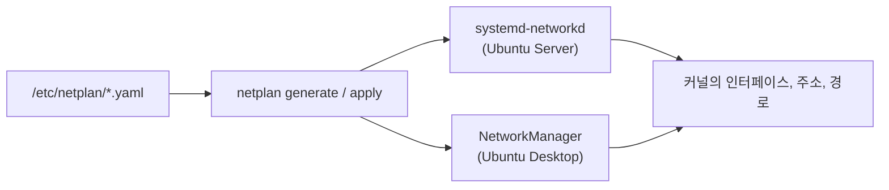
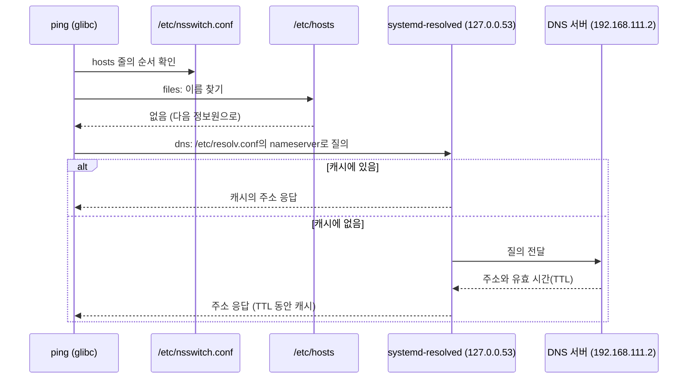

# 11장 — 네트워크 설정

[레포지토리 안내](../../README.ko.md) | [English](Concepts_Lecture.md) | [한국어](Concepts_Lecture.ko.md)

> **최종 수정일:** 2026-11-27

> **학습 목표:**
> 1. 호스트가 네트워크에 참여하는 데 필요한 IP 주소, 프리픽스, 기본 게이트웨이, DNS 서버의 역할을 설명할 수 있다
> 2. 프리픽스 길이로 네트워크 주소, 브로드캐스트 주소, 사용 가능한 호스트 수를 계산할 수 있다
> 3. `ip`, `ss`, `ping`, `tracepath`, `resolvectl`로 네트워크 상태를 확인하고 출력을 해석할 수 있다
> 4. Netplan 설정 파일로 고정 IP 주소를 설정하고 `netplan try`로 안전하게 적용할 수 있다
> 5. 호스트 이름과 이름 해석(`/etc/hosts`, `/etc/resolv.conf`, systemd-resolved)의 관계를 설명할 수 있다

---

## 목차

- [1. 네트워크 기초](#1-네트워크-기초)
  - [1.1 호스트에 필요한 네 가지 설정](#11-호스트에-필요한-네-가지-설정)
  - [1.2 프리픽스와 서브넷의 계산](#12-프리픽스와-서브넷의-계산)
  - [1.3 네트워크 인터페이스의 이름](#13-네트워크-인터페이스의-이름)
  - [1.4 주소의 종류와 특별한 주소 범위](#14-주소의-종류와-특별한-주소-범위)
  - [1.5 서브넷 나누기](#15-서브넷-나누기)
- [2. 네트워크 상태 확인](#2-네트워크-상태-확인)
  - [2.1 ip address와 ip link](#21-ip-address와-ip-link)
  - [2.2 ip route와 기본 게이트웨이](#22-ip-route와-기본-게이트웨이)
  - [2.3 ss로 보는 열린 포트](#23-ss로-보는-열린-포트)
  - [2.4 ping과 tracepath](#24-ping과-tracepath)
  - [2.5 최장 접두사 일치의 추적](#25-최장-접두사-일치의-추적)
  - [2.6 같은 서브넷 안의 전달과 이웃 테이블](#26-같은-서브넷-안의-전달과-이웃-테이블)
- [3. Netplan을 이용한 네트워크 설정](#3-netplan을-이용한-네트워크-설정)
  - [3.1 Netplan의 구조와 렌더러](#31-netplan의-구조와-렌더러)
  - [3.2 고정 IP 주소의 설정과 적용](#32-고정-ip-주소의-설정과-적용)
  - [3.3 ip 명령의 임시 설정](#33-ip-명령의-임시-설정)
  - [3.4 DHCP에서 고정 주소로 바꾸는 전체 절차](#34-dhcp에서-고정-주소로-바꾸는-전체-절차)
  - [3.5 NetworkManager의 nmcli로 설정하기](#35-networkmanager의-nmcli로-설정하기)
- [4. 호스트 이름과 이름 해석](#4-호스트-이름과-이름-해석)
  - [4.1 호스트 이름의 설정](#41-호스트-이름의-설정)
  - [4.2 systemd-resolved와 /etc/resolv.conf](#42-systemd-resolved와-etcresolvconf)
  - [4.3 이름 해석의 순서와 확인](#43-이름-해석의-순서와-확인)
  - [4.4 이름 해석의 전체 흐름](#44-이름-해석의-전체-흐름)
- [5. 네트워크 문제의 진단](#5-네트워크-문제의-진단)
  - [5.1 아래 계층부터 확인하는 순서](#51-아래-계층부터-확인하는-순서)
  - [5.2 사례: 다른 컴퓨터에서 서비스에 접속되지 않는 경우](#52-사례-다른-컴퓨터에서-서비스에-접속되지-않는-경우)
  - [5.3 흔한 실수](#53-흔한-실수)
- [개념 적용](#개념-적용)
- [요약](#요약)
- [점검 문제](#점검-문제)
- [참고 문헌](#참고-문헌)

---

<br>

## 1. 네트워크 기초

### 1.1 호스트에 필요한 네 가지 설정

Linux 컴퓨터가 인터넷의 다른 컴퓨터와 통신하려면 네트워크 인터페이스마다 다음 네 가지가 정해져 있어야 한다.

| 설정 | 하는 일 | 예 |
|:-----|:-----|:-----|
| IP 주소 | 네트워크에서 이 호스트를 가리키는 주소 | `192.168.111.130` |
| 프리픽스(서브넷 마스크) | 주소 가운데 네트워크를 나타내는 앞부분의 길이. 같은 네트워크에 있는 호스트를 판정하는 기준 | `/24` (`255.255.255.0`) |
| 기본 게이트웨이 | 같은 네트워크 밖으로 가는 패킷을 넘겨줄 라우터의 주소 | `192.168.111.2` |
| DNS 서버 | `www.ubuntu.com` 같은 이름을 IP 주소로 바꾸어 주는 서버의 주소 | `192.168.111.2`, `8.8.8.8` |

*표 1. 호스트가 네트워크에 참여하는 데 필요한 설정*

이 설정은 관리자가 직접 정하는 **고정(static) 설정**과, 네트워크의 DHCP 서버에게 받아 오는 **동적(dynamic) 설정**의 두 방법으로 정한다. 가상 머신의 NAT 네트워크(1주차 7.4절)나 가정의 공유기처럼 DHCP 서버가 있는 곳에서는 Ubuntu가 설치 직후부터 동적 설정으로 동작한다. 서버처럼 주소가 바뀌면 안 되는 컴퓨터에는 고정 설정을 쓴다(3.2절).

> **[컴퓨터네트워크]** 컴퓨터네트워크에서 배우는 TCP/IP 계층으로 보면, IP 주소와 프리픽스, 게이트웨이는 네트워크 계층의 포워딩에, DNS는 응용 계층의 이름 해석에 쓰인다. 호스트는 목적지 주소가 자기 네트워크 안이면 링크 계층(ARP와 이더넷)으로 직접 보내고, 밖이면 기본 게이트웨이에게 보낸다. 이 판정에 쓰는 것이 1.2절의 프리픽스이다.

### 1.2 프리픽스와 서브넷의 계산

IPv4 주소는 32비트이고, 앞의 n비트가 네트워크 부분, 나머지 32 - n비트가 호스트 부분이다. 이 n을 **프리픽스 길이(prefix length)** 라 하고 주소 뒤에 `/n`으로 쓴다(CIDR 표기). 프리픽스 길이만큼 1을 앞에 놓은 32비트 값이 서브넷 마스크이다. 한 서브넷에서 다음 두 주소는 호스트에게 줄 수 없다.

- **네트워크 주소:** 호스트 부분이 모두 0인 주소. 서브넷 자체를 가리킨다.
- **브로드캐스트 주소:** 호스트 부분이 모두 1인 주소. 서브넷의 모든 호스트를 가리킨다.

따라서 사용 가능한 호스트 수는 다음과 같다.

```math
\text{호스트 수} = 2^{32-n} - 2
```

`192.168.10.37/26`을 계산하면 다음과 같다.

```text
address      192.168.10.37  = 11000000.10101000.00001010.00 100101
mask /26     255.255.255.192 = 11111111.11111111.11111111.11 000000
network      192.168.10.0   = 11000000.10101000.00001010.00 000000   (host part all 0)
broadcast    192.168.10.63  = 11000000.10101000.00001010.00 111111   (host part all 1)
host range   192.168.10.1 ~ 192.168.10.62, 2^6 - 2 = 62 hosts
```

*그림 1. 192.168.10.37/26의 네트워크 부분과 호스트 부분*

마지막 바이트 37은 2진수로 `00100101`이고, 앞의 두 비트 `00`이 네트워크 부분, 뒤의 여섯 비트 `100101`이 호스트 부분이다. 같은 방법으로 다른 예를 계산하면 다음과 같다.

| 주소/프리픽스 | 서브넷 마스크 | 네트워크 주소 | 브로드캐스트 주소 | 호스트 수 |
|:-----|:-----|:-----|:-----|-----:|
| `192.168.111.130/24` | `255.255.255.0` | `192.168.111.0` | `192.168.111.255` | 254 |
| `192.168.10.37/26` | `255.255.255.192` | `192.168.10.0` | `192.168.10.63` | 62 |
| `10.0.5.200/20` | `255.255.240.0` | `10.0.0.0` | `10.0.15.255` | 4,094 |
| `172.16.4.1/30` | `255.255.255.252` | `172.16.4.0` | `172.16.4.3` | 2 |

*표 2. 프리픽스 길이에 따른 서브넷 계산의 예*

`10.0.5.200/20`은 셋째 바이트의 앞 네 비트까지가 네트워크 부분이다. 5는 `0000 0101`이므로 앞 네 비트 `0000`을 남기면 네트워크 주소의 셋째 바이트는 0, 뒤 네 비트를 모두 1로 하면 브로드캐스트 주소의 셋째 바이트는 15가 된다. `/30`은 호스트 두 개만 쓸 수 있으므로 라우터 두 대를 잇는 링크에 쓴다.

> **주의:** 두 호스트의 주소가 비슷해 보여도 프리픽스가 다르면 같은 네트워크가 아닐 수 있다. `192.168.10.37/26`과 `192.168.10.70/26`은 앞 세 바이트가 같지만, 70은 `01000110`이라 네트워크 부분이 `01`로 37의 `00`과 다르므로 서로 다른 서브넷이다. 두 호스트는 게이트웨이를 거쳐야 통신할 수 있다.

### 1.3 네트워크 인터페이스의 이름

Linux는 네트워크 장치에 `lo`, `ens33`, `enp0s3`, `wlp2s0` 같은 이름을 붙인다. `lo`는 자기 자신을 가리키는 루프백 인터페이스이고, 나머지는 systemd의 udev가 장치의 종류와 위치로 만든 **예측 가능한 이름**이다 [1]. 앞의 두 글자는 장치의 종류로, `en`은 이더넷, `wl`은 무선 LAN이고, 그 뒤는 펌웨어가 알려 준 슬롯 번호(`s33`)나 PCI 버스와 슬롯의 위치(`p0s3`) 같은 정보이다.

예전에는 장치를 찾은 순서대로 `eth0`, `eth1`을 붙였는데, 이 방식은 부팅할 때마다 장치를 찾는 순서가 달라지면 이름이 바뀔 수 있었다. 예측 가능한 이름은 장치의 물리적 위치에서 만들어지므로 같은 하드웨어에서는 늘 같다. 그래서 설정 파일(3절)에 인터페이스 이름을 적어도 안전하다. 인터페이스 이름은 컴퓨터마다 다르므로, 설정하기 전에 `ip link`로 실제 이름을 먼저 확인해야 한다.

### 1.4 주소의 종류와 특별한 주소 범위

IPv4 주소 가운데 일부 범위는 특별한 뜻으로 예약되어 있다. 이 범위를 알면 `ip address`의 출력만 보고도 호스트의 상태를 짐작할 수 있다.

| 범위 | 이름 | 뜻 |
|:-----|:-----|:-----|
| `10.0.0.0/8`, `172.16.0.0/12`, `192.168.0.0/16` | 사설 주소 | 조직 안에서 자유롭게 쓰는 주소로, 인터넷에서는 경로가 없어 공유기나 NAT를 거쳐 공인 주소로 바뀌어 나간다 [2] |
| `127.0.0.0/8` | 루프백 | 호스트 자신. 패킷이 네트워크 카드 밖으로 나가지 않는다 |
| `169.254.0.0/16` | 링크 로컬 | DHCP 서버에게서 주소를 받지 못한 호스트가 스스로 정하는 주소로, 같은 링크 안에서만 쓰인다 [3] |
| `0.0.0.0` | 지정되지 않은 주소 | 서버 소켓에서는 "이 호스트의 모든 주소"를 뜻한다(2.3절) |

*표 3. 특별한 뜻으로 예약된 IPv4 주소 범위*

`172.16.0.0/12`는 `172.16.0.0`부터 `172.31.255.255`까지이다. `/12`는 둘째 바이트의 앞 네 비트까지가 네트워크 부분이므로, 둘째 바이트 16(`0001 0000`)부터 31(`0001 1111`)까지가 모두 같은 네트워크에 들어간다. 따라서 `172.20.37.140`은 사설 주소이고 `172.32.0.1`은 사설 주소가 아니다.

> **주의:** 인터페이스의 주소가 `169.254.x.x`이면 네트워크 설정이 된 것이 아니라 DHCP가 실패한 것이다. 이 주소로는 게이트웨이나 인터넷에 닿을 수 없으므로, 케이블 연결(5.1절의 1단계), 가상 머신의 네트워크 방식(1주차 7.4절), DHCP 서버의 동작을 먼저 확인한다.

### 1.5 서브넷 나누기

하나의 네트워크를 프리픽스가 더 긴 여러 서브넷으로 나누면, 부서나 용도마다 네트워크를 따로 둘 수 있다. 프리픽스를 k비트 늘리면 서브넷이 $`2^k`$개로 나뉘고 서브넷마다 주소가 $`2^k`$분의 1로 줄어든다. `192.168.10.0/24`를 `/26` 네 개로 나누면 다음과 같다(늘린 비트 수 k = 2).

| 서브넷 | 네트워크 주소 | 호스트 범위 | 브로드캐스트 주소 |
|:-----|:-----|:-----|:-----|
| 0 | `192.168.10.0/26` | `.1` \~ `.62` | `.63` |
| 1 | `192.168.10.64/26` | `.65` \~ `.126` | `.127` |
| 2 | `192.168.10.128/26` | `.129` \~ `.190` | `.191` |
| 3 | `192.168.10.192/26` | `.193` \~ `.254` | `.255` |

*표 4. 192.168.10.0/24를 /26 네 개로 나눈 결과*

각 서브넷의 네트워크 주소는 마지막 바이트가 64씩 늘어난다. 64는 `/26`의 호스트 부분 6비트가 나타내는 주소 수 $`2^6`$이다. 필요한 호스트 수에서 프리픽스를 고를 때는 $`2^{32-n} - 2`$가 필요한 수 이상이 되는 가장 긴 n을 고른다. 호스트 50대가 필요한 실습실은 $`2^6 - 2 = 62`$ ≥ 50이므로 `/26`이면 되고, 100대가 필요하면 `/26`(62)으로는 모자라 $`2^7 - 2 = 126`$인 `/25`가 필요하다.

---

<br>

## 2. 네트워크 상태 확인

### 2.1 ip address와 ip link

`ip`는 iproute2 패키지의 명령으로, 인터페이스, 주소, 라우팅 표를 모두 다룬다. 예전의 `ifconfig`, `route`(net-tools 패키지)를 대신하며, Ubuntu 24.04에는 `ifconfig`가 기본으로 설치되어 있지 않다. `ip address`(줄여서 `ip a`)는 인터페이스마다 주소를 보여 준다. 다음은 Ubuntu 24.04 Server 가상 머신의 출력 예이다.

```text
$ ip address show ens33
2: ens33: <BROADCAST,MULTICAST,UP,LOWER_UP> mtu 1500 qdisc fq_codel state UP group default qlen 1000
    link/ether 00:0c:29:3a:5b:7c brd ff:ff:ff:ff:ff:ff
    altname enp2s1
    inet 192.168.111.130/24 metric 100 brd 192.168.111.255 scope global dynamic ens33
       valid_lft 1750sec preferred_lft 1750sec
    inet6 fe80::20c:29ff:fe3a:5b7c/64 scope link
       valid_lft forever preferred_lft forever
```

| 표시 | 뜻 |
|:-----|:-----|
| `2: ens33:` | 인터페이스 번호와 이름 |
| `UP,LOWER_UP` | 관리자가 켜 두었고(UP), 물리적 연결도 살아 있음(LOWER_UP) |
| `mtu 1500` | 한 번에 보낼 수 있는 최대 패킷 크기(바이트) |
| `link/ether 00:0c:29:...` | 이더넷 MAC 주소 |
| `altname enp2s1` | 같은 인터페이스의 다른 이름 |
| `inet 192.168.111.130/24` | IPv4 주소와 프리픽스 |
| `brd 192.168.111.255` | 브로드캐스트 주소 (표 2와 같음) |
| `dynamic`, `valid_lft 1750sec` | DHCP로 받은 주소이며, 남은 임대 시간이 1750초 |
| `inet6 fe80::.../64 scope link` | 같은 링크 안에서만 쓰는 IPv6 링크 로컬 주소 |

*표 5. ip address 출력의 해석*

`ip link`는 주소 없이 인터페이스의 상태만, `ip -br a`는 인터페이스마다 한 줄로 요약해 보여 준다. `ip -4 a`는 IPv4 주소만 보인다.

### 2.2 ip route와 기본 게이트웨이

`ip route`(줄여서 `ip r`)는 커널의 라우팅 표를 보여 준다. 위의 가상 머신에서는 다음과 같다(출력 예, 일부 줄 생략).

```text
$ ip route
default via 192.168.111.2 dev ens33 proto dhcp src 192.168.111.130 metric 100
192.168.111.0/24 dev ens33 proto kernel scope link src 192.168.111.130 metric 100
```

- 첫 줄은 **기본 경로(default route)** 로, 다른 줄에 맞지 않는 모든 목적지의 패킷을 `ens33`을 통해 게이트웨이 `192.168.111.2`에게 보내라는 뜻이다. `proto dhcp`는 DHCP로 받은 경로임을 나타낸다.
- 둘째 줄은 같은 네트워크 `192.168.111.0/24`로 가는 패킷은 게이트웨이 없이 `ens33`으로 직접 보내라는 뜻이다. 주소를 설정하면 커널이 자동으로 만든다(`proto kernel`).

커널은 목적지 주소와 맞는 줄 가운데 프리픽스가 가장 긴 줄을 고른다. `default`는 `0.0.0.0/0`, 곧 프리픽스 길이가 0이어서 다른 줄이 하나도 맞지 않을 때만 쓰인다. 특정 목적지로 갈 때 어느 경로가 쓰이는지는 `ip route get`으로 확인한다.

```text
$ ip route get 8.8.8.8
8.8.8.8 via 192.168.111.2 dev ens33 src 192.168.111.130 uid 1000
    cache
```

### 2.3 ss로 보는 열린 포트

`ss`는 소켓의 상태를 보여 주며 예전의 `netstat`을 대신한다. `-t`는 TCP, `-u`는 UDP, `-l`은 연결을 기다리는(LISTEN) 소켓, `-n`은 이름 대신 숫자, `-p`는 소켓을 쓰는 프로세스(`sudo` 필요)이다.

```text
$ ss -tln
State   Recv-Q  Send-Q   Local Address:Port    Peer Address:Port  Process
LISTEN  0       4096     127.0.0.53%lo:53           0.0.0.0:*
LISTEN  0       4096        127.0.0.54:53           0.0.0.0:*
LISTEN  0       4096           0.0.0.0:22           0.0.0.0:*
LISTEN  0       4096              [::]:22              [::]:*
```

`0.0.0.0:22`는 모든 IPv4 주소의 22번 포트(SSH, 12장)에서 연결을 기다린다는 뜻이고, `127.0.0.53%lo:53`은 루프백 인터페이스에서만 DNS 요청을 받는 systemd-resolved이다(4.2절). 서버를 설정한 뒤 외부에서 접속되지 않으면 먼저 `ss -tln`으로 그 서비스가 원하는 주소와 포트에서 기다리는지 확인한다. `127.0.0.1`에서만 기다리는 서비스는 다른 컴퓨터에서 접속할 수 없다.

### 2.4 ping과 tracepath

`ping`은 ICMP 에코 요청을 보내고 응답이 돌아오기까지의 왕복 시간을 잰다. Linux의 `ping`은 멈출 때까지 계속 보내므로 `-c`로 횟수를 정한다.

```text
$ ping -c 3 192.168.111.2
PING 192.168.111.2 (192.168.111.2) 56(84) bytes of data.
64 bytes from 192.168.111.2: icmp_seq=1 ttl=128 time=0.412 ms
64 bytes from 192.168.111.2: icmp_seq=2 ttl=128 time=0.388 ms
64 bytes from 192.168.111.2: icmp_seq=3 ttl=128 time=0.401 ms

--- 192.168.111.2 ping statistics ---
3 packets transmitted, 3 received, 0% packet loss, time 2034ms
rtt min/avg/max/mdev = 0.388/0.400/0.412/0.010 ms
```

`56(84) bytes`는 데이터 56바이트에 ICMP 헤더 8바이트와 IP 헤더 20바이트를 더해 84바이트라는 뜻이다. 평균 왕복 시간은 (0.412 + 0.388 + 0.401) ÷ 3 ≈ 0.400 ms이다. 네트워크 문제는 가까운 곳부터 차례로 확인한다.

1. `ping -c 3 127.0.0.1`: 자기 자신의 TCP/IP 동작
2. `ping -c 3 192.168.111.2`: 같은 네트워크의 게이트웨이까지
3. `ping -c 3 8.8.8.8`: 게이트웨이 너머 인터넷까지 (IP 주소로)
4. `ping -c 3 www.ubuntu.com`: 이름 해석까지

3번은 되는데 4번이 안 되면 경로가 아니라 DNS 설정(4절)의 문제이다. `tracepath 8.8.8.8`(또는 `traceroute`)은 목적지까지 거치는 라우터를 차례로 보여 주므로, 어느 지점에서 끊기는지 찾을 수 있다. 다만 ICMP를 막아 둔 서버도 많으므로, `ping`에 응답이 없다고 해서 반드시 그 호스트가 꺼진 것은 아니다.

### 2.5 최장 접두사 일치의 추적

인터페이스가 두 개(`ens33`, `ens34`)인 서버의 라우팅 표가 다음과 같다고 하자.

```text
default via 192.168.111.2 dev ens33
10.0.0.0/8 via 192.168.111.254 dev ens33
10.20.0.0/16 via 192.168.111.253 dev ens33
10.20.30.0/24 dev ens34 proto kernel scope link src 10.20.30.1
192.168.111.0/24 dev ens33 proto kernel scope link src 192.168.111.130
```

커널은 목적지 주소의 앞 n비트가 각 줄의 네트워크 주소의 앞 n비트와 같은지(n은 그 줄의 프리픽스 길이) 차례로 보고, 맞는 줄 가운데 n이 가장 큰 줄을 고른다. 목적지 `10.20.30.40`을 추적하면 다음과 같다.

| 줄 | 프리픽스 | 비교하는 앞부분 | 일치 |
|:-----|-----:|:-----|:-----|
| `default` | 0 | (비교할 비트 없음) | 맞음 |
| `10.0.0.0/8` | 8 | `00001010` = `00001010` | 맞음 |
| `10.20.0.0/16` | 16 | `00001010.00010100` = `00001010.00010100` | 맞음 |
| `10.20.30.0/24` | 24 | `00001010.00010100.00011110` = 같음 | 맞음 |
| `192.168.111.0/24` | 24 | `00001010...` ≠ `11000000...` | 틀림 |

*표 6. 목적지 10.20.30.40에 대한 최장 접두사 일치의 추적*

맞는 줄은 네 개이고 그중 프리픽스가 가장 긴 `/24`가 선택되므로, 이 패킷은 게이트웨이 없이 `ens34`로 직접 나간다. 다른 목적지도 같은 방법으로 정해진다.

```text
$ ip route get 10.20.30.40
10.20.30.40 dev ens34 src 10.20.30.1 uid 1000
$ ip route get 10.20.99.1
10.20.99.1 via 192.168.111.253 dev ens33 src 192.168.111.130 uid 1000
$ ip route get 10.99.1.1
10.99.1.1 via 192.168.111.254 dev ens33 src 192.168.111.130 uid 1000
$ ip route get 172.16.0.1
172.16.0.1 via 192.168.111.2 dev ens33 src 192.168.111.130 uid 1000
```

`10.20.99.1`은 셋째 바이트 99가 30과 달라 `/24`에는 맞지 않고 `/16`이 가장 길다. `10.99.1.1`은 둘째 바이트가 20이 아니므로 `/8`까지만 맞고, `172.16.0.1`은 `default`에만 맞는다. 여러 줄이 겹칠 때 줄의 순서는 결과에 영향을 주지 않으며, 언제나 프리픽스의 길이로 정해진다.

### 2.6 같은 서브넷 안의 전달과 이웃 테이블

라우팅 표에서 `via` 없이 `dev`만 있는 줄(2.2절의 `192.168.111.0/24 dev ens33`)을 고르면 커널은 패킷을 목적지에게 직접 보낸다. 이때 이더넷 프레임에는 IP 주소가 아니라 MAC 주소가 필요하므로, 커널은 ARP(Address Resolution Protocol)로 "이 IP 주소를 가진 호스트의 MAC 주소"를 물어 그 답을 **이웃 테이블(neighbor table)** 에 기억해 둔다. 게이트웨이를 거치는 경우에도 첫 홉인 게이트웨이의 MAC 주소를 같은 방법으로 얻는다. 이웃 테이블은 `ip neigh`로 본다(출력 예).

```text
$ ip neigh
192.168.111.2 dev ens33 lladdr 00:50:56:e2:1a:4f REACHABLE
192.168.111.1 dev ens33 lladdr 00:50:56:c0:00:08 STALE
192.168.111.150 dev ens33 FAILED
```

- `REACHABLE`은 최근에 통신이 확인된 이웃, `STALE`은 기록은 있지만 한동안 확인하지 않은 이웃이다. `STALE`인 이웃에게 다시 보내면 커널이 확인 과정을 거쳐 `REACHABLE`로 되돌린다.
- `FAILED`는 ARP 요청에 아무도 답하지 않은 주소이다. 같은 서브넷에 그 주소를 쓰는 호스트가 없거나, 그 호스트가 꺼져 있거나, 서브넷 설정이 서로 맞지 않는 경우이다.

그래서 같은 서브넷의 호스트에게 `ping`이 실패하면 `ip neigh`의 상태로 원인을 가를 수 있다. 상대가 `FAILED`이면 링크 계층에서 상대를 찾지 못한 것이고, `REACHABLE`인데 응답이 없으면 상대가 ICMP를 막고 있을 가능성이 크다.

---

<br>

## 3. Netplan을 이용한 네트워크 설정

### 3.1 Netplan의 구조와 렌더러

Ubuntu는 네트워크 설정을 **Netplan**의 YAML 파일 `/etc/netplan/*.yaml`에 적는다. Netplan은 이 파일을 읽어 실제로 네트워크를 설정할 프로그램(**렌더러**)의 설정으로 바꾸어 준다. 렌더러는 `networkd`(systemd-networkd)와 `NetworkManager` 두 가지이며, 지정하지 않으면 `networkd`가 쓰인다 [4].



*그림 2. Netplan 설정이 렌더러를 거쳐 커널에 적용되는 과정*

Ubuntu Server는 보통 설치할 때 만든 `/etc/netplan/50-cloud-init.yaml`에서 networkd를 쓰고, Ubuntu Desktop은 보통 `renderer: NetworkManager`만 적힌 파일을 두어 설정 화면과 `nmcli`가 실제 설정을 맡게 한다. 따라서 Desktop에서는 그래픽 설정 화면이나 `nmcli`로, Server에서는 Netplan 파일로 설정하는 것이 자연스럽다.

### 3.2 고정 IP 주소의 설정과 적용

서버 `ens33`에 고정 주소 `192.168.111.100/24`, 게이트웨이 `192.168.111.2`, DNS 서버 두 개를 정하는 Netplan 파일은 다음과 같다.

```yaml
network:
  version: 2
  renderer: networkd
  ethernets:
    ens33:
      dhcp4: false
      addresses:
        - 192.168.111.100/24
      routes:
        - to: default
          via: 192.168.111.2
      nameservers:
        addresses: [192.168.111.2, 8.8.8.8]
```

- YAML은 들여쓰기로 구조를 나타내므로 공백의 개수가 중요하며, 탭 문자는 쓸 수 없다.
- `dhcp4: false`는 DHCP를 쓰지 않는다는 뜻이다(기본값도 꺼짐) [4].
- `addresses`의 주소에는 반드시 프리픽스 길이를 붙인다.
- `routes`의 `to: default`가 기본 게이트웨이이다. 예전의 `gateway4:` 키는 더 쓰지 않는(deprecated) 형식이다 [4].
- `nameservers.addresses`는 DNS 서버의 목록이다.

설정 파일을 고친 뒤에는 `sudo netplan try`로 적용한다. `netplan try`는 새 설정을 적용한 뒤 사용자가 확인하지 않으면 기본 120초 뒤에 원래 설정으로 되돌린다 [5]. SSH로 원격 접속한 서버에서 설정을 잘못하여 연결이 끊겨도 2분 뒤에 저절로 복구되므로, 원격 서버에서는 `netplan apply`보다 `netplan try`가 안전하다.

```text
$ sudo netplan try
Do you want to keep these settings?

Press ENTER before the timeout to accept the new configuration

Changes will revert in 118 seconds
Configuration accepted.
$ ip -4 -br address show ens33
ens33            UP             192.168.111.100/24
```

> **주의:** 고정 주소는 DHCP 서버가 나누어 주는 주소 범위 밖에서 골라야 한다. 같은 주소를 DHCP가 다른 컴퓨터에 주면 두 컴퓨터의 주소가 충돌하여 둘 다 통신이 불안정해진다. 고정 주소, 프리픽스, 게이트웨이가 서로 맞는지(게이트웨이가 같은 서브넷 안에 있는지)도 1.2절의 방법으로 먼저 확인한다.

### 3.3 ip 명령의 임시 설정

`ip` 명령으로도 주소와 경로를 바꿀 수 있지만, 이 설정은 커널에만 적용되고 파일에 저장되지 않으므로 다시 부팅하거나 렌더러가 설정을 다시 적용하면 사라진다.

```text
$ sudo ip address add 192.168.111.101/24 dev ens33
$ sudo ip route add 10.20.0.0/16 via 192.168.111.254
$ sudo ip link set ens33 down
$ sudo ip link set ens33 up
```

첫 명령은 `ens33`에 주소를 하나 더 붙이고, 둘째 명령은 `10.20.0.0/16`으로 가는 경로를 더하며, 나머지 두 명령은 인터페이스를 껐다 켠다. 시험 삼아 바꾸어 볼 때 유용하며, 계속 쓸 설정은 3.2절처럼 Netplan 파일에 적는다. 원격 접속 중인 인터페이스를 `down`하면 그 순간 연결이 끊기므로 주의해야 한다.

### 3.4 DHCP에서 고정 주소로 바꾸는 전체 절차

DHCP로 주소를 받던 Ubuntu Server의 `ens33`을 3.2절의 고정 주소로 바꾸는 전체 절차는 다음과 같다.

```text
$ ip -br link
lo               UNKNOWN        00:00:00:00:00:00 <LOOPBACK,UP,LOWER_UP>
ens33            UP             00:0c:29:3a:5b:7c <BROADCAST,MULTICAST,UP,LOWER_UP>
$ ls /etc/netplan
50-cloud-init.yaml
$ sudo cat /etc/netplan/50-cloud-init.yaml
network:
  version: 2
  ethernets:
    ens33:
      dhcp4: true
$ sudo nano /etc/netplan/99-static.yaml
$ sudo chmod 600 /etc/netplan/99-static.yaml
$ sudo netplan generate
$ sudo netplan try
...
Configuration accepted.
$ ip -4 -br address show ens33
ens33            UP             192.168.111.100/24
$ ip route | grep default
default via 192.168.111.2 dev ens33 proto static
$ resolvectl dns ens33
Link 2 (ens33): 192.168.111.2 8.8.8.8
$ ping -c 1 -q www.ubuntu.com | tail -1
rtt min/avg/max/mdev = 4.105/4.105/4.105/0.000 ms
```

1. **이름 확인.** `ip -br link`로 실제 인터페이스 이름 `ens33`을 확인한다(1.3절).
2. **기존 파일 확인.** 설치 프로그램이 만든 `50-cloud-init.yaml`은 `dhcp4: true`이다.
3. **새 파일 작성.** 3.2절의 내용을 `99-static.yaml`에 쓴다. Netplan은 이름이 다른 파일들을 디렉터리와 관계없이 이름의 사전순으로 읽고, 뒤에 읽은 파일이 앞 파일의 값에 더해지거나 덮어쓴다 [6]. `99-`는 `50-`보다 뒤이므로 `dhcp4: false`가 `true`를 덮어쓴다. `01-static.yaml`처럼 앞선 이름으로 만들면 거꾸로 `50-cloud-init.yaml`의 `dhcp4: true`가 이긴다.
4. **권한.** 설정 파일에 비밀번호 같은 값이 들어갈 수 있으므로 root만 읽도록 `600`으로 둔다. 다른 사용자가 읽을 수 있으면 Netplan이 경고를 출력한다.
5. **문법 검사와 적용.** `netplan generate`는 적용하지 않고 렌더러 설정만 만들어 YAML 문법 오류를 먼저 알려 준다. 이어서 `netplan try`로 적용하고 연결이 유지되면 `Enter`로 확정한다(3.2절).
6. **확인.** 주소, 기본 경로(`proto static`으로 바뀜), DNS 서버, 이름으로 하는 `ping`을 차례로 확인한다. 이 순서는 5.1절의 진단 순서와 같다.

`netplan try`의 시간 안에 `Enter`를 누르지 못하면(예: 원격 연결이 끊긴 경우) 이전 설정으로 돌아가므로, 다시 접속하여 `99-static.yaml`의 오류를 고친 뒤 처음부터 되풀이한다.

### 3.5 NetworkManager의 nmcli로 설정하기

렌더러가 NetworkManager인 Ubuntu Desktop(3.1절)에서는 Netplan 파일 대신 그래픽 설정 화면이나 명령 `nmcli`로 설정한다. NetworkManager는 설정을 **연결 프로필(connection)** 단위로 관리하며, 하나의 인터페이스에 여러 프로필을 두고 골라 쓸 수 있다. 3.2절과 같은 고정 주소를 `nmcli`로 설정하면 다음과 같다.

```text
$ nmcli connection show
NAME                UUID                                  TYPE      DEVICE
Wired connection 1  6c1d9b1e-3c51-3b4a-9a5e-2f0e8c7d4b21  ethernet  ens33
$ sudo nmcli connection modify "Wired connection 1" \
    ipv4.method manual \
    ipv4.addresses 192.168.111.100/24 \
    ipv4.gateway 192.168.111.2 \
    ipv4.dns "192.168.111.2 8.8.8.8"
$ sudo nmcli connection up "Wired connection 1"
Connection successfully activated (D-Bus active path: /org/freedesktop/NetworkManager/ActiveConnection/3)
```

- `ipv4.method manual`은 고정 설정을, `auto`는 DHCP를 뜻한다. `manual`로 바꿀 때는 `ipv4.addresses`를 함께 정해야 한다.
- `modify`는 프로필의 값만 바꾸며, 바뀐 값은 `connection up`으로 다시 활성화해야 적용된다.
- DHCP로 되돌리려면 `ipv4.method auto`로 바꾸고 `ipv4.addresses`, `ipv4.gateway`, `ipv4.dns`를 빈 값(`""`)으로 지운 뒤 다시 활성화한다.

NetworkManager가 관리하는 인터페이스를 Netplan 파일의 networkd 설정으로 함께 다루면 두 프로그램이 같은 인터페이스를 서로 다르게 설정하려 하므로, 한 인터페이스는 한 렌더러만 맡게 한다.

---

<br>

## 4. 호스트 이름과 이름 해석

### 4.1 호스트 이름의 설정

호스트 이름은 `/etc/hostname`에 저장되고, `hostnamectl`로 확인하고 바꾼다. `hostnamectl hostname 이름`은 정적(static), 일시(transient), 표시용(pretty) 호스트 이름을 함께 바꾸며 [7], 예전 형식인 `hostnamectl set-hostname 이름`도 쓸 수 있다.

```text
$ hostnamectl hostname
myubuntu
$ sudo hostnamectl hostname server1
$ cat /etc/hostname
server1
```

호스트 이름을 바꾼 뒤에는 `/etc/hosts`의 `127.0.1.1 myubuntu` 줄(1주차 4.3절)도 새 이름으로 고친다. 이 줄이 맞지 않으면 `sudo`를 실행할 때 `unable to resolve host server1` 경고가 나온다. 정적 호스트 이름과 일시 호스트 이름은 인터넷 도메인 이름에 쓰는 문자만 쓸 수 있고 64자를 넘을 수 없다 [7].

### 4.2 systemd-resolved와 /etc/resolv.conf

Ubuntu에서 이름 해석은 **systemd-resolved** 서비스가 맡는다. systemd-resolved는 루프백 인터페이스의 `127.0.0.53`과 `127.0.0.54`에서 DNS 요청을 받는 스텁 리스너를 두고 [8], 받은 요청을 Netplan(3.2절)이나 DHCP로 정해진 실제 DNS 서버로 보낸다. 그래서 `/etc/resolv.conf`에는 실제 DNS 서버가 아니라 `127.0.0.53`이 적혀 있다.

```text
$ ls -l /etc/resolv.conf
lrwxrwxrwx 1 root root 39 Mar 11 14:20 /etc/resolv.conf -> ../run/systemd/resolve/stub-resolv.conf
$ grep nameserver /etc/resolv.conf
nameserver 127.0.0.53
$ resolvectl dns ens33
Link 2 (ens33): 192.168.111.2 8.8.8.8
```

`/etc/resolv.conf`는 systemd-resolved가 만드는 파일을 가리키는 심볼릭 링크이므로, 이 파일을 직접 고쳐도 다시 덮어써진다. DNS 서버를 바꾸려면 Netplan의 `nameservers`를 고치고 `netplan apply`를 실행한다. 실제로 쓰이는 DNS 서버는 `resolvectl status`나 `resolvectl dns`로 확인한다.

### 4.3 이름 해석의 순서와 확인

프로그램이 이름을 주소로 바꿀 때 어떤 정보원을 어떤 순서로 쓰는지는 `/etc/nsswitch.conf`의 `hosts:` 줄이 정한다. Ubuntu Desktop의 기본값은 대략 `hosts: files mdns4_minimal [NOTFOUND=return] dns`이고, mDNS 모듈을 설치하지 않은 Server는 `hosts: files dns`이다. 어느 쪽이든 `files`(곧 `/etc/hosts`)를 먼저 보고 거기에 없을 때 DNS를 쓴다. 그래서 `/etc/hosts`에 `192.168.111.100 server1`을 적어 두면 DNS 서버 없이도 `ping server1`이 동작하고, 같은 이름이 DNS에 다른 주소로 등록되어 있어도 `/etc/hosts`가 이긴다.

| 명령 | 확인하는 것 |
|:-----|:-----|
| `getent hosts server1` | `/etc/nsswitch.conf`의 순서를 따른 결과 (프로그램이 실제로 얻는 주소) |
| `resolvectl query www.ubuntu.com` | systemd-resolved를 거친 DNS 결과 |
| `dig www.ubuntu.com`, `nslookup www.ubuntu.com` | DNS 서버에 직접 물은 결과 (`/etc/hosts`는 보지 않음) |

*표 7. 이름 해석을 확인하는 명령*

`getent`와 `dig`의 결과가 다르면 `/etc/hosts`의 줄이 원인인 경우가 많다. 웹 브라우저나 `ssh`처럼 일반 프로그램은 `getent`와 같은 경로로 이름을 해석하므로, "DNS는 맞는데 접속이 엉뚱한 곳으로 간다"면 먼저 `/etc/hosts`를 확인한다.

### 4.4 이름 해석의 전체 흐름

`ping www.ubuntu.com`을 실행하면 이름이 주소로 바뀌기까지 다음 순서를 거친다.



*그림 3. ping이 이름을 주소로 바꾸는 과정*

1. `ping`은 C 라이브러리(glibc)의 이름 해석 함수를 부르고, glibc는 `/etc/nsswitch.conf`의 `hosts:` 줄을 읽어 정보원의 순서를 정한다 [9].
2. 첫 정보원 `files`는 `/etc/hosts`를 찾는다. 이름이 있으면 여기서 끝난다.
3. `mdns4_minimal`은 `.local`로 끝나는 이름만 다루므로 일반 이름은 지나간다. `[NOTFOUND=return]`은 이 정보원이 "그런 이름은 없다"고 확실히 답하면 거기서 멈추라는 뜻이다 [9].
4. `dns`는 `/etc/resolv.conf`의 `nameserver 127.0.0.53`에게 질의하므로, 질의는 같은 컴퓨터의 systemd-resolved로 간다(4.2절).
5. systemd-resolved는 캐시에 답이 있으면 바로 돌려주고, 없으면 그 인터페이스에 설정된 실제 DNS 서버(Netplan의 `nameservers`)에게 묻는다. 받은 답은 DNS 응답에 담긴 유효 시간(TTL) 동안 캐시한다.

같은 이름을 두 번 물으면 둘째에는 캐시에서 답이 온다(출력 예).

```text
$ resolvectl query www.ubuntu.com
www.ubuntu.com: 185.125.190.21                 -- link: ens33

-- Information acquired via protocol DNS in 31.6ms.
-- Data is authenticated: no; Data was acquired via local or encrypted transport: no
-- Data from: network
$ resolvectl query www.ubuntu.com | tail -1
-- Data from: cache
```

`resolvectl flush-caches`는 이 캐시를 비운다. DNS 레코드를 바꾼 직후 옛 주소가 계속 나오면 캐시 때문일 수 있다.

---

<br>

## 5. 네트워크 문제의 진단

### 5.1 아래 계층부터 확인하는 순서

네트워크 문제는 아래 계층(물리 연결)부터 위 계층(응용)으로 하나씩 확인하면 원인을 빠르게 좁힐 수 있다. 앞 단계가 실패하면 그 뒤의 단계는 확인할 필요가 없다.

| 단계 | 명령 | 정상인 상태 | 이상할 때 의심할 것 |
|-----:|:-----|:-----|:-----|
| 1 | `ip -br link` | `UP`과 `LOWER_UP` | `NO-CARRIER`: 케이블, VM 네트워크 연결 |
| 2 | `ip -4 -br address` | 서브넷에 맞는 주소 | 주소 없음이나 `169.254.x.x`: DHCP 실패, Netplan 오류 |
| 3 | `ip route` | `default via 게이트웨이` | 기본 경로 없음: `routes`의 `to: default` 누락 |
| 4 | `ping -c 3 게이트웨이`, `ping -c 3 8.8.8.8` | 응답 | 게이트웨이 무응답: 서브넷 불일치, 외부 무응답: 게이트웨이나 NAT |
| 5 | `getent hosts 이름`, `resolvectl query 이름` | 주소 | 실패: `nameservers`, `/etc/hosts`의 잘못된 줄 |
| 6 | `ss -tln` (서버), `curl` (클라이언트) | 원하는 주소와 포트에서 LISTEN | `127.0.0.1`에서만 대기, 서비스 꺼짐, 방화벽 |

*표 8. 아래 계층부터 확인하는 네트워크 진단의 순서*

### 5.2 사례: 다른 컴퓨터에서 서비스에 접속되지 않는 경우

서버 `192.168.111.100`에서 실행한 웹 서비스(포트 8080)에 서버 자신에서는 접속되는데 같은 네트워크의 다른 PC에서는 접속되지 않는다. 표 8의 순서로 확인하면 다음과 같다(출력 예).

```text
client$ ping -c 1 -q 192.168.111.100 | tail -1
rtt min/avg/max/mdev = 0.512/0.512/0.512/0.000 ms
client$ curl http://192.168.111.100:8080/
curl: (7) Failed to connect to 192.168.111.100 port 8080 after 1 ms: Couldn't connect to server
server$ sudo ss -tlnp | grep 8080
LISTEN 0      5          127.0.0.1:8080      0.0.0.0:*    users:(("python3",pid=2310,fd=3))
server$ python3 -m http.server 8080 --bind 0.0.0.0
```

- `ping`이 성공하므로 1\~4단계(연결, 주소, 경로)는 정상이다. 주소로 접속했으므로 5단계(이름 해석)도 관계가 없다.
- `curl`이 곧바로 "연결할 수 없다"고 끝나는 것은 서버가 그 포트로 들어온 연결을 거절했다는 뜻이다. 패킷이 방화벽에 버려지면 거절 대신 시간이 지나서야 실패한다.
- 6단계의 `ss`가 원인을 보여 준다. 서비스가 `127.0.0.1:8080`, 곧 루프백에서만 기다리므로 다른 컴퓨터에서 온 연결은 받지 않는다. 모든 주소(`0.0.0.0`)에서 기다리도록 다시 실행하면 해결된다.

이처럼 "서버에서는 되는데 밖에서는 안 된다"는 증상은 대개 서비스의 대기 주소나 방화벽의 문제이고, "IP 주소로는 되는데 이름으로는 안 된다"는 증상은 이름 해석의 문제이다.

### 5.3 흔한 실수

| 실수 | 결과 | 올바른 방법 |
|:-----|:-----|:-----|
| `addresses`에 프리픽스 없이 `192.168.111.100`만 씀 | Netplan 오류 또는 의도와 다른 프리픽스 | `192.168.111.100/24`처럼 프리픽스를 붙임 |
| 게이트웨이를 다른 서브넷의 주소로 씀 | 기본 경로에 닿지 못해 외부 통신 불가 | 게이트웨이가 주소와 같은 서브넷인지 계산하여 확인 (1.2절) |
| YAML 들여쓰기에 탭을 쓰거나 칸 수를 틀림 | `netplan generate`가 문법 오류를 냄 | 공백 두 칸 단위로 들여씀 |
| 고정 설정 파일을 `50-cloud-init.yaml`보다 앞선 이름으로 만듦 | DHCP 설정이 고정 설정을 덮어씀 | `99-static.yaml`처럼 뒤에 오는 이름을 씀 (3.4절) |
| `/etc/resolv.conf`를 직접 고침 | 다시 덮어써져 원래대로 돌아감 | Netplan의 `nameservers`를 고침 (4.2절) |
| 원격 서버에서 `netplan apply`나 `ip link set down`을 실행 | 설정이 틀리면 연결이 끊겨 복구할 수 없음 | `netplan try`를 씀 (3.2절) |
| 서비스를 `127.0.0.1`에 묶어 둠 | 다른 컴퓨터에서 접속할 수 없음 | `0.0.0.0`이나 그 인터페이스의 주소에서 대기 (5.2절) |

*표 9. 네트워크 설정의 흔한 실수*

---

<br>

## 개념 적용

**T/F 점검:**

| 문장 | 판단과 근거 |
|:-----|:-----|
| `/26` 서브넷에는 호스트를 64개 둘 수 있다. | **F.** 2^6 = 64개 가운데 네트워크 주소와 브로드캐스트 주소를 빼면 62개이다. |
| `192.168.10.37/26`과 `192.168.10.70/26`은 같은 서브넷이다. | **F.** 마지막 바이트의 앞 두 비트가 `00`과 `01`로 다르므로 서로 다른 서브넷이다. |
| `sudo ip address add`로 붙인 주소는 다시 부팅해도 남는다. | **F.** `ip` 명령의 설정은 커널에만 적용되며 파일에 저장되지 않는다. |
| 원격 서버의 네트워크 설정을 바꿀 때는 `netplan try`가 `netplan apply`보다 안전하다. | **T.** 확인하지 않으면 기본 120초 뒤에 이전 설정으로 되돌아간다. |
| DNS 서버를 바꾸려면 `/etc/resolv.conf`를 직접 고친다. | **F.** systemd-resolved가 관리하는 링크이므로 Netplan의 `nameservers`를 고친다. |
| `dig`의 결과는 `/etc/hosts`의 내용을 반영한다. | **F.** `dig`는 DNS 서버에 직접 묻고, `/etc/hosts`를 포함한 결과는 `getent hosts`로 본다. |
| 프리픽스를 2비트 늘리면 서브넷이 네 개로 나뉜다. | **T.** k비트를 늘리면 $`2^k`$개로 나뉘므로 $`2^2 = 4`$개이다. |
| 라우팅 표에서 위에 적힌 줄이 먼저 선택된다. | **F.** 줄의 순서와 관계없이 맞는 줄 가운데 프리픽스가 가장 긴 줄이 선택된다. |
| 인터페이스 주소가 `169.254.10.20`이면 고정 주소가 설정된 것이다. | **F.** DHCP에서 주소를 받지 못한 호스트가 스스로 정한 링크 로컬 주소이다. |

---

<br>

## 요약

| 개념 | 핵심 요약 |
|------|-----------|
| 호스트의 네 가지 설정 | IP 주소, 프리픽스, 기본 게이트웨이, DNS 서버이며, 고정 설정이나 DHCP로 정한다. |
| 프리픽스 계산 | `/n`은 앞 n비트가 네트워크 부분이며, 호스트 수는 2^(32-n) - 2이고 호스트 부분이 모두 0이면 네트워크, 모두 1이면 브로드캐스트 주소이다. |
| 인터페이스 이름 | `en`은 이더넷, `wl`은 무선 LAN이며 장치의 위치로 만든 예측 가능한 이름이라 부팅마다 바뀌지 않는다. |
| ip 명령 | `ip address`는 주소, `ip route`는 라우팅 표, `ip link`는 인터페이스 상태를 보이며, `ip`로 바꾼 설정은 임시이다. |
| ss와 ping | `ss -tln`은 기다리는 TCP 포트를, `ping -c`는 왕복 시간을 보이며, 문제는 루프백, 게이트웨이, 인터넷, 이름 해석 순서로 좁힌다. |
| Netplan | `/etc/netplan/*.yaml`을 networkd나 NetworkManager의 설정으로 바꾸며, `netplan try`는 확인이 없으면 120초 뒤 되돌린다. |
| 이름 해석 | systemd-resolved가 `127.0.0.53`에서 요청을 받아 실제 DNS로 보내고, `/etc/nsswitch.conf`에 따라 `/etc/hosts`를 먼저 본다. |
| 특별한 주소 | `10/8`, `172.16/12`, `192.168/16`은 사설 주소, `127/8`은 루프백, `169.254/16`은 DHCP 실패 때의 링크 로컬 주소이다. |
| 최장 접두사 일치 | 목적지와 맞는 경로 가운데 프리픽스가 가장 긴 것을 고르며, `default`(`/0`)는 맞는 줄이 없을 때만 쓰인다. |
| 설정 파일의 순서 | Netplan은 파일을 이름의 사전순으로 읽어 뒤 파일이 앞 파일을 덮어쓰므로 고정 설정은 `99-` 같은 뒤 이름으로 둔다. |
| 진단의 순서 | 링크, 주소, 경로, 게이트웨이와 외부, 이름 해석, 포트의 순서로 아래 계층부터 확인한다. |
| 이웃 테이블 | 같은 서브넷의 목적지와 게이트웨이의 MAC 주소를 ARP로 얻어 `ip neigh`에 기억하며, `FAILED`는 상대를 찾지 못했다는 뜻이다. |
| nmcli | NetworkManager의 연결 프로필을 `connection modify`로 바꾸고 `connection up`으로 적용한다. |

---

<br>

## 점검 문제

1. **서브넷 계산:** `172.20.37.140/27`의 서브넷 마스크, 네트워크 주소, 브로드캐스트 주소, 사용 가능한 호스트 범위를 구하라.

   <details>
   <summary>정답</summary>

   `/27`의 마스크는 `255.255.255.224`이다. 마지막 바이트 140은 `100 01100`이므로 앞 세 비트 `100`을 남기면 128, 뒤 다섯 비트를 모두 1로 하면 159이다. 네트워크 주소는 `172.20.37.128`, 브로드캐스트 주소는 `172.20.37.159`, 호스트 범위는 `172.20.37.129` \~ `172.20.37.158`의 2^5 - 2 = 30개이다.

   </details>

2. **라우팅 표 해석:** 라우팅 표에 `default via 10.0.0.1 dev ens33`과 `10.0.0.0/24 dev ens33 proto kernel scope link`, `172.16.0.0/16 via 10.0.0.254 dev ens33` 세 줄이 있다. 목적지 `10.0.0.77`, `172.16.5.5`, `8.8.8.8`로 가는 패킷은 각각 어디로 보내지는가?

   <details>
   <summary>정답</summary>

   커널은 맞는 줄 가운데 프리픽스가 가장 긴 줄을 고른다. `10.0.0.77`은 `10.0.0.0/24`에 맞으므로 게이트웨이 없이 `ens33`으로 직접 보낸다. `172.16.5.5`는 `172.16.0.0/16`에 맞으므로 `10.0.0.254`에게 보낸다. `8.8.8.8`은 `default`(`/0`)에만 맞으므로 기본 게이트웨이 `10.0.0.1`에게 보낸다.

   </details>

3. **문제의 위치 찾기:** `ping -c 3 8.8.8.8`은 성공하는데 `ping -c 3 www.ubuntu.com`은 `Temporary failure in name resolution`으로 실패한다. 어느 설정을 확인해야 하는지와 확인 명령을 쓰라.

   <details>
   <summary>정답</summary>

   IP 주소로는 인터넷까지 도달하므로 주소, 프리픽스, 게이트웨이는 정상이고 이름 해석이 문제이다. `resolvectl status`(또는 `resolvectl dns`)로 인터페이스에 DNS 서버가 설정되어 있는지 확인하고, 없거나 틀리면 Netplan의 `nameservers`를 고친 뒤 `sudo netplan apply`를 실행한다. `resolvectl query www.ubuntu.com`으로 해석 결과를 다시 확인한다.

   </details>

4. **Netplan 설정:** 서버의 `enp0s3`이 DHCP로 주소를 받고 있다. 이를 고정 주소 `10.0.2.50/24`, 게이트웨이 `10.0.2.2`, DNS 서버 `10.0.2.3`으로 바꾸는 `ethernets` 부분을 쓰라.

   <details>
   <summary>정답</summary>

   ```yaml
   ethernets:
     enp0s3:
       dhcp4: false
       addresses:
         - 10.0.2.50/24
       routes:
         - to: default
           via: 10.0.2.2
       nameservers:
         addresses: [10.0.2.3]
   ```

   게이트웨이 `10.0.2.2`가 `10.0.2.0/24` 안에 있으므로 주소와 맞는다. 저장한 뒤 `sudo netplan try`로 적용하고 연결이 유지되면 `Enter`로 확정한다.

   </details>

5. **이름 해석의 순서:** `/etc/hosts`에 `10.0.0.9 db.example.com`이 있고 DNS에는 `db.example.com`이 `10.0.0.20`으로 등록되어 있다. `getent hosts db.example.com`, `dig +short db.example.com`, `ssh db.example.com`은 각각 어느 주소를 쓰는가?

   <details>
   <summary>정답</summary>

   `/etc/nsswitch.conf`의 `hosts: files ... dns` 순서에 따라 `getent`는 `/etc/hosts`의 `10.0.0.9`를 돌려준다. `dig`는 DNS 서버에 직접 물으므로 `10.0.0.20`을 출력한다. `ssh`는 일반 프로그램처럼 `getent`와 같은 경로로 해석하므로 `10.0.0.9`에 접속한다.

   </details>

6. **서브넷 설계:** `10.10.0.0/22`를 같은 크기의 서브넷 네 개로 나눌 때 각 서브넷의 프리픽스와 네트워크 주소, 서브넷마다 사용 가능한 호스트 수를 구하라.

   <details>
   <summary>정답</summary>

   네 개로 나누려면 프리픽스를 2비트 늘려 `/24`가 된다. `/22`의 주소 범위는 `10.10.0.0` \~ `10.10.3.255`이므로 네트워크 주소는 `10.10.0.0/24`, `10.10.1.0/24`, `10.10.2.0/24`, `10.10.3.0/24`이고, 서브넷마다 $`2^8 - 2 = 254`$개의 호스트를 쓸 수 있다.

   </details>

7. **최장 접두사 일치:** 2.5절의 라우팅 표에서 목적지 `10.20.30.255`, `10.21.0.1`, `192.168.111.77`로 가는 패킷이 고르는 줄과 나가는 인터페이스를 쓰라.

   <details>
   <summary>정답</summary>

   `10.20.30.255`는 앞 24비트가 `10.20.30`이므로 `10.20.30.0/24`가 가장 길어 `ens34`로 직접 나간다(그 서브넷의 브로드캐스트 주소이다). `10.21.0.1`은 둘째 바이트가 21이라 `/16`과 `/24`에 맞지 않고 `10.0.0.0/8`이 가장 길어 `192.168.111.254`를 거쳐 `ens33`으로 나간다. `192.168.111.77`은 `192.168.111.0/24`에 맞아 `ens33`으로 직접 나간다.

   </details>

8. **진단 순서:** 새로 설치한 서버에서 `ip -4 -br address`가 `ens33 UP 169.254.83.12/16`을 출력하고 `ping 8.8.8.8`이 `Network is unreachable`로 실패한다. 무엇이 문제이며 다음에 무엇을 확인해야 하는가?

   <details>
   <summary>정답</summary>

   링크는 `UP`이지만 주소가 `169.254.0.0/16`의 링크 로컬 주소이므로 DHCP로 주소를 받지 못했다. 이 상태에서는 기본 경로가 없으므로 외부로 가는 경로가 없다는 오류가 난다. 가상 머신의 네트워크 방식과 DHCP 서버의 동작을 확인하고, DHCP를 쓸 수 없는 네트워크이면 3.4절처럼 고정 주소, 게이트웨이, DNS 서버를 Netplan에 설정한다.

   </details>

---

<br>

## 참고 문헌

1. systemd project, "systemd.net-naming-scheme, Network device naming schemes," *freedesktop.org*. [Online]. Available: https://www.freedesktop.org/software/systemd/man/latest/systemd.net-naming-scheme.html
2. Y. Rekhter, B. Moskowitz, D. Karrenberg, G. J. de Groot, and E. Lear, "Address Allocation for Private Internets," RFC 1918, Feb. 1996. [Online]. Available: https://www.rfc-editor.org/rfc/rfc1918
3. S. Cheshire, B. Aboba, and E. Guttman, "Dynamic Configuration of IPv4 Link-Local Addresses," RFC 3927, May 2005. [Online]. Available: https://www.rfc-editor.org/rfc/rfc3927
4. Netplan project, "YAML configuration," *Netplan documentation*. [Online]. Available: https://netplan.readthedocs.io/en/stable/netplan-yaml/
5. Netplan project, "netplan-try," *Netplan documentation*. [Online]. Available: https://netplan.readthedocs.io/en/stable/netplan-try/
6. Netplan project, "netplan-generate," *Netplan documentation*. [Online]. Available: https://netplan.readthedocs.io/en/stable/netplan-generate/
7. systemd project, "hostnamectl, Control the system hostname," *freedesktop.org*. [Online]. Available: https://www.freedesktop.org/software/systemd/man/latest/hostnamectl.html
8. systemd project, "systemd-resolved.service, Network Name Resolution manager," *freedesktop.org*. [Online]. Available: https://www.freedesktop.org/software/systemd/man/latest/systemd-resolved.service.html
9. M. Kerrisk et al., "nsswitch.conf(5), Linux manual page," *The Linux man-pages project*. [Online]. Available: https://man7.org/linux/man-pages/man5/nsswitch.conf.5.html
