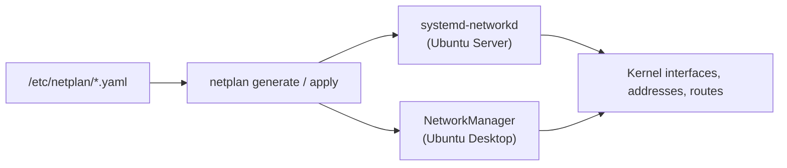
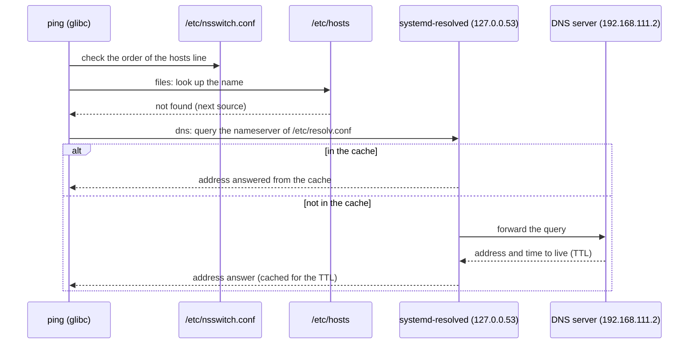

# Chapter 11 — Network Configuration

[Repository Guide](../../README.md) | [English](Concepts_Lecture.md) | [한국어](Concepts_Lecture.ko.md)

> **Last Updated:** 2026-11-19

> **Learning Objectives:**
> 1. Explain the roles of the IP address, prefix, default gateway, and DNS server that a host needs to take part in a network
> 2. Compute the network address, broadcast address, and number of usable hosts from the prefix length
> 3. Check the network state with `ip`, `ss`, `ping`, `tracepath`, and `resolvectl` and interpret their output
> 4. Configure a static IP address with a Netplan configuration file and apply it safely with `netplan try`
> 5. Explain the relations among the host name and name resolution (`/etc/hosts`, `/etc/resolv.conf`, systemd-resolved)

---

## Table of Contents

- [1. Network Fundamentals](#1-network-fundamentals)
  - [1.1 The Four Settings a Host Needs](#11-the-four-settings-a-host-needs)
  - [1.2 Computing Prefixes and Subnets](#12-computing-prefixes-and-subnets)
  - [1.3 Names of Network Interfaces](#13-names-of-network-interfaces)
  - [1.4 Kinds of Addresses and Special Address Ranges](#14-kinds-of-addresses-and-special-address-ranges)
  - [1.5 Dividing a Network into Subnets](#15-dividing-a-network-into-subnets)
- [2. Checking the Network State](#2-checking-the-network-state)
  - [2.1 ip address and ip link](#21-ip-address-and-ip-link)
  - [2.2 ip route and the Default Gateway](#22-ip-route-and-the-default-gateway)
  - [2.3 Open Ports Seen with ss](#23-open-ports-seen-with-ss)
  - [2.4 ping and tracepath](#24-ping-and-tracepath)
  - [2.5 Tracing Longest-Prefix Matching](#25-tracing-longest-prefix-matching)
  - [2.6 Delivery Within the Same Subnet and the Neighbor Table](#26-delivery-within-the-same-subnet-and-the-neighbor-table)
- [3. Network Configuration with Netplan](#3-network-configuration-with-netplan)
  - [3.1 Structure of Netplan and Renderers](#31-structure-of-netplan-and-renderers)
  - [3.2 Setting and Applying a Static IP Address](#32-setting-and-applying-a-static-ip-address)
  - [3.3 Temporary Settings with the ip Command](#33-temporary-settings-with-the-ip-command)
  - [3.4 The Complete Procedure for Changing from DHCP to a Static Address](#34-the-complete-procedure-for-changing-from-dhcp-to-a-static-address)
  - [3.5 Configuring with nmcli of NetworkManager](#35-configuring-with-nmcli-of-networkmanager)
- [4. Host Names and Name Resolution](#4-host-names-and-name-resolution)
  - [4.1 Setting the Host Name](#41-setting-the-host-name)
  - [4.2 systemd-resolved and /etc/resolv.conf](#42-systemd-resolved-and-etcresolvconf)
  - [4.3 Order and Checking of Name Resolution](#43-order-and-checking-of-name-resolution)
  - [4.4 The Complete Flow of Name Resolution](#44-the-complete-flow-of-name-resolution)
- [5. Diagnosing Network Problems](#5-diagnosing-network-problems)
  - [5.1 Checking from the Lower Layers Up](#51-checking-from-the-lower-layers-up)
  - [5.2 Case: A Service Cannot Be Reached from Another Computer](#52-case-a-service-cannot-be-reached-from-another-computer)
  - [5.3 Common Mistakes](#53-common-mistakes)
- [Concept Applications](#concept-applications)
- [Summary](#summary)
- [Self-Check Questions](#self-check-questions)
- [References](#references)

---

<br>

## 1. Network Fundamentals

### 1.1 The Four Settings a Host Needs

For a Linux computer to communicate with other computers on the Internet, the following four settings must be determined for each network interface.

| Setting | Role | Example |
|:-----|:-----|:-----|
| IP address | The address that refers to this host on the network | `192.168.111.130` |
| Prefix (subnet mask) | The length of the leading part of the address that identifies the network; the criterion for deciding which hosts are on the same network | `/24` (`255.255.255.0`) |
| Default gateway | The address of the router to which packets bound outside the network are handed | `192.168.111.2` |
| DNS server | The address of the server that turns names such as `www.ubuntu.com` into IP addresses | `192.168.111.2`, `8.8.8.8` |

*Table 1. Settings a host needs to take part in a network*

These settings are determined in two ways: a **static configuration** set directly by the administrator, and a **dynamic configuration** obtained from the network's DHCP server. Where a DHCP server exists, as in the NAT network of a virtual machine (Week 1, Section 7.4) or a home router, Ubuntu works with dynamic configuration right after installation. A static configuration is used for computers whose addresses must not change, such as servers (Section 3.2).

> **[Computer Networks]** In terms of the TCP/IP layers taught in Computer Networks, the IP address, prefix, and gateway are used for forwarding in the network layer, and DNS for name resolution in the application layer. If the destination address is within its own network, the host sends the packet directly through the link layer (ARP and Ethernet); otherwise it sends it to the default gateway. The prefix of Section 1.2 is what this decision uses.

### 1.2 Computing Prefixes and Subnets

An IPv4 address has 32 bits; the first n bits are the network part and the remaining 32 - n bits the host part. This n is called the **prefix length** and is written as `/n` after the address (CIDR notation). The 32-bit value with n leading 1s is the subnet mask. In a subnet, the following two addresses cannot be given to hosts.

- **Network address:** The address whose host part is all 0s. It refers to the subnet itself.
- **Broadcast address:** The address whose host part is all 1s. It refers to all hosts of the subnet.

The number of usable hosts is therefore as follows.

```math
\text{number of hosts} = 2^{32-n} - 2
```

Computing `192.168.10.37/26` gives the following.

```text
address      192.168.10.37  = 11000000.10101000.00001010.00 100101
mask /26     255.255.255.192 = 11111111.11111111.11111111.11 000000
network      192.168.10.0   = 11000000.10101000.00001010.00 000000   (host part all 0)
broadcast    192.168.10.63  = 11000000.10101000.00001010.00 111111   (host part all 1)
host range   192.168.10.1 ~ 192.168.10.62, 2^6 - 2 = 62 hosts
```

*Figure 1. The network part and host part of 192.168.10.37/26*

The last byte 37 is `00100101` in binary; the first two bits `00` are the network part and the last six bits `100101` the host part. Computing other examples in the same way gives the following.

| Address/prefix | Subnet mask | Network address | Broadcast address | Hosts |
|:-----|:-----|:-----|:-----|-----:|
| `192.168.111.130/24` | `255.255.255.0` | `192.168.111.0` | `192.168.111.255` | 254 |
| `192.168.10.37/26` | `255.255.255.192` | `192.168.10.0` | `192.168.10.63` | 62 |
| `10.0.5.200/20` | `255.255.240.0` | `10.0.0.0` | `10.0.15.255` | 4,094 |
| `172.16.4.1/30` | `255.255.255.252` | `172.16.4.0` | `172.16.4.3` | 2 |

*Table 2. Examples of subnet computation by prefix length*

For `10.0.5.200/20`, the network part extends through the first four bits of the third byte. 5 is `0000 0101`, so keeping the first four bits `0000` gives 0 as the third byte of the network address, and setting the last four bits to 1 gives 15 as the third byte of the broadcast address. `/30` allows only two hosts, so it is used for a link connecting two routers.

> **Caution:** Even if the addresses of two hosts look alike, they may not be on the same network if the prefix differs. `192.168.10.37/26` and `192.168.10.70/26` share the first three bytes, but 70 is `01000110`, whose network part `01` differs from the `00` of 37, so they are in different subnets. The two hosts can communicate only through a gateway.

### 1.3 Names of Network Interfaces

Linux gives network devices names such as `lo`, `ens33`, `enp0s3`, and `wlp2s0`. `lo` is the loopback interface that refers to the machine itself, and the others are **predictable names** that systemd's udev builds from the type and location of the device [1]. The first two letters give the type of device, `en` for Ethernet and `wl` for wireless LAN, and the rest is information such as the slot number reported by the firmware (`s33`) or the PCI bus and slot location (`p0s3`).

In the past, the names `eth0` and `eth1` were assigned in the order the devices were found, and with this method a name could change if the order of detection differed from boot to boot. Predictable names are built from the physical location of the device, so they are always the same on the same hardware. It is therefore safe to write interface names in configuration files (Section 3). Interface names differ from computer to computer, so the actual name must first be checked with `ip link` before configuring.

### 1.4 Kinds of Addresses and Special Address Ranges

Some ranges of IPv4 addresses are reserved for special meanings. Knowing them makes it possible to guess the state of a host from the output of `ip address` alone.

| Range | Name | Meaning |
|:-----|:-----|:-----|
| `10.0.0.0/8`, `172.16.0.0/12`, `192.168.0.0/16` | Private addresses | Addresses used freely within an organization; they have no routes on the Internet and are translated into public addresses by a router or NAT on the way out [2] |
| `127.0.0.0/8` | Loopback | The host itself. Packets never leave the network card |
| `169.254.0.0/16` | Link-local | An address that a host chooses for itself when it cannot obtain one from a DHCP server; usable only within the same link [3] |
| `0.0.0.0` | Unspecified address | On a server socket it means "every address of this host" (Section 2.3) |

*Table 3. IPv4 address ranges reserved for special meanings*

`172.16.0.0/12` runs from `172.16.0.0` to `172.31.255.255`. With `/12`, the network part extends through the first four bits of the second byte, so every second byte from 16 (`0001 0000`) to 31 (`0001 1111`) belongs to the same network. `172.20.37.140` is therefore a private address, and `172.32.0.1` is not.

> **Caution:** If an interface's address is `169.254.x.x`, the network has not been configured; DHCP has failed. With this address the gateway and the Internet cannot be reached, so first check the cable connection (step 1 of Section 5.1), the network mode of the virtual machine (Week 1, Section 7.4), and the operation of the DHCP server.

### 1.5 Dividing a Network into Subnets

Dividing one network into several subnets with longer prefixes makes it possible to keep a separate network for each department or purpose. Lengthening the prefix by k bits divides the network into $`2^k`$ subnets, and each subnet has 1/$`2^k`$ of the addresses. Dividing `192.168.10.0/24` into four `/26` subnets gives the following (number of added bits k = 2).

| Subnet | Network address | Host range | Broadcast address |
|:-----|:-----|:-----|:-----|
| 0 | `192.168.10.0/26` | `.1` - `.62` | `.63` |
| 1 | `192.168.10.64/26` | `.65` - `.126` | `.127` |
| 2 | `192.168.10.128/26` | `.129` - `.190` | `.191` |
| 3 | `192.168.10.192/26` | `.193` - `.254` | `.255` |

*Table 4. Result of dividing 192.168.10.0/24 into four /26 subnets*

The last byte of each subnet's network address increases by 64. 64 is $`2^6`$, the number of addresses represented by the 6-bit host part of `/26`. When choosing a prefix from the number of hosts needed, choose the longest n for which $`2^{32-n} - 2`$ is at least the required number. A lab that needs 50 hosts can use `/26`, since $`2^6 - 2 = 62`$ ≥ 50, while one that needs 100 hosts cannot use `/26` (62) and needs `/25`, with $`2^7 - 2 = 126`$.

---

<br>

## 2. Checking the Network State

### 2.1 ip address and ip link

`ip` is a command of the iproute2 package that handles interfaces, addresses, and routing tables. It replaces the former `ifconfig` and `route` (net-tools package), and `ifconfig` is not installed by default on Ubuntu 24.04. `ip address` (`ip a` for short) shows the addresses of each interface. The following is example output from an Ubuntu 24.04 Server virtual machine.

```text
$ ip address show ens33
2: ens33: <BROADCAST,MULTICAST,UP,LOWER_UP> mtu 1500 qdisc fq_codel state UP group default qlen 1000
    link/ether 00:0c:29:3a:5b:7c brd ff:ff:ff:ff:ff:ff
    altname enp2s1
    inet 192.168.111.130/24 metric 100 brd 192.168.111.255 scope global dynamic ens33
       valid_lft 1750sec preferred_lft 1750sec
    inet6 fe80::20c:29ff:fe3a:5b7c/64 scope link
       valid_lft forever preferred_lft forever
```

| Notation | Meaning |
|:-----|:-----|
| `2: ens33:` | Interface number and name |
| `UP,LOWER_UP` | Turned on by the administrator (UP), and the physical link is alive (LOWER_UP) |
| `mtu 1500` | Maximum packet size that can be sent at once (bytes) |
| `link/ether 00:0c:29:...` | Ethernet MAC address |
| `altname enp2s1` | Another name of the same interface |
| `inet 192.168.111.130/24` | IPv4 address and prefix |
| `brd 192.168.111.255` | Broadcast address (as in Table 2) |
| `dynamic`, `valid_lft 1750sec` | An address obtained by DHCP, with 1750 seconds of lease remaining |
| `inet6 fe80::.../64 scope link` | IPv6 link-local address used only within the same link |

*Table 5. Interpretation of ip address output*

`ip link` shows only the state of interfaces without addresses, and `ip -br a` summarizes each interface on one line. `ip -4 a` shows only IPv4 addresses.

### 2.2 ip route and the Default Gateway

`ip route` (`ip r` for short) shows the kernel's routing table. On the virtual machine above it is as follows (example output, some lines omitted).

```text
$ ip route
default via 192.168.111.2 dev ens33 proto dhcp src 192.168.111.130 metric 100
192.168.111.0/24 dev ens33 proto kernel scope link src 192.168.111.130 metric 100
```

- The first line is the **default route**: packets to every destination that matches no other line are sent through `ens33` to the gateway `192.168.111.2`. `proto dhcp` indicates a route obtained by DHCP.
- The second line means that packets to the same network `192.168.111.0/24` are sent directly through `ens33` without a gateway. The kernel creates it automatically when the address is configured (`proto kernel`).

Among the lines that match the destination address, the kernel chooses the one with the longest prefix. `default` is `0.0.0.0/0`, that is, a prefix length of 0, so it is used only when no other line matches. Which route is used for a particular destination is checked with `ip route get`.

```text
$ ip route get 8.8.8.8
8.8.8.8 via 192.168.111.2 dev ens33 src 192.168.111.130 uid 1000
    cache
```

### 2.3 Open Ports Seen with ss

`ss` shows the state of sockets and replaces the former `netstat`. `-t` selects TCP, `-u` UDP, `-l` sockets waiting for connections (LISTEN), `-n` numbers instead of names, and `-p` the processes using the sockets (needs `sudo`).

```text
$ ss -tln
State   Recv-Q  Send-Q   Local Address:Port    Peer Address:Port  Process
LISTEN  0       4096     127.0.0.53%lo:53           0.0.0.0:*
LISTEN  0       4096        127.0.0.54:53           0.0.0.0:*
LISTEN  0       4096           0.0.0.0:22           0.0.0.0:*
LISTEN  0       4096              [::]:22              [::]:*
```

`0.0.0.0:22` means waiting for connections on port 22 (SSH, Chapter 12) of every IPv4 address, and `127.0.0.53%lo:53` is systemd-resolved, which accepts DNS requests only on the loopback interface (Section 4.2). When a server has been configured but cannot be reached from outside, first check with `ss -tln` that the service is waiting on the intended address and port. A service waiting only on `127.0.0.1` cannot be reached from other computers.

### 2.4 ping and tracepath

`ping` sends ICMP echo requests and measures the round-trip time until the reply returns. Linux's `ping` keeps sending until stopped, so the count is set with `-c`.

```text
$ ping -c 3 192.168.111.2
PING 192.168.111.2 (192.168.111.2) 56(84) bytes of data.
64 bytes from 192.168.111.2: icmp_seq=1 ttl=128 time=0.412 ms
64 bytes from 192.168.111.2: icmp_seq=2 ttl=128 time=0.388 ms
64 bytes from 192.168.111.2: icmp_seq=3 ttl=128 time=0.401 ms

--- 192.168.111.2 ping statistics ---
3 packets transmitted, 3 received, 0% packet loss, time 2034ms
rtt min/avg/max/mdev = 0.388/0.400/0.412/0.010 ms
```

`56(84) bytes` means 56 bytes of data plus an 8-byte ICMP header and a 20-byte IP header, 84 bytes in all. The average round-trip time is (0.412 + 0.388 + 0.401) ÷ 3 ≈ 0.400 ms. Network problems are checked step by step from the nearest point.

1. `ping -c 3 127.0.0.1`: the host's own TCP/IP operation
2. `ping -c 3 192.168.111.2`: up to the gateway on the same network
3. `ping -c 3 8.8.8.8`: beyond the gateway to the Internet (by IP address)
4. `ping -c 3 www.ubuntu.com`: including name resolution

If step 3 works but step 4 does not, the problem lies not in the path but in the DNS settings (Section 4). `tracepath 8.8.8.8` (or `traceroute`) shows the routers passed on the way to the destination in turn, so it can find where the connection breaks. Many servers block ICMP, however, so no reply to `ping` does not necessarily mean that the host is down.

### 2.5 Tracing Longest-Prefix Matching

Suppose the routing table of a server with two interfaces (`ens33`, `ens34`) is as follows.

```text
default via 192.168.111.2 dev ens33
10.0.0.0/8 via 192.168.111.254 dev ens33
10.20.0.0/16 via 192.168.111.253 dev ens33
10.20.30.0/24 dev ens34 proto kernel scope link src 10.20.30.1
192.168.111.0/24 dev ens33 proto kernel scope link src 192.168.111.130
```

For each line, the kernel checks whether the first n bits of the destination address equal the first n bits of the line's network address (n being the line's prefix length), and among the matching lines it chooses the one with the largest n. Tracing the destination `10.20.30.40` gives the following.

| Line | Prefix | Leading part compared | Match |
|:-----|-----:|:-----|:-----|
| `default` | 0 | (no bits to compare) | Yes |
| `10.0.0.0/8` | 8 | `00001010` = `00001010` | Yes |
| `10.20.0.0/16` | 16 | `00001010.00010100` = `00001010.00010100` | Yes |
| `10.20.30.0/24` | 24 | `00001010.00010100.00011110` = same | Yes |
| `192.168.111.0/24` | 24 | `00001010...` ≠ `11000000...` | No |

*Table 6. Trace of longest-prefix matching for the destination 10.20.30.40*

Four lines match, and the `/24`, which has the longest prefix, is chosen, so the packet goes out directly through `ens34` without a gateway. Other destinations are decided in the same way.

```text
$ ip route get 10.20.30.40
10.20.30.40 dev ens34 src 10.20.30.1 uid 1000
$ ip route get 10.20.99.1
10.20.99.1 via 192.168.111.253 dev ens33 src 192.168.111.130 uid 1000
$ ip route get 10.99.1.1
10.99.1.1 via 192.168.111.254 dev ens33 src 192.168.111.130 uid 1000
$ ip route get 172.16.0.1
172.16.0.1 via 192.168.111.2 dev ens33 src 192.168.111.130 uid 1000
```

For `10.20.99.1`, the third byte 99 differs from 30, so it does not match the `/24`, and the `/16` is the longest match. `10.99.1.1` matches only up to the `/8` because its second byte is not 20, and `172.16.0.1` matches only `default`. When several lines overlap, their order does not affect the result; it is always decided by prefix length.

### 2.6 Delivery Within the Same Subnet and the Neighbor Table

When the routing table yields a line with only `dev` and no `via` (`192.168.111.0/24 dev ens33` of Section 2.2), the kernel sends the packet directly to the destination. An Ethernet frame needs a MAC address rather than an IP address, so the kernel asks with ARP (Address Resolution Protocol) for "the MAC address of the host that has this IP address" and remembers the answer in the **neighbor table**. Even when the packet goes through a gateway, the MAC address of the gateway, the first hop, is obtained in the same way. The neighbor table is shown with `ip neigh` (example output).

```text
$ ip neigh
192.168.111.2 dev ens33 lladdr 00:50:56:e2:1a:4f REACHABLE
192.168.111.1 dev ens33 lladdr 00:50:56:c0:00:08 STALE
192.168.111.150 dev ens33 FAILED
```

- `REACHABLE` is a neighbor with which communication was recently confirmed, and `STALE` a neighbor that is recorded but has not been confirmed for a while. When something is sent again to a `STALE` neighbor, the kernel goes through a confirmation process and returns it to `REACHABLE`.
- `FAILED` is an address for which nobody answered the ARP request. Either no host on the same subnet uses that address, the host is turned off, or the subnet settings of the two hosts do not agree.

When `ping` to a host on the same subnet fails, the state in `ip neigh` therefore separates the causes. If the other host is `FAILED`, it could not be found at the link layer; if it is `REACHABLE` but there is no reply, the other host is probably blocking ICMP.

---

<br>

## 3. Network Configuration with Netplan

### 3.1 Structure of Netplan and Renderers

Ubuntu writes network settings in the YAML files of **Netplan**, `/etc/netplan/*.yaml`. Netplan reads these files and converts them into the configuration of the program that actually configures the network (the **renderer**). There are two renderers, `networkd` (systemd-networkd) and `NetworkManager`, and `networkd` is used if none is specified [4].



*Figure 2. How Netplan settings are applied to the kernel through a renderer*

Ubuntu Server usually uses networkd in `/etc/netplan/50-cloud-init.yaml`, created at installation, while Ubuntu Desktop usually keeps a file containing only `renderer: NetworkManager` so that the settings screen and `nmcli` handle the actual configuration. On Desktop it is therefore natural to configure with the graphical settings screen or `nmcli`, and on Server with Netplan files.

### 3.2 Setting and Applying a Static IP Address

A Netplan file that gives the server's `ens33` the static address `192.168.111.100/24`, the gateway `192.168.111.2`, and two DNS servers is as follows.

```yaml
network:
  version: 2
  renderer: networkd
  ethernets:
    ens33:
      dhcp4: false
      addresses:
        - 192.168.111.100/24
      routes:
        - to: default
          via: 192.168.111.2
      nameservers:
        addresses: [192.168.111.2, 8.8.8.8]
```

- YAML expresses structure by indentation, so the number of spaces matters, and tab characters cannot be used.
- `dhcp4: false` means that DHCP is not used (it is also off by default) [4].
- The addresses in `addresses` must always carry the prefix length.
- `to: default` in `routes` is the default gateway. The former `gateway4:` key is a deprecated form [4].
- `nameservers.addresses` is the list of DNS servers.

After editing the configuration file, apply it with `sudo netplan try`. `netplan try` applies the new configuration and, unless the user confirms it, reverts to the original configuration after 120 seconds by default [5]. Even if a mistake in the settings cuts the connection to a server accessed remotely through SSH, it recovers by itself after two minutes, so on a remote server `netplan try` is safer than `netplan apply`.

```text
$ sudo netplan try
Do you want to keep these settings?

Press ENTER before the timeout to accept the new configuration

Changes will revert in 118 seconds
Configuration accepted.
$ ip -4 -br address show ens33
ens33            UP             192.168.111.100/24
```

> **Caution:** A static address must be chosen outside the range of addresses handed out by the DHCP server. If DHCP gives the same address to another computer, the addresses of the two computers conflict and both communicate unreliably. Check first with the method of Section 1.2 that the static address, prefix, and gateway are consistent with each other (that the gateway lies within the same subnet).

### 3.3 Temporary Settings with the ip Command

Addresses and routes can also be changed with the `ip` command, but these settings are applied only to the kernel and are not saved to a file, so they disappear after a reboot or when the renderer reapplies its configuration.

```text
$ sudo ip address add 192.168.111.101/24 dev ens33
$ sudo ip route add 10.20.0.0/16 via 192.168.111.254
$ sudo ip link set ens33 down
$ sudo ip link set ens33 up
```

The first command adds one more address to `ens33`, the second adds a route to `10.20.0.0/16`, and the remaining two turn the interface off and on. These commands are useful for trying out changes, and settings to be kept are written in a Netplan file as in Section 3.2. Taking down the interface that carries a remote session cuts the connection at that moment, so care is needed.

### 3.4 The Complete Procedure for Changing from DHCP to a Static Address

The complete procedure for changing `ens33` of an Ubuntu Server that obtained its address by DHCP to the static address of Section 3.2 is as follows.

```text
$ ip -br link
lo               UNKNOWN        00:00:00:00:00:00 <LOOPBACK,UP,LOWER_UP>
ens33            UP             00:0c:29:3a:5b:7c <BROADCAST,MULTICAST,UP,LOWER_UP>
$ ls /etc/netplan
50-cloud-init.yaml
$ sudo cat /etc/netplan/50-cloud-init.yaml
network:
  version: 2
  ethernets:
    ens33:
      dhcp4: true
$ sudo nano /etc/netplan/99-static.yaml
$ sudo chmod 600 /etc/netplan/99-static.yaml
$ sudo netplan generate
$ sudo netplan try
...
Configuration accepted.
$ ip -4 -br address show ens33
ens33            UP             192.168.111.100/24
$ ip route | grep default
default via 192.168.111.2 dev ens33 proto static
$ resolvectl dns ens33
Link 2 (ens33): 192.168.111.2 8.8.8.8
$ ping -c 1 -q www.ubuntu.com | tail -1
rtt min/avg/max/mdev = 4.105/4.105/4.105/0.000 ms
```

1. **Check the name.** Check the actual interface name `ens33` with `ip -br link` (Section 1.3).
2. **Check the existing file.** `50-cloud-init.yaml`, created by the installer, has `dhcp4: true`.
3. **Write a new file.** Write the content of Section 3.2 in `99-static.yaml`. Netplan reads files with different names in lexicographical order of their names, regardless of directory, and a file read later adds to or overrides the values of earlier files [6]. `99-` comes after `50-`, so `dhcp4: false` overrides `true`. A file with an earlier name such as `01-static.yaml` would instead be overridden by the `dhcp4: true` of `50-cloud-init.yaml`.
4. **Permissions.** A configuration file may contain values such as passwords, so it is set to `600` so that only root can read it. If other users can read it, Netplan prints a warning.
5. **Syntax check and application.** `netplan generate` only produces the renderer configuration without applying it, so it reports YAML syntax errors first. Then apply with `netplan try` and confirm with `Enter` if the connection is kept (Section 3.2).
6. **Verification.** Check in turn the address, the default route (now `proto static`), the DNS servers, and a `ping` by name. This order is the same as the diagnosis order of Section 5.1.

If `Enter` is not pressed within the time of `netplan try` (for example, because the remote connection was cut), the previous configuration returns, so reconnect, fix the error in `99-static.yaml`, and repeat from the beginning.

### 3.5 Configuring with nmcli of NetworkManager

On Ubuntu Desktop, whose renderer is NetworkManager (Section 3.1), configuration is done not with Netplan files but with the graphical settings screen or the `nmcli` command. NetworkManager manages settings in units of **connection profiles**, and several profiles can be kept for one interface and chosen among. Setting the static address of Section 3.2 with `nmcli` gives the following.

```text
$ nmcli connection show
NAME                UUID                                  TYPE      DEVICE
Wired connection 1  6c1d9b1e-3c51-3b4a-9a5e-2f0e8c7d4b21  ethernet  ens33
$ sudo nmcli connection modify "Wired connection 1" \
    ipv4.method manual \
    ipv4.addresses 192.168.111.100/24 \
    ipv4.gateway 192.168.111.2 \
    ipv4.dns "192.168.111.2 8.8.8.8"
$ sudo nmcli connection up "Wired connection 1"
Connection successfully activated (D-Bus active path: /org/freedesktop/NetworkManager/ActiveConnection/3)
```

- `ipv4.method manual` means a static configuration, and `auto` means DHCP. When switching to `manual`, `ipv4.addresses` must be set as well.
- `modify` only changes the values of the profile; the changed values take effect after the profile is activated again with `connection up`.
- To return to DHCP, change to `ipv4.method auto`, clear `ipv4.addresses`, `ipv4.gateway`, and `ipv4.dns` with empty values (`""`), and activate the profile again.

If an interface managed by NetworkManager is also handled by networkd settings in a Netplan file, the two programs try to configure the same interface differently, so each interface is left to a single renderer.

---

<br>

## 4. Host Names and Name Resolution

### 4.1 Setting the Host Name

The host name is stored in `/etc/hostname` and is checked and changed with `hostnamectl`. `hostnamectl hostname name` changes the static, transient, and pretty host names together [7], and the older form `hostnamectl set-hostname name` can also be used.

```text
$ hostnamectl hostname
myubuntu
$ sudo hostnamectl hostname server1
$ cat /etc/hostname
server1
```

After changing the host name, also change the line `127.0.1.1 myubuntu` in `/etc/hosts` (Week 1, Section 4.3) to the new name. If this line does not match, running `sudo` gives the warning `unable to resolve host server1`. Static and transient host names may use only the characters used in Internet domain names and cannot exceed 64 characters [7].

### 4.2 systemd-resolved and /etc/resolv.conf

On Ubuntu, name resolution is handled by the **systemd-resolved** service. systemd-resolved runs a stub listener that accepts DNS requests on `127.0.0.53` and `127.0.0.54` of the loopback interface [8] and forwards the requests to the real DNS servers set by Netplan (Section 3.2) or DHCP. `/etc/resolv.conf` therefore contains not the real DNS servers but `127.0.0.53`.

```text
$ ls -l /etc/resolv.conf
lrwxrwxrwx 1 root root 39 Mar 11 14:20 /etc/resolv.conf -> ../run/systemd/resolve/stub-resolv.conf
$ grep nameserver /etc/resolv.conf
nameserver 127.0.0.53
$ resolvectl dns ens33
Link 2 (ens33): 192.168.111.2 8.8.8.8
```

`/etc/resolv.conf` is a symbolic link to a file generated by systemd-resolved, so editing it directly is overwritten again. To change the DNS servers, edit `nameservers` in Netplan and run `netplan apply`. The DNS servers actually in use are checked with `resolvectl status` or `resolvectl dns`.

### 4.3 Order and Checking of Name Resolution

Which sources a program uses, and in what order, when it turns a name into an address is determined by the `hosts:` line of `/etc/nsswitch.conf`. The default of Ubuntu Desktop is roughly `hosts: files mdns4_minimal [NOTFOUND=return] dns`, and that of Server, which does not install the mDNS module, is `hosts: files dns`. Either way, `files` (that is, `/etc/hosts`) is looked at first, and DNS is used when the name is not there. Writing `192.168.111.100 server1` in `/etc/hosts` therefore makes `ping server1` work without a DNS server, and `/etc/hosts` wins even if the same name is registered in DNS with a different address.

| Command | What it checks |
|:-----|:-----|
| `getent hosts server1` | The result following the order of `/etc/nsswitch.conf` (the address a program actually gets) |
| `resolvectl query www.ubuntu.com` | The DNS result through systemd-resolved |
| `dig www.ubuntu.com`, `nslookup www.ubuntu.com` | The result of asking a DNS server directly (`/etc/hosts` is not consulted) |

*Table 7. Commands for checking name resolution*

When the results of `getent` and `dig` differ, a line in `/etc/hosts` is often the cause. Ordinary programs such as web browsers and `ssh` resolve names by the same path as `getent`, so if "DNS is correct but the connection goes somewhere else", check `/etc/hosts` first.

### 4.4 The Complete Flow of Name Resolution

When `ping www.ubuntu.com` is run, the name passes through the following steps before it becomes an address.



*Figure 3. How ping turns a name into an address*

1. `ping` calls the name resolution functions of the C library (glibc), and glibc reads the `hosts:` line of `/etc/nsswitch.conf` to decide the order of sources [9].
2. The first source, `files`, looks in `/etc/hosts`. If the name is there, the lookup ends here.
3. `mdns4_minimal` handles only names ending in `.local`, so an ordinary name passes on. `[NOTFOUND=return]` means "stop here if this source answers definitely that no such name exists" [9].
4. `dns` queries `nameserver 127.0.0.53` of `/etc/resolv.conf`, so the query goes to systemd-resolved on the same computer (Section 4.2).
5. If the answer is in its cache, systemd-resolved returns it at once; otherwise it asks the real DNS server set for the interface (the `nameservers` of Netplan). It caches the answer for the time to live (TTL) carried in the DNS response.

When the same name is asked twice, the second answer comes from the cache (example output).

```text
$ resolvectl query www.ubuntu.com
www.ubuntu.com: 185.125.190.21                 -- link: ens33

-- Information acquired via protocol DNS in 31.6ms.
-- Data is authenticated: no; Data was acquired via local or encrypted transport: no
-- Data from: network
$ resolvectl query www.ubuntu.com | tail -1
-- Data from: cache
```

`resolvectl flush-caches` empties this cache. If the old address keeps appearing right after a DNS record has been changed, the cache may be the reason.

---

<br>

## 5. Diagnosing Network Problems

### 5.1 Checking from the Lower Layers Up

The cause of a network problem can be narrowed down quickly by checking one item at a time from the lower layers (the physical connection) up to the upper layers (the application). If a step fails, the later steps need not be checked.

| Step | Command | Normal state | What to suspect when abnormal |
|-----:|:-----|:-----|:-----|
| 1 | `ip -br link` | `UP` and `LOWER_UP` | `NO-CARRIER`: cable, VM network connection |
| 2 | `ip -4 -br address` | An address that fits the subnet | No address or `169.254.x.x`: DHCP failure, Netplan error |
| 3 | `ip route` | `default via gateway` | No default route: missing `to: default` in `routes` |
| 4 | `ping -c 3 gateway`, `ping -c 3 8.8.8.8` | Replies | No reply from the gateway: subnet mismatch; no reply from outside: gateway or NAT |
| 5 | `getent hosts name`, `resolvectl query name` | An address | Failure: `nameservers`, a wrong line in `/etc/hosts` |
| 6 | `ss -tln` (server), `curl` (client) | LISTEN on the intended address and port | Waiting only on `127.0.0.1`, service stopped, firewall |

*Table 8. Order of network diagnosis from the lower layers up*

### 5.2 Case: A Service Cannot Be Reached from Another Computer

A web service (port 8080) running on the server `192.168.111.100` can be reached from the server itself but not from another PC on the same network. Checking in the order of Table 8 gives the following (example output).

```text
client$ ping -c 1 -q 192.168.111.100 | tail -1
rtt min/avg/max/mdev = 0.512/0.512/0.512/0.000 ms
client$ curl http://192.168.111.100:8080/
curl: (7) Failed to connect to 192.168.111.100 port 8080 after 1 ms: Couldn't connect to server
server$ sudo ss -tlnp | grep 8080
LISTEN 0      5          127.0.0.1:8080      0.0.0.0:*    users:(("python3",pid=2310,fd=3))
server$ python3 -m http.server 8080 --bind 0.0.0.0
```

- `ping` succeeds, so steps 1-4 (link, address, route) are fine. The connection was made by address, so step 5 (name resolution) does not matter either.
- `curl` ending at once with "could not connect" means that the server refused the connection on that port. If a firewall dropped the packets, the attempt would fail only after a timeout instead of being refused.
- The `ss` of step 6 shows the cause. The service waits only on `127.0.0.1:8080`, that is, on the loopback, so it does not accept connections from other computers. Running it again so that it waits on every address (`0.0.0.0`) solves the problem.

In this way, the symptom "it works on the server but not from outside" is usually a problem of the service's listening address or of a firewall, and the symptom "it works by IP address but not by name" is a problem of name resolution.

### 5.3 Common Mistakes

| Mistake | Result | Correct method |
|:-----|:-----|:-----|
| Writing only `192.168.111.100` in `addresses` without a prefix | A Netplan error or an unintended prefix | Attach the prefix, as in `192.168.111.100/24` |
| Writing an address of another subnet as the gateway | The default route cannot be reached, so no outside communication | Compute and check that the gateway is in the same subnet as the address (Section 1.2) |
| Using tabs or the wrong number of spaces in YAML indentation | `netplan generate` reports a syntax error | Indent in units of two spaces |
| Giving the static configuration file a name earlier than `50-cloud-init.yaml` | The DHCP setting overrides the static setting | Use a later name such as `99-static.yaml` (Section 3.4) |
| Editing `/etc/resolv.conf` directly | It is overwritten again and reverts | Edit `nameservers` in Netplan (Section 4.2) |
| Running `netplan apply` or `ip link set down` on a remote server | A wrong setting cuts the connection with no way to recover | Use `netplan try` (Section 3.2) |
| Binding a service to `127.0.0.1` | It cannot be reached from other computers | Listen on `0.0.0.0` or on that interface's address (Section 5.2) |

*Table 9. Common mistakes in network configuration*

---

<br>

## Concept Applications

**True/False Check:**

| Statement | Judgment and Reason |
|:-----|:-----|
| A `/26` subnet can hold 64 hosts. | **F.** Of the 2^6 = 64 addresses, excluding the network address and the broadcast address leaves 62. |
| `192.168.10.37/26` and `192.168.10.70/26` are in the same subnet. | **F.** The first two bits of the last byte differ, `00` and `01`, so they are in different subnets. |
| An address added with `sudo ip address add` remains after a reboot. | **F.** Settings made with `ip` apply only to the kernel and are not saved to a file. |
| When changing the network settings of a remote server, `netplan try` is safer than `netplan apply`. | **T.** Without confirmation, it reverts to the previous settings after 120 seconds by default. |
| To change the DNS servers, edit `/etc/resolv.conf` directly. | **F.** It is a link managed by systemd-resolved, so edit `nameservers` in Netplan. |
| The result of `dig` reflects the contents of `/etc/hosts`. | **F.** `dig` asks a DNS server directly; results that include `/etc/hosts` are seen with `getent hosts`. |
| Lengthening the prefix by 2 bits divides the network into four subnets. | **T.** Lengthening by k bits divides it into $`2^k`$ subnets, so $`2^2 = 4`$. |
| A line written higher in the routing table is chosen first. | **F.** Regardless of order, the matching line with the longest prefix is chosen. |
| An interface address of `169.254.10.20` means a static address has been configured. | **F.** It is a link-local address that a host chose for itself after failing to obtain one by DHCP. |

---

<br>

## Summary

| Concept | Key Summary |
|---------|-------------|
| The four settings of a host | They are the IP address, prefix, default gateway, and DNS server, set statically or by DHCP. |
| Prefix computation | `/n` makes the first n bits the network part; there are 2^(32-n) - 2 hosts, and a host part of all 0s is the network address and all 1s the broadcast address. |
| Interface names | `en` means Ethernet and `wl` wireless LAN, and predictable names built from the device location do not change from boot to boot. |
| The ip command | `ip address` shows addresses, `ip route` the routing table, and `ip link` interface states, and settings changed with `ip` are temporary. |
| ss and ping | `ss -tln` shows listening TCP ports and `ping -c` round-trip times, and problems are narrowed down in the order loopback, gateway, Internet, name resolution. |
| Netplan | It converts `/etc/netplan/*.yaml` into networkd or NetworkManager settings, and `netplan try` reverts after 120 seconds without confirmation. |
| Name resolution | systemd-resolved accepts requests on `127.0.0.53` and forwards them to the real DNS, and `/etc/hosts` is consulted first according to `/etc/nsswitch.conf`. |
| Special addresses | `10/8`, `172.16/12`, and `192.168/16` are private, `127/8` is loopback, and `169.254/16` is the link-local range used when DHCP fails. |
| Longest-prefix matching | Among the routes matching the destination, the one with the longest prefix is chosen, and `default` (`/0`) is used only when no other line matches. |
| Order of configuration files | Netplan reads files in lexicographical order and later files override earlier ones, so a static configuration gets a later name such as `99-`. |
| Order of diagnosis | Check from the lower layers up: link, address, route, gateway and outside, name resolution, and port. |
| Neighbor table | MAC addresses of destinations and gateways on the same subnet are obtained by ARP and remembered in `ip neigh`, and `FAILED` means the other host was not found. |
| nmcli | Connection profiles of NetworkManager are changed with `connection modify` and applied with `connection up`. |

---

<br>

## Self-Check Questions

1. **Subnet computation:** Find the subnet mask, network address, broadcast address, and usable host range of `172.20.37.140/27`.

   <details>
   <summary>Answer</summary>

   The mask of `/27` is `255.255.255.224`. The last byte 140 is `100 01100`, so keeping the first three bits `100` gives 128, and setting the last five bits to 1 gives 159. The network address is `172.20.37.128`, the broadcast address `172.20.37.159`, and the host range `172.20.37.129` - `172.20.37.158`, 2^5 - 2 = 30 hosts.

   </details>

2. **Interpreting a routing table:** The routing table has three lines: `default via 10.0.0.1 dev ens33`, `10.0.0.0/24 dev ens33 proto kernel scope link`, and `172.16.0.0/16 via 10.0.0.254 dev ens33`. Where is a packet to each of the destinations `10.0.0.77`, `172.16.5.5`, and `8.8.8.8` sent?

   <details>
   <summary>Answer</summary>

   Among the matching lines, the kernel chooses the one with the longest prefix. `10.0.0.77` matches `10.0.0.0/24`, so it is sent directly through `ens33` without a gateway. `172.16.5.5` matches `172.16.0.0/16`, so it is sent to `10.0.0.254`. `8.8.8.8` matches only `default` (`/0`), so it is sent to the default gateway `10.0.0.1`.

   </details>

3. **Locating the problem:** `ping -c 3 8.8.8.8` succeeds, but `ping -c 3 www.ubuntu.com` fails with `Temporary failure in name resolution`. Write which settings should be checked and the commands for checking them.

   <details>
   <summary>Answer</summary>

   The Internet is reachable by IP address, so the address, prefix, and gateway are fine, and name resolution is the problem. Check with `resolvectl status` (or `resolvectl dns`) whether DNS servers are set for the interface, and if they are missing or wrong, edit `nameservers` in Netplan and run `sudo netplan apply`. Check the resolution result again with `resolvectl query www.ubuntu.com`.

   </details>

4. **Netplan configuration:** The server's `enp0s3` obtains its address by DHCP. Write the `ethernets` part that changes it to the static address `10.0.2.50/24`, the gateway `10.0.2.2`, and the DNS server `10.0.2.3`.

   <details>
   <summary>Answer</summary>

   ```yaml
   ethernets:
     enp0s3:
       dhcp4: false
       addresses:
         - 10.0.2.50/24
       routes:
         - to: default
           via: 10.0.2.2
       nameservers:
         addresses: [10.0.2.3]
   ```

   The gateway `10.0.2.2` lies within `10.0.2.0/24`, so it is consistent with the address. After saving, apply it with `sudo netplan try`, and confirm with `Enter` if the connection is kept.

   </details>

5. **Order of name resolution:** `/etc/hosts` contains `10.0.0.9 db.example.com`, and DNS has `db.example.com` registered as `10.0.0.20`. Which address does each of `getent hosts db.example.com`, `dig +short db.example.com`, and `ssh db.example.com` use?

   <details>
   <summary>Answer</summary>

   Following the order `hosts: files ... dns` of `/etc/nsswitch.conf`, `getent` returns `10.0.0.9` from `/etc/hosts`. `dig` asks the DNS server directly and prints `10.0.0.20`. `ssh`, like other ordinary programs, resolves names by the same path as `getent`, so it connects to `10.0.0.9`.

   </details>

6. **Subnet design:** When `10.10.0.0/22` is divided into four subnets of equal size, find the prefix and network address of each subnet and the number of usable hosts per subnet.

   <details>
   <summary>Answer</summary>

   Dividing into four lengthens the prefix by 2 bits, giving `/24`. The address range of the `/22` is `10.10.0.0` - `10.10.3.255`, so the network addresses are `10.10.0.0/24`, `10.10.1.0/24`, `10.10.2.0/24`, and `10.10.3.0/24`, and each subnet has $`2^8 - 2 = 254`$ usable hosts.

   </details>

7. **Longest-prefix matching:** In the routing table of Section 2.5, write the line chosen and the outgoing interface for packets to the destinations `10.20.30.255`, `10.21.0.1`, and `192.168.111.77`.

   <details>
   <summary>Answer</summary>

   `10.20.30.255` has `10.20.30` as its first 24 bits, so `10.20.30.0/24` is the longest match and the packet goes out directly through `ens34` (it is that subnet's broadcast address). `10.21.0.1` has 21 as its second byte, so it matches neither the `/16` nor the `/24`; `10.0.0.0/8` is the longest match, and the packet goes out through `ens33` via `192.168.111.254`. `192.168.111.77` matches `192.168.111.0/24` and goes out directly through `ens33`.

   </details>

8. **Order of diagnosis:** On a newly installed server, `ip -4 -br address` prints `ens33 UP 169.254.83.12/16`, and `ping 8.8.8.8` fails with `Network is unreachable`. What is the problem, and what should be checked next?

   <details>
   <summary>Answer</summary>

   The link is `UP`, but the address is a link-local address in `169.254.0.0/16`, so no address was obtained by DHCP. In this state there is no default route, so the error reports that there is no route to the outside. Check the network mode of the virtual machine and the operation of the DHCP server, and if DHCP cannot be used on the network, configure a static address, gateway, and DNS server in Netplan as in Section 3.4.

   </details>

---

<br>

## References

1. systemd project, "systemd.net-naming-scheme, Network device naming schemes," *freedesktop.org*. [Online]. Available: https://www.freedesktop.org/software/systemd/man/latest/systemd.net-naming-scheme.html
2. Y. Rekhter, B. Moskowitz, D. Karrenberg, G. J. de Groot, and E. Lear, "Address Allocation for Private Internets," RFC 1918, Feb. 1996. [Online]. Available: https://www.rfc-editor.org/rfc/rfc1918
3. S. Cheshire, B. Aboba, and E. Guttman, "Dynamic Configuration of IPv4 Link-Local Addresses," RFC 3927, May 2005. [Online]. Available: https://www.rfc-editor.org/rfc/rfc3927
4. Netplan project, "YAML configuration," *Netplan documentation*. [Online]. Available: https://netplan.readthedocs.io/en/stable/netplan-yaml/
5. Netplan project, "netplan-try," *Netplan documentation*. [Online]. Available: https://netplan.readthedocs.io/en/stable/netplan-try/
6. Netplan project, "netplan-generate," *Netplan documentation*. [Online]. Available: https://netplan.readthedocs.io/en/stable/netplan-generate/
7. systemd project, "hostnamectl, Control the system hostname," *freedesktop.org*. [Online]. Available: https://www.freedesktop.org/software/systemd/man/latest/hostnamectl.html
8. systemd project, "systemd-resolved.service, Network Name Resolution manager," *freedesktop.org*. [Online]. Available: https://www.freedesktop.org/software/systemd/man/latest/systemd-resolved.service.html
9. M. Kerrisk et al., "nsswitch.conf(5), Linux manual page," *The Linux man-pages project*. [Online]. Available: https://man7.org/linux/man-pages/man5/nsswitch.conf.5.html
