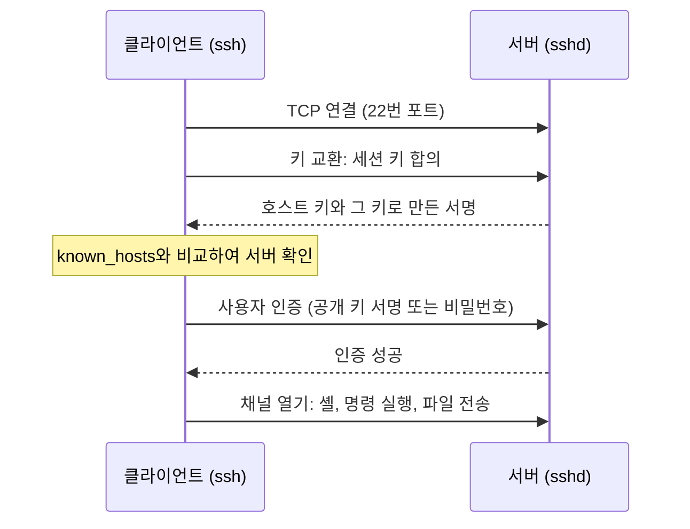

# 12장 — 원격 접속과 FTP

[레포지토리 안내](../../README.ko.md) | [English](Concepts_Lecture.md) | [한국어](Concepts_Lecture.ko.md)

> **최종 수정일:** 2026-11-19

> **학습 목표:**
> 1. 텔넷과 FTP가 안전하지 않은 이유와 SSH가 이를 해결하는 방법을 설명할 수 있다
> 2. 호스트 키와 `known_hosts`로 서버를 확인하는 과정과 그 경고의 뜻을 설명할 수 있다
> 3. 비밀번호 인증과 공개 키 인증을 비교하고, 키를 만들어 서버에 등록할 수 있다
> 4. `scp`, `sftp`, `rsync`로 파일을 전송하고 `~/.ssh/config`로 접속 설정을 줄일 수 있다
> 5. `sshd_config`로 SSH 서버를 안전하게 설정하고, FTP의 능동 모드와 수동 모드를 구분할 수 있다
> 6. 메일이 전달되는 구조와 SMTP, POP3, IMAP의 역할을 설명할 수 있다

---

## 목차

- [1. 원격 접속과 평문 프로토콜의 문제](#1-원격-접속과-평문-프로토콜의-문제)
  - [1.1 원격 접속의 구조](#11-원격-접속의-구조)
  - [1.2 텔넷과 FTP가 위험한 이유](#12-텔넷과-ftp가-위험한-이유)
- [2. SSH의 구조와 서버 확인](#2-ssh의-구조와-서버-확인)
  - [2.1 SSH 클라이언트와 서버](#21-ssh-클라이언트와-서버)
  - [2.2 호스트 키와 known_hosts](#22-호스트-키와-known_hosts)
  - [2.3 연결이 이루어지는 단계](#23-연결이-이루어지는-단계)
- [3. 사용자 인증](#3-사용자-인증)
  - [3.1 비밀번호 인증과 공개 키 인증](#31-비밀번호-인증과-공개-키-인증)
  - [3.2 키 만들기와 서버에 등록하기](#32-키-만들기와-서버에-등록하기)
- [4. SSH를 이용한 파일 전송](#4-ssh를-이용한-파일-전송)
  - [4.1 scp](#41-scp)
  - [4.2 sftp](#42-sftp)
  - [4.3 rsync](#43-rsync)
  - [4.4 ~/.ssh/config로 접속 설정 줄이기](#44-sshconfig로-접속-설정-줄이기)
  - [4.5 포트 전달](#45-포트-전달)
- [5. SSH 서버의 설정과 보안 강화](#5-ssh-서버의-설정과-보안-강화)
  - [5.1 sshd_config의 구조](#51-sshd_config의-구조)
  - [5.2 보안을 위한 기본 설정](#52-보안을-위한-기본-설정)
- [6. FTP](#6-ftp)
  - [6.1 제어 연결과 데이터 연결](#61-제어-연결과-데이터-연결)
  - [6.2 능동 모드와 수동 모드](#62-능동-모드와-수동-모드)
- [7. 전자 메일의 송수신](#7-전자-메일의-송수신)
  - [7.1 메일이 전달되는 구조](#71-메일이-전달되는-구조)
  - [7.2 POP3와 IMAP](#72-pop3와-imap)
- [개념 적용](#개념-적용)
- [요약](#요약)
- [점검 문제](#점검-문제)
- [참고 문헌](#참고-문헌)

---

<br>

## 1. 원격 접속과 평문 프로토콜의 문제

### 1.1 원격 접속의 구조

**원격 접속(remote login)** 은 네트워크로 다른 컴퓨터에 로그인하여 그 컴퓨터의 셸을 쓰는 것이다. 접속을 받는 컴퓨터에서는 서버 프로그램(데몬)이 정해진 포트에서 연결을 기다리고(11장 2.3절), 사용자는 클라이언트 프로그램으로 그 포트에 접속한다.

| 서비스 | 포트 | 서버 | 클라이언트 | 통신 내용 |
|:-----|-----:|:-----|:-----|:-----|
| 텔넷(Telnet) | 23 | `telnetd` | `telnet` | 평문 |
| SSH | 22 | `sshd` | `ssh`, `scp`, `sftp` | 암호화 |
| FTP | 21 (제어) | `vsftpd` 등 | `ftp` | 평문 |

*표 1. 원격 접속과 파일 전송 서비스의 포트*

### 1.2 텔넷과 FTP가 위험한 이유

텔넷과 FTP는 사용자 이름, 비밀번호, 입력한 명령, 주고받는 파일을 모두 **평문**으로 보낸다. 같은 네트워크에서 패킷을 엿보는 사람(공용 Wi-Fi, 공유기를 거치는 경로의 어느 지점)은 `tcpdump` 같은 도구로 비밀번호를 그대로 읽을 수 있다. 또 클라이언트는 접속한 상대가 실제 서버인지 확인할 방법이 없으므로, 공격자가 중간에서 서버인 척하고 비밀번호를 받아 갈 수도 있다.

SSH(Secure Shell)는 이 두 문제를 함께 해결한다. 접속하자마자 두 컴퓨터가 암호 키를 합의하여 그 뒤의 모든 내용을 암호화하고, 서버는 자신의 **호스트 키**로 자신이 실제 서버임을 증명한다(2.2절). SSH는 전송 계층, 사용자 인증, 연결의 세 프로토콜로 이루어진다 [1]. 그래서 오늘날 원격 접속에는 텔넷 대신 SSH를, 파일 전송에는 FTP 대신 SSH 위의 `sftp`, `scp`, `rsync`를 쓴다.

> **[정보보호]** 정보보호에서 배우는 암호학으로 보면, SSH는 디피-헬먼 방식의 키 교환으로 세션 키를 합의하고, 그 키로 대칭 키 암호화와 메시지 인증 코드를 적용하여 기밀성과 무결성을 지킨다. 서버의 신원은 호스트 키로 만든 전자 서명으로 증명하며, 사용자의 신원은 비밀번호나 사용자의 개인 키로 만든 서명으로 증명한다.

---

<br>

## 2. SSH의 구조와 서버 확인

### 2.1 SSH 클라이언트와 서버

Ubuntu에는 클라이언트 `ssh`(패키지 `openssh-client`)가 기본으로 설치되어 있고, 서버 `sshd`(패키지 `openssh-server`)는 Ubuntu Server를 설치할 때 고르거나 `sudo apt install openssh-server`로 설치한다(9장). Ubuntu 24.04의 SSH 서버는 systemd의 소켓 활성화를 써서, `ssh.socket`이 22번 포트를 기다리다가 연결이 오면 `sshd`를 실행한다 [2].

```text
$ systemctl is-active ssh.socket
active
$ ssh user1@192.168.111.100
user1@192.168.111.100's password:
Welcome to Ubuntu 24.04.1 LTS (GNU/Linux 6.8.0-51-generic x86_64)
...
user1@server1:~$ exit
logout
Connection to 192.168.111.100 closed.
```

`ssh 사용자@호스트`에서 사용자를 생략하면 클라이언트 쪽의 사용자 이름을 쓰고, 포트가 22가 아니면 `-p 포트`로 지정한다. `ssh user1@server1 'df -h /'`처럼 명령을 덧붙이면 로그인하지 않고 그 명령만 원격에서 실행한 뒤 결과를 돌려받는다.

### 2.2 호스트 키와 known_hosts

SSH 서버는 설치할 때 자신의 **호스트 키** 쌍을 만들어 `/etc/ssh/ssh_host_*_key`(개인 키)와 `.pub`(공개 키)에 둔다. 클라이언트는 처음 접속한 서버의 공개 호스트 키를 `~/.ssh/known_hosts`에 기록해 두고, 다음 접속부터는 서버가 내미는 키가 기록과 같은지 확인한다. 처음 접속할 때는 다음과 같이 묻는다.

```text
$ ssh user1@192.168.111.100
The authenticity of host '192.168.111.100 (192.168.111.100)' can't be established.
ED25519 key fingerprint is SHA256:Xy3kq0pVQm2a9cJtT6fB1vLr8oN4sHdE7wZuYgKiAcM.
This key is not known by any other names.
Are you sure you want to continue connecting (yes/no/[fingerprint])? yes
Warning: Permanently added '192.168.111.100' (ED25519) to the list of known hosts.
```

여기서 `yes`를 누르면 그 키를 믿는다는 뜻이므로, 원칙적으로는 서버에서 확인한 지문과 같은지 비교한 뒤 답해야 한다. 서버의 콘솔에서 다음 명령으로 지문을 본다.

```text
server$ ssh-keygen -lf /etc/ssh/ssh_host_ed25519_key.pub
256 SHA256:Xy3kq0pVQm2a9cJtT6fB1vLr8oN4sHdE7wZuYgKiAcM root@server1 (ED25519)
```

확인하지 않고 처음 키를 받아들이면 그 접속은 엿보기에는 안전하지만, 공격자가 처음부터 서버인 척하는 중간자 공격에는 약하다 [1]. 이미 기록된 서버의 키가 바뀌면 `ssh`는 `WARNING: REMOTE HOST IDENTIFICATION HAS CHANGED!` 경고를 내고 접속을 거부한다. 서버를 다시 설치하여 키가 새로 만들어진 것처럼 이유가 분명하면 `ssh-keygen -R 192.168.111.100`으로 옛 기록을 지운 뒤 다시 접속하고, 이유를 모르면 중간자 공격일 수 있으므로 접속하지 않는다.

> **주의:** 가상 머신을 복제(1주차 7.2절)하면 호스트 키까지 그대로 복사되어 두 서버가 같은 호스트 키를 갖는다. 복제한 서버에서는 `sudo rm /etc/ssh/ssh_host_*`로 기존 키를 지운 뒤 `sudo ssh-keygen -A`로 없는 종류의 호스트 키를 새로 만들고 [3], `sudo systemctl restart ssh`로 서버에 반영한다.

### 2.3 연결이 이루어지는 단계

`ssh` 명령 하나로 접속하는 동안 클라이언트와 서버는 다음 단계를 차례로 거친다. 앞의 두 단계가 SSH의 전송 계층 프로토콜, 셋째 단계가 사용자 인증 프로토콜, 마지막 단계가 연결 프로토콜에 해당한다 [1].



*그림 1. SSH 연결이 이루어지는 단계*

1. **키 교환.** 두 컴퓨터가 서로 값을 주고받아 세션 키를 합의한다. 이 키는 네트워크로 직접 보내지지 않으므로 엿보는 사람은 알 수 없다. 그 뒤의 모든 내용은 이 키로 암호화된다.
2. **서버 인증.** 서버는 키 교환의 내용에 자신의 호스트 개인 키로 서명하여 보낸다. 클라이언트는 그 서명을 서버의 공개 호스트 키로 검사하고, 그 키가 `known_hosts`의 기록과 같은지 확인한다(2.2절).
3. **사용자 인증.** 이미 암호화된 연결 안에서 비밀번호나 공개 키 서명으로 사용자를 증명한다(3절). 그래서 비밀번호 인증도 비밀번호가 평문으로 네트워크에 흐르지는 않는다.
4. **채널.** 인증이 끝나면 하나의 연결 안에 셸, 원격 명령, `sftp` 같은 여러 채널을 열 수 있다. 4.5절의 포트 전달도 채널을 이용한다.

`ssh -v 사용자@호스트`는 이 단계마다 무엇이 일어나는지 출력하므로, 접속이 어디에서 실패하는지(서버 확인인지, 사용자 인증인지) 찾을 때 쓴다.

---

<br>

## 3. 사용자 인증

### 3.1 비밀번호 인증과 공개 키 인증

| 구분 | 비밀번호 인증 | 공개 키 인증 |
|:-----|:-----|:-----|
| 증명하는 것 | 서버 계정의 비밀번호를 안다 | 서버에 등록된 공개 키의 짝인 개인 키를 가졌다 |
| 서버에 보내는 것 | 비밀번호 (암호화된 연결 안에서) | 개인 키로 만든 서명. 개인 키 자체는 보내지 않음 |
| 무차별 대입 공격 | 약한 비밀번호는 추측될 수 있음 | 사실상 불가능 |
| 서버가 털렸을 때 | 비밀번호가 다른 곳에서도 쓰였다면 함께 위험 | 서버에는 공개 키만 있으므로 개인 키는 안전 |

*표 2. 비밀번호 인증과 공개 키 인증의 비교*

공개 키 인증에서 사용자는 **키 쌍**을 만든다. 개인 키는 클라이언트에만 두고, 공개 키는 서버 계정의 `~/.ssh/authorized_keys`에 넣는다. 접속할 때 서버는 클라이언트에게 개인 키로만 만들 수 있는 서명을 요구하고, 등록된 공개 키로 그 서명을 검사한다. 개인 키는 네트워크로 나가지 않는다.

### 3.2 키 만들기와 서버에 등록하기

`ssh-keygen`은 인자 없이 실행하면 Ed25519 키를 만든다 [3].

```text
$ ssh-keygen -C user1@myubuntu
Generating public/private ed25519 key pair.
Enter file in which to save the key (/home/user1/.ssh/id_ed25519):
Enter passphrase (empty for no passphrase):
Enter same passphrase again:
Your identification has been saved in /home/user1/.ssh/id_ed25519
Your public key has been saved in /home/user1/.ssh/id_ed25519.pub
The key fingerprint is:
SHA256:nFMAopgFOgYjC7kz8eHThmSJ41wioMl+sOwo6lUDQgU user1@myubuntu
The key's randomart image is:
+--[ED25519 256]--+
|OE+o. ...        |
|#O=o .   .       |
|%&+=      .      |
|B+O +  . o       |
| * + o  S        |
|o . . .  .       |
|o. .             |
|o .              |
|o.               |
+----[SHA256]-----+
$ ls -l ~/.ssh/id_ed25519*
-rw------- 1 user1 user1 464 Mar 21 16:00 /home/user1/.ssh/id_ed25519
-rw-r--r-- 1 user1 user1  96 Mar 21 16:00 /home/user1/.ssh/id_ed25519.pub
```

- `-C`는 키를 알아보기 위한 설명(주석)이다. `-t rsa -b 4096`처럼 다른 종류의 키를 만들 수도 있다.
- **암호 문구(passphrase)** 는 개인 키 파일 자체를 암호화한다. 개인 키 파일을 도난당해도 암호 문구를 모르면 쓸 수 없으므로, 비워 두지 않는 것이 안전하다. 매번 입력하는 번거로움은 `ssh-agent`가 한 번 입력한 키를 기억하여 줄여 준다.
- 개인 키는 소유자만 읽을 수 있는 `600`, 공개 키는 `644`이다(7주차). 개인 키의 권한이 넓으면 `ssh`가 그 키를 쓰지 않는다.

공개 키를 서버에 등록하는 가장 간단한 방법은 `ssh-copy-id`이다. 이 명령은 비밀번호로 한 번 접속하여 공개 키를 서버의 `~/.ssh/authorized_keys` 끝에 덧붙인다.

```text
$ ssh-copy-id user1@192.168.111.100
...
Number of key(s) added: 1
$ ssh user1@192.168.111.100
Enter passphrase for key '/home/user1/.ssh/id_ed25519':
user1@server1:~$
```

이번에는 서버 계정의 비밀번호가 아니라 자기 개인 키의 암호 문구를 묻는다. `ssh-copy-id`가 없으면 공개 키 파일의 한 줄을 서버의 `~/.ssh/authorized_keys`에 직접 덧붙인다. 이때 서버의 `~/.ssh` 디렉터리는 `700`, `authorized_keys`는 `600`이어야 한다. 다른 사용자가 쓸 수 있는 권한이면 `sshd`는 다른 사람이 키를 끼워 넣었을 수 있다고 보고 그 파일을 무시한다.

---

<br>

## 4. SSH를 이용한 파일 전송

### 4.1 scp

`scp`는 `cp`와 같은 형식으로 파일을 SSH 연결로 복사한다. 원격 쪽 경로는 `사용자@호스트:경로`로 쓰고, 경로를 `/`로 시작하지 않으면 원격 사용자의 홈 디렉터리를 기준으로 한다.

```text
$ scp report.pdf user1@192.168.111.100:docs/
report.pdf                         100%  245KB  21.3MB/s   00:00
$ scp user1@192.168.111.100:/var/log/syslog ./server-syslog
$ scp -r project user1@192.168.111.100:
```

`-r`은 디렉터리를 재귀적으로 복사하고, `-P`(대문자)는 포트를 지정한다. `ssh`의 포트 옵션은 소문자 `-p`이므로 혼동하지 않도록 유의해야 한다.

### 4.2 sftp

`sftp`는 FTP와 비슷한 대화형 명령으로 SSH 위에서 파일을 주고받는다.

```text
$ sftp user1@192.168.111.100
Connected to 192.168.111.100.
sftp> pwd
Remote working directory: /home/user1
sftp> lcd /tmp
sftp> get docs/report.pdf
Fetching /home/user1/docs/report.pdf to report.pdf
sftp> put notes.txt
Uploading notes.txt to /home/user1/notes.txt
sftp> bye
```

| 명령 | 뜻 |
|:-----|:-----|
| `pwd`, `cd`, `ls` | 원격의 현재 디렉터리, 이동, 목록 |
| `lpwd`, `lcd`, `lls` | 로컬(클라이언트)의 현재 디렉터리, 이동, 목록 |
| `get 원격파일` | 원격에서 로컬로 받기 |
| `put 로컬파일` | 로컬에서 원격으로 보내기 |
| `bye`, `exit` | 끝내기 |

*표 3. sftp의 주요 명령*

이름 앞에 `l`이 붙은 명령은 로컬 쪽에 작용한다. `get`과 `put`의 방향은 로컬(클라이언트)을 기준으로 한 "받기"와 "보내기"이다.

### 4.3 rsync

`rsync`는 원본과 대상을 비교하여 **바뀐 부분만** 보내므로, 같은 디렉터리를 거듭 동기화하는 백업에 알맞다. 원격 쪽이 있으면 SSH로 연결한다.

```text
$ rsync -avz project/ user1@192.168.111.100:backup/project/
$ rsync -avz --delete -n project/ user1@192.168.111.100:backup/project/
```

- `-a`(archive)는 하위 디렉터리를 재귀적으로, 권한, 시간, 심볼릭 링크를 보존하여 복사한다. `-v`는 전송한 파일을 출력하고, `-z`는 전송 중에 압축한다.
- `--delete`는 원본에 없는 파일을 대상에서 지워 두 쪽을 똑같이 맞춘다. 잘못 쓰면 대상의 파일이 지워지므로, `-n`(dry run)으로 무엇을 할지 먼저 출력해 확인한 뒤 `-n`을 빼고 실행한다.

`rsync`는 원본 경로 끝의 `/`가 결과를 바꾼다. 원본 `src`에 `a.txt`와 `sub/b.txt`가 있을 때 비교하면 다음과 같다.

```text
$ rsync -a src dst1/
$ rsync -a src/ dst2/
$ find dst1 dst2 | sort
dst1
dst1/src
dst1/src/a.txt
dst1/src/sub
dst1/src/sub/b.txt
dst2
dst2/a.txt
dst2/sub
dst2/sub/b.txt
```

`src`는 "디렉터리 `src` 자체"를 보내므로 대상 안에 `src/`가 생기고, `src/`는 "디렉터리 `src`의 내용"을 보내므로 대상에 내용이 바로 들어간다. 4주차 1.4절의 `cp -r src dest`처럼 대상의 구조가 의도와 달라지는 흔한 실수이다.

### 4.4 ~/.ssh/config로 접속 설정 줄이기

자주 접속하는 서버의 주소, 사용자, 포트, 키 파일은 `~/.ssh/config`에 별명으로 적어 둘 수 있다 [4].

```text
Host lab
    HostName 192.168.111.100
    User user1
    Port 2222
    IdentityFile ~/.ssh/id_ed25519
```

이렇게 두면 `ssh -p 2222 -i ~/.ssh/id_ed25519 user1@192.168.111.100` 대신 `ssh lab`만 입력하면 되고, `scp report.pdf lab:docs/`, `sftp lab`, `rsync -a project/ lab:backup/`처럼 SSH를 쓰는 모든 명령에서 같은 별명을 쓸 수 있다. 같은 설정이 여러 곳에 있으면 처음 얻은 값이 쓰이므로 [4], 구체적인 `Host` 블록을 파일의 앞에, `Host *` 같은 일반 설정을 뒤에 둔다.

### 4.5 포트 전달

SSH 연결 안으로 다른 TCP 연결을 실어 보내는 것을 **포트 전달(port forwarding)** 이라 한다. 서버의 데이터베이스(5432번 포트)가 `127.0.0.1`에서만 연결을 받도록 설정되어 밖에서 직접 접속할 수 없을 때(11장 5.2절), 다음 명령으로 안전하게 접속할 수 있다.

```text
$ ssh -L 15432:127.0.0.1:5432 lab
```

`-L 로컬포트:목적지:목적지포트`는 클라이언트의 `15432`번 포트로 들어온 연결을 SSH 연결로 서버까지 보낸 뒤, 서버에서 본 `127.0.0.1:5432`로 연결한다. 이 SSH 세션이 열려 있는 동안 클라이언트의 프로그램은 `localhost:15432`에 접속하면 서버의 데이터베이스에 닿는다. 데이터베이스의 통신이 평문이라도 네트워크 구간은 SSH가 암호화하므로, 서비스의 포트를 외부에 열지 않고도 원격에서 쓸 수 있다.

---

<br>

## 5. SSH 서버의 설정과 보안 강화

### 5.1 sshd_config의 구조

SSH 서버의 설정은 `/etc/ssh/sshd_config`이며, 이 파일의 맨 앞의 `Include /etc/ssh/sshd_config.d/*.conf` 줄이 `sshd_config.d` 디렉터리의 파일을 먼저 읽는다 [5]. `sshd`는 같은 설정이 여러 번 나오면 **처음 얻은 값**을 쓰므로, `sshd_config.d/`의 파일에 쓴 값이 본 파일의 값보다 우선한다 [5]. 그래서 설정을 바꿀 때는 본 파일을 고치지 않고 `/etc/ssh/sshd_config.d/50-hardening.conf` 같은 파일을 새로 만들어 넣는다.

Ubuntu 24.04에서는 포트처럼 소켓에 관한 설정을 systemd 생성기가 `sshd_config`와 `sshd_config.d/`에서 읽어 `ssh.socket`에 반영한다 [2]. 따라서 설정을 바꾼 뒤에는 다음 순서로 적용한다.

```text
$ sudo sshd -t
$ sudo systemctl daemon-reload
$ sudo systemctl restart ssh.socket
```

`sshd -t`는 설정 파일의 문법을 검사하여 오류가 있을 때만 출력한다. 오류가 있는 설정으로 서버를 다시 시작하면 원격에서 다시 접속할 수 없게 될 수 있으므로, 적용 전에 반드시 검사한다.

### 5.2 보안을 위한 기본 설정

| 설정 | 기본값 | 권장 | 뜻 |
|:-----|:-----|:-----|:-----|
| `PermitRootLogin` | `prohibit-password` | `no` | root의 직접 로그인. 기본값은 root의 비밀번호 로그인만 막고 키 로그인은 허용 [5] |
| `PasswordAuthentication` | `yes` | `no` (키 등록 후) | 비밀번호 인증의 허용 여부 [5] |
| `PubkeyAuthentication` | `yes` | `yes` | 공개 키 인증의 허용 여부 |
| `AllowUsers` | (없음) | `user1 admin` | 접속을 허용할 사용자만 나열 |
| `Port` | `22` | 환경에 따라 | 기다리는 포트 |

*표 4. sshd_config의 보안 관련 설정*

```text
$ cat /etc/ssh/sshd_config.d/50-hardening.conf
PermitRootLogin no
PasswordAuthentication no
AllowUsers user1
```

이 설정은 root의 직접 로그인을 막고, 공개 키를 등록한 user1만 키로 접속하게 한다. 관리 작업은 user1로 로그인한 뒤 `sudo`로 한다(12주차 7절). 포트를 22가 아닌 번호로 바꾸면 자동화된 무차별 대입 시도가 크게 줄지만, 포트를 찾는 공격자를 막는 것은 아니므로 키 인증을 대신하지 못한다.

> **주의:** `PasswordAuthentication no`를 적용하기 전에 반드시 공개 키 로그인이 되는지 확인해야 한다. 그리고 설정을 적용하는 동안 기존의 SSH 세션 하나를 끊지 말고 열어 둔 채, 새 터미널에서 접속을 시험한다. 새 접속이 실패해도 열어 둔 세션에서 설정을 되돌릴 수 있다.

---

<br>

## 6. FTP

### 6.1 제어 연결과 데이터 연결

FTP(File Transfer Protocol)는 연결을 두 개 쓴다 [6]. **제어 연결**은 클라이언트가 서버의 21번 포트에 맺으며, `USER`, `PASS`, `LIST`, `RETR`(받기), `STOR`(보내기) 같은 명령과 응답이 오간다. **데이터 연결**은 파일 목록이나 파일 내용을 보낼 때마다 따로 맺는다. 두 연결 모두 평문이므로 1.2절의 위험을 그대로 갖는다. Ubuntu에서 FTP 서버로는 `vsftpd`가 많이 쓰이며, 익명 사용자에게 공개 자료를 내려받게 하는 용도가 아니라면 SSH의 `sftp`를 쓰는 편이 안전하다.

### 6.2 능동 모드와 수동 모드

데이터 연결을 누가 맺는지에 따라 두 방식이 있다.

| 방식 | 클라이언트의 명령 | 데이터 연결을 맺는 쪽 | 연결 방향 |
|:-----|:-----|:-----|:-----|
| 능동 모드(active) | `PORT h1,h2,h3,h4,p1,p2` | 서버 | 서버의 20번 포트 → 클라이언트가 알려 준 포트 |
| 수동 모드(passive) | `PASV` | 클라이언트 | 클라이언트 → 서버가 알려 준 포트 |

*표 5. FTP의 능동 모드와 수동 모드*

능동 모드에서는 서버가 제어 포트 바로 아래인 20번 포트에서 클라이언트에게 연결을 건다 [6]. 클라이언트가 공유기의 NAT나 방화벽 뒤에 있으면 밖에서 들어오는 이 연결이 막히므로 데이터 전송이 실패한다. 수동 모드에서는 서버가 데이터용 포트를 열고 기다리며 그 주소와 포트를 응답으로 알려 주고 [6], 클라이언트가 그 포트로 연결을 건다. 연결이 언제나 클라이언트에서 나가므로 NAT 뒤의 클라이언트도 동작하여, 오늘날의 FTP 클라이언트는 대부분 수동 모드를 기본으로 쓴다.

응답의 여섯 숫자 가운데 앞 넷은 IP 주소, 뒤 둘은 포트를 256진법으로 나타낸 것이다. 서버가 다음과 같이 응답하면,

```text
227 Entering Passive Mode (192,168,111,100,195,80)
```

주소는 `192.168.111.100`이고 포트는 다음과 같다.

```math
195 \times 256 + 80 = 49920 + 80 = 50000
```

---

<br>

## 7. 전자 메일의 송수신

### 7.1 메일이 전달되는 구조

전자 메일은 여러 프로그램이 나누어 전달한다. 사용자가 메일을 쓰고 읽는 프로그램(Thunderbird, Evolution, `mail` 명령 등)을 **메일 사용자 에이전트(MUA, Mail User Agent)** 라 하고, 메일을 받아 다른 서버로 넘기는 서버 프로그램(Postfix, Sendmail 등)을 **메일 전송 에이전트(MTA, Mail Transfer Agent)** 라 한다. 받는 쪽 MTA는 도착한 메일을 사용자의 메일함에 넣고, 사용자는 나중에 MUA로 그 메일함을 읽는다.


*그림 2. 메일이 보내는 사람에게서 받는 사람에게 전달되는 경로*

보내는 방향에는 **SMTP(Simple Mail Transfer Protocol)** 를 쓴다. MUA가 자신의 메일 서버에 메일을 맡길 때는 사용자 인증을 거치는 제출(submission) 포트 587을 쓰고, MTA끼리 메일을 넘길 때는 25번 포트를 쓴다. SMTP는 메일을 상대 서버로 밀어 넣는 프로토콜이므로, 받는 사람이 서버의 메일함에서 메일을 가져올 때는 별도의 접근 프로토콜인 POP3나 IMAP을 쓴다.

### 7.2 POP3와 IMAP

| 구분 | POP3 | IMAP |
|:-----|:-----|:-----|
| 포트 (평문 / TLS) | 110 / 995 | 143 / 993 |
| 메일의 위치 | 클라이언트로 내려받고 서버에서는 보통 지움 | 서버에 남기고 클라이언트는 그 내용을 보여 줌 |
| 여러 기기에서 사용 | 기기마다 받은 메일이 달라짐 | 모든 기기가 같은 메일함과 읽음 상태를 봄 |
| 폴더 | 받은 편지함 하나 | 서버에 여러 폴더를 만들 수 있음 |

*표 6. POP3와 IMAP의 비교*

텔넷, FTP와 마찬가지로 SMTP, POP3, IMAP도 원래 평문 프로토콜이므로 비밀번호와 메일 내용이 그대로 노출된다(1.2절). 그래서 오늘날에는 연결하자마자 TLS로 암호화하는 포트(제출 465, IMAP 993, POP3 995)를 쓰거나, 평문 포트에 접속한 뒤 `STARTTLS` 명령으로 암호화 연결로 바꾼다. RFC 8314는 메일의 제출과 접근에 처음부터 TLS를 쓰는 방식을 STARTTLS보다 권장한다 [7].

---

<br>

## 개념 적용

**T/F 점검:**

| 문장 | 판단과 근거 |
|:-----|:-----|
| 텔넷은 비밀번호만 암호화하고 명령은 평문으로 보낸다. | **F.** 텔넷은 비밀번호를 포함한 모든 내용을 평문으로 보낸다. |
| 공개 키 인증에서 클라이언트는 개인 키를 서버에 보낸다. | **F.** 개인 키로 만든 서명만 보내며, 서버는 등록된 공개 키로 서명을 검사한다. |
| `REMOTE HOST IDENTIFICATION HAS CHANGED` 경고가 나오면 언제나 `ssh-keygen -R`로 지우고 접속하면 된다. | **F.** 서버를 다시 설치한 것처럼 이유가 분명할 때만 지우며, 이유를 모르면 중간자 공격일 수 있다. |
| `rsync -a src/ dst/`와 `rsync -a src dst/`의 결과는 같다. | **F.** 끝에 `/`가 있으면 내용을, 없으면 디렉터리 자체를 보내므로 앞의 것은 `dst/a.txt`, 뒤의 것은 `dst/src/a.txt`가 된다. |
| `sshd_config.d/`에 쓴 설정은 `sshd_config` 본 파일의 같은 설정보다 우선한다. | **T.** 그 디렉터리의 파일을 맨 앞에서 읽고, `sshd`는 처음 얻은 값을 쓴다. |
| FTP 능동 모드에서는 NAT 뒤의 클라이언트도 문제없이 파일을 받는다. | **F.** 능동 모드는 서버가 클라이언트에게 연결을 걸므로 NAT나 방화벽에 막히며, 수동 모드를 써야 한다. |
| 메일 서버끼리 메일을 넘길 때도 POP3를 쓴다. | **F.** 서버 사이의 전달은 SMTP(25번)로 하고, POP3와 IMAP은 사용자가 메일함에서 메일을 가져올 때 쓴다. |

---

<br>

## 요약

| 개념 | 핵심 요약 |
|------|-----------|
| 평문 프로토콜 | 텔넷(23)과 FTP(21)는 비밀번호와 내용을 평문으로 보내고 서버를 확인하지 못하므로 SSH로 대신한다. |
| 호스트 키 | 서버가 자신을 증명하는 키이며, 클라이언트는 처음 받은 공개 키를 `known_hosts`에 기록하고 바뀌면 경고한다. |
| 공개 키 인증 | 개인 키는 클라이언트에, 공개 키는 서버의 `authorized_keys`에 두며, 개인 키로 만든 서명으로 인증한다. |
| ssh-keygen | 인자 없이 Ed25519 키 쌍을 만들며, 개인 키는 `600`, 암호 문구로 개인 키 파일을 보호한다. |
| 파일 전송 | `scp`는 복사, `sftp`는 대화형 전송, `rsync`는 바뀐 부분만 동기화하며, `rsync`는 원본 끝의 `/`가 결과를 바꾼다. |
| SSH 연결의 단계 | 키 교환, 호스트 키로 서버 인증, 사용자 인증, 채널 열기의 순서이며, `ssh -v`로 각 단계를 볼 수 있다. |
| 포트 전달 | `ssh -L 로컬포트:목적지:포트`로 다른 TCP 연결을 SSH 안에 실어 암호화된 경로로 보낸다. |
| ~/.ssh/config | `Host` 별명에 주소, 사용자, 포트, 키를 묶어 SSH를 쓰는 모든 명령에서 쓴다. |
| sshd 설정 | `sshd_config.d/`의 파일이 먼저 읽혀 우선하며, root 로그인과 비밀번호 인증을 끄고 `sshd -t`로 검사한 뒤 적용한다. |
| FTP의 두 모드 | 능동 모드는 서버가 20번 포트에서 클라이언트로, 수동 모드는 클라이언트가 서버가 알려 준 포트로 데이터 연결을 맺는다. |
| 메일 프로토콜 | 보내는 방향은 SMTP(제출 587, 서버 사이 25), 가져오는 방향은 POP3(110)나 IMAP(143)이며, 오늘날에는 TLS 포트(465, 995, 993)를 쓴다. |

---

<br>

## 점검 문제

1. **평문의 위험:** 카페의 공용 Wi-Fi에서 텔넷으로 서버에 접속했다. 같은 Wi-Fi의 공격자가 알아낼 수 있는 것과, SSH를 쓰면 무엇이 달라지는지 설명하라.

   <details>
   <summary>정답</summary>

   텔넷은 모든 내용을 평문으로 보내므로 공격자는 패킷을 엿보아 사용자 이름, 비밀번호, 입력한 명령과 출력을 모두 읽을 수 있다. SSH는 접속 직후 합의한 세션 키로 비밀번호를 포함한 모든 내용을 암호화하므로 엿보아도 내용을 알 수 없고, 호스트 키로 서버를 확인하므로 공격자가 서버인 척하는 것도 알아챌 수 있다.

   </details>

2. **호스트 키 경고:** 어제까지 잘 접속하던 서버에 접속하자 `REMOTE HOST IDENTIFICATION HAS CHANGED!` 경고가 나왔다. 확인해야 할 것과 상황에 따른 조치를 쓰라.

   <details>
   <summary>정답</summary>

   서버의 호스트 키가 `known_hosts`의 기록과 다르다는 뜻이다. 먼저 관리자에게 서버를 다시 설치했거나 호스트 키를 바꾸었는지 확인하고, 서버 콘솔에서 `ssh-keygen -lf /etc/ssh/ssh_host_ed25519_key.pub`로 지문을 확인한다. 그런 이유가 확인되면 `ssh-keygen -R 호스트`로 옛 기록을 지우고 다시 접속하여 새 지문을 비교한다. 이유를 모르면 중간자 공격일 수 있으므로 접속하지 않는다.

   </details>

3. **키 등록의 실패:** 공개 키를 서버의 `~/.ssh/authorized_keys`에 넣었는데도 계속 비밀번호를 묻는다. 서버에서 `ls -ld ~/.ssh ~/.ssh/authorized_keys`의 결과가 `drwxrwxr-x`와 `-rw-rw-r--`이다. 원인과 해결 방법을 쓰라.

   <details>
   <summary>정답</summary>

   디렉터리와 파일에 그룹 쓰기 권한이 있어 다른 사용자가 키를 끼워 넣을 수 있으므로, `sshd`가 그 파일을 믿지 않고 무시한다. `chmod 700 ~/.ssh`와 `chmod 600 ~/.ssh/authorized_keys`로 권한을 좁히면 공개 키 인증이 동작한다.

   </details>

4. **rsync 명령:** 로컬의 `~/site/` 안의 파일들을 서버 `lab`의 `/var/www/html/` 안에 그대로 맞추고, 서버에만 있는 파일은 지우려 한다. 실행 전에 확인하는 명령과 실제 명령을 쓰라.

   <details>
   <summary>정답</summary>

   먼저 `rsync -avz --delete -n ~/site/ lab:/var/www/html/`로 보낼 파일과 지울 파일을 확인한다. 이상이 없으면 `-n`을 뺀 `rsync -avz --delete ~/site/ lab:/var/www/html/`을 실행한다. 원본 끝의 `/` 덕분에 `site` 디렉터리 자체가 아니라 그 내용이 `/var/www/html/` 안에 들어간다.

   </details>

5. **ssh 설정 파일:** 서버 `10.0.2.50`의 포트 `2200`에 사용자 `admin`으로 `~/.ssh/lab_key`를 써서 접속하는 일을 `ssh db`만으로 하도록 `~/.ssh/config`의 항목을 쓰라.

   <details>
   <summary>정답</summary>

   ```text
   Host db
       HostName 10.0.2.50
       User admin
       Port 2200
       IdentityFile ~/.ssh/lab_key
   ```

   이후 `ssh db`, `scp file db:`, `sftp db`가 모두 이 설정을 쓴다.

   </details>

6. **서버 강화의 순서:** 비밀번호 인증을 끄고 root 로그인을 막는 설정을 원격 서버에 적용하려 한다. 접속을 잃지 않도록 하는 작업 순서를 쓰라.

   <details>
   <summary>정답</summary>

   (1) 공개 키를 등록하고 새 터미널에서 키로 로그인되는지 확인한다. (2) 기존 SSH 세션을 하나 열어 둔 채 `/etc/ssh/sshd_config.d/50-hardening.conf`에 `PermitRootLogin no`와 `PasswordAuthentication no`를 쓴다. (3) `sudo sshd -t`로 문법을 검사한다. (4) `sudo systemctl daemon-reload`와 `sudo systemctl restart ssh.socket`으로 적용한다. (5) 새 터미널에서 다시 접속을 시험하고, 실패하면 열어 둔 세션에서 설정을 되돌린다.

   </details>

7. **FTP 수동 모드:** 서버가 `227 Entering Passive Mode (10,0,0,5,4,1)`로 응답했다. 클라이언트가 데이터 연결을 맺을 주소와 포트를 구하고, 이 연결을 누가 시작하는지 쓰라.

   <details>
   <summary>정답</summary>

   주소는 앞 네 숫자인 `10.0.0.5`이고, 포트는 4 × 256 + 1 = 1025이다. 수동 모드이므로 클라이언트가 `10.0.0.5`의 1025번 포트로 데이터 연결을 시작한다.

   </details>

8. **메일 프로토콜 선택:** 휴대 전화와 노트북에서 같은 메일함을 보고 읽음 표시도 서로 맞추려 한다. POP3와 IMAP 가운데 어느 것을 써야 하는지와 그 이유, 메일 프로그램에 설정할 수신 포트를 쓰라.

   <details>
   <summary>정답</summary>

   IMAP을 쓴다. IMAP은 메일과 읽음 상태를 서버에 두므로 어느 기기로 접속해도 같은 메일함을 본다. POP3는 메일을 각 기기로 내려받고 서버에서 지우는 방식이라 기기마다 받은 메일이 달라진다. 수신 포트는 연결하자마자 TLS로 암호화하는 IMAP의 993번을 쓴다.

   </details>

---

<br>

## 참고 문헌

1. T. Ylonen and C. Lonvick, Ed., "The Secure Shell (SSH) Protocol Architecture," RFC 4251, Jan. 2006. [Online]. Available: https://www.rfc-editor.org/rfc/rfc4251
2. Canonical, "Ubuntu 24.04 LTS (Noble Numbat) release notes," [Online]. Available: https://documentation.ubuntu.com/release-notes/24.04/
3. "ssh-keygen(1), Ubuntu noble manual page," *OpenSSH*. [Online]. Available: https://manpages.ubuntu.com/manpages/noble/man1/ssh-keygen.1.html
4. "ssh_config(5), Ubuntu noble manual page," *OpenSSH*. [Online]. Available: https://manpages.ubuntu.com/manpages/noble/man5/ssh_config.5.html
5. "sshd_config(5), Ubuntu noble manual page," *OpenSSH*. [Online]. Available: https://manpages.ubuntu.com/manpages/noble/man5/sshd_config.5.html
6. J. Postel and J. Reynolds, "File Transfer Protocol (FTP)," RFC 959, Oct. 1985. [Online]. Available: https://www.rfc-editor.org/rfc/rfc959
7. K. Moore and C. Newman, "Cleartext Considered Obsolete: Use of Transport Layer Security (TLS) for Email Submission and Access," RFC 8314, Jan. 2018. [Online]. Available: https://www.rfc-editor.org/rfc/rfc8314
