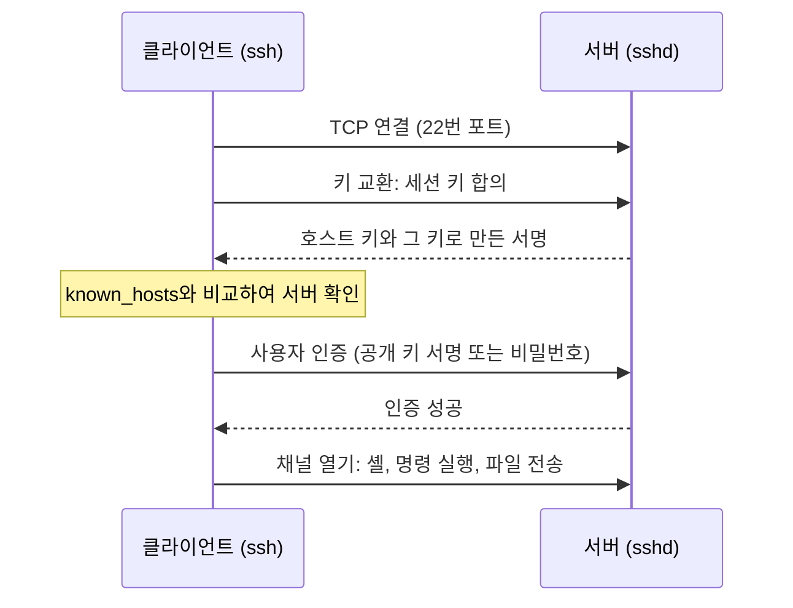
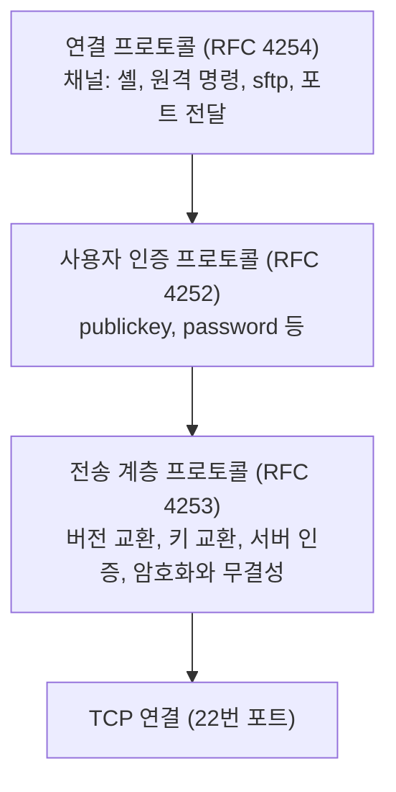
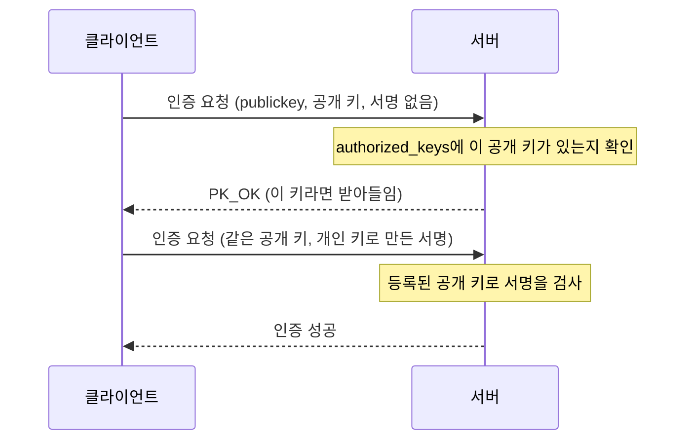
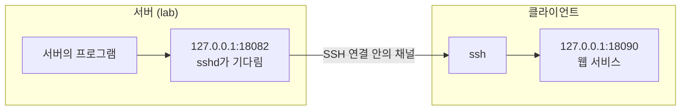

# 12장 — 원격 접속과 FTP

[레포지토리 안내](../../README.ko.md) | [English](Concepts_Lecture.md) | [한국어](Concepts_Lecture.ko.md)

> **최종 수정일:** 2026-11-19

> **학습 목표:**
> 1. 텔넷과 FTP가 안전하지 않은 이유와 SSH가 이를 해결하는 방법을 설명할 수 있다
> 2. SSH의 세 계층과 키 교환, 호스트 키와 `known_hosts`로 서버를 확인하는 과정과 그 경고의 뜻을 설명할 수 있다
> 3. 비밀번호 인증과 공개 키 인증을 비교하고, 키를 만들어 서버에 등록할 수 있다
> 4. `scp`, `sftp`, `rsync`로 파일을 전송하고 `~/.ssh/config`, 점프 호스트, 세 가지 포트 전달을 쓸 수 있다
> 5. `sshd_config`로 SSH 서버를 안전하게 설정하고 접속 문제를 진단하며, FTP의 두 모드와 FTPS, SFTP를 구분할 수 있다
> 6. 메일이 전달되는 구조와 SMTP, POP3, IMAP의 역할을 설명할 수 있다

---

## 목차

- [1. 원격 접속과 평문 프로토콜의 문제](#1-원격-접속과-평문-프로토콜의-문제)
  - [1.1 원격 접속의 구조](#11-원격-접속의-구조)
  - [1.2 텔넷과 FTP가 위험한 이유](#12-텔넷과-ftp가-위험한-이유)
  - [1.3 텔넷의 동작과 노출되는 내용](#13-텔넷의-동작과-노출되는-내용)
- [2. SSH의 구조와 서버 확인](#2-ssh의-구조와-서버-확인)
  - [2.1 SSH 클라이언트와 서버](#21-ssh-클라이언트와-서버)
  - [2.2 호스트 키와 known_hosts](#22-호스트-키와-known_hosts)
  - [2.3 연결이 이루어지는 단계](#23-연결이-이루어지는-단계)
  - [2.4 SSH 프로토콜의 세 계층](#24-ssh-프로토콜의-세-계층)
  - [2.5 키 교환과 세션 식별자](#25-키-교환과-세션-식별자)
  - [2.6 최초 사용 시 신뢰와 known_hosts의 형식](#26-최초-사용-시-신뢰와-known_hosts의-형식)
- [3. 사용자 인증](#3-사용자-인증)
  - [3.1 비밀번호 인증과 공개 키 인증](#31-비밀번호-인증과-공개-키-인증)
  - [3.2 키 만들기와 서버에 등록하기](#32-키-만들기와-서버에-등록하기)
  - [3.3 공개 키 인증이 진행되는 과정](#33-공개-키-인증이-진행되는-과정)
  - [3.4 키의 종류와 authorized_keys의 형식](#34-키의-종류와-authorized_keys의-형식)
  - [3.5 ssh-agent와 에이전트 전달](#35-ssh-agent와-에이전트-전달)
- [4. SSH를 이용한 파일 전송](#4-ssh를-이용한-파일-전송)
  - [4.1 scp](#41-scp)
  - [4.2 sftp](#42-sftp)
  - [4.3 rsync](#43-rsync)
  - [4.4 ~/.ssh/config로 접속 설정 줄이기](#44-sshconfig로-접속-설정-줄이기)
  - [4.5 포트 전달](#45-포트-전달)
  - [4.6 ssh_config의 적용 규칙과 점프 호스트](#46-ssh_config의-적용-규칙과-점프-호스트)
  - [4.7 원격 포트 전달과 동적 포트 전달](#47-원격-포트-전달과-동적-포트-전달)
  - [4.8 scp, sftp, rsync의 비교](#48-scp-sftp-rsync의-비교)
- [5. SSH 서버의 설정과 보안 강화](#5-ssh-서버의-설정과-보안-강화)
  - [5.1 sshd_config의 구조](#51-sshd_config의-구조)
  - [5.2 보안을 위한 기본 설정](#52-보안을-위한-기본-설정)
  - [5.3 실제로 적용되는 설정의 확인과 Match 블록](#53-실제로-적용되는-설정의-확인과-match-블록)
  - [5.4 접속 문제의 진단](#54-접속-문제의-진단)
- [6. FTP](#6-ftp)
  - [6.1 제어 연결과 데이터 연결](#61-제어-연결과-데이터-연결)
  - [6.2 능동 모드와 수동 모드](#62-능동-모드와-수동-모드)
  - [6.3 FTP 세션의 추적](#63-ftp-세션의-추적)
  - [6.4 FTPS와 SFTP](#64-ftps와-sftp)
  - [6.5 vsftpd 설정의 기초](#65-vsftpd-설정의-기초)
- [7. 전자 메일의 송수신](#7-전자-메일의-송수신)
  - [7.1 메일이 전달되는 구조](#71-메일이-전달되는-구조)
  - [7.2 POP3와 IMAP](#72-pop3와-imap)
- [개념 적용](#개념-적용)
- [요약](#요약)
- [점검 문제](#점검-문제)
- [참고 문헌](#참고-문헌)

---

<br>

## 1. 원격 접속과 평문 프로토콜의 문제

### 1.1 원격 접속의 구조

**원격 접속(remote login)** 은 네트워크로 다른 컴퓨터에 로그인하여 그 컴퓨터의 셸을 쓰는 것이다. 접속을 받는 컴퓨터에서는 서버 프로그램(데몬)이 정해진 포트에서 연결을 기다리고(11장 2.3절), 사용자는 클라이언트 프로그램으로 그 포트에 접속한다.

| 서비스 | 포트 | 서버 | 클라이언트 | 통신 내용 |
|:-----|-----:|:-----|:-----|:-----|
| 텔넷(Telnet) | 23 | `telnetd` | `telnet` | 평문 |
| SSH | 22 | `sshd` | `ssh`, `scp`, `sftp` | 암호화 |
| FTP | 21 (제어) | `vsftpd` 등 | `ftp` | 평문 |

*표 1. 원격 접속과 파일 전송 서비스의 포트*

### 1.2 텔넷과 FTP가 위험한 이유

텔넷과 FTP는 사용자 이름, 비밀번호, 입력한 명령, 주고받는 파일을 모두 **평문**으로 보낸다. 같은 네트워크에서 패킷을 엿보는 사람(공용 Wi-Fi, 공유기를 거치는 경로의 어느 지점)은 `tcpdump` 같은 도구로 비밀번호를 그대로 읽을 수 있다. 또 클라이언트는 접속한 상대가 실제 서버인지 확인할 방법이 없으므로, 공격자가 중간에서 서버인 척하고 비밀번호를 받아 갈 수도 있다.

SSH(Secure Shell)는 이 두 문제를 함께 해결한다. 접속하자마자 두 컴퓨터가 암호 키를 합의하여 그 뒤의 모든 내용을 암호화하고, 서버는 자신의 **호스트 키**로 자신이 실제 서버임을 증명한다(2.2절). SSH는 전송 계층, 사용자 인증, 연결의 세 프로토콜로 이루어진다 [1]. 그래서 오늘날 원격 접속에는 텔넷 대신 SSH를, 파일 전송에는 FTP 대신 SSH 위의 `sftp`, `scp`, `rsync`를 쓴다.

> **[정보보호]** 정보보호에서 배우는 암호학으로 보면, SSH는 디피-헬먼 방식의 키 교환으로 세션 키를 합의하고, 그 키로 대칭 키 암호화와 메시지 인증 코드를 적용하여 기밀성과 무결성을 지킨다. 서버의 신원은 호스트 키로 만든 전자 서명으로 증명하며, 사용자의 신원은 비밀번호나 사용자의 개인 키로 만든 서명으로 증명한다.

### 1.3 텔넷의 동작과 노출되는 내용

텔넷은 TCP 연결 위에서 양쪽이 **NVT(Network Virtual Terminal)** 라는 가상의 단말을 가정하고 문자를 주고받는 프로토콜이다 [2]. 제어가 필요하면 값이 255인 바이트(IAC, Interpret As Command) 뒤에 명령을 붙여 보내며, `WILL`, `WONT`, `DO`, `DONT`로 입력한 글자를 되돌려 보여 줄지(echo) 같은 선택 사항을 협상한다 [2]. 그 밖의 바이트는 모두 사용자가 입력한 글자나 서버가 출력한 글자 그대로이다. 그래서 텔넷 연결을 엿보는 사람이 얻는 것은 다음과 같다.

| 오가는 내용 | 엿보는 사람이 보는 것 |
|:-----|:-----|
| 로그인 이름과 비밀번호 | 입력한 글자 그대로 |
| 입력한 명령 | 그대로 |
| 명령의 출력 | 화면에 보인 내용 그대로 |
| `cat`으로 본 파일 | 파일의 내용 그대로 |

*표 2. 텔넷 연결에서 노출되는 내용*

비밀번호를 입력할 때 화면에 글자가 보이지 않더라도 그것은 화면에 되돌려 표시하지 않을 뿐이며, 입력한 글자 자체는 다른 입력과 똑같이 평문으로 서버에 전달된다. 텔넷 클라이언트는 지금도 어떤 TCP 포트가 연결을 받는지 시험하는 데 쓰인다. 예를 들어 SSH 서버의 22번 포트에 접속하면 서버가 보내는 SSH의 버전 문자열(2.4절)이 그대로 보인다(출력 예).

```text
$ telnet 192.168.111.100 22
Trying 192.168.111.100...
Connected to 192.168.111.100.
Escape character is '^]'.
SSH-2.0-OpenSSH_9.6p1 Ubuntu-3ubuntu13.20
```

`Ctrl+]`를 누른 뒤 `quit`을 입력하면 텔넷을 끝낸다. 버전 문자열이 보이면 TCP 연결과 서버 프로그램은 정상이므로, 그 뒤의 문제는 SSH의 키 교환이나 인증에서 찾는다(5.4절).

---

<br>

## 2. SSH의 구조와 서버 확인

### 2.1 SSH 클라이언트와 서버

Ubuntu에는 클라이언트 `ssh`(패키지 `openssh-client`)가 기본으로 설치되어 있고, 서버 `sshd`(패키지 `openssh-server`)는 Ubuntu Server를 설치할 때 고르거나 `sudo apt install openssh-server`로 설치한다(9장). Ubuntu 24.04의 SSH 서버는 systemd의 소켓 활성화를 써서, `ssh.socket`이 22번 포트를 기다리다가 연결이 오면 `sshd`를 실행한다 [3].

```text
$ systemctl is-active ssh.socket
active
$ ssh user1@192.168.111.100
user1@192.168.111.100's password:
Welcome to Ubuntu 24.04.1 LTS (GNU/Linux 6.8.0-51-generic x86_64)
...
user1@server1:~$ exit
logout
Connection to 192.168.111.100 closed.
```

`ssh 사용자@호스트`에서 사용자를 생략하면 클라이언트 쪽의 사용자 이름을 쓰고, 포트가 22가 아니면 `-p 포트`로 지정한다. `ssh user1@server1 'df -h /'`처럼 명령을 덧붙이면 로그인하지 않고 그 명령만 원격에서 실행한 뒤 결과를 돌려받는다.

### 2.2 호스트 키와 known_hosts

SSH 서버는 설치할 때 자신의 **호스트 키** 쌍을 만들어 `/etc/ssh/ssh_host_*_key`(개인 키)와 `.pub`(공개 키)에 둔다. 클라이언트는 처음 접속한 서버의 공개 호스트 키를 `~/.ssh/known_hosts`에 기록해 두고, 다음 접속부터는 서버가 내미는 키가 기록과 같은지 확인한다. 처음 접속할 때는 다음과 같이 묻는다.

```text
$ ssh user1@192.168.111.100
The authenticity of host '192.168.111.100 (192.168.111.100)' can't be established.
ED25519 key fingerprint is SHA256:Xy3kq0pVQm2a9cJtT6fB1vLr8oN4sHdE7wZuYgKiAcM.
This key is not known by any other names.
Are you sure you want to continue connecting (yes/no/[fingerprint])? yes
Warning: Permanently added '192.168.111.100' (ED25519) to the list of known hosts.
```

여기서 `yes`를 누르면 그 키를 믿는다는 뜻이므로, 원칙적으로는 서버에서 확인한 지문과 같은지 비교한 뒤 답해야 한다. 서버의 콘솔에서 다음 명령으로 지문을 본다.

```text
server$ ssh-keygen -lf /etc/ssh/ssh_host_ed25519_key.pub
256 SHA256:Xy3kq0pVQm2a9cJtT6fB1vLr8oN4sHdE7wZuYgKiAcM root@server1 (ED25519)
```

확인하지 않고 처음 키를 받아들이면 그 접속은 엿보기에는 안전하지만, 공격자가 처음부터 서버인 척하는 중간자 공격에는 약하다 [1]. 이미 기록된 서버의 키가 바뀌면 `ssh`는 `WARNING: REMOTE HOST IDENTIFICATION HAS CHANGED!` 경고를 내고 접속을 거부한다. 서버를 다시 설치하여 키가 새로 만들어진 것처럼 이유가 분명하면 `ssh-keygen -R 192.168.111.100`으로 옛 기록을 지운 뒤 다시 접속하고, 이유를 모르면 중간자 공격일 수 있으므로 접속하지 않는다.

> **주의:** 가상 머신을 복제(1주차 7.2절)하면 호스트 키까지 그대로 복사되어 두 서버가 같은 호스트 키를 갖는다. 복제한 서버에서는 `sudo rm /etc/ssh/ssh_host_*`로 기존 키를 지운 뒤 `sudo ssh-keygen -A`로 없는 종류의 호스트 키를 새로 만들고 [4], `sudo systemctl restart ssh`로 서버에 반영한다.

### 2.3 연결이 이루어지는 단계

`ssh` 명령 하나로 접속하는 동안 클라이언트와 서버는 다음 단계를 차례로 거친다. 앞의 두 단계가 SSH의 전송 계층 프로토콜, 셋째 단계가 사용자 인증 프로토콜, 마지막 단계가 연결 프로토콜에 해당한다 [1].



*그림 1. SSH 연결이 이루어지는 단계*

1. **키 교환.** 두 컴퓨터가 서로 값을 주고받아 세션 키를 합의한다. 이 키는 네트워크로 직접 보내지지 않으므로 엿보는 사람은 알 수 없다. 그 뒤의 모든 내용은 이 키로 암호화된다.
2. **서버 인증.** 서버는 키 교환의 내용에 자신의 호스트 개인 키로 서명하여 보낸다. 클라이언트는 그 서명을 서버의 공개 호스트 키로 검사하고, 그 키가 `known_hosts`의 기록과 같은지 확인한다(2.2절).
3. **사용자 인증.** 이미 암호화된 연결 안에서 비밀번호나 공개 키 서명으로 사용자를 증명한다(3절). 그래서 비밀번호 인증도 비밀번호가 평문으로 네트워크에 흐르지는 않는다.
4. **채널.** 인증이 끝나면 하나의 연결 안에 셸, 원격 명령, `sftp` 같은 여러 채널을 열 수 있다. 4.5절의 포트 전달도 채널을 이용한다.

`ssh -v 사용자@호스트`는 이 단계마다 무엇이 일어나는지 출력하므로, 접속이 어디에서 실패하는지(서버 확인인지, 사용자 인증인지) 찾을 때 쓴다.

### 2.4 SSH 프로토콜의 세 계층

2.3절의 네 단계는 SSH를 이루는 세 프로토콜이 차례로 동작한 결과이다. 전송 계층 프로토콜은 TCP 위에서 서버 인증, 기밀성, 무결성을 제공하고, 사용자 인증 프로토콜은 그 위에서 사용자를 인증하며, 연결 프로토콜은 사용자 인증 위에서 암호화된 연결 하나를 여러 논리적 채널로 나누어 쓴다 [1].



*그림 2. SSH 프로토콜의 계층 구조*

`ssh -v`의 출력은 이 계층을 그대로 보여 준다. 다음은 OpenSSH 10.5의 클라이언트와 서버 사이의 출력에서 주요 줄만 남긴 것이다.

```text
$ ssh -v user1@192.168.111.100 true
debug1: Connecting to 192.168.111.100 [192.168.111.100] port 22.
debug1: Connection established.
debug1: Local version string SSH-2.0-OpenSSH_10.5
debug1: Remote protocol version 2.0, remote software version OpenSSH_10.5
debug1: Authenticating to 192.168.111.100:22 as 'user1'
debug1: SSH2_MSG_KEXINIT sent
debug1: SSH2_MSG_KEXINIT received
debug1: kex: algorithm: mlkem768x25519-sha256
debug1: kex: host key algorithm: ssh-ed25519
debug1: kex: server->client cipher: chacha20-poly1305@openssh.com MAC: <implicit> compression: none
debug1: kex: client->server cipher: chacha20-poly1305@openssh.com MAC: <implicit> compression: none
debug1: expecting SSH2_MSG_KEX_ECDH_REPLY
debug1: SSH2_MSG_KEX_ECDH_REPLY received
debug1: Server host key: ssh-ed25519 SHA256:Xy3kq0pVQm2a9cJtT6fB1vLr8oN4sHdE7wZuYgKiAcM
debug1: Host '192.168.111.100' is known and matches the ED25519 host key.
debug1: SSH2_MSG_NEWKEYS sent
debug1: SSH2_MSG_NEWKEYS received
debug1: SSH2_MSG_SERVICE_ACCEPT received
debug1: Authentications that can continue: publickey
debug1: Next authentication method: publickey
debug1: Offering public key: /home/user1/.ssh/id_ed25519 ED25519 SHA256:nFMAopgFOgYjC7kz8eHThmSJ41wioMl+sOwo6lUDQgU
debug1: Server accepts key: /home/user1/.ssh/id_ed25519 ED25519 SHA256:nFMAopgFOgYjC7kz8eHThmSJ41wioMl+sOwo6lUDQgU
Authenticated to 192.168.111.100 ([192.168.111.100]:22) using "publickey".
debug1: channel 0: new session [client-session] (inactive timeout: 0)
debug1: Sending command: true
debug1: Exit status 0
```

| 계층 | 하는 일 | 위 출력에서 해당하는 줄 |
|:-----|:-----|:-----|
| 전송 계층 | 버전 문자열 교환, 알고리즘 협상(`KEXINIT`), 키 교환, 서버 인증, 새 키의 적용(`NEWKEYS`) | `Remote protocol version`부터 `SSH2_MSG_NEWKEYS received`까지 |
| 사용자 인증 | `ssh-userauth` 서비스를 요청하고 인증 방법을 시도 | `SERVICE_ACCEPT`부터 `Authenticated to`까지 |
| 연결 | 채널을 열고 그 안에서 셸, 명령, 하위 시스템, 포트 전달을 실행 | `channel 0: new session`, `Sending command` |

*표 3. SSH의 세 계층과 ssh -v의 출력*

버전 문자열은 `SSH-프로토콜판-소프트웨어판 주석` 형식이다 [5]. 1.3절의 `SSH-2.0-OpenSSH_9.6p1 Ubuntu-3ubuntu13.20`에서 `2.0`이 프로토콜의 판, `OpenSSH_9.6p1`이 소프트웨어, 뒤의 `Ubuntu-3ubuntu13.20`이 배포판이 붙인 주석이다. Ubuntu 24.04의 OpenSSH 9.6끼리 연결하면 위의 출력에서 버전과 함께 키 교환 방식의 줄이 달라진다(2.5절).

### 2.5 키 교환과 세션 식별자

**알고리즘의 협상.** 연결 직후 두 쪽은 `SSH2_MSG_KEXINIT`으로 자신이 지원하는 키 교환, 호스트 키, 암호, MAC, 압축 방식의 목록을 보내고, 항목마다 클라이언트의 목록 가운데 서버도 지원하는 첫 방식을 고른다 [5]. 그래서 클라이언트의 목록 순서가 선택을 결정한다. Ubuntu 24.04의 `ssh`가 보내는 키 교환 목록의 첫 항목은 `sntrup761x25519-sha512@openssh.com`이고, 그다음이 `curve25519-sha256`이다 [6]. 이 기본 방식은 타원 곡선 방식(x25519)에, 앞으로의 양자 컴퓨터로도 깨기 어렵다고 여겨지는 Streamlined NTRU Prime을 결합한 것으로, OpenSSH 9.0부터 기본값이 되었다 [7].

**디피-헬먼 키 교환의 원리.** 작은 수로 보이면 다음과 같다. 두 쪽은 공개된 소수 p = 23과 생성원 g = 5를 쓰고, 클라이언트는 비밀 값 a = 6을, 서버는 비밀 값 b = 15를 고른다.

| 단계 | 클라이언트 | 서버 |
|:-----|:-----|:-----|
| 비밀 값을 고름 | a = 6 | b = 15 |
| 공개 값을 계산하여 보냄 | A = 5⁶ mod 23 = 15625 mod 23 = 8 | B = 5¹⁵ mod 23 = 19 |
| 받은 값으로 공통 비밀을 계산 | K = 19⁶ mod 23 = 2 | K = 8¹⁵ mod 23 = 2 |

*표 4. 작은 수로 본 디피-헬먼 키 교환*

네트워크로는 p, g, A = 8, B = 19만 지나가고, a, b, K는 지나가지 않는다. 엿보는 사람이 K를 얻으려면 8 = 5ᵃ mod 23을 만족하는 a를 구해야 하는데(이산 로그 문제), 실제 키 교환은 매우 큰 수나 타원 곡선을 써서 이를 현실적인 시간 안에 계산할 수 없게 한다.

**교환 해시와 서버 인증.** 키 교환이 끝나면 두 쪽은 양쪽의 버전 문자열, 두 `KEXINIT`의 내용, 서버의 호스트 키, 두 교환 값, 공통 비밀 K를 이어 붙여 해시한 **교환 해시** H를 계산한다 [5]. 서버는 이 H에 호스트 개인 키로 서명하여 보내며(2.3절의 2단계), 이 서명은 두 가지를 보장한다.

- H에는 이번 연결에서만 나온 교환 값이 들어 있으므로, 공격자가 예전 연결에서 엿본 서명을 다시 보내도 맞지 않는다.
- H에는 호스트 키와 협상한 알고리즘 목록도 들어 있으므로, 중간에서 목록을 바꾸어 약한 방식을 고르게 하면 서명 검사가 실패한다.

**세션 식별자.** 첫 키 교환의 H는 그 연결의 세션 식별자가 되며, 연결이 끝날 때까지 바뀌지 않는다 [5]. 3.3절의 사용자 인증은 이 세션 식별자를 쓴다.

> **참고:** **세션 키의 유도와 재교환.** 실제로 쓰는 키는 K, H, 문자 하나, 세션 식별자를 차례로 이어 붙여 해시하여 만든다. 문자 A부터 F가 클라이언트에서 서버로 가는 방향과 그 반대 방향의 초기 벡터, 암호 키, 무결성 키에 하나씩 대응하므로 두 방향은 서로 다른 키를 쓴다 [5]. 키는 연결 중에 다시 교환할 수 있으며, RFC 4253은 1 GB를 보내거나 1시간이 지날 때 가운데 먼저 오는 때에 다시 교환하도록 권한다 [5]. 다시 교환해도 세션 식별자는 바뀌지 않는다.

### 2.6 최초 사용 시 신뢰와 known_hosts의 형식

> **용어 정의:** **최초 사용 시 신뢰(TOFU, trust on first use)** 는 처음 접속할 때 받은 상대의 공개 키를 믿고 기록해 두었다가, 이후의 접속에서는 같은 키인지만 확인하는 방식이다. 첫 접속이 공격자와 이루어지지 않았다면 이후의 중간자 공격을 막지만, 첫 접속 자체는 따로 확인하지 않는 한 보호하지 못한다.

2.2절의 `known_hosts`가 이 방식을 구현한다. 한 줄은 `[표시] 호스트이름들 키종류 키 [주석]`의 형식이며, 표시에는 인증 기관의 키를 뜻하는 `@cert-authority`나 폐기된 키를 뜻하는 `@revoked`가 올 수 있다 [8]. Ubuntu의 `/etc/ssh/ssh_config`는 OpenSSH의 기본값과 달리 `HashKnownHosts yes`를 설정하므로 [6], 새로 기록하는 호스트 이름은 해시로 바뀌어 저장된다.

```text
$ cat ~/.ssh/known_hosts
|1|9l+k34HJN4PjtBipFGo5Qx2W+GQ=|A4rbkbEkkVU66Fuq6F8q0t3SJwU= ssh-ed25519 AAAAC3NzaC1lZDI1NTE5AAAAIHNVjwdiEdZ4RQXs2WN9o1CsU1AwThJOUbGtxpj0udV9
$ ssh-keygen -F 192.168.111.100
# Host 192.168.111.100 found: line 1
|1|9l+k34HJN4PjtBipFGo5Qx2W+GQ=|A4rbkbEkkVU66Fuq6F8q0t3SJwU= ssh-ed25519 AAAAC3NzaC1lZDI1NTE5AAAAIHNVjwdiEdZ4RQXs2WN9o1CsU1AwThJOUbGtxpj0udV9
```

`|1|` 뒤의 두 값은 무작위 값과, 그 값으로 호스트 이름을 해시한 결과이다. 파일이 유출되어도 어느 서버에 접속했는지가 드러나지 않지만, 사람이 이름을 읽을 수 없으므로 항목은 `ssh-keygen -F 호스트`로 찾고 `ssh-keygen -R 호스트`로 지운다 [4]. 새 호스트와 키가 바뀐 호스트를 어떻게 다룰지는 `StrictHostKeyChecking`이 정한다 [6].

| 값 | 처음 보는 호스트 | 키가 바뀐 호스트 |
|:-----|:-----|:-----|
| `ask` (기본) | 물어본 뒤 기록 | 접속 거부 |
| `accept-new` | 묻지 않고 기록 | 접속 거부 |
| `yes` | 접속 거부 (키를 직접 기록해야 함) | 접속 거부 |
| `no` | 묻지 않고 기록 | 몇 가지 기능을 제한한 채 접속 |

*표 5. StrictHostKeyChecking의 값과 동작*

TOFU의 약점인 첫 접속을 보완하려면 2.2절처럼 서버 콘솔에서 지문을 확인하거나, 관리자가 서버의 공개 호스트 키를 모든 사용자가 읽는 `/etc/ssh/ssh_known_hosts`에 미리 넣어 둔다. `ssh`는 서버의 키를 사용자의 `known_hosts`와 이 파일에서 함께 찾는다 [9]. 자동화된 스크립트에서는 `accept-new`가 처음 접속하는 서버에서 멈추지 않으면서도 키가 바뀐 서버는 거부하므로, 키 검사를 끄는 `no`보다 안전하다.

---

<br>

## 3. 사용자 인증

### 3.1 비밀번호 인증과 공개 키 인증

| 구분 | 비밀번호 인증 | 공개 키 인증 |
|:-----|:-----|:-----|
| 증명하는 것 | 서버 계정의 비밀번호를 안다 | 서버에 등록된 공개 키의 짝인 개인 키를 가졌다 |
| 서버에 보내는 것 | 비밀번호 (암호화된 연결 안에서) | 개인 키로 만든 서명. 개인 키 자체는 보내지 않음 |
| 무차별 대입 공격 | 약한 비밀번호는 추측될 수 있음 | 사실상 불가능 |
| 서버가 털렸을 때 | 비밀번호가 다른 곳에서도 쓰였다면 함께 위험 | 서버에는 공개 키만 있으므로 개인 키는 안전 |

*표 6. 비밀번호 인증과 공개 키 인증의 비교*

공개 키 인증에서 사용자는 **키 쌍**을 만든다. 개인 키는 클라이언트에만 두고, 공개 키는 서버 계정의 `~/.ssh/authorized_keys`에 넣는다. 접속할 때 서버는 클라이언트에게 개인 키로만 만들 수 있는 서명을 요구하고, 등록된 공개 키로 그 서명을 검사한다. 개인 키는 네트워크로 나가지 않는다.

### 3.2 키 만들기와 서버에 등록하기

`ssh-keygen`은 인자 없이 실행하면 Ed25519 키를 만든다 [4].

```text
$ ssh-keygen -C user1@myubuntu
Generating public/private ed25519 key pair.
Enter file in which to save the key (/home/user1/.ssh/id_ed25519):
Enter passphrase (empty for no passphrase):
Enter same passphrase again:
Your identification has been saved in /home/user1/.ssh/id_ed25519
Your public key has been saved in /home/user1/.ssh/id_ed25519.pub
The key fingerprint is:
SHA256:nFMAopgFOgYjC7kz8eHThmSJ41wioMl+sOwo6lUDQgU user1@myubuntu
The key's randomart image is:
+--[ED25519 256]--+
|OE+o. ...        |
|#O=o .   .       |
|%&+=      .      |
|B+O +  . o       |
| * + o  S        |
|o . . .  .       |
|o. .             |
|o .              |
|o.               |
+----[SHA256]-----+
$ ls -l ~/.ssh/id_ed25519*
-rw------- 1 user1 user1 464 Mar 21 16:00 /home/user1/.ssh/id_ed25519
-rw-r--r-- 1 user1 user1  96 Mar 21 16:00 /home/user1/.ssh/id_ed25519.pub
```

- `-C`는 키를 알아보기 위한 설명(주석)이다. `-t rsa -b 4096`처럼 다른 종류의 키를 만들 수도 있다.
- **암호 문구(passphrase)** 는 개인 키 파일 자체를 암호화한다. 개인 키 파일을 도난당해도 암호 문구를 모르면 쓸 수 없으므로, 비워 두지 않는 것이 안전하다. 매번 입력하는 번거로움은 `ssh-agent`가 한 번 입력한 키를 기억하여 줄여 준다.
- 개인 키는 소유자만 읽을 수 있는 `600`, 공개 키는 `644`이다(7주차). 개인 키의 권한이 넓으면 `ssh`가 그 키를 쓰지 않는다.

공개 키를 서버에 등록하는 가장 간단한 방법은 `ssh-copy-id`이다. 이 명령은 비밀번호로 한 번 접속하여 공개 키를 서버의 `~/.ssh/authorized_keys` 끝에 덧붙인다.

```text
$ ssh-copy-id user1@192.168.111.100
...
Number of key(s) added: 1
$ ssh user1@192.168.111.100
Enter passphrase for key '/home/user1/.ssh/id_ed25519':
user1@server1:~$
```

이번에는 서버 계정의 비밀번호가 아니라 자기 개인 키의 암호 문구를 묻는다. `ssh-copy-id`가 없으면 공개 키 파일의 한 줄을 서버의 `~/.ssh/authorized_keys`에 직접 덧붙인다. 이때 서버의 `~/.ssh` 디렉터리는 `700`, `authorized_keys`는 `600`이어야 한다. 다른 사용자가 쓸 수 있는 권한이면 `sshd`는 다른 사람이 키를 끼워 넣었을 수 있다고 보고 그 파일을 무시한다.

### 3.3 공개 키 인증이 진행되는 과정

사용자 인증 프로토콜에서 클라이언트는 사용자 이름, 인증 뒤에 쓸 서비스(`ssh-connection`), 인증 방법을 담은 요청을 보낸다. 요청이 실패하면 서버는 "계속할 수 있는 인증 방법"의 목록을 돌려주고, 클라이언트는 그 목록에서 방법을 골라 다시 시도한다 [10]. 공개 키 방법은 다음 순서로 진행된다 [10].



*그림 3. 공개 키 인증의 메시지 순서*

1. 클라이언트는 먼저 서명 없이 공개 키만 보내 서버가 그 키를 받아들일지 묻는다. 서명을 만들려면 암호 문구를 묻거나 계산을 해야 하므로, 받아들여지지 않을 키로 그 수고를 하지 않기 위해서이다.
2. 서버는 그 공개 키가 사용자의 `~/.ssh/authorized_keys`에 있으면 `SSH_MSG_USERAUTH_PK_OK`로 답한다.
3. 클라이언트는 세션 식별자(2.5절), 사용자 이름, 서비스 이름, 방법의 이름, 공개 키를 정해진 순서로 이어 붙인 자료에 개인 키로 서명하여 보낸다.
4. 서버는 그 공개 키가 받아들일 수 있는 키인지와 서명이 맞는지를 모두 확인하고, 둘 다 맞으면 성공을 알린다.

서명하는 자료에 세션 식별자가 들어 있으므로 서명은 그 연결에서만 유효하다. 공격자가 서명을 엿보아 다른 연결에서 다시 보내도 세션 식별자가 다르므로 받아들여지지 않는다. 2.4절의 `ssh -v` 출력에서 `Offering public key`가 1단계, `Server accepts key`가 2단계에 해당하고, `Authenticated to ... using "publickey"`가 4단계의 결과이다. 그 앞의 `Authentications that can continue: publickey`는 이 서버가 공개 키 방법만 허용함을 알린 것이다(5.2절의 `PasswordAuthentication no`).

### 3.4 키의 종류와 authorized_keys의 형식

`ssh-keygen -t`로 고를 수 있는 주요 키 종류는 다음과 같다 [4].

| 종류 (`-t`) | 크기 | 특징 |
|:-----|:-----|:-----|
| `ed25519` | 256비트로 고정 | Ubuntu 24.04의 `ssh-keygen`이 인자 없이 만드는 종류 |
| `ecdsa` | 256, 384, 521비트 가운데 `-b`로 선택 | NIST 곡선을 쓰는 타원 곡선 서명 |
| `rsa` | 기본 3072비트, 최소 1024비트 | 오래된 서버와도 호환 |
| `ed25519-sk`, `ecdsa-sk` | | 개인 키의 연산을 FIDO 인증 장치(보안 키)가 맡음 |

*표 7. ssh-keygen이 만드는 주요 키 종류*

RSA 키는 같은 키로 여러 서명 방식을 쓸 수 있다. OpenSSH 8.8부터는 SHA-1 해시를 쓰는 옛 방식(`ssh-rsa`)의 서명을 기본으로 받아들이지 않고 [11], SHA-2를 쓰는 `rsa-sha2-256`과 `rsa-sha2-512`를 쓴다 [12]. 그래서 이 두 방식을 모르는 오래된 서버에는 RSA 키로 접속하지 못할 수 있다.

`authorized_keys`의 한 줄은 `[옵션] 키종류 base64로-쓴-키 [주석]`의 형식이다 [8]. 옵션은 쉼표로 나열하며, 그 키로 할 수 있는 일을 제한한다(키는 일부를 줄여 적음).

```text
ssh-ed25519 AAAAC3NzaC1lZDI1NTE5AAAAI... user1@myubuntu
from="192.168.111.0/24",restrict ssh-ed25519 AAAAC3NzaC1lZDI1NTE5AAAAI... user1@laptop
command="/usr/local/bin/backup.sh",restrict ssh-ed25519 AAAAC3NzaC1lZDI1NTE5AAAAI... backup-job
```

- 첫째 줄은 옵션이 없는 일반적인 등록이다.
- `from="패턴"`은 그 패턴에 맞는 주소나 호스트 이름에서 온 접속에만 이 키를 허용한다. CIDR 표기(`192.168.111.0/24`)도 쓸 수 있으므로, 키를 도난당해도 다른 네트워크에서는 쓸 수 없다 [8].
- `command="명령"`은 이 키로 접속하면 클라이언트가 요청한 명령과 관계없이 정해진 명령만 실행하게 한다. 자동 백업처럼 한 가지 일만 하는 키에 쓴다.
- `restrict`는 포트 전달, 에이전트 전달, X11 전달, 터미널 할당, `~/.ssh/rc`의 실행을 모두 막는다 [8].

`sshd`는 `StrictModes yes`(기본값)일 때 사용자의 홈 디렉터리, `~/.ssh`, `authorized_keys`가 다른 사용자에게 쓰기를 허용하면 그 파일을 쓰지 않는다 [13], [8]. 3.2절의 권한 문제가 생기면 클라이언트는 이유 없이 `Permission denied (publickey).`만 보고, 이유는 서버의 로그(5.4절)에 다음처럼 남는다.

```text
server$ chmod 664 ~/.ssh/authorized_keys
client$ ssh user1@192.168.111.100 true
user1@192.168.111.100: Permission denied (publickey).
server$ sudo journalctl -u ssh | tail -1
... sshd[2481]: Authentication refused: bad ownership or modes for file /home/user1/.ssh/authorized_keys
```

### 3.5 ssh-agent와 에이전트 전달

**ssh-agent** 는 암호 문구를 풀어 둔 개인 키를 메모리에 보관하고, `ssh`의 요청을 받아 그 키로 서명해 주는 프로그램이다. `ssh`는 환경 변수 `SSH_AUTH_SOCK`이 가리키는 유닉스 도메인 소켓으로 에이전트와 통신하며, 개인 키 자체는 에이전트 밖으로 나오지 않는다 [14].

```text
$ eval "$(ssh-agent -s)"
Agent pid 4213
$ ssh-add -l
The agent has no identities.
$ ssh-add ~/.ssh/id_ed25519
Enter passphrase for /home/user1/.ssh/id_ed25519:
Identity added: /home/user1/.ssh/id_ed25519 (user1@myubuntu)
$ ssh-add -l
256 SHA256:nFMAopgFOgYjC7kz8eHThmSJ41wioMl+sOwo6lUDQgU user1@myubuntu (ED25519)
$ ssh user1@192.168.111.100
user1@server1:~$
```

1. `ssh-agent -s`는 에이전트를 시작하고 `SSH_AUTH_SOCK`과 `SSH_AGENT_PID`를 설정하는 셸 명령을 출력하며, `eval`이 그 명령을 현재 셸에서 실행한다. Ubuntu 24.04(OpenSSH 9.6)에서 소켓은 `$TMPDIR/ssh-XXXXXXXXXX/agent.<부모의 PID>`에 만들어진다 [14].
2. 처음의 `ssh-add -l`은 아직 넣은 키가 없음을 보인다.
3. `ssh-add`가 키를 에이전트에 넣으며, 암호 문구는 이때 한 번만 묻는다.
4. 두 번째 `ssh-add -l`은 넣어 둔 키의 크기, 지문, 주석, 종류를 보인다.
5. 이후의 `ssh`는 암호 문구를 묻지 않고 에이전트에게 서명을 맡긴다.

`ssh-add -D`는 넣어 둔 키를 모두 지우고, `ssh-add -t 3600 키`처럼 수명을 주면 그 시간이 지난 뒤 키를 자동으로 지운다 [15].

**에이전트 전달.** `ssh -A`(설정 파일에서는 `ForwardAgent yes`)는 원격 서버에서도 로컬의 에이전트를 쓰게 한다. 그러나 원격 서버에서 그 소켓에 접근할 수 있는 사용자(그 서버의 root 등)는 연결이 유지되는 동안 에이전트에 넣은 키로 다른 서버에 인증할 수 있다. 키 자체를 빼낼 수는 없지만 키를 쓸 수는 있으므로, 중간 서버를 거쳐 다른 서버에 접속할 때는 에이전트 전달 대신 4.6절의 점프 호스트를 쓰는 것이 안전하다 [9].

---

<br>

## 4. SSH를 이용한 파일 전송

### 4.1 scp

`scp`는 `cp`와 같은 형식으로 파일을 SSH 연결로 복사한다. 원격 쪽 경로는 `사용자@호스트:경로`로 쓰고, 경로를 `/`로 시작하지 않으면 원격 사용자의 홈 디렉터리를 기준으로 한다.

```text
$ scp report.pdf user1@192.168.111.100:docs/
report.pdf                         100%  245KB  21.3MB/s   00:00
$ scp user1@192.168.111.100:/var/log/syslog ./server-syslog
$ scp -r project user1@192.168.111.100:
```

`-r`은 디렉터리를 재귀적으로 복사하고, `-P`(대문자)는 포트를 지정한다. `ssh`의 포트 옵션은 소문자 `-p`이므로 혼동하지 않도록 유의해야 한다.

### 4.2 sftp

`sftp`는 FTP와 비슷한 대화형 명령으로 SSH 위에서 파일을 주고받는다.

```text
$ sftp user1@192.168.111.100
Connected to 192.168.111.100.
sftp> pwd
Remote working directory: /home/user1
sftp> lcd /tmp
sftp> get docs/report.pdf
Fetching /home/user1/docs/report.pdf to report.pdf
sftp> put notes.txt
Uploading notes.txt to /home/user1/notes.txt
sftp> bye
```

| 명령 | 뜻 |
|:-----|:-----|
| `pwd`, `cd`, `ls` | 원격의 현재 디렉터리, 이동, 목록 |
| `lpwd`, `lcd`, `lls` | 로컬(클라이언트)의 현재 디렉터리, 이동, 목록 |
| `get 원격파일` | 원격에서 로컬로 받기 |
| `put 로컬파일` | 로컬에서 원격으로 보내기 |
| `bye`, `exit` | 끝내기 |

*표 8. sftp의 주요 명령*

이름 앞에 `l`이 붙은 명령은 로컬 쪽에 작용한다. `get`과 `put`의 방향은 로컬(클라이언트)을 기준으로 한 "받기"와 "보내기"이다.

### 4.3 rsync

`rsync`는 원본과 대상을 비교하여 **바뀐 부분만** 보내므로, 같은 디렉터리를 거듭 동기화하는 백업에 알맞다. 원격 쪽이 있으면 SSH로 연결한다.

```text
$ rsync -avz project/ user1@192.168.111.100:backup/project/
$ rsync -avz --delete -n project/ user1@192.168.111.100:backup/project/
```

- `-a`(archive)는 하위 디렉터리를 재귀적으로, 권한, 시간, 심볼릭 링크를 보존하여 복사한다. `-v`는 전송한 파일을 출력하고, `-z`는 전송 중에 압축한다.
- `--delete`는 원본에 없는 파일을 대상에서 지워 두 쪽을 똑같이 맞춘다. 잘못 쓰면 대상의 파일이 지워지므로, `-n`(dry run)으로 무엇을 할지 먼저 출력해 확인한 뒤 `-n`을 빼고 실행한다.

`rsync`는 원본 경로 끝의 `/`가 결과를 바꾼다. 원본 `src`에 `a.txt`와 `sub/b.txt`가 있을 때 비교하면 다음과 같다.

```text
$ rsync -a src dst1/
$ rsync -a src/ dst2/
$ find dst1 dst2 | sort
dst1
dst1/src
dst1/src/a.txt
dst1/src/sub
dst1/src/sub/b.txt
dst2
dst2/a.txt
dst2/sub
dst2/sub/b.txt
```

`src`는 "디렉터리 `src` 자체"를 보내므로 대상 안에 `src/`가 생기고, `src/`는 "디렉터리 `src`의 내용"을 보내므로 대상에 내용이 바로 들어간다. 4주차 1.4절의 `cp -r src dest`처럼 대상의 구조가 의도와 달라지는 흔한 실수이다.

### 4.4 ~/.ssh/config로 접속 설정 줄이기

자주 접속하는 서버의 주소, 사용자, 포트, 키 파일은 `~/.ssh/config`에 별명으로 적어 둘 수 있다 [6].

```text
Host lab
    HostName 192.168.111.100
    User user1
    Port 2222
    IdentityFile ~/.ssh/id_ed25519
```

이렇게 두면 `ssh -p 2222 -i ~/.ssh/id_ed25519 user1@192.168.111.100` 대신 `ssh lab`만 입력하면 되고, `scp report.pdf lab:docs/`, `sftp lab`, `rsync -a project/ lab:backup/`처럼 SSH를 쓰는 모든 명령에서 같은 별명을 쓸 수 있다. 같은 설정이 여러 곳에 있으면 처음 얻은 값이 쓰이므로 [6], 구체적인 `Host` 블록을 파일의 앞에, `Host *` 같은 일반 설정을 뒤에 둔다.

### 4.5 포트 전달

SSH 연결 안으로 다른 TCP 연결을 실어 보내는 것을 **포트 전달(port forwarding)** 이라 한다. 서버의 데이터베이스(5432번 포트)가 `127.0.0.1`에서만 연결을 받도록 설정되어 밖에서 직접 접속할 수 없을 때(11장 5.2절), 다음 명령으로 안전하게 접속할 수 있다.

```text
$ ssh -L 15432:127.0.0.1:5432 lab
```

`-L 로컬포트:목적지:목적지포트`는 클라이언트의 `15432`번 포트로 들어온 연결을 SSH 연결로 서버까지 보낸 뒤, 서버에서 본 `127.0.0.1:5432`로 연결한다. 이 SSH 세션이 열려 있는 동안 클라이언트의 프로그램은 `localhost:15432`에 접속하면 서버의 데이터베이스에 닿는다. 데이터베이스의 통신이 평문이라도 네트워크 구간은 SSH가 암호화하므로, 서비스의 포트를 외부에 열지 않고도 원격에서 쓸 수 있다.

### 4.6 ssh_config의 적용 규칙과 점프 호스트

`ssh`는 설정을 명령행 옵션, `~/.ssh/config`, `/etc/ssh/ssh_config`의 순서로 읽고, 설정마다 처음 얻은 값을 쓴다(4.4절) [6]. 파일 안에서는 `Host`의 패턴이 접속할 이름과 맞는 블록만 적용되며, 한 이름에 여러 블록이 맞을 수 있다. `ssh -G 이름`은 접속하지 않고 그 이름에 적용될 최종 설정만 출력하므로 [9], 다음 설정에서 세 이름이 각각 어떤 값을 얻는지 확인할 수 있다.

```text
Host lab
    HostName 192.168.111.100
    User user1
    Port 2222

Host web*
    User deploy
    ProxyJump lab

Host *
    User guest
    ServerAliveInterval 60
    IdentityFile ~/.ssh/id_ed25519
```

```text
$ ssh -G lab | grep -E '^(user|hostname|port|proxyjump) '
user user1
hostname 192.168.111.100
port 2222
$ ssh -G web1 | grep -E '^(user|hostname|port|proxyjump) '
user deploy
hostname web1
port 22
proxyjump lab
$ ssh -G other | grep -E '^(user|hostname|port|proxyjump) '
user guest
hostname other
port 22
```

- `lab`은 첫 블록과 `Host *`에 맞는다. `User`는 첫 블록에서 `user1`을 먼저 얻었으므로 `Host *`의 `guest`는 쓰이지 않고, `ServerAliveInterval`과 `IdentityFile`은 `Host *`에서만 얻는다.
- `web1`은 `web*`과 `Host *`에 맞아 `User deploy`를 얻고, `HostName`이 없으므로 주어진 이름 그대로 접속한다.
- `other`는 `Host *`에만 맞는다.

`Host *`를 파일의 맨 앞에 두면 모든 호스트의 `User`가 `guest`로 먼저 정해져 아래 블록의 `User`가 모두 무시된다. 일반 설정을 파일 끝에 두는 이유가 이것이다.

**점프 호스트.** `web1`처럼 내부망에 있어 밖에서 직접 닿지 않는 서버는 밖에서 닿는 서버(`lab`)를 거쳐 접속한다. `ProxyJump lab`(명령행에서는 `ssh -J lab web1`)은 먼저 `lab`에 SSH로 접속한 뒤, 그 연결을 통해 `web1`로 가는 TCP 전달을 열고, 그 위에서 `web1`과 새 SSH 연결을 맺는다 [9]. 키 교환과 사용자 인증은 클라이언트와 `web1` 사이에서 직접 이루어지므로, 중간의 `lab`은 암호화된 내용을 볼 수 없고 개인 키를 `lab`에 둘 필요도 없다. 이것이 3.5절의 에이전트 전달보다 안전한 이유이다.

### 4.7 원격 포트 전달과 동적 포트 전달

4.5절의 `-L`과 함께 포트 전달에는 세 가지가 있으며, 연결을 기다리는 쪽과 연결이 최종적으로 향하는 곳이 서로 다르다 [9].

| 옵션 | 연결을 기다리는 쪽 | 연결이 향하는 곳 | 쓰임 |
|:-----|:-----|:-----|:-----|
| `-L 로컬포트:목적지:포트` | 클라이언트 | 서버에서 본 목적지 | 밖에 열지 않은 서버 쪽 서비스를 클라이언트에서 쓰기 |
| `-R 원격포트:목적지:포트` | 서버 | 클라이언트에서 본 목적지 | 클라이언트 쪽 서비스를 서버에서 쓰기 |
| `-D 로컬포트` | 클라이언트 (SOCKS 프록시) | 요청마다 정한 곳 (서버에서 연결) | 여러 목적지로 가는 연결을 서버를 거쳐 보내기 |

*표 9. 세 가지 포트 전달의 비교*



*그림 4. 원격 포트 전달(-R)에서 연결이 지나가는 경로*

다음은 세 방식을 차례로 쓴 예이다. 서버에는 `127.0.0.1:18080`에서만 기다리는 관리 페이지가, 클라이언트에는 `127.0.0.1:18090`에서만 기다리는 웹 서비스가 있다.

```text
client$ ssh -f -N -L 15432:127.0.0.1:18080 lab
client$ curl -s http://localhost:15432/
admin page on the server
client$ ssh -f -N -R 18082:127.0.0.1:18090 lab
server$ curl -s http://127.0.0.1:18082/
page served by the client
client$ ssh -f -N -D 11080 lab
client$ curl -s --socks5-hostname 127.0.0.1:11080 http://127.0.0.1:18080/
admin page on the server
```

- `-f`는 인증을 마친 뒤 `ssh`를 백그라운드로 보내고, `-N`은 원격 명령을 실행하지 않는다. 포트 전달만 할 때 함께 쓴다 [9].
- `-R`에서 서버의 `sshd`는 대기 소켓을 기본적으로 루프백 주소에만 만든다(`GatewayPorts no`) [13]. 그래서 18082번 포트는 서버 자신에서만 접속할 수 있고, 다른 컴퓨터에도 열려면 서버의 `GatewayPorts`를 바꾸어야 한다.
- `-D`에서 SOCKS를 쓰는 프로그램은 목적지를 요청에 담아 보내고, `ssh`는 그 요청을 서버로 넘겨 서버가 그 목적지에 연결하게 한다 [9]. 위의 목적지 `127.0.0.1:18080`은 서버에서 본 주소이므로 서버 자신의 관리 페이지에 닿았다. `curl`의 `--socks5-hostname`은 이름 해석도 서버 쪽에서 하게 한다.
- 연결 프로토콜로 보면 `-L`과 `-D`는 클라이언트가 `direct-tcpip` 채널을 열고, `-R`은 클라이언트가 `tcpip-forward` 요청으로 서버에 대기를 부탁한 뒤 서버가 `forwarded-tcpip` 채널을 연다 [16].

서버의 `AllowTcpForwarding`(기본값 `yes`)을 `no`로 두면 세 방식이 모두 막히며 [13], `authorized_keys`의 `restrict` 옵션(3.4절)도 그 키의 포트 전달을 막는다.

> **참고:** **X11 전달.** `ssh -X`는 원격 서버에서 실행한 그래픽 프로그램의 창을 로컬 화면에 띄운다. 서버의 `sshd`는 `localhost:10.0`처럼 10번부터 시작하는 가상의 디스플레이를 원격 셸의 `DISPLAY`에 넣고 [13], 그 디스플레이로 오는 X11 연결을 `x11` 채널로 로컬의 X 서버에 넘긴다 [16]. Ubuntu의 `sshd_config`는 OpenSSH의 기본값과 달리 `X11Forwarding yes`를 설정한다 [13]. 원격 서버에서 파일 권한을 넘어설 수 있는 사용자(그 서버의 root 등)가 전달된 연결로 로컬 화면에 접근하여 키 입력을 엿볼 수 있으므로 믿을 수 있는 서버에서만 쓰며, Ubuntu에서는 `-Y`가 `-X`와 같게 동작한다 [9].

### 4.8 scp, sftp, rsync의 비교

세 명령은 모두 SSH 연결을 쓰지만, 그 안에서 쓰는 프로토콜과 잘하는 일이 다르다.

| 항목 | `scp` | `sftp` | `rsync` |
|:-----|:-----|:-----|:-----|
| SSH 안의 프로토콜 | SFTP (`-O`이면 옛 SCP 프로토콜) | SFTP | 양쪽의 `rsync`가 주고받는 자체 프로토콜 |
| 원격에 필요한 것 | SFTP 하위 시스템 | SFTP 하위 시스템 | 원격에도 설치된 `rsync` |
| 쓰는 방식 | `cp`처럼 한 번에 복사 | 대화형, 또는 `-b`의 명령 파일 | 동기화 |
| 바뀐 부분만 보내기 | 하지 않음 | 하지 않음 (`reget`, `reput`으로 이어 받기는 가능) | 함 |
| 대상에만 있는 파일의 삭제 | 하지 않음 | 하지 않음 | `--delete` |

*표 10. scp, sftp, rsync의 비교*

OpenSSH 9.0부터 `scp`는 SSH 연결 안에서 옛 SCP 프로토콜 대신 SFTP 프로토콜을 쓴다 [7]. 옛 프로토콜은 원격의 셸이 파일 이름의 와일드카드를 확장하므로, 특수 문자가 든 파일 이름을 두 번 인용해야 했고 그렇지 않으면 원격에서 명령으로 해석될 수 있었다 [7]. 그 차이가 `scp -v`의 출력에 보인다.

```text
$ scp -v report.txt lab:docs/ 2>&1 | grep -E 'Sending (subsystem|command)'
debug1: Sending subsystem: sftp
$ scp -O -v report.txt lab:docs/ 2>&1 | grep -E 'Sending (subsystem|command)'
debug1: Sending command: scp -v -t docs/
```

첫째는 연결 프로토콜의 `subsystem` 요청으로 서버의 `sftp` 하위 시스템을 연 것이고 [16], 둘째는 원격에서 `scp -t` 명령을 실행하여 옛 프로토콜로 주고받은 것이다. Ubuntu의 `sshd_config`는 `Subsystem sftp /usr/lib/openssh/sftp-server`로 이 하위 시스템을 정한다 [13].

`rsync`는 먼저 크기와 수정 시간이 바뀐 파일을 찾고(quick check), 그 파일에 대해서도 원본과 대상의 차이만 보내는 델타 전송 알고리즘을 쓴다 [17]. 그래서 큰 파일의 일부만 바뀌어도 바뀐 부분만 네트워크로 나간다. 원격 쪽에서도 `rsync`가 실행되어야 하므로 양쪽에 모두 설치되어 있어야 한다 [17]. 한 번에 많은 파일을 묶어 보내는 경우에는 9장 4.5절처럼 `tar`를 `ssh`로 잇는 방법도 쓴다.

---

<br>

## 5. SSH 서버의 설정과 보안 강화

### 5.1 sshd_config의 구조

SSH 서버의 설정은 `/etc/ssh/sshd_config`이며, 이 파일의 맨 앞의 `Include /etc/ssh/sshd_config.d/*.conf` 줄이 `sshd_config.d` 디렉터리의 파일을 먼저 읽는다 [13]. `sshd`는 같은 설정이 여러 번 나오면 **처음 얻은 값**을 쓰므로, `sshd_config.d/`의 파일에 쓴 값이 본 파일의 값보다 우선한다 [13]. 그래서 설정을 바꿀 때는 본 파일을 고치지 않고 `/etc/ssh/sshd_config.d/50-hardening.conf` 같은 파일을 새로 만들어 넣는다.

Ubuntu 24.04에서는 포트처럼 소켓에 관한 설정을 systemd 생성기가 `sshd_config`와 `sshd_config.d/`에서 읽어 `ssh.socket`에 반영한다 [3]. 따라서 설정을 바꾼 뒤에는 다음 순서로 적용한다.

```text
$ sudo sshd -t
$ sudo systemctl daemon-reload
$ sudo systemctl restart ssh.socket
```

`sshd -t`는 설정 파일의 문법을 검사하여 오류가 있을 때만 출력한다. 오류가 있는 설정으로 서버를 다시 시작하면 원격에서 다시 접속할 수 없게 될 수 있으므로, 적용 전에 반드시 검사한다.

### 5.2 보안을 위한 기본 설정

| 설정 | 기본값 | 권장 | 뜻 |
|:-----|:-----|:-----|:-----|
| `PermitRootLogin` | `prohibit-password` | `no` | root의 직접 로그인. 기본값은 root의 비밀번호 로그인만 막고 키 로그인은 허용 [13] |
| `PasswordAuthentication` | `yes` | `no` (키 등록 후) | 비밀번호 인증의 허용 여부 [13] |
| `PubkeyAuthentication` | `yes` | `yes` | 공개 키 인증의 허용 여부 |
| `AllowUsers` | (없음) | `user1 admin` | 접속을 허용할 사용자만 나열 |
| `Port` | `22` | 환경에 따라 | 기다리는 포트 |

*표 11. sshd_config의 보안 관련 설정*

```text
$ cat /etc/ssh/sshd_config.d/50-hardening.conf
PermitRootLogin no
PasswordAuthentication no
AllowUsers user1
```

이 설정은 root의 직접 로그인을 막고, 공개 키를 등록한 user1만 키로 접속하게 한다. 관리 작업은 user1로 로그인한 뒤 `sudo`로 한다(12주차 7절). 포트를 22가 아닌 번호로 바꾸면 자동화된 무차별 대입 시도가 크게 줄지만, 포트를 찾는 공격자를 막는 것은 아니므로 키 인증을 대신하지 못한다.

> **주의:** `PasswordAuthentication no`를 적용하기 전에 반드시 공개 키 로그인이 되는지 확인해야 한다. 그리고 설정을 적용하는 동안 기존의 SSH 세션 하나를 끊지 말고 열어 둔 채, 새 터미널에서 접속을 시험한다. 새 접속이 실패해도 열어 둔 세션에서 설정을 되돌릴 수 있다.

### 5.3 실제로 적용되는 설정의 확인과 Match 블록

`sshd`는 같은 설정이 여러 번 나오면 처음 값을 쓰므로(5.1절), 파일을 읽는 것만으로는 실제 값을 잘못 판단하기 쉽다. `sudo sshd -T`는 설정을 검사한 뒤 실제로 적용될 모든 값을 출력하고, `-C`로 접속의 조건(사용자, 호스트, 주소)을 주면 그 조건에서 적용될 값을 보여 준다 [8]. 다음 설정으로 확인하면 다음과 같다(출력 예, Ubuntu 24.04).

```text
$ cat /etc/ssh/sshd_config.d/50-hardening.conf
PermitRootLogin no
PasswordAuthentication no
PasswordAuthentication yes
MaxAuthTries 3
Match Address 192.168.111.0/24
    PasswordAuthentication yes
$ sudo sshd -T | grep -E '^(logingracetime|maxauthtries|permitrootlogin|passwordauthentication) '
logingracetime 120
maxauthtries 3
permitrootlogin no
passwordauthentication no
$ sudo sshd -T -C user=user1,host=pc1,addr=192.168.111.50 | grep '^passwordauthentication'
passwordauthentication yes
$ sudo sshd -T -C user=user1,host=pc2,addr=203.0.113.7 | grep '^passwordauthentication'
passwordauthentication no
```

- `PasswordAuthentication`이 두 번 있지만 처음 값 `no`가 쓰인다. 뒤의 `yes`는 아무 효과가 없다.
- `Match Address 192.168.111.0/24` 아래의 설정은 그 조건에 맞는 접속에서 전역 설정을 덮어쓴다. `Match` 블록은 다음 `Match` 줄이나 파일 끝까지 이어진다 [13]. 그래서 내부망(`192.168.111.50`)에서는 비밀번호 인증이 허용되고, 외부(`203.0.113.7`)에서는 막힌다.
- 파일에 쓰지 않은 `logingracetime 120`은 기본값이다. 설정을 바꾸기 전과 후에 `sshd -T`의 출력을 비교하면 의도한 값이 적용되는지 확인할 수 있다.

5.2절의 설정 말고도 보안에 관계된 주요 설정은 다음과 같다 [13].

| 설정 | 기본값 | 뜻 |
|:-----|:-----|:-----|
| `MaxAuthTries` | 6 | 한 연결에서 허용하는 인증 시도의 횟수 |
| `LoginGraceTime` | 120초 | 접속한 뒤 인증을 마쳐야 하는 시간 |
| `AuthenticationMethods` | `any` | `publickey,password`처럼 쓰면 두 방법을 모두 통과해야 로그인 |
| `DenyUsers`, `AllowGroups`, `DenyGroups` | (없음) | 사용자는 `DenyUsers`, `AllowUsers`의 순서로, 그룹은 `DenyGroups`, `AllowGroups`의 순서로 검사 |
| `KbdInteractiveAuthentication` | `yes` (Ubuntu의 설정 파일은 `no`) | 키보드 대화형 인증의 허용 |
| `X11Forwarding` | `no` (Ubuntu의 설정 파일은 `yes`) | X11 전달의 허용 (4.7절) |
| `AllowTcpForwarding` | `yes` | 포트 전달의 허용 (4.7절) |
| `ClientAliveInterval` | 0 | 응답이 없는 클라이언트를 확인하는 간격(초), 0이면 확인하지 않음 |

*표 12. sshd_config의 그 밖의 보안 관련 설정*

### 5.4 접속 문제의 진단

SSH 접속의 실패는 2.3절의 어느 단계에서 일어났는지로 원인을 좁힌다. `ssh -v`는 단계마다 한 일을 출력하므로 마지막으로 성공한 줄이 실패한 단계를 알려 주며, `-vv`, `-vvv`로 더 자세히 볼 수 있다 [9]. 서버 쪽의 기록은 `sudo journalctl -u ssh`로 본다.

| 메시지 | 실패한 단계 | 흔한 원인 | 확인과 해결 |
|:-----|:-----|:-----|:-----|
| `Connection refused` | TCP 연결 | 그 포트에서 `sshd`가 기다리지 않음 | 서버에서 `ss -tln` (11장 2.3절), 포트 번호 확인 |
| `Connection timed out` | TCP 연결 | 방화벽이 패킷을 버리거나 경로가 없음 | 11장 5.1절의 순서로 진단 |
| `Host key verification failed.` | 서버 인증 | `known_hosts`의 키와 서버의 키가 다름 | 2.2절, 서버를 다시 설치했는지 확인 |
| `Permission denied (publickey).` | 사용자 인증 | 키가 등록되지 않았거나, `authorized_keys`와 `~/.ssh`의 권한 문제 | 서버 로그의 `Authentication refused` (3.4절) |
| `WARNING: UNPROTECTED PRIVATE KEY FILE!` | 사용자 인증 (클라이언트) | 개인 키 파일을 다른 사용자가 읽을 수 있음 | `chmod 600 ~/.ssh/id_ed25519` |
| `Too many authentication failures` | 사용자 인증 | 에이전트의 여러 키를 차례로 제시하다 `MaxAuthTries`를 넘김 | `IdentitiesOnly yes`와 `IdentityFile`로 쓸 키를 정함 |

*표 13. SSH 접속 실패의 메시지와 원인*

다음은 각 메시지가 실제로 나타나는 모습이다.

```text
$ ssh -p 2200 user1@192.168.111.100
ssh: connect to host 192.168.111.100 port 2200: Connection refused
$ ssh user1@192.168.111.100
@@@@@@@@@@@@@@@@@@@@@@@@@@@@@@@@@@@@@@@@@@@@@@@@@@@@@@@@@@@
@    WARNING: REMOTE HOST IDENTIFICATION HAS CHANGED!     @
@@@@@@@@@@@@@@@@@@@@@@@@@@@@@@@@@@@@@@@@@@@@@@@@@@@@@@@@@@@
IT IS POSSIBLE THAT SOMEONE IS DOING SOMETHING NASTY!
Someone could be eavesdropping on you right now (man-in-the-middle attack)!
It is also possible that a host key has just been changed.
The fingerprint for the ED25519 key sent by the remote host is
SHA256:5VrDMCfDmif2kg24jTNTWb6lfCQCAkmW3whS3vFfMME.
Please contact your system administrator.
Add correct host key in /home/user1/.ssh/known_hosts to get rid of this message.
Offending ED25519 key in /home/user1/.ssh/known_hosts:1
Host key for 192.168.111.100 has changed and you have requested strict checking.
Host key verification failed.
$ ssh -i ~/.ssh/id_ed25519 user1@192.168.111.100
@@@@@@@@@@@@@@@@@@@@@@@@@@@@@@@@@@@@@@@@@@@@@@@@@@@@@@@@@@@
@         WARNING: UNPROTECTED PRIVATE KEY FILE!          @
@@@@@@@@@@@@@@@@@@@@@@@@@@@@@@@@@@@@@@@@@@@@@@@@@@@@@@@@@@@
Permissions 0644 for '/home/user1/.ssh/id_ed25519' are too open.
It is required that your private key files are NOT accessible by others.
This private key will be ignored.
Load key "/home/user1/.ssh/id_ed25519": bad permissions
user1@192.168.111.100: Permission denied (publickey).
$ ssh user1@192.168.111.100
Received disconnect from 192.168.111.100 port 22:2: Too many authentication failures
Disconnected from 192.168.111.100 port 22
```

- 첫째는 서버가 연결을 곧바로 거절한 경우이다. 패킷이 방화벽에 버려지면 거절 대신 시간이 지난 뒤 `Connection timed out`이 난다.
- 둘째에서 `Offending ED25519 key in ...:1`은 기록된 키가 `known_hosts`의 1번 줄에 있다는 뜻이다. 이유가 확인되면 `ssh-keygen -R 192.168.111.100`으로 그 줄을 지운다(2.2절).
- 셋째에서 `ssh`는 권한이 `0644`인 개인 키를 쓰지 않으므로, 다른 키가 없으면 인증에 실패한다.
- 넷째는 에이전트에 키가 여러 개 있을 때 일어난다. `ssh`가 키를 하나씩 제시하는 동안 서버의 `MaxAuthTries`(5.3절)를 넘으면, 맞는 키를 제시하기도 전에 연결이 끊긴다 [13]. 그 호스트의 `Host` 블록에 `IdentitiesOnly yes`를 주면 `IdentityFile`로 정한 키만 쓴다 [6].

---

<br>

## 6. FTP

### 6.1 제어 연결과 데이터 연결

FTP(File Transfer Protocol)는 연결을 두 개 쓴다 [18]. **제어 연결**은 클라이언트가 서버의 21번 포트에 맺으며, `USER`, `PASS`, `LIST`, `RETR`(받기), `STOR`(보내기) 같은 명령과 응답이 오간다. **데이터 연결**은 파일 목록이나 파일 내용을 보낼 때마다 따로 맺는다. 두 연결 모두 평문이므로 1.2절의 위험을 그대로 갖는다. Ubuntu에서 FTP 서버로는 `vsftpd`가 많이 쓰이며, 익명 사용자에게 공개 자료를 내려받게 하는 용도가 아니라면 SSH의 `sftp`를 쓰는 편이 안전하다.

### 6.2 능동 모드와 수동 모드

데이터 연결을 누가 맺는지에 따라 두 방식이 있다.

| 방식 | 클라이언트의 명령 | 데이터 연결을 맺는 쪽 | 연결 방향 |
|:-----|:-----|:-----|:-----|
| 능동 모드(active) | `PORT h1,h2,h3,h4,p1,p2` | 서버 | 서버의 20번 포트 → 클라이언트가 알려 준 포트 |
| 수동 모드(passive) | `PASV` | 클라이언트 | 클라이언트 → 서버가 알려 준 포트 |

*표 14. FTP의 능동 모드와 수동 모드*

능동 모드에서는 서버가 제어 포트 바로 아래인 20번 포트에서 클라이언트에게 연결을 건다 [18]. 클라이언트가 공유기의 NAT나 방화벽 뒤에 있으면 밖에서 들어오는 이 연결이 막히므로 데이터 전송이 실패한다. 수동 모드에서는 서버가 데이터용 포트를 열고 기다리며 그 주소와 포트를 응답으로 알려 주고 [18], 클라이언트가 그 포트로 연결을 건다. 연결이 언제나 클라이언트에서 나가므로 NAT 뒤의 클라이언트도 동작하여, 오늘날의 FTP 클라이언트는 대부분 수동 모드를 기본으로 쓴다.

응답의 여섯 숫자 가운데 앞 넷은 IP 주소, 뒤 둘은 포트를 256진법으로 나타낸 것이다. 서버가 다음과 같이 응답하면,

```text
227 Entering Passive Mode (192,168,111,100,195,80)
```

주소는 `192.168.111.100`이고 포트는 다음과 같다.

```math
195 \times 256 + 80 = 49920 + 80 = 50000
```

### 6.3 FTP 세션의 추적

다음은 수동 모드로 로그인하여 파일 목록을 받고 파일 하나를 내려받는 동안 제어 연결에 오가는 명령과 응답이다. `C:`는 클라이언트가 보낸 명령, `S:`는 `vsftpd` 서버의 응답이다(출력 예).

```text
S: 220 (vsFTPd 3.0.5)
C: USER user1
S: 331 Please specify the password.
C: PASS ftp-secret
S: 230 Login successful.
C: PASV
S: 227 Entering Passive Mode (192,168,111,100,195,80).
C: LIST
S: 150 Here comes the directory listing.
S: 226 Directory send OK.
C: TYPE I
S: 200 Switching to Binary mode.
C: PASV
S: 227 Entering Passive Mode (192,168,111,100,195,81).
C: RETR report.pdf
S: 150 Opening BINARY mode data connection for report.pdf (250880 bytes).
S: 226 Transfer complete.
C: QUIT
S: 221 Goodbye.
```

응답의 세 자리 숫자는 첫 자리로 결과의 종류를 나타낸다 [18].

| 첫 자리 | 뜻 | 위의 예 |
|:-----|:-----|:-----|
| 1 | 예비 응답: 요청을 시작했으며 곧 다른 응답이 옴 | 150 (데이터 연결을 엶) |
| 2 | 완료 | 220 (서비스 준비), 230, 226, 221 |
| 3 | 중간 응답: 정보가 더 필요함 | 331 (비밀번호가 필요함) |
| 4 | 일시적 실패: 다시 시도하면 될 수 있음 | 425 (데이터 연결을 열 수 없음) |
| 5 | 영구적 실패 | 530 (로그인되지 않음) |

*표 15. FTP 응답 코드의 첫 자리*

이 추적에서 다음을 읽을 수 있다.

- `PASS ftp-secret`처럼 비밀번호가 그대로 보인다. 제어 연결을 엿보는 사람은 이 화면을 그대로 보며, 데이터 연결로 오가는 목록과 파일 내용도 평문이다(1.2절).
- 데이터 연결은 전송마다 새로 맺으므로 `LIST`와 `RETR` 앞에서 `PASV`를 다시 보냈다. 서버가 알려 준 포트는 195 × 256 + 80 = 50000과 195 × 256 + 81 = 50001이다.
- `TYPE I`는 파일을 바이트 그대로 보내는 이진 방식(image)을 고른다. 텍스트 방식(`TYPE A`)은 줄 끝의 표현을 바꿀 수 있으므로 텍스트가 아닌 파일에는 쓰지 않는다 [18].

능동 모드에서는 `PASV` 대신 클라이언트가 `PORT`로 자신의 주소와 포트를 알려 준다.

```text
C: PORT 192,168,111,50,234,219
S: 200 PORT command successful. Consider using PASV.
C: RETR report.pdf
S: 150 Opening BINARY mode data connection for report.pdf (250880 bytes).
S: 226 Transfer complete.
```

클라이언트는 `192.168.111.50`의 234 × 256 + 219 = 60123번 포트에서 기다리고, 서버가 그곳으로 연결을 건다. `vsftpd`는 `connect_from_port_20`이 켜져 있을 때 이 연결을 20번 포트에서 시작한다 [19]. 클라이언트가 NAT 뒤에 있으면 `192.168.111.50` 같은 사설 주소로는 밖에서 연결할 수 없다. 이때 서버가 보는 제어 연결의 주소는 공유기의 공인 주소이므로, `vsftpd`는 기본 설정(`port_promiscuous=NO`)에서 그와 다른 주소를 담은 `PORT`를 `500 Illegal PORT command.`로 거부한다 [19]. 주소가 같더라도 클라이언트의 방화벽이 들어오는 연결을 막으면, 데이터 연결을 열 수 없다는 `425`가 온다.

IPv6 주소는 네 개의 숫자로 나타낼 수 없으므로 확장 명령 `EPSV`와 `EPRT`가 쓰인다 [20]. `EPSV`의 응답 `229 Entering Extended Passive Mode (|||50000|)`는 포트만 알려 주고, 주소는 제어 연결과 같은 주소를 쓰게 한다 [20]. 응답에 주소가 들어 있지 않으므로 NAT를 지날 때도 주소를 고칠 필요가 없다.

### 6.4 FTPS와 SFTP

이름이 비슷하지만 두 방식은 서로 다른 프로토콜이다. FTPS는 FTP를 TLS로 암호화한 것이고, SFTP는 SSH 연결 위에서 FTP와 비슷한 작업을 하는 별개의 프로토콜이다 [21].

| 항목 | FTPS | SFTP |
|:-----|:-----|:-----|
| 바탕 | FTP에 TLS 암호화를 더함 | SSH의 하위 시스템으로 동작하는 파일 전송 프로토콜 |
| 연결 | FTP와 같이 제어 연결(21번)과 데이터 연결을 따로 맺음 | SSH 연결(22번) 하나 안의 채널 |
| 인증 | FTP의 `USER`, `PASS`를 TLS 안에서 보냄 | SSH의 사용자 인증 (공개 키 인증 가능) |
| 서버 프로그램 | `vsftpd` (`ssl_enable=YES`) | `sshd`의 `sftp-server` (4.8절) |
| 방화벽 | 제어 포트와 함께 데이터 포트의 범위를 열어야 함 | 22번 포트 하나만 열면 됨 |

*표 16. FTPS와 SFTP의 비교*

FTPS의 클라이언트는 평문으로 시작한 제어 연결에서 `AUTH TLS`를 보내 TLS로 바꾸고(응답 234), `PBSZ 0`과 `PROT P`로 데이터 연결도 암호화하도록 정한 뒤 `USER`와 `PASS`를 보낸다 [22]. 그래서 비밀번호도 암호화된 연결로 전달된다. 다만 제어 연결이 암호화되면 방화벽이나 NAT 장치가 `PASV` 응답의 포트를 읽을 수 없으므로 [22], 서버의 수동 모드 포트 범위를 정하여 미리 열어 두어야 한다(6.5절). SFTP는 사용자가 셸을 쓸 수 있는 계정이어야 한다는 차이도 있지만, SFTP만 허용하고 셸 접속은 막도록 제한할 수 있다 [21].

### 6.5 vsftpd 설정의 기초

Ubuntu에서 FTP 서버는 `sudo apt install vsftpd`로 설치하고, `/etc/vsftpd.conf`를 고친 뒤 `sudo systemctl restart vsftpd.service`로 적용한다 [21]. 설치된 설정은 익명 사용자의 내려받기를 허용하지 않고, 시스템 사용자의 로그인과 내려받기만 허용한다 [21]. 주요 설정은 다음과 같다 [19].

| 설정 | 뜻 |
|:-----|:-----|
| `anonymous_enable` | `ftp`, `anonymous` 이름의 익명 로그인 허용 |
| `local_enable` | `/etc/passwd`의 시스템 계정으로 로그인 허용 |
| `write_enable` | `STOR`, `DELE`, `MKD`처럼 파일 시스템을 바꾸는 명령의 허용 (기본 `NO`) |
| `chroot_local_user` | 로그인한 사용자를 홈 디렉터리 안에 가둠 |
| `pasv_min_port`, `pasv_max_port` | 수동 모드의 데이터 포트 범위 (기본 0, 아무 포트) |
| `ssl_enable` | FTPS의 사용 |
| `connect_from_port_20` | 능동 모드의 데이터 연결을 20번 포트에서 시작 (기본 `NO`, 함께 제공되는 예시 설정 파일에서는 켬) |

*표 17. vsftpd.conf의 주요 설정*

사용자가 파일을 올리고 홈 디렉터리 밖으로 나가지 못하게 하며, 수동 모드의 포트를 정해 두려면 다음과 같이 쓴다.

```text
write_enable=YES
chroot_local_user=YES
pasv_min_port=50000
pasv_max_port=50100
```

방화벽에서는 21번 포트와 함께 50000번부터 50100번까지를 열어야 수동 모드가 동작한다. 6.3절의 `227` 응답이 알려 준 50000번과 50001번이 이 범위 안의 포트이다. 또 `/etc/ftpusers`에 있는 사용자(root, daemon, nobody 등)는 FTP 로그인이 막힌다 [21]. FTP는 비밀번호를 평문으로 보내므로, 중요한 계정의 비밀번호가 FTP로 흐르지 않게 하려는 것이다.

---

<br>

## 7. 전자 메일의 송수신

### 7.1 메일이 전달되는 구조

전자 메일은 여러 프로그램이 나누어 전달한다. 사용자가 메일을 쓰고 읽는 프로그램(Thunderbird, Evolution, `mail` 명령 등)을 **메일 사용자 에이전트(MUA, Mail User Agent)** 라 하고, 메일을 받아 다른 서버로 넘기는 서버 프로그램(Postfix, Sendmail 등)을 **메일 전송 에이전트(MTA, Mail Transfer Agent)** 라 한다. 받는 쪽 MTA는 도착한 메일을 사용자의 메일함에 넣고, 사용자는 나중에 MUA로 그 메일함을 읽는다.


*그림 5. 메일이 보내는 사람에게서 받는 사람에게 전달되는 경로*

보내는 방향에는 **SMTP(Simple Mail Transfer Protocol)** 를 쓴다. MUA가 자신의 메일 서버에 메일을 맡길 때는 사용자 인증을 거치는 제출(submission) 포트 587을 쓰고, MTA끼리 메일을 넘길 때는 25번 포트를 쓴다. SMTP는 메일을 상대 서버로 밀어 넣는 프로토콜이므로, 받는 사람이 서버의 메일함에서 메일을 가져올 때는 별도의 접근 프로토콜인 POP3나 IMAP을 쓴다.

### 7.2 POP3와 IMAP

| 구분 | POP3 | IMAP |
|:-----|:-----|:-----|
| 포트 (평문 / TLS) | 110 / 995 | 143 / 993 |
| 메일의 위치 | 클라이언트로 내려받고 서버에서는 보통 지움 | 서버에 남기고 클라이언트는 그 내용을 보여 줌 |
| 여러 기기에서 사용 | 기기마다 받은 메일이 달라짐 | 모든 기기가 같은 메일함과 읽음 상태를 봄 |
| 폴더 | 받은 편지함 하나 | 서버에 여러 폴더를 만들 수 있음 |

*표 18. POP3와 IMAP의 비교*

텔넷, FTP와 마찬가지로 SMTP, POP3, IMAP도 원래 평문 프로토콜이므로 비밀번호와 메일 내용이 그대로 노출된다(1.2절). 그래서 오늘날에는 연결하자마자 TLS로 암호화하는 포트(제출 465, IMAP 993, POP3 995)를 쓰거나, 평문 포트에 접속한 뒤 `STARTTLS` 명령으로 암호화 연결로 바꾼다. RFC 8314는 메일의 제출과 접근에 처음부터 TLS를 쓰는 방식을 STARTTLS보다 권장한다 [23].

---

<br>

## 개념 적용

**T/F 점검:**

| 문장 | 판단과 근거 |
|:-----|:-----|
| 텔넷은 비밀번호만 암호화하고 명령은 평문으로 보낸다. | **F.** 텔넷은 비밀번호를 포함한 모든 내용을 평문으로 보낸다. |
| 공개 키 인증에서 클라이언트는 개인 키를 서버에 보낸다. | **F.** 개인 키로 만든 서명만 보내며, 서버는 등록된 공개 키로 서명을 검사한다. |
| `REMOTE HOST IDENTIFICATION HAS CHANGED` 경고가 나오면 언제나 `ssh-keygen -R`로 지우고 접속하면 된다. | **F.** 서버를 다시 설치한 것처럼 이유가 분명할 때만 지우며, 이유를 모르면 중간자 공격일 수 있다. |
| `rsync -a src/ dst/`와 `rsync -a src dst/`의 결과는 같다. | **F.** 끝에 `/`가 있으면 내용을, 없으면 디렉터리 자체를 보내므로 앞의 것은 `dst/a.txt`, 뒤의 것은 `dst/src/a.txt`가 된다. |
| `sshd_config.d/`에 쓴 설정은 `sshd_config` 본 파일의 같은 설정보다 우선한다. | **T.** 그 디렉터리의 파일을 맨 앞에서 읽고, `sshd`는 처음 얻은 값을 쓴다. |
| FTP 능동 모드에서는 NAT 뒤의 클라이언트도 문제없이 파일을 받는다. | **F.** 능동 모드는 서버가 클라이언트에게 연결을 걸므로 NAT나 방화벽에 막히며, 수동 모드를 써야 한다. |
| 메일 서버끼리 메일을 넘길 때도 POP3를 쓴다. | **F.** 서버 사이의 전달은 SMTP(25번)로 하고, POP3와 IMAP은 사용자가 메일함에서 메일을 가져올 때 쓴다. |
| SSH의 세션 키는 키 교환 중에 암호화되어 네트워크로 전달된다. | **F.** 두 쪽이 키 교환으로 같은 공통 비밀을 얻은 뒤 세션 키를 각자 계산하므로, 세션 키 자체는 네트워크로 전달되지 않는다. |
| 공개 키 인증의 서명을 엿본 공격자는 그 서명을 다시 보내 같은 사용자로 로그인할 수 있다. | **F.** 서명한 자료에 그 연결의 세션 식별자가 들어 있으므로 다른 연결에서는 맞지 않는다. |
| `~/.ssh/config`에서 `Host *` 블록을 맨 앞에 두어도 아래의 구체적인 블록의 값이 우선한다. | **F.** 처음 얻은 값을 쓰므로 `Host *`에 쓴 설정이 아래 블록의 같은 설정을 가린다. |
| `ssh -R 8080:127.0.0.1:80 lab`을 실행하면 클라이언트의 8080번 포트가 열린다. | **F.** `-R`은 서버(`lab`)에서 8080번 포트를 기다리고, 그 연결을 클라이언트에서 본 `127.0.0.1:80`으로 보낸다. |
| OpenSSH 9.0 이후의 `scp`는 SSH 연결 안에서 SFTP 프로토콜을 쓴다. | **T.** `scp -v`에 `Sending subsystem: sftp`가 나타나며, 옛 프로토콜은 `-O`를 주어야 쓴다. |
| FTPS와 SFTP는 같은 프로토콜을 부르는 두 이름이다. | **F.** FTPS는 FTP에 TLS를 더한 것이고, SFTP는 SSH 위에서 동작하는 별개의 프로토콜이다. |
| 능동 모드의 `PORT 10,0,0,7,4,1`은 클라이언트가 서버의 1025번 포트로 연결하겠다는 뜻이다. | **F.** 클라이언트가 자신의 주소 `10.0.0.7`의 1025번 포트에서 기다리고 있으므로 서버가 그곳으로 연결하라는 뜻이다. |

---

<br>

## 요약

| 개념 | 핵심 요약 |
|------|-----------|
| 평문 프로토콜 | 텔넷(23)과 FTP(21)는 비밀번호와 내용을 평문으로 보내고 서버를 확인하지 못하므로 SSH로 대신한다. |
| 호스트 키 | 서버가 자신을 증명하는 키이며, 클라이언트는 처음 받은 공개 키를 `known_hosts`에 기록하고 바뀌면 경고한다. |
| 공개 키 인증 | 개인 키는 클라이언트에, 공개 키는 서버의 `authorized_keys`에 두며, 개인 키로 만든 서명으로 인증한다. |
| ssh-keygen | 인자 없이 Ed25519 키 쌍을 만들며, 개인 키는 `600`, 암호 문구로 개인 키 파일을 보호한다. |
| 파일 전송 | `scp`는 복사, `sftp`는 대화형 전송, `rsync`는 바뀐 부분만 동기화하며, `rsync`는 원본 끝의 `/`가 결과를 바꾼다. |
| SSH 연결의 단계 | 키 교환, 호스트 키로 서버 인증, 사용자 인증, 채널 열기의 순서이며, `ssh -v`로 각 단계를 볼 수 있다. |
| 포트 전달 | `ssh -L 로컬포트:목적지:포트`로 다른 TCP 연결을 SSH 안에 실어 암호화된 경로로 보낸다. |
| ~/.ssh/config | `Host` 별명에 주소, 사용자, 포트, 키를 묶어 SSH를 쓰는 모든 명령에서 쓴다. |
| sshd 설정 | `sshd_config.d/`의 파일이 먼저 읽혀 우선하며, root 로그인과 비밀번호 인증을 끄고 `sshd -t`로 검사한 뒤 적용한다. |
| FTP의 두 모드 | 능동 모드는 서버가 20번 포트에서 클라이언트로, 수동 모드는 클라이언트가 서버가 알려 준 포트로 데이터 연결을 맺는다. |
| 메일 프로토콜 | 보내는 방향은 SMTP(제출 587, 서버 사이 25), 가져오는 방향은 POP3(110)나 IMAP(143)이며, 오늘날에는 TLS 포트(465, 995, 993)를 쓴다. |
| 텔넷의 노출 | 텔넷은 IAC로 시작하는 제어 바이트 외의 모든 바이트가 입력과 출력 그대로이므로, 비밀번호와 명령, 출력이 모두 보인다. |
| SSH의 세 계층 | 전송 계층(버전 교환, 키 교환, 서버 인증, 암호화), 사용자 인증, 연결(채널)의 세 프로토콜이 차례로 쌓인다. |
| 키 교환 | 디피-헬먼 방식으로 두 쪽이 같은 비밀을 계산하고, 교환 해시에 호스트 키로 서명하여 서버를 증명하며, 첫 교환 해시가 세션 식별자가 된다. |
| TOFU | 처음 받은 호스트 키를 기록하고 이후 같은지 확인하는 방식이며, Ubuntu는 `known_hosts`의 호스트 이름을 해시로 기록한다. |
| 공개 키 인증의 과정 | 서명 없이 공개 키를 제시하여 `PK_OK`를 받은 뒤, 세션 식별자를 포함한 자료에 개인 키로 서명하여 보낸다. |
| authorized_keys | `[옵션] 종류 키 주석`의 줄로 이루어지며, `from=`, `command=`, `restrict`로 키의 쓰임을 제한하고 `StrictModes`가 권한을 검사한다. |
| ssh-agent | 풀어 둔 개인 키를 보관하고 `SSH_AUTH_SOCK`의 소켓으로 서명을 대신하며, 중간 서버를 거칠 때는 에이전트 전달보다 점프 호스트가 안전하다. |
| ssh_config의 규칙과 점프 호스트 | 맞는 `Host` 블록에서 처음 얻은 값을 쓰며 `ssh -G`로 확인하고, `ProxyJump`는 중간 서버를 거쳐 목적지와 직접 SSH 연결을 맺는다. |
| 세 가지 포트 전달 | `-L`은 클라이언트에서, `-R`은 서버에서 기다리고, `-D`는 클라이언트에서 SOCKS 프록시로 동작한다. |
| scp, sftp, rsync | `scp`와 `sftp`는 SFTP 프로토콜을 쓰고, `rsync`는 자체 프로토콜로 바뀐 부분만 보낸다. |
| sshd -T와 Match | `sshd -T`가 실제로 적용되는 값을, `-C`가 접속 조건별 값을 보여 주며, `Match`는 조건에 맞는 접속에만 설정을 적용한다. |
| 접속 문제의 진단 | 실패한 단계(TCP 연결, 서버 인증, 사용자 인증)를 `ssh -v`와 메시지로 찾고, 서버의 로그로 원인을 확인한다. |
| FTP의 응답 코드 | 첫 자리가 1은 예비, 2는 완료, 3은 추가 정보 필요, 4는 일시적 실패, 5는 영구적 실패이며, 제어 연결에서 `USER`와 `PASS`가 평문으로 보인다. |
| FTPS와 SFTP | FTPS는 `AUTH TLS`로 FTP를 암호화하고, SFTP는 SSH 연결 하나 안에서 동작하는 별개의 프로토콜이다. |
| vsftpd | `/etc/vsftpd.conf`의 `local_enable`, `write_enable`, `chroot_local_user`, `pasv_min_port`, `ssl_enable`로 설정하고 `/etc/ftpusers`로 계정을 막는다. |

---

<br>

## 점검 문제

1. **평문의 위험:** 카페의 공용 Wi-Fi에서 텔넷으로 서버에 접속했다. 같은 Wi-Fi의 공격자가 알아낼 수 있는 것과, SSH를 쓰면 무엇이 달라지는지 설명하라.

   <details>
   <summary>정답</summary>

   텔넷은 모든 내용을 평문으로 보내므로 공격자는 패킷을 엿보아 사용자 이름, 비밀번호, 입력한 명령과 출력을 모두 읽을 수 있다. SSH는 접속 직후 합의한 세션 키로 비밀번호를 포함한 모든 내용을 암호화하므로 엿보아도 내용을 알 수 없고, 호스트 키로 서버를 확인하므로 공격자가 서버인 척하는 것도 알아챌 수 있다.

   </details>

2. **호스트 키 경고:** 어제까지 잘 접속하던 서버에 접속하자 `REMOTE HOST IDENTIFICATION HAS CHANGED!` 경고가 나왔다. 확인해야 할 것과 상황에 따른 조치를 쓰라.

   <details>
   <summary>정답</summary>

   서버의 호스트 키가 `known_hosts`의 기록과 다르다는 뜻이다. 먼저 관리자에게 서버를 다시 설치했거나 호스트 키를 바꾸었는지 확인하고, 서버 콘솔에서 `ssh-keygen -lf /etc/ssh/ssh_host_ed25519_key.pub`로 지문을 확인한다. 그런 이유가 확인되면 `ssh-keygen -R 호스트`로 옛 기록을 지우고 다시 접속하여 새 지문을 비교한다. 이유를 모르면 중간자 공격일 수 있으므로 접속하지 않는다.

   </details>

3. **키 등록의 실패:** 공개 키를 서버의 `~/.ssh/authorized_keys`에 넣었는데도 계속 비밀번호를 묻는다. 서버에서 `ls -ld ~/.ssh ~/.ssh/authorized_keys`의 결과가 `drwxrwxr-x`와 `-rw-rw-r--`이다. 원인과 해결 방법을 쓰라.

   <details>
   <summary>정답</summary>

   디렉터리와 파일에 그룹 쓰기 권한이 있어 다른 사용자가 키를 끼워 넣을 수 있으므로, `sshd`가 그 파일을 믿지 않고 무시한다. `chmod 700 ~/.ssh`와 `chmod 600 ~/.ssh/authorized_keys`로 권한을 좁히면 공개 키 인증이 동작한다.

   </details>

4. **rsync 명령:** 로컬의 `~/site/` 안의 파일들을 서버 `lab`의 `/var/www/html/` 안에 그대로 맞추고, 서버에만 있는 파일은 지우려 한다. 실행 전에 확인하는 명령과 실제 명령을 쓰라.

   <details>
   <summary>정답</summary>

   먼저 `rsync -avz --delete -n ~/site/ lab:/var/www/html/`로 보낼 파일과 지울 파일을 확인한다. 이상이 없으면 `-n`을 뺀 `rsync -avz --delete ~/site/ lab:/var/www/html/`을 실행한다. 원본 끝의 `/` 덕분에 `site` 디렉터리 자체가 아니라 그 내용이 `/var/www/html/` 안에 들어간다.

   </details>

5. **ssh 설정 파일:** 서버 `10.0.2.50`의 포트 `2200`에 사용자 `admin`으로 `~/.ssh/lab_key`를 써서 접속하는 일을 `ssh db`만으로 하도록 `~/.ssh/config`의 항목을 쓰라.

   <details>
   <summary>정답</summary>

   ```text
   Host db
       HostName 10.0.2.50
       User admin
       Port 2200
       IdentityFile ~/.ssh/lab_key
   ```

   이후 `ssh db`, `scp file db:`, `sftp db`가 모두 이 설정을 쓴다.

   </details>

6. **서버 강화의 순서:** 비밀번호 인증을 끄고 root 로그인을 막는 설정을 원격 서버에 적용하려 한다. 접속을 잃지 않도록 하는 작업 순서를 쓰라.

   <details>
   <summary>정답</summary>

   (1) 공개 키를 등록하고 새 터미널에서 키로 로그인되는지 확인한다. (2) 기존 SSH 세션을 하나 열어 둔 채 `/etc/ssh/sshd_config.d/50-hardening.conf`에 `PermitRootLogin no`와 `PasswordAuthentication no`를 쓴다. (3) `sudo sshd -t`로 문법을 검사한다. (4) `sudo systemctl daemon-reload`와 `sudo systemctl restart ssh.socket`으로 적용한다. (5) 새 터미널에서 다시 접속을 시험하고, 실패하면 열어 둔 세션에서 설정을 되돌린다.

   </details>

7. **FTP 수동 모드:** 서버가 `227 Entering Passive Mode (10,0,0,5,4,1)`로 응답했다. 클라이언트가 데이터 연결을 맺을 주소와 포트를 구하고, 이 연결을 누가 시작하는지 쓰라.

   <details>
   <summary>정답</summary>

   주소는 앞 네 숫자인 `10.0.0.5`이고, 포트는 4 × 256 + 1 = 1025이다. 수동 모드이므로 클라이언트가 `10.0.0.5`의 1025번 포트로 데이터 연결을 시작한다.

   </details>

8. **메일 프로토콜 선택:** 휴대 전화와 노트북에서 같은 메일함을 보고 읽음 표시도 서로 맞추려 한다. POP3와 IMAP 가운데 어느 것을 써야 하는지와 그 이유, 메일 프로그램에 설정할 수신 포트를 쓰라.

   <details>
   <summary>정답</summary>

   IMAP을 쓴다. IMAP은 메일과 읽음 상태를 서버에 두므로 어느 기기로 접속해도 같은 메일함을 본다. POP3는 메일을 각 기기로 내려받고 서버에서 지우는 방식이라 기기마다 받은 메일이 달라진다. 수신 포트는 연결하자마자 TLS로 암호화하는 IMAP의 993번을 쓴다.

   </details>

9. **점프 호스트와 포트 전달:** 집의 노트북에서 회사 내부망의 서버 `web1`이 `127.0.0.1:8443`에서만 제공하는 관리 페이지를 보려 한다. `web1`에는 밖에서 직접 닿지 않고, 밖에서 SSH로 접속할 수 있는 `lab`을 거칠 수 있다. 노트북의 브라우저로 `https://localhost:9443`에 접속하면 그 페이지가 보이도록 하는 `ssh` 명령을 쓰고, `ssh -L 9443:web1:8443 lab`으로는 안 되는 이유를 쓰라.

   <details>
   <summary>정답</summary>

   `ssh -f -N -J lab -L 9443:127.0.0.1:8443 user1@web1`을 쓴다. `-J lab`으로 `lab`을 거쳐 `web1`과 SSH 연결을 맺고, `-L`의 목적지 `127.0.0.1:8443`은 `web1`에서 본 주소이므로 `web1` 자신의 관리 페이지에 닿는다. `ssh -L 9443:web1:8443 lab`은 `lab`이 `web1`의 외부 주소의 8443번 포트로 연결하는데, 그 페이지는 `web1`의 루프백 주소에서만 기다리므로 연결이 거절된다.

   </details>

10. **FTP 추적 읽기:** 클라이언트가 `PORT 192,168,0,20,197,143`을 보내고 `RETR data.csv`를 요청하자 서버가 `425`로 응답했다. 데이터 연결의 방향과 주소, 포트를 구하고, 실패의 원인으로 생각할 수 있는 것과 해결 방법을 쓰라.

    <details>
    <summary>정답</summary>

    능동 모드이므로 서버가 클라이언트의 `192.168.0.20`의 197 × 256 + 143 = 50575번 포트로 연결을 건다. `425`는 데이터 연결을 열 수 없다는 일시적 실패이다. `192.168.0.20`은 사설 주소이므로 클라이언트가 NAT 뒤에 있으면 서버가 그 주소로 연결할 수 없고, 클라이언트 쪽의 방화벽이 들어오는 연결을 막아도 같은 결과가 된다. 클라이언트가 연결을 거는 수동 모드(`PASV`나 `EPSV`)로 바꾸면 해결된다.

    </details>

---

<br>

## 참고 문헌

1. T. Ylonen and C. Lonvick, Ed., "The Secure Shell (SSH) Protocol Architecture," RFC 4251, Jan. 2006. [Online]. Available: https://www.rfc-editor.org/rfc/rfc4251
2. J. Postel and J. Reynolds, "Telnet Protocol Specification," RFC 854, May 1983. [Online]. Available: https://www.rfc-editor.org/rfc/rfc854
3. Canonical, "Ubuntu 24.04 LTS (Noble Numbat) release notes," [Online]. Available: https://documentation.ubuntu.com/release-notes/24.04/
4. "ssh-keygen(1), Ubuntu noble manual page," *OpenSSH*. [Online]. Available: https://manpages.ubuntu.com/manpages/noble/man1/ssh-keygen.1.html
5. T. Ylonen and C. Lonvick, Ed., "The Secure Shell (SSH) Transport Layer Protocol," RFC 4253, Jan. 2006. [Online]. Available: https://www.rfc-editor.org/rfc/rfc4253
6. "ssh_config(5), Ubuntu noble manual page," *OpenSSH*. [Online]. Available: https://manpages.ubuntu.com/manpages/noble/man5/ssh_config.5.html
7. OpenBSD Project, "OpenSSH 9.0 release notes," Apr. 2022. [Online]. Available: https://www.openssh.com/txt/release-9.0
8. "sshd(8), Ubuntu noble manual page," *OpenSSH*. [Online]. Available: https://manpages.ubuntu.com/manpages/noble/man8/sshd.8.html
9. "ssh(1), Ubuntu noble manual page," *OpenSSH*. [Online]. Available: https://manpages.ubuntu.com/manpages/noble/man1/ssh.1.html
10. T. Ylonen and C. Lonvick, Ed., "The Secure Shell (SSH) Authentication Protocol," RFC 4252, Jan. 2006. [Online]. Available: https://www.rfc-editor.org/rfc/rfc4252
11. OpenBSD Project, "OpenSSH 8.8 release notes," Sep. 2021. [Online]. Available: https://www.openssh.com/txt/release-8.8
12. D. Bider, "Use of RSA Keys with SHA-256 and SHA-512 in the Secure Shell (SSH) Protocol," RFC 8332, Mar. 2018. [Online]. Available: https://www.rfc-editor.org/rfc/rfc8332
13. "sshd_config(5), Ubuntu noble manual page," *OpenSSH*. [Online]. Available: https://manpages.ubuntu.com/manpages/noble/man5/sshd_config.5.html
14. "ssh-agent(1), Ubuntu noble manual page," *OpenSSH*. [Online]. Available: https://manpages.ubuntu.com/manpages/noble/man1/ssh-agent.1.html
15. "ssh-add(1), Ubuntu noble manual page," *OpenSSH*. [Online]. Available: https://manpages.ubuntu.com/manpages/noble/man1/ssh-add.1.html
16. T. Ylonen and C. Lonvick, Ed., "The Secure Shell (SSH) Connection Protocol," RFC 4254, Jan. 2006. [Online]. Available: https://www.rfc-editor.org/rfc/rfc4254
17. "rsync(1), Ubuntu noble manual page," *rsync*. [Online]. Available: https://manpages.ubuntu.com/manpages/noble/man1/rsync.1.html
18. J. Postel and J. Reynolds, "File Transfer Protocol (FTP)," RFC 959, Oct. 1985. [Online]. Available: https://www.rfc-editor.org/rfc/rfc959
19. "vsftpd.conf(5), Ubuntu noble manual page," *vsftpd*. [Online]. Available: https://manpages.ubuntu.com/manpages/noble/man5/vsftpd.conf.5.html
20. M. Allman, S. Ostermann, and C. Metz, "FTP Extensions for IPv6 and NATs," RFC 2428, Sep. 1998. [Online]. Available: https://www.rfc-editor.org/rfc/rfc2428
21. Canonical, "Host files with an FTP server," *Ubuntu Server documentation*. [Online]. Available: https://documentation.ubuntu.com/server/how-to/networking/ftp/
22. P. Ford-Hutchinson, "Securing FTP with TLS," RFC 4217, Oct. 2005. [Online]. Available: https://www.rfc-editor.org/rfc/rfc4217
23. K. Moore and C. Newman, "Cleartext Considered Obsolete: Use of Transport Layer Security (TLS) for Email Submission and Access," RFC 8314, Jan. 2018. [Online]. Available: https://www.rfc-editor.org/rfc/rfc8314
