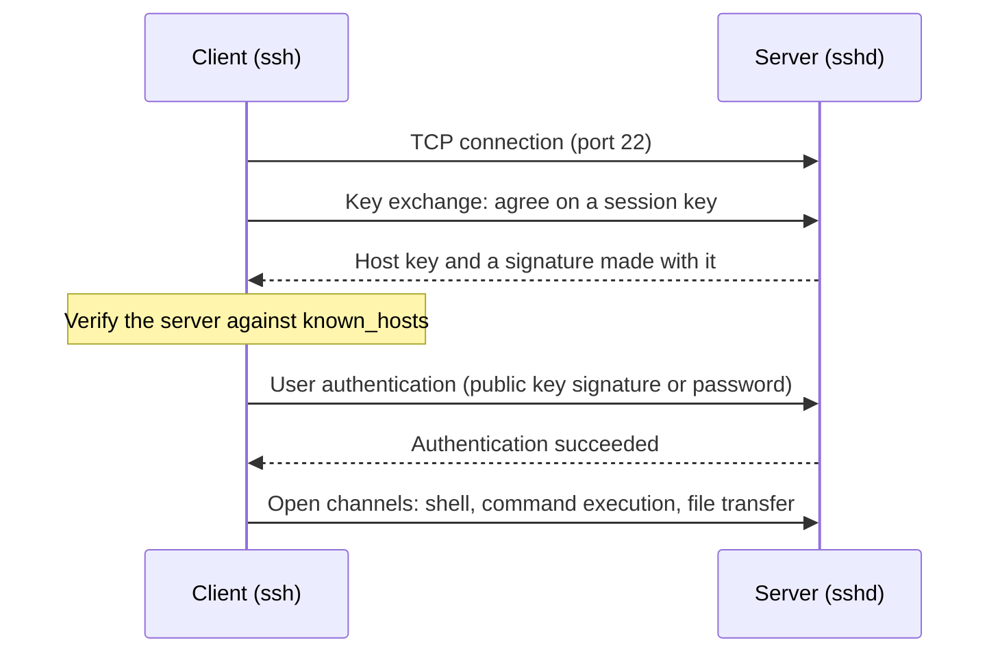
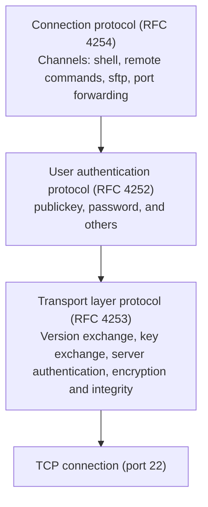
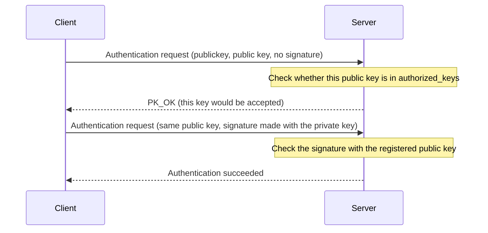
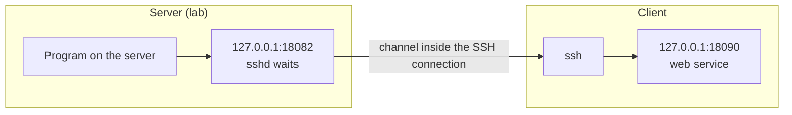

# Chapter 12 — Remote Access and FTP

[Repository Guide](../../README.md) | [English](Concepts_Lecture.md) | [한국어](Concepts_Lecture.ko.md)

> **Last Updated:** 2026-11-19

> **Learning Objectives:**
> 1. Explain why Telnet and FTP are insecure and how SSH solves these problems
> 2. Explain the three layers of SSH, key exchange, and how a server is verified with host keys and `known_hosts`, and what the warnings mean
> 3. Compare password authentication with public key authentication, and create a key and register it on a server
> 4. Transfer files with `scp`, `sftp`, and `rsync`, and use `~/.ssh/config`, jump hosts, and the three kinds of port forwarding
> 5. Configure an SSH server securely with `sshd_config` and diagnose connection problems, and distinguish the two modes of FTP, FTPS, and SFTP
> 6. Explain how mail is delivered and the roles of SMTP, POP3, and IMAP

---

## Table of Contents

- [1. Remote Access and the Problem of Plaintext Protocols](#1-remote-access-and-the-problem-of-plaintext-protocols)
  - [1.1 Structure of Remote Access](#11-structure-of-remote-access)
  - [1.2 Why Telnet and FTP Are Dangerous](#12-why-telnet-and-ftp-are-dangerous)
  - [1.3 How Telnet Works and What It Exposes](#13-how-telnet-works-and-what-it-exposes)
- [2. Structure of SSH and Server Verification](#2-structure-of-ssh-and-server-verification)
  - [2.1 SSH Client and Server](#21-ssh-client-and-server)
  - [2.2 Host Keys and known_hosts](#22-host-keys-and-known_hosts)
  - [2.3 Stages of Establishing a Connection](#23-stages-of-establishing-a-connection)
  - [2.4 The Three Layers of the SSH Protocol](#24-the-three-layers-of-the-ssh-protocol)
  - [2.5 Key Exchange and the Session Identifier](#25-key-exchange-and-the-session-identifier)
  - [2.6 Trust on First Use and the Format of known_hosts](#26-trust-on-first-use-and-the-format-of-known_hosts)
- [3. User Authentication](#3-user-authentication)
  - [3.1 Password Authentication and Public Key Authentication](#31-password-authentication-and-public-key-authentication)
  - [3.2 Creating a Key and Registering It on a Server](#32-creating-a-key-and-registering-it-on-a-server)
  - [3.3 How Public Key Authentication Proceeds](#33-how-public-key-authentication-proceeds)
  - [3.4 Key Types and the Format of authorized_keys](#34-key-types-and-the-format-of-authorized_keys)
  - [3.5 ssh-agent and Agent Forwarding](#35-ssh-agent-and-agent-forwarding)
- [4. File Transfer over SSH](#4-file-transfer-over-ssh)
  - [4.1 scp](#41-scp)
  - [4.2 sftp](#42-sftp)
  - [4.3 rsync](#43-rsync)
  - [4.4 Shortening Connection Settings with ~/.ssh/config](#44-shortening-connection-settings-with-sshconfig)
  - [4.5 Port Forwarding](#45-port-forwarding)
  - [4.6 Matching Rules of ssh_config and Jump Hosts](#46-matching-rules-of-ssh_config-and-jump-hosts)
  - [4.7 Remote and Dynamic Port Forwarding](#47-remote-and-dynamic-port-forwarding)
  - [4.8 Comparing scp, sftp, and rsync](#48-comparing-scp-sftp-and-rsync)
- [5. Configuring and Hardening the SSH Server](#5-configuring-and-hardening-the-ssh-server)
  - [5.1 Structure of sshd_config](#51-structure-of-sshd_config)
  - [5.2 Basic Settings for Security](#52-basic-settings-for-security)
  - [5.3 Checking the Effective Settings and Match Blocks](#53-checking-the-effective-settings-and-match-blocks)
  - [5.4 Diagnosing Connection Problems](#54-diagnosing-connection-problems)
- [6. FTP](#6-ftp)
  - [6.1 Control Connection and Data Connection](#61-control-connection-and-data-connection)
  - [6.2 Active Mode and Passive Mode](#62-active-mode-and-passive-mode)
  - [6.3 Tracing an FTP Session](#63-tracing-an-ftp-session)
  - [6.4 FTPS and SFTP](#64-ftps-and-sftp)
  - [6.5 Basics of vsftpd Configuration](#65-basics-of-vsftpd-configuration)
- [7. Sending and Receiving Electronic Mail](#7-sending-and-receiving-electronic-mail)
  - [7.1 How Mail Is Delivered](#71-how-mail-is-delivered)
  - [7.2 POP3 and IMAP](#72-pop3-and-imap)
- [Concept Applications](#concept-applications)
- [Summary](#summary)
- [Self-Check Questions](#self-check-questions)
- [References](#references)

---

<br>

## 1. Remote Access and the Problem of Plaintext Protocols

### 1.1 Structure of Remote Access

**Remote login** means logging in to another computer over the network and using that computer's shell. On the computer that accepts connections, a server program (daemon) waits for connections on a fixed port (Chapter 11, Section 2.3), and the user connects to that port with a client program.

| Service | Port | Server | Client | Communication |
|:-----|-----:|:-----|:-----|:-----|
| Telnet | 23 | `telnetd` | `telnet` | Plaintext |
| SSH | 22 | `sshd` | `ssh`, `scp`, `sftp` | Encrypted |
| FTP | 21 (control) | `vsftpd` and others | `ftp` | Plaintext |

*Table 1. Ports of remote access and file transfer services*

### 1.2 Why Telnet and FTP Are Dangerous

Telnet and FTP send the user name, the password, the commands typed, and the files exchanged all in **plaintext**. Anyone who can capture packets on the same network (a public Wi-Fi, any point on the path through a router) can read the password as it is with tools such as `tcpdump`. Moreover, the client has no way of verifying that the party it connected to is the real server, so an attacker in the middle can pretend to be the server and collect the password.

SSH (Secure Shell) solves both problems together. As soon as a connection is made, the two computers agree on cryptographic keys and encrypt everything that follows, and the server proves that it is the real server with its **host key** (Section 2.2). SSH consists of three protocols: the transport layer, user authentication, and the connection protocol [1]. Today, therefore, SSH is used for remote access instead of Telnet, and `sftp`, `scp`, and `rsync` over SSH are used for file transfer instead of FTP.

> **[Information Security]** In terms of the cryptography taught in Information Security, SSH agrees on a session key by a Diffie-Hellman key exchange and applies symmetric encryption and message authentication codes with that key to protect confidentiality and integrity. The server's identity is proved by a digital signature made with its host key, and the user's identity by a password or by a signature made with the user's private key.

### 1.3 How Telnet Works and What It Exposes

Telnet is a protocol in which both sides assume a virtual terminal called the **NVT (Network Virtual Terminal)** and exchange characters over a TCP connection [2]. When control is needed, a command is sent after a byte of value 255 (IAC, Interpret As Command), and `WILL`, `WONT`, `DO`, and `DONT` negotiate options such as whether typed characters are echoed back [2]. All other bytes are exactly the characters the user typed or the server printed. What an eavesdropper on a Telnet connection obtains is therefore as follows.

| Contents exchanged | What the eavesdropper sees |
|:-----|:-----|
| Login name and password | The typed characters as they are |
| Commands typed | As they are |
| Output of commands | Exactly what appeared on the screen |
| A file viewed with `cat` | The file's contents as they are |

*Table 2. What is exposed in a Telnet connection*

Even if no characters appear on the screen while a password is typed, that only means they are not echoed to the screen; the typed characters themselves reach the server in plaintext like any other input. The Telnet client is still used today to test whether a TCP port accepts connections. For example, connecting to port 22 of an SSH server shows the SSH version string sent by the server (Section 2.4) as it is (example output).

```text
$ telnet 192.168.111.100 22
Trying 192.168.111.100...
Connected to 192.168.111.100.
Escape character is '^]'.
SSH-2.0-OpenSSH_9.6p1 Ubuntu-3ubuntu13.20
```

Pressing `Ctrl+]` and typing `quit` ends Telnet. If the version string appears, the TCP connection and the server program are working, so any remaining problem lies in SSH key exchange or authentication (Section 5.4).

---

<br>

## 2. Structure of SSH and Server Verification

### 2.1 SSH Client and Server

Ubuntu has the client `ssh` (package `openssh-client`) installed by default, and the server `sshd` (package `openssh-server`) is chosen when installing Ubuntu Server or installed with `sudo apt install openssh-server` (Chapter 9). The SSH server of Ubuntu 24.04 uses systemd socket activation: `ssh.socket` waits on port 22 and starts `sshd` when a connection arrives [3].

```text
$ systemctl is-active ssh.socket
active
$ ssh user1@192.168.111.100
user1@192.168.111.100's password:
Welcome to Ubuntu 24.04.1 LTS (GNU/Linux 6.8.0-51-generic x86_64)
...
user1@server1:~$ exit
logout
Connection to 192.168.111.100 closed.
```

If the user is omitted in `ssh user@host`, the client-side user name is used, and a port other than 22 is given with `-p port`. Appending a command, as in `ssh user1@server1 'df -h /'`, runs only that command remotely without an interactive login and returns the result.

### 2.2 Host Keys and known_hosts

When it is installed, the SSH server creates its own **host key** pairs and keeps them in `/etc/ssh/ssh_host_*_key` (private keys) and `.pub` (public keys). The client records the public host key of a server it connects to for the first time in `~/.ssh/known_hosts`, and from the next connection on checks whether the key presented by the server matches the record. On the first connection it asks as follows.

```text
$ ssh user1@192.168.111.100
The authenticity of host '192.168.111.100 (192.168.111.100)' can't be established.
ED25519 key fingerprint is SHA256:Xy3kq0pVQm2a9cJtT6fB1vLr8oN4sHdE7wZuYgKiAcM.
This key is not known by any other names.
Are you sure you want to continue connecting (yes/no/[fingerprint])? yes
Warning: Permanently added '192.168.111.100' (ED25519) to the list of known hosts.
```

Answering `yes` here means trusting that key, so in principle one should answer only after comparing it with the fingerprint checked on the server. On the server's console, the fingerprint is shown with the following command.

```text
server$ ssh-keygen -lf /etc/ssh/ssh_host_ed25519_key.pub
256 SHA256:Xy3kq0pVQm2a9cJtT6fB1vLr8oN4sHdE7wZuYgKiAcM root@server1 (ED25519)
```

If the key is accepted the first time without checking, the connection is safe against eavesdropping but vulnerable to a man-in-the-middle attack in which the attacker pretends to be the server from the start [1]. If the key of a server already on record changes, `ssh` prints the warning `WARNING: REMOTE HOST IDENTIFICATION HAS CHANGED!` and refuses to connect. If the reason is clear, as when the server was reinstalled and its keys were created anew, remove the old record with `ssh-keygen -R 192.168.111.100` and connect again; if the reason is unknown, it may be a man-in-the-middle attack, so do not connect.

> **Caution:** Cloning a virtual machine (Week 1, Section 7.2) copies even the host keys, so the two servers end up with the same host key. On the cloned server, delete the existing keys with `sudo rm /etc/ssh/ssh_host_*`, create new host keys of the missing types with `sudo ssh-keygen -A` [4], and apply them to the server with `sudo systemctl restart ssh`.

### 2.3 Stages of Establishing a Connection

While connecting with a single `ssh` command, the client and the server go through the following stages in turn. The first two stages belong to the SSH transport layer protocol, the third to the user authentication protocol, and the last to the connection protocol [1].



*Figure 1. Stages of establishing an SSH connection*

1. **Key exchange.** The two computers exchange values and agree on a session key. The key itself is never sent over the network, so an eavesdropper cannot learn it. Everything afterwards is encrypted with this key.
2. **Server authentication.** The server signs the contents of the key exchange with its private host key and sends the signature. The client checks the signature with the server's public host key and confirms that the key matches the record in `known_hosts` (Section 2.2).
3. **User authentication.** Inside the already encrypted connection, the user is proved by a password or a public key signature (Section 3). Even with password authentication, therefore, the password never flows over the network in plaintext.
4. **Channels.** After authentication, several channels such as a shell, remote commands, and `sftp` can be opened within one connection. The port forwarding of Section 4.5 also uses channels.

`ssh -v user@host` prints what happens at each of these stages, so it is used to find where a connection fails (server verification or user authentication).

### 2.4 The Three Layers of the SSH Protocol

The four stages of Section 2.3 result from the three protocols that make up SSH operating in turn. The transport layer protocol provides server authentication, confidentiality, and integrity over TCP, the user authentication protocol authenticates the user on top of it, and the connection protocol, on top of user authentication, divides one encrypted connection into several logical channels [1].



*Figure 2. Layered structure of the SSH protocol*

The output of `ssh -v` shows these layers directly. The following keeps only the main lines of the output between an OpenSSH 10.5 client and server.

```text
$ ssh -v user1@192.168.111.100 true
debug1: Connecting to 192.168.111.100 [192.168.111.100] port 22.
debug1: Connection established.
debug1: Local version string SSH-2.0-OpenSSH_10.5
debug1: Remote protocol version 2.0, remote software version OpenSSH_10.5
debug1: Authenticating to 192.168.111.100:22 as 'user1'
debug1: SSH2_MSG_KEXINIT sent
debug1: SSH2_MSG_KEXINIT received
debug1: kex: algorithm: mlkem768x25519-sha256
debug1: kex: host key algorithm: ssh-ed25519
debug1: kex: server->client cipher: chacha20-poly1305@openssh.com MAC: <implicit> compression: none
debug1: kex: client->server cipher: chacha20-poly1305@openssh.com MAC: <implicit> compression: none
debug1: expecting SSH2_MSG_KEX_ECDH_REPLY
debug1: SSH2_MSG_KEX_ECDH_REPLY received
debug1: Server host key: ssh-ed25519 SHA256:Xy3kq0pVQm2a9cJtT6fB1vLr8oN4sHdE7wZuYgKiAcM
debug1: Host '192.168.111.100' is known and matches the ED25519 host key.
debug1: SSH2_MSG_NEWKEYS sent
debug1: SSH2_MSG_NEWKEYS received
debug1: SSH2_MSG_SERVICE_ACCEPT received
debug1: Authentications that can continue: publickey
debug1: Next authentication method: publickey
debug1: Offering public key: /home/user1/.ssh/id_ed25519 ED25519 SHA256:nFMAopgFOgYjC7kz8eHThmSJ41wioMl+sOwo6lUDQgU
debug1: Server accepts key: /home/user1/.ssh/id_ed25519 ED25519 SHA256:nFMAopgFOgYjC7kz8eHThmSJ41wioMl+sOwo6lUDQgU
Authenticated to 192.168.111.100 ([192.168.111.100]:22) using "publickey".
debug1: channel 0: new session [client-session] (inactive timeout: 0)
debug1: Sending command: true
debug1: Exit status 0
```

| Layer | What it does | Corresponding lines in the output above |
|:-----|:-----|:-----|
| Transport layer | Version string exchange, algorithm negotiation (`KEXINIT`), key exchange, server authentication, applying the new keys (`NEWKEYS`) | From `Remote protocol version` to `SSH2_MSG_NEWKEYS received` |
| User authentication | Requests the `ssh-userauth` service and tries authentication methods | From `SERVICE_ACCEPT` to `Authenticated to` |
| Connection | Opens channels and runs shells, commands, subsystems, and port forwarding in them | `channel 0: new session`, `Sending command` |

*Table 3. The three layers of SSH and the output of ssh -v*

A version string has the form `SSH-protoversion-softwareversion comments` [5]. In `SSH-2.0-OpenSSH_9.6p1 Ubuntu-3ubuntu13.20` of Section 1.3, `2.0` is the protocol version, `OpenSSH_9.6p1` the software, and the trailing `Ubuntu-3ubuntu13.20` a comment added by the distribution. Between OpenSSH 9.6 installations of Ubuntu 24.04, the version and the key exchange line differ from the output above (Section 2.5).

### 2.5 Key Exchange and the Session Identifier

**Algorithm negotiation.** Right after connecting, both sides send with `SSH2_MSG_KEXINIT` the lists of key exchange, host key, cipher, MAC, and compression methods they support, and for each item the first method in the client's list that the server also supports is chosen [5]. The order of the client's list therefore decides the choice. The first entry in the key exchange list sent by `ssh` on Ubuntu 24.04 is `sntrup761x25519-sha512@openssh.com`, followed by `curve25519-sha256` [6]. This default method combines the elliptic curve method (x25519) with Streamlined NTRU Prime, which is believed to resist future quantum computers, and became the default in OpenSSH 9.0 [7].

**The principle of Diffie-Hellman key exchange.** With small numbers it works as follows. Both sides use the public prime p = 23 and generator g = 5, the client chooses the secret value a = 6, and the server chooses the secret value b = 15.

| Step | Client | Server |
|:-----|:-----|:-----|
| Choose a secret value | a = 6 | b = 15 |
| Compute and send the public value | A = 5⁶ mod 23 = 15625 mod 23 = 8 | B = 5¹⁵ mod 23 = 19 |
| Compute the shared secret from the received value | K = 19⁶ mod 23 = 2 | K = 8¹⁵ mod 23 = 2 |

*Table 4. Diffie-Hellman key exchange with small numbers*

Only p, g, A = 8, and B = 19 cross the network; a, b, and K do not. To obtain K, an eavesdropper must find the a satisfying 8 = 5ᵃ mod 23 (the discrete logarithm problem), and real key exchanges use very large numbers or elliptic curves so that this cannot be computed in practical time.

**The exchange hash and server authentication.** When the key exchange ends, both sides compute the **exchange hash** H by hashing the concatenation of both version strings, the contents of the two `KEXINIT` messages, the server's host key, the two exchange values, and the shared secret K [5]. The server signs this H with its private host key and sends the signature (stage 2 of Section 2.3), and this signature guarantees two things.

- H contains exchange values that appear only in this connection, so a signature an attacker captured from an earlier connection does not match when replayed.
- H also contains the host key and the negotiated algorithm lists, so if someone in the middle alters the lists to force a weak method, the signature check fails.

**The session identifier.** The H of the first key exchange becomes the connection's session identifier and does not change until the connection ends [5]. The user authentication of Section 3.3 uses this session identifier.

> **Note:** **Derivation and re-exchange of session keys.** The keys actually used are made by hashing K, H, one character, and the session identifier concatenated in that order. The characters A to F each correspond to the initial vector, encryption key, and integrity key for the client-to-server direction and the opposite direction, so the two directions use different keys [5]. Keys can be exchanged again during a connection, and RFC 4253 recommends re-exchanging after each gigabyte sent or each hour, whichever comes sooner [5]. The session identifier does not change after a re-exchange.

### 2.6 Trust on First Use and the Format of known_hosts

> **Definition:** **Trust on first use (TOFU)** is a method that trusts and records the peer's public key received on the first connection, and on later connections only checks that the key is the same. It stops later man-in-the-middle attacks as long as the first connection was not made with an attacker, but it cannot protect the first connection itself unless that is checked separately.

The `known_hosts` of Section 2.2 implements this method. A line has the form `[marker] hostnames keytype key [comment]`, and the marker may be `@cert-authority`, meaning a certification authority's key, or `@revoked`, meaning a revoked key [8]. Unlike OpenSSH's default, Ubuntu's `/etc/ssh/ssh_config` sets `HashKnownHosts yes` [6], so newly recorded host names are stored as hashes.

```text
$ cat ~/.ssh/known_hosts
|1|9l+k34HJN4PjtBipFGo5Qx2W+GQ=|A4rbkbEkkVU66Fuq6F8q0t3SJwU= ssh-ed25519 AAAAC3NzaC1lZDI1NTE5AAAAIHNVjwdiEdZ4RQXs2WN9o1CsU1AwThJOUbGtxpj0udV9
$ ssh-keygen -F 192.168.111.100
# Host 192.168.111.100 found: line 1
|1|9l+k34HJN4PjtBipFGo5Qx2W+GQ=|A4rbkbEkkVU66Fuq6F8q0t3SJwU= ssh-ed25519 AAAAC3NzaC1lZDI1NTE5AAAAIHNVjwdiEdZ4RQXs2WN9o1CsU1AwThJOUbGtxpj0udV9
```

The two values after `|1|` are a random value and the result of hashing the host name with it. Even if the file leaks, it does not reveal which servers were visited, but because people cannot read the names, entries are found with `ssh-keygen -F host` and removed with `ssh-keygen -R host` [4]. How new hosts and hosts with changed keys are handled is set by `StrictHostKeyChecking` [6].

| Value | Host seen for the first time | Host whose key changed |
|:-----|:-----|:-----|
| `ask` (default) | Recorded after asking | Connection refused |
| `accept-new` | Recorded without asking | Connection refused |
| `yes` | Connection refused (the key must be recorded manually) | Connection refused |
| `no` | Recorded without asking | Connects with some features restricted |

*Table 5. Values of StrictHostKeyChecking and their behaviour*

To make up for TOFU's weak point, the first connection, either check the fingerprint on the server console as in Section 2.2, or have the administrator put the server's public host key in advance into `/etc/ssh/ssh_known_hosts`, which all users read. `ssh` looks up the server's key in this file together with the user's `known_hosts` [9]. In automated scripts `accept-new` does not stop at servers connected to for the first time and still refuses servers whose keys changed, so it is safer than `no`, which turns key checking off.

---

<br>

## 3. User Authentication

### 3.1 Password Authentication and Public Key Authentication

| Aspect | Password authentication | Public key authentication |
|:-----|:-----|:-----|
| What is proved | Knowing the password of the server account | Holding the private key that pairs with a public key registered on the server |
| What is sent to the server | The password (inside the encrypted connection) | A signature made with the private key; the private key itself is never sent |
| Brute-force attacks | Weak passwords can be guessed | Practically impossible |
| If the server is compromised | The password is also at risk wherever else it was used | The server holds only the public key, so the private key stays safe |

*Table 6. Comparison of password authentication and public key authentication*

In public key authentication the user creates a **key pair**. The private key stays only on the client, and the public key is put in `~/.ssh/authorized_keys` of the server account. On connection, the server asks the client for a signature that can be made only with the private key and checks the signature with the registered public key. The private key never leaves for the network.

### 3.2 Creating a Key and Registering It on a Server

Run without arguments, `ssh-keygen` creates an Ed25519 key [4].

```text
$ ssh-keygen -C user1@myubuntu
Generating public/private ed25519 key pair.
Enter file in which to save the key (/home/user1/.ssh/id_ed25519):
Enter passphrase (empty for no passphrase):
Enter same passphrase again:
Your identification has been saved in /home/user1/.ssh/id_ed25519
Your public key has been saved in /home/user1/.ssh/id_ed25519.pub
The key fingerprint is:
SHA256:nFMAopgFOgYjC7kz8eHThmSJ41wioMl+sOwo6lUDQgU user1@myubuntu
The key's randomart image is:
+--[ED25519 256]--+
|OE+o. ...        |
|#O=o .   .       |
|%&+=      .      |
|B+O +  . o       |
| * + o  S        |
|o . . .  .       |
|o. .             |
|o .              |
|o.               |
+----[SHA256]-----+
$ ls -l ~/.ssh/id_ed25519*
-rw------- 1 user1 user1 464 Mar 21 16:00 /home/user1/.ssh/id_ed25519
-rw-r--r-- 1 user1 user1  96 Mar 21 16:00 /home/user1/.ssh/id_ed25519.pub
```

- `-C` is a description (comment) for recognizing the key. Other kinds of keys can also be created, as in `-t rsa -b 4096`.
- A **passphrase** encrypts the private key file itself. Even if the private key file is stolen, it cannot be used without the passphrase, so it is safer not to leave it empty. The inconvenience of typing it every time is reduced by `ssh-agent`, which remembers a key once it has been unlocked.
- The private key is `600`, readable only by its owner, and the public key `644` (Week 7). If the permissions of the private key are too broad, `ssh` refuses to use it.

The simplest way to register the public key on a server is `ssh-copy-id`. This command connects once with the password and appends the public key to the end of `~/.ssh/authorized_keys` on the server.

```text
$ ssh-copy-id user1@192.168.111.100
...
Number of key(s) added: 1
$ ssh user1@192.168.111.100
Enter passphrase for key '/home/user1/.ssh/id_ed25519':
user1@server1:~$
```

This time it asks not for the server account's password but for the passphrase of the user's own private key. Without `ssh-copy-id`, append the single line of the public key file to `~/.ssh/authorized_keys` on the server directly. The server's `~/.ssh` directory must then be `700` and `authorized_keys` `600`. If other users have write permission, `sshd` assumes someone else may have inserted a key and ignores the file.

### 3.3 How Public Key Authentication Proceeds

In the user authentication protocol, the client sends a request containing the user name, the service to use after authentication (`ssh-connection`), and the authentication method. If the request fails, the server returns the list of "authentications that can continue", and the client chooses a method from that list and tries again [10]. The public key method proceeds in the following order [10].



*Figure 3. Message order of public key authentication*

1. The client first sends only the public key, without a signature, to ask whether the server would accept that key. Making a signature requires asking for the passphrase or doing computation, so this avoids that effort for keys that would not be accepted.
2. If that public key is in the user's `~/.ssh/authorized_keys`, the server replies with `SSH_MSG_USERAUTH_PK_OK`.
3. The client signs, with the private key, data that concatenates in a fixed order the session identifier (Section 2.5), the user name, the service name, the method name, and the public key, and sends the signature.
4. The server checks both that the public key is acceptable and that the signature is correct, and reports success if both hold.

Because the signed data contains the session identifier, a signature is valid only in that connection. Even if an attacker captures a signature and replays it in another connection, it is not accepted because the session identifier differs. In the `ssh -v` output of Section 2.4, `Offering public key` corresponds to step 1, `Server accepts key` to step 2, and `Authenticated to ... using "publickey"` is the result of step 4. The earlier `Authentications that can continue: publickey` announced that this server allows only the public key method (`PasswordAuthentication no` of Section 5.2).

### 3.4 Key Types and the Format of authorized_keys

The main key types that can be chosen with `ssh-keygen -t` are as follows [4].

| Type (`-t`) | Size | Characteristics |
|:-----|:-----|:-----|
| `ed25519` | Fixed at 256 bits | The type `ssh-keygen` on Ubuntu 24.04 creates without arguments |
| `ecdsa` | 256, 384, or 521 bits, chosen with `-b` | Elliptic curve signatures on NIST curves |
| `rsa` | 3072 bits by default, at least 1024 bits | Compatible with old servers too |
| `ed25519-sk`, `ecdsa-sk` | | Private key operations are performed by a FIDO authenticator (security key) |

*Table 7. Main key types created by ssh-keygen*

An RSA key can be used with several signature methods. Since OpenSSH 8.8, signatures of the old method using the SHA-1 hash (`ssh-rsa`) are not accepted by default [11], and `rsa-sha2-256` and `rsa-sha2-512`, which use SHA-2, are used instead [12]. An RSA key may therefore fail to connect to old servers that do not know these two methods.

A line of `authorized_keys` has the form `[options] keytype base64-encoded-key [comment]` [8]. Options are listed separated by commas and restrict what can be done with that key (the keys are partly shortened).

```text
ssh-ed25519 AAAAC3NzaC1lZDI1NTE5AAAAI... user1@myubuntu
from="192.168.111.0/24",restrict ssh-ed25519 AAAAC3NzaC1lZDI1NTE5AAAAI... user1@laptop
command="/usr/local/bin/backup.sh",restrict ssh-ed25519 AAAAC3NzaC1lZDI1NTE5AAAAI... backup-job
```

- The first line is an ordinary registration without options.
- `from="pattern"` allows this key only for connections from addresses or host names matching the pattern. CIDR notation (`192.168.111.0/24`) can also be used, so a stolen key cannot be used from other networks [8].
- `command="command"` makes a connection with this key run only the fixed command, regardless of the command the client requested. It is used for keys that do only one job, such as automated backups.
- `restrict` blocks port forwarding, agent forwarding, X11 forwarding, terminal allocation, and the execution of `~/.ssh/rc` all together [8].

When `StrictModes yes` (the default) is in effect, `sshd` does not use `authorized_keys` if the user's home directory, `~/.ssh`, or the file itself is writable by other users [13], [8]. When the permission problem of Section 3.2 occurs, the client sees only `Permission denied (publickey).` without a reason, and the reason is left in the server's log (Section 5.4) as follows.

```text
server$ chmod 664 ~/.ssh/authorized_keys
client$ ssh user1@192.168.111.100 true
user1@192.168.111.100: Permission denied (publickey).
server$ sudo journalctl -u ssh | tail -1
... sshd[2481]: Authentication refused: bad ownership or modes for file /home/user1/.ssh/authorized_keys
```

### 3.5 ssh-agent and Agent Forwarding

**ssh-agent** is a program that keeps private keys whose passphrases have been unlocked in memory and signs with those keys at the request of `ssh`. `ssh` communicates with the agent through the Unix domain socket named by the environment variable `SSH_AUTH_SOCK`, and the private keys themselves never leave the agent [14].

```text
$ eval "$(ssh-agent -s)"
Agent pid 4213
$ ssh-add -l
The agent has no identities.
$ ssh-add ~/.ssh/id_ed25519
Enter passphrase for /home/user1/.ssh/id_ed25519:
Identity added: /home/user1/.ssh/id_ed25519 (user1@myubuntu)
$ ssh-add -l
256 SHA256:nFMAopgFOgYjC7kz8eHThmSJ41wioMl+sOwo6lUDQgU user1@myubuntu (ED25519)
$ ssh user1@192.168.111.100
user1@server1:~$
```

1. `ssh-agent -s` starts the agent and prints shell commands that set `SSH_AUTH_SOCK` and `SSH_AGENT_PID`, and `eval` runs those commands in the current shell. On Ubuntu 24.04 (OpenSSH 9.6), the socket is created at `$TMPDIR/ssh-XXXXXXXXXX/agent.<parent PID>` [14].
2. The first `ssh-add -l` shows that no key has been added yet.
3. `ssh-add` adds the key to the agent, asking for the passphrase only this once.
4. The second `ssh-add -l` shows the size, fingerprint, comment, and type of the added key.
5. Later `ssh` commands do not ask for the passphrase and leave signing to the agent.

`ssh-add -D` removes all added keys, and giving a lifetime, as in `ssh-add -t 3600 key`, removes the key automatically after that time [15].

**Agent forwarding.** `ssh -A` (`ForwardAgent yes` in the configuration file) lets the local agent be used on the remote server as well. However, users on the remote server who can access that socket (such as that server's root) can authenticate to other servers with the keys in the agent while the connection lasts. They cannot extract the keys themselves, but they can use them, so when connecting to another server through an intermediate server, the jump host of Section 4.6 is safer than agent forwarding [9].

---

<br>

## 4. File Transfer over SSH

### 4.1 scp

`scp` copies files over an SSH connection in the same form as `cp`. A remote path is written as `user@host:path`, and a path not starting with `/` is relative to the remote user's home directory.

```text
$ scp report.pdf user1@192.168.111.100:docs/
report.pdf                         100%  245KB  21.3MB/s   00:00
$ scp user1@192.168.111.100:/var/log/syslog ./server-syslog
$ scp -r project user1@192.168.111.100:
```

`-r` copies directories recursively, and `-P` (uppercase) sets the port. The port option of `ssh` is lowercase `-p`, so care is needed not to confuse the two.

### 4.2 sftp

`sftp` exchanges files over SSH with interactive commands similar to FTP.

```text
$ sftp user1@192.168.111.100
Connected to 192.168.111.100.
sftp> pwd
Remote working directory: /home/user1
sftp> lcd /tmp
sftp> get docs/report.pdf
Fetching /home/user1/docs/report.pdf to report.pdf
sftp> put notes.txt
Uploading notes.txt to /home/user1/notes.txt
sftp> bye
```

| Command | Meaning |
|:-----|:-----|
| `pwd`, `cd`, `ls` | Remote current directory, change, list |
| `lpwd`, `lcd`, `lls` | Local (client) current directory, change, list |
| `get remotefile` | Download from remote to local |
| `put localfile` | Upload from local to remote |
| `bye`, `exit` | Quit |

*Table 8. Main commands of sftp*

Commands with `l` before the name act on the local side. The directions of `get` and `put` are "receive" and "send" from the viewpoint of the local side (the client).

### 4.3 rsync

`rsync` compares the source with the destination and sends **only the changed parts**, so it suits backups that synchronize the same directory repeatedly. If one side is remote, it connects over SSH.

```text
$ rsync -avz project/ user1@192.168.111.100:backup/project/
$ rsync -avz --delete -n project/ user1@192.168.111.100:backup/project/
```

- `-a` (archive) copies recursively while preserving permissions, times, and symbolic links. `-v` prints the files transferred, and `-z` compresses during transfer.
- `--delete` deletes from the destination the files that are not in the source, making both sides identical. Misused, it deletes files at the destination, so first print what it would do with `-n` (dry run), check it, and then run without `-n`.

With `rsync`, a `/` at the end of the source path changes the result. With `a.txt` and `sub/b.txt` in the source `src`, the comparison is as follows.

```text
$ rsync -a src dst1/
$ rsync -a src/ dst2/
$ find dst1 dst2 | sort
dst1
dst1/src
dst1/src/a.txt
dst1/src/sub
dst1/src/sub/b.txt
dst2
dst2/a.txt
dst2/sub
dst2/sub/b.txt
```

`src` sends "the directory `src` itself", so `src/` is created inside the destination, while `src/` sends "the contents of the directory `src`", so the contents go directly into the destination. Like `cp -r src dest` in Week 4, Section 1.4, it is a common mistake in which the structure of the destination differs from what was intended.

### 4.4 Shortening Connection Settings with ~/.ssh/config

The address, user, port, and key file of a server connected to often can be written in `~/.ssh/config` under an alias [6].

```text
Host lab
    HostName 192.168.111.100
    User user1
    Port 2222
    IdentityFile ~/.ssh/id_ed25519
```

With this, typing just `ssh lab` replaces `ssh -p 2222 -i ~/.ssh/id_ed25519 user1@192.168.111.100`, and the same alias can be used in every command that uses SSH, as in `scp report.pdf lab:docs/`, `sftp lab`, and `rsync -a project/ lab:backup/`. If the same setting appears in several places, the first value obtained is used [6], so specific `Host` blocks go at the beginning of the file and general settings such as `Host *` at the end.

### 4.5 Port Forwarding

Carrying another TCP connection inside an SSH connection is called **port forwarding**. When a database on the server (port 5432) is configured to accept connections only on `127.0.0.1`, so that it cannot be reached directly from outside (Chapter 11, Section 5.2), it can be reached securely with the following command.

```text
$ ssh -L 15432:127.0.0.1:5432 lab
```

`-L localport:destination:destport` sends connections arriving at port `15432` of the client through the SSH connection to the server and then connects to `127.0.0.1:5432` as seen from the server. While this SSH session is open, programs on the client reach the server's database by connecting to `localhost:15432`. Even if the database's communication is plaintext, the network segment is encrypted by SSH, so the service can be used remotely without opening its port to the outside.

### 4.6 Matching Rules of ssh_config and Jump Hosts

`ssh` reads settings in the order of command-line options, `~/.ssh/config`, and `/etc/ssh/ssh_config`, and uses the first value obtained for each setting (Section 4.4) [6]. Within a file, only the blocks whose `Host` patterns match the name being connected to apply, and several blocks may match one name. `ssh -G name` prints only the final settings that would apply to that name without connecting [9], so it shows which values each of three names obtains under the following configuration.

```text
Host lab
    HostName 192.168.111.100
    User user1
    Port 2222

Host web*
    User deploy
    ProxyJump lab

Host *
    User guest
    ServerAliveInterval 60
    IdentityFile ~/.ssh/id_ed25519
```

```text
$ ssh -G lab | grep -E '^(user|hostname|port|proxyjump) '
user user1
hostname 192.168.111.100
port 2222
$ ssh -G web1 | grep -E '^(user|hostname|port|proxyjump) '
user deploy
hostname web1
port 22
proxyjump lab
$ ssh -G other | grep -E '^(user|hostname|port|proxyjump) '
user guest
hostname other
port 22
```

- `lab` matches the first block and `Host *`. `User` obtained `user1` first from the first block, so `guest` of `Host *` is not used, while `ServerAliveInterval` and `IdentityFile` are obtained only from `Host *`.
- `web1` matches `web*` and `Host *` and obtains `User deploy`, and because there is no `HostName` it connects to the given name as it is.
- `other` matches only `Host *`.

Placing `Host *` at the very beginning of the file fixes every host's `User` to `guest` first, so the `User` of every block below is ignored. This is why general settings go at the end of the file.

**Jump hosts.** A server such as `web1`, which is on an internal network and cannot be reached directly from outside, is connected to through a server reachable from outside (`lab`). `ProxyJump lab` (`ssh -J lab web1` on the command line) first connects to `lab` with SSH, opens a TCP forwarding to `web1` through that connection, and establishes a new SSH connection with `web1` on top of it [9]. Key exchange and user authentication happen directly between the client and `web1`, so the intermediate `lab` cannot see the encrypted contents, and the private key need not be placed on `lab`. This is why it is safer than the agent forwarding of Section 3.5.

### 4.7 Remote and Dynamic Port Forwarding

Together with the `-L` of Section 4.5 there are three kinds of port forwarding, and they differ in which side waits for connections and where the connections finally go [9].

| Option | Side that waits for connections | Where connections go | Use |
|:-----|:-----|:-----|:-----|
| `-L localport:destination:port` | Client | The destination as seen from the server | Using a server-side service not opened to the outside from the client |
| `-R remoteport:destination:port` | Server | The destination as seen from the client | Using a client-side service from the server |
| `-D localport` | Client (SOCKS proxy) | Wherever each request specifies (connected from the server) | Sending connections to many destinations through the server |

*Table 9. Comparison of the three kinds of port forwarding*



*Figure 4. The path of a connection in remote port forwarding (-R)*

The following uses the three methods in turn. The server has an administration page that listens only on `127.0.0.1:18080`, and the client has a web service that listens only on `127.0.0.1:18090`.

```text
client$ ssh -f -N -L 15432:127.0.0.1:18080 lab
client$ curl -s http://localhost:15432/
admin page on the server
client$ ssh -f -N -R 18082:127.0.0.1:18090 lab
server$ curl -s http://127.0.0.1:18082/
page served by the client
client$ ssh -f -N -D 11080 lab
client$ curl -s --socks5-hostname 127.0.0.1:11080 http://127.0.0.1:18080/
admin page on the server
```

- `-f` sends `ssh` to the background after authentication, and `-N` runs no remote command. They are used together when only forwarding ports [9].
- With `-R`, the server's `sshd` by default creates the listening socket only on the loopback address (`GatewayPorts no`) [13]. Port 18082 can therefore be reached only from the server itself, and opening it to other computers requires changing the server's `GatewayPorts`.
- With `-D`, a program using SOCKS puts the destination in its request, and `ssh` passes the request to the server, which connects to that destination [9]. The destination `127.0.0.1:18080` above is an address as seen from the server, so it reached the server's own administration page. `--socks5-hostname` of `curl` makes name resolution happen on the server side too.
- In terms of the connection protocol, for `-L` and `-D` the client opens `direct-tcpip` channels, while for `-R` the client asks the server to listen with a `tcpip-forward` request and the server then opens `forwarded-tcpip` channels [16].

Setting the server's `AllowTcpForwarding` (default `yes`) to `no` blocks all three methods [13], and the `restrict` option of `authorized_keys` (Section 3.4) also blocks port forwarding for that key.

> **Note:** **X11 forwarding.** `ssh -X` displays the windows of graphical programs run on the remote server on the local screen. The server's `sshd` puts a virtual display numbered from 10, such as `localhost:10.0`, into the remote shell's `DISPLAY` [13], and passes X11 connections to that display over `x11` channels to the local X server [16]. Unlike OpenSSH's default, Ubuntu's `sshd_config` sets `X11Forwarding yes` [13]. Because users who can bypass file permissions on the remote server (such as its root) can reach the local display through the forwarded connection and observe keystrokes, it is used only with trusted servers, and on Ubuntu `-Y` behaves the same as `-X` [9].

### 4.8 Comparing scp, sftp, and rsync

All three commands use an SSH connection, but they differ in the protocol used inside it and in what they do well.

| Aspect | `scp` | `sftp` | `rsync` |
|:-----|:-----|:-----|:-----|
| Protocol inside SSH | SFTP (the old SCP protocol with `-O`) | SFTP | rsync's own protocol between the two `rsync` processes |
| Needed on the remote side | The SFTP subsystem | The SFTP subsystem | An installed `rsync` |
| Way of use | Copies at once, like `cp` | Interactive, or a command file with `-b` | Synchronization |
| Sending only changed parts | No | No (resuming with `reget` and `reput` is possible) | Yes |
| Deleting files that exist only at the destination | No | No | `--delete` |

*Table 10. Comparison of scp, sftp, and rsync*

Since OpenSSH 9.0, `scp` uses the SFTP protocol inside the SSH connection instead of the old SCP protocol [7]. In the old protocol the remote shell expanded wildcards in file names, so file names containing special characters had to be quoted twice, and otherwise they could be interpreted as commands on the remote side [7]. The difference shows in the output of `scp -v`.

```text
$ scp -v report.txt lab:docs/ 2>&1 | grep -E 'Sending (subsystem|command)'
debug1: Sending subsystem: sftp
$ scp -O -v report.txt lab:docs/ 2>&1 | grep -E 'Sending (subsystem|command)'
debug1: Sending command: scp -v -t docs/
```

The first opened the server's `sftp` subsystem with a `subsystem` request of the connection protocol [16], and the second ran the `scp -t` command remotely and exchanged data with the old protocol. Ubuntu's `sshd_config` defines this subsystem with `Subsystem sftp /usr/lib/openssh/sftp-server` [13].

`rsync` first finds the files whose size or modification time changed (the quick check), and for those files too it uses the delta-transfer algorithm, which sends only the differences between the source and the destination [17]. Even if only part of a large file changes, only the changed part goes over the network. Because `rsync` must also run on the remote side, it must be installed on both sides [17]. For sending many files bundled at once, connecting `tar` to `ssh` as in Chapter 9, Section 4.5 is also used.

---

<br>

## 5. Configuring and Hardening the SSH Server

### 5.1 Structure of sshd_config

The SSH server's configuration is `/etc/ssh/sshd_config`, and its `Include /etc/ssh/sshd_config.d/*.conf` line at the very beginning reads the files of the `sshd_config.d` directory first [13]. When the same setting appears more than once, `sshd` uses the **first value obtained**, so values written in files in `sshd_config.d/` take precedence over those in the main file [13]. When changing settings, therefore, the main file is not edited; instead a new file such as `/etc/ssh/sshd_config.d/50-hardening.conf` is added.

In Ubuntu 24.04, socket-related settings such as the port are read from `sshd_config` and `sshd_config.d/` by a systemd generator and applied to `ssh.socket` [3]. After changing the settings, apply them in the following order.

```text
$ sudo sshd -t
$ sudo systemctl daemon-reload
$ sudo systemctl restart ssh.socket
```

`sshd -t` checks the syntax of the configuration files and prints output only when there is an error. Restarting the server with a faulty configuration can make it impossible to connect again remotely, so always check before applying.

### 5.2 Basic Settings for Security

| Setting | Default | Recommended | Meaning |
|:-----|:-----|:-----|:-----|
| `PermitRootLogin` | `prohibit-password` | `no` | Direct login as root. The default blocks only root's password login and allows key login [13] |
| `PasswordAuthentication` | `yes` | `no` (after registering keys) | Whether password authentication is allowed [13] |
| `PubkeyAuthentication` | `yes` | `yes` | Whether public key authentication is allowed |
| `AllowUsers` | (none) | `user1 admin` | Lists only the users allowed to connect |
| `Port` | `22` | Depends on the environment | The port to listen on |

*Table 11. Security-related settings of sshd_config*

```text
$ cat /etc/ssh/sshd_config.d/50-hardening.conf
PermitRootLogin no
PasswordAuthentication no
AllowUsers user1
```

These settings block direct login as root and let only user1, who has registered a public key, connect with that key. Administrative work is done by logging in as user1 and using `sudo` (Week 12, Section 7). Changing the port to a number other than 22 greatly reduces automated brute-force attempts, but it does not stop an attacker who scans for the port, so it does not replace key authentication.

> **Caution:** Before applying `PasswordAuthentication no`, always confirm that public key login works. While applying the settings, keep one existing SSH session open without disconnecting it, and test the connection from a new terminal. Even if the new connection fails, the settings can be reverted from the session kept open.

### 5.3 Checking the Effective Settings and Match Blocks

When the same setting appears more than once, `sshd` uses the first value (Section 5.1), so it is easy to misjudge the actual values by reading the files alone. `sudo sshd -T` checks the configuration and prints every value that will actually apply, and giving connection conditions (user, host, address) with `-C` shows the values that apply under those conditions [8]. Checking with the following configuration gives the following (example output, Ubuntu 24.04).

```text
$ cat /etc/ssh/sshd_config.d/50-hardening.conf
PermitRootLogin no
PasswordAuthentication no
PasswordAuthentication yes
MaxAuthTries 3
Match Address 192.168.111.0/24
    PasswordAuthentication yes
$ sudo sshd -T | grep -E '^(logingracetime|maxauthtries|permitrootlogin|passwordauthentication) '
logingracetime 120
maxauthtries 3
permitrootlogin no
passwordauthentication no
$ sudo sshd -T -C user=user1,host=pc1,addr=192.168.111.50 | grep '^passwordauthentication'
passwordauthentication yes
$ sudo sshd -T -C user=user1,host=pc2,addr=203.0.113.7 | grep '^passwordauthentication'
passwordauthentication no
```

- `PasswordAuthentication` appears twice, but the first value `no` is used. The later `yes` has no effect.
- The settings under `Match Address 192.168.111.0/24` override the global settings for connections matching that condition. A `Match` block continues until the next `Match` line or the end of the file [13]. Password authentication is therefore allowed from the internal network (`192.168.111.50`) and blocked from outside (`203.0.113.7`).
- `logingracetime 120`, which is not written in the file, is the default. Comparing the output of `sshd -T` before and after changing the settings confirms whether the intended values apply.

Besides the settings of Section 5.2, the main security-related settings are as follows [13].

| Setting | Default | Meaning |
|:-----|:-----|:-----|
| `MaxAuthTries` | 6 | The number of authentication attempts allowed per connection |
| `LoginGraceTime` | 120 seconds | The time within which authentication must finish after connecting |
| `AuthenticationMethods` | `any` | Written as `publickey,password`, login requires passing both methods |
| `DenyUsers`, `AllowGroups`, `DenyGroups` | (none) | Users are checked in the order `DenyUsers`, `AllowUsers`, and groups in the order `DenyGroups`, `AllowGroups` |
| `KbdInteractiveAuthentication` | `yes` (`no` in Ubuntu's configuration file) | Whether keyboard-interactive authentication is allowed |
| `X11Forwarding` | `no` (`yes` in Ubuntu's configuration file) | Whether X11 forwarding is allowed (Section 4.7) |
| `AllowTcpForwarding` | `yes` | Whether port forwarding is allowed (Section 4.7) |
| `ClientAliveInterval` | 0 | The interval (seconds) for checking unresponsive clients; 0 means no checking |

*Table 12. Other security-related settings of sshd_config*

### 5.4 Diagnosing Connection Problems

The cause of an SSH connection failure is narrowed down by the stage of Section 2.3 at which it occurred. `ssh -v` prints what it did at each stage, so the last successful line tells the failed stage, and `-vv` and `-vvv` show more detail [9]. Records on the server side are viewed with `sudo journalctl -u ssh`.

| Message | Failed stage | Common cause | Check and remedy |
|:-----|:-----|:-----|:-----|
| `Connection refused` | TCP connection | `sshd` is not listening on that port | `ss -tln` on the server (Chapter 11, Section 2.3), check the port number |
| `Connection timed out` | TCP connection | A firewall drops packets or there is no route | Diagnose in the order of Chapter 11, Section 5.1 |
| `Host key verification failed.` | Server authentication | The key in `known_hosts` differs from the server's key | Section 2.2, check whether the server was reinstalled |
| `Permission denied (publickey).` | User authentication | The key is not registered, or the permissions of `authorized_keys` and `~/.ssh` are wrong | `Authentication refused` in the server log (Section 3.4) |
| `WARNING: UNPROTECTED PRIVATE KEY FILE!` | User authentication (client) | Other users can read the private key file | `chmod 600 ~/.ssh/id_ed25519` |
| `Too many authentication failures` | User authentication | Offering the agent's keys one by one exceeded `MaxAuthTries` | Choose the key with `IdentitiesOnly yes` and `IdentityFile` |

*Table 13. Messages and causes of SSH connection failures*

The following shows how each message actually appears.

```text
$ ssh -p 2200 user1@192.168.111.100
ssh: connect to host 192.168.111.100 port 2200: Connection refused
$ ssh user1@192.168.111.100
@@@@@@@@@@@@@@@@@@@@@@@@@@@@@@@@@@@@@@@@@@@@@@@@@@@@@@@@@@@
@    WARNING: REMOTE HOST IDENTIFICATION HAS CHANGED!     @
@@@@@@@@@@@@@@@@@@@@@@@@@@@@@@@@@@@@@@@@@@@@@@@@@@@@@@@@@@@
IT IS POSSIBLE THAT SOMEONE IS DOING SOMETHING NASTY!
Someone could be eavesdropping on you right now (man-in-the-middle attack)!
It is also possible that a host key has just been changed.
The fingerprint for the ED25519 key sent by the remote host is
SHA256:5VrDMCfDmif2kg24jTNTWb6lfCQCAkmW3whS3vFfMME.
Please contact your system administrator.
Add correct host key in /home/user1/.ssh/known_hosts to get rid of this message.
Offending ED25519 key in /home/user1/.ssh/known_hosts:1
Host key for 192.168.111.100 has changed and you have requested strict checking.
Host key verification failed.
$ ssh -i ~/.ssh/id_ed25519 user1@192.168.111.100
@@@@@@@@@@@@@@@@@@@@@@@@@@@@@@@@@@@@@@@@@@@@@@@@@@@@@@@@@@@
@         WARNING: UNPROTECTED PRIVATE KEY FILE!          @
@@@@@@@@@@@@@@@@@@@@@@@@@@@@@@@@@@@@@@@@@@@@@@@@@@@@@@@@@@@
Permissions 0644 for '/home/user1/.ssh/id_ed25519' are too open.
It is required that your private key files are NOT accessible by others.
This private key will be ignored.
Load key "/home/user1/.ssh/id_ed25519": bad permissions
user1@192.168.111.100: Permission denied (publickey).
$ ssh user1@192.168.111.100
Received disconnect from 192.168.111.100 port 22:2: Too many authentication failures
Disconnected from 192.168.111.100 port 22
```

- The first is a case in which the server refused the connection at once. If a firewall drops the packets, `Connection timed out` appears after some time instead of a refusal.
- In the second, `Offending ED25519 key in ...:1` means that the recorded key is on line 1 of `known_hosts`. Once the reason is confirmed, remove that line with `ssh-keygen -R 192.168.111.100` (Section 2.2).
- In the third, `ssh` does not use a private key whose permissions are `0644`, so authentication fails if there is no other key.
- The fourth happens when the agent holds several keys. While `ssh` offers the keys one at a time, exceeding the server's `MaxAuthTries` (Section 5.3) cuts the connection before the right key is even offered [13]. Giving `IdentitiesOnly yes` in that host's `Host` block makes `ssh` use only the keys set with `IdentityFile` [6].

---

<br>

## 6. FTP

### 6.1 Control Connection and Data Connection

FTP (File Transfer Protocol) uses two connections [18]. The **control connection** is made by the client to port 21 of the server, and commands such as `USER`, `PASS`, `LIST`, `RETR` (receive), and `STOR` (store) and their replies travel over it. A **data connection** is made separately each time a file list or file contents are sent. Both connections are plaintext, so they carry the dangers of Section 1.2 as they are. On Ubuntu, `vsftpd` is widely used as an FTP server; unless the purpose is to let anonymous users download public material, SSH's `sftp` is the safer choice.

### 6.2 Active Mode and Passive Mode

There are two methods according to who makes the data connection.

| Method | Client command | Side that makes the data connection | Direction of the connection |
|:-----|:-----|:-----|:-----|
| Active mode | `PORT h1,h2,h3,h4,p1,p2` | Server | Server port 20 → the port given by the client |
| Passive mode | `PASV` | Client | Client → the port given by the server |

*Table 14. Active and passive modes of FTP*

In active mode, the server connects to the client from port 20, the port just below the control port [18]. If the client is behind a router's NAT or a firewall, this incoming connection is blocked, so the data transfer fails. In passive mode, the server opens a data port, waits, and reports that address and port in its reply [18], and the client connects to that port. Because connections always go out from the client, clients behind NAT also work, and most FTP clients today use passive mode by default.

Of the six numbers in the reply, the first four give the IP address and the last two the port in base 256. If the server replies as follows,

```text
227 Entering Passive Mode (192,168,111,100,195,80)
```

the address is `192.168.111.100` and the port is as follows.

```math
195 \times 256 + 80 = 49920 + 80 = 50000
```

### 6.3 Tracing an FTP Session

The following shows the commands and replies exchanged over the control connection while logging in in passive mode, receiving a file list, and downloading one file. `C:` marks commands sent by the client and `S:` replies of the `vsftpd` server (example output).

```text
S: 220 (vsFTPd 3.0.5)
C: USER user1
S: 331 Please specify the password.
C: PASS ftp-secret
S: 230 Login successful.
C: PASV
S: 227 Entering Passive Mode (192,168,111,100,195,80).
C: LIST
S: 150 Here comes the directory listing.
S: 226 Directory send OK.
C: TYPE I
S: 200 Switching to Binary mode.
C: PASV
S: 227 Entering Passive Mode (192,168,111,100,195,81).
C: RETR report.pdf
S: 150 Opening BINARY mode data connection for report.pdf (250880 bytes).
S: 226 Transfer complete.
C: QUIT
S: 221 Goodbye.
```

The first digit of a three-digit reply indicates the kind of result [18].

| First digit | Meaning | In the example above |
|:-----|:-----|:-----|
| 1 | Preliminary reply: the request has started and another reply will follow | 150 (opening the data connection) |
| 2 | Completion | 220 (service ready), 230, 226, 221 |
| 3 | Intermediate reply: more information is needed | 331 (password needed) |
| 4 | Transient failure: retrying may succeed | 425 (cannot open data connection) |
| 5 | Permanent failure | 530 (not logged in) |

*Table 15. The first digit of FTP reply codes*

The following can be read from this trace.

- The password appears as it is, as in `PASS ftp-secret`. Anyone eavesdropping on the control connection sees this screen as it is, and the listings and file contents exchanged over the data connections are plaintext too (Section 1.2).
- A data connection is made anew for each transfer, so `PASV` was sent again before `LIST` and before `RETR`. The ports given by the server are 195 × 256 + 80 = 50000 and 195 × 256 + 81 = 50001.
- `TYPE I` chooses the binary type (image), which sends a file byte for byte. The text type (`TYPE A`) may change how line endings are represented, so it is not used for files other than text [18].

In active mode, instead of `PASV`, the client reports its own address and port with `PORT`.

```text
C: PORT 192,168,111,50,234,219
S: 200 PORT command successful. Consider using PASV.
C: RETR report.pdf
S: 150 Opening BINARY mode data connection for report.pdf (250880 bytes).
S: 226 Transfer complete.
```

The client waits on port 234 × 256 + 219 = 60123 of `192.168.111.50`, and the server connects there. `vsftpd` starts this connection from port 20 when `connect_from_port_20` is enabled [19]. If the client is behind NAT, a private address such as `192.168.111.50` cannot be reached from outside. In that case the address of the control connection that the server sees is the router's public address, so with the default setting (`port_promiscuous=NO`) `vsftpd` rejects a `PORT` carrying a different address with `500 Illegal PORT command.` [19]. Even when the addresses match, if the client's firewall blocks incoming connections, the reply is `425`, meaning that the data connection cannot be opened.

IPv6 addresses cannot be written as four numbers, so the extended commands `EPSV` and `EPRT` are used [20]. The `EPSV` reply `229 Entering Extended Passive Mode (|||50000|)` gives only the port and makes the client use the same address as the control connection [20]. Because the reply contains no address, it needs no address rewriting when passing through NAT.

### 6.4 FTPS and SFTP

Despite their similar names, the two are different protocols. FTPS is FTP encrypted with TLS, and SFTP is a separate protocol that performs FTP-like work over an SSH connection [21].

| Aspect | FTPS | SFTP |
|:-----|:-----|:-----|
| Basis | FTP with TLS encryption added | A file transfer protocol running as an SSH subsystem |
| Connections | Like FTP, a control connection (port 21) and separate data connections | Channels inside one SSH connection (port 22) |
| Authentication | FTP's `USER` and `PASS` sent inside TLS | SSH user authentication (public key authentication possible) |
| Server program | `vsftpd` (`ssl_enable=YES`) | `sftp-server` of `sshd` (Section 4.8) |
| Firewall | A range of data ports must be opened along with the control port | Only port 22 needs to be opened |

*Table 16. Comparison of FTPS and SFTP*

An FTPS client sends `AUTH TLS` over the control connection, which starts in plaintext, to switch it to TLS (reply 234), arranges with `PBSZ 0` and `PROT P` for the data connections to be encrypted as well, and then sends `USER` and `PASS` [22]. The password is therefore also carried over an encrypted connection. Once the control connection is encrypted, however, firewalls and NAT devices cannot read the port in the `PASV` reply [22], so the server's passive port range must be fixed and opened in advance (Section 6.5). SFTP also differs in that users need accounts that can use a shell, but such accounts can be restricted to allow only SFTP and block shell access [21].

### 6.5 Basics of vsftpd Configuration

On Ubuntu, the FTP server is installed with `sudo apt install vsftpd`, and `/etc/vsftpd.conf` is edited and applied with `sudo systemctl restart vsftpd.service` [21]. The installed configuration does not allow anonymous downloads and allows only logins and downloads by system users [21]. The main settings are as follows [19].

| Setting | Meaning |
|:-----|:-----|
| `anonymous_enable` | Allows anonymous logins with the names `ftp` and `anonymous` |
| `local_enable` | Allows logins with the system accounts in `/etc/passwd` |
| `write_enable` | Allows commands that change the file system, such as `STOR`, `DELE`, and `MKD` (default `NO`) |
| `chroot_local_user` | Confines logged-in users within their home directories |
| `pasv_min_port`, `pasv_max_port` | The data port range of passive mode (default 0, any port) |
| `ssl_enable` | Use of FTPS |
| `connect_from_port_20` | Starts active-mode data connections from port 20 (default `NO`, enabled in the sample configuration file provided) |

*Table 17. Main settings of vsftpd.conf*

To let users upload files, keep them from leaving their home directories, and fix the passive-mode ports, write the following.

```text
write_enable=YES
chroot_local_user=YES
pasv_min_port=50000
pasv_max_port=50100
```

The firewall must open ports 50000 through 50100 along with port 21 for passive mode to work. Ports 50000 and 50001, given by the `227` replies of Section 6.3, are within this range. In addition, users listed in `/etc/ftpusers` (root, daemon, nobody, and others) are blocked from FTP login [21]. Because FTP sends passwords in plaintext, this keeps the passwords of important accounts from flowing over FTP.

---

<br>

## 7. Sending and Receiving Electronic Mail

### 7.1 How Mail Is Delivered

Electronic mail is delivered by several programs that share the work. The program with which a user writes and reads mail (Thunderbird, Evolution, the `mail` command, and so on) is called a **mail user agent (MUA)**, and the server program that receives mail and passes it on to other servers (Postfix, Sendmail, and so on) is called a **mail transfer agent (MTA)**. The receiving MTA puts arriving mail into the user's mailbox, and the user later reads that mailbox with an MUA.


*Figure 5. The path along which mail is delivered from the sender to the recipient*

The sending direction uses **SMTP (Simple Mail Transfer Protocol)**. When an MUA hands mail to its own mail server, it uses the submission port 587, which requires user authentication, and when MTAs pass mail to each other, they use port 25. SMTP is a protocol that pushes mail to the other server, so when the recipient fetches mail from the mailbox on the server, a separate access protocol, POP3 or IMAP, is used.

### 7.2 POP3 and IMAP

| Aspect | POP3 | IMAP |
|:-----|:-----|:-----|
| Port (plaintext / TLS) | 110 / 995 | 143 / 993 |
| Location of mail | Downloaded to the client and usually deleted from the server | Kept on the server, and the client displays it |
| Use from several devices | Each device ends up with different mail | Every device sees the same mailbox and read state |
| Folders | A single inbox | Several folders can be created on the server |

*Table 18. Comparison of POP3 and IMAP*

Like Telnet and FTP, SMTP, POP3, and IMAP were originally plaintext protocols, so passwords and mail contents are exposed as they are (Section 1.2). Today, therefore, ports that encrypt with TLS as soon as the connection is made (submission 465, IMAP 993, POP3 995) are used, or the client connects to the plaintext port and switches to an encrypted connection with the `STARTTLS` command. RFC 8314 recommends using TLS from the start for mail submission and access in preference to STARTTLS [23].

---

<br>

## Concept Applications

**True/False Check:**

| Statement | Judgment and Reason |
|:-----|:-----|
| Telnet encrypts only the password and sends commands in plaintext. | **F.** Telnet sends everything, including the password, in plaintext. |
| In public key authentication the client sends its private key to the server. | **F.** Only a signature made with the private key is sent, and the server checks it with the registered public key. |
| When the warning `REMOTE HOST IDENTIFICATION HAS CHANGED` appears, it is always fine to remove the record with `ssh-keygen -R` and connect. | **F.** Remove it only when the reason is clear, such as a reinstalled server; if the reason is unknown, it may be a man-in-the-middle attack. |
| `rsync -a src/ dst/` and `rsync -a src dst/` give the same result. | **F.** With a trailing `/` the contents are sent and without it the directory itself, so the former gives `dst/a.txt` and the latter `dst/src/a.txt`. |
| A setting written in `sshd_config.d/` takes precedence over the same setting in the main `sshd_config`. | **T.** Files in that directory are read at the very beginning, and `sshd` uses the first value obtained. |
| In FTP active mode, a client behind NAT also receives files without trouble. | **F.** In active mode the server connects to the client, which NAT or a firewall blocks, so passive mode must be used. |
| Mail servers also use POP3 to pass mail to each other. | **F.** Delivery between servers uses SMTP (port 25); POP3 and IMAP are used when a user fetches mail from a mailbox. |
| The SSH session key is encrypted and sent over the network during key exchange. | **F.** The two sides obtain the same shared secret through the key exchange and then each computes the session keys, so the session keys themselves are never sent over the network. |
| An attacker who captures the signature of public key authentication can replay it to log in as the same user. | **F.** The signed data contains the session identifier of that connection, so it does not match in another connection. |
| Even if the `Host *` block is placed first in `~/.ssh/config`, the values of the specific blocks below take precedence. | **F.** The first value obtained is used, so settings written in `Host *` mask the same settings in the blocks below. |
| Running `ssh -R 8080:127.0.0.1:80 lab` opens port 8080 on the client. | **F.** `-R` waits on port 8080 of the server (`lab`) and sends those connections to `127.0.0.1:80` as seen from the client. |
| `scp` since OpenSSH 9.0 uses the SFTP protocol inside the SSH connection. | **T.** `Sending subsystem: sftp` appears in `scp -v`, and the old protocol requires `-O`. |
| FTPS and SFTP are two names for the same protocol. | **F.** FTPS is FTP with TLS added, and SFTP is a separate protocol running over SSH. |
| In active mode, `PORT 10,0,0,7,4,1` means that the client will connect to port 1025 of the server. | **F.** It means that the client is waiting on port 1025 of its own `10.0.0.7` and asks the server to connect there. |

---

<br>

## Summary

| Concept | Key Summary |
|---------|-------------|
| Plaintext protocols | Telnet (23) and FTP (21) send passwords and contents in plaintext and cannot verify the server, so SSH replaces them. |
| Host key | It is the key with which a server proves itself; the client records the public key received first in `known_hosts` and warns if it changes. |
| Public key authentication | The private key stays on the client and the public key goes in the server's `authorized_keys`, and authentication uses a signature made with the private key. |
| ssh-keygen | Without arguments it creates an Ed25519 key pair; the private key is `600`, and a passphrase protects the private key file. |
| File transfer | `scp` copies, `sftp` transfers interactively, and `rsync` synchronizes only the changes, with the trailing `/` of the source changing the result. |
| Stages of an SSH connection | Key exchange, server authentication with the host key, user authentication, and opening channels, in that order; `ssh -v` shows each stage. |
| Port forwarding | `ssh -L localport:destination:port` carries another TCP connection inside SSH over an encrypted path. |
| ~/.ssh/config | It bundles address, user, port, and key under a `Host` alias used by every command that uses SSH. |
| sshd configuration | Files in `sshd_config.d/` are read first and take precedence; root login and password authentication are turned off, checked with `sshd -t`, and then applied. |
| Two modes of FTP | In active mode the server connects from port 20 to the client, and in passive mode the client connects to the port given by the server. |
| Mail protocols | Sending uses SMTP (submission 587, between servers 25) and fetching uses POP3 (110) or IMAP (143), and today the TLS ports (465, 995, 993) are used. |
| Exposure in Telnet | In Telnet every byte other than control bytes starting with IAC is input or output as it is, so passwords, commands, and output are all visible. |
| Three layers of SSH | The transport layer (version exchange, key exchange, server authentication, encryption), user authentication, and connection (channels) protocols are stacked in turn. |
| Key exchange | The two sides compute the same secret by Diffie-Hellman, the server proves itself by signing the exchange hash with its host key, and the first exchange hash becomes the session identifier. |
| TOFU | It records the host key received first and later checks that it is the same, and Ubuntu records the host names in `known_hosts` as hashes. |
| Process of public key authentication | The client offers the public key without a signature and receives `PK_OK`, then sends a signature, made with the private key, over data that includes the session identifier. |
| authorized_keys | It consists of lines `[options] type key comment`, restricts the use of keys with `from=`, `command=`, and `restrict`, and has its permissions checked by `StrictModes`. |
| ssh-agent | It keeps unlocked private keys and signs on their behalf through the socket of `SSH_AUTH_SOCK`, and a jump host is safer than agent forwarding when going through an intermediate server. |
| ssh_config rules and jump hosts | The first value obtained from the matching `Host` blocks is used and checked with `ssh -G`, and `ProxyJump` makes a direct SSH connection to the destination through an intermediate server. |
| Three kinds of port forwarding | `-L` waits on the client, `-R` on the server, and `-D` acts as a SOCKS proxy on the client. |
| scp, sftp, rsync | `scp` and `sftp` use the SFTP protocol, and `rsync` sends only the changed parts with its own protocol. |
| sshd -T and Match | `sshd -T` shows the values that actually apply and `-C` the values per connection condition, and `Match` applies settings only to matching connections. |
| Diagnosing connection problems | The failed stage (TCP connection, server authentication, user authentication) is found from `ssh -v` and the messages, and the cause is confirmed in the server's log. |
| FTP reply codes | A first digit of 1 means preliminary, 2 completion, 3 more information needed, 4 transient failure, and 5 permanent failure, and `USER` and `PASS` are visible in plaintext on the control connection. |
| FTPS and SFTP | FTPS encrypts FTP with `AUTH TLS`, and SFTP is a separate protocol running inside one SSH connection. |
| vsftpd | It is configured with `local_enable`, `write_enable`, `chroot_local_user`, `pasv_min_port`, and `ssl_enable` in `/etc/vsftpd.conf`, and accounts are blocked with `/etc/ftpusers`. |

---

<br>

## Self-Check Questions

1. **Danger of plaintext:** A user connected to a server with Telnet over a public Wi-Fi in a cafe. Explain what an attacker on the same Wi-Fi can learn and what changes when SSH is used.

   <details>
   <summary>Answer</summary>

   Telnet sends everything in plaintext, so the attacker can capture packets and read the user name, the password, and all commands typed and their output. SSH encrypts everything, including the password, with the session key agreed right after connecting, so captured packets reveal nothing, and because the server is verified with its host key, an attacker pretending to be the server can also be detected.

   </details>

2. **Host key warning:** On connecting to a server that worked fine until yesterday, the warning `REMOTE HOST IDENTIFICATION HAS CHANGED!` appeared. Write what should be checked and the action to take in each situation.

   <details>
   <summary>Answer</summary>

   It means that the server's host key differs from the record in `known_hosts`. First ask the administrator whether the server was reinstalled or its host keys changed, and check the fingerprint on the server console with `ssh-keygen -lf /etc/ssh/ssh_host_ed25519_key.pub`. If such a reason is confirmed, remove the old record with `ssh-keygen -R host`, connect again, and compare the new fingerprint. If the reason is unknown, it may be a man-in-the-middle attack, so do not connect.

   </details>

3. **Failed key registration:** The public key was put in `~/.ssh/authorized_keys` on the server, but the password is still requested. On the server, `ls -ld ~/.ssh ~/.ssh/authorized_keys` shows `drwxrwxr-x` and `-rw-rw-r--`. Write the cause and the remedy.

   <details>
   <summary>Answer</summary>

   The directory and the file have group write permission, so another user could insert a key; `sshd` therefore does not trust the file and ignores it. Narrowing the permissions with `chmod 700 ~/.ssh` and `chmod 600 ~/.ssh/authorized_keys` makes public key authentication work.

   </details>

4. **rsync command:** The files inside local `~/site/` are to be mirrored exactly into `/var/www/html/` on the server `lab`, deleting files that exist only on the server. Write the command for checking before running and the actual command.

   <details>
   <summary>Answer</summary>

   First check the files to be sent and deleted with `rsync -avz --delete -n ~/site/ lab:/var/www/html/`. If nothing is wrong, run `rsync -avz --delete ~/site/ lab:/var/www/html/` without `-n`. Thanks to the trailing `/` of the source, the contents of `site`, not the directory `site` itself, go into `/var/www/html/`.

   </details>

5. **SSH configuration file:** Write a `~/.ssh/config` entry so that `ssh db` alone connects to port `2200` of the server `10.0.2.50` as the user `admin` using `~/.ssh/lab_key`.

   <details>
   <summary>Answer</summary>

   ```text
   Host db
       HostName 10.0.2.50
       User admin
       Port 2200
       IdentityFile ~/.ssh/lab_key
   ```

   From then on, `ssh db`, `scp file db:`, and `sftp db` all use this setting.

   </details>

6. **Order of server hardening:** Settings that turn off password authentication and block root login are to be applied to a remote server. Write the order of work that avoids losing access.

   <details>
   <summary>Answer</summary>

   (1) Register a public key and confirm from a new terminal that key login works. (2) Keeping one existing SSH session open, write `PermitRootLogin no` and `PasswordAuthentication no` in `/etc/ssh/sshd_config.d/50-hardening.conf`. (3) Check the syntax with `sudo sshd -t`. (4) Apply with `sudo systemctl daemon-reload` and `sudo systemctl restart ssh.socket`. (5) Test the connection again from a new terminal, and if it fails, revert the settings from the session kept open.

   </details>

7. **FTP passive mode:** The server replied `227 Entering Passive Mode (10,0,0,5,4,1)`. Find the address and port to which the client makes the data connection, and state who starts this connection.

   <details>
   <summary>Answer</summary>

   The address is the first four numbers, `10.0.0.5`, and the port is 4 × 256 + 1 = 1025. It is passive mode, so the client starts the data connection to port 1025 of `10.0.0.5`.

   </details>

8. **Choosing a mail protocol:** You want to see the same mailbox on a phone and a laptop and keep the read marks in step. Write which of POP3 and IMAP to use and why, and the incoming port to set in the mail program.

   <details>
   <summary>Answer</summary>

   Use IMAP. IMAP keeps the mail and its read state on the server, so every device that connects sees the same mailbox. POP3 downloads mail to each device and deletes it from the server, so each device ends up with different mail. For the incoming port, use 993 of IMAP, which encrypts with TLS as soon as the connection is made.

   </details>

9. **Jump hosts and port forwarding:** From a laptop at home, you want to view an administration page that the server `web1` on a company's internal network serves only on `127.0.0.1:8443`. `web1` cannot be reached directly from outside, but you can go through `lab`, which accepts SSH connections from outside. Write an `ssh` command so that connecting the laptop's browser to `https://localhost:9443` shows that page, and explain why `ssh -L 9443:web1:8443 lab` does not work.

   <details>
   <summary>Answer</summary>

   Use `ssh -f -N -J lab -L 9443:127.0.0.1:8443 user1@web1`. `-J lab` establishes an SSH connection with `web1` through `lab`, and the `-L` destination `127.0.0.1:8443` is an address as seen from `web1`, so it reaches `web1`'s own administration page. With `ssh -L 9443:web1:8443 lab`, `lab` connects to port 8443 on `web1`'s external address, but the page listens only on `web1`'s loopback address, so the connection is refused.

   </details>

10. **Reading an FTP trace:** The client sent `PORT 192,168,0,20,197,143` and requested `RETR data.csv`, and the server replied with `425`. Find the direction, address, and port of the data connection, and write a likely cause of the failure and the remedy.

    <details>
    <summary>Answer</summary>

    It is active mode, so the server connects to port 197 × 256 + 143 = 50575 of the client's `192.168.0.20`. `425` is a transient failure meaning that the data connection cannot be opened. `192.168.0.20` is a private address, so if the client is behind NAT the server cannot connect to that address, and a client-side firewall blocking incoming connections gives the same result. Switching to passive mode (`PASV` or `EPSV`), in which the client makes the connection, resolves it.

    </details>

---

<br>

## References

1. T. Ylonen and C. Lonvick, Ed., "The Secure Shell (SSH) Protocol Architecture," RFC 4251, Jan. 2006. [Online]. Available: https://www.rfc-editor.org/rfc/rfc4251
2. J. Postel and J. Reynolds, "Telnet Protocol Specification," RFC 854, May 1983. [Online]. Available: https://www.rfc-editor.org/rfc/rfc854
3. Canonical, "Ubuntu 24.04 LTS (Noble Numbat) release notes," [Online]. Available: https://documentation.ubuntu.com/release-notes/24.04/
4. "ssh-keygen(1), Ubuntu noble manual page," *OpenSSH*. [Online]. Available: https://manpages.ubuntu.com/manpages/noble/man1/ssh-keygen.1.html
5. T. Ylonen and C. Lonvick, Ed., "The Secure Shell (SSH) Transport Layer Protocol," RFC 4253, Jan. 2006. [Online]. Available: https://www.rfc-editor.org/rfc/rfc4253
6. "ssh_config(5), Ubuntu noble manual page," *OpenSSH*. [Online]. Available: https://manpages.ubuntu.com/manpages/noble/man5/ssh_config.5.html
7. OpenBSD Project, "OpenSSH 9.0 release notes," Apr. 2022. [Online]. Available: https://www.openssh.com/txt/release-9.0
8. "sshd(8), Ubuntu noble manual page," *OpenSSH*. [Online]. Available: https://manpages.ubuntu.com/manpages/noble/man8/sshd.8.html
9. "ssh(1), Ubuntu noble manual page," *OpenSSH*. [Online]. Available: https://manpages.ubuntu.com/manpages/noble/man1/ssh.1.html
10. T. Ylonen and C. Lonvick, Ed., "The Secure Shell (SSH) Authentication Protocol," RFC 4252, Jan. 2006. [Online]. Available: https://www.rfc-editor.org/rfc/rfc4252
11. OpenBSD Project, "OpenSSH 8.8 release notes," Sep. 2021. [Online]. Available: https://www.openssh.com/txt/release-8.8
12. D. Bider, "Use of RSA Keys with SHA-256 and SHA-512 in the Secure Shell (SSH) Protocol," RFC 8332, Mar. 2018. [Online]. Available: https://www.rfc-editor.org/rfc/rfc8332
13. "sshd_config(5), Ubuntu noble manual page," *OpenSSH*. [Online]. Available: https://manpages.ubuntu.com/manpages/noble/man5/sshd_config.5.html
14. "ssh-agent(1), Ubuntu noble manual page," *OpenSSH*. [Online]. Available: https://manpages.ubuntu.com/manpages/noble/man1/ssh-agent.1.html
15. "ssh-add(1), Ubuntu noble manual page," *OpenSSH*. [Online]. Available: https://manpages.ubuntu.com/manpages/noble/man1/ssh-add.1.html
16. T. Ylonen and C. Lonvick, Ed., "The Secure Shell (SSH) Connection Protocol," RFC 4254, Jan. 2006. [Online]. Available: https://www.rfc-editor.org/rfc/rfc4254
17. "rsync(1), Ubuntu noble manual page," *rsync*. [Online]. Available: https://manpages.ubuntu.com/manpages/noble/man1/rsync.1.html
18. J. Postel and J. Reynolds, "File Transfer Protocol (FTP)," RFC 959, Oct. 1985. [Online]. Available: https://www.rfc-editor.org/rfc/rfc959
19. "vsftpd.conf(5), Ubuntu noble manual page," *vsftpd*. [Online]. Available: https://manpages.ubuntu.com/manpages/noble/man5/vsftpd.conf.5.html
20. M. Allman, S. Ostermann, and C. Metz, "FTP Extensions for IPv6 and NATs," RFC 2428, Sep. 1998. [Online]. Available: https://www.rfc-editor.org/rfc/rfc2428
21. Canonical, "Host files with an FTP server," *Ubuntu Server documentation*. [Online]. Available: https://documentation.ubuntu.com/server/how-to/networking/ftp/
22. P. Ford-Hutchinson, "Securing FTP with TLS," RFC 4217, Oct. 2005. [Online]. Available: https://www.rfc-editor.org/rfc/rfc4217
23. K. Moore and C. Newman, "Cleartext Considered Obsolete: Use of Transport Layer Security (TLS) for Email Submission and Access," RFC 8314, Jan. 2018. [Online]. Available: https://www.rfc-editor.org/rfc/rfc8314
