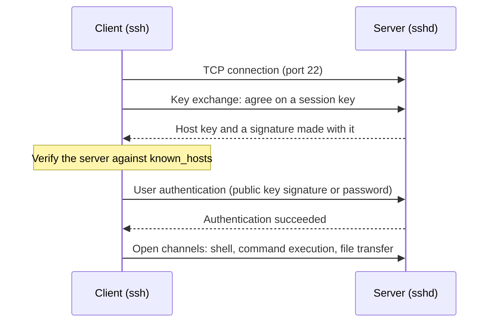

# Chapter 12 — Remote Access and FTP

[Repository Guide](../../README.md) | [English](Concepts_Lecture.md) | [한국어](Concepts_Lecture.ko.md)

> **Last Updated:** 2026-11-19

> **Learning Objectives:**
> 1. Explain why Telnet and FTP are insecure and how SSH solves these problems
> 2. Explain how a server is verified with host keys and `known_hosts` and what the warnings mean
> 3. Compare password authentication with public key authentication, and create a key and register it on a server
> 4. Transfer files with `scp`, `sftp`, and `rsync`, and shorten connection settings with `~/.ssh/config`
> 5. Configure an SSH server securely with `sshd_config`, and distinguish the active and passive modes of FTP
> 6. Explain how mail is delivered and the roles of SMTP, POP3, and IMAP

---

## Table of Contents

- [1. Remote Access and the Problem of Plaintext Protocols](#1-remote-access-and-the-problem-of-plaintext-protocols)
  - [1.1 Structure of Remote Access](#11-structure-of-remote-access)
  - [1.2 Why Telnet and FTP Are Dangerous](#12-why-telnet-and-ftp-are-dangerous)
- [2. Structure of SSH and Server Verification](#2-structure-of-ssh-and-server-verification)
  - [2.1 SSH Client and Server](#21-ssh-client-and-server)
  - [2.2 Host Keys and known_hosts](#22-host-keys-and-known_hosts)
  - [2.3 Stages of Establishing a Connection](#23-stages-of-establishing-a-connection)
- [3. User Authentication](#3-user-authentication)
  - [3.1 Password Authentication and Public Key Authentication](#31-password-authentication-and-public-key-authentication)
  - [3.2 Creating a Key and Registering It on a Server](#32-creating-a-key-and-registering-it-on-a-server)
- [4. File Transfer over SSH](#4-file-transfer-over-ssh)
  - [4.1 scp](#41-scp)
  - [4.2 sftp](#42-sftp)
  - [4.3 rsync](#43-rsync)
  - [4.4 Shortening Connection Settings with ~/.ssh/config](#44-shortening-connection-settings-with-sshconfig)
  - [4.5 Port Forwarding](#45-port-forwarding)
- [5. Configuring and Hardening the SSH Server](#5-configuring-and-hardening-the-ssh-server)
  - [5.1 Structure of sshd_config](#51-structure-of-sshd_config)
  - [5.2 Basic Settings for Security](#52-basic-settings-for-security)
- [6. FTP](#6-ftp)
  - [6.1 Control Connection and Data Connection](#61-control-connection-and-data-connection)
  - [6.2 Active Mode and Passive Mode](#62-active-mode-and-passive-mode)
- [7. Sending and Receiving Electronic Mail](#7-sending-and-receiving-electronic-mail)
  - [7.1 How Mail Is Delivered](#71-how-mail-is-delivered)
  - [7.2 POP3 and IMAP](#72-pop3-and-imap)
- [Concept Applications](#concept-applications)
- [Summary](#summary)
- [Self-Check Questions](#self-check-questions)
- [References](#references)

---

<br>

## 1. Remote Access and the Problem of Plaintext Protocols

### 1.1 Structure of Remote Access

**Remote login** means logging in to another computer over the network and using that computer's shell. On the computer that accepts connections, a server program (daemon) waits for connections on a fixed port (Chapter 11, Section 2.3), and the user connects to that port with a client program.

| Service | Port | Server | Client | Communication |
|:-----|-----:|:-----|:-----|:-----|
| Telnet | 23 | `telnetd` | `telnet` | Plaintext |
| SSH | 22 | `sshd` | `ssh`, `scp`, `sftp` | Encrypted |
| FTP | 21 (control) | `vsftpd` and others | `ftp` | Plaintext |

*Table 1. Ports of remote access and file transfer services*

### 1.2 Why Telnet and FTP Are Dangerous

Telnet and FTP send the user name, the password, the commands typed, and the files exchanged all in **plaintext**. Anyone who can capture packets on the same network (a public Wi-Fi, any point on the path through a router) can read the password as it is with tools such as `tcpdump`. Moreover, the client has no way of verifying that the party it connected to is the real server, so an attacker in the middle can pretend to be the server and collect the password.

SSH (Secure Shell) solves both problems together. As soon as a connection is made, the two computers agree on cryptographic keys and encrypt everything that follows, and the server proves that it is the real server with its **host key** (Section 2.2). SSH consists of three protocols: the transport layer, user authentication, and the connection protocol [1]. Today, therefore, SSH is used for remote access instead of Telnet, and `sftp`, `scp`, and `rsync` over SSH are used for file transfer instead of FTP.

> **[Information Security]** In terms of the cryptography taught in Information Security, SSH agrees on a session key by a Diffie-Hellman key exchange and applies symmetric encryption and message authentication codes with that key to protect confidentiality and integrity. The server's identity is proved by a digital signature made with its host key, and the user's identity by a password or by a signature made with the user's private key.

---

<br>

## 2. Structure of SSH and Server Verification

### 2.1 SSH Client and Server

Ubuntu has the client `ssh` (package `openssh-client`) installed by default, and the server `sshd` (package `openssh-server`) is chosen when installing Ubuntu Server or installed with `sudo apt install openssh-server` (Chapter 9). The SSH server of Ubuntu 24.04 uses systemd socket activation: `ssh.socket` waits on port 22 and starts `sshd` when a connection arrives [2].

```text
$ systemctl is-active ssh.socket
active
$ ssh user1@192.168.111.100
user1@192.168.111.100's password:
Welcome to Ubuntu 24.04.1 LTS (GNU/Linux 6.8.0-51-generic x86_64)
...
user1@server1:~$ exit
logout
Connection to 192.168.111.100 closed.
```

If the user is omitted in `ssh user@host`, the client-side user name is used, and a port other than 22 is given with `-p port`. Appending a command, as in `ssh user1@server1 'df -h /'`, runs only that command remotely without an interactive login and returns the result.

### 2.2 Host Keys and known_hosts

When it is installed, the SSH server creates its own **host key** pairs and keeps them in `/etc/ssh/ssh_host_*_key` (private keys) and `.pub` (public keys). The client records the public host key of a server it connects to for the first time in `~/.ssh/known_hosts`, and from the next connection on checks whether the key presented by the server matches the record. On the first connection it asks as follows.

```text
$ ssh user1@192.168.111.100
The authenticity of host '192.168.111.100 (192.168.111.100)' can't be established.
ED25519 key fingerprint is SHA256:Xy3kq0pVQm2a9cJtT6fB1vLr8oN4sHdE7wZuYgKiAcM.
This key is not known by any other names.
Are you sure you want to continue connecting (yes/no/[fingerprint])? yes
Warning: Permanently added '192.168.111.100' (ED25519) to the list of known hosts.
```

Answering `yes` here means trusting that key, so in principle one should answer only after comparing it with the fingerprint checked on the server. On the server's console, the fingerprint is shown with the following command.

```text
server$ ssh-keygen -lf /etc/ssh/ssh_host_ed25519_key.pub
256 SHA256:Xy3kq0pVQm2a9cJtT6fB1vLr8oN4sHdE7wZuYgKiAcM root@server1 (ED25519)
```

If the key is accepted the first time without checking, the connection is safe against eavesdropping but vulnerable to a man-in-the-middle attack in which the attacker pretends to be the server from the start [1]. If the key of a server already on record changes, `ssh` prints the warning `WARNING: REMOTE HOST IDENTIFICATION HAS CHANGED!` and refuses to connect. If the reason is clear, as when the server was reinstalled and its keys were created anew, remove the old record with `ssh-keygen -R 192.168.111.100` and connect again; if the reason is unknown, it may be a man-in-the-middle attack, so do not connect.

> **Caution:** Cloning a virtual machine (Week 1, Section 7.2) copies even the host keys, so the two servers end up with the same host key. On the cloned server, delete the existing keys with `sudo rm /etc/ssh/ssh_host_*`, create new host keys of the missing types with `sudo ssh-keygen -A` [3], and apply them to the server with `sudo systemctl restart ssh`.

### 2.3 Stages of Establishing a Connection

While connecting with a single `ssh` command, the client and the server go through the following stages in turn. The first two stages belong to the SSH transport layer protocol, the third to the user authentication protocol, and the last to the connection protocol [1].



*Figure 1. Stages of establishing an SSH connection*

1. **Key exchange.** The two computers exchange values and agree on a session key. The key itself is never sent over the network, so an eavesdropper cannot learn it. Everything afterwards is encrypted with this key.
2. **Server authentication.** The server signs the contents of the key exchange with its private host key and sends the signature. The client checks the signature with the server's public host key and confirms that the key matches the record in `known_hosts` (Section 2.2).
3. **User authentication.** Inside the already encrypted connection, the user is proved by a password or a public key signature (Section 3). Even with password authentication, therefore, the password never flows over the network in plaintext.
4. **Channels.** After authentication, several channels such as a shell, remote commands, and `sftp` can be opened within one connection. The port forwarding of Section 4.5 also uses channels.

`ssh -v user@host` prints what happens at each of these stages, so it is used to find where a connection fails (server verification or user authentication).

---

<br>

## 3. User Authentication

### 3.1 Password Authentication and Public Key Authentication

| Aspect | Password authentication | Public key authentication |
|:-----|:-----|:-----|
| What is proved | Knowing the password of the server account | Holding the private key that pairs with a public key registered on the server |
| What is sent to the server | The password (inside the encrypted connection) | A signature made with the private key; the private key itself is never sent |
| Brute-force attacks | Weak passwords can be guessed | Practically impossible |
| If the server is compromised | The password is also at risk wherever else it was used | The server holds only the public key, so the private key stays safe |

*Table 2. Comparison of password authentication and public key authentication*

In public key authentication the user creates a **key pair**. The private key stays only on the client, and the public key is put in `~/.ssh/authorized_keys` of the server account. On connection, the server asks the client for a signature that can be made only with the private key and checks the signature with the registered public key. The private key never leaves for the network.

### 3.2 Creating a Key and Registering It on a Server

Run without arguments, `ssh-keygen` creates an Ed25519 key [3].

```text
$ ssh-keygen -C user1@myubuntu
Generating public/private ed25519 key pair.
Enter file in which to save the key (/home/user1/.ssh/id_ed25519):
Enter passphrase (empty for no passphrase):
Enter same passphrase again:
Your identification has been saved in /home/user1/.ssh/id_ed25519
Your public key has been saved in /home/user1/.ssh/id_ed25519.pub
The key fingerprint is:
SHA256:nFMAopgFOgYjC7kz8eHThmSJ41wioMl+sOwo6lUDQgU user1@myubuntu
The key's randomart image is:
+--[ED25519 256]--+
|OE+o. ...        |
|#O=o .   .       |
|%&+=      .      |
|B+O +  . o       |
| * + o  S        |
|o . . .  .       |
|o. .             |
|o .              |
|o.               |
+----[SHA256]-----+
$ ls -l ~/.ssh/id_ed25519*
-rw------- 1 user1 user1 464 Mar 21 16:00 /home/user1/.ssh/id_ed25519
-rw-r--r-- 1 user1 user1  96 Mar 21 16:00 /home/user1/.ssh/id_ed25519.pub
```

- `-C` is a description (comment) for recognizing the key. Other kinds of keys can also be created, as in `-t rsa -b 4096`.
- A **passphrase** encrypts the private key file itself. Even if the private key file is stolen, it cannot be used without the passphrase, so it is safer not to leave it empty. The inconvenience of typing it every time is reduced by `ssh-agent`, which remembers a key once it has been unlocked.
- The private key is `600`, readable only by its owner, and the public key `644` (Week 7). If the permissions of the private key are too broad, `ssh` refuses to use it.

The simplest way to register the public key on a server is `ssh-copy-id`. This command connects once with the password and appends the public key to the end of `~/.ssh/authorized_keys` on the server.

```text
$ ssh-copy-id user1@192.168.111.100
...
Number of key(s) added: 1
$ ssh user1@192.168.111.100
Enter passphrase for key '/home/user1/.ssh/id_ed25519':
user1@server1:~$
```

This time it asks not for the server account's password but for the passphrase of the user's own private key. Without `ssh-copy-id`, append the single line of the public key file to `~/.ssh/authorized_keys` on the server directly. The server's `~/.ssh` directory must then be `700` and `authorized_keys` `600`. If other users have write permission, `sshd` assumes someone else may have inserted a key and ignores the file.

---

<br>

## 4. File Transfer over SSH

### 4.1 scp

`scp` copies files over an SSH connection in the same form as `cp`. A remote path is written as `user@host:path`, and a path not starting with `/` is relative to the remote user's home directory.

```text
$ scp report.pdf user1@192.168.111.100:docs/
report.pdf                         100%  245KB  21.3MB/s   00:00
$ scp user1@192.168.111.100:/var/log/syslog ./server-syslog
$ scp -r project user1@192.168.111.100:
```

`-r` copies directories recursively, and `-P` (uppercase) sets the port. The port option of `ssh` is lowercase `-p`, so care is needed not to confuse the two.

### 4.2 sftp

`sftp` exchanges files over SSH with interactive commands similar to FTP.

```text
$ sftp user1@192.168.111.100
Connected to 192.168.111.100.
sftp> pwd
Remote working directory: /home/user1
sftp> lcd /tmp
sftp> get docs/report.pdf
Fetching /home/user1/docs/report.pdf to report.pdf
sftp> put notes.txt
Uploading notes.txt to /home/user1/notes.txt
sftp> bye
```

| Command | Meaning |
|:-----|:-----|
| `pwd`, `cd`, `ls` | Remote current directory, change, list |
| `lpwd`, `lcd`, `lls` | Local (client) current directory, change, list |
| `get remotefile` | Download from remote to local |
| `put localfile` | Upload from local to remote |
| `bye`, `exit` | Quit |

*Table 3. Main commands of sftp*

Commands with `l` before the name act on the local side. The directions of `get` and `put` are "receive" and "send" from the viewpoint of the local side (the client).

### 4.3 rsync

`rsync` compares the source with the destination and sends **only the changed parts**, so it suits backups that synchronize the same directory repeatedly. If one side is remote, it connects over SSH.

```text
$ rsync -avz project/ user1@192.168.111.100:backup/project/
$ rsync -avz --delete -n project/ user1@192.168.111.100:backup/project/
```

- `-a` (archive) copies recursively while preserving permissions, times, and symbolic links. `-v` prints the files transferred, and `-z` compresses during transfer.
- `--delete` deletes from the destination the files that are not in the source, making both sides identical. Misused, it deletes files at the destination, so first print what it would do with `-n` (dry run), check it, and then run without `-n`.

With `rsync`, a `/` at the end of the source path changes the result. With `a.txt` and `sub/b.txt` in the source `src`, the comparison is as follows.

```text
$ rsync -a src dst1/
$ rsync -a src/ dst2/
$ find dst1 dst2 | sort
dst1
dst1/src
dst1/src/a.txt
dst1/src/sub
dst1/src/sub/b.txt
dst2
dst2/a.txt
dst2/sub
dst2/sub/b.txt
```

`src` sends "the directory `src` itself", so `src/` is created inside the destination, while `src/` sends "the contents of the directory `src`", so the contents go directly into the destination. Like `cp -r src dest` in Week 4, Section 1.4, it is a common mistake in which the structure of the destination differs from what was intended.

### 4.4 Shortening Connection Settings with ~/.ssh/config

The address, user, port, and key file of a server connected to often can be written in `~/.ssh/config` under an alias [4].

```text
Host lab
    HostName 192.168.111.100
    User user1
    Port 2222
    IdentityFile ~/.ssh/id_ed25519
```

With this, typing just `ssh lab` replaces `ssh -p 2222 -i ~/.ssh/id_ed25519 user1@192.168.111.100`, and the same alias can be used in every command that uses SSH, as in `scp report.pdf lab:docs/`, `sftp lab`, and `rsync -a project/ lab:backup/`. If the same setting appears in several places, the first value obtained is used [4], so specific `Host` blocks go at the beginning of the file and general settings such as `Host *` at the end.

### 4.5 Port Forwarding

Carrying another TCP connection inside an SSH connection is called **port forwarding**. When a database on the server (port 5432) is configured to accept connections only on `127.0.0.1`, so that it cannot be reached directly from outside (Chapter 11, Section 5.2), it can be reached securely with the following command.

```text
$ ssh -L 15432:127.0.0.1:5432 lab
```

`-L localport:destination:destport` sends connections arriving at port `15432` of the client through the SSH connection to the server and then connects to `127.0.0.1:5432` as seen from the server. While this SSH session is open, programs on the client reach the server's database by connecting to `localhost:15432`. Even if the database's communication is plaintext, the network segment is encrypted by SSH, so the service can be used remotely without opening its port to the outside.

---

<br>

## 5. Configuring and Hardening the SSH Server

### 5.1 Structure of sshd_config

The SSH server's configuration is `/etc/ssh/sshd_config`, and its `Include /etc/ssh/sshd_config.d/*.conf` line at the very beginning reads the files of the `sshd_config.d` directory first [5]. When the same setting appears more than once, `sshd` uses the **first value obtained**, so values written in files in `sshd_config.d/` take precedence over those in the main file [5]. When changing settings, therefore, the main file is not edited; instead a new file such as `/etc/ssh/sshd_config.d/50-hardening.conf` is added.

In Ubuntu 24.04, socket-related settings such as the port are read from `sshd_config` and `sshd_config.d/` by a systemd generator and applied to `ssh.socket` [2]. After changing the settings, apply them in the following order.

```text
$ sudo sshd -t
$ sudo systemctl daemon-reload
$ sudo systemctl restart ssh.socket
```

`sshd -t` checks the syntax of the configuration files and prints output only when there is an error. Restarting the server with a faulty configuration can make it impossible to connect again remotely, so always check before applying.

### 5.2 Basic Settings for Security

| Setting | Default | Recommended | Meaning |
|:-----|:-----|:-----|:-----|
| `PermitRootLogin` | `prohibit-password` | `no` | Direct login as root. The default blocks only root's password login and allows key login [5] |
| `PasswordAuthentication` | `yes` | `no` (after registering keys) | Whether password authentication is allowed [5] |
| `PubkeyAuthentication` | `yes` | `yes` | Whether public key authentication is allowed |
| `AllowUsers` | (none) | `user1 admin` | Lists only the users allowed to connect |
| `Port` | `22` | Depends on the environment | The port to listen on |

*Table 4. Security-related settings of sshd_config*

```text
$ cat /etc/ssh/sshd_config.d/50-hardening.conf
PermitRootLogin no
PasswordAuthentication no
AllowUsers user1
```

These settings block direct login as root and let only user1, who has registered a public key, connect with that key. Administrative work is done by logging in as user1 and using `sudo` (Week 12, Section 7). Changing the port to a number other than 22 greatly reduces automated brute-force attempts, but it does not stop an attacker who scans for the port, so it does not replace key authentication.

> **Caution:** Before applying `PasswordAuthentication no`, always confirm that public key login works. While applying the settings, keep one existing SSH session open without disconnecting it, and test the connection from a new terminal. Even if the new connection fails, the settings can be reverted from the session kept open.

---

<br>

## 6. FTP

### 6.1 Control Connection and Data Connection

FTP (File Transfer Protocol) uses two connections [6]. The **control connection** is made by the client to port 21 of the server, and commands such as `USER`, `PASS`, `LIST`, `RETR` (receive), and `STOR` (store) and their replies travel over it. A **data connection** is made separately each time a file list or file contents are sent. Both connections are plaintext, so they carry the dangers of Section 1.2 as they are. On Ubuntu, `vsftpd` is widely used as an FTP server; unless the purpose is to let anonymous users download public material, SSH's `sftp` is the safer choice.

### 6.2 Active Mode and Passive Mode

There are two methods according to who makes the data connection.

| Method | Client command | Side that makes the data connection | Direction of the connection |
|:-----|:-----|:-----|:-----|
| Active mode | `PORT h1,h2,h3,h4,p1,p2` | Server | Server port 20 → the port given by the client |
| Passive mode | `PASV` | Client | Client → the port given by the server |

*Table 5. Active and passive modes of FTP*

In active mode, the server connects to the client from port 20, the port just below the control port [6]. If the client is behind a router's NAT or a firewall, this incoming connection is blocked, so the data transfer fails. In passive mode, the server opens a data port, waits, and reports that address and port in its reply [6], and the client connects to that port. Because connections always go out from the client, clients behind NAT also work, and most FTP clients today use passive mode by default.

Of the six numbers in the reply, the first four give the IP address and the last two the port in base 256. If the server replies as follows,

```text
227 Entering Passive Mode (192,168,111,100,195,80)
```

the address is `192.168.111.100` and the port is as follows.

```math
195 \times 256 + 80 = 49920 + 80 = 50000
```

---

<br>

## 7. Sending and Receiving Electronic Mail

### 7.1 How Mail Is Delivered

Electronic mail is delivered by several programs that share the work. The program with which a user writes and reads mail (Thunderbird, Evolution, the `mail` command, and so on) is called a **mail user agent (MUA)**, and the server program that receives mail and passes it on to other servers (Postfix, Sendmail, and so on) is called a **mail transfer agent (MTA)**. The receiving MTA puts arriving mail into the user's mailbox, and the user later reads that mailbox with an MUA.


*Figure 2. The path along which mail is delivered from the sender to the recipient*

The sending direction uses **SMTP (Simple Mail Transfer Protocol)**. When an MUA hands mail to its own mail server, it uses the submission port 587, which requires user authentication, and when MTAs pass mail to each other, they use port 25. SMTP is a protocol that pushes mail to the other server, so when the recipient fetches mail from the mailbox on the server, a separate access protocol, POP3 or IMAP, is used.

### 7.2 POP3 and IMAP

| Aspect | POP3 | IMAP |
|:-----|:-----|:-----|
| Port (plaintext / TLS) | 110 / 995 | 143 / 993 |
| Location of mail | Downloaded to the client and usually deleted from the server | Kept on the server, and the client displays it |
| Use from several devices | Each device ends up with different mail | Every device sees the same mailbox and read state |
| Folders | A single inbox | Several folders can be created on the server |

*Table 6. Comparison of POP3 and IMAP*

Like Telnet and FTP, SMTP, POP3, and IMAP were originally plaintext protocols, so passwords and mail contents are exposed as they are (Section 1.2). Today, therefore, ports that encrypt with TLS as soon as the connection is made (submission 465, IMAP 993, POP3 995) are used, or the client connects to the plaintext port and switches to an encrypted connection with the `STARTTLS` command. RFC 8314 recommends using TLS from the start for mail submission and access in preference to STARTTLS [7].

---

<br>

## Concept Applications

**True/False Check:**

| Statement | Judgment and Reason |
|:-----|:-----|
| Telnet encrypts only the password and sends commands in plaintext. | **F.** Telnet sends everything, including the password, in plaintext. |
| In public key authentication the client sends its private key to the server. | **F.** Only a signature made with the private key is sent, and the server checks it with the registered public key. |
| When the warning `REMOTE HOST IDENTIFICATION HAS CHANGED` appears, it is always fine to remove the record with `ssh-keygen -R` and connect. | **F.** Remove it only when the reason is clear, such as a reinstalled server; if the reason is unknown, it may be a man-in-the-middle attack. |
| `rsync -a src/ dst/` and `rsync -a src dst/` give the same result. | **F.** With a trailing `/` the contents are sent and without it the directory itself, so the former gives `dst/a.txt` and the latter `dst/src/a.txt`. |
| A setting written in `sshd_config.d/` takes precedence over the same setting in the main `sshd_config`. | **T.** Files in that directory are read at the very beginning, and `sshd` uses the first value obtained. |
| In FTP active mode, a client behind NAT also receives files without trouble. | **F.** In active mode the server connects to the client, which NAT or a firewall blocks, so passive mode must be used. |
| Mail servers also use POP3 to pass mail to each other. | **F.** Delivery between servers uses SMTP (port 25); POP3 and IMAP are used when a user fetches mail from a mailbox. |

---

<br>

## Summary

| Concept | Key Summary |
|---------|-------------|
| Plaintext protocols | Telnet (23) and FTP (21) send passwords and contents in plaintext and cannot verify the server, so SSH replaces them. |
| Host key | It is the key with which a server proves itself; the client records the public key received first in `known_hosts` and warns if it changes. |
| Public key authentication | The private key stays on the client and the public key goes in the server's `authorized_keys`, and authentication uses a signature made with the private key. |
| ssh-keygen | Without arguments it creates an Ed25519 key pair; the private key is `600`, and a passphrase protects the private key file. |
| File transfer | `scp` copies, `sftp` transfers interactively, and `rsync` synchronizes only the changes, with the trailing `/` of the source changing the result. |
| Stages of an SSH connection | Key exchange, server authentication with the host key, user authentication, and opening channels, in that order; `ssh -v` shows each stage. |
| Port forwarding | `ssh -L localport:destination:port` carries another TCP connection inside SSH over an encrypted path. |
| ~/.ssh/config | It bundles address, user, port, and key under a `Host` alias used by every command that uses SSH. |
| sshd configuration | Files in `sshd_config.d/` are read first and take precedence; root login and password authentication are turned off, checked with `sshd -t`, and then applied. |
| Two modes of FTP | In active mode the server connects from port 20 to the client, and in passive mode the client connects to the port given by the server. |
| Mail protocols | Sending uses SMTP (submission 587, between servers 25) and fetching uses POP3 (110) or IMAP (143), and today the TLS ports (465, 995, 993) are used. |

---

<br>

## Self-Check Questions

1. **Danger of plaintext:** A user connected to a server with Telnet over a public Wi-Fi in a cafe. Explain what an attacker on the same Wi-Fi can learn and what changes when SSH is used.

   <details>
   <summary>Answer</summary>

   Telnet sends everything in plaintext, so the attacker can capture packets and read the user name, the password, and all commands typed and their output. SSH encrypts everything, including the password, with the session key agreed right after connecting, so captured packets reveal nothing, and because the server is verified with its host key, an attacker pretending to be the server can also be detected.

   </details>

2. **Host key warning:** On connecting to a server that worked fine until yesterday, the warning `REMOTE HOST IDENTIFICATION HAS CHANGED!` appeared. Write what should be checked and the action to take in each situation.

   <details>
   <summary>Answer</summary>

   It means that the server's host key differs from the record in `known_hosts`. First ask the administrator whether the server was reinstalled or its host keys changed, and check the fingerprint on the server console with `ssh-keygen -lf /etc/ssh/ssh_host_ed25519_key.pub`. If such a reason is confirmed, remove the old record with `ssh-keygen -R host`, connect again, and compare the new fingerprint. If the reason is unknown, it may be a man-in-the-middle attack, so do not connect.

   </details>

3. **Failed key registration:** The public key was put in `~/.ssh/authorized_keys` on the server, but the password is still requested. On the server, `ls -ld ~/.ssh ~/.ssh/authorized_keys` shows `drwxrwxr-x` and `-rw-rw-r--`. Write the cause and the remedy.

   <details>
   <summary>Answer</summary>

   The directory and the file have group write permission, so another user could insert a key; `sshd` therefore does not trust the file and ignores it. Narrowing the permissions with `chmod 700 ~/.ssh` and `chmod 600 ~/.ssh/authorized_keys` makes public key authentication work.

   </details>

4. **rsync command:** The files inside local `~/site/` are to be mirrored exactly into `/var/www/html/` on the server `lab`, deleting files that exist only on the server. Write the command for checking before running and the actual command.

   <details>
   <summary>Answer</summary>

   First check the files to be sent and deleted with `rsync -avz --delete -n ~/site/ lab:/var/www/html/`. If nothing is wrong, run `rsync -avz --delete ~/site/ lab:/var/www/html/` without `-n`. Thanks to the trailing `/` of the source, the contents of `site`, not the directory `site` itself, go into `/var/www/html/`.

   </details>

5. **SSH configuration file:** Write a `~/.ssh/config` entry so that `ssh db` alone connects to port `2200` of the server `10.0.2.50` as the user `admin` using `~/.ssh/lab_key`.

   <details>
   <summary>Answer</summary>

   ```text
   Host db
       HostName 10.0.2.50
       User admin
       Port 2200
       IdentityFile ~/.ssh/lab_key
   ```

   From then on, `ssh db`, `scp file db:`, and `sftp db` all use this setting.

   </details>

6. **Order of server hardening:** Settings that turn off password authentication and block root login are to be applied to a remote server. Write the order of work that avoids losing access.

   <details>
   <summary>Answer</summary>

   (1) Register a public key and confirm from a new terminal that key login works. (2) Keeping one existing SSH session open, write `PermitRootLogin no` and `PasswordAuthentication no` in `/etc/ssh/sshd_config.d/50-hardening.conf`. (3) Check the syntax with `sudo sshd -t`. (4) Apply with `sudo systemctl daemon-reload` and `sudo systemctl restart ssh.socket`. (5) Test the connection again from a new terminal, and if it fails, revert the settings from the session kept open.

   </details>

7. **FTP passive mode:** The server replied `227 Entering Passive Mode (10,0,0,5,4,1)`. Find the address and port to which the client makes the data connection, and state who starts this connection.

   <details>
   <summary>Answer</summary>

   The address is the first four numbers, `10.0.0.5`, and the port is 4 × 256 + 1 = 1025. It is passive mode, so the client starts the data connection to port 1025 of `10.0.0.5`.

   </details>

8. **Choosing a mail protocol:** You want to see the same mailbox on a phone and a laptop and keep the read marks in step. Write which of POP3 and IMAP to use and why, and the incoming port to set in the mail program.

   <details>
   <summary>Answer</summary>

   Use IMAP. IMAP keeps the mail and its read state on the server, so every device that connects sees the same mailbox. POP3 downloads mail to each device and deletes it from the server, so each device ends up with different mail. For the incoming port, use 993 of IMAP, which encrypts with TLS as soon as the connection is made.

   </details>

---

<br>

## References

1. T. Ylonen and C. Lonvick, Ed., "The Secure Shell (SSH) Protocol Architecture," RFC 4251, Jan. 2006. [Online]. Available: https://www.rfc-editor.org/rfc/rfc4251
2. Canonical, "Ubuntu 24.04 LTS (Noble Numbat) release notes," [Online]. Available: https://documentation.ubuntu.com/release-notes/24.04/
3. "ssh-keygen(1), Ubuntu noble manual page," *OpenSSH*. [Online]. Available: https://manpages.ubuntu.com/manpages/noble/man1/ssh-keygen.1.html
4. "ssh_config(5), Ubuntu noble manual page," *OpenSSH*. [Online]. Available: https://manpages.ubuntu.com/manpages/noble/man5/ssh_config.5.html
5. "sshd_config(5), Ubuntu noble manual page," *OpenSSH*. [Online]. Available: https://manpages.ubuntu.com/manpages/noble/man5/sshd_config.5.html
6. J. Postel and J. Reynolds, "File Transfer Protocol (FTP)," RFC 959, Oct. 1985. [Online]. Available: https://www.rfc-editor.org/rfc/rfc959
7. K. Moore and C. Newman, "Cleartext Considered Obsolete: Use of Transport Layer Security (TLS) for Email Submission and Access," RFC 8314, Jan. 2018. [Online]. Available: https://www.rfc-editor.org/rfc/rfc8314
