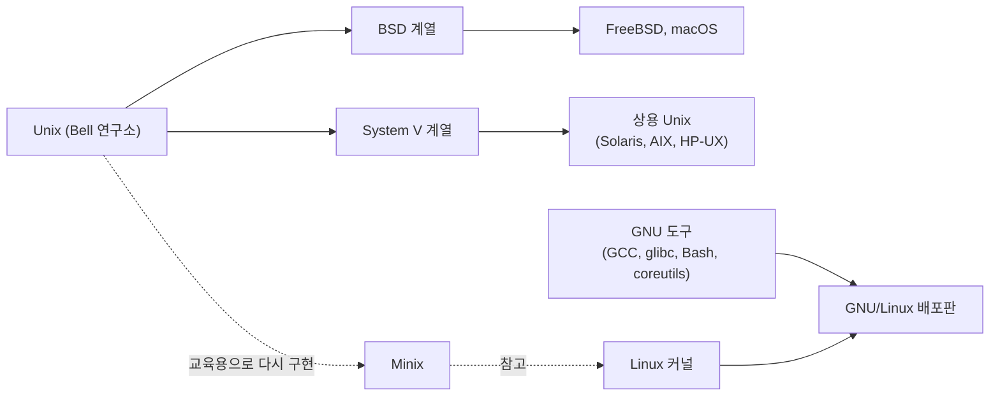
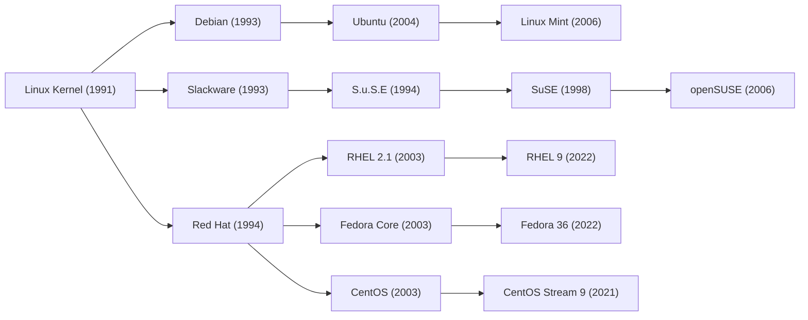
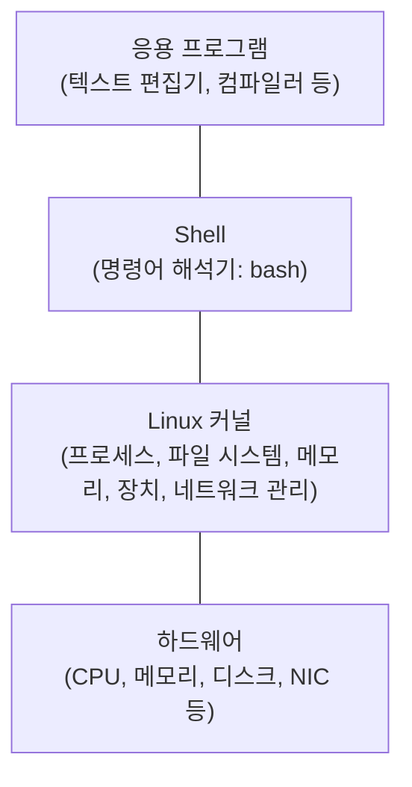

# 1주차 이론 — 강의 소개

[레포지토리 안내](../../README.ko.md) | [English](Concepts_Lecture.md) | [한국어](Concepts_Lecture.ko.md)

> **최종 수정일:** 2026-11-27
>
> 우분투 리눅스, 이종원, Ch 1

> **학습 목표:**
> 1. Linux와 UNIX의 역사, 자유 소프트웨어 철학을 설명할 수 있다
> 2. 주요 Linux 배포판의 계열과 용도, 실세계 활용 분야를 설명할 수 있다
> 3. Linux 시스템의 계층 구조(하드웨어, 커널, 셸, 응용 프로그램)와 사용자 공간, 커널 공간을 설명할 수 있다
> 4. 가상 머신의 개념과 VMware의 주요 기능을 설명할 수 있다
> 5. POSIX와 Unix 철학이 Linux 명령어 사용 방식에 주는 의미를 설명할 수 있다
> 6. Ubuntu의 버전 번호와 지원 기간, 커널 버전 문자열을 해석할 수 있다

---

## 목차

- [1. Linux의 개념](#1-linux의-개념)
  - [1.1 주요 특징](#11-주요-특징)
  - [1.2 Linux를 배우는 이유](#12-linux를-배우는-이유)
  - [1.3 Unix 계열 운영체제와 POSIX](#13-unix-계열-운영체제와-posix)
- [2. Linux의 역사](#2-linux의-역사)
  - [2.1 Linus Torvalds](#21-linus-torvalds)
  - [2.2 Richard Stallman](#22-richard-stallman)
  - [2.3 연표](#23-연표)
  - [2.4 Unix에서 GNU/Linux까지](#24-unix에서-gnulinux까지)
- [3. GNU 프로젝트와 자유 소프트웨어](#3-gnu-프로젝트와-자유-소프트웨어)
  - [3.1 GNU 프로젝트의 개념](#31-gnu-프로젝트의-개념)
  - [3.2 자유 소프트웨어의 네 가지 자유](#32-자유-소프트웨어의-네-가지-자유)
  - [3.3 GPL (GNU 일반 공중 사용 허가서)](#33-gpl-gnu-일반-공중-사용-허가서)
  - [3.4 Copyleft 라이선스와 허용형 라이선스](#34-copyleft-라이선스와-허용형-라이선스)
- [4. Linux 배포판](#4-linux-배포판)
  - [4.1 주요 배포판 계열](#41-주요-배포판-계열)
  - [4.2 인기 배포판](#42-인기-배포판)
  - [4.3 배포판을 이루는 요소](#43-배포판을-이루는-요소)
  - [4.4 Ubuntu의 릴리스 체계](#44-ubuntu의-릴리스-체계)
- [5. Linux 아키텍처](#5-linux-아키텍처)
  - [5.1 시스템 구조](#51-시스템-구조)
  - [5.2 구성 요소의 역할](#52-구성-요소의-역할)
  - [5.3 커널의 버전과 릴리스 종류](#53-커널의-버전과-릴리스-종류)
  - [5.4 시스템 정보의 확인](#54-시스템-정보의-확인)
- [6. 실세계에서의 Linux 활용](#6-실세계에서의-linux-활용)
  - [6.1 산업 분야별 Linux](#61-산업-분야별-linux)
  - [6.2 Linux 자격증](#62-linux-자격증)
- [7. 가상 머신](#7-가상-머신)
  - [7.1 가상 머신 구성](#71-가상-머신-구성)
  - [7.2 VMware의 유용한 기능](#72-vmware의-유용한-기능)
  - [7.3 하이퍼바이저의 유형](#73-하이퍼바이저의-유형)
  - [7.4 가상 머신의 네트워크 연결 방식](#74-가상-머신의-네트워크-연결-방식)
- [개념 적용](#개념-적용)
- [요약](#요약)
- [점검 문제](#점검-문제)
- [참고 문헌](#참고-문헌)

---

<br>

## 1. Linux의 개념

Linux는 Unix 운영체제에 기반한 **무료 오픈소스 운영체제**이다. 1991년 Linus Torvalds가 처음 만들었으며, 세계에서 가장 널리 쓰이는 운영체제 중 하나이다. GNU 일반 공중 사용 허가서(GPL)에 따라 배포되므로 누구나 소스 코드를 수정하고 배포할 수 있고, 개발자와 사용자로 이루어진 크고 활발한 커뮤니티가 있다.

### 1.1 주요 특징

- **오픈소스:** 누구나 소스 코드를 자유롭게 열람, 수정, 배포할 수 있다.
- **Unix 호환:** Unix와 높은 호환성을 유지하며, Unix 계열 운영체제의 표준인 POSIX를 대부분 따른다.
- **다중 사용자 및 다중 작업:** 여러 사용자와 여러 프로세스를 동시에 지원한다.
- **안정성 및 보안:** 견고한 보안과 시스템 안정성으로 널리 알려져 있다.
- **유연성:** 서버와 슈퍼컴퓨터부터 스마트폰, 스마트워치, IoT 장치, 드론, 자율주행차까지 다양한 장치에서 실행된다.
- **GUI 환경:** 서버용 운영체제로 많이 쓰이지만, GNOME, KDE, XFCE 같은 데스크톱 환경으로 편리한 GUI도 제공한다.

### 1.2 Linux를 배우는 이유

- 전 세계 스마트폰의 **80%** 이상이 Linux 기반인 Android를 실행한다.
- 클라우드 서버의 **95%** 이상이 Linux를 실행한다.
- 세계 상위 500대 슈퍼컴퓨터는 **100%** Linux를 실행한다.
- 세계 상위 25개 웹사이트 대부분이 Linux에서 운영된다.
- 5G 이동통신 인프라, IoT 장치, 드론, 자율주행차에 필수적이다.

> **핵심:** Linux는 단순한 서버 운영체제가 아니라 현대 컴퓨팅 인프라의 기반이다.

### 1.3 Unix 계열 운영체제와 POSIX

Linux는 Unix의 소스 코드를 물려받은 운영체제가 아니다. Torvalds는 커널을 처음부터 새로 작성했고, Unix가 정한 동작 방식(계층형 파일 시스템, 프로세스 모델, 셸, 사용자와 권한 모델)을 그대로 따르도록 만들었다. 이처럼 Unix의 코드가 아니라 Unix의 인터페이스와 동작을 따르는 운영체제를 **Unix 계열 운영체제(Unix-like operating system)** 라고 하며, Linux, FreeBSD, macOS가 대표적이다. Unix 계열 운영체제들이 서로 같은 방식으로 동작하도록 묶어 주는 기준이 POSIX이다.

> **용어 정의:** **POSIX** 는 응용 프로그램이 소스 코드 수준에서 이식될 수 있도록 운영체제가 제공해야 할 인터페이스와 환경을 정한 표준이다. 최신판인 POSIX.1-2024는 IEEE Std 1003.1-2024이자 The Open Group Base Specifications Issue 8이며, 공통 용어와 헤더를 정한 Base Definitions, C 함수 형태의 시스템 서비스를 정한 System Interfaces, 셸 언어와 유틸리티를 정한 Shell and Utilities, 근거를 설명한 Rationale의 네 권으로 이루어진다 [1].

POSIX가 정하는 것은 실행 파일 자체가 아니라 소스 코드와 명령어의 동작이다. 따라서 POSIX가 정한 C 함수만 쓰는 프로그램은 다른 Unix 계열 운영체제에서 다시 컴파일하면 동작하고, POSIX 셸 문법과 POSIX 유틸리티의 옵션만 쓰는 셸 스크립트는 다른 Unix 계열 운영체제에서도 그대로 실행된다. 반대로 실행 파일(바이너리)의 이식성은 POSIX의 범위 밖이다 [1]. Linux에서 쓰는 `ls`, `grep`, `sort` 같은 명령어는 대부분 GNU 프로젝트가 만든 구현이며(GNU coreutils, GNU grep 등), 이 구현들은 POSIX가 정한 옵션을 지원하면서 `--help`, `--color` 같은 GNU 고유의 긴 옵션을 더 제공한다.

> **주의:** GNU 고유의 옵션을 쓴 명령은 다른 Unix 계열 운영체제에서 동작하지 않을 수 있다. 예를 들어 macOS의 `sed -i`는 백업 파일 확장자를 반드시 인자로 받으므로 GNU `sed -i 's/a/b/' f`를 그대로 실행하면 오류가 나거나 다르게 동작한다. 여러 운영체제에서 실행할 스크립트는 POSIX가 정한 옵션만 쓰는 것이 안전하다.

Unix와 Linux의 명령어 설계에는 **Unix 철학**이라 불리는 공통된 원칙이 있다. 하나의 프로그램은 한 가지 일만 잘하도록 작게 만들고, 프로그램의 입력과 출력은 사람이 읽을 수 있는 텍스트 줄의 흐름으로 하며, 복잡한 작업은 작은 프로그램을 파이프(`|`)로 이어 해결한다는 것이다. 예를 들어 사용자 계정 파일 `/etc/passwd`의 각 줄은 콜론으로 구분된 7개의 필드로 이루어지고 마지막 필드가 로그인 셸이다(12주차). 다음 명령은 서로 다른 일을 하는 네 프로그램을 이어 계정들이 쓰는 로그인 셸의 종류별 개수를 센다. 실행한 파일은 실습용 Ubuntu 시스템의 `/etc/passwd` 사본(43줄)이다.

```text
$ cut -d: -f7 passwd | sort | uniq -c | sort -rn
     29 /usr/sbin/nologin
      9 /bin/bash
      3 /bin/false
      1 /bin/sync
      1 /bin/sh
```

`cut -d: -f7`은 각 줄에서 7번째 필드만 잘라 내고, `sort`는 같은 셸이 이웃하도록 정렬하며, `uniq -c`는 이웃한 같은 줄을 하나로 합치면서 개수를 붙이고, 마지막 `sort -rn`은 그 개수를 숫자로 보고(`-n`) 큰 것부터(`-r`) 정렬한다. `uniq`는 이웃한 줄만 비교하므로 앞의 `sort`를 빼면 같은 셸이 여러 번 따로 세어진다. 각 명령어는 4주차(파이프), 15주차(`cut`, `sort`, `uniq`)에서 자세히 다룬다.

---

<br>

## 2. Linux의 역사

### 2.1 Linus Torvalds

- **출생:** 1969년 12월 28일, 핀란드 헬싱키
- **학력:** 헬싱키 대학교
- **1991년:** 교육용 운영체제인 Minix를 참고하여 새로운 운영체제인 Linux를 개발했다.
- **1991년 8월 26일:** Torvalds가 comp.os.minix 뉴스그룹에 아래 글을 올린 날로, 흔히 Linux의 탄생일로 꼽는다. 이 날짜는 한국 시간 기준이며, 협정 세계시(UTC)로는 8월 25일이다.

```text
"Hello everybody out there using minix -
I'm doing a (free) operating system (just a hobby, won't be big
and professional like gnu) for 386(486) AT clones."
-- Linus Torvalds (1991)
```

### 2.2 Richard Stallman

- 1953년 미국 뉴욕 맨해튼에서 태어났다.
- 16세에 IBM 인턴으로 컴퓨터 작업을 시작했다.
- 1976년 MIT AI 연구소에서 **Emacs** 편집기를 개발했다.
- 소프트웨어의 상업화에 반대하고 협력 개발 문화를 주장했다.
- 1985년 **자유 소프트웨어 재단(FSF)** 을 설립했다.
- **GNU 일반 공중 사용 허가서(GPL)** 를 작성했다.
- **Copyleft** 운동을 시작했다.

### 2.3 연표

| 연도 | 사건 |
|------|------|
| 1969 | AT&T Bell 연구소에서 Unix 개발 |
| 1983 | Richard Stallman이 GNU 프로젝트 발표 |
| 1985 | 자유 소프트웨어 재단(FSF) 설립 |
| 1991 | Linus Torvalds가 Linux 커널 0.01 공개 |
| 1993 | Debian 및 Slackware 배포판 출시 |
| 1994 | Red Hat Linux 출시 |
| 2004 | Ubuntu 출시 (Debian 기반) |
| 2025 | 최신 커널 버전 6.13.5 (3월 기준) |

*표 1. Unix, GNU, Linux의 주요 연표*

### 2.4 Unix에서 GNU/Linux까지

표 1의 사건들은 하나의 흐름으로 이어진다. Bell 연구소의 Ken Thompson과 Dennis Ritchie가 만든 Unix는 뒤에 C 언어로 다시 작성되어 다른 하드웨어로 옮기기 쉬워졌고, AT&T가 대학과 기업에 소스 코드를 허가하면서 여러 갈래로 나뉘었다. University of California, Berkeley의 BSD 계열과 AT&T의 System V 계열이 대표적이며, 상용 Unix(Solaris, AIX, HP-UX)와 오늘날의 FreeBSD, macOS는 이 갈래에서 나왔다. Unix의 소스 코드가 상업적 허가 대상이 되자 Stallman은 Unix와 호환되면서 자유롭게 쓸 수 있는 운영체제를 처음부터 만들기 위해 GNU 프로젝트를 시작했다(3절).

GNU 프로젝트는 컴파일러(GCC), C 라이브러리(glibc), 셸(Bash), 기본 명령어(coreutils), 편집기(Emacs) 같은 운영체제의 나머지 부분을 거의 갖추었지만, 하드웨어를 직접 다루는 커널은 완성하지 못한 상태였다. 같은 시기에 Tanenbaum의 교육용 운영체제 Minix를 쓰던 Torvalds가 GNU의 컴파일러로 새 커널을 만들었고, 이 커널과 GNU의 도구를 합치자 자유롭게 쓸 수 있는 완전한 운영체제가 되었다. 이 때문에 FSF는 이 운영체제를 GNU/Linux라고 부를 것을 주장한다. 엄밀하게 말하면 Linux는 커널의 이름이고, 일상적으로 Linux라 부르는 운영체제는 Linux 커널, GNU의 도구, 그 밖의 응용 프로그램을 합친 배포판(4절)이다.



*그림 1. Unix 계열 운영체제와 GNU/Linux의 계보*

그림 1에서 실선은 소스 코드를 물려받은 관계이고, 점선은 코드 없이 설계만 참고한 관계이다. Minix와 Linux는 모두 Unix의 코드를 쓰지 않고 Unix의 동작을 다시 구현했다.

---

<br>

## 3. GNU 프로젝트와 자유 소프트웨어

### 3.1 GNU 프로젝트의 개념

GNU는 **GNU's Not Unix**의 약자로, 약어 자신이 풀이 안에 다시 들어가는 재귀적 약어(recursive acronym)이다. GNU 프로젝트는 Unix와 호환되는 **자유 소프트웨어(free software)** 를 개발하는 프로젝트이며, 모든 소프트웨어를 자유롭게 사용하는 것을 목표로 한다.

### 3.2 자유 소프트웨어의 네 가지 자유

| 자유 | 설명 |
|------|------|
| 자유 0 | 어떤 목적으로든 프로그램을 실행할 자유 |
| 자유 1 | 프로그램이 어떻게 작동하는지 연구하고 필요에 맞게 수정할 자유 (소스 코드 접근 필요) |
| 자유 2 | 다른 사람을 돕기 위해 복사본을 재배포할 자유 |
| 자유 3 | 프로그램을 개선하고, 개선된 버전을 배포하여 공동체 전체가 혜택을 받게 할 자유 (소스 코드 접근 필요) |

*표 2. 자유 소프트웨어의 네 가지 자유*

### 3.3 GPL (GNU 일반 공중 사용 허가서)

- 파생 저작물도 자유 소프트웨어로 남도록 보장하는 **Copyleft** 라이선스이다. Copyleft는 저작권을 이용해 자유를 보장하는 방식으로, 수정한 버전을 배포할 때도 받는 사람에게 같은 자유를 주도록 요구한다.
- 버전으로는 GPLv1, GPLv2, GPLv3이 있다.
- Linux 커널은 **GPLv2** 라이선스를 사용한다.

> **핵심:** 영어 free는 가격과 자유를 모두 뜻할 수 있지만, 자유 소프트웨어의 free는 가격이 아니라 자유를 의미한다. free beer(무료 맥주)의 free가 아니라 free speech(언론의 자유)의 free로 이해해야 한다.

### 3.4 Copyleft 라이선스와 허용형 라이선스

소스 코드를 공개하는 라이선스는 파생 저작물을 배포할 때 무엇을 요구하는지에 따라 두 종류로 나뉜다.

| 구분 | Copyleft 라이선스 | 허용형 라이선스(permissive license) |
|:-----|:-----|:-----|
| 대표 예 | GPLv2, GPLv3, LGPL, AGPL | MIT, BSD, Apache License 2.0 |
| 수정본 배포 조건 | 수정본도 같은 라이선스로, 소스 코드와 함께 배포 | 저작권 고지와 라이선스 문구만 유지하면 비공개 상용 제품에 포함 가능 |
| 소스 공개 의무가 생기는 시점 | 프로그램을 다른 사람에게 배포할 때 (AGPL은 네트워크로 서비스를 제공할 때도) | 의무 없음 |
| 목적 | 자유가 파생 저작물까지 이어지게 함 | 재사용의 제약을 최소화함 |
| 사용 예 | Linux 커널(GPLv2), GNU coreutils(GPLv3) | FreeBSD(BSD), Kubernetes(Apache 2.0) |

*표 3. Copyleft 라이선스와 허용형 라이선스의 비교*

GPL의 요구는 배포할 때 생긴다. 회사 안에서 GPL 프로그램을 고쳐 쓰기만 하고 밖으로 배포하지 않으면 소스 코드를 공개할 의무가 없다. 또한 자유 2(재배포할 자유)는 복사본을 무료로 나누어 주는 것뿐 아니라 돈을 받고 파는 것도 포함하므로, GPL 소프트웨어를 판매하는 것 자체는 허용된다. 판매할 때도 받는 사람에게 소스 코드를 얻고 다시 배포할 권리를 주어야 한다는 조건은 그대로이다.

LGPL(Lesser GPL)은 라이브러리를 위한 완화된 Copyleft로, 라이브러리 자체를 고쳐 배포할 때는 소스 공개를 요구하지만 그 라이브러리를 링크하여 쓰는 프로그램에는 같은 라이선스를 요구하지 않는다. GNU C 라이브러리(glibc)가 LGPL을 쓰므로 Linux에서 glibc에 링크된 상용 프로그램을 만들 수 있다. 오픈 소스(open source)라는 말은 Open Source Initiative(OSI)가 정한 기준을 만족하는 라이선스를 가리키며, 대부분의 자유 소프트웨어 라이선스는 오픈 소스 라이선스이기도 하다. 두 말은 가리키는 라이선스가 거의 같지만, 자유 소프트웨어는 사용자의 자유라는 윤리적 가치를, 오픈 소스는 공개 개발의 실용적 이점을 앞세운다는 점이 다르다.

> **주의:** "오픈 소스"는 "무료"와 같은 말이 아니고, "소스를 볼 수 있다"와도 같은 말이 아니다. 소스 코드를 공개하더라도 수정이나 재배포를 금지하는 라이선스는 자유 소프트웨어도 오픈 소스도 아니다. CC BY-NC-SA 4.0, PolyForm Noncommercial처럼 상업적 이용을 금지하는 라이선스는 자유 0(어떤 목적으로든 실행할 자유)을 제한하므로 자유 소프트웨어 라이선스에 해당하지 않는다.

---

<br>

## 4. Linux 배포판

Linux 배포판은 **Linux 커널**과 **응용 프로그램**을 적절하게 묶어 구성한 버전이다. 누구나 원하는 대로 구성하여 배포할 수 있으므로 다양한 배포판이 존재한다.

### 4.1 주요 배포판 계열



*그림 2. 주요 Linux 배포판 계열의 계보*

### 4.2 인기 배포판

| 배포판 | 기반 | 용도 | 웹사이트 |
|--------|------|------|----------|
| **Ubuntu** | Debian | 데스크톱, 서버 | https://ubuntu.com |
| **CentOS/RHEL** | Red Hat | 엔터프라이즈 서버 | https://centos.org |
| **Fedora** | Red Hat | 개발 | https://getfedora.org |
| **Arch Linux** | 독립 | 고급 사용자 | https://archlinux.org |

*표 4. 대표적인 Linux 배포판의 기반과 용도*

> **참고:** CentOS Linux는 RHEL을 무료로 다시 빌드한 배포판이었으나 지원이 끝났으며(마지막인 CentOS Linux 7은 2024년 6월), 현재는 RHEL에 들어갈 변경 사항을 먼저 반영하는 CentOS Stream으로 이어진다.

> **핵심:** Ubuntu는 Debian 계열의 배포판으로 초보자가 쓰기 쉬워 널리 쓰이며, 이 과목의 실습에서 사용한다.

### 4.3 배포판을 이루는 요소

배포판마다 커널은 같은 Linux 커널이지만, 그 위에 무엇을 어떻게 얹는지가 다르다. 배포판을 고를 때 실제로 차이를 만드는 요소는 다음과 같다.

| 요소 | 하는 일 | Debian 계열 (Ubuntu) | Red Hat 계열 (RHEL, Fedora) |
|:-----|:-----|:-----|:-----|
| 패키지 형식 | 프로그램과 설정 파일을 묶은 설치 단위 | `.deb` | `.rpm` |
| 패키지 관리 도구 | 패키지 저장소에서 내려받고 의존성을 해결하며 설치, 삭제 | `apt`, `dpkg` | `dnf`, `rpm` |
| 초기화 시스템 | 부팅 뒤 첫 프로세스로 실행되어 서비스를 시작하고 관리 | systemd | systemd |
| 데스크톱 환경 | 창, 메뉴, 파일 관리자 같은 그래픽 환경 | GNOME (Ubuntu Desktop 기본) | GNOME (Fedora Workstation 기본) |
| 릴리스 정책 | 새 버전을 내는 주기와 지원 기간 | 정기 릴리스와 LTS (4.4절) | 배포판마다 다름 |

*표 5. 배포판을 이루는 요소와 두 계열의 차이*

같은 계열의 배포판끼리는 패키지 형식과 관리 도구가 같으므로 사용법이 거의 같다. 예를 들어 Ubuntu에서 익힌 `apt install` 명령은 Debian과 Linux Mint에서도 그대로 쓸 수 있지만, Fedora에서는 `dnf install`을 써야 한다. 패키지 관리는 9장에서, 부팅과 systemd는 14주차에서 다룬다.

Ubuntu Desktop의 기본 그래픽 환경은 GNOME이다. 화면 위쪽의 상단 표시줄은 세 부분으로 나뉜다. 왼쪽의 현재 활동(Activities)은 자주 쓰는 프로그램의 아이콘과 실행 중인 프로그램의 축소 화면을 한꺼번에 보여 주고, 가운데의 날짜와 시간은 알림 사항을 관리하며, 오른쪽의 시스템 메뉴에서는 소리 조절, 유선 연결, 블루투스 켜기, 설정, 화면 잠금, 컴퓨터 끄기와 로그아웃을 한다. 화면 왼쪽에는 자주 쓰는 프로그램(Firefox, Thunderbird, 파일, 소프트웨어, 도움말)과 휴지통을 고정해 두는 독(dock)이 있으며, 독 아래쪽의 프로그램 표시 단추를 누르면 설치된 프로그램 목록이 나타난다. 터미널, 파일 관리자, 텍스트 편집기는 모두 이 목록에서 실행할 수 있다. 텍스트 편집기의 열기 대화 상자에서 다른 위치, 컴퓨터, `etc`를 차례로 고르고 `hosts` 파일을 열면 이 컴퓨터의 호스트 이름과 IP 주소의 대응표를 볼 수 있다. 설치할 때 컴퓨터 이름을 `myubuntu`로 정한 Ubuntu에서 이 파일은 보통 다음과 같다.

```text
127.0.0.1 localhost
127.0.1.1 myubuntu

# The following lines are desirable for IPv6 capable hosts
::1     ip6-localhost ip6-loopback
fe00::0 ip6-localnet
ff00::0 ip6-mcastprefix
ff02::1 ip6-allnodes
ff02::2 ip6-allrouters
```

첫 줄은 자기 자신을 가리키는 루프백 주소 `127.0.0.1`에 `localhost`라는 이름을, 둘째 줄은 Debian 계열이 자기 호스트 이름에 붙이는 주소 `127.0.1.1`에 `myubuntu`라는 이름을 대응시킨다. `/etc`는 시스템 설정 파일을 모아 두는 디렉터리이며(3주차), 일반 사용자는 이 파일을 읽을 수는 있지만 고쳐 저장할 수는 없다(7주차).

### 4.4 Ubuntu의 릴리스 체계

Ubuntu는 6개월마다 새 버전을 내고, 버전 번호는 그 버전이 나온 해와 달을 `YY.MM` 형식으로 쓴다. 따라서 24.04는 2024년 4월에, 24.10은 2024년 10월에 나온 버전이다. 그중 2년마다 나오는 버전은 **LTS(Long Term Support)** 이며, LTS는 짝수 해의 4월에 나온다 [2].

| 종류 | 출시 주기 | 기본 보안 유지 보수 기간 | 예 |
|:-----|:-----|:-----|:-----|
| LTS | 2년마다 | 5년 | 22.04 LTS, 24.04 LTS, 26.04 LTS |
| 정기 릴리스(interim) | LTS 사이의 6개월마다 | 9개월 | 24.10, 25.04, 25.10 |

*표 6. Ubuntu 릴리스의 종류와 지원 기간*

LTS는 Ubuntu Pro를 쓰면 기본 5년 뒤에도 보안 업데이트를 더 받을 수 있다 [2]. 버전마다 형용사와 동물 이름을 같은 알파벳으로 맞춘 코드명이 있어서 22.04는 Jammy Jellyfish, 24.04는 Noble Numbat, 26.04는 Resolute Raccoon이다 [3]. 설정 파일과 저장소 주소에는 코드명의 첫 단어를 소문자로 쓴다(24.04는 `noble`). LTS가 나온 뒤에는 누적된 업데이트와 새 하드웨어 지원을 담은 설치 이미지가 24.04.1, 24.04.2처럼 세 번째 숫자를 붙여 다시 나오는데, 이를 포인트 릴리스라 한다 [3]. 포인트 릴리스는 새 버전이 아니므로 24.04를 쓰는 시스템은 업데이트만 하면 24.04.x와 같은 상태가 된다.

이 과목의 실습 환경인 Ubuntu 24.04 LTS는 Linux 커널 6.8과 systemd 255.4를 담고 있으며, 기본 보안 유지 보수는 2029년 5월 31일까지이다 [4]. 서버를 운영하거나 수업처럼 한 학기 이상 같은 환경을 써야 하면 LTS를, 새 기능을 빨리 써 보려면 정기 릴리스를 고른다.

> **주의:** 버전 번호 24.04의 `04`는 4월을 뜻하며 "네 번째 수정판"이 아니다. 또한 24.10은 24.04보다 새 버전이지만 LTS가 아니므로 지원 기간이 9개월뿐이다. 버전 번호가 크다고 오래 지원되는 것이 아니다.

---

<br>

## 5. Linux 아키텍처

### 5.1 시스템 구조



*그림 3. Linux 시스템의 계층 구조*

### 5.2 구성 요소의 역할

- **커널:** 운영체제의 핵심으로, 하드웨어 자원, 프로세스, 메모리, 파일 시스템을 관리한다.
- **셸(shell):** 사용자와 커널 사이의 인터페이스로, 사용자가 입력한 명령을 해석하여 실행한다. Ubuntu의 기본 셸은 bash이다.
- **응용 프로그램:** 사용자가 직접 상호작용하는 프로그램이다(편집기, 컴파일러, 웹 서버 등).

응용 프로그램과 셸이 실행되는 영역을 **사용자 공간(user space)**, 커널이 실행되는 영역을 **커널 공간(kernel space)** 이라 한다. 사용자 공간의 프로그램은 하드웨어를 직접 다루지 않고, 파일 읽기와 쓰기 같은 작업을 커널에 요청한다.

> **[운영체제]** 운영체제에서 배우는 관점으로 보면, 커널은 CPU 시간, 메모리, 디스크, 입출력 장치 같은 하드웨어 자원을 여러 프로세스에 나누어 주고 프로세스들이 서로 침범하지 않게 보호하는 자원 관리자이다. 응용 프로그램은 하드웨어를 직접 다루지 않고 시스템 콜(system call)로 커널에 서비스를 요청한다. 셸도 커널 위에서 실행되는 하나의 사용자 프로그램이므로, 그림 3에서 셸과 응용 프로그램은 모두 시스템 콜을 통해서만 커널의 기능을 쓴다.

### 5.3 커널의 버전과 릴리스 종류

Linux 커널은 Torvalds가 관리하는 **메인라인(mainline)** 트리에서 개발된다. 새 메인라인 커널은 9\~10주마다 나오며, 한 주기는 새 기능을 받아들이는 2주의 병합 기간(merge window)과 매주 시험판(`-rc1`, `-rc2`, ...)을 내며 안정화하는 약 7주로 이루어진다 [5]. 메인라인 커널이 나오면 그 버전은 **안정판(stable)** 이 되어 메인라인의 버그 수정을 옮겨 받는 갱신판을 보통 매주 내고, 그중 일부 버전은 **장기 지원판(longterm)** 으로 지정되어 중요한 버그 수정만 여러 해 동안 받는다 [5].

커널 버전은 `주.부.패치` 형식이다. 예를 들어 6.13.5는 메인라인 6.13에 안정판 갱신이 다섯 번 적용된 커널이다. 주 번호는 기능의 큰 변화가 아니라 부 번호가 너무 커졌다고 판단될 때 올라가며, 예전에 쓰던 "부 번호가 홀수면 개발판" 규칙은 2.6 이후 쓰지 않는다 [5].

배포판은 kernel.org의 커널을 그대로 쓰지 않고 자신의 패치와 설정을 더해 빌드하며, 버전 문자열 뒤에 자신의 표시를 붙인다 [5]. Ubuntu 24.04의 `uname -r` 출력 `6.8.0-51-generic`은 다음과 같이 읽는다.

```text
6.8.0  -  51  -  generic
  │       │       └─ flavour: the build for ordinary PCs and servers
  │       └───────── ABI number assigned by Ubuntu: grows with updates
  └───────────────── the base mainline kernel 6.8
```

*그림 4. Ubuntu 커널 버전 문자열의 구성*

ABI 번호는 Ubuntu가 보안 수정과 버그 수정을 반영한 새 커널 패키지를 낼 때 대개 함께 커지므로, 같은 24.04라도 언제 업데이트했는지에 따라 `-51` 자리의 숫자가 다르다. kernel.org의 최신 버전이 6.8보다 높다고 해서 Ubuntu 24.04의 커널이 낡았거나 보안 수정이 빠진 것은 아니다. LTS 배포판은 기준 버전을 고정하고 수정만 옮겨 와 동작의 안정성을 지킨다.

### 5.4 시스템 정보의 확인

지금 쓰는 시스템의 커널, 셸, 배포판은 다음 명령으로 확인한다. 아래 출력은 x86-64 가상 머신에 설치한 Ubuntu 24.04.1 LTS의 예이며, 커널의 ABI 번호와 포인트 릴리스 번호는 업데이트에 따라 달라진다.

```text
$ uname -s
Linux
$ uname -r
6.8.0-51-generic
$ uname -m
x86_64
$ echo $SHELL
/bin/bash
$ cat /etc/os-release
PRETTY_NAME="Ubuntu 24.04.1 LTS"
NAME="Ubuntu"
VERSION_ID="24.04"
VERSION="24.04.1 LTS (Noble Numbat)"
VERSION_CODENAME=noble
ID=ubuntu
ID_LIKE=debian
HOME_URL="https://www.ubuntu.com/"
SUPPORT_URL="https://help.ubuntu.com/"
BUG_REPORT_URL="https://bugs.launchpad.net/ubuntu/"
PRIVACY_POLICY_URL="https://www.ubuntu.com/legal/terms-and-policies/privacy-policy"
UBUNTU_CODENAME=noble
LOGO=ubuntu-logo
```

- `uname -s`는 커널의 이름, `-r`은 커널의 릴리스(버전 문자열), `-m`은 하드웨어 종류를 출력한다. `-a`를 주면 이 정보를 모두 한 줄로 출력한다. Apple Silicon Mac의 UTM이나 VMware Fusion에서 ARM용 Ubuntu를 설치했다면 `uname -m`은 `aarch64`를 출력한다.
- `$SHELL`은 사용자의 로그인 셸 경로를 담은 환경 변수이다(6주차). 지금 실행 중인 셸이 아니라 계정에 등록된 셸을 보여 준다.
- `/etc/os-release`는 배포판의 이름과 버전을 `키=값` 형식으로 적은 파일로, systemd를 쓰는 배포판들이 공통으로 둔다. `ID_LIKE=debian`은 이 배포판이 Debian 계열임을 나타내므로, 스크립트는 이 값을 읽어 `apt`와 `dnf` 중 무엇을 쓸지 정할 수 있다.

> **주의:** `uname`은 배포판이 아니라 커널을 보여 준다. 같은 커널 6.8을 쓰는 다른 배포판도 있으므로 `uname -r`만으로 Ubuntu의 버전을 알 수는 없고, 배포판은 `/etc/os-release`로 확인해야 한다.

---

<br>

## 6. 실세계에서의 Linux 활용

### 6.1 산업 분야별 Linux

| 분야 | 예시 |
|------|------|
| 클라우드 컴퓨팅 | AWS, Google Cloud, Azure에서 실행되는 서버의 대부분이 Linux를 사용 |
| 모바일 | Linux 기반인 Android가 스마트폰의 80% 이상 점유 |
| 슈퍼컴퓨팅 | 세계 상위 500대 슈퍼컴퓨터 모두 Linux 사용 |
| 임베디드 시스템 | IoT 장치, 차량 시스템, 스마트 TV |
| DevOps | Docker, Kubernetes, CI/CD 파이프라인 |
| 네트워킹 | 라우터, 스위치, 방화벽 |

*표 7. 산업 분야별 Linux 활용 예*

### 6.2 Linux 자격증

- **리눅스마스터 2급**
  - 주관 기관은 한국정보통신진흥협회(KAIT, http://www.ihd.or.kr/)이다.
  - 국가 공인 자격증이다.
  - 시스템 관리, 네트워크, 보안 분야를 다룬다.

---

<br>

## 7. 가상 머신

### 7.1 가상 머신 구성

**가상 머신(Virtual Machine, VM)** 은 PC에 설치된 운영체제(호스트 OS) 위에 가상의 머신(하드웨어)을 만들고, 그 위에 다른 운영체제(게스트 OS)를 설치하고 실행할 수 있게 해 주는 응용 프로그램이다.

| VM 소프트웨어 | 호스트 OS | 게스트 OS |
|--------------|-----------|-----------|
| VMware | Windows, Linux, macOS | Windows, Linux, Solaris, macOS |
| VirtualBox | Windows, Linux, macOS, Solaris | Windows, Linux, Solaris, macOS, OpenBSD |
| Hyper-V | Windows | Windows, 일부 Linux, Solaris |

*표 8. 가상 머신 소프트웨어별 호스트 OS와 게스트 OS*

### 7.2 VMware의 유용한 기능

- **하드웨어 추가:** 하드디스크 같은 하드웨어를 원하는 만큼 장착하여 테스트할 수 있다.
- **Clone(복제):** 같은 운영체제가 필요할 때 VM 전체를 복제하여 테스트에 사용한다.
- **Suspend(일시 중지):** VM의 현재 상태를 저장해 두었다가 다음에 그 상태 그대로 다시 구동한다.
- **Snapshot(스냅샷):** 특정 시점을 체크포인트로 저장해 두고, 실험적인 작업 중 문제가 생기면 그 시점으로 되돌린다.

### 7.3 하이퍼바이저의 유형

가상 머신을 만들고 실행하는 소프트웨어를 **하이퍼바이저(hypervisor)** 라고 하며, 하드웨어와의 관계에 따라 두 유형으로 나뉜다.

| 유형 | 위치 | 예 | 주된 용도 |
|:-----|:-----|:-----|:-----|
| 유형 1 (베어메탈) | 하드웨어 위에서 직접 실행되고, 그 위에 게스트 OS들이 올라감 | VMware ESXi, Microsoft Hyper-V, Linux의 KVM | 데이터 센터와 클라우드 서버 |
| 유형 2 (호스트형) | 호스트 OS 위에서 하나의 응용 프로그램으로 실행됨 | VMware Workstation, VMware Fusion, VirtualBox, UTM | 개인 PC에서의 실습과 개발 |

*표 9. 하이퍼바이저의 두 유형*

유형 2 하이퍼바이저는 호스트 OS를 거쳐 하드웨어를 쓰므로 유형 1보다 느리지만, 이미 쓰고 있는 PC에 설치만 하면 되므로 실습 환경으로 적합하다. 최근의 CPU는 가상화를 돕는 명령어(Intel VT-x, AMD-V)를 갖추고 있어서 하이퍼바이저가 게스트의 명령 대부분을 CPU에서 직접 실행하게 할 수 있다. 이 기능이 BIOS나 UEFI 설정에서 꺼져 있으면 64비트 게스트를 실행하지 못하거나 매우 느려진다.

게스트는 호스트와 같은 CPU 구조(명령어 집합)여야 하드웨어 가상화로 빠르게 실행된다. Apple Silicon(ARM) Mac에서는 ARM용(`arm64`) Ubuntu 설치 이미지를 써야 하며, x86-64용 이미지는 UTM의 에뮬레이션으로만 실행되어 매우 느리다.

> **[운영체제]** 가상 머신은 하드웨어 전체를 흉내 내고 게스트마다 자신의 커널을 실행한다. 이와 달리 컨테이너(Docker 등)는 호스트의 커널 하나를 여러 컨테이너가 함께 쓰고, 커널의 이름 공간(namespace)과 제어 그룹(cgroup)으로 프로세스, 파일 시스템, 네트워크를 서로 격리한다. 그래서 컨테이너는 가상 머신보다 가볍지만, 호스트와 다른 커널(예: Linux 호스트 위의 Windows)을 실행할 수 없다.

### 7.4 가상 머신의 네트워크 연결 방식

하이퍼바이저는 게스트에게 가상의 네트워크 카드를 주고, 그 카드를 바깥 네트워크와 어떻게 이을지 정하는 방식을 제공한다.

| 방식 | 게스트의 IP 주소 | 게스트에서 인터넷 접속 | 호스트에서 게스트 접속 | 같은 네트워크의 다른 PC에서 게스트 접속 |
|:-----|:-----|:-----|:-----|:-----|
| NAT | 하이퍼바이저가 만든 사설 네트워크의 주소 | 가능 (호스트의 주소로 변환되어 나감) | VMware, UTM은 가능, VirtualBox는 포트 전달 설정이 필요 | 기본적으로 불가 |
| 브리지(bridged) | 호스트와 같은 물리 네트워크에서 받은 주소 | 가능 | 가능 | 가능 |
| 호스트 전용(host-only) | 호스트와 게스트만 있는 사설 네트워크의 주소 | 불가 | 가능 | 불가 |

*표 10. 가상 머신의 네트워크 연결 방식*

VMware의 기본값인 NAT 방식에서는 게스트가 인터넷에 접속할 수 있고 호스트도 게스트의 사설 주소로 SSH 접속을 할 수 있으므로, 강의 정보 문서에 적은 원격 접속 절차(`ip addr`로 게스트의 주소를 확인하고 호스트에서 `ssh user1@주소`로 접속)가 그대로 동작한다. 게스트를 같은 실습실의 다른 PC에서도 접속할 수 있는 서버로 쓰려면 브리지 방식을 고른다.

---

<br>

## 개념 적용

**T/F 점검:**

| 문장 | 판단과 근거 |
|:-----|:-----|
| Linux에는 AT&T Unix의 원래 소스 코드 일부가 들어 있다. | **F.** Torvalds는 커널을 처음부터 새로 작성했으며, Linux는 Unix의 코드를 쓰지 않고 인터페이스와 동작(POSIX)을 따른다. |
| GPL 소프트웨어를 돈을 받고 파는 것은 GPL 위반이다. | **F.** 자유 2는 돈을 받는 재배포도 포함하며, GPL이 요구하는 것은 받는 사람이 소스 코드와 같은 자유를 얻는 것이다. |
| GPL 프로그램을 고쳐 회사 안에서만 쓰는 회사는 수정한 소스를 공개해야 한다. | **F.** 소스를 제공할 의무는 프로그램을 다른 사람에게 배포할 때 생긴다. |
| Ubuntu 24.10은 24.04 LTS보다 새 버전이므로 더 오래 지원된다. | **F.** 24.10은 기본 유지 보수가 9개월인 정기 릴리스이고, 24.04 LTS는 5년이다. |
| `uname -r`만으로 Ubuntu의 버전을 알 수 있다. | **F.** 커널 버전만 보여 주므로 배포판과 그 버전은 `/etc/os-release`에서 확인한다. |
| VMware의 NAT 방식에서도 호스트는 게스트에 SSH로 접속할 수 있다. | **T.** VMware는 호스트를 하이퍼바이저가 만든 사설 네트워크에 연결하므로 게스트의 사설 주소에 닿을 수 있다. |

---

<br>

## 요약

| 개념 | 핵심 요약 |
|------|-----------|
| Linux | 1991년 Linus Torvalds가 만든 Unix 기반의 무료 오픈소스 운영체제이다. |
| GNU 프로젝트 | Richard Stallman이 시작한 자유 소프트웨어 운동으로, 소프트웨어의 자유를 보장한다. |
| GPL | 파생 저작물도 자유 소프트웨어로 남도록 하는 Copyleft 라이선스이다. |
| 배포판 | 커널과 응용 프로그램을 묶은 것으로, Ubuntu, RHEL, Fedora 등이 있다. |
| 아키텍처 | 하드웨어 위에 커널, 셸, 응용 프로그램이 차례로 계층을 이룬다. |
| 사용자 공간과 커널 공간 | 응용 프로그램과 셸은 사용자 공간에서, 커널은 커널 공간에서 실행되며, 응용 프로그램은 커널을 거쳐 하드웨어를 쓴다. |
| 가상 머신 | 하나의 물리적 머신에서 여러 운영체제를 실행할 수 있게 해 준다. |
| 실세계 활용 | 서버, 클라우드, 모바일, 슈퍼컴퓨팅, IoT 분야에서 지배적으로 쓰인다. |
| POSIX | 응용 프로그램이 소스 코드 수준에서 이식되도록 셸, 유틸리티, 시스템 인터페이스를 정한 IEEE Std 1003.1 표준이다. |
| Unix 철학 | 한 가지 일을 하는 작은 프로그램을 텍스트 흐름과 파이프로 이어 복잡한 작업을 해결한다. |
| Copyleft와 허용형 | Copyleft는 수정본도 같은 라이선스로 소스와 함께 배포하게 하고, 허용형은 고지만 유지하면 비공개 제품에도 포함하게 한다. |
| Ubuntu 버전 | `YY.MM` 형식이며 6개월마다 나오고, 짝수 해 4월의 LTS는 5년, 정기 릴리스는 9개월 동안 기본 지원을 받는다. |
| 커널 버전 | `주.부.패치` 형식이며, Ubuntu의 `6.8.0-51-generic`은 기준 커널, ABI 번호, 변형으로 이루어진다. |
| 하이퍼바이저 | 유형 1은 하드웨어 위에서, 유형 2는 호스트 OS 위에서 실행되며, 실습용 VMware Workstation과 UTM은 유형 2이다. |
| VM 네트워크 | NAT는 게스트가 사설 주소로 밖에 나가게 하고, 브리지는 호스트와 같은 네트워크의 주소를, 호스트 전용은 호스트와만 통하는 주소를 준다. |

---

<br>

## 점검 문제

1. **자유 소프트웨어:** 자유 소프트웨어의 네 가지 자유를 쓰고, 그중 소스 코드에 접근할 수 있어야 누릴 수 있는 자유를 고르라.

   <details>
   <summary>정답</summary>

   자유 0은 어떤 목적으로든 실행할 자유, 자유 1은 동작을 연구하고 수정할 자유, 자유 2는 복사본을 재배포할 자유, 자유 3은 개선한 버전을 배포하여 공동체가 혜택을 받게 할 자유이다. 프로그램을 연구하고 수정하거나 개선하려면 소스 코드가 있어야 하므로 자유 1과 자유 3이 소스 코드 접근을 전제로 한다.

   </details>

2. **GPL과 Copyleft:** GPLv2로 배포되는 Linux 커널을 수정하여 다른 사람에게 배포하려고 한다. 이때 지켜야 하는 조건은 무엇이며, 이런 라이선스 방식을 무엇이라 부르는가?

   <details>
   <summary>정답</summary>

   수정한 커널도 GPLv2로 배포하여, 받는 사람이 소스 코드를 얻고 다시 실행, 수정, 재배포할 수 있게 해야 한다. 파생 저작물에도 같은 자유를 주도록 요구하는 이 방식을 Copyleft라고 한다.

   </details>

3. **계층 구조:** 사용자가 터미널에서 `ls`를 입력하여 디렉터리 내용을 볼 때, 요청이 하드웨어에 닿기까지 거치는 Linux 시스템의 계층을 순서대로 쓰고 각 계층이 하는 일을 설명하라.

   <details>
   <summary>정답</summary>

   셸(bash)이 입력한 명령을 해석하여 `ls` 프로그램을 실행한다. 응용 프로그램인 `ls`는 커널에 디렉터리 내용을 요청한다. 커널은 파일 시스템을 통해 디스크(하드웨어)에서 정보를 읽어 `ls`에 돌려주고, `ls`가 그 결과를 화면에 출력한다. 따라서 셸, 응용 프로그램, 커널, 하드웨어 순으로 요청이 내려간다.

   </details>

4. **VMware 기능:** 시스템 설정 파일을 수정하는 실험을 하기 전에, 문제가 생기면 실험 직전 상태로 되돌릴 수 있도록 하려면 VMware의 어떤 기능을 써야 하는가? Clone, Suspend와 비교하여 설명하라.

   <details>
   <summary>정답</summary>

   Snapshot을 쓴다. Snapshot은 특정 시점의 VM 상태를 체크포인트로 저장하므로, 실험 중 문제가 생기면 그 시점으로 되돌릴 수 있다. Clone은 VM 전체를 복제하여 같은 환경을 하나 더 만드는 기능이고, Suspend는 현재 상태를 저장해 두었다가 다음에 이어서 구동하는 기능이므로 실험 이전 시점으로 되돌리는 용도가 아니다.

   </details>

5. **배포판 계열:** Ubuntu, Linux Mint, Fedora, CentOS Stream을 그림 2의 배포판 계열에 따라 분류하라.

   <details>
   <summary>정답</summary>

   Ubuntu와 Ubuntu에서 파생된 Linux Mint는 Debian 계열이다. Fedora와 CentOS Stream은 Red Hat 계열이다.

   </details>

6. **사용자 공간과 커널 공간:** 텍스트 편집기로 파일을 저장할 때 편집기와 커널이 각각 맡는 일을 그림 3의 계층에 따라 설명하라.

   <details>
   <summary>정답</summary>

   편집기는 사용자 공간에서 실행되는 응용 프로그램으로, 사용자가 입력한 내용을 메모리에 들고 있다가 커널에 파일에 쓰도록 요청한다. 커널은 커널 공간에서 그 요청을 받아 파일 시스템을 갱신하고, 장치 입출력으로 디스크(하드웨어)에 실제 데이터를 기록한다. 응용 프로그램은 하드웨어를 직접 다루지 않고 커널을 거친다.

   </details>

7. **파이프와 Unix 철학:** 1.3절의 명령 `cut -d: -f7 passwd | sort | uniq -c | sort -rn`에서 첫 번째 `sort`를 빼면 결과가 어떻게 달라지는지 설명하라.

   <details>
   <summary>정답</summary>

   `uniq -c`는 이웃한 같은 줄만 하나로 합치므로, 정렬하지 않은 원래 순서에서는 같은 셸이라도 사이에 다른 셸이 끼어 있으면 따로 세어진다. 예를 들어 `/usr/sbin/nologin` 줄들이 `/bin/bash`나 `/bin/false` 줄로 끊겨 있으면 `/usr/sbin/nologin`이 여러 줄로 나뉘어 각각 작은 개수로 출력된다. 첫 번째 `sort`는 같은 셸을 이웃하게 모아 `uniq -c`가 전체 개수를 셀 수 있게 한다.

   </details>

8. **라이선스 판단:** 다음 각 경우에 소스 코드를 공개해야 하는지 판단하라. (가) GPLv2인 Linux 커널을 고쳐 회사 서버에서만 쓴다. (나) GPLv2인 Linux 커널을 고쳐 공유기 제품에 넣어 판다. (다) MIT 라이선스 라이브러리를 고쳐 비공개 상용 앱에 넣어 판다.

   <details>
   <summary>정답</summary>

   (가)는 배포하지 않으므로 공개 의무가 없다. (나)는 수정한 커널을 제품과 함께 배포하므로 구매자에게 수정한 커널의 소스 코드를 GPLv2로 제공해야 한다. (다)는 허용형 라이선스이므로 MIT 라이선스의 저작권 고지와 라이선스 문구만 함께 넣으면 소스를 공개하지 않아도 된다.

   </details>

9. **Ubuntu 버전 해석:** Ubuntu 25.10은 언제 나온 버전이며 LTS인가? 2026년 11월에 서버를 새로 설치한다면 24.04 LTS, 25.10, 26.04 LTS 중 무엇을 고르는 것이 적절한지 지원 기간을 근거로 설명하라.

   <details>
   <summary>정답</summary>

   25.10은 2025년 10월에 나온 정기 릴리스이다. LTS는 짝수 해의 4월에만 나오므로 25.10은 LTS가 아니며 기본 지원은 9개월이라 2026년 11월에는 이미 끝났다. 24.04 LTS는 2029년 5월까지, 26.04 LTS는 출시(2026년 4월)부터 5년인 2031년 무렵까지 기본 지원을 받으므로, 서버에는 지원 기간이 가장 긴 26.04 LTS가 적절하다.

   </details>

10. **커널 버전 문자열:** 두 Ubuntu 24.04 시스템에서 `uname -r`이 각각 `6.8.0-45-generic`과 `6.8.0-51-generic`을 출력했다. 두 커널의 관계를 설명하고, 어느 쪽이 최근에 업데이트되었는지 판단하라.

    <details>
    <summary>정답</summary>

    두 커널은 모두 메인라인 6.8을 기준으로 Ubuntu가 빌드한 `generic` 변형이며, ABI 번호만 45와 51로 다르다. ABI 번호는 Ubuntu가 수정을 반영한 새 커널 패키지를 낼 때 대개 함께 커지고 줄어들지 않으므로, `-51`인 시스템이 더 최근의 커널로 업데이트되었다.

    </details>

11. **네트워크 방식 선택:** 실습실의 다른 학생 PC에서 내 가상 머신의 웹 서버에 접속할 수 있게 하려 한다. NAT, 브리지, 호스트 전용 중 어느 방식을 골라야 하는지와 나머지 두 방식이 맞지 않는 이유를 설명하라.

    <details>
    <summary>정답</summary>

    브리지 방식을 고른다. 브리지 방식의 게스트는 호스트와 같은 물리 네트워크에서 주소를 받으므로 같은 네트워크의 다른 PC가 그 주소로 직접 접속할 수 있다. NAT 방식의 게스트 주소는 하이퍼바이저가 만든 사설 네트워크 안에만 있어 밖에서 기본적으로 접속할 수 없고, 호스트 전용 방식은 호스트와 게스트만 통신할 수 있다.

    </details>

---

<br>

## 참고 문헌

1. The IEEE and The Open Group, "The Open Group Base Specifications Issue 8, IEEE Std 1003.1-2024 Edition," 2024. [Online]. Available: https://pubs.opengroup.org/onlinepubs/9799919799/
2. Canonical, "Ubuntu release cycle," [Online]. Available: https://ubuntu.com/about/release-cycle
3. Canonical, "Ubuntu release notes," [Online]. Available: https://documentation.ubuntu.com/release-notes/
4. Canonical, "Ubuntu 24.04 LTS (Noble Numbat) release notes," [Online]. Available: https://documentation.ubuntu.com/release-notes/24.04/
5. The Linux Kernel Archives, "Releases," [Online]. Available: https://www.kernel.org/category/releases.html
