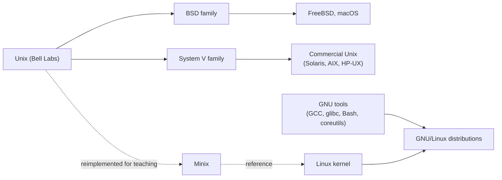
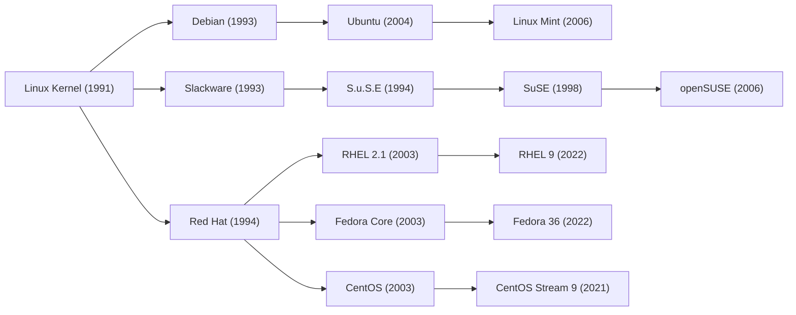
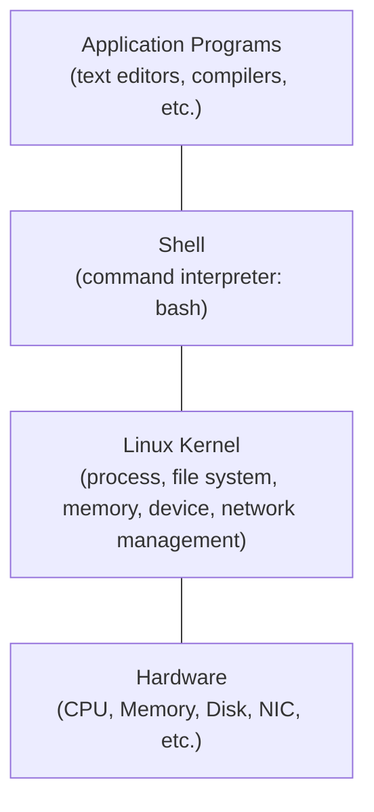

# Week 1 Lecture — Course Introduction

[Repository Guide](../../README.md) | [English](Concepts_Lecture.md) | [한국어](Concepts_Lecture.ko.md)

> **Last Updated:** 2026-11-19
>
> 우분투 리눅스, 이종원, Ch 1

> **Learning Objectives:**
> 1. Explain the history of Linux and UNIX and the philosophy of free software
> 2. Explain the families and use cases of major Linux distributions and the real-world domains of Linux
> 3. Explain the layered structure of a Linux system (hardware, kernel, shell, applications) and the distinction between user space and kernel space
> 4. Explain the concept of a virtual machine and the main features of VMware
> 5. Explain what POSIX and the Unix philosophy mean for the way Linux commands are used
> 6. Interpret Ubuntu version numbers, support periods, and kernel version strings

---

## Table of Contents

- [1. The Concept of Linux](#1-the-concept-of-linux)
  - [1.1 Key Characteristics](#11-key-characteristics)
  - [1.2 Reasons to Learn Linux](#12-reasons-to-learn-linux)
  - [1.3 Unix-like Operating Systems and POSIX](#13-unix-like-operating-systems-and-posix)
- [2. History of Linux](#2-history-of-linux)
  - [2.1 Linus Torvalds](#21-linus-torvalds)
  - [2.2 Richard Stallman](#22-richard-stallman)
  - [2.3 Timeline](#23-timeline)
  - [2.4 From Unix to GNU/Linux](#24-from-unix-to-gnulinux)
- [3. GNU Project and Free Software](#3-gnu-project-and-free-software)
  - [3.1 The Concept of the GNU Project](#31-the-concept-of-the-gnu-project)
  - [3.2 The Four Freedoms of Free Software](#32-the-four-freedoms-of-free-software)
  - [3.3 GPL (GNU General Public License)](#33-gpl-gnu-general-public-license)
  - [3.4 Copyleft Licenses and Permissive Licenses](#34-copyleft-licenses-and-permissive-licenses)
- [4. Linux Distributions](#4-linux-distributions)
  - [4.1 Major Distribution Families](#41-major-distribution-families)
  - [4.2 Popular Distributions](#42-popular-distributions)
  - [4.3 Components of a Distribution](#43-components-of-a-distribution)
  - [4.4 The Ubuntu Release Cycle](#44-the-ubuntu-release-cycle)
- [5. Linux Architecture](#5-linux-architecture)
  - [5.1 System Structure](#51-system-structure)
  - [5.2 Component Roles](#52-component-roles)
  - [5.3 Kernel Versions and Release Types](#53-kernel-versions-and-release-types)
  - [5.4 Inspecting System Information](#54-inspecting-system-information)
- [6. Linux Usage in the Real World](#6-linux-usage-in-the-real-world)
  - [6.1 Linux in Industry](#61-linux-in-industry)
  - [6.2 Linux Certification](#62-linux-certification)
- [7. Virtual Machines](#7-virtual-machines)
  - [7.1 Virtual Machine Setup](#71-virtual-machine-setup)
  - [7.2 Useful Features of VMware](#72-useful-features-of-vmware)
  - [7.3 Types of Hypervisors](#73-types-of-hypervisors)
  - [7.4 Network Modes of a Virtual Machine](#74-network-modes-of-a-virtual-machine)
- [Concept Applications](#concept-applications)
- [Summary](#summary)
- [Self-Check Questions](#self-check-questions)
- [References](#references)

---

<br>

## 1. The Concept of Linux

Linux is a **free and open-source operating system** based on the Unix operating system. Linus Torvalds first created it in 1991, and it is one of the most widely used operating systems in the world. It is distributed under the GNU General Public License (GPL), so anyone can modify and distribute the source code, and it has a large and active community of developers and users.

### 1.1 Key Characteristics

- **Open Source:** Anyone can freely view, modify, and distribute the source code.
- **Unix-compatible:** It maintains a high degree of compatibility with Unix and follows most of POSIX, the standard for Unix-like operating systems.
- **Multi-user and Multi-tasking:** It supports multiple users and multiple processes simultaneously.
- **Stability and Security:** It is widely known for robust security and system stability.
- **Flexibility:** It runs on a wide range of devices, from servers and supercomputers to smartphones, smartwatches, IoT devices, drones, and autonomous vehicles.
- **GUI Environment:** Although it is widely used as a server operating system, it also provides a convenient GUI through desktop environments such as GNOME, KDE, and XFCE.

### 1.2 Reasons to Learn Linux

- Over **80%** of smartphones worldwide run Android, which is Linux-based.
- Over **95%** of cloud servers run Linux.
- **100%** of the world's top 500 supercomputers run Linux.
- Most of the world's top 25 websites run on Linux.
- Linux is critical for 5G mobile infrastructure, IoT devices, drones, and autonomous vehicles.

> **Key Point:** Linux is not just a server OS; it is the foundation of modern computing infrastructure.

### 1.3 Unix-like Operating Systems and POSIX

Linux is not an operating system that inherited Unix source code. Torvalds wrote the kernel from scratch and made it follow the behavior that Unix had established (a hierarchical file system, the process model, the shell, and the user and permission model). An operating system that follows the interfaces and behavior of Unix rather than its code is called a **Unix-like operating system**, and Linux, FreeBSD, and macOS are typical examples. The standard that makes Unix-like operating systems behave in the same way is POSIX.

> **Definition:** **POSIX** is a standard that defines the interfaces and environment an operating system must provide so that applications can be ported at the source code level. Its latest edition, POSIX.1-2024, is both IEEE Std 1003.1-2024 and The Open Group Base Specifications Issue 8, and it consists of four volumes: Base Definitions (common terms and headers), System Interfaces (system services in the form of C functions), Shell and Utilities (the shell language and utilities), and Rationale [1].

What POSIX specifies is the behavior of source code and commands, not the executable files themselves. A program that uses only the C functions defined by POSIX therefore works on another Unix-like operating system after recompilation, and a shell script that uses only the POSIX shell syntax and the options of POSIX utilities runs unchanged on other Unix-like operating systems. Portability of executable files (binaries), on the other hand, is outside the scope of POSIX [1]. Most commands used on Linux, such as `ls`, `grep`, and `sort`, are implementations made by the GNU Project (GNU coreutils, GNU grep, and so on); these implementations support the options defined by POSIX and add GNU-specific long options such as `--help` and `--color`.

> **Caution:** A command that uses GNU-specific options may not work on other Unix-like operating systems. For example, `sed -i` on macOS always takes a backup file extension as an argument, so running the GNU form `sed -i 's/a/b/' f` there fails or behaves differently. Scripts meant to run on several operating systems are safer when they use only the options defined by POSIX.

The command design of Unix and Linux follows a common set of principles known as the **Unix philosophy**: each program is kept small so that it does one thing well, the input and output of programs are flows of human-readable text lines, and complex tasks are solved by connecting small programs with pipes (`|`). For example, each line of the user account file `/etc/passwd` consists of seven colon-separated fields, and the last field is the login shell (Week 12). The following command connects four programs that each do a different job to count how many accounts use each kind of login shell. The file used is a copy (43 lines) of `/etc/passwd` from a lab Ubuntu system.

```text
$ cut -d: -f7 passwd | sort | uniq -c | sort -rn
     29 /usr/sbin/nologin
      9 /bin/bash
      3 /bin/false
      1 /bin/sync
      1 /bin/sh
```

`cut -d: -f7` cuts out only the seventh field of each line, `sort` sorts the lines so that identical shells become adjacent, `uniq -c` merges adjacent identical lines into one and prefixes the count, and the final `sort -rn` treats the counts as numbers (`-n`) and sorts them from largest to smallest (`-r`). Because `uniq` compares only adjacent lines, removing the first `sort` makes the same shell be counted several times separately. Each of these commands is covered in detail in Week 4 (pipes) and Week 15 (`cut`, `sort`, `uniq`).

---

<br>

## 2. History of Linux

### 2.1 Linus Torvalds

- **Born:** December 28, 1969, in Helsinki, Finland
- **Education:** University of Helsinki
- **1991:** He created a new operating system, Linux, by referencing Minix, an educational OS.
- **August 26, 1991:** The day Torvalds posted the message below to the comp.os.minix newsgroup, which is commonly regarded as the birthday of Linux. This date is in Korea Standard Time; in Coordinated Universal Time (UTC) it was August 25.

```text
"Hello everybody out there using minix -
I'm doing a (free) operating system (just a hobby, won't be big
and professional like gnu) for 386(486) AT clones."
-- Linus Torvalds (1991)
```

### 2.2 Richard Stallman

- He was born in 1953 in Manhattan, New York, USA.
- He started computer work at age 16 as an intern at IBM.
- He developed the **Emacs** editor in 1976 at the MIT AI Lab.
- He opposed software commercialization and advocated a cooperative development culture.
- He founded the **Free Software Foundation (FSF)** in 1985.
- He wrote the **GNU General Public License (GPL)**.
- He initiated the **Copyleft** movement.

### 2.3 Timeline

| Year | Event |
|------|-------|
| 1969 | Unix developed at AT&T Bell Labs |
| 1983 | GNU Project announced by Richard Stallman |
| 1985 | Free Software Foundation (FSF) established |
| 1991 | Linux kernel 0.01 released by Linus Torvalds |
| 1993 | Debian and Slackware distributions released |
| 1994 | Red Hat Linux released |
| 2004 | Ubuntu released (Debian-based) |
| 2025 | Latest kernel version 6.13.5 (as of March) |

*Table 1. Major milestones of Unix, GNU, and Linux*

### 2.4 From Unix to GNU/Linux

The events in Table 1 form a single story. Unix, created by Ken Thompson and Dennis Ritchie at Bell Labs, was later rewritten in the C language, which made it easy to move to other hardware, and it split into several branches when AT&T licensed its source code to universities and companies. The BSD family of the University of California, Berkeley and the System V family of AT&T are the main branches, and the commercial Unixes (Solaris, AIX, HP-UX) as well as today's FreeBSD and macOS came from these branches. When the Unix source code became subject to commercial licensing, Stallman started the GNU Project to build from scratch an operating system that was compatible with Unix and free to use (Section 3).

The GNU Project had nearly all the rest of an operating system, such as the compiler (GCC), the C library (glibc), the shell (Bash), the basic commands (coreutils), and the editor (Emacs), but had not completed the kernel that handles the hardware directly. At about the same time, Torvalds, who was using Tanenbaum's educational operating system Minix, built a new kernel with the GNU compiler, and combining this kernel with the GNU tools produced a complete operating system that anyone could use freely. For this reason the FSF argues that this operating system should be called GNU/Linux. Strictly speaking, Linux is the name of the kernel, and the operating system that is commonly called Linux is a distribution (Section 4) that combines the Linux kernel, the GNU tools, and other application programs.



*Figure 1. Lineage of Unix-like operating systems and GNU/Linux*

In Figure 1, a solid line is a relation in which source code was inherited, and a dashed line is a relation in which only the design was used as a reference, without code. Minix and Linux both reimplemented the behavior of Unix without using Unix code.

---

<br>

## 3. GNU Project and Free Software

### 3.1 The Concept of the GNU Project

GNU stands for **GNU's Not Unix**, a recursive acronym, that is, an acronym whose expansion contains the acronym itself. The GNU Project develops **free software** compatible with Unix, with the goal that all software can be used freely.

### 3.2 The Four Freedoms of Free Software

| Freedom | Description |
|---------|-------------|
| Freedom 0 | Run the program for any purpose |
| Freedom 1 | Study how the program works and modify it to suit one's needs (requires source code access) |
| Freedom 2 | Redistribute copies to help others |
| Freedom 3 | Improve the program and distribute the improved version so the whole community can benefit (requires source code access) |

*Table 2. The four freedoms of free software*

### 3.3 GPL (GNU General Public License)

- It is a **Copyleft** license that ensures derivative works remain free software. Copyleft uses copyright to guarantee freedom: whoever distributes a modified version must give the recipients the same freedoms.
- Its versions are GPLv1, GPLv2, and GPLv3.
- The Linux kernel is licensed under **GPLv2**.

> **Key Point:** The English word free can refer to price or to liberty; the free in free software refers to liberty, not price. Think of free as in free speech, not as in free beer.

### 3.4 Copyleft Licenses and Permissive Licenses

Licenses that publish source code fall into two kinds according to what they require when derivative works are distributed.

| Category | Copyleft license | Permissive license |
|:-----|:-----|:-----|
| Typical examples | GPLv2, GPLv3, LGPL, AGPL | MIT, BSD, Apache License 2.0 |
| Condition for distributing a modified version | The modified version is distributed under the same license, together with its source code | It may be included in a closed commercial product as long as the copyright notice and the license text are kept |
| When the obligation to publish source arises | When the program is distributed to others (for the AGPL, also when it is offered as a service over a network) | No obligation |
| Purpose | Make freedom extend to derivative works | Minimize restrictions on reuse |
| Examples of use | Linux kernel (GPLv2), GNU coreutils (GPLv3) | FreeBSD (BSD), Kubernetes (Apache 2.0) |

*Table 3. Comparison of copyleft licenses and permissive licenses*

The requirements of the GPL arise on distribution. A company that only modifies and uses a GPL program internally, without distributing it outside, has no obligation to publish the source code. Moreover, Freedom 2 (the freedom to redistribute) covers not only giving copies away free of charge but also selling them for a fee, so selling GPL software is itself allowed. Even when it is sold, the condition that recipients must be given the right to obtain the source code and redistribute it stays the same.

The LGPL (Lesser GPL) is a weaker copyleft for libraries: it requires the source to be published when the library itself is modified and distributed, but it does not require the same license for programs that link to the library. Because the GNU C Library (glibc) uses the LGPL, commercial programs linked to glibc can be built on Linux. The term open source refers to licenses that meet the criteria defined by the Open Source Initiative (OSI), and most free software licenses are also open source licenses. The two terms refer to almost the same licenses, but they differ in emphasis: free software puts the ethical value of user freedom first, whereas open source puts the practical benefits of open development first.

> **Caution:** "Open source" does not mean "free of charge", nor does it mean "the source can be viewed". A license that publishes source code but forbids modification or redistribution is neither free software nor open source. Licenses that forbid commercial use, such as CC BY-NC-SA 4.0 and PolyForm Noncommercial, restrict Freedom 0 (the freedom to run the program for any purpose) and therefore are not free software licenses.

---

<br>

## 4. Linux Distributions

A Linux distribution is a version that bundles the **Linux kernel** with suitable **application programs**. Since anyone can assemble and distribute one as they wish, many distributions exist.

### 4.1 Major Distribution Families



*Figure 2. Lineage of the major Linux distribution families*

### 4.2 Popular Distributions

| Distribution | Base | Use Case | Website |
|-------------|------|----------|---------|
| **Ubuntu** | Debian | Desktop, Server | https://ubuntu.com |
| **CentOS/RHEL** | Red Hat | Enterprise Server | https://centos.org |
| **Fedora** | Red Hat | Development | https://getfedora.org |
| **Arch Linux** | Independent | Advanced Users | https://archlinux.org |

*Table 4. Base and use case of representative Linux distributions*

> **Note:** CentOS Linux was a free rebuild of RHEL, but its support has ended (the last one, CentOS Linux 7, in June 2024); it continues as CentOS Stream, which receives changes before they enter RHEL.

> **Key Point:** Ubuntu is a Debian-family distribution that is widely used because it is easy for beginners, and it is used in the labs of this course.

### 4.3 Components of a Distribution

Every distribution uses the same Linux kernel, but they differ in what they put on top of it and how. The components that make a real difference when choosing a distribution are as follows.

| Component | Role | Debian family (Ubuntu) | Red Hat family (RHEL, Fedora) |
|:-----|:-----|:-----|:-----|
| Package format | The installation unit that bundles a program and its configuration files | `.deb` | `.rpm` |
| Package management tools | Download from package repositories, resolve dependencies, install, and remove | `apt`, `dpkg` | `dnf`, `rpm` |
| Init system | Runs as the first process after boot and starts and manages services | systemd | systemd |
| Desktop environment | The graphical environment of windows, menus, and the file manager | GNOME (default of Ubuntu Desktop) | GNOME (default of Fedora Workstation) |
| Release policy | The cycle of new versions and the support period | Regular releases and LTS (Section 4.4) | Differs by distribution |

*Table 5. Components of a distribution and the differences between the two families*

Distributions of the same family share the package format and the management tools, so they are used in almost the same way. For example, the `apt install` command learned on Ubuntu works unchanged on Debian and Linux Mint, but on Fedora one must use `dnf install`. Package management is covered in Chapter 9, and booting and systemd in Week 14.

The default graphical environment of Ubuntu Desktop is GNOME. The top bar at the top of the screen has three parts. Activities on the left shows the icons of frequently used programs together with thumbnails of the running programs, the date and time in the middle manage notifications, and the system menu on the right provides sound volume, the wired connection, Bluetooth, settings, screen lock, and power off and log out. On the left of the screen is the dock, where frequently used programs (Firefox, Thunderbird, Files, Software, and Help) and the trash are pinned, and pressing the show-applications button at the bottom of the dock displays the list of installed programs. The terminal, the file manager, and the text editor can all be started from this list. In the open dialog of the text editor, choosing Other Locations, Computer, and `etc` in turn and opening the `hosts` file shows this computer's table of host names and IP addresses. On an Ubuntu system whose computer name was set to `myubuntu` during installation, the file usually looks like this.

```text
127.0.0.1 localhost
127.0.1.1 myubuntu

# The following lines are desirable for IPv6 capable hosts
::1     ip6-localhost ip6-loopback
fe00::0 ip6-localnet
ff00::0 ip6-mcastprefix
ff02::1 ip6-allnodes
ff02::2 ip6-allrouters
```

The first line maps the name `localhost` to the loopback address `127.0.0.1`, which refers to the machine itself, and the second line maps the name `myubuntu` to `127.0.1.1`, the address that the Debian family assigns to its own host name. `/etc` is the directory that holds system configuration files (Week 3), and an ordinary user can read this file but cannot modify and save it (Week 7).

### 4.4 The Ubuntu Release Cycle

Ubuntu releases a new version every six months, and the version number gives the year and month of the release in the form `YY.MM`. Version 24.04 was therefore released in April 2024, and 24.10 in October 2024. The version released every two years is an **LTS (Long Term Support)** release, and LTS releases come out in April of even-numbered years [2].

| Type | Release cycle | Standard security maintenance | Examples |
|:-----|:-----|:-----|:-----|
| LTS | Every two years | 5 years | 22.04 LTS, 24.04 LTS, 26.04 LTS |
| Interim release | Every six months between LTS releases | 9 months | 24.10, 25.04, 25.10 |

*Table 6. Types of Ubuntu releases and their support periods*

With Ubuntu Pro, an LTS release can receive security updates beyond the standard five years [2]. Each version has a code name made of an adjective and an animal name that start with the same letter: 22.04 is Jammy Jellyfish, 24.04 is Noble Numbat, and 26.04 is Resolute Raccoon [3]. Configuration files and repository addresses use the first word of the code name in lowercase (`noble` for 24.04). After an LTS release, installation images that contain the accumulated updates and support for new hardware are reissued with a third number, such as 24.04.1 and 24.04.2; these are called point releases [3]. A point release is not a new version, so a system running 24.04 reaches the same state as 24.04.x simply by updating.

Ubuntu 24.04 LTS, the lab environment of this course, contains Linux kernel 6.8 and systemd 255.4, and its standard security maintenance lasts until May 31, 2029 [4]. LTS is the choice for running a server or for keeping the same environment for a semester or longer, as in a course, and an interim release is the choice for trying new features early.

> **Caution:** The `04` in version number 24.04 means April, not "the fourth revision". Also, 24.10 is newer than 24.04 but is not an LTS release, so it is supported for only nine months. A larger version number does not mean a longer support period.

---

<br>

## 5. Linux Architecture

### 5.1 System Structure



*Figure 3. Layered structure of a Linux system*

### 5.2 Component Roles

- **Kernel:** The core of the OS; it manages hardware resources, processes, memory, and file systems.
- **Shell:** The interface between the user and the kernel; it interprets and executes the commands the user enters. The default shell of Ubuntu is bash.
- **Applications:** Programs that users interact with directly (editors, compilers, web servers, etc.).

The area where applications and the shell run is called **user space**, and the area where the kernel runs is called **kernel space**. Programs in user space do not access the hardware directly but ask the kernel to perform operations such as reading and writing files.

> **[Operating Systems]** From the viewpoint taught in Operating Systems, the kernel is a resource manager that divides hardware resources such as CPU time, memory, disks, and I/O devices among processes and protects the processes from interfering with one another. Applications do not access the hardware directly but request services from the kernel through system calls. The shell is itself a user program running on top of the kernel, so in Figure 3 both the shell and the applications use kernel functions only through system calls.

### 5.3 Kernel Versions and Release Types

The Linux kernel is developed in the **mainline** tree maintained by Torvalds. A new mainline kernel is released every 9-10 weeks, and one cycle consists of a two-week merge window, in which new features are accepted, followed by about seven weeks of stabilization with a weekly release candidate (`-rc1`, `-rc2`, ...) [5]. Once a mainline kernel is released, that version becomes **stable** and receives update releases, usually every week, that carry bug fixes backported from mainline, and some versions are designated **longterm** and receive only important bug fixes for several years [5].

A kernel version has the form `major.minor.patch`. For example, 6.13.5 is mainline 6.13 with five stable updates applied. The major number goes up not because of a large change in features but when the minor number is judged to have become too large, and the old rule that "an odd minor number means a development version" has not been used since 2.6 [5].

Distributions do not use the kernel from kernel.org as it is; they build it with their own patches and configuration and append their own mark to the version string [5]. The output `6.8.0-51-generic` of `uname -r` on Ubuntu 24.04 reads as follows.

```text
6.8.0  -  51  -  generic
  │       │       └─ flavour: the build for ordinary PCs and servers
  │       └───────── ABI number assigned by Ubuntu: grows with updates
  └───────────────── the base mainline kernel 6.8
```

*Figure 4. Structure of an Ubuntu kernel version string*

Because the ABI number usually grows when Ubuntu releases a new kernel package with security and bug fixes, the number in the `-51` position differs on two 24.04 systems depending on when they were updated. The fact that the latest version on kernel.org is higher than 6.8 does not mean that the kernel of Ubuntu 24.04 is outdated or lacks security fixes. An LTS distribution fixes the base version and backports only the fixes, which preserves the stability of its behavior.

### 5.4 Inspecting System Information

The kernel, shell, and distribution of the current system are checked with the following commands. The output below is an example from Ubuntu 24.04.1 LTS installed in an x86-64 virtual machine; the kernel ABI number and the point release number change with updates.

```text
$ uname -s
Linux
$ uname -r
6.8.0-51-generic
$ uname -m
x86_64
$ echo $SHELL
/bin/bash
$ cat /etc/os-release
PRETTY_NAME="Ubuntu 24.04.1 LTS"
NAME="Ubuntu"
VERSION_ID="24.04"
VERSION="24.04.1 LTS (Noble Numbat)"
VERSION_CODENAME=noble
ID=ubuntu
ID_LIKE=debian
HOME_URL="https://www.ubuntu.com/"
SUPPORT_URL="https://help.ubuntu.com/"
BUG_REPORT_URL="https://bugs.launchpad.net/ubuntu/"
PRIVACY_POLICY_URL="https://www.ubuntu.com/legal/terms-and-policies/privacy-policy"
UBUNTU_CODENAME=noble
LOGO=ubuntu-logo
```

- `uname -s` prints the name of the kernel, `-r` the kernel release (the version string), and `-m` the hardware type. With `-a`, it prints all of this information on one line. If ARM Ubuntu was installed in UTM or VMware Fusion on an Apple Silicon Mac, `uname -m` prints `aarch64`.
- `$SHELL` is an environment variable holding the path of the user's login shell (Week 6). It shows the shell registered for the account, not the shell that is currently running.
- `/etc/os-release` is a file that gives the name and version of the distribution in `key=value` form, and distributions that use systemd all provide it. `ID_LIKE=debian` indicates that this distribution belongs to the Debian family, so a script can read this value to decide whether to use `apt` or `dnf`.

> **Caution:** `uname` shows the kernel, not the distribution. Other distributions also use kernel 6.8, so `uname -r` alone does not tell the Ubuntu version; the distribution must be checked with `/etc/os-release`.

---

<br>

## 6. Linux Usage in the Real World

### 6.1 Linux in Industry

| Domain | Examples |
|--------|----------|
| Cloud Computing | Most servers running on AWS, Google Cloud, and Azure use Linux |
| Mobile | Android (Linux-based) powers 80%+ of smartphones |
| Supercomputing | All top 500 supercomputers run Linux |
| Embedded Systems | IoT devices, automotive systems, smart TVs |
| DevOps | Docker, Kubernetes, CI/CD pipelines |
| Networking | Routers, switches, firewalls |

*Table 7. Examples of Linux use by industry*

### 6.2 Linux Certification

- **Linux Master Level 2**
  - It is administered by the Korea Association for ICT Promotion (KAIT, http://www.ihd.or.kr/).
  - It is a recognized national certification in Korea.
  - It covers system administration, networking, and security.

---

<br>

## 7. Virtual Machines

### 7.1 Virtual Machine Setup

A **Virtual Machine (VM)** is an application that creates a virtual machine (hardware) on top of the operating system installed on a PC (the host OS), so that another operating system (the guest OS) can be installed and run on it.

| VM Software | Host OS | Guest OS |
|------------|---------|----------|
| VMware | Windows, Linux, macOS | Windows, Linux, Solaris, macOS |
| VirtualBox | Windows, Linux, macOS, Solaris | Windows, Linux, Solaris, macOS, OpenBSD |
| Hyper-V | Windows | Windows, some Linux, Solaris |

*Table 8. Host and guest operating systems supported by each VM software*

### 7.2 Useful Features of VMware

- **Adding hardware:** You can attach as many hardware devices, such as hard disks, as you like for testing.
- **Clone:** When the same operating system is needed, duplicate the entire VM for testing.
- **Suspend:** Save the current state of the VM and later start it again in exactly that state.
- **Snapshot:** Save a specific point in time as a checkpoint, and revert to it if something goes wrong during an experiment.

### 7.3 Types of Hypervisors

Software that creates and runs virtual machines is called a **hypervisor**, and hypervisors fall into two types according to their relation to the hardware.

| Type | Position | Examples | Main use |
|:-----|:-----|:-----|:-----|
| Type 1 (bare-metal) | Runs directly on the hardware, and the guest OSes run on top of it | VMware ESXi, Microsoft Hyper-V, KVM in Linux | Data centers and cloud servers |
| Type 2 (hosted) | Runs as an application on top of a host OS | VMware Workstation, VMware Fusion, VirtualBox, UTM | Labs and development on personal PCs |

*Table 9. The two types of hypervisors*

A type 2 hypervisor uses the hardware through the host OS and is therefore slower than type 1, but it only has to be installed on a PC already in use, which makes it suitable as a lab environment. Recent CPUs have instructions that assist virtualization (Intel VT-x, AMD-V), which let the hypervisor execute most guest instructions directly on the CPU. If this feature is turned off in the BIOS or UEFI settings, 64-bit guests cannot run or become very slow.

A guest runs quickly with hardware virtualization only when it has the same CPU architecture (instruction set) as the host. On an Apple Silicon (ARM) Mac, the ARM (`arm64`) Ubuntu installation image must be used; the x86-64 image runs only under UTM's emulation and is very slow.

> **[Operating Systems]** A virtual machine imitates an entire machine, and each guest runs its own kernel. Containers (Docker and the like), in contrast, share the single kernel of the host and isolate processes, file systems, and networks from each other with the kernel's namespaces and control groups (cgroups). Containers are therefore lighter than virtual machines, but they cannot run a kernel different from the host's (for example, Windows on a Linux host).

### 7.4 Network Modes of a Virtual Machine

A hypervisor gives the guest a virtual network card and offers modes that determine how the card is connected to the outside network.

| Mode | Guest IP address | Internet access from the guest | Access to the guest from the host | Access to the guest from other PCs on the same network |
|:-----|:-----|:-----|:-----|:-----|
| NAT | An address on a private network created by the hypervisor | Possible (translated to the host's address on the way out) | Possible in VMware and UTM; VirtualBox needs port forwarding | Not possible by default |
| Bridged | An address obtained from the same physical network as the host | Possible | Possible | Possible |
| Host-only | An address on a private network containing only the host and its guests | Not possible | Possible | Not possible |

*Table 10. Network modes of a virtual machine*

In NAT mode, the VMware default, the guest can reach the Internet and the host can connect to the guest's private address with SSH, so the remote access procedure given in the course information document (check the guest's address with `ip addr` and connect from the host with `ssh user1@address`) works as it is. To use the guest as a server that other PCs in the same lab can also reach, choose bridged mode.

---

<br>

## Concept Applications

**True/False Check:**

| Statement | Judgment and Reason |
|:-----|:-----|
| Linux contains part of the original AT&T Unix source code. | **F.** Torvalds wrote the kernel from scratch, and Linux follows the interfaces and behavior of Unix (POSIX) without using its code. |
| Selling GPL software for a fee violates the GPL. | **F.** Freedom 2 includes redistribution for a fee; what the GPL requires is that recipients receive the source code and the same freedoms. |
| A company that modifies a GPL program and uses it only internally must publish the modified source. | **F.** The obligation to provide source arises when the program is distributed to others. |
| Ubuntu 24.10 is supported longer than 24.04 LTS because it is newer. | **F.** 24.10 is an interim release with nine months of maintenance, while 24.04 LTS has five years. |
| `uname -r` alone identifies the Ubuntu release. | **F.** It shows only the kernel version; the distribution and its version are in `/etc/os-release`. |
| In VMware's NAT mode, the host can still connect to the guest with SSH. | **T.** VMware attaches the host to the private network created by the hypervisor, so it can reach the guest's private address. |

---

<br>

## Summary

| Concept | Key Summary |
|---------|-------------|
| Linux | It is a free, open-source OS based on Unix, created by Linus Torvalds in 1991. |
| GNU Project | It is the free software movement started by Richard Stallman, and it guarantees software freedom. |
| GPL | It is a Copyleft license that keeps derivative works free software. |
| Distributions | A distribution bundles the kernel with applications; examples are Ubuntu, RHEL, and Fedora. |
| Architecture | The kernel, the shell, and applications form successive layers on top of the hardware. |
| User Space and Kernel Space | Applications and the shell run in user space and the kernel runs in kernel space, and applications use the hardware through the kernel. |
| Virtual Machine | It allows multiple operating systems to run on one physical machine. |
| Real-world Usage | Linux dominates servers, cloud, mobile, supercomputing, and IoT. |
| POSIX | It is the IEEE Std 1003.1 standard that defines the shell, utilities, and system interfaces so that applications can be ported at the source code level. |
| Unix philosophy | Complex tasks are solved by connecting small programs that each do one thing with text streams and pipes. |
| Copyleft and permissive | Copyleft requires modified versions to be distributed under the same license with source, while permissive licenses allow inclusion in closed products as long as the notice is kept. |
| Ubuntu versions | They use the `YY.MM` form and come every six months; LTS releases in April of even years get five years and interim releases nine months of standard support. |
| Kernel versions | They use the `major.minor.patch` form, and Ubuntu's `6.8.0-51-generic` consists of the base kernel, the ABI number, and the flavour. |
| Hypervisor | Type 1 runs on the hardware and type 2 on a host OS, and VMware Workstation and UTM used for labs are type 2. |
| VM networking | NAT lets the guest go out through a private address, bridged mode gives an address on the host's network, and host-only mode gives an address that reaches only the host. |

---

<br>

## Self-Check Questions

1. **Free software:** List the four freedoms of free software, and identify the freedoms that require access to the source code.

   <details>
   <summary>Answer</summary>

   Freedom 0 is the freedom to run the program for any purpose, Freedom 1 to study how it works and modify it, Freedom 2 to redistribute copies, and Freedom 3 to distribute improved versions so the community benefits. Studying, modifying, or improving a program requires its source code, so Freedoms 1 and 3 presuppose source code access.

   </details>

2. **GPL and Copyleft:** You want to modify the Linux kernel, which is distributed under GPLv2, and distribute it to others. What condition must you follow, and what is this licensing approach called?

   <details>
   <summary>Answer</summary>

   You must also distribute the modified kernel under GPLv2 so that recipients can obtain the source code and run, modify, and redistribute it again. This approach, which requires derivative works to carry the same freedoms, is called Copyleft.

   </details>

3. **Layered structure:** When a user types `ls` in a terminal to view a directory's contents, list in order the layers of the Linux system that the request passes through before it reaches the hardware, and explain what each layer does.

   <details>
   <summary>Answer</summary>

   The shell (bash) interprets the entered command and runs the `ls` program. The application `ls` asks the kernel for the directory's contents. The kernel reads the information from the disk (hardware) through the file system and returns it to `ls`, which prints the result on the screen. The request therefore goes down through the shell, the application, the kernel, and the hardware.

   </details>

4. **VMware features:** Before an experiment that modifies system configuration files, which VMware feature should you use so that you can return to the state just before the experiment if something goes wrong? Explain in comparison with Clone and Suspend.

   <details>
   <summary>Answer</summary>

   Use Snapshot. A snapshot saves the VM state at a specific point as a checkpoint, so you can revert to that point if a problem occurs during the experiment. Clone duplicates the entire VM to create one more identical environment, and Suspend saves the current state to continue from it later, so neither is meant for reverting to the point before an experiment.

   </details>

5. **Distribution families:** Classify Ubuntu, Linux Mint, Fedora, and CentOS Stream according to the distribution families in Figure 2.

   <details>
   <summary>Answer</summary>

   Ubuntu and Linux Mint, which is derived from Ubuntu, belong to the Debian family. Fedora and CentOS Stream belong to the Red Hat family.

   </details>

6. **User space and kernel space:** When you save a file with a text editor, explain what the editor and the kernel each do, following the layers of Figure 3.

   <details>
   <summary>Answer</summary>

   The editor is an application running in user space; it holds the user's input in memory and asks the kernel to write it to a file. The kernel receives the request in kernel space, updates the file system, and writes the actual data to the disk (hardware) through device I/O. Applications do not handle the hardware directly but go through the kernel.

   </details>

7. **Pipes and the Unix philosophy:** Explain how the result of the command `cut -d: -f7 passwd | sort | uniq -c | sort -rn` in Section 1.3 changes if the first `sort` is removed.

   <details>
   <summary>Answer</summary>

   `uniq -c` merges only adjacent identical lines, so in the original unsorted order the same shell is counted separately whenever other shells come between its lines. For example, if the `/usr/sbin/nologin` lines are interrupted by `/bin/bash` or `/bin/false` lines, `/usr/sbin/nologin` is split into several lines, each printed with a small count. The first `sort` gathers identical shells next to each other so that `uniq -c` can count the totals.

   </details>

8. **License judgment:** Decide in each case whether source code must be published. (a) The GPLv2 Linux kernel is modified and used only on the company's servers. (b) The GPLv2 Linux kernel is modified, put into a router product, and sold. (c) A library under the MIT license is modified, put into a closed commercial app, and sold.

   <details>
   <summary>Answer</summary>

   In (a) the program is not distributed, so there is no obligation. In (b) the modified kernel is distributed with the product, so the buyers must be given the source code of the modified kernel under GPLv2. In (c) the license is permissive, so it suffices to include the copyright notice and license text of the MIT license, and the source need not be published.

   </details>

9. **Interpreting Ubuntu versions:** When was Ubuntu 25.10 released, and is it an LTS release? If a server is to be newly installed in November 2026, explain on the basis of support periods which of 24.04 LTS, 25.10, and 26.04 LTS is appropriate.

   <details>
   <summary>Answer</summary>

   25.10 is an interim release from October 2025. LTS releases come only in April of even years, so 25.10 is not an LTS release, and its standard support of nine months had already ended by November 2026. 24.04 LTS is supported until May 2029, and 26.04 LTS for five years from its release (April 2026), that is, until about 2031, so 26.04 LTS, with the longest support period, is appropriate for a server.

   </details>

10. **Kernel version strings:** On two Ubuntu 24.04 systems, `uname -r` printed `6.8.0-45-generic` and `6.8.0-51-generic`, respectively. Explain the relation between the two kernels and decide which system was updated more recently.

    <details>
    <summary>Answer</summary>

    Both kernels are the `generic` flavour built by Ubuntu on the basis of mainline 6.8, and only their ABI numbers, 45 and 51, differ. Because the ABI number usually grows when Ubuntu releases a new kernel package with fixes and never decreases, the system with `-51` has been updated to a more recent kernel.

    </details>

11. **Choosing a network mode:** You want the web server in your virtual machine to be reachable from other students' PCs in the lab. Explain which of NAT, bridged, and host-only modes to choose and why the other two do not fit.

    <details>
    <summary>Answer</summary>

    Choose bridged mode. A guest in bridged mode obtains an address from the same physical network as the host, so other PCs on that network can connect to the address directly. In NAT mode the guest's address exists only inside the private network created by the hypervisor and cannot be reached from outside by default, and in host-only mode only the host and the guest can communicate.

    </details>

---

<br>

## References

1. The IEEE and The Open Group, "The Open Group Base Specifications Issue 8, IEEE Std 1003.1-2024 Edition," 2024. [Online]. Available: https://pubs.opengroup.org/onlinepubs/9799919799/
2. Canonical, "Ubuntu release cycle," [Online]. Available: https://ubuntu.com/about/release-cycle
3. Canonical, "Ubuntu release notes," [Online]. Available: https://documentation.ubuntu.com/release-notes/
4. Canonical, "Ubuntu 24.04 LTS (Noble Numbat) release notes," [Online]. Available: https://documentation.ubuntu.com/release-notes/24.04/
5. The Linux Kernel Archives, "Releases," [Online]. Available: https://www.kernel.org/category/releases.html
