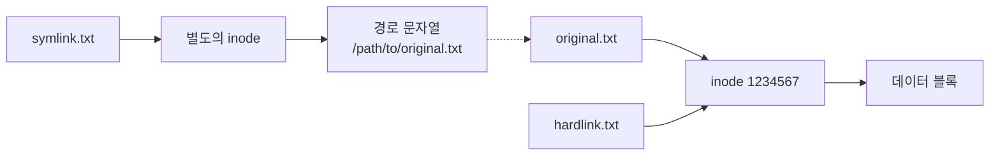

# 4주차 이론 — 디렉터리 및 파일 관리 II

[레포지토리 안내](../../README.ko.md) | [English](Concepts_Lecture.md) | [한국어](Concepts_Lecture.ko.md)

> **최종 수정일:** 2026-11-19
>
> 우분투 리눅스, 이종원, Ch 2

> **학습 목표:**
> 1. `cp`, `mv`, `rm`으로 파일과 디렉터리를 복사, 이동, 삭제할 수 있다
> 2. inode를 바탕으로 하드 링크와 심볼릭 링크의 차이를 설명하고 각각 만들 수 있다
> 3. `touch`로 빈 파일을 만들거나 파일의 시간 정보를 바꿀 수 있다
> 4. `grep`과 정규 표현식으로 파일 내용을 검색할 수 있다
> 5. 파일 검색 명령(find, whereis, which, locate)으로 파일과 명령의 위치를 찾을 수 있다
> 6. 와일드카드, 입출력 리다이렉션, 파이프를 사용할 수 있다

---

## 목차

- [1. 파일 복사, 이동, 삭제](#1-파일-복사-이동-삭제)
  - [1.1 cp: 파일 및 디렉터리 복사](#11-cp-파일-및-디렉터리-복사)
  - [1.2 mv: 파일 이동 또는 이름 변경](#12-mv-파일-이동-또는-이름-변경)
  - [1.3 rm: 파일 및 디렉터리 제거](#13-rm-파일-및-디렉터리-제거)
  - [1.4 복사, 이동, 삭제의 동작 원리](#14-복사-이동-삭제의-동작-원리)
- [2. 하드 링크와 심볼릭 링크](#2-하드-링크와-심볼릭-링크)
  - [2.1 Inode](#21-inode)
  - [2.2 하드 링크](#22-하드-링크)
  - [2.3 심볼릭 링크 (소프트 링크)](#23-심볼릭-링크-소프트-링크)
  - [2.4 비교](#24-비교)
  - [2.5 파일의 네 가지 시간과 stat](#25-파일의-네-가지-시간과-stat)
  - [2.6 링크 수의 추적](#26-링크-수의-추적)
  - [2.7 상대 경로 심볼릭 링크](#27-상대-경로-심볼릭-링크)
- [3. 빈 파일 생성](#3-빈-파일-생성)
  - [3.1 touch: 파일 생성 또는 타임스탬프 갱신](#31-touch-파일-생성-또는-타임스탬프-갱신)
  - [3.2 빈 파일을 만드는 방법과 touch의 세부 동작](#32-빈-파일을-만드는-방법과-touch의-세부-동작)
- [4. 파일 내용 검색](#4-파일-내용-검색)
  - [4.1 grep: 파일 내용 검색](#41-grep-파일-내용-검색)
  - [4.2 기본 정규 표현식과 확장 정규 표현식](#42-기본-정규-표현식과-확장-정규-표현식)
- [5. 파일 위치 검색](#5-파일-위치-검색)
  - [5.1 find: 파일 검색](#51-find-파일-검색)
  - [5.2 whereis: 바이너리, 소스, 매뉴얼 위치](#52-whereis-바이너리-소스-매뉴얼-위치)
  - [5.3 which: 명령어 바이너리 위치](#53-which-명령어-바이너리-위치)
  - [5.4 locate: 빠른 파일 검색 (데이터베이스 기반)](#54-locate-빠른-파일-검색-데이터베이스-기반)
  - [5.5 find 식의 평가 순서와 고급 조건](#55-find-식의-평가-순서와-고급-조건)
- [6. 와일드카드와 글로빙](#6-와일드카드와-글로빙)
  - [6.1 셸 와일드카드](#61-셸-와일드카드)
  - [6.2 글로빙의 세부 규칙](#62-글로빙의-세부-규칙)
- [7. I/O 리다이렉션과 파이프](#7-io-리다이렉션과-파이프)
  - [7.1 표준 I/O 스트림](#71-표준-io-스트림)
  - [7.2 출력 리다이렉션](#72-출력-리다이렉션)
  - [7.3 입력 리다이렉션](#73-입력-리다이렉션)
  - [7.4 파이프](#74-파이프)
  - [7.5 tee: 파일과 화면에 동시 출력](#75-tee-파일과-화면에-동시-출력)
  - [7.6 리다이렉션과 파이프의 함정](#76-리다이렉션과-파이프의-함정)
- [8. 모범 사례](#8-모범-사례)
  - [8.1 효율적인 파일 관리](#81-효율적인-파일-관리)
  - [8.2 안전 팁](#82-안전-팁)
- [개념 적용](#개념-적용)
- [요약](#요약)
- [점검 문제](#점검-문제)
- [참고 문헌](#참고-문헌)

---

<br>

## 1. 파일 복사, 이동, 삭제

### 1.1 cp: 파일 및 디렉터리 복사

```bash
cp source destination            # 파일 복사
cp file1.txt file2.txt           # file1.txt를 file2.txt로 복사
cp file.txt /tmp/                # /tmp 디렉터리로 복사
cp -r dir1/ dir2/                # 디렉터리를 재귀적으로 복사
cp -i file.txt /tmp/             # 대화형 (덮어쓰기 전 확인)
cp -p file.txt backup/           # 타임스탬프 및 권한 보존
cp -a dir1/ dir2/                # 아카이브 모드 (모든 것 보존)
cp file1 file2 file3 destdir/    # 여러 파일을 디렉터리로 복사
```

형식은 `cp [옵션] 원본 대상`이다. 두 인자가 모두 파일이면 원본을 대상 이름의 파일로 복사하고, 대상이 디렉터리이면 그 안에 같은 이름으로 복사한다. `cp text1 temp/text2`처럼 디렉터리 안의 다른 이름을 지정할 수도 있다. 인자를 셋 이상 주면 마지막 인자는 디렉터리여야 하며, 앞의 파일들이 모두 그 디렉터리로 복사된다. 쓰기 권한이 없는 디렉터리(예: `/etc`)로 복사하면 `Permission denied` 오류가 나고, 디렉터리를 `-r` 없이 복사하려 하면 `cp: -r not specified; omitting directory` 메시지와 함께 건너뛴다.

### 1.2 mv: 파일 이동 또는 이름 변경

```bash
mv oldname.txt newname.txt       # 파일 이름 변경
mv file.txt /tmp/                # 파일을 /tmp로 이동
mv dir1/ /home/user/             # 디렉터리 이동
mv -i file.txt /tmp/             # 대화형 (덮어쓰기 전 확인)
mv file1 file2 destdir/          # 여러 파일 이동
```

`mv text1 temp/data2`처럼 파일을 다른 디렉터리로 옮기면서 이름을 함께 바꿀 수도 있다. 두 인자를 모두 디렉터리로 지정하면, 대상 디렉터리가 이미 있을 때는 원본 디렉터리를 그 안으로 옮기고, 없을 때는 원본 디렉터리의 이름을 대상 이름으로 바꾼다.

> **핵심:** `mv`는 이중 용도로 사용되며, 파일 이동과 이름 변경을 모두 수행한다.

### 1.3 rm: 파일 및 디렉터리 제거

```bash
rm file.txt                      # 파일 제거
rm -i file.txt                   # 대화형 (삭제 전 확인)
rm -f file.txt                   # 강제 제거 (확인 없음)
rm -r directory/                 # 디렉터리와 내용을 재귀적으로 제거
rm -rf directory/                # 강제 재귀 제거 (위험)
```

> **주의:** Linux 명령줄의 `rm`은 휴지통을 거치지 않으므로, 삭제한 파일은 되돌릴 수 없다.

```bash
# 안전 팁: 기본적으로 rm -i 사용
alias rm='rm -i'                 # ~/.bashrc에 추가
```

### 1.4 복사, 이동, 삭제의 동작 원리

세 명령의 결과는 inode(2.1절)의 관점에서 보면 정확하게 이해할 수 있다.

| 명령 | 디렉터리 표의 변화 | inode의 변화 | 데이터 블록의 변화 |
|:-----|:-----|:-----|:-----|
| `cp a b` | 대상 디렉터리에 이름 `b` 추가 | 새 inode 할당 | 내용을 새 블록에 복사 |
| `mv a b` (같은 파일 시스템) | 이름 `a`를 지우고 `b`를 추가 (이름 바꾸기) | 그대로 | 그대로 |
| `mv a /other/b` (다른 파일 시스템) | 대상에 이름 추가, 원본에서 이름 삭제 | 대상 파일 시스템에 새 inode | 내용을 복사한 뒤 원본 삭제 |
| `rm a` | 이름 `a` 삭제 | 링크 수 1 감소, 0이 되고 열린 곳이 없으면 해제 | inode가 해제될 때 반환 |

*표 1. 복사, 이동, 삭제가 디렉터리 표, inode, 데이터 블록에 미치는 영향*

같은 파일 시스템 안의 `mv`는 데이터를 옮기지 않고 디렉터리 표의 이름만 바꾸므로, 파일이 아무리 커도 즉시 끝나며 inode 번호도 그대로이다.

```text
$ ls -i report.txt
1310740 report.txt
$ mv report.txt docs/final.txt
$ ls -i docs/final.txt
1310740 docs/final.txt
$ cp docs/final.txt copy.txt
$ ls -i copy.txt
1310745 copy.txt
```

`rm`이 실제로 하는 일은 디렉터리에서 이름을 지우는 것이다. 그래서 파일을 지우는 데 필요한 권한은 그 파일의 쓰기 권한이 아니라 파일을 담은 디렉터리의 쓰기 권한이다(7주차). 파일 자체에 쓰기 권한이 없고 표준 입력이 터미널이면 GNU `rm`은 지우기 전에 `rm: remove write-protected regular file 'a'?`처럼 한 번 묻고, `-f`를 주면 묻지 않는다.

덮어쓰기와 관련된 옵션은 다음과 같다.

| 옵션 | `cp`, `mv`에서의 동작 |
|:-----|:-----|
| (없음) | 같은 이름의 대상이 있으면 묻지 않고 덮어씀 |
| `-i` | 덮어쓰기 전에 확인을 받음 |
| `-n` | 이미 있는 대상을 덮어쓰지 않음 |
| `-b` | 덮어쓰기 전에 대상을 `이름~` 백업 파일로 남김 |
| `-v` | 처리한 파일을 하나씩 출력함 |

*표 2. 덮어쓰기와 관련된 cp, mv의 옵션*

> **주의:** `cp -r src dest`의 결과는 `dest`가 이미 있는지에 따라 다르다. `dest`가 없으면 `src`의 복사본이 `dest`라는 이름으로 생기지만, `dest`가 이미 디렉터리이면 `dest/src`가 생긴다. 같은 명령을 두 번 실행하면 두 번째에는 `dest/src`가 만들어지므로, 스크립트에서는 `cp -r src/. dest`처럼 "src의 내용을 dest로"라는 뜻을 분명히 쓰는 것이 안전하다.

`cp`는 심볼릭 링크를 만나면 기본적으로 링크가 가리키는 파일의 내용을 복사하지만, `-r`로 디렉터리를 재귀 복사할 때는 그 안의 심볼릭 링크를 링크 그대로 복사한다. `cp -a`(archive)는 `-dR --preserve=all`과 같아서, 링크는 링크로, 소유자, 권한, 시간도 그대로 보존하여 디렉터리를 백업할 때 쓴다 [1].

---

<br>

## 2. 하드 링크와 심볼릭 링크

### 2.1 Inode

Linux 파일은 파일 이름, inode, 데이터 블록으로 구성된다. 파일 이름은 디렉터리 항목에 들어 있고, 이름이 가리키는 inode에는 파일의 상세 정보와 데이터 블록의 주소가 저장되며, 실제 내용은 데이터 블록에 있다.


*그림 1. Linux 파일의 구성 요소*

Linux 파일 시스템의 모든 파일은 다음 정보를 저장하는 **inode(index node)** 를 하나씩 가진다.

- 파일 유형 및 권한
- 소유자 및 그룹
- 파일 크기
- 하드 링크 수
- 타임스탬프 (접근, 수정, 상태 변경)
- 데이터 블록에 대한 포인터
- **파일 이름은 포함하지 않는다** (이름은 디렉터리 항목에 저장됨).

```bash
ls -i file.txt                   # inode 번호 표시
stat file.txt                    # 상세 inode 정보 표시
```

### 2.2 하드 링크

**링크(link)** 는 기존 파일에 새로운 이름을 붙이는 것이다. **하드 링크(hard link)** 는 `ln` 명령으로 만들며, **동일한 inode**를 가리키는 디렉터리 항목을 하나 더 만든다. 형식은 `ln [옵션] 원본파일 링크파일`이다.

```bash
ln original.txt hardlink.txt

# 두 파일이 동일한 inode를 공유
$ ls -li
1234567 -rw-r--r-- 2 user1 user1 100 Mar 21 10:00 hardlink.txt
1234567 -rw-r--r-- 2 user1 user1 100 Mar 21 10:00 original.txt
```

**특성:**
- 원본과 inode 번호가 같다.
- 하드 링크 수가 늘어난다(위 출력의 `2`).
- 하나를 삭제해도 다른 이름으로 계속 접근할 수 있으며, 데이터는 하드 링크 수가 0이 될 때 해제된다.
- 서로 다른 파일 시스템 사이에는 만들 수 없다.
- 디렉터리에 대해서는 만들 수 없다(`.`과 `..` 제외).

파일을 `cp`로 복사하면 새 inode가 할당되어 별개의 파일이 되므로 `ls -i`로 본 inode 번호가 원본과 다르다. 하드 링크는 새 파일을 만들지 않고 같은 파일에 이름만 더하므로 inode 번호가 같다.

### 2.3 심볼릭 링크 (소프트 링크)

**심볼릭 링크(symbolic link)** 는 `ln -s`로 만들며, 원본 파일의 경로를 내용으로 담은 **새 파일**을 생성한다.

```bash
ln -s /path/to/original.txt symlink.txt

$ ls -l
lrwxrwxrwx 1 user1 user1 21 Mar 21 10:00 symlink.txt -> /path/to/original.txt
```

**특성:**
- `ls -l`에서 파일 유형이 `l`로 표시되고, 이름 뒤에 `-> 원본`이 표시된다.
- 원본과 inode 번호가 다르다. 즉 원본 파일과 심볼릭 링크는 별개의 파일이다.
- 원본에 이름을 추가하는 것이 아니므로 원본의 하드 링크 수는 늘지 않는다.
- 대상 파일의 경로를 내용으로 담으며, 크기는 그 경로 문자열의 길이이다(위 예에서 21바이트).
- 서로 다른 파일 시스템 사이에도 만들 수 있다.
- 디렉터리에 대해서도 만들 수 있다.
- 대상이 삭제되면 가리키는 곳이 없는 댕글링 링크(dangling link)가 되어, `cat`으로 읽으면 `No such file or directory` 오류가 난다.

### 2.4 비교



*그림 2. 하드 링크와 심볼릭 링크가 파일을 가리키는 방식*

| 특징 | 하드 링크 | 심볼릭 링크 |
|------|-----------|-------------|
| Inode | 원본과 동일 | 다름 |
| 파일 시스템 간 | 불가 | 가능 |
| 디렉터리 링크 | 불가 | 가능 |
| 대상 삭제 시 | 파일 계속 접근 가능 | 댕글링(끊어진) 링크 |
| 파일 크기 | 원본과 동일 | 경로 문자열 크기 |
| 명령어 | `ln file link` | `ln -s file link` |

*표 3. 하드 링크와 심볼릭 링크의 비교*

### 2.5 파일의 네 가지 시간과 stat

inode에는 파일의 시간 정보가 네 가지 기록된다. 각 시간이 언제 바뀌는지는 시험과 실무에서 모두 자주 혼동되므로 정확히 구분해야 한다.

| 시간 | 이름 | 바뀌는 때 | 확인 방법 |
|:-----|:-----|:-----|:-----|
| atime | 마지막 접근 시간 | 파일의 내용을 읽을 때 (`cat`, `less`, 실행) | `ls -lu`, `stat` |
| mtime | 마지막 수정 시간 | 파일의 내용을 바꿀 때 (`echo >>`, 편집기로 저장) | `ls -l`, `stat` |
| ctime | 마지막 상태 변경 시간 | 내용을 쓸 때와 inode 정보(소유자, 그룹, 링크 수, 권한)를 바꿀 때 | `ls -lc`, `stat` |
| btime | 생성 시간 | 파일을 만들 때 한 번 정해지고 바뀌지 않음 | `stat` |

*표 4. inode에 기록되는 네 가지 시간*

mtime은 소유자, 그룹, 링크 수, 권한을 바꿀 때는 바뀌지 않고, ctime은 내용을 쓸 때와 inode 정보를 바꿀 때 모두 바뀐다 [2]. 따라서 `chmod`, `chown`, `ln`은 ctime만 바꾸고, 내용을 고치면 mtime과 ctime이 함께 바뀐다. 디렉터리의 mtime은 그 안에 파일을 만들거나 지울 때 바뀐다 [2]. ctime의 c는 creation이 아니라 change이다.

GNU `stat`은 네 시간을 모두 보여 준다. Ubuntu 24.04의 ext4에서 `a.txt`를 만들고 내용을 읽고, 덧붙이고, 권한을 바꾸면서 확인하면 다음과 같다.

```text
$ echo hello > a.txt
$ stat a.txt
  File: a.txt
  Size: 6         	Blocks: 8          IO Block: 4096   regular file
Device: 8,2	Inode: 1310750     Links: 1
Access: (0664/-rw-rw-r--)  Uid: ( 1000/   user1)   Gid: ( 1000/   user1)
Access: 2025-03-21 12:00:00.110000000 +0900
Modify: 2025-03-21 12:00:00.110000000 +0900
Change: 2025-03-21 12:00:00.110000000 +0900
 Birth: 2025-03-21 12:00:00.110000000 +0900
$ cat a.txt               # 12:05에 읽음
hello
$ echo world >> a.txt     # 12:10에 덧붙임
$ chmod 600 a.txt         # 12:15에 권한 변경
$ stat --printf 'A=%x\nM=%y\nC=%z\n' a.txt
A=2025-03-21 12:05:00.231000000 +0900
M=2025-03-21 12:10:00.452000000 +0900
C=2025-03-21 12:15:00.678000000 +0900
```

- `Size: 6`은 `hello`의 다섯 글자와 줄바꿈 문자이고, `Blocks: 8`은 512바이트 단위로 센 할당 블록 수(곧 4 KiB)이다.
- `Access: (0664/-rw-rw-r--)`는 권한을 8진수와 기호로 함께 보여 준다(7주차).
- `cat`은 atime을 12:05로 바꾸었다. `echo >>`는 내용을 바꾸었으므로 mtime과 ctime을 12:10으로 바꾸었고, `chmod`는 inode 정보만 바꾸었으므로 ctime만 12:15로 바꾸었다. btime은 처음 그대로이다.
- `stat --printf`는 형식 문자열대로 출력한다. `%x`, `%y`, `%z`, `%w`는 각각 atime, mtime, ctime, btime이다. `-c`(`--format`)도 형식을 지정하지만, `--printf`는 `\n` 같은 이스케이프를 해석하고 끝에 줄바꿈을 저절로 붙이지 않는다는 점이 다르다.

> **주의:** Linux는 기본적으로 `relatime` 방식으로 atime을 기록한다. 이전 atime이 현재의 mtime과 ctime보다 모두 늦으면, 다시 읽어도 atime을 바꾸지 않는다. 다만 atime이 하루보다 오래되었으면 읽을 때 갱신한다 [3]. 그래서 같은 파일을 연달아 두 번 읽어도 atime이 두 번째 읽기 시각으로 바뀌지 않는 것이 정상이다. 디스크 쓰기를 줄이기 위한 동작이다.

### 2.6 링크 수의 추적

하드 링크와 심볼릭 링크가 섞인 명령의 결과는 각 단계에서 inode와 이름의 대응을 적어 가며 추적한다. 다음 명령을 차례로 실행한 뒤 `fb`의 링크 수를 구하는 문제를 예로 든다.

```text
$ touch fa
$ ln fa fb
$ ln fa fc
$ ln -s fa fd
$ ln -s fa fe
$ rm fa fe
```

| 단계 | 이름과 대상 | inode X(파일 내용)의 링크 수 |
|:-----|:-----|-----:|
| `touch fa` | `fa` → X | 1 |
| `ln fa fb` | `fa`, `fb` → X | 2 |
| `ln fa fc` | `fa`, `fb`, `fc` → X | 3 |
| `ln -s fa fd` | `fd` → 새 inode S1 (내용: `fa`) | 3 |
| `ln -s fa fe` | `fe` → 새 inode S2 (내용: `fa`) | 3 |
| `rm fa fe` | 이름 `fa`, `fe` 삭제, S2 해제 | 2 |

*표 5. 하드 링크와 심볼릭 링크를 섞은 명령의 단계별 추적*

마지막 상태를 `ls -li`로 보면 다음과 같다.

```text
$ ls -li f*
1310760 -rw-rw-r-- 2 user1 user1 0 Mar 21 12:20 fb
1310760 -rw-rw-r-- 2 user1 user1 0 Mar 21 12:20 fc
1310763 lrwxrwxrwx 1 user1 user1 2 Mar 21 12:20 fd -> fa
$ cat fd
cat: fd: No such file or directory
```

- 심볼릭 링크는 원본 inode의 링크 수를 늘리지 않으므로 `fd`, `fe`를 만들어도 X의 링크 수는 3에 머문다.
- `rm fa`는 이름 `fa` 하나를 지울 뿐이므로 X는 `fb`, `fc`라는 이름으로 남고 링크 수는 2가 된다. 하드 링크에는 "원본"과 "사본"의 구분이 없다.
- `fd`는 여전히 이름 `fa`를 내용으로 담고 있지만 그 이름이 사라졌으므로 댕글링 링크가 된다. `fd`의 크기 2는 경로 문자열 `fa`의 길이이다.

### 2.7 상대 경로 심볼릭 링크

심볼릭 링크에 담긴 경로가 상대 경로이면, 그 경로는 링크를 만들 때의 현재 디렉터리가 아니라 **링크 파일이 있는 디렉터리**를 기준으로 해석된다. 이 규칙을 모르면 만들자마자 끊어진 링크를 만들기 쉽다.

```text
$ pwd
/home/user1/ch2
$ ls sub
file.txt
$ ln -s file.txt sub/l1
$ cat sub/l1
data
$ cd sub
$ ln -s file.txt ../l2
$ cat ../l2
cat: ../l2: No such file or directory
$ readlink ../l2
file.txt
$ readlink -f l1
/home/user1/ch2/sub/file.txt
```

- `sub/l1`은 `sub` 디렉터리에 있으므로 내용 `file.txt`는 `sub/file.txt`로 해석되어 동작한다.
- `../l2`는 `ch2` 디렉터리에 만들어졌으므로 내용 `file.txt`는 `ch2/file.txt`로 해석되는데, 그런 파일이 없어 링크가 끊어진다. `ln -s`는 대상이 있는지 확인하지 않으므로 오류 없이 만들어진다.
- `readlink`는 링크에 저장된 문자열을 그대로, `readlink -f`는 끝까지 따라간 절대 경로를 출력한다.

상대 경로 링크는 링크와 대상이 들어 있는 디렉터리 전체를 다른 곳으로 옮겨도 계속 동작하고, 절대 경로 링크는 링크만 다른 곳으로 옮겨도 계속 동작한다. Ubuntu의 `/bin -> usr/bin`이 상대 경로 링크인 것은 루트 파일 시스템을 다른 곳에 마운트하여 다룰 때에도 링크가 그 안에서 올바르게 해석되게 하기 위해서이다.

---

<br>

## 3. 빈 파일 생성

### 3.1 touch: 파일 생성 또는 타임스탬프 갱신

```bash
touch newfile.txt                # 빈 파일 생성 (또는 타임스탬프 갱신)
touch -t 202503211200 file.txt   # 특정 타임스탬프 설정
touch -r ref.txt file.txt        # 참조 파일에서 타임스탬프 복사
touch file1 file2 file3          # 여러 파일 생성
```

형식은 `touch [-acm] [-r 참조파일 | -t 시간] 파일`이다. 파일이 없으면 빈 파일을 만들고, 있으면 접근 시간과 수정 시간을 현재 시각으로 바꾼다. `-a`는 접근 시간만, `-m`은 수정 시간만 바꾼다. `-t`의 시간은 `[[CC]YY]MMDDhhmm[.ss]` 형식이며, 각 필드는 다음과 같다.

| 필드 | 의미 | 범위 |
|------|------|------|
| CC | 연도의 앞 두 자리 | 생략하면 YY가 69\~99일 때 19, 00\~68일 때 20 |
| YY | 연도의 뒤 두 자리 | 생략하면 현재 연도 |
| MM | 월 | 01~12 |
| DD | 일 | 01~31 |
| hh | 시 | 00~23 |
| mm | 분 | 00~59 |
| ss | 초 (생략 가능) | 00~59 |

*표 6. touch -t의 시간 형식*

예를 들어 `touch -t 12311200 test`는 test의 시간을 올해 12월 31일 12:00으로 바꾸고, `touch -t 202503211200 file.txt`는 2025년 3월 21일 12:00으로 바꾼다.

### 3.2 빈 파일을 만드는 방법과 touch의 세부 동작

크기가 0바이트인 파일을 만드는 방법은 여럿이다.

```text
$ touch fa
$ > fb
$ : > fc
$ ls -l fa fb fc
-rw-rw-r-- 1 user1 user1 0 Mar 21 12:30 fa
-rw-rw-r-- 1 user1 user1 0 Mar 21 12:30 fb
-rw-rw-r-- 1 user1 user1 0 Mar 21 12:30 fc
```

- `touch fa`는 파일이 없을 때만 빈 파일을 만들고, 있으면 내용은 그대로 두고 시간만 바꾼다.
- `> fb`는 셸의 출력 리다이렉션만 있고 명령은 없는 형태이다. 셸이 `fb`를 쓰기 위해 열면서 길이를 0으로 만들므로, 파일이 없으면 빈 파일이 생기고 **있으면 내용이 지워진다**. `: > fc`의 `:`는 아무 일도 하지 않는 셸 내장 명령으로, 같은 일을 하되 다른 셸에서도 동작하는 형태이다.

`touch`의 그 밖의 세부 동작은 다음과 같다.

- `-c`(`--no-create`)는 파일이 없으면 만들지 않는다. 이미 있는 파일의 시간만 갱신할 때 쓴다.
- GNU `touch`의 `-d`는 사람이 읽는 날짜 문자열을 받는다. `touch -d '2025-03-21 12:00' f`는 `touch -t 202503211200 f`와 같다.
- `touch`로 atime과 mtime은 원하는 값으로 바꿀 수 있지만, ctime은 바꿀 수 없다. 시간을 바꾸는 것 자체가 inode를 바꾸는 일이므로 ctime은 언제나 `touch`를 실행한 현재 시각이 된다. 그래서 ctime은 파일이 마지막으로 손대어진 시각을 추적하는 데 쓰인다.

> **주의:** `> 파일`은 빈 파일을 만드는 손쉬운 방법이지만 이미 있는 파일에 쓰면 경고 없이 내용이 사라진다. 기존 파일을 건드리지 않으려면 `touch`를 쓰거나, 셸에서 `set -o noclobber`를 켜 두어 `>`가 기존 파일을 덮어쓰지 못하게 한다(7.6절).

---

<br>

## 4. 파일 내용 검색

### 4.1 grep: 파일 내용 검색

```bash
grep "pattern" file.txt                  # 파일에서 패턴 검색
grep -i "pattern" file.txt               # 대소문자 구분 없이 검색
grep -n "pattern" file.txt               # 줄 번호 표시
grep -r "pattern" directory/             # 디렉터리에서 재귀적 검색
grep -v "pattern" file.txt               # 역 매칭 (매칭되지 않는 줄 표시)
grep -c "pattern" file.txt               # 매칭되는 줄 수 세기
grep -l "pattern" *.txt                  # 매칭되는 파일 이름만 표시
grep -w "word" file.txt                  # 완전한 단어만 매칭
grep -E "regex" file.txt                 # 확장 정규식 (egrep과 동일)
```

형식은 `grep [옵션] 패턴 [파일]`이며, 지정한 파일에서 패턴이 들어 있는 줄을 찾아 출력한다. 패턴에는 문자, 문자열, 문장, 정규 표현식을 쓸 수 있고, 옵션은 `grep -ni unix grep.dat`처럼 묶어 쓸 수 있다. `ls -l | grep rw-`, `ps -ef | grep user1`처럼 다른 명령의 출력을 파이프(7.4절)로 받아 검색할 수도 있다.

**정규 표현식(regular expression)** 은 특정한 규칙을 가진 문자열의 집합을 표현하는 형식 언어이다. 한 줄에서 패턴의 위치를 나타내는 앵커(`^`, `$`), 하나 이상의 문자를 나타내는 문자 집합(`.`, `[]` 등), 앞 문자 집합의 반복 횟수를 지정하는 수식자(`*`)로 구성된다.

| 패턴 | 의미 | 예 |
|------|------|------|
| `.` | 임의의 단일 문자 | `a...b`: a로 시작하고 b로 끝나는 5글자 |
| `*` | 앞 문자의 0회 이상 반복 | `ab*`: a 다음에 b가 없거나 여러 번 나오는 문자열 |
| `^` | 줄의 시작 | `^root`: root로 시작하는 줄 |
| `$` | 줄의 끝 | `sh$`: sh로 끝나는 줄 |
| `[abc]` | 집합 내의 임의의 문자 | `[Pp]attern`: Pattern 또는 pattern |
| `[^abc]` | 집합에 포함되지 않은 임의의 문자 | `[^a-m]att`: att 앞에 a부터 m까지가 아닌 문자 |
| `\b` | 단어 경계 | `\bsh\b`: 단어 sh |

*표 7. 정규 표현식의 기본 메타 문자*

```bash
# 예시
grep "^root" /etc/passwd          # "root"로 시작하는 줄
grep "bash$" /etc/passwd          # "bash"로 끝나는 줄
grep "^$" file.txt                # 빈 줄
grep -E "[0-9]{3}" file.txt       # 연속된 3자리 숫자
```

> **주의:** 셸 와일드카드의 `*`(임의의 문자열, 6절)와 정규 표현식의 `*`(앞 문자의 0회 이상 반복)는 뜻이 다르다. 기본 정규 표현식에서 패턴 맨 앞의 `*`는 반복할 앞 문자가 없으므로 문자 `*` 자체로 취급된다.

### 4.2 기본 정규 표현식과 확장 정규 표현식

`grep`은 기본적으로 **기본 정규 표현식(basic regular expression, BRE)** 을, `grep -E`는 **확장 정규 표현식(extended regular expression, ERE)** 을 쓴다. 두 문법은 표현할 수 있는 패턴은 같고, 일부 메타 문자를 쓰는 방법만 다르다.

| 뜻 | BRE (`grep`) | ERE (`grep -E`) |
|:-----|:-----|:-----|
| 앞 항목의 1회 이상 반복 | `a\+` (GNU 확장) | `a+` |
| 앞 항목의 0회 또는 1회 | `a\?` (GNU 확장) | `a?` |
| 앞 항목의 n회 이상 m회 이하 반복 | `a\{n,m\}` | `a{n,m}` |
| 묶음 | `\(ab\)` | `(ab)` |
| 둘 중 하나 | `cat\\|dog` (GNU 확장) | `cat\|dog` |
| 문자 그대로의 `+`, `?`, `{`, `(`, `\|` | `+`, `?`, `{`, `(`, `\|` | `\+`, `\?`, `\{`, `\(`, `\\|` |

*표 8. BRE와 ERE에서 메타 문자를 쓰는 방법*

예를 들어 `grep 'ab+'`는 문자열 `ab+`(b 다음의 문자 `+`)를 찾고, `grep -E 'ab+'`는 a 다음에 b가 한 번 이상 오는 문자열을 찾는다. `grep -F`는 패턴을 정규 표현식이 아닌 고정 문자열로 다루므로 `.`이나 `*`가 든 문자열을 그대로 찾을 때 쓴다.

문자 집합에는 **POSIX 문자 클래스**를 쓸 수 있다. `[[:digit:]]`는 숫자, `[[:alpha:]]`는 영문자, `[[:alnum:]]`는 영문자와 숫자, `[[:space:]]`는 공백 문자, `[[:upper:]]`와 `[[:lower:]]`는 대문자와 소문자이다. 바깥쪽 `[ ]`는 문자 집합의 괄호이고 안쪽 `[: :]`는 클래스 이름의 괄호이므로 괄호가 두 겹이 된다. `[a-z]` 같은 범위는 로케일에 따라 해석이 달라질 수 있으므로, 이식성이 중요하면 클래스를 쓰는 것이 안전하다.

점검 문제 1의 `grep.dat`에 몇 가지 패턴을 적용하면 다음과 같다.

```text
$ grep -E '^[A-Z]+ ' grep.dat
UNIX 12345
ROOT other csh
$ grep -E '[0-9]{4,}' grep.dat
UNIX 12345
ck07555 Student ksh
CK08777 student bash
$ grep -o -E '[kc]?sh$' grep.dat
sh
ksh
csh
ksh
sh
$ grep -c '' grep.dat
12
```

- `^[A-Z]+ `는 대문자만으로 된 단어로 시작하고 그 뒤에 공백이 오는 줄이다. `CK08777`은 `[A-Z]+`가 줄 시작의 `CK`까지만 맞고 그다음 글자 `0`이 공백이 아니므로 해당하지 않는다. 정규 표현식은 줄 안의 일부만 맞아도 되지만, `^`가 있으면 그 부분이 줄의 시작에서 출발해야 한다.
- `[0-9]{4,}`는 숫자가 4개 이상 이어진 부분이 있는 줄이다.
- `-o`는 줄 전체가 아니라 패턴에 맞는 부분만 출력한다. `KSH`는 대문자이므로 나오지 않는다.
- 빈 패턴은 모든 줄에 맞으므로 `grep -c ''`는 줄 수를 센다.

---

<br>

## 5. 파일 위치 검색

### 5.1 find: 파일 검색

```bash
find /path -name "filename"              # 정확한 이름으로 검색
find /home -name "*.txt"                 # 패턴으로 검색
find / -name "*.log" -size +10M          # 10MB보다 큰 로그 파일 검색
find . -type f -name "*.sh"              # 일반 파일만 검색
find . -type d -name "backup"            # 디렉터리만 검색
find /tmp -mtime -7                      # 최근 7일 내 수정된 파일
find . -user user1                       # user1 소유 파일 검색
find . -perm 755                         # 특정 권한의 파일 검색
find . -empty                            # 빈 파일/디렉터리 검색

# 검색된 파일에 명령어 실행
find . -name "*.tmp" -exec rm {} \;      # 모든 .tmp 파일 삭제
find . -name "*.sh" -exec chmod +x {} \; # 모든 .sh 파일에 실행 권한 부여
```

형식은 `find [경로] [검색 조건] [동작]`이며, 지정한 경로부터 하위 디렉터리를 재귀적으로 내려가며 조건에 맞는 파일을 찾는다. 경로를 생략하면 현재 디렉터리에서 찾는다.

| 검색 조건 | 의미 |
|-----------|------|
| `-name 파일명` | 이름이 일치하는 파일 (`*`, `?` 같은 메타 문자 사용 가능) |
| `-type 종류` | 종류가 일치하는 파일 (`f`: 일반 파일, `d`: 디렉터리, `l`: 심볼릭 링크) |
| `-mtime [+\|-]n` | 수정 시간이 n일보다 오래되었거나(`+n`), n일 이내이거나(`-n`), 정확히 n일 전인 파일 |
| `-atime [+\|-]n` | `-mtime`과 같은 방식으로 접근 시간을 비교 |
| `-mmin [+\|-]n` | 수정 시간을 분 단위로 비교 |
| `-user loginID` | loginID가 소유한 모든 파일 |
| `-size [+\|-]n` | n보다 크거나(`+n`), 작거나(`-n`), 정확히 n인 파일 (단위가 없으면 512바이트 블록, `c`는 바이트, `k`, `M`, `G`는 KiB, MiB, GiB) |
| `-newer 기준파일` | 기준 파일보다 나중에 수정된 파일 |
| `-perm 권한` | 사용 권한이 8진수 값과 정확히 일치하는 파일 |

*표 9. find의 주요 검색 조건*

| 동작 | 의미 |
|------|------|
| `-exec 명령 {} \;` | 검색된 각 파일을 `{}` 자리에 넣어 명령을 실행하며, `\;`으로 끝난다 |
| `-ok 명령 {} \;` | `-exec`와 같지만 실행할 때마다 사용자의 확인을 받는다(`rm -i`처럼) |
| `-print` | 검색된 파일의 경로를 화면에 출력한다(기본 동작) |
| `-ls` | 검색 결과를 `ls -l`과 비슷한 긴 목록 형식으로 출력한다 |
| `-delete` | 검색된 파일을 삭제한다 |

*표 10. find의 동작*

검색 조건은 `-a`(그리고), `-o`(또는), `!`(부정)으로 결합한다. 조건을 나란히 쓰면 `-a`로 결합한 것과 같다.

```bash
find /etc -perm 0777 -a -name "*sh"      # 권한이 777이면서 이름이 sh로 끝나는 파일
find ~ -type d -o -name Unix             # 디렉터리이거나 이름이 Unix인 파일
find . ! -newer g.txt                    # g.txt보다 나중에 수정되지 않은 파일
find /home -mtime +3 -ok rm {} \;        # 3일보다 오래된 파일을 확인 후 삭제
find /etc -name hostname 2> /dev/null    # 권한 오류 메시지를 버리고 결과만 출력
```

`-mtime`은 24시간 단위로 센다. `-mtime -1`은 24시간 이내에, `-mtime 1`은 24시간 이상 48시간 미만 전에, `-mtime +1`은 48시간 이상 전에 수정된 파일을 찾는다. 권한이 없는 디렉터리를 만나면 `Permission denied` 오류가 출력되므로, 위의 마지막 예처럼 오류를 `/dev/null`로 보내면(7.2절) 결과만 볼 수 있다.

### 5.2 whereis: 바이너리, 소스, 매뉴얼 위치

```bash
whereis ls
# ls: /usr/bin/ls /usr/share/man/man1/ls.1.gz
```

`whereis`는 정해진 경로에서 명령의 바이너리 파일, 소스 파일, 매뉴얼 파일의 위치를 찾는다. `-b`는 바이너리 파일만, `-m`은 매뉴얼 파일만, `-s`는 소스 파일만 검색한다.

### 5.3 which: 명령어 바이너리 위치

```bash
which python3
# /usr/bin/python3
```

`which`는 PATH 환경 변수에 지정된 디렉터리에서 명령 파일을 찾아 그 경로를 출력한다. 셸 내장 명령이나 별칭까지 확인하려면 6주차에서 다루는 `type`을 쓴다.

### 5.4 locate: 빠른 파일 검색 (데이터베이스 기반)

```bash
sudo apt install mlocate           # 미설치 시 설치
sudo updatedb                      # 파일 데이터베이스 갱신
locate filename                    # 빠른 검색
locate -i filename                 # 대소문자 구분 없이
```

> **참고:** 최근 Ubuntu에서는 `mlocate` 대신 `plocate` 패키지가 `locate` 명령을 제공하므로 `sudo apt install plocate`로 설치한다. 사용법은 같다.

> **핵심:** `locate`는 미리 구축된 데이터베이스를 검색하므로 `find`보다 훨씬 빠르지만, 최근 변경 사항이 반영되지 않을 수 있다. `updatedb`를 실행하여 갱신한다.

### 5.5 find 식의 평가 순서와 고급 조건

`find`는 찾은 파일마다 식을 왼쪽에서 오른쪽으로 평가하며, 결과가 정해지면 나머지를 평가하지 않는다. `-a`(나란히 쓴 것 포함)는 `-o`보다 우선순위가 높다 [4]. 그리고 식 전체에 `-print`, `-exec` 같은 동작이 하나도 없을 때만 `find`가 식 전체를 괄호로 감싸 끝에 `-print`를 붙인다. 이 두 규칙을 모르면 다음과 같은 실수를 한다.

```text
$ find . -name '*.c' -o -name '*.h' -print
./util.h
$ find . \( -name '*.c' -o -name '*.h' \) -print
./main.c
./util.h
```

첫 명령은 `-a`가 `-o`보다 먼저 묶이므로 `-name '*.c' -o ( -name '*.h' -a -print )`로 해석된다. `.c` 파일은 왼쪽 조건이 참이 되어 오른쪽(`-print`)을 평가하지 않으므로 출력되지 않는다. 둘째 명령처럼 괄호로 묶어야 두 종류가 모두 출력된다. 괄호는 셸의 특수 문자이므로 `\(`, `\)`로 쓰고, 앞뒤를 공백으로 띄운다.

GNU `find`의 그 밖의 주요 조건과 동작은 다음과 같다 [4].

| 조건이나 동작 | 의미 |
|:-----|:-----|
| `-maxdepth n` | 시작 디렉터리에서 n단계 아래까지만 내려감. `-maxdepth 1`은 하위 디렉터리를 검색하지 않음 |
| `-mindepth n` | n단계보다 얕은 파일에는 조건을 적용하지 않음. `-mindepth 1`은 시작 디렉터리 자신을 뺌 |
| `-iname 패턴` | 대소문자를 구분하지 않는 `-name` |
| `-perm -mode` | `mode`의 권한 비트가 **모두** 켜져 있는 파일 |
| `-perm /mode` | `mode`의 권한 비트 가운데 **하나라도** 켜져 있는 파일 |
| `-exec 명령 {} +` | 찾은 파일들을 한꺼번에 인자로 모아 명령을 적은 횟수만 실행 |

*표 11. find의 고급 조건과 동작*

`-perm`의 세 형태는 권한의 비트 연산으로 이해한다(7주차). 파일의 권한이 `644`(`rw-r--r--`)이면 `-perm 644`는 정확히 일치하므로 참, `-perm -600`은 소유자의 `r`, `w`가 모두 켜져 있으므로 참, `-perm /022`는 그룹 쓰기와 기타 사용자 쓰기 가운데 어느 것도 켜져 있지 않으므로 거짓이다. 그래서 "다른 사용자가 쓸 수 있는 파일"을 찾을 때는 `find /etc -perm /o=w`처럼 `/` 형태를 쓴다.

`-exec ... \;`은 파일 하나마다 명령을 한 번씩 실행하고, `-exec ... +`는 `xargs`처럼 여러 파일을 한 명령줄에 모아 실행한다. 파일이 1,000개이면 `\;`은 프로세스를 1,000번 만들고, `+`는 명령줄 길이의 한도 안에서 몇 번만 만든다. 예를 들어 `/etc` 바로 아래의 심볼릭 링크만 골라 상세 목록을 파일로 저장하는 명령은 다음과 같다.

```text
$ find /etc -maxdepth 1 -type l -exec ls -l {} + > link.out
$ grep localtime link.out
lrwxrwxrwx 1 root root 30 Mar 11 14:20 /etc/localtime -> /usr/share/zoneinfo/Asia/Seoul
```

`-size`는 크기를 단위로 나눈 값을 **올림**하여 비교하므로 주의가 필요하다. `-size -1M`은 "1 MiB보다 작은 파일"이 아니라 "올림한 MiB 수가 1보다 작은 파일", 곧 크기가 0인 파일만 찾는다 [4]. 1 MiB보다 작은 파일을 찾으려면 `-size -1024k`나 `-size -1048576c`처럼 더 작은 단위로 쓴다.

명령의 위치를 찾는 세 명령은 찾는 범위가 다르다. `which`는 `PATH`의 디렉터리만, `whereis`는 정해진 표준 디렉터리에서 바이너리, 매뉴얼, 소스를, `type`은 셸 자신이 해석하는 순서(별칭, 함수, 내장 명령, `PATH`)대로 찾는다. `which cd`는 아무것도 출력하지 않을 수 있지만 `type cd`는 `cd is a shell builtin`을 출력한다. `locate`의 데이터베이스는 Ubuntu 24.04의 `plocate`에서는 systemd 타이머가 하루에 한 번 `updatedb`를 실행하여 갱신하므로, 방금 만든 파일은 `sudo updatedb`를 직접 실행하기 전에는 찾지 못한다.

---

<br>

## 6. 와일드카드와 글로빙

### 6.1 셸 와일드카드

**와일드카드(wildcard)** 는 여러 파일 이름을 한꺼번에 가리키는 특수 문자이며, 셸이 명령을 실행하기 전에 와일드카드를 일치하는 파일 이름들로 바꾸는 것을 **글로빙(globbing)** 이라 한다.

| 와일드카드 | 의미 | 예시 |
|-----------|------|------|
| `*` | 임의 수의 문자 | `*.txt` = 모든 .txt 파일 |
| `?` | 정확히 한 문자 | `file?.txt` = file1.txt, fileA.txt |
| `[abc]` | 집합 내의 한 문자 | `file[123].txt` = file1.txt, file2.txt |
| `[a-z]` | 범위 내의 한 문자 | `[a-z]*.txt` = 소문자로 시작하는 파일 |
| `[!abc]` | 집합에 포함되지 않은 한 문자 | `file[!0-9].txt` = 숫자가 아닌 접미사 |
| `{a,b,c}` | 중괄호 확장 | `file.{txt,log}` = file.txt, file.log |

*표 12. 셸 와일드카드*

```bash
ls *.txt                          # 모든 .txt 파일
ls file[0-9].txt                  # file0.txt부터 file9.txt까지
cp *.{jpg,png} images/            # 모든 jpg와 png 파일 복사
rm test_?.log                     # test_1.log, test_A.log 등 제거
```

> **참고:** 중괄호 확장은 파일이 있는지와 관계없이 `file.txt file.log`처럼 문자열을 만들어 내므로, 엄밀히는 글로빙이 아니라 셸의 별도 확장이다. 또 `find`의 `-name`에 와일드카드를 줄 때는 `find /home -name "a*"`처럼 따옴표로 감싸야 한다. 따옴표가 없으면 현재 디렉터리에 `a.txt`가 있을 때 셸이 먼저 `a*`를 `a.txt`로 바꾸어, `find`는 이름이 정확히 `a.txt`인 파일만 찾는다.

### 6.2 글로빙의 세부 규칙

Bash의 글로빙에는 다음 규칙이 있다 [5].

1. 패턴은 이름이 `.`으로 시작하는 파일에 맞지 않는다. `*`는 숨김 파일을 포함하지 않으며, 숨김 파일을 가리키려면 `.*`처럼 `.`을 직접 써야 한다.
2. 맞는 파일이 없으면 패턴이 바뀌지 않고 그대로 명령에 넘어간다(`nullglob` 옵션이 꺼진 기본 상태). 그래서 `ls *.xyz`는 `*.xyz`라는 이름의 파일을 찾다가 오류를 낸다.
3. 펼친 이름들은 정렬되어 넘어간다. 숫자도 문자로 비교하므로 `file10`이 `file2`보다 앞에 온다.
4. `/`는 패턴의 `*`나 `?`에 맞지 않으므로 `*`는 한 단계의 디렉터리 안에서만 펼쳐진다.
5. 글로빙은 셸이 명령을 실행하기 전에 하므로, 명령은 패턴이 아니라 펼친 이름의 목록을 받는다.

`a.txt`, `b.txt`, `.hidden.txt`, `file1`, `file2`, `file10`이 있는 디렉터리에서 확인하면 다음과 같다. `echo`는 받은 인자를 그대로 출력하므로 글로빙의 결과를 미리 볼 때 쓴다.

```text
$ echo *.txt
a.txt b.txt
$ echo .*.txt
.hidden.txt
$ echo file*
file1 file10 file2
$ echo file?
file1 file2
$ echo *.xyz
*.xyz
$ ls *.xyz
ls: cannot access '*.xyz': No such file or directory
$ echo {1..3} file{1,2}.bak
1 2 3 file1.bak file2.bak
```

셸이 명령줄을 처리하는 순서는 중괄호 확장, 물결표 확장, 변수 확장과 명령 치환, 단어 분리, 경로 이름 확장(글로빙)이다 [5]. 중괄호 확장이 가장 먼저이므로 `{1..3}`처럼 파일과 무관한 문자열을 만들 수 있고(Bash의 순차 확장), 글로빙이 마지막이므로 변수에 담긴 `*`도 따옴표 없이 쓰면 펼쳐진다. 셸의 확장 순서 전체는 6주차에서 다룬다.

> **주의:** 위험한 명령을 와일드카드와 함께 실행하기 전에는 `rm` 자리에 `echo`를 넣어 실제로 어떤 이름이 넘어가는지 먼저 확인한다. 예를 들어 `rm * .bak`(별표와 `.bak` 사이에 공백)은 `rm *.bak`의 오타이지만, 셸은 이를 "모든 파일"과 `.bak`으로 펼치므로 디렉터리의 모든 파일이 지워진다. `echo * .bak`으로 확인하면 이 실수를 실행 전에 발견할 수 있다.

---

<br>

## 7. I/O 리다이렉션과 파이프

### 7.1 표준 I/O 스트림

| 스트림 | 파일 디스크립터 | 기본값 |
|--------|----------------|--------|
| stdin | 0 | 키보드 |
| stdout | 1 | 화면 |
| stderr | 2 | 화면 |

*표 13. 표준 입출력 스트림과 파일 디스크립터*

프로세스는 실행을 시작할 때 표준 입력(stdin), 표준 출력(stdout), 표준 오류(stderr)의 세 스트림을 받는다. 명령은 보통 키보드에서 입력을 읽고, 정상 결과는 표준 출력으로, 오류 메시지는 표준 오류로 화면에 출력한다. 두 출력이 따로 있으므로 결과와 오류 메시지를 서로 다른 곳으로 보낼 수 있다.

### 7.2 출력 리다이렉션

```bash
command > file                    # stdout을 파일로 리다이렉션 (덮어쓰기)
command >> file                   # stdout을 파일로 리다이렉션 (추가)
command 2> file                   # stderr를 파일로 리다이렉션
command 2>&1                      # stderr를 stdout으로 리다이렉션
command > file 2>&1               # stdout과 stderr를 모두 리다이렉션
command &> file                   # 위의 축약형 (bash)
```

`/dev/null`은 쓴 내용을 모두 버리는 특수 파일이므로, `2> /dev/null`처럼 쓰면 오류 메시지를 화면에 출력하지 않고 버린다.

> **[시스템프로그래밍]** 시스템프로그래밍에서 배우는 시스템 I/O로 보면, 파일 디스크립터는 프로세스가 연 파일을 가리키는 작은 정수이며 표 13의 0, 1, 2번은 모든 프로세스가 처음부터 열어 두는 표준 스트림이다. 셸은 명령을 실행하기 전에 `> file`이면 파일을 열어 그 디스크립터를 1번 자리에 복사하고(`dup2` 시스템 콜), `2>&1`이면 그 시점에 1번이 가리키는 곳을 2번 자리에 복사한다. 명령은 리다이렉션을 모른 채 0, 1, 2번으로 읽고 쓸 뿐이다. 리다이렉션은 왼쪽부터 차례로 적용되므로 `> file 2>&1`은 두 출력을 모두 파일로 보내지만, `2>&1 > file`은 표준 오류를 원래의 화면에 남기고 표준 출력만 파일로 보낸다.

### 7.3 입력 리다이렉션

```bash
command < file                    # 파일에서 입력 읽기
sort < unsorted.txt               # 파일 입력으로 정렬
```

`<`는 명령이 키보드 대신 지정한 파일에서 표준 입력을 읽게 한다. `sort < unsorted.txt`는 `sort unsorted.txt`와 결과가 같지만, 앞의 경우에는 셸이 파일을 열어 `sort`의 표준 입력으로 연결하고, 뒤의 경우에는 `sort`가 인자로 받은 파일을 직접 연다.

### 7.4 파이프

```bash
command1 | command2               # command1의 stdout을 command2의 stdin으로 전달
ls -la | grep "\.txt$"            # .txt 파일만 나열
cat /etc/passwd | sort            # passwd 항목 정렬
ps aux | grep nginx               # nginx 프로세스 찾기
history | tail -20                # 최근 20개 명령어 표시
```

**파이프(pipe)** `|`는 앞 명령의 표준 출력을 뒤 명령의 표준 입력으로 연결하여, 중간 파일 없이 여러 명령을 이어서 처리하게 한다. 표준 오류는 파이프로 넘어가지 않으므로, 오류 메시지까지 뒤 명령으로 넘기려면 `command 2>&1 | less`처럼 쓴다.

### 7.5 tee: 파일과 화면에 동시 출력

```bash
command | tee file.txt            # 파일과 화면 모두에 출력
command | tee -a file.txt         # 파일에 추가하면서 화면에도 표시
```

`tee`는 표준 입력으로 받은 내용을 지정한 파일에 저장하면서 같은 내용을 표준 출력으로도 내보낸다. 그래서 결과를 화면으로 확인하면서 파일에 기록하거나, 파이프 중간의 결과를 저장할 때 쓴다. `-a`를 주면 파일을 덮어쓰지 않고 뒤에 덧붙인다.

### 7.6 리다이렉션과 파이프의 함정

**같은 파일을 읽고 쓰기.** 셸은 명령을 실행하기 **전에** 리다이렉션을 처리하며, `>`는 파일을 열면서 길이를 0으로 만든다. 따라서 `sort n.txt > n.txt`는 `sort`가 `n.txt`를 읽기 전에 이미 `n.txt`가 비어 있으므로 빈 파일만 남는다.

```text
$ printf '3\n1\n2\n' > n.txt
$ sort n.txt > n.txt
$ wc -c n.txt
0 n.txt
$ printf '3\n1\n2\n' > n.txt
$ sort n.txt > tmp.txt && mv tmp.txt n.txt
$ cat n.txt
1
2
3
```

같은 파일을 고쳐 쓰려면 다른 파일에 결과를 쓴 뒤 옮기거나, `sort -o n.txt n.txt`처럼 명령 자신의 출력 파일 옵션을 쓴다. `sort -o`는 입력을 모두 읽은 뒤에 출력 파일을 열므로 안전하다.

**덮어쓰기 방지.** `set -o noclobber`를 켜면 `>`가 이미 있는 일반 파일을 덮어쓰지 않고 오류를 낸다. 그래도 덮어써야 하면 `>|`를 쓴다 [5].

```text
$ set -o noclobber
$ echo hi > n.txt
bash: n.txt: cannot overwrite existing file
$ echo hi >| n.txt
$ cat n.txt
hi
```

**Bash의 축약형.** `&> file`과 `&>> file`은 표준 출력과 표준 오류를 함께 파일에 쓰거나 덧붙이고, `명령1 |& 명령2`는 `명령1 2>&1 | 명령2`와 같다 [5].

**파이프의 종료 상태.** 파이프 전체의 종료 상태는 기본적으로 마지막 명령의 종료 상태이다. 그래서 `grep nosuch file | sort`는 `grep`이 실패해도 `sort`가 성공하면 성공(0)으로 끝난다. `set -o pipefail`을 켜면 실패한 명령 가운데 가장 오른쪽 것의 상태가 파이프 전체의 상태가 되고, 각 명령의 상태는 배열 `PIPESTATUS`에 남는다 [5].

```text
$ false | true; echo $?
0
$ false | true; echo "${PIPESTATUS[@]}"
1 0
$ set -o pipefail
$ false | true; echo $?
1
```

`grep`의 종료 상태는 맞는 줄이 있으면 0, 없으면 1, 파일이 없는 것 같은 오류가 나면 2이다. `grep -q`는 아무것도 출력하지 않고 종료 상태만 돌려주므로, 셸 스크립트에서 "파일에 이 문자열이 있는가"를 조건으로 쓸 때 사용한다(13주차).

---

<br>

## 8. 모범 사례

### 8.1 효율적인 파일 관리

- 실수를 막기 위해 `cp -i`, `mv -i`, `rm -i`를 사용한다.
- 디렉터리를 가리킬 때는 하드 링크를 만들 수 없으므로 심볼릭 링크를 사용한다.
- 여러 파일에 같은 작업을 할 때는 `find`와 `-exec`를 함께 사용한다.
- 여러 파일에서 내용을 검색할 때는 `grep -r`을 사용한다.

### 8.2 안전 팁

```bash
# rm -rf 실행 전, 경로 확인
echo rm -rf /path/to/dir         # 먼저 명령어 미리 보기
ls /path/to/dir                  # 디렉터리 내용 확인

# 안전을 위해 rm 대신 trash-cli 사용
sudo apt install trash-cli
trash-put file.txt               # 삭제 대신 휴지통으로 이동
```

---

<br>

## 개념 적용

**T/F 점검:**

| 문장 | 판단과 근거 |
|:-----|:-----|
| 같은 파일 시스템 안에서 큰 파일을 `mv`로 옮기면 파일 크기만큼 시간이 걸린다. | **F.** 같은 파일 시스템 안의 `mv`는 디렉터리 표의 이름만 바꾸므로 inode와 데이터는 그대로이다. |
| 읽기 전용 파일이라도 그 파일을 담은 디렉터리에 쓰기 권한이 있으면 지울 수 있다. | **T.** `rm`은 디렉터리에서 이름을 지우므로 디렉터리의 쓰기 권한이 필요하다. |
| `chmod`로 권한을 바꾸면 파일의 mtime이 바뀐다. | **F.** 권한은 inode 정보이므로 ctime만 바뀐다. |
| `touch -t`로 ctime을 과거 시각으로 바꿀 수 있다. | **F.** `touch`는 atime과 mtime만 지정할 수 있고 ctime은 현재 시각이 된다. |
| `ln -s file.txt ../link`는 현재 디렉터리의 `file.txt`를 가리키는 링크를 만든다. | **F.** 상대 경로는 링크가 있는 상위 디렉터리를 기준으로 해석되므로 상위 디렉터리의 `file.txt`를 가리킨다. |
| `grep 'a+'`는 a가 한 번 이상 나오는 줄을 찾는다. | **F.** BRE에서 `+`는 문자 그대로이므로 `a+`라는 문자열을 찾는다. `grep -E 'a+'`나 `grep 'a\+'`를 써야 한다. |
| `find . -size -1M`은 1 MiB보다 작은 모든 파일을 찾는다. | **F.** 크기를 MiB 단위로 올림하여 비교하므로 크기가 0인 파일만 찾는다. |
| `sort data > data`는 `data`를 정렬된 내용으로 바꾼다. | **F.** 셸이 `sort`를 실행하기 전에 `data`를 비우므로 빈 파일만 남는다. |

---

<br>

## 요약

| 개념 | 핵심 요약 |
|------|-----------|
| `cp` | 파일을 복사하며, 디렉터리는 `-r`로, 속성 보존은 `-p`로 복사한다. |
| `mv` | 파일과 디렉터리를 이동하거나 이름을 바꾼다. |
| `rm` | 파일을 제거하며 디렉터리는 `-r`로 제거하고, 삭제는 되돌릴 수 없다. |
| 하드 링크 | 같은 inode를 가리키며, 파일 시스템을 넘을 수 없고, 모든 링크가 제거될 때까지 파일이 유지된다. |
| 심볼릭 링크 | 별도의 inode에 경로를 담으며, 파일 시스템을 넘을 수 있고 디렉터리도 가리킬 수 있다. |
| `touch` | 빈 파일을 만들거나 파일의 타임스탬프를 갱신한다. |
| `grep` | 패턴과 정규 표현식으로 파일 내용을 검색한다. |
| `find` | 이름, 유형, 크기, 날짜, 권한 등의 조건으로 파일을 검색하고 동작을 적용한다. |
| 와일드카드 | `*`(임의의 문자열), `?`(한 문자), `[set]`, `{a,b}`로 여러 파일 이름을 가리킨다. |
| 리다이렉션 | `>`(덮어쓰기), `>>`(추가), `2>`(stderr), `<`(입력)로 입출력의 방향을 바꾼다. |
| 파이프 | `\|`로 명령을 연결하여 앞 명령의 stdout을 뒤 명령의 stdin으로 전달한다. |
| 이동과 삭제의 원리 | 같은 파일 시스템의 `mv`는 이름만 바꾸고, `rm`은 이름을 지워 링크 수를 줄이며, 삭제에는 디렉터리의 쓰기 권한이 필요하다. |
| 네 가지 시간 | atime은 읽기, mtime은 내용 수정, ctime은 내용 수정과 inode 정보 변경, btime은 생성 때 정해진다. |
| 상대 경로 링크 | 심볼릭 링크의 상대 경로는 링크 파일이 있는 디렉터리를 기준으로 해석된다. |
| BRE와 ERE | `grep`의 BRE에서 `+`, `?`, `\|`, `()`, `{}`는 역슬래시를 붙여야 메타 문자가 되고, `grep -E`의 ERE에서는 그대로 메타 문자이다. |
| find의 평가 | `-a`가 `-o`보다 먼저 묶이고 동작이 있으면 기본 `-print`가 붙지 않으므로, `-o`를 쓸 때는 괄호로 묶는다. |
| 글로빙 규칙 | `*`는 숨김 파일과 `/`에 맞지 않고, 맞는 파일이 없으면 패턴이 그대로 넘어간다. |
| 리다이렉션의 함정 | `>`는 명령 실행 전에 파일을 비우므로 같은 파일을 읽고 쓰면 내용이 사라지고, `noclobber`와 `>\|`로 덮어쓰기를 관리한다. |

---

<br>

## 점검 문제

1. **grep 옵션 조합:** 다음 내용의 `grep.dat`에 대해 (a) sh로 끝나는 줄의 수, (b) 단어 sh가 독립적으로 들어 있는 줄의 수, (c) 대소문자를 구분하지 않고 root로 시작하는 줄을 출력하는 명령을 쓰고, 각 결과를 구하라.

   ```text
   UNIX 12345
   unix+ 123
   Linux root
   linux rott
   system admin
   Network 5
   root other sh
   sjyoun root ksh
   jongwon prof KSH
   ROOT other csh
   ck07555 Student ksh
   CK08777 student bash
   ```

   <details>
   <summary>정답</summary>

   (a) `grep -c 'sh$' grep.dat`의 결과는 5이다. `root other sh`, `sjyoun root ksh`, `ROOT other csh`, `ck07555 Student ksh`, `CK08777 student bash`가 소문자 sh로 끝나며, `KSH`는 대문자라 해당하지 않는다. (b) `grep -cw sh grep.dat`의 결과는 1이다. sh가 다른 글자와 붙지 않은 단어로 나오는 줄은 `root other sh`뿐이다. (c) `grep -i '^root' grep.dat`는 `root other sh`와 `ROOT other csh`를 출력한다.

   </details>

2. **링크와 inode:** `data1`이 있을 때 `cp data1 data1.cp`, `ln data1 data1.ln`, `ln -s data1 data1.sl`을 차례로 실행했다. `ls -i`로 볼 때 inode 번호가 `data1`과 같은 파일은 무엇이며, `data1`의 하드 링크 수는 얼마인가? 이어서 `rm data1`을 실행하면 `cat data1.ln`과 `cat data1.sl`은 각각 어떻게 되는가?

   <details>
   <summary>정답</summary>

   `data1.ln`만 `data1`과 inode 번호가 같으며, `data1`의 하드 링크 수는 2이다. `data1.cp`는 복사로 새 inode를 받은 별개의 파일이고, `data1.sl`은 경로를 담은 별도의 inode를 가진다. `rm data1` 뒤에도 `data1.ln`은 같은 inode를 가리키므로 `cat data1.ln`은 원래 내용을 출력한다(링크 수는 1로 줄어든다). `data1.sl`은 사라진 이름 `data1`을 가리키는 댕글링 링크가 되어 `cat data1.sl`은 `No such file or directory` 오류를 낸다.

   </details>

3. **find의 시간 조건:** `find . -mtime -1`, `find . -mtime 1`, `find . -mtime +1`은 각각 언제 수정된 파일을 찾는가?

   <details>
   <summary>정답</summary>

   `-mtime`은 마지막 수정 이후 지난 시간을 24시간 단위로 세고 소수점 이하는 버린다. 따라서 `-mtime -1`은 24시간 이내에, `-mtime 1`은 24시간 이상 48시간 미만 전에, `-mtime +1`은 48시간 이상 전에 수정된 파일을 찾는다.

   </details>

4. **touch의 시간 지정:** `touch -t 2501021530.45 memo`를 실행하면 memo의 수정 시간은 언제가 되는가? `touch -t 6901010000 old`는 몇 년으로 해석되는가?

   <details>
   <summary>정답</summary>

   `2501021530.45`는 YY=25, MM=01, DD=02, hh=15, mm=30, ss=45이고, CC가 생략되었으며 YY가 00~68 범위이므로 연도는 2025년이다. 따라서 수정 시간은 2025년 1월 2일 15:30:45가 된다. `6901010000`은 YY=69이므로 1969년 1월 1일 00:00으로 해석된다.

   </details>

5. **와일드카드와 find:** 현재 디렉터리에 `a.txt`가 있고 `/home/u` 아래에 `a.txt`와 `x/ab.txt`가 있다. `find /home -name a*`와 `find /home -name "a*"`의 결과가 어떻게 다른지 설명하라.

   <details>
   <summary>정답</summary>

   따옴표가 없으면 셸이 `find`를 실행하기 전에 `a*`를 현재 디렉터리의 `a.txt`로 바꾸므로, `find /home -name a.txt`가 실행되어 `/home/u/a.txt`만 찾는다. 따옴표로 감싸면 패턴 `a*`가 그대로 `find`에 전달되어 `/home/u/a.txt`와 `/home/u/x/ab.txt`를 모두 찾는다.

   </details>

6. **시간 정보의 변화:** 어제 만든 파일 `memo`에 다음을 차례로 실행했다. (가) `cat memo` (나) `chmod g+w memo` (다) `echo add >> memo` (라) `ln memo memo2`. 각 단계에서 atime, mtime, ctime 가운데 무엇이 바뀌는지 쓰라. (가)의 시점에 atime은 mtime보다 이르다고 가정한다.

   <details>
   <summary>정답</summary>

   (가) 내용을 읽으므로 atime이 바뀐다. 이전 atime이 mtime보다 이르므로 `relatime`에서도 갱신된다. (나) 권한은 inode 정보이므로 ctime만 바뀐다. (다) 내용을 쓰므로 mtime과 ctime이 바뀐다. (라) 하드 링크를 만들면 inode의 링크 수가 바뀌므로 ctime만 바뀌고, 디렉터리에 이름이 추가되므로 디렉터리의 mtime도 바뀐다.

   </details>

7. **mv와 inode:** `/home`과 `/data`가 서로 다른 파일 시스템이다. `/home/user1/big.iso`를 `mv`로 `/home/user1/iso/big.iso`로 옮길 때와 `/data/big.iso`로 옮길 때, inode 번호와 걸리는 시간이 각각 어떻게 다른지 설명하라.

   <details>
   <summary>정답</summary>

   같은 파일 시스템 안의 이동은 디렉터리 표의 이름만 바꾸므로 inode 번호가 그대로이고 즉시 끝난다. 다른 파일 시스템으로의 이동은 inode가 파일 시스템마다 따로 있으므로 `/data`에 새 inode를 만들어 내용을 모두 복사한 뒤 원본을 지운다. 그래서 inode 번호가 바뀌고 파일 크기에 비례하는 시간이 걸린다.

   </details>

8. **find 식:** 다음 두 명령의 출력 차이를 설명하라. (가) `find . -type f -name '*.log' -o -name '*.tmp' -delete` (나) `find . -type f \( -name '*.log' -o -name '*.tmp' \) -delete`

   <details>
   <summary>정답</summary>

   (가)는 `-a`가 `-o`보다 먼저 묶이므로 `( -type f -a -name '*.log' ) -o ( -name '*.tmp' -a -delete )`로 해석된다. 따라서 `.log` 파일은 아무 동작도 받지 않고, 이름이 `.tmp`로 끝나는 것은 일반 파일이 아니라도 지워진다. (나)는 일반 파일이면서 이름이 `.log`나 `.tmp`로 끝나는 것을 모두 지운다. 의도한 명령은 (나)이다.

   </details>

9. **리다이렉션 순서:** 존재하지 않는 파일 `nosuch`에 대해 `ls nosuch 2>&1 > out.txt`와 `ls nosuch > out.txt 2>&1`을 각각 실행했다. 오류 메시지는 어디에 나타나는가?

   <details>
   <summary>정답</summary>

   리다이렉션은 왼쪽부터 적용된다. 첫 명령은 `2>&1`이 적용될 때 1번이 아직 화면을 가리키므로 표준 오류가 화면으로 정해지고, 그 뒤 1번만 `out.txt`로 바뀐다. 그래서 오류 메시지는 화면에 나타나고 `out.txt`는 비어 있다. 둘째 명령은 1번을 `out.txt`로 바꾼 뒤 2번을 1번과 같게 하므로 오류 메시지가 `out.txt`에 기록된다.

   </details>

---

<br>

## 참고 문헌

1. T. Granlund, D. MacKenzie, and J. Meyering, "cp(1), GNU coreutils manual page." [Online]. Available: https://man7.org/linux/man-pages/man1/cp.1.html
2. M. Kerrisk et al., "inode(7), Linux manual page," *The Linux man-pages project*. [Online]. Available: https://man7.org/linux/man-pages/man7/inode.7.html
3. "mount(8), Linux manual page," *util-linux*. [Online]. Available: https://man7.org/linux/man-pages/man8/mount.8.html
4. "find(1), Linux manual page," *GNU findutils*. [Online]. Available: https://man7.org/linux/man-pages/man1/find.1.html
5. C. Ramey and B. Fox, "bash(1), GNU Bash 5.3 manual page." [Online]. Available: https://man7.org/linux/man-pages/man1/bash.1.html
