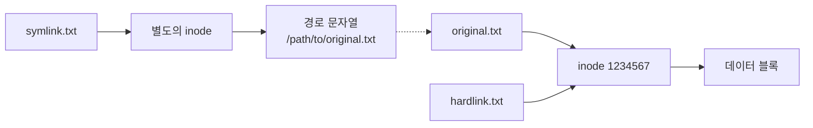

# 4주차 이론 — 디렉터리 및 파일 관리 II

[레포지토리 안내](../../README.ko.md) | [English](Concepts_Lecture.md) | [한국어](Concepts_Lecture.ko.md)

> **최종 수정일:** 2026-10-19
>
> 우분투 리눅스, 이종원, Ch 2

> **학습 목표:**
> 1. `cp`, `mv`, `rm`으로 파일과 디렉터리를 복사, 이동, 삭제할 수 있다
> 2. inode를 바탕으로 하드 링크와 심볼릭 링크의 차이를 설명하고 각각 만들 수 있다
> 3. `touch`로 빈 파일을 만들거나 파일의 시간 정보를 바꿀 수 있다
> 4. `grep`과 정규 표현식으로 파일 내용을 검색할 수 있다
> 5. 파일 검색 명령(find, whereis, which, locate)으로 파일과 명령의 위치를 찾을 수 있다
> 6. 와일드카드, 입출력 리다이렉션, 파이프를 사용할 수 있다

---

## 목차

- [1. 파일 복사, 이동, 삭제](#1-파일-복사-이동-삭제)
  - [1.1 cp: 파일 및 디렉터리 복사](#11-cp-파일-및-디렉터리-복사)
  - [1.2 mv: 파일 이동 또는 이름 변경](#12-mv-파일-이동-또는-이름-변경)
  - [1.3 rm: 파일 및 디렉터리 제거](#13-rm-파일-및-디렉터리-제거)
- [2. 하드 링크와 심볼릭 링크](#2-하드-링크와-심볼릭-링크)
  - [2.1 Inode](#21-inode)
  - [2.2 하드 링크](#22-하드-링크)
  - [2.3 심볼릭 링크 (소프트 링크)](#23-심볼릭-링크-소프트-링크)
  - [2.4 비교](#24-비교)
- [3. 빈 파일 생성](#3-빈-파일-생성)
  - [3.1 touch: 파일 생성 또는 타임스탬프 갱신](#31-touch-파일-생성-또는-타임스탬프-갱신)
- [4. 파일 내용 검색](#4-파일-내용-검색)
  - [4.1 grep: 파일 내용 검색](#41-grep-파일-내용-검색)
- [5. 파일 위치 검색](#5-파일-위치-검색)
  - [5.1 find: 파일 검색](#51-find-파일-검색)
  - [5.2 whereis: 바이너리, 소스, 매뉴얼 위치](#52-whereis-바이너리-소스-매뉴얼-위치)
  - [5.3 which: 명령어 바이너리 위치](#53-which-명령어-바이너리-위치)
  - [5.4 locate: 빠른 파일 검색 (데이터베이스 기반)](#54-locate-빠른-파일-검색-데이터베이스-기반)
- [6. 와일드카드와 글로빙](#6-와일드카드와-글로빙)
  - [6.1 셸 와일드카드](#61-셸-와일드카드)
- [7. I/O 리다이렉션과 파이프](#7-io-리다이렉션과-파이프)
  - [7.1 표준 I/O 스트림](#71-표준-io-스트림)
  - [7.2 출력 리다이렉션](#72-출력-리다이렉션)
  - [7.3 입력 리다이렉션](#73-입력-리다이렉션)
  - [7.4 파이프](#74-파이프)
  - [7.5 tee: 파일과 화면에 동시 출력](#75-tee-파일과-화면에-동시-출력)
- [8. 모범 사례](#8-모범-사례)
  - [8.1 효율적인 파일 관리](#81-효율적인-파일-관리)
  - [8.2 안전 팁](#82-안전-팁)
- [요약](#요약)
- [점검 문제](#점검-문제)

---

<br>

## 1. 파일 복사, 이동, 삭제

### 1.1 cp: 파일 및 디렉터리 복사

```bash
cp source destination            # 파일 복사
cp file1.txt file2.txt           # file1.txt를 file2.txt로 복사
cp file.txt /tmp/                # /tmp 디렉터리로 복사
cp -r dir1/ dir2/                # 디렉터리를 재귀적으로 복사
cp -i file.txt /tmp/             # 대화형 (덮어쓰기 전 확인)
cp -p file.txt backup/           # 타임스탬프 및 권한 보존
cp -a dir1/ dir2/                # 아카이브 모드 (모든 것 보존)
cp file1 file2 file3 destdir/    # 여러 파일을 디렉터리로 복사
```

형식은 `cp [옵션] 원본 대상`이다. 두 인자가 모두 파일이면 원본을 대상 이름의 파일로 복사하고, 대상이 디렉터리이면 그 안에 같은 이름으로 복사한다. `cp text1 temp/text2`처럼 디렉터리 안의 다른 이름을 지정할 수도 있다. 인자를 셋 이상 주면 마지막 인자는 디렉터리여야 하며, 앞의 파일들이 모두 그 디렉터리로 복사된다. 쓰기 권한이 없는 디렉터리(예: `/etc`)로 복사하면 `Permission denied` 오류가 나고, 디렉터리를 `-r` 없이 복사하려 하면 `cp: -r not specified; omitting directory` 메시지와 함께 건너뛴다.

### 1.2 mv: 파일 이동 또는 이름 변경

```bash
mv oldname.txt newname.txt       # 파일 이름 변경
mv file.txt /tmp/                # 파일을 /tmp로 이동
mv dir1/ /home/user/             # 디렉터리 이동
mv -i file.txt /tmp/             # 대화형 (덮어쓰기 전 확인)
mv file1 file2 destdir/          # 여러 파일 이동
```

`mv text1 temp/data2`처럼 파일을 다른 디렉터리로 옮기면서 이름을 함께 바꿀 수도 있다. 두 인자를 모두 디렉터리로 지정하면, 대상 디렉터리가 이미 있을 때는 원본 디렉터리를 그 안으로 옮기고, 없을 때는 원본 디렉터리의 이름을 대상 이름으로 바꾼다.

> **핵심:** `mv`는 이중 용도로 사용되며, 파일 이동과 이름 변경을 모두 수행한다.

### 1.3 rm: 파일 및 디렉터리 제거

```bash
rm file.txt                      # 파일 제거
rm -i file.txt                   # 대화형 (삭제 전 확인)
rm -f file.txt                   # 강제 제거 (확인 없음)
rm -r directory/                 # 디렉터리와 내용을 재귀적으로 제거
rm -rf directory/                # 강제 재귀 제거 (위험)
```

> **주의:** Linux 명령줄의 `rm`은 휴지통을 거치지 않으므로, 삭제한 파일은 되돌릴 수 없다.

```bash
# 안전 팁: 기본적으로 rm -i 사용
alias rm='rm -i'                 # ~/.bashrc에 추가
```

---

<br>

## 2. 하드 링크와 심볼릭 링크

### 2.1 Inode

Linux 파일은 파일 이름, inode, 데이터 블록으로 구성된다. 파일 이름은 디렉터리 항목에 들어 있고, 이름이 가리키는 inode에는 파일의 상세 정보와 데이터 블록의 주소가 저장되며, 실제 내용은 데이터 블록에 있다.


*그림 1. Linux 파일의 구성 요소*

Linux 파일 시스템의 모든 파일은 다음 정보를 저장하는 **inode(index node)** 를 하나씩 가진다.

- 파일 유형 및 권한
- 소유자 및 그룹
- 파일 크기
- 하드 링크 수
- 타임스탬프 (접근, 수정, 상태 변경)
- 데이터 블록에 대한 포인터
- **파일 이름은 포함하지 않는다** (이름은 디렉터리 항목에 저장됨).

```bash
ls -i file.txt                   # inode 번호 표시
stat file.txt                    # 상세 inode 정보 표시
```

### 2.2 하드 링크

**링크(link)** 는 기존 파일에 새로운 이름을 붙이는 것이다. **하드 링크(hard link)** 는 `ln` 명령으로 만들며, **동일한 inode**를 가리키는 디렉터리 항목을 하나 더 만든다. 형식은 `ln [옵션] 원본파일 링크파일`이다.

```bash
ln original.txt hardlink.txt

# 두 파일이 동일한 inode를 공유
$ ls -li
1234567 -rw-r--r-- 2 user1 user1 100 Mar 21 10:00 hardlink.txt
1234567 -rw-r--r-- 2 user1 user1 100 Mar 21 10:00 original.txt
```

**특성:**
- 원본과 inode 번호가 같다.
- 하드 링크 수가 늘어난다(위 출력의 `2`).
- 하나를 삭제해도 다른 이름으로 계속 접근할 수 있으며, 데이터는 하드 링크 수가 0이 될 때 해제된다.
- 서로 다른 파일 시스템 사이에는 만들 수 없다.
- 디렉터리에 대해서는 만들 수 없다(`.`과 `..` 제외).

파일을 `cp`로 복사하면 새 inode가 할당되어 별개의 파일이 되므로 `ls -i`로 본 inode 번호가 원본과 다르다. 하드 링크는 새 파일을 만들지 않고 같은 파일에 이름만 더하므로 inode 번호가 같다.

### 2.3 심볼릭 링크 (소프트 링크)

**심볼릭 링크(symbolic link)** 는 `ln -s`로 만들며, 원본 파일의 경로를 내용으로 담은 **새 파일**을 생성한다.

```bash
ln -s /path/to/original.txt symlink.txt

$ ls -l
lrwxrwxrwx 1 user1 user1 21 Mar 21 10:00 symlink.txt -> /path/to/original.txt
```

**특성:**
- `ls -l`에서 파일 유형이 `l`로 표시되고, 이름 뒤에 `-> 원본`이 표시된다.
- 원본과 inode 번호가 다르다. 즉 원본 파일과 심볼릭 링크는 별개의 파일이다.
- 원본에 이름을 추가하는 것이 아니므로 원본의 하드 링크 수는 늘지 않는다.
- 대상 파일의 경로를 내용으로 담으며, 크기는 그 경로 문자열의 길이이다(위 예에서 21바이트).
- 서로 다른 파일 시스템 사이에도 만들 수 있다.
- 디렉터리에 대해서도 만들 수 있다.
- 대상이 삭제되면 가리키는 곳이 없는 댕글링 링크(dangling link)가 되어, `cat`으로 읽으면 `No such file or directory` 오류가 난다.

### 2.4 비교



*그림 2. 하드 링크와 심볼릭 링크가 파일을 가리키는 방식*

| 특징 | 하드 링크 | 심볼릭 링크 |
|------|-----------|-------------|
| Inode | 원본과 동일 | 다름 |
| 파일 시스템 간 | 불가 | 가능 |
| 디렉터리 링크 | 불가 | 가능 |
| 대상 삭제 시 | 파일 계속 접근 가능 | 댕글링(끊어진) 링크 |
| 파일 크기 | 원본과 동일 | 경로 문자열 크기 |
| 명령어 | `ln file link` | `ln -s file link` |

*표 1. 하드 링크와 심볼릭 링크의 비교*

---

<br>

## 3. 빈 파일 생성

### 3.1 touch: 파일 생성 또는 타임스탬프 갱신

```bash
touch newfile.txt                # 빈 파일 생성 (또는 타임스탬프 갱신)
touch -t 202503211200 file.txt   # 특정 타임스탬프 설정
touch -r ref.txt file.txt        # 참조 파일에서 타임스탬프 복사
touch file1 file2 file3          # 여러 파일 생성
```

형식은 `touch [-acm] [-r 참조파일 | -t 시간] 파일`이다. 파일이 없으면 빈 파일을 만들고, 있으면 접근 시간과 수정 시간을 현재 시각으로 바꾼다. `-a`는 접근 시간만, `-m`은 수정 시간만 바꾼다. `-t`의 시간은 `[[CC]YY]MMDDhhmm[.ss]` 형식이며, 각 필드는 다음과 같다.

| 필드 | 의미 | 범위 |
|------|------|------|
| CC | 연도의 앞 두 자리 | 생략하면 YY가 69\~99일 때 19, 00\~68일 때 20 |
| YY | 연도의 뒤 두 자리 | 생략하면 현재 연도 |
| MM | 월 | 01~12 |
| DD | 일 | 01~31 |
| hh | 시 | 00~23 |
| mm | 분 | 00~59 |
| ss | 초 (생략 가능) | 00~59 |

*표 2. touch -t의 시간 형식*

예를 들어 `touch -t 12311200 test`는 test의 시간을 올해 12월 31일 12:00으로 바꾸고, `touch -t 202503211200 file.txt`는 2025년 3월 21일 12:00으로 바꾼다.

---

<br>

## 4. 파일 내용 검색

### 4.1 grep: 파일 내용 검색

```bash
grep "pattern" file.txt                  # 파일에서 패턴 검색
grep -i "pattern" file.txt               # 대소문자 구분 없이 검색
grep -n "pattern" file.txt               # 줄 번호 표시
grep -r "pattern" directory/             # 디렉터리에서 재귀적 검색
grep -v "pattern" file.txt               # 역 매칭 (매칭되지 않는 줄 표시)
grep -c "pattern" file.txt               # 매칭되는 줄 수 세기
grep -l "pattern" *.txt                  # 매칭되는 파일 이름만 표시
grep -w "word" file.txt                  # 완전한 단어만 매칭
grep -E "regex" file.txt                 # 확장 정규식 (egrep과 동일)
```

형식은 `grep [옵션] 패턴 [파일]`이며, 지정한 파일에서 패턴이 들어 있는 줄을 찾아 출력한다. 패턴에는 문자, 문자열, 문장, 정규 표현식을 쓸 수 있고, 옵션은 `grep -ni unix grep.dat`처럼 묶어 쓸 수 있다. `ls -l | grep rw-`, `ps -ef | grep user1`처럼 다른 명령의 출력을 파이프(7.4절)로 받아 검색할 수도 있다.

**정규 표현식(regular expression)** 은 특정한 규칙을 가진 문자열의 집합을 표현하는 형식 언어이다. 한 줄에서 패턴의 위치를 나타내는 앵커(`^`, `$`), 하나 이상의 문자를 나타내는 문자 집합(`.`, `[]` 등), 앞 문자 집합의 반복 횟수를 지정하는 수식자(`*`)로 구성된다.

| 패턴 | 의미 | 예 |
|------|------|------|
| `.` | 임의의 단일 문자 | `a...b`: a로 시작하고 b로 끝나는 5글자 |
| `*` | 앞 문자의 0회 이상 반복 | `ab*`: a 다음에 b가 없거나 여러 번 나오는 문자열 |
| `^` | 줄의 시작 | `^root`: root로 시작하는 줄 |
| `$` | 줄의 끝 | `sh$`: sh로 끝나는 줄 |
| `[abc]` | 집합 내의 임의의 문자 | `[Pp]attern`: Pattern 또는 pattern |
| `[^abc]` | 집합에 포함되지 않은 임의의 문자 | `[^a-m]att`: att 앞에 a부터 m까지가 아닌 문자 |
| `\b` | 단어 경계 | `\bsh\b`: 단어 sh |

*표 3. 정규 표현식의 기본 메타 문자*

```bash
# 예시
grep "^root" /etc/passwd          # "root"로 시작하는 줄
grep "bash$" /etc/passwd          # "bash"로 끝나는 줄
grep "^$" file.txt                # 빈 줄
grep -E "[0-9]{3}" file.txt       # 연속된 3자리 숫자
```

> **주의:** 셸 와일드카드의 `*`(임의의 문자열, 6절)와 정규 표현식의 `*`(앞 문자의 0회 이상 반복)는 뜻이 다르다. 기본 정규 표현식에서 패턴 맨 앞의 `*`는 반복할 앞 문자가 없으므로 문자 `*` 자체로 취급된다.

---

<br>

## 5. 파일 위치 검색

### 5.1 find: 파일 검색

```bash
find /path -name "filename"              # 정확한 이름으로 검색
find /home -name "*.txt"                 # 패턴으로 검색
find / -name "*.log" -size +10M          # 10MB보다 큰 로그 파일 검색
find . -type f -name "*.sh"              # 일반 파일만 검색
find . -type d -name "backup"            # 디렉터리만 검색
find /tmp -mtime -7                      # 최근 7일 내 수정된 파일
find . -user user1                       # user1 소유 파일 검색
find . -perm 755                         # 특정 권한의 파일 검색
find . -empty                            # 빈 파일/디렉터리 검색

# 검색된 파일에 명령어 실행
find . -name "*.tmp" -exec rm {} \;      # 모든 .tmp 파일 삭제
find . -name "*.sh" -exec chmod +x {} \; # 모든 .sh 파일에 실행 권한 부여
```

형식은 `find [경로] [검색 조건] [동작]`이며, 지정한 경로부터 하위 디렉터리를 재귀적으로 내려가며 조건에 맞는 파일을 찾는다. 경로를 생략하면 현재 디렉터리에서 찾는다.

| 검색 조건 | 의미 |
|-----------|------|
| `-name 파일명` | 이름이 일치하는 파일 (`*`, `?` 같은 메타 문자 사용 가능) |
| `-type 종류` | 종류가 일치하는 파일 (`f`: 일반 파일, `d`: 디렉터리, `l`: 심볼릭 링크) |
| `-mtime [+\|-]n` | 수정 시간이 n일보다 오래되었거나(`+n`), n일 이내이거나(`-n`), 정확히 n일 전인 파일 |
| `-atime [+\|-]n` | `-mtime`과 같은 방식으로 접근 시간을 비교 |
| `-mmin [+\|-]n` | 수정 시간을 분 단위로 비교 |
| `-user loginID` | loginID가 소유한 모든 파일 |
| `-size [+\|-]n` | n보다 크거나(`+n`), 작거나(`-n`), 정확히 n인 파일 (단위가 없으면 512바이트 블록, `c`는 바이트, `k`, `M`, `G`는 KiB, MiB, GiB) |
| `-newer 기준파일` | 기준 파일보다 나중에 수정된 파일 |
| `-perm 권한` | 사용 권한이 8진수 값과 정확히 일치하는 파일 |

*표 4. find의 주요 검색 조건*

| 동작 | 의미 |
|------|------|
| `-exec 명령 {} \;` | 검색된 각 파일을 `{}` 자리에 넣어 명령을 실행하며, `\;`으로 끝난다 |
| `-ok 명령 {} \;` | `-exec`와 같지만 실행할 때마다 사용자의 확인을 받는다(`rm -i`처럼) |
| `-print` | 검색된 파일의 경로를 화면에 출력한다(기본 동작) |
| `-ls` | 검색 결과를 `ls -l`과 비슷한 긴 목록 형식으로 출력한다 |
| `-delete` | 검색된 파일을 삭제한다 |

*표 5. find의 동작*

검색 조건은 `-a`(그리고), `-o`(또는), `!`(부정)으로 결합한다. 조건을 나란히 쓰면 `-a`로 결합한 것과 같다.

```bash
find /etc -perm 0777 -a -name "*sh"      # 권한이 777이면서 이름이 sh로 끝나는 파일
find ~ -type d -o -name Unix             # 디렉터리이거나 이름이 Unix인 파일
find . ! -newer g.txt                    # g.txt보다 나중에 수정되지 않은 파일
find /home -mtime +3 -ok rm {} \;        # 3일보다 오래된 파일을 확인 후 삭제
find /etc -name hostname 2> /dev/null    # 권한 오류 메시지를 버리고 결과만 출력
```

`-mtime`은 24시간 단위로 센다. `-mtime -1`은 24시간 이내에, `-mtime 1`은 24시간 이상 48시간 미만 전에, `-mtime +1`은 48시간 이상 전에 수정된 파일을 찾는다. 권한이 없는 디렉터리를 만나면 `Permission denied` 오류가 출력되므로, 위의 마지막 예처럼 오류를 `/dev/null`로 보내면(7.2절) 결과만 볼 수 있다.

### 5.2 whereis: 바이너리, 소스, 매뉴얼 위치

```bash
whereis ls
# ls: /usr/bin/ls /usr/share/man/man1/ls.1.gz
```

`whereis`는 정해진 경로에서 명령의 바이너리 파일, 소스 파일, 매뉴얼 파일의 위치를 찾는다. `-b`는 바이너리 파일만, `-m`은 매뉴얼 파일만, `-s`는 소스 파일만 검색한다.

### 5.3 which: 명령어 바이너리 위치

```bash
which python3
# /usr/bin/python3
```

`which`는 PATH 환경 변수에 지정된 디렉터리에서 명령 파일을 찾아 그 경로를 출력한다. 셸 내장 명령이나 별칭까지 확인하려면 2주차에서 다룬 `type`을 쓴다.

### 5.4 locate: 빠른 파일 검색 (데이터베이스 기반)

```bash
sudo apt install mlocate           # 미설치 시 설치
sudo updatedb                      # 파일 데이터베이스 갱신
locate filename                    # 빠른 검색
locate -i filename                 # 대소문자 구분 없이
```

> **참고:** 최근 Ubuntu에서는 `mlocate` 대신 `plocate` 패키지가 `locate` 명령을 제공하므로 `sudo apt install plocate`로 설치한다. 사용법은 같다.

> **핵심:** `locate`는 미리 구축된 데이터베이스를 검색하므로 `find`보다 훨씬 빠르지만, 최근 변경 사항이 반영되지 않을 수 있다. `updatedb`를 실행하여 갱신한다.

---

<br>

## 6. 와일드카드와 글로빙

### 6.1 셸 와일드카드

**와일드카드(wildcard)** 는 여러 파일 이름을 한꺼번에 가리키는 특수 문자이며, 셸이 명령을 실행하기 전에 와일드카드를 일치하는 파일 이름들로 바꾸는 것을 **글로빙(globbing)** 이라 한다.

| 와일드카드 | 의미 | 예시 |
|-----------|------|------|
| `*` | 임의 수의 문자 | `*.txt` = 모든 .txt 파일 |
| `?` | 정확히 한 문자 | `file?.txt` = file1.txt, fileA.txt |
| `[abc]` | 집합 내의 한 문자 | `file[123].txt` = file1.txt, file2.txt |
| `[a-z]` | 범위 내의 한 문자 | `[a-z]*.txt` = 소문자로 시작하는 파일 |
| `[!abc]` | 집합에 포함되지 않은 한 문자 | `file[!0-9].txt` = 숫자가 아닌 접미사 |
| `{a,b,c}` | 중괄호 확장 | `file.{txt,log}` = file.txt, file.log |

*표 6. 셸 와일드카드*

```bash
ls *.txt                          # 모든 .txt 파일
ls file[0-9].txt                  # file0.txt부터 file9.txt까지
cp *.{jpg,png} images/            # 모든 jpg와 png 파일 복사
rm test_?.log                     # test_1.log, test_A.log 등 제거
```

> **참고:** 중괄호 확장은 파일이 있는지와 관계없이 `file.txt file.log`처럼 문자열을 만들어 내므로, 엄밀히는 글로빙이 아니라 셸의 별도 확장이다. 또 `find`의 `-name`에 와일드카드를 줄 때는 `find /home -name "a*"`처럼 따옴표로 감싸야 한다. 따옴표가 없으면 현재 디렉터리에 `a.txt`가 있을 때 셸이 먼저 `a*`를 `a.txt`로 바꾸어, `find`는 이름이 정확히 `a.txt`인 파일만 찾는다.

---

<br>

## 7. I/O 리다이렉션과 파이프

### 7.1 표준 I/O 스트림

| 스트림 | 파일 디스크립터 | 기본값 |
|--------|----------------|--------|
| stdin | 0 | 키보드 |
| stdout | 1 | 화면 |
| stderr | 2 | 화면 |

*표 7. 표준 입출력 스트림과 파일 디스크립터*

### 7.2 출력 리다이렉션

```bash
command > file                    # stdout을 파일로 리다이렉션 (덮어쓰기)
command >> file                   # stdout을 파일로 리다이렉션 (추가)
command 2> file                   # stderr를 파일로 리다이렉션
command 2>&1                      # stderr를 stdout으로 리다이렉션
command > file 2>&1               # stdout과 stderr를 모두 리다이렉션
command &> file                   # 위의 축약형 (bash)
```

`/dev/null`은 쓴 내용을 모두 버리는 특수 파일이므로, `2> /dev/null`처럼 쓰면 오류 메시지를 화면에 출력하지 않고 버린다.

### 7.3 입력 리다이렉션

```bash
command < file                    # 파일에서 입력 읽기
sort < unsorted.txt               # 파일 입력으로 정렬
```

### 7.4 파이프

```bash
command1 | command2               # command1의 stdout을 command2의 stdin으로 전달
ls -la | grep "\.txt$"            # .txt 파일만 나열
cat /etc/passwd | sort            # passwd 항목 정렬
ps aux | grep nginx               # nginx 프로세스 찾기
history | tail -20                # 최근 20개 명령어 표시
```

### 7.5 tee: 파일과 화면에 동시 출력

```bash
command | tee file.txt            # 파일과 화면 모두에 출력
command | tee -a file.txt         # 파일에 추가하면서 화면에도 표시
```

---

<br>

## 8. 모범 사례

### 8.1 효율적인 파일 관리

- 실수를 막기 위해 `cp -i`, `mv -i`, `rm -i`를 사용한다.
- 디렉터리를 가리킬 때는 하드 링크를 만들 수 없으므로 심볼릭 링크를 사용한다.
- 여러 파일에 같은 작업을 할 때는 `find`와 `-exec`를 함께 사용한다.
- 여러 파일에서 내용을 검색할 때는 `grep -r`을 사용한다.

### 8.2 안전 팁

```bash
# rm -rf 실행 전, 경로 확인
echo rm -rf /path/to/dir         # 먼저 명령어 미리 보기
ls /path/to/dir                  # 디렉터리 내용 확인

# 안전을 위해 rm 대신 trash-cli 사용
sudo apt install trash-cli
trash-put file.txt               # 삭제 대신 휴지통으로 이동
```

---

<br>

## 요약

| 개념 | 핵심 요약 |
|------|-----------|
| `cp` | 파일을 복사하며, 디렉터리는 `-r`로, 속성 보존은 `-p`로 복사한다. |
| `mv` | 파일과 디렉터리를 이동하거나 이름을 바꾼다. |
| `rm` | 파일을 제거하며 디렉터리는 `-r`로 제거하고, 삭제는 되돌릴 수 없다. |
| 하드 링크 | 같은 inode를 가리키며, 파일 시스템을 넘을 수 없고, 모든 링크가 제거될 때까지 파일이 유지된다. |
| 심볼릭 링크 | 별도의 inode에 경로를 담으며, 파일 시스템을 넘을 수 있고 디렉터리도 가리킬 수 있다. |
| `touch` | 빈 파일을 만들거나 파일의 타임스탬프를 갱신한다. |
| `grep` | 패턴과 정규 표현식으로 파일 내용을 검색한다. |
| `find` | 이름, 유형, 크기, 날짜, 권한 등의 조건으로 파일을 검색하고 동작을 적용한다. |
| 와일드카드 | `*`(임의의 문자열), `?`(한 문자), `[set]`, `{a,b}`로 여러 파일 이름을 가리킨다. |
| 리다이렉션 | `>`(덮어쓰기), `>>`(추가), `2>`(stderr), `<`(입력)로 입출력의 방향을 바꾼다. |
| 파이프 | `\|`로 명령을 연결하여 앞 명령의 stdout을 뒤 명령의 stdin으로 전달한다. |

---

<br>

## 점검 문제

1. **grep 옵션 조합:** 다음 내용의 `grep.dat`에 대해 (a) sh로 끝나는 줄의 수, (b) 단어 sh가 독립적으로 들어 있는 줄의 수, (c) 대소문자를 구분하지 않고 root로 시작하는 줄을 출력하는 명령을 쓰고, 각 결과를 구하라.

   ```text
   UNIX 12345
   unix+ 123
   Linux root
   linux rott
   system admin
   Network 5
   root other sh
   sjyoun root ksh
   jongwon prof KSH
   ROOT other csh
   ck07555 Student ksh
   CK08777 student bash
   ```

   <details>
   <summary>정답</summary>

   (a) `grep -c 'sh$' grep.dat`의 결과는 5이다. `root other sh`, `sjyoun root ksh`, `ROOT other csh`, `ck07555 Student ksh`, `CK08777 student bash`가 소문자 sh로 끝나며, `KSH`는 대문자라 해당하지 않는다. (b) `grep -cw sh grep.dat`의 결과는 1이다. sh가 다른 글자와 붙지 않은 단어로 나오는 줄은 `root other sh`뿐이다. (c) `grep -i '^root' grep.dat`는 `root other sh`와 `ROOT other csh`를 출력한다.

   </details>

2. **링크와 inode:** `data1`이 있을 때 `cp data1 data1.cp`, `ln data1 data1.ln`, `ln -s data1 data1.sl`을 차례로 실행했다. `ls -i`로 볼 때 inode 번호가 `data1`과 같은 파일은 무엇이며, `data1`의 하드 링크 수는 얼마인가? 이어서 `rm data1`을 실행하면 `cat data1.ln`과 `cat data1.sl`은 각각 어떻게 되는가?

   <details>
   <summary>정답</summary>

   `data1.ln`만 `data1`과 inode 번호가 같으며, `data1`의 하드 링크 수는 2이다. `data1.cp`는 복사로 새 inode를 받은 별개의 파일이고, `data1.sl`은 경로를 담은 별도의 inode를 가진다. `rm data1` 뒤에도 `data1.ln`은 같은 inode를 가리키므로 `cat data1.ln`은 원래 내용을 출력한다(링크 수는 1로 줄어든다). `data1.sl`은 사라진 이름 `data1`을 가리키는 댕글링 링크가 되어 `cat data1.sl`은 `No such file or directory` 오류를 낸다.

   </details>

3. **find의 시간 조건:** `find . -mtime -1`, `find . -mtime 1`, `find . -mtime +1`은 각각 언제 수정된 파일을 찾는가?

   <details>
   <summary>정답</summary>

   `-mtime`은 마지막 수정 이후 지난 시간을 24시간 단위로 세고 소수점 이하는 버린다. 따라서 `-mtime -1`은 24시간 이내에, `-mtime 1`은 24시간 이상 48시간 미만 전에, `-mtime +1`은 48시간 이상 전에 수정된 파일을 찾는다.

   </details>

4. **touch의 시간 지정:** `touch -t 2501021530.45 memo`를 실행하면 memo의 수정 시간은 언제가 되는가? `touch -t 6901010000 old`는 몇 년으로 해석되는가?

   <details>
   <summary>정답</summary>

   `2501021530.45`는 YY=25, MM=01, DD=02, hh=15, mm=30, ss=45이고, CC가 생략되었으며 YY가 00~68 범위이므로 연도는 2025년이다. 따라서 수정 시간은 2025년 1월 2일 15:30:45가 된다. `6901010000`은 YY=69이므로 1969년 1월 1일 00:00으로 해석된다.

   </details>

5. **와일드카드와 find:** 현재 디렉터리에 `a.txt`가 있고 `/home/u` 아래에 `a.txt`와 `x/ab.txt`가 있다. `find /home -name a*`와 `find /home -name "a*"`의 결과가 어떻게 다른지 설명하라.

   <details>
   <summary>정답</summary>

   따옴표가 없으면 셸이 `find`를 실행하기 전에 `a*`를 현재 디렉터리의 `a.txt`로 바꾸므로, `find /home -name a.txt`가 실행되어 `/home/u/a.txt`만 찾는다. 따옴표로 감싸면 패턴 `a*`가 그대로 `find`에 전달되어 `/home/u/a.txt`와 `/home/u/x/ab.txt`를 모두 찾는다.

   </details>
