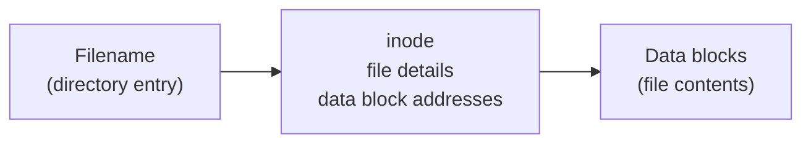
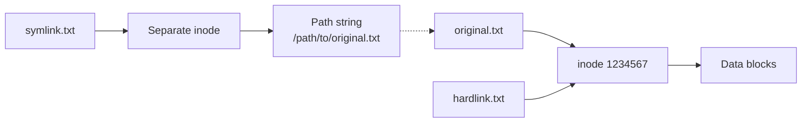

# Week 4 Lecture — Directory and File Management II

[Repository Guide](../../README.md) | [English](Concepts_Lecture.md) | [한국어](Concepts_Lecture.ko.md)

> **Last Updated:** 2026-10-26
>
> 우분투 리눅스, 이종원, Ch 2

> **Learning Objectives:**
> 1. Copy, move, and delete files and directories with `cp`, `mv`, and `rm`
> 2. Explain the difference between hard links and symbolic links in terms of inodes, and create each
> 3. Create empty files or change a file's time information with `touch`
> 4. Search file contents with `grep` and regular expressions
> 5. Find the locations of files and commands with the file search commands (find, whereis, which, locate)
> 6. Use wildcards, I/O redirection, and pipes

---

## Table of Contents

- [1. File Copy, Move, and Delete](#1-file-copy-move-and-delete)
  - [1.1 cp: Copy Files and Directories](#11-cp-copy-files-and-directories)
  - [1.2 mv: Move or Rename Files](#12-mv-move-or-rename-files)
  - [1.3 rm: Remove Files and Directories](#13-rm-remove-files-and-directories)
- [2. Hard Links and Symbolic Links](#2-hard-links-and-symbolic-links)
  - [2.1 Inodes](#21-inodes)
  - [2.2 Hard Links](#22-hard-links)
  - [2.3 Symbolic Links (Soft Links)](#23-symbolic-links-soft-links)
  - [2.4 Comparison](#24-comparison)
- [3. Empty File Creation](#3-empty-file-creation)
  - [3.1 touch: Create or Update Timestamps](#31-touch-create-or-update-timestamps)
- [4. File Content Searching](#4-file-content-searching)
  - [4.1 grep: Search File Contents](#41-grep-search-file-contents)
- [5. File Location Searching](#5-file-location-searching)
  - [5.1 find: Search for Files](#51-find-search-for-files)
  - [5.2 whereis: Locate Binary, Source, and Manual](#52-whereis-locate-binary-source-and-manual)
  - [5.3 which: Locate Command Binary](#53-which-locate-command-binary)
  - [5.4 locate: Fast File Search (Database-based)](#54-locate-fast-file-search-database-based)
- [6. Wildcards and Globbing](#6-wildcards-and-globbing)
  - [6.1 Shell Wildcards](#61-shell-wildcards)
- [7. I/O Redirection and Pipes](#7-io-redirection-and-pipes)
  - [7.1 Standard I/O Streams](#71-standard-io-streams)
  - [7.2 Output Redirection](#72-output-redirection)
  - [7.3 Input Redirection](#73-input-redirection)
  - [7.4 Pipes](#74-pipes)
  - [7.5 tee: Write to File and Screen](#75-tee-write-to-file-and-screen)
- [8. Best Practices](#8-best-practices)
  - [8.1 Efficient File Management](#81-efficient-file-management)
  - [8.2 Safety Tips](#82-safety-tips)
- [Summary](#summary)
- [Self-Check Questions](#self-check-questions)

---

<br>

## 1. File Copy, Move, and Delete

### 1.1 cp: Copy Files and Directories

```bash
cp source destination            # Copy file
cp file1.txt file2.txt           # Copy file1.txt to file2.txt
cp file.txt /tmp/                # Copy to /tmp directory
cp -r dir1/ dir2/                # Copy directory recursively
cp -i file.txt /tmp/             # Interactive (prompt before overwrite)
cp -p file.txt backup/           # Preserve timestamps and permissions
cp -a dir1/ dir2/                # Archive mode (preserve everything)
cp file1 file2 file3 destdir/    # Copy multiple files to directory
```

The form is `cp [options] source destination`. If both arguments are files, the source is copied to a file with the destination name; if the destination is a directory, the source is copied into it under the same name. A different name inside a directory can also be given, as in `cp text1 temp/text2`. With three or more arguments, the last argument must be a directory, and all the preceding files are copied into it. Copying into a directory without write permission (e.g., `/etc`) fails with a `Permission denied` error, and trying to copy a directory without `-r` skips it with the message `cp: -r not specified; omitting directory`.

### 1.2 mv: Move or Rename Files

```bash
mv oldname.txt newname.txt       # Rename file
mv file.txt /tmp/                # Move file to /tmp
mv dir1/ /home/user/             # Move directory
mv -i file.txt /tmp/             # Interactive (prompt before overwrite)
mv file1 file2 destdir/          # Move multiple files
```

A file can be moved to another directory and renamed at the same time, as in `mv text1 temp/data2`. If both arguments are directories, the source directory is moved into the destination directory when the destination already exists, and the source directory is renamed to the destination name when it does not.

> **Key Point:** `mv` serves a dual purpose: it both moves and renames files.

### 1.3 rm: Remove Files and Directories

```bash
rm file.txt                      # Remove file
rm -i file.txt                   # Interactive (confirm before delete)
rm -f file.txt                   # Force removal (no confirmation)
rm -r directory/                 # Remove directory and contents recursively
rm -rf directory/                # Force recursive removal (DANGEROUS)
```

> **Caution:** `rm` on the Linux command line does not go through a trash bin, so deleted files cannot be recovered.

```bash
# Safety tip: use rm -i by default
alias rm='rm -i'                 # Add to ~/.bashrc
```

---

<br>

## 2. Hard Links and Symbolic Links

### 2.1 Inodes

A Linux file consists of a filename, an inode, and data blocks. The filename is stored in a directory entry, the inode it points to stores the file's detailed information and the addresses of its data blocks, and the actual contents are in the data blocks.



*Figure 1. Components of a Linux file*

Every file on a Linux file system has one **inode (index node)** that stores the following information.

- File type and permissions
- Owner and group
- File size
- Hard link count
- Timestamps (access, modification, status change)
- Pointers to data blocks
- **It does NOT contain the filename** (names are stored in directory entries).

```bash
ls -i file.txt                   # Show inode number
stat file.txt                    # Show detailed inode information
```

### 2.2 Hard Links

A **link** gives a new name to an existing file. A **hard link** is created with the `ln` command and adds another directory entry pointing to the **same inode**. The form is `ln [options] original_file link_file`.

```bash
ln original.txt hardlink.txt

# Both files share the same inode
$ ls -li
1234567 -rw-r--r-- 2 user1 user1 100 Mar 21 10:00 hardlink.txt
1234567 -rw-r--r-- 2 user1 user1 100 Mar 21 10:00 original.txt
```

**Properties:**
- It has the same inode number as the original.
- The hard link count increases (the `2` in the output above).
- Deleting one name leaves the file accessible through the other name, and the data is freed only when the hard link count reaches 0.
- It cannot span different file systems.
- It cannot be created for directories (except `.` and `..`).

Copying a file with `cp` allocates a new inode and creates a separate file, so its inode number shown by `ls -i` differs from the original. A hard link does not create a new file but only adds a name to the same file, so the inode number is the same.

### 2.3 Symbolic Links (Soft Links)

A **symbolic link** is created with `ln -s` and creates a **new file** whose contents are the path to the original file.

```bash
ln -s /path/to/original.txt symlink.txt

$ ls -l
lrwxrwxrwx 1 user1 user1 21 Mar 21 10:00 symlink.txt -> /path/to/original.txt
```

**Properties:**
- `ls -l` shows its file type as `l` and shows `-> original` after its name.
- Its inode number differs from the original; that is, the original file and the symbolic link are separate files.
- It does not add a name to the original, so the original's hard link count does not increase.
- Its contents are the path to the target file, and its size is the length of that path string (21 bytes in the example above).
- It can span different file systems.
- It can be created for directories.
- If the target is deleted, it becomes a dangling link that points nowhere, and reading it with `cat` gives a `No such file or directory` error.

### 2.4 Comparison



*Figure 2. How hard links and symbolic links point to a file*

| Feature | Hard Link | Symbolic Link |
|---------|-----------|---------------|
| Inode | Same as original | Different |
| Across file systems | No | Yes |
| Link to directory | No | Yes |
| Target deleted | File still accessible | Dangling (broken) link |
| File size | Same as original | Size of path string |
| Command | `ln file link` | `ln -s file link` |

*Table 1. Comparison of hard links and symbolic links*

---

<br>

## 3. Empty File Creation

### 3.1 touch: Create or Update Timestamps

```bash
touch newfile.txt                # Create empty file (or update timestamp)
touch -t 202503211200 file.txt   # Set specific timestamp
touch -r ref.txt file.txt        # Copy timestamp from reference file
touch file1 file2 file3          # Create multiple files
```

The form is `touch [-acm] [-r ref_file | -t time] file`. If the file does not exist, `touch` creates an empty file; if it exists, `touch` changes its access and modification times to the current time. `-a` changes only the access time, and `-m` changes only the modification time. The time of `-t` has the form `[[CC]YY]MMDDhhmm[.ss]`, with the following fields.

| Field | Meaning | Range |
|-------|---------|-------|
| CC | First two digits of the year | If omitted, 19 when YY is 69-99 and 20 when YY is 00-68 |
| YY | Last two digits of the year | If omitted, the current year |
| MM | Month | 01-12 |
| DD | Day | 01-31 |
| hh | Hour | 00-23 |
| mm | Minute | 00-59 |
| ss | Second (optional) | 00-59 |

*Table 2. Time format of touch -t*

For example, `touch -t 12311200 test` sets the time of test to 12:00 on December 31 of the current year, and `touch -t 202503211200 file.txt` sets it to 12:00 on March 21, 2025.

---

<br>

## 4. File Content Searching

### 4.1 grep: Search File Contents

```bash
grep "pattern" file.txt                  # Search for pattern in file
grep -i "pattern" file.txt               # Case-insensitive search
grep -n "pattern" file.txt               # Show line numbers
grep -r "pattern" directory/             # Recursive search in directory
grep -v "pattern" file.txt               # Invert match (show non-matching)
grep -c "pattern" file.txt               # Count matching lines
grep -l "pattern" *.txt                  # Show only filenames with matches
grep -w "word" file.txt                  # Match whole word only
grep -E "regex" file.txt                 # Extended regex (same as egrep)
```

The form is `grep [options] pattern [file]`; it finds and prints the lines of the given file that contain the pattern. The pattern can be a character, a string, a sentence, or a regular expression, and options can be combined, as in `grep -ni unix grep.dat`. `grep` can also search the output of another command received through a pipe (Section 7.4), as in `ls -l | grep rw-` or `ps -ef | grep user1`.

A **regular expression** is a formal language for describing a set of strings that follow a particular rule. It consists of anchors that indicate the position of the pattern in a line (`^`, `$`), character sets that represent one or more characters (`.`, `[]`, etc.), and modifiers that specify how many times the preceding character set repeats (`*`).

| Pattern | Meaning | Example |
|---------|---------|---------|
| `.` | Any single character | `a...b`: five characters starting with a and ending with b |
| `*` | Zero or more of preceding character | `ab*`: a followed by no b or by repeated b |
| `^` | Start of line | `^root`: lines starting with root |
| `$` | End of line | `sh$`: lines ending with sh |
| `[abc]` | Any character in the set | `[Pp]attern`: Pattern or pattern |
| `[^abc]` | Any character NOT in the set | `[^a-m]att`: a character other than a through m before att |
| `\b` | Word boundary | `\bsh\b`: the word sh |

*Table 3. Basic metacharacters of regular expressions*

```bash
# Examples
grep "^root" /etc/passwd          # Lines starting with "root"
grep "bash$" /etc/passwd          # Lines ending with "bash"
grep "^$" file.txt                # Empty lines
grep -E "[0-9]{3}" file.txt       # Three consecutive digits
```

> **Caution:** The `*` of shell wildcards (any string, Section 6) and the `*` of regular expressions (zero or more of the preceding character) mean different things. In a basic regular expression, a `*` at the very beginning of the pattern has no preceding character to repeat, so it is treated as the literal character `*`.

---

<br>

## 5. File Location Searching

### 5.1 find: Search for Files

```bash
find /path -name "filename"              # Find by exact name
find /home -name "*.txt"                 # Find by pattern
find / -name "*.log" -size +10M          # Find logs larger than 10MB
find . -type f -name "*.sh"              # Find regular files only
find . -type d -name "backup"            # Find directories only
find /tmp -mtime -7                      # Modified within last 7 days
find . -user user1                       # Find files owned by user1
find . -perm 755                         # Find files with specific permissions
find . -empty                            # Find empty files/directories

# Execute command on found files
find . -name "*.tmp" -exec rm {} \;      # Delete all .tmp files
find . -name "*.sh" -exec chmod +x {} \; # Make all .sh files executable
```

The form is `find [path] [conditions] [action]`; starting from the given path, `find` descends recursively into subdirectories and finds files that match the conditions. If the path is omitted, it searches the current directory.

| Condition | Meaning |
|-----------|---------|
| `-name filename` | Files whose name matches (metacharacters such as `*` and `?` allowed) |
| `-type type` | Files whose type matches (`f`: regular file, `d`: directory, `l`: symbolic link) |
| `-mtime [+\|-]n` | Files modified more than n days ago (`+n`), within n days (`-n`), or exactly n days ago |
| `-atime [+\|-]n` | Compares the access time in the same way as `-mtime` |
| `-mmin [+\|-]n` | Compares the modification time in minutes |
| `-user loginID` | All files owned by loginID |
| `-size [+\|-]n` | Files larger than n (`+n`), smaller than n (`-n`), or exactly n (without a unit, 512-byte blocks; `c` is bytes, and `k`, `M`, `G` are KiB, MiB, GiB) |
| `-newer ref_file` | Files modified more recently than the reference file |
| `-perm mode` | Files whose permissions exactly match the octal value |

*Table 4. Main search conditions of find*

| Action | Meaning |
|--------|---------|
| `-exec command {} \;` | Runs the command with each found file in place of `{}`; it ends with `\;` |
| `-ok command {} \;` | Same as `-exec` but asks the user for confirmation before each execution (like `rm -i`) |
| `-print` | Prints the paths of the found files on the screen (the default action) |
| `-ls` | Prints the results in a long listing format similar to `ls -l` |
| `-delete` | Deletes the found files |

*Table 5. Actions of find*

Conditions are combined with `-a` (and), `-o` (or), and `!` (not). Writing conditions side by side is the same as combining them with `-a`.

```bash
find /etc -perm 0777 -a -name "*sh"      # Permission 777 and name ending in sh
find ~ -type d -o -name Unix             # Directories or files named Unix
find . ! -newer g.txt                    # Files not modified after g.txt
find /home -mtime +3 -ok rm {} \;        # Delete files older than 3 days after confirmation
find /etc -name hostname 2> /dev/null    # Discard permission errors and print only results
```

`-mtime` counts in units of 24 hours. `-mtime -1` finds files modified within 24 hours, `-mtime 1` files modified at least 24 but less than 48 hours ago, and `-mtime +1` files modified 48 or more hours ago. When `find` reaches a directory it has no permission for, it prints a `Permission denied` error, so sending errors to `/dev/null` (Section 7.2), as in the last example above, shows only the results.

### 5.2 whereis: Locate Binary, Source, and Manual

```bash
whereis ls
# ls: /usr/bin/ls /usr/share/man/man1/ls.1.gz
```

`whereis` searches predefined paths for the binary, source, and manual files of a command. `-b` searches only for binary files, `-m` only for manual files, and `-s` only for source files.

### 5.3 which: Locate Command Binary

```bash
which python3
# /usr/bin/python3
```

`which` searches the directories listed in the PATH environment variable for the command file and prints its path. To also check shell builtins and aliases, use `type`, covered in Week 2.

### 5.4 locate: Fast File Search (Database-based)

```bash
sudo apt install mlocate           # Install if not present
sudo updatedb                      # Update the file database
locate filename                    # Fast search
locate -i filename                 # Case-insensitive
```

> **Note:** On recent Ubuntu releases, the `plocate` package provides the `locate` command instead of `mlocate`, so install it with `sudo apt install plocate`. Its usage is the same.

> **Key Point:** `locate` is much faster than `find` because it searches a pre-built database, but results may not reflect recent changes. Run `updatedb` to refresh.

---

<br>

## 6. Wildcards and Globbing

### 6.1 Shell Wildcards

A **wildcard** is a special character that refers to many filenames at once, and the shell's replacing of wildcards with the matching filenames before it runs a command is called **globbing**.

| Wildcard | Meaning | Example |
|----------|---------|---------|
| `*` | Any number of characters | `*.txt` = all .txt files |
| `?` | Exactly one character | `file?.txt` = file1.txt, fileA.txt |
| `[abc]` | One character from set | `file[123].txt` = file1.txt, file2.txt |
| `[a-z]` | One character from range | `[a-z]*.txt` = lowercase starting files |
| `[!abc]` | One character NOT in set | `file[!0-9].txt` = non-digit suffix |
| `{a,b,c}` | Brace expansion | `file.{txt,log}` = file.txt, file.log |

*Table 6. Shell wildcards*

```bash
ls *.txt                          # All .txt files
ls file[0-9].txt                  # file0.txt through file9.txt
cp *.{jpg,png} images/            # Copy all jpg and png files
rm test_?.log                     # Remove test_1.log, test_A.log, etc.
```

> **Note:** Brace expansion generates strings such as `file.txt file.log` whether or not the files exist, so strictly speaking it is a separate shell expansion rather than globbing. Also, when giving a wildcard to the `-name` of `find`, quote it, as in `find /home -name "a*"`. Without quotes, if `a.txt` exists in the current directory, the shell first replaces `a*` with `a.txt`, and `find` then finds only files named exactly `a.txt`.

---

<br>

## 7. I/O Redirection and Pipes

### 7.1 Standard I/O Streams

| Stream | File Descriptor | Default |
|--------|-----------------|---------|
| stdin | 0 | Keyboard |
| stdout | 1 | Screen |
| stderr | 2 | Screen |

*Table 7. Standard I/O streams and their file descriptors*

A process starts with three streams: standard input (stdin), standard output (stdout), and standard error (stderr). A command usually reads input from the keyboard and prints normal results to standard output and error messages to standard error, both on the screen. Because the two outputs are separate, results and error messages can be sent to different places.

### 7.2 Output Redirection

```bash
command > file                    # Redirect stdout to file (overwrite)
command >> file                   # Redirect stdout to file (append)
command 2> file                   # Redirect stderr to file
command 2>&1                      # Redirect stderr to stdout
command > file 2>&1               # Redirect both stdout and stderr
command &> file                   # Shorthand for above (bash)
```

`/dev/null` is a special file that discards everything written to it, so writing `2> /dev/null` discards error messages instead of printing them on the screen.

> **[Systems Programming]** In terms of the system I/O taught in Systems Programming, a file descriptor is a small integer that refers to a file a process has opened, and descriptors 0, 1, and 2 in Table 7 are the standard streams that every process has open from the start. Before running a command, the shell handles `> file` by opening the file and copying its descriptor into slot 1 (the `dup2` system call), and `2>&1` by copying whatever slot 1 refers to at that moment into slot 2. The command itself only reads and writes descriptors 0, 1, and 2 without knowing about the redirection. Redirections are applied from left to right, so `> file 2>&1` sends both outputs to the file, while `2>&1 > file` leaves standard error on the original screen and sends only standard output to the file.

### 7.3 Input Redirection

```bash
command < file                    # Read input from file
sort < unsorted.txt               # Sort from file input
```

`<` makes a command read standard input from the given file instead of the keyboard. `sort < unsorted.txt` gives the same result as `sort unsorted.txt`, but in the former the shell opens the file and connects it to the standard input of `sort`, while in the latter `sort` opens the file it receives as an argument.

### 7.4 Pipes

```bash
command1 | command2               # Pipe stdout of command1 to stdin of command2
ls -la | grep "\.txt$"            # List only .txt files
cat /etc/passwd | sort            # Sort passwd entries
ps aux | grep nginx               # Find nginx processes
history | tail -20                # Show last 20 commands
```

A **pipe** `|` connects the standard output of the command before it to the standard input of the command after it, so that several commands can be chained without intermediate files. Standard error does not pass through a pipe, so to pass error messages to the next command as well, write `command 2>&1 | less`.

### 7.5 tee: Write to File and Screen

```bash
command | tee file.txt            # Write to both file and screen
command | tee -a file.txt         # Append to file and show on screen
```

`tee` writes what it receives on standard input to the given file and also passes the same content to standard output. It is therefore used to record results in a file while watching them on the screen, or to save the intermediate result of a pipeline. With `-a`, it appends to the file instead of overwriting it.

---

<br>

## 8. Best Practices

### 8.1 Efficient File Management

- Use `cp -i`, `mv -i`, and `rm -i` to prevent accidental operations.
- To point to a directory, use a symbolic link, because a hard link to a directory cannot be created.
- To apply the same operation to many files, use `find` with `-exec`.
- To search contents across multiple files, use `grep -r`.

### 8.2 Safety Tips

```bash
# Before running rm -rf, verify the path
echo rm -rf /path/to/dir         # Preview the command first
ls /path/to/dir                  # Verify the directory contents

# Use trash-cli instead of rm for safety
sudo apt install trash-cli
trash-put file.txt               # Move to trash instead of delete
```

---

<br>

## Summary

| Concept | Key Summary |
|---------|-------------|
| `cp` | It copies files, using `-r` for directories and `-p` to preserve attributes. |
| `mv` | It moves or renames files and directories. |
| `rm` | It removes files, using `-r` for directories, and the deletion cannot be undone. |
| Hard Link | It points to the same inode, cannot cross file systems, and keeps the file until all links are removed. |
| Symbolic Link | It stores a path in a separate inode, can cross file systems, and can point to directories. |
| `touch` | It creates empty files or updates a file's timestamps. |
| `grep` | It searches file contents using patterns and regular expressions. |
| `find` | It searches for files by conditions such as name, type, size, date, and permissions, and applies actions. |
| Wildcards | `*` (any string), `?` (one character), `[set]`, and `{a,b}` refer to many filenames. |
| Redirection | `>` (overwrite), `>>` (append), `2>` (stderr), and `<` (input) change the direction of input and output. |
| Pipes | `\|` connects commands, passing the stdout of one command to the stdin of the next. |

---

<br>

## Self-Check Questions

1. **Combining grep options:** For a `grep.dat` with the following contents, write the commands that (a) count the lines ending with sh, (b) count the lines containing the word sh on its own, and (c) print the lines starting with root regardless of case, and give each result.

   ```text
   UNIX 12345
   unix+ 123
   Linux root
   linux rott
   system admin
   Network 5
   root other sh
   sjyoun root ksh
   jongwon prof KSH
   ROOT other csh
   ck07555 Student ksh
   CK08777 student bash
   ```

   <details>
   <summary>Answer</summary>

   (a) `grep -c 'sh$' grep.dat` gives 5. `root other sh`, `sjyoun root ksh`, `ROOT other csh`, `ck07555 Student ksh`, and `CK08777 student bash` end with lowercase sh, while `KSH` is uppercase and does not match. (b) `grep -cw sh grep.dat` gives 1. Only `root other sh` contains sh as a word not attached to other letters. (c) `grep -i '^root' grep.dat` prints `root other sh` and `ROOT other csh`.

   </details>

2. **Links and inodes:** With an existing `data1`, you run `cp data1 data1.cp`, `ln data1 data1.ln`, and `ln -s data1 data1.sl` in turn. Which file has the same inode number as `data1` in `ls -i`, and what is the hard link count of `data1`? If you then run `rm data1`, what happens with `cat data1.ln` and `cat data1.sl`?

   <details>
   <summary>Answer</summary>

   Only `data1.ln` has the same inode number as `data1`, and the hard link count of `data1` is 2. `data1.cp` is a separate file that received a new inode when copied, and `data1.sl` has its own inode holding a path. After `rm data1`, `data1.ln` still points to the same inode, so `cat data1.ln` prints the original contents (the link count drops to 1). `data1.sl` becomes a dangling link to the vanished name `data1`, so `cat data1.sl` gives a `No such file or directory` error.

   </details>

3. **Time conditions of find:** When were the files found by `find . -mtime -1`, `find . -mtime 1`, and `find . -mtime +1` modified?

   <details>
   <summary>Answer</summary>

   `-mtime` counts the time since the last modification in units of 24 hours and drops the fraction. Therefore `-mtime -1` finds files modified within 24 hours, `-mtime 1` files modified at least 24 but less than 48 hours ago, and `-mtime +1` files modified 48 or more hours ago.

   </details>

4. **Specifying time with touch:** After `touch -t 2501021530.45 memo`, what is the modification time of memo? Which year does `touch -t 6901010000 old` mean?

   <details>
   <summary>Answer</summary>

   `2501021530.45` is YY=25, MM=01, DD=02, hh=15, mm=30, ss=45; CC is omitted and YY is in the range 00-68, so the year is 2025. The modification time therefore becomes 15:30:45 on January 2, 2025. `6901010000` has YY=69, so it means 00:00 on January 1, 1969.

   </details>

5. **Wildcards and find:** The current directory contains `a.txt`, and `/home/u` contains `a.txt` and `x/ab.txt`. Explain how the results of `find /home -name a*` and `find /home -name "a*"` differ.

   <details>
   <summary>Answer</summary>

   Without quotes, the shell replaces `a*` with `a.txt` from the current directory before running `find`, so `find /home -name a.txt` runs and finds only `/home/u/a.txt`. With quotes, the pattern `a*` is passed to `find` as is, and it finds both `/home/u/a.txt` and `/home/u/x/ab.txt`.

   </details>
