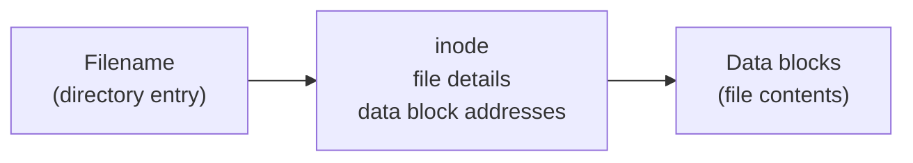
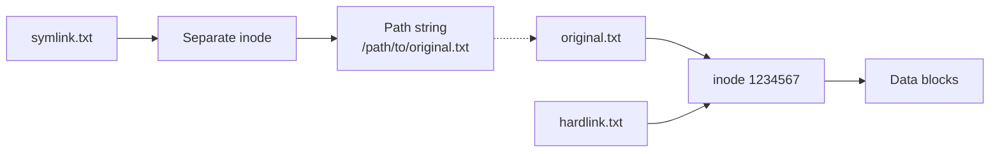

# Week 4 Lecture — Directory and File Management II

[Repository Guide](../../README.md) | [English](Concepts_Lecture.md) | [한국어](Concepts_Lecture.ko.md)

> **Last Updated:** 2026-11-19
>
> 우분투 리눅스, 이종원, Ch 2

> **Learning Objectives:**
> 1. Copy, move, and delete files and directories with `cp`, `mv`, and `rm`
> 2. Explain the difference between hard links and symbolic links in terms of inodes, and create each
> 3. Create empty files or change a file's time information with `touch`
> 4. Search file contents with `grep` and regular expressions
> 5. Find the locations of files and commands with the file search commands (find, whereis, which, locate)
> 6. Use wildcards, I/O redirection, and pipes

---

## Table of Contents

- [1. File Copy, Move, and Delete](#1-file-copy-move-and-delete)
  - [1.1 cp: Copy Files and Directories](#11-cp-copy-files-and-directories)
  - [1.2 mv: Move or Rename Files](#12-mv-move-or-rename-files)
  - [1.3 rm: Remove Files and Directories](#13-rm-remove-files-and-directories)
  - [1.4 How Copying, Moving, and Deleting Work](#14-how-copying-moving-and-deleting-work)
- [2. Hard Links and Symbolic Links](#2-hard-links-and-symbolic-links)
  - [2.1 Inodes](#21-inodes)
  - [2.2 Hard Links](#22-hard-links)
  - [2.3 Symbolic Links (Soft Links)](#23-symbolic-links-soft-links)
  - [2.4 Comparison](#24-comparison)
  - [2.5 The Four Timestamps of a File and stat](#25-the-four-timestamps-of-a-file-and-stat)
  - [2.6 Tracing Link Counts](#26-tracing-link-counts)
  - [2.7 Symbolic Links with Relative Paths](#27-symbolic-links-with-relative-paths)
- [3. Empty File Creation](#3-empty-file-creation)
  - [3.1 touch: Create or Update Timestamps](#31-touch-create-or-update-timestamps)
  - [3.2 Ways to Create an Empty File and Details of touch](#32-ways-to-create-an-empty-file-and-details-of-touch)
- [4. File Content Searching](#4-file-content-searching)
  - [4.1 grep: Search File Contents](#41-grep-search-file-contents)
  - [4.2 Basic and Extended Regular Expressions](#42-basic-and-extended-regular-expressions)
- [5. File Location Searching](#5-file-location-searching)
  - [5.1 find: Search for Files](#51-find-search-for-files)
  - [5.2 whereis: Locate Binary, Source, and Manual](#52-whereis-locate-binary-source-and-manual)
  - [5.3 which: Locate Command Binary](#53-which-locate-command-binary)
  - [5.4 locate: Fast File Search (Database-based)](#54-locate-fast-file-search-database-based)
  - [5.5 Evaluation Order of find Expressions and Advanced Tests](#55-evaluation-order-of-find-expressions-and-advanced-tests)
- [6. Wildcards and Globbing](#6-wildcards-and-globbing)
  - [6.1 Shell Wildcards](#61-shell-wildcards)
  - [6.2 Detailed Rules of Globbing](#62-detailed-rules-of-globbing)
- [7. I/O Redirection and Pipes](#7-io-redirection-and-pipes)
  - [7.1 Standard I/O Streams](#71-standard-io-streams)
  - [7.2 Output Redirection](#72-output-redirection)
  - [7.3 Input Redirection](#73-input-redirection)
  - [7.4 Pipes](#74-pipes)
  - [7.5 tee: Write to File and Screen](#75-tee-write-to-file-and-screen)
  - [7.6 Pitfalls of Redirection and Pipes](#76-pitfalls-of-redirection-and-pipes)
- [8. Best Practices](#8-best-practices)
  - [8.1 Efficient File Management](#81-efficient-file-management)
  - [8.2 Safety Tips](#82-safety-tips)
- [Concept Applications](#concept-applications)
- [Summary](#summary)
- [Self-Check Questions](#self-check-questions)
- [References](#references)

---

<br>

## 1. File Copy, Move, and Delete

### 1.1 cp: Copy Files and Directories

```bash
cp source destination            # Copy file
cp file1.txt file2.txt           # Copy file1.txt to file2.txt
cp file.txt /tmp/                # Copy to /tmp directory
cp -r dir1/ dir2/                # Copy directory recursively
cp -i file.txt /tmp/             # Interactive (prompt before overwrite)
cp -p file.txt backup/           # Preserve timestamps and permissions
cp -a dir1/ dir2/                # Archive mode (preserve everything)
cp file1 file2 file3 destdir/    # Copy multiple files to directory
```

The form is `cp [options] source destination`. If both arguments are files, the source is copied to a file with the destination name; if the destination is a directory, the source is copied into it under the same name. A different name inside a directory can also be given, as in `cp text1 temp/text2`. With three or more arguments, the last argument must be a directory, and all the preceding files are copied into it. Copying into a directory without write permission (e.g., `/etc`) fails with a `Permission denied` error, and trying to copy a directory without `-r` skips it with the message `cp: -r not specified; omitting directory`.

### 1.2 mv: Move or Rename Files

```bash
mv oldname.txt newname.txt       # Rename file
mv file.txt /tmp/                # Move file to /tmp
mv dir1/ /home/user/             # Move directory
mv -i file.txt /tmp/             # Interactive (prompt before overwrite)
mv file1 file2 destdir/          # Move multiple files
```

A file can be moved to another directory and renamed at the same time, as in `mv text1 temp/data2`. If both arguments are directories, the source directory is moved into the destination directory when the destination already exists, and the source directory is renamed to the destination name when it does not.

> **Key Point:** `mv` serves a dual purpose: it both moves and renames files.

### 1.3 rm: Remove Files and Directories

```bash
rm file.txt                      # Remove file
rm -i file.txt                   # Interactive (confirm before delete)
rm -f file.txt                   # Force removal (no confirmation)
rm -r directory/                 # Remove directory and contents recursively
rm -rf directory/                # Force recursive removal (DANGEROUS)
```

> **Caution:** `rm` on the Linux command line does not go through a trash bin, so deleted files cannot be recovered.

```bash
# Safety tip: use rm -i by default
alias rm='rm -i'                 # Add to ~/.bashrc
```

### 1.4 How Copying, Moving, and Deleting Work

The results of the three commands can be understood precisely from the viewpoint of the inode (Section 2.1).

| Command | Change in the directory table | Change in the inode | Change in the data blocks |
|:-----|:-----|:-----|:-----|
| `cp a b` | Name `b` added to the target directory | New inode allocated | Contents copied to new blocks |
| `mv a b` (same file system) | Name `a` removed and `b` added (renaming) | Unchanged | Unchanged |
| `mv a /other/b` (different file system) | Name added at the target, removed at the source | New inode on the target file system | Contents copied, then the source deleted |
| `rm a` | Name `a` removed | Link count decreased by 1; freed when it reaches 0 and no process has it open | Returned when the inode is freed |

*Table 1. Effects of copying, moving, and deleting on the directory table, the inode, and the data blocks*

Within one file system, `mv` does not move any data but only changes the name in the directory table, so it finishes immediately however large the file is, and the inode number stays the same.

```text
$ ls -i report.txt
1310740 report.txt
$ mv report.txt docs/final.txt
$ ls -i docs/final.txt
1310740 docs/final.txt
$ cp docs/final.txt copy.txt
$ ls -i copy.txt
1310745 copy.txt
```

What `rm` actually does is remove a name from a directory. The permission needed to delete a file is therefore not write permission on the file but write permission on the directory that contains it (Week 7). If the file itself is not writable and standard input is a terminal, GNU `rm` asks once before deleting it, as in `rm: remove write-protected regular file 'a'?`, and with `-f` it does not ask.

The options related to overwriting are as follows.

| Option | Behavior in `cp` and `mv` |
|:-----|:-----|
| (none) | Overwrites an existing target of the same name without asking |
| `-i` | Asks for confirmation before overwriting |
| `-n` | Does not overwrite an existing target |
| `-b` | Keeps the target as a backup file `name~` before overwriting |
| `-v` | Prints each file it processes |

*Table 2. Options of cp and mv related to overwriting*

> **Caution:** The result of `cp -r src dest` depends on whether `dest` already exists. If `dest` does not exist, a copy of `src` is created with the name `dest`, but if `dest` is already a directory, `dest/src` is created. Running the same command twice therefore creates `dest/src` the second time, so in scripts it is safer to state the meaning "the contents of src into dest" explicitly, as in `cp -r src/. dest`.

When `cp` meets a symbolic link, it copies the contents of the file the link points to by default, but when it copies a directory recursively with `-r`, it copies symbolic links inside it as links. `cp -a` (archive) is equivalent to `-dR --preserve=all`, so it copies links as links and preserves owners, permissions, and times; it is used to back up directories [1].

---

<br>

## 2. Hard Links and Symbolic Links

### 2.1 Inodes

A Linux file consists of a filename, an inode, and data blocks. The filename is stored in a directory entry, the inode it points to stores the file's detailed information and the addresses of its data blocks, and the actual contents are in the data blocks.



*Figure 1. Components of a Linux file*

Every file on a Linux file system has one **inode (index node)** that stores the following information.

- File type and permissions
- Owner and group
- File size
- Hard link count
- Timestamps (access, modification, status change)
- Pointers to data blocks
- **It does NOT contain the filename** (names are stored in directory entries).

```bash
ls -i file.txt                   # Show inode number
stat file.txt                    # Show detailed inode information
```

### 2.2 Hard Links

A **link** gives a new name to an existing file. A **hard link** is created with the `ln` command and adds another directory entry pointing to the **same inode**. The form is `ln [options] original_file link_file`.

```bash
ln original.txt hardlink.txt

# Both files share the same inode
$ ls -li
1234567 -rw-r--r-- 2 user1 user1 100 Mar 21 10:00 hardlink.txt
1234567 -rw-r--r-- 2 user1 user1 100 Mar 21 10:00 original.txt
```

**Properties:**
- It has the same inode number as the original.
- The hard link count increases (the `2` in the output above).
- Deleting one name leaves the file accessible through the other name, and the data is freed only when the hard link count reaches 0.
- It cannot span different file systems.
- It cannot be created for directories (except `.` and `..`).

Copying a file with `cp` allocates a new inode and creates a separate file, so its inode number shown by `ls -i` differs from the original. A hard link does not create a new file but only adds a name to the same file, so the inode number is the same.

### 2.3 Symbolic Links (Soft Links)

A **symbolic link** is created with `ln -s` and creates a **new file** whose contents are the path to the original file.

```bash
ln -s /path/to/original.txt symlink.txt

$ ls -l
lrwxrwxrwx 1 user1 user1 21 Mar 21 10:00 symlink.txt -> /path/to/original.txt
```

**Properties:**
- `ls -l` shows its file type as `l` and shows `-> original` after its name.
- Its inode number differs from the original; that is, the original file and the symbolic link are separate files.
- It does not add a name to the original, so the original's hard link count does not increase.
- Its contents are the path to the target file, and its size is the length of that path string (21 bytes in the example above).
- It can span different file systems.
- It can be created for directories.
- If the target is deleted, it becomes a dangling link that points nowhere, and reading it with `cat` gives a `No such file or directory` error.

### 2.4 Comparison



*Figure 2. How hard links and symbolic links point to a file*

| Feature | Hard Link | Symbolic Link |
|---------|-----------|---------------|
| Inode | Same as original | Different |
| Across file systems | No | Yes |
| Link to directory | No | Yes |
| Target deleted | File still accessible | Dangling (broken) link |
| File size | Same as original | Size of path string |
| Command | `ln file link` | `ln -s file link` |

*Table 3. Comparison of hard links and symbolic links*

### 2.5 The Four Timestamps of a File and stat

An inode records four kinds of time information. When each time changes is often confused both in exams and in practice, so the four must be distinguished precisely.

| Time | Name | When it changes | How to check |
|:-----|:-----|:-----|:-----|
| atime | Last access time | When the file's contents are read (`cat`, `less`, execution) | `ls -lu`, `stat` |
| mtime | Last modification time | When the file's contents are changed (`echo >>`, saving in an editor) | `ls -l`, `stat` |
| ctime | Last status change time | When contents are written and when inode information (owner, group, link count, permissions) is changed | `ls -lc`, `stat` |
| btime | Creation time | Set once when the file is created and never changed | `stat` |

*Table 4. The four timestamps recorded in an inode*

The mtime does not change when the owner, group, link count, or permissions change, whereas the ctime changes both when contents are written and when inode information is changed [2]. Therefore `chmod`, `chown`, and `ln` change only the ctime, and editing the contents changes both the mtime and the ctime. The mtime of a directory changes when files are created or deleted in it [2]. The c in ctime stands for change, not creation.

GNU `stat` shows all four times. Creating `a.txt` on ext4 in Ubuntu 24.04 and checking it while reading, appending to, and changing the permissions of the file gives the following.

```text
$ echo hello > a.txt
$ stat a.txt
  File: a.txt
  Size: 6         	Blocks: 8          IO Block: 4096   regular file
Device: 8,2	Inode: 1310750     Links: 1
Access: (0664/-rw-rw-r--)  Uid: ( 1000/   user1)   Gid: ( 1000/   user1)
Access: 2025-03-21 12:00:00.110000000 +0900
Modify: 2025-03-21 12:00:00.110000000 +0900
Change: 2025-03-21 12:00:00.110000000 +0900
 Birth: 2025-03-21 12:00:00.110000000 +0900
$ cat a.txt               # read at 12:05
hello
$ echo world >> a.txt     # appended at 12:10
$ chmod 600 a.txt         # permissions changed at 12:15
$ stat --printf 'A=%x\nM=%y\nC=%z\n' a.txt
A=2025-03-21 12:05:00.231000000 +0900
M=2025-03-21 12:10:00.452000000 +0900
C=2025-03-21 12:15:00.678000000 +0900
```

- `Size: 6` is the five characters of `hello` plus a newline, and `Blocks: 8` is the number of allocated blocks counted in 512-byte units (that is, 4 KiB).
- `Access: (0664/-rw-rw-r--)` shows the permissions in octal and in symbols (Week 7).
- `cat` changed the atime to 12:05. `echo >>` changed the contents, so it changed the mtime and the ctime to 12:10, and `chmod` changed only inode information, so it changed only the ctime to 12:15. The btime stays as it was.
- `stat --printf` prints according to the format string. `%x`, `%y`, `%z`, and `%w` are the atime, mtime, ctime, and btime. `-c` (`--format`) also specifies a format, but `--printf` differs in that it interprets escapes such as `\n` and does not append a newline by itself.

> **Caution:** Linux records the atime in `relatime` mode by default. If the previous atime is later than both the current mtime and the current ctime, reading the file again does not change the atime; however, if the atime is more than a day old, it is updated on reading [3]. It is therefore normal that reading the same file twice in a row does not change the atime to the time of the second read. This behavior reduces disk writes.

### 2.6 Tracing Link Counts

The result of commands that mix hard links and symbolic links is traced by writing down the correspondence between inodes and names at each step. As an example, consider finding the link count of `fb` after running the following commands in order.

```text
$ touch fa
$ ln fa fb
$ ln fa fc
$ ln -s fa fd
$ ln -s fa fe
$ rm fa fe
```

| Step | Names and targets | Link count of inode X (the file contents) |
|:-----|:-----|-----:|
| `touch fa` | `fa` → X | 1 |
| `ln fa fb` | `fa`, `fb` → X | 2 |
| `ln fa fc` | `fa`, `fb`, `fc` → X | 3 |
| `ln -s fa fd` | `fd` → new inode S1 (contents: `fa`) | 3 |
| `ln -s fa fe` | `fe` → new inode S2 (contents: `fa`) | 3 |
| `rm fa fe` | Names `fa` and `fe` removed, S2 freed | 2 |

*Table 5. Step-by-step trace of commands that mix hard links and symbolic links*

Viewing the final state with `ls -li` gives the following.

```text
$ ls -li f*
1310760 -rw-rw-r-- 2 user1 user1 0 Mar 21 12:20 fb
1310760 -rw-rw-r-- 2 user1 user1 0 Mar 21 12:20 fc
1310763 lrwxrwxrwx 1 user1 user1 2 Mar 21 12:20 fd -> fa
$ cat fd
cat: fd: No such file or directory
```

- A symbolic link does not increase the link count of the original inode, so the link count of X stays at 3 even after `fd` and `fe` are created.
- `rm fa` removes only the single name `fa`, so X remains under the names `fb` and `fc` with a link count of 2. Hard links make no distinction between an "original" and a "copy".
- `fd` still contains the name `fa`, but that name has disappeared, so `fd` becomes a dangling link. The size 2 of `fd` is the length of the path string `fa`.

### 2.7 Symbolic Links with Relative Paths

If the path stored in a symbolic link is relative, it is resolved relative not to the current directory at the time the link was created but to **the directory that contains the link file**. Without knowing this rule, it is easy to create a link that is broken from the moment it is made.

```text
$ pwd
/home/user1/ch2
$ ls sub
file.txt
$ ln -s file.txt sub/l1
$ cat sub/l1
data
$ cd sub
$ ln -s file.txt ../l2
$ cat ../l2
cat: ../l2: No such file or directory
$ readlink ../l2
file.txt
$ readlink -f l1
/home/user1/ch2/sub/file.txt
```

- `sub/l1` is in the directory `sub`, so its contents `file.txt` are resolved as `sub/file.txt`, and the link works.
- `../l2` was created in the directory `ch2`, so its contents `file.txt` are resolved as `ch2/file.txt`; no such file exists, so the link is broken. `ln -s` does not check whether the target exists, so it is created without an error.
- `readlink` prints the string stored in the link as it is, and `readlink -f` prints the absolute path obtained by following it to the end.

A relative link keeps working when the whole directory containing both the link and its target is moved elsewhere, and an absolute link keeps working when only the link is moved elsewhere. Ubuntu's `/bin -> usr/bin` is a relative link so that the link is still resolved correctly inside the root file system when that file system is mounted elsewhere and handled there.

---

<br>

## 3. Empty File Creation

### 3.1 touch: Create or Update Timestamps

```bash
touch newfile.txt                # Create empty file (or update timestamp)
touch -t 202503211200 file.txt   # Set specific timestamp
touch -r ref.txt file.txt        # Copy timestamp from reference file
touch file1 file2 file3          # Create multiple files
```

The form is `touch [-acm] [-r ref_file | -t time] file`. If the file does not exist, `touch` creates an empty file; if it exists, `touch` changes its access and modification times to the current time. `-a` changes only the access time, and `-m` changes only the modification time. The time of `-t` has the form `[[CC]YY]MMDDhhmm[.ss]`, with the following fields.

| Field | Meaning | Range |
|-------|---------|-------|
| CC | First two digits of the year | If omitted, 19 when YY is 69-99 and 20 when YY is 00-68 |
| YY | Last two digits of the year | If omitted, the current year |
| MM | Month | 01-12 |
| DD | Day | 01-31 |
| hh | Hour | 00-23 |
| mm | Minute | 00-59 |
| ss | Second (optional) | 00-59 |

*Table 6. Time format of touch -t*

For example, `touch -t 12311200 test` sets the time of test to 12:00 on December 31 of the current year, and `touch -t 202503211200 file.txt` sets it to 12:00 on March 21, 2025.

### 3.2 Ways to Create an Empty File and Details of touch

There are several ways to create a file whose size is 0 bytes.

```text
$ touch fa
$ > fb
$ : > fc
$ ls -l fa fb fc
-rw-rw-r-- 1 user1 user1 0 Mar 21 12:30 fa
-rw-rw-r-- 1 user1 user1 0 Mar 21 12:30 fb
-rw-rw-r-- 1 user1 user1 0 Mar 21 12:30 fc
```

- `touch fa` creates an empty file only when the file does not exist; if it exists, the contents are left alone and only the times change.
- `> fb` consists only of a shell output redirection with no command. The shell opens `fb` for writing and truncates it to length 0, so an empty file is created if it does not exist, and **its contents are erased if it does**. The `:` in `: > fc` is a shell builtin that does nothing; this form does the same and also works in other shells.

Other details of `touch` are as follows.

- `-c` (`--no-create`) does not create the file if it does not exist. It is used to update only the times of existing files.
- The `-d` option of GNU `touch` takes a human-readable date string. `touch -d '2025-03-21 12:00' f` is the same as `touch -t 202503211200 f`.
- `touch` can set the atime and the mtime to any desired value, but it cannot set the ctime. Changing the times is itself a change to the inode, so the ctime always becomes the current time at which `touch` was run. The ctime is therefore used to track when a file was last touched.

> **Caution:** `> file` is a convenient way to create an empty file, but writing it for an existing file erases the contents without warning. To leave existing files alone, use `touch`, or turn on `set -o noclobber` in the shell so that `>` cannot overwrite existing files (Section 7.6).

---

<br>

## 4. File Content Searching

### 4.1 grep: Search File Contents

```bash
grep "pattern" file.txt                  # Search for pattern in file
grep -i "pattern" file.txt               # Case-insensitive search
grep -n "pattern" file.txt               # Show line numbers
grep -r "pattern" directory/             # Recursive search in directory
grep -v "pattern" file.txt               # Invert match (show non-matching)
grep -c "pattern" file.txt               # Count matching lines
grep -l "pattern" *.txt                  # Show only filenames with matches
grep -w "word" file.txt                  # Match whole word only
grep -E "regex" file.txt                 # Extended regex (same as egrep)
```

The form is `grep [options] pattern [file]`; it finds and prints the lines of the given file that contain the pattern. The pattern can be a character, a string, a sentence, or a regular expression, and options can be combined, as in `grep -ni unix grep.dat`. `grep` can also search the output of another command received through a pipe (Section 7.4), as in `ls -l | grep rw-` or `ps -ef | grep user1`.

A **regular expression** is a formal language for describing a set of strings that follow a particular rule. It consists of anchors that indicate the position of the pattern in a line (`^`, `$`), character sets that represent one or more characters (`.`, `[]`, etc.), and modifiers that specify how many times the preceding character set repeats (`*`).

| Pattern | Meaning | Example |
|---------|---------|---------|
| `.` | Any single character | `a...b`: five characters starting with a and ending with b |
| `*` | Zero or more of preceding character | `ab*`: a followed by no b or by repeated b |
| `^` | Start of line | `^root`: lines starting with root |
| `$` | End of line | `sh$`: lines ending with sh |
| `[abc]` | Any character in the set | `[Pp]attern`: Pattern or pattern |
| `[^abc]` | Any character NOT in the set | `[^a-m]att`: a character other than a through m before att |
| `\b` | Word boundary | `\bsh\b`: the word sh |

*Table 7. Basic metacharacters of regular expressions*

```bash
# Examples
grep "^root" /etc/passwd          # Lines starting with "root"
grep "bash$" /etc/passwd          # Lines ending with "bash"
grep "^$" file.txt                # Empty lines
grep -E "[0-9]{3}" file.txt       # Three consecutive digits
```

> **Caution:** The `*` of shell wildcards (any string, Section 6) and the `*` of regular expressions (zero or more of the preceding character) mean different things. In a basic regular expression, a `*` at the very beginning of the pattern has no preceding character to repeat, so it is treated as the literal character `*`.

### 4.2 Basic and Extended Regular Expressions

By default `grep` uses **basic regular expressions (BRE)**, and `grep -E` uses **extended regular expressions (ERE)**. The two syntaxes can express the same patterns and differ only in how some metacharacters are written.

| Meaning | BRE (`grep`) | ERE (`grep -E`) |
|:-----|:-----|:-----|
| One or more repetitions of the preceding item | `a\+` (GNU extension) | `a+` |
| Zero or one occurrence of the preceding item | `a\?` (GNU extension) | `a?` |
| Between n and m repetitions of the preceding item | `a\{n,m\}` | `a{n,m}` |
| Grouping | `\(ab\)` | `(ab)` |
| One of two alternatives | `cat\\|dog` (GNU extension) | `cat\|dog` |
| Literal `+`, `?`, `{`, `(`, `\|` | `+`, `?`, `{`, `(`, `\|` | `\+`, `\?`, `\{`, `\(`, `\\|` |

*Table 8. How metacharacters are written in BRE and ERE*

For example, `grep 'ab+'` searches for the string `ab+` (the character `+` after b), while `grep -E 'ab+'` searches for strings in which b occurs one or more times after a. `grep -F` treats the pattern as a fixed string rather than a regular expression, so it is used to search for strings containing `.` or `*` literally.

Character sets may use **POSIX character classes**. `[[:digit:]]` matches digits, `[[:alpha:]]` letters, `[[:alnum:]]` letters and digits, `[[:space:]]` whitespace characters, and `[[:upper:]]` and `[[:lower:]]` uppercase and lowercase letters. The outer `[ ]` are the brackets of the character set and the inner `[: :]` are the brackets of the class name, so the brackets are doubled. Ranges such as `[a-z]` may be interpreted differently depending on the locale, so classes are safer when portability matters.

Applying a few patterns to `grep.dat` of Self-Check Question 1 gives the following.

```text
$ grep -E '^[A-Z]+ ' grep.dat
UNIX 12345
ROOT other csh
$ grep -E '[0-9]{4,}' grep.dat
UNIX 12345
ck07555 Student ksh
CK08777 student bash
$ grep -o -E '[kc]?sh$' grep.dat
sh
ksh
csh
ksh
sh
$ grep -c '' grep.dat
12
```

- `^[A-Z]+ ` matches lines that start with a word made only of uppercase letters followed by a space. For `CK08777`, `[A-Z]+` matches only `CK` at the start of the line, and the next character `0` is not a space, so the line does not match. A regular expression needs to match only part of a line, but with `^` that part must begin at the start of the line.
- `[0-9]{4,}` matches lines that contain a run of four or more digits.
- `-o` prints only the parts that match the pattern, not the whole lines. `KSH` is uppercase, so it does not appear.
- An empty pattern matches every line, so `grep -c ''` counts the lines.

---

<br>

## 5. File Location Searching

### 5.1 find: Search for Files

```bash
find /path -name "filename"              # Find by exact name
find /home -name "*.txt"                 # Find by pattern
find / -name "*.log" -size +10M          # Find logs larger than 10MB
find . -type f -name "*.sh"              # Find regular files only
find . -type d -name "backup"            # Find directories only
find /tmp -mtime -7                      # Modified within last 7 days
find . -user user1                       # Find files owned by user1
find . -perm 755                         # Find files with specific permissions
find . -empty                            # Find empty files/directories

# Execute command on found files
find . -name "*.tmp" -exec rm {} \;      # Delete all .tmp files
find . -name "*.sh" -exec chmod +x {} \; # Make all .sh files executable
```

The form is `find [path] [conditions] [action]`; starting from the given path, `find` descends recursively into subdirectories and finds files that match the conditions. If the path is omitted, it searches the current directory.

| Condition | Meaning |
|-----------|---------|
| `-name filename` | Files whose name matches (metacharacters such as `*` and `?` allowed) |
| `-type type` | Files whose type matches (`f`: regular file, `d`: directory, `l`: symbolic link) |
| `-mtime [+\|-]n` | Files modified more than n days ago (`+n`), within n days (`-n`), or exactly n days ago |
| `-atime [+\|-]n` | Compares the access time in the same way as `-mtime` |
| `-mmin [+\|-]n` | Compares the modification time in minutes |
| `-user loginID` | All files owned by loginID |
| `-size [+\|-]n` | Files larger than n (`+n`), smaller than n (`-n`), or exactly n (without a unit, 512-byte blocks; `c` is bytes, and `k`, `M`, `G` are KiB, MiB, GiB) |
| `-newer ref_file` | Files modified more recently than the reference file |
| `-perm mode` | Files whose permissions exactly match the octal value |

*Table 9. Main search conditions of find*

| Action | Meaning |
|--------|---------|
| `-exec command {} \;` | Runs the command with each found file in place of `{}`; it ends with `\;` |
| `-ok command {} \;` | Same as `-exec` but asks the user for confirmation before each execution (like `rm -i`) |
| `-print` | Prints the paths of the found files on the screen (the default action) |
| `-ls` | Prints the results in a long listing format similar to `ls -l` |
| `-delete` | Deletes the found files |

*Table 10. Actions of find*

Conditions are combined with `-a` (and), `-o` (or), and `!` (not). Writing conditions side by side is the same as combining them with `-a`.

```bash
find /etc -perm 0777 -a -name "*sh"      # Permission 777 and name ending in sh
find ~ -type d -o -name Unix             # Directories or files named Unix
find . ! -newer g.txt                    # Files not modified after g.txt
find /home -mtime +3 -ok rm {} \;        # Delete files older than 3 days after confirmation
find /etc -name hostname 2> /dev/null    # Discard permission errors and print only results
```

`-mtime` counts in units of 24 hours. `-mtime -1` finds files modified within 24 hours, `-mtime 1` files modified at least 24 but less than 48 hours ago, and `-mtime +1` files modified 48 or more hours ago. When `find` reaches a directory it has no permission for, it prints a `Permission denied` error, so sending errors to `/dev/null` (Section 7.2), as in the last example above, shows only the results.

### 5.2 whereis: Locate Binary, Source, and Manual

```bash
whereis ls
# ls: /usr/bin/ls /usr/share/man/man1/ls.1.gz
```

`whereis` searches predefined paths for the binary, source, and manual files of a command. `-b` searches only for binary files, `-m` only for manual files, and `-s` only for source files.

### 5.3 which: Locate Command Binary

```bash
which python3
# /usr/bin/python3
```

`which` searches the directories listed in the PATH environment variable for the command file and prints its path. To also check shell builtins and aliases, use `type`, covered in Week 6.

### 5.4 locate: Fast File Search (Database-based)

```bash
sudo apt install mlocate           # Install if not present
sudo updatedb                      # Update the file database
locate filename                    # Fast search
locate -i filename                 # Case-insensitive
```

> **Note:** On recent Ubuntu releases, the `plocate` package provides the `locate` command instead of `mlocate`, so install it with `sudo apt install plocate`. Its usage is the same.

> **Key Point:** `locate` is much faster than `find` because it searches a pre-built database, but results may not reflect recent changes. Run `updatedb` to refresh.

### 5.5 Evaluation Order of find Expressions and Advanced Tests

For each file it finds, `find` evaluates the expression from left to right and stops evaluating as soon as the result is determined. `-a` (including juxtaposition) has higher precedence than `-o` [4]. In addition, only when the whole expression contains no action such as `-print` or `-exec` does `find` wrap the whole expression in parentheses and append `-print`. Without knowing these two rules, one makes mistakes like the following.

```text
$ find . -name '*.c' -o -name '*.h' -print
./util.h
$ find . \( -name '*.c' -o -name '*.h' \) -print
./main.c
./util.h
```

Because `-a` binds before `-o`, the first command is interpreted as `-name '*.c' -o ( -name '*.h' -a -print )`. For a `.c` file the left condition is true, so the right side (`-print`) is not evaluated and the file is not printed. Only when the alternatives are grouped in parentheses, as in the second command, are both kinds printed. Parentheses are special characters of the shell, so they are written as `\(` and `\)` and separated by spaces.

Other key tests and actions of GNU `find` are as follows [4].

| Test or action | Meaning |
|:-----|:-----|
| `-maxdepth n` | Descend at most n levels below the starting directory. `-maxdepth 1` does not search subdirectories |
| `-mindepth n` | Do not apply tests to files shallower than n levels. `-mindepth 1` excludes the starting directory itself |
| `-iname pattern` | `-name` without case distinction |
| `-perm -mode` | Files in which **all** permission bits of `mode` are set |
| `-perm /mode` | Files in which **any** permission bit of `mode` is set |
| `-exec command {} +` | Collect the found files as arguments and run the command only a few times |

*Table 11. Advanced tests and actions of find*

The three forms of `-perm` are understood as bit operations on permissions (Week 7). For a file with permissions `644` (`rw-r--r--`), `-perm 644` is true because it matches exactly, `-perm -600` is true because the owner's `r` and `w` are both set, and `-perm /022` is false because neither group write nor others write is set. To find "files writable by other users", the `/` form is therefore used, as in `find /etc -perm /o=w`.

`-exec ... \;` runs the command once for each file, while `-exec ... +` collects many files on one command line and runs it, like `xargs`. With 1,000 files, `\;` creates 1,000 processes, while `+` creates only a few within the limit of the command line length. For example, the command that selects only the symbolic links directly under `/etc` and saves their detailed listing to a file is as follows.

```text
$ find /etc -maxdepth 1 -type l -exec ls -l {} + > link.out
$ grep localtime link.out
lrwxrwxrwx 1 root root 30 Mar 11 14:20 /etc/localtime -> /usr/share/zoneinfo/Asia/Seoul
```

`-size` requires care because it rounds the size divided by the unit **up** before comparing. `-size -1M` does not mean "files smaller than 1 MiB" but "files whose size rounded up to MiB is less than 1", that is, only files of size 0 [4]. To find files smaller than 1 MiB, use a smaller unit, as in `-size -1024k` or `-size -1048576c`.

The three commands that locate commands search different scopes. `which` searches only the directories in `PATH`; `whereis` searches fixed standard directories for binaries, manuals, and sources; and `type` searches in the order in which the shell itself interprets a name (aliases, functions, builtins, `PATH`). `which cd` may print nothing, but `type cd` prints `cd is a shell builtin`. With `plocate` on Ubuntu 24.04, the `locate` database is updated by a systemd timer that runs `updatedb` once a day, so a file just created cannot be found until `sudo updatedb` is run manually.

---

<br>

## 6. Wildcards and Globbing

### 6.1 Shell Wildcards

A **wildcard** is a special character that refers to many filenames at once, and the shell's replacing of wildcards with the matching filenames before it runs a command is called **globbing**.

| Wildcard | Meaning | Example |
|----------|---------|---------|
| `*` | Any number of characters | `*.txt` = all .txt files |
| `?` | Exactly one character | `file?.txt` = file1.txt, fileA.txt |
| `[abc]` | One character from set | `file[123].txt` = file1.txt, file2.txt |
| `[a-z]` | One character from range | `[a-z]*.txt` = lowercase starting files |
| `[!abc]` | One character NOT in set | `file[!0-9].txt` = non-digit suffix |
| `{a,b,c}` | Brace expansion | `file.{txt,log}` = file.txt, file.log |

*Table 12. Shell wildcards*

```bash
ls *.txt                          # All .txt files
ls file[0-9].txt                  # file0.txt through file9.txt
cp *.{jpg,png} images/            # Copy all jpg and png files
rm test_?.log                     # Remove test_1.log, test_A.log, etc.
```

> **Note:** Brace expansion generates strings such as `file.txt file.log` whether or not the files exist, so strictly speaking it is a separate shell expansion rather than globbing. Also, when giving a wildcard to the `-name` of `find`, quote it, as in `find /home -name "a*"`. Without quotes, if `a.txt` exists in the current directory, the shell first replaces `a*` with `a.txt`, and `find` then finds only files named exactly `a.txt`.

### 6.2 Detailed Rules of Globbing

Bash globbing follows these rules [5].

1. A pattern does not match files whose names start with `.`. `*` does not include hidden files; to refer to hidden files, the `.` must be written explicitly, as in `.*`.
2. If no file matches, the pattern is passed to the command unchanged (the default state, with the `nullglob` option off). `ls *.xyz` therefore looks for a file named `*.xyz` and reports an error.
3. The expanded names are passed in sorted order. Digits are compared as characters, so `file10` comes before `file2`.
4. `/` is not matched by `*` or `?` in a pattern, so `*` expands only within one directory level.
5. Globbing happens in the shell before the command runs, so the command receives not the pattern but the list of expanded names.

Checking in a directory containing `a.txt`, `b.txt`, `.hidden.txt`, `file1`, `file2`, and `file10` gives the following. `echo` prints the arguments it receives as they are, so it is used to preview the result of globbing.

```text
$ echo *.txt
a.txt b.txt
$ echo .*.txt
.hidden.txt
$ echo file*
file1 file10 file2
$ echo file?
file1 file2
$ echo *.xyz
*.xyz
$ ls *.xyz
ls: cannot access '*.xyz': No such file or directory
$ echo {1..3} file{1,2}.bak
1 2 3 file1.bak file2.bak
```

The shell processes a command line in the order brace expansion, tilde expansion, variable expansion and command substitution, word splitting, and pathname expansion (globbing) [5]. Because brace expansion comes first, it can produce strings unrelated to files, such as `{1..3}` (Bash's sequence expression), and because globbing comes last, a `*` stored in a variable is also expanded when the variable is used without quotes. The complete order of shell expansions is covered in Week 6.

> **Caution:** Before running a dangerous command with wildcards, put `echo` in place of `rm` to check first which names are actually passed. For example, `rm * .bak` (with a space between the asterisk and `.bak`) is a typo for `rm *.bak`, but the shell expands it into "all files" and `.bak`, so every file in the directory is deleted. Checking with `echo * .bak` reveals this mistake before it is executed.

---

<br>

## 7. I/O Redirection and Pipes

### 7.1 Standard I/O Streams

| Stream | File Descriptor | Default |
|--------|-----------------|---------|
| stdin | 0 | Keyboard |
| stdout | 1 | Screen |
| stderr | 2 | Screen |

*Table 13. Standard I/O streams and their file descriptors*

A process starts with three streams: standard input (stdin), standard output (stdout), and standard error (stderr). A command usually reads input from the keyboard and prints normal results to standard output and error messages to standard error, both on the screen. Because the two outputs are separate, results and error messages can be sent to different places.

### 7.2 Output Redirection

```bash
command > file                    # Redirect stdout to file (overwrite)
command >> file                   # Redirect stdout to file (append)
command 2> file                   # Redirect stderr to file
command 2>&1                      # Redirect stderr to stdout
command > file 2>&1               # Redirect both stdout and stderr
command &> file                   # Shorthand for above (bash)
```

`/dev/null` is a special file that discards everything written to it, so writing `2> /dev/null` discards error messages instead of printing them on the screen.

> **[Systems Programming]** In terms of the system I/O taught in Systems Programming, a file descriptor is a small integer that refers to a file a process has opened, and descriptors 0, 1, and 2 in Table 13 are the standard streams that every process has open from the start. Before running a command, the shell handles `> file` by opening the file and copying its descriptor into slot 1 (the `dup2` system call), and `2>&1` by copying whatever slot 1 refers to at that moment into slot 2. The command itself only reads and writes descriptors 0, 1, and 2 without knowing about the redirection. Redirections are applied from left to right, so `> file 2>&1` sends both outputs to the file, while `2>&1 > file` leaves standard error on the original screen and sends only standard output to the file.

### 7.3 Input Redirection

```bash
command < file                    # Read input from file
sort < unsorted.txt               # Sort from file input
```

`<` makes a command read standard input from the given file instead of the keyboard. `sort < unsorted.txt` gives the same result as `sort unsorted.txt`, but in the former the shell opens the file and connects it to the standard input of `sort`, while in the latter `sort` opens the file it receives as an argument.

### 7.4 Pipes

```bash
command1 | command2               # Pipe stdout of command1 to stdin of command2
ls -la | grep "\.txt$"            # List only .txt files
cat /etc/passwd | sort            # Sort passwd entries
ps aux | grep nginx               # Find nginx processes
history | tail -20                # Show last 20 commands
```

A **pipe** `|` connects the standard output of the command before it to the standard input of the command after it, so that several commands can be chained without intermediate files. Standard error does not pass through a pipe, so to pass error messages to the next command as well, write `command 2>&1 | less`.

### 7.5 tee: Write to File and Screen

```bash
command | tee file.txt            # Write to both file and screen
command | tee -a file.txt         # Append to file and show on screen
```

`tee` writes what it receives on standard input to the given file and also passes the same content to standard output. It is therefore used to record results in a file while watching them on the screen, or to save the intermediate result of a pipeline. With `-a`, it appends to the file instead of overwriting it.

### 7.6 Pitfalls of Redirection and Pipes

**Reading and writing the same file.** The shell processes redirections **before** running the command, and `>` truncates the file to length 0 when it opens it. Therefore `sort n.txt > n.txt` leaves only an empty file, because `n.txt` is already empty before `sort` reads it.

```text
$ printf '3\n1\n2\n' > n.txt
$ sort n.txt > n.txt
$ wc -c n.txt
0 n.txt
$ printf '3\n1\n2\n' > n.txt
$ sort n.txt > tmp.txt && mv tmp.txt n.txt
$ cat n.txt
1
2
3
```

To rewrite the same file, write the result to another file and then move it, or use the command's own output file option, as in `sort -o n.txt n.txt`. `sort -o` opens the output file after reading all of its input, so it is safe.

**Preventing overwrites.** With `set -o noclobber` on, `>` does not overwrite an existing regular file but reports an error. When overwriting is still needed, use `>|` [5].

```text
$ set -o noclobber
$ echo hi > n.txt
bash: n.txt: cannot overwrite existing file
$ echo hi >| n.txt
$ cat n.txt
hi
```

**Bash shorthands.** `&> file` and `&>> file` write or append both standard output and standard error to a file, and `command1 |& command2` is the same as `command1 2>&1 | command2` [5].

**Exit status of a pipeline.** By default, the exit status of a whole pipeline is the exit status of its last command. Therefore `grep nosuch file | sort` ends in success (0) if `sort` succeeds, even when `grep` fails. With `set -o pipefail` on, the status of the rightmost failed command becomes the status of the whole pipeline, and the status of each command remains in the array `PIPESTATUS` [5].

```text
$ false | true; echo $?
0
$ false | true; echo "${PIPESTATUS[@]}"
1 0
$ set -o pipefail
$ false | true; echo $?
1
```

The exit status of `grep` is 0 if some line matches, 1 if none does, and 2 if an error occurs, such as a missing file. `grep -q` prints nothing and only returns the exit status, so it is used in shell scripts to test "does this file contain this string" (Week 13).

---

<br>

## 8. Best Practices

### 8.1 Efficient File Management

- Use `cp -i`, `mv -i`, and `rm -i` to prevent accidental operations.
- To point to a directory, use a symbolic link, because a hard link to a directory cannot be created.
- To apply the same operation to many files, use `find` with `-exec`.
- To search contents across multiple files, use `grep -r`.

### 8.2 Safety Tips

```bash
# Before running rm -rf, verify the path
echo rm -rf /path/to/dir         # Preview the command first
ls /path/to/dir                  # Verify the directory contents

# Use trash-cli instead of rm for safety
sudo apt install trash-cli
trash-put file.txt               # Move to trash instead of delete
```

---

<br>

## Concept Applications

**True/False Check:**

| Statement | Judgment and Reason |
|:-----|:-----|
| Moving a large file with `mv` within the same file system takes time proportional to the file size. | **F.** `mv` within one file system only changes the name in the directory table, so the inode and the data stay where they are. |
| Even a read-only file can be deleted if one has write permission on the directory that contains it. | **T.** `rm` removes a name from a directory, so it needs write permission on the directory. |
| Changing permissions with `chmod` changes the file's mtime. | **F.** Permissions are inode information, so only the ctime changes. |
| `touch -t` can set the ctime to a past time. | **F.** `touch` can set only the atime and the mtime; the ctime becomes the current time. |
| `ln -s file.txt ../link` creates a link that points to `file.txt` in the current directory. | **F.** A relative path is resolved from the parent directory that contains the link, so it points to `file.txt` in the parent directory. |
| `grep 'a+'` finds lines in which a appears one or more times. | **F.** In BRE, `+` is literal, so it searches for the string `a+`. Use `grep -E 'a+'` or `grep 'a\+'`. |
| `find . -size -1M` finds all files smaller than 1 MiB. | **F.** It compares sizes rounded up to MiB, so it finds only files of size 0. |
| `sort data > data` replaces `data` with its sorted contents. | **F.** The shell empties `data` before running `sort`, so only an empty file remains. |

---

<br>

## Summary

| Concept | Key Summary |
|---------|-------------|
| `cp` | It copies files, using `-r` for directories and `-p` to preserve attributes. |
| `mv` | It moves or renames files and directories. |
| `rm` | It removes files, using `-r` for directories, and the deletion cannot be undone. |
| Hard Link | It points to the same inode, cannot cross file systems, and keeps the file until all links are removed. |
| Symbolic Link | It stores a path in a separate inode, can cross file systems, and can point to directories. |
| `touch` | It creates empty files or updates a file's timestamps. |
| `grep` | It searches file contents using patterns and regular expressions. |
| `find` | It searches for files by conditions such as name, type, size, date, and permissions, and applies actions. |
| Wildcards | `*` (any string), `?` (one character), `[set]`, and `{a,b}` refer to many filenames. |
| Redirection | `>` (overwrite), `>>` (append), `2>` (stderr), and `<` (input) change the direction of input and output. |
| Pipes | `\|` connects commands, passing the stdout of one command to the stdin of the next. |
| How moving and deleting work | `mv` within one file system only renames, `rm` removes a name and decreases the link count, and deletion needs write permission on the directory. |
| The four timestamps | The atime is set by reading, the mtime by changing contents, the ctime by changing contents or inode information, and the btime at creation. |
| Relative-path links | The relative path of a symbolic link is resolved from the directory that contains the link file. |
| BRE and ERE | In the BRE of `grep`, `+`, `?`, `\|`, `()`, and `{}` become metacharacters only with a backslash, while in the ERE of `grep -E` they are metacharacters as they are. |
| Evaluation of find | `-a` binds before `-o`, and no default `-print` is added when an action exists, so alternatives with `-o` are grouped in parentheses. |
| Globbing rules | `*` does not match hidden files or `/`, and a pattern with no match is passed on unchanged. |
| Redirection pitfalls | `>` empties the file before the command runs, so reading and writing the same file loses its contents, and `noclobber` and `>\|` manage overwriting. |

---

<br>

## Self-Check Questions

1. **Combining grep options:** For a `grep.dat` with the following contents, write the commands that (a) count the lines ending with sh, (b) count the lines containing the word sh on its own, and (c) print the lines starting with root regardless of case, and give each result.

   ```text
   UNIX 12345
   unix+ 123
   Linux root
   linux rott
   system admin
   Network 5
   root other sh
   sjyoun root ksh
   jongwon prof KSH
   ROOT other csh
   ck07555 Student ksh
   CK08777 student bash
   ```

   <details>
   <summary>Answer</summary>

   (a) `grep -c 'sh$' grep.dat` gives 5. `root other sh`, `sjyoun root ksh`, `ROOT other csh`, `ck07555 Student ksh`, and `CK08777 student bash` end with lowercase sh, while `KSH` is uppercase and does not match. (b) `grep -cw sh grep.dat` gives 1. Only `root other sh` contains sh as a word not attached to other letters. (c) `grep -i '^root' grep.dat` prints `root other sh` and `ROOT other csh`.

   </details>

2. **Links and inodes:** With an existing `data1`, you run `cp data1 data1.cp`, `ln data1 data1.ln`, and `ln -s data1 data1.sl` in turn. Which file has the same inode number as `data1` in `ls -i`, and what is the hard link count of `data1`? If you then run `rm data1`, what happens with `cat data1.ln` and `cat data1.sl`?

   <details>
   <summary>Answer</summary>

   Only `data1.ln` has the same inode number as `data1`, and the hard link count of `data1` is 2. `data1.cp` is a separate file that received a new inode when copied, and `data1.sl` has its own inode holding a path. After `rm data1`, `data1.ln` still points to the same inode, so `cat data1.ln` prints the original contents (the link count drops to 1). `data1.sl` becomes a dangling link to the vanished name `data1`, so `cat data1.sl` gives a `No such file or directory` error.

   </details>

3. **Time conditions of find:** When were the files found by `find . -mtime -1`, `find . -mtime 1`, and `find . -mtime +1` modified?

   <details>
   <summary>Answer</summary>

   `-mtime` counts the time since the last modification in units of 24 hours and drops the fraction. Therefore `-mtime -1` finds files modified within 24 hours, `-mtime 1` files modified at least 24 but less than 48 hours ago, and `-mtime +1` files modified 48 or more hours ago.

   </details>

4. **Specifying time with touch:** After `touch -t 2501021530.45 memo`, what is the modification time of memo? Which year does `touch -t 6901010000 old` mean?

   <details>
   <summary>Answer</summary>

   `2501021530.45` is YY=25, MM=01, DD=02, hh=15, mm=30, ss=45; CC is omitted and YY is in the range 00-68, so the year is 2025. The modification time therefore becomes 15:30:45 on January 2, 2025. `6901010000` has YY=69, so it means 00:00 on January 1, 1969.

   </details>

5. **Wildcards and find:** The current directory contains `a.txt`, and `/home/u` contains `a.txt` and `x/ab.txt`. Explain how the results of `find /home -name a*` and `find /home -name "a*"` differ.

   <details>
   <summary>Answer</summary>

   Without quotes, the shell replaces `a*` with `a.txt` from the current directory before running `find`, so `find /home -name a.txt` runs and finds only `/home/u/a.txt`. With quotes, the pattern `a*` is passed to `find` as is, and it finds both `/home/u/a.txt` and `/home/u/x/ab.txt`.

   </details>

6. **Changes in time information:** The following were run in order on the file `memo` created yesterday. (a) `cat memo` (b) `chmod g+w memo` (c) `echo add >> memo` (d) `ln memo memo2`. State which of the atime, mtime, and ctime changes at each step. Assume that at the time of (a) the atime is earlier than the mtime.

   <details>
   <summary>Answer</summary>

   (a) The contents are read, so the atime changes. The previous atime is earlier than the mtime, so it is updated even under `relatime`. (b) Permissions are inode information, so only the ctime changes. (c) Contents are written, so the mtime and the ctime change. (d) Creating a hard link changes the inode's link count, so only the ctime changes; a name is also added to the directory, so the directory's mtime changes as well.

   </details>

7. **mv and inodes:** `/home` and `/data` are different file systems. Explain how the inode number and the time taken differ when `/home/user1/big.iso` is moved with `mv` to `/home/user1/iso/big.iso` and when it is moved to `/data/big.iso`.

   <details>
   <summary>Answer</summary>

   A move within the same file system only changes the name in the directory table, so the inode number stays the same and the move finishes immediately. In a move to another file system, inodes belong to each file system separately, so a new inode is created on `/data`, all contents are copied, and then the original is deleted. The inode number therefore changes, and the move takes time proportional to the file size.

   </details>

8. **find expressions:** Explain the difference in effect between the following two commands. (a) `find . -type f -name '*.log' -o -name '*.tmp' -delete` (b) `find . -type f \( -name '*.log' -o -name '*.tmp' \) -delete`

   <details>
   <summary>Answer</summary>

   Because `-a` binds before `-o`, (a) is interpreted as `( -type f -a -name '*.log' ) -o ( -name '*.tmp' -a -delete )`. `.log` files therefore receive no action, and anything whose name ends in `.tmp` is deleted even if it is not a regular file. (b) deletes every regular file whose name ends in `.log` or `.tmp`. The intended command is (b).

   </details>

9. **The three forms of -perm:** There are four files with permissions `755`, `644`, `600`, and `777`. Select the files that match `-perm 644`, `-perm -644`, and `-perm /022`, respectively.

   <details>
   <summary>Answer</summary>

   `-perm 644` requires an exact match, so only `644`. `-perm -644` requires all bits of 644 (`rw-r--r--`) to be set: `755` (`rwxr-xr-x`) qualifies because its owner `w` is set, `644` and `777` also qualify, and `600` does not because its group `r` is off. `-perm /022` requires at least one of group write and others write to be set, so only `777`.

   </details>

10. **Order of redirections:** For a nonexistent file `nosuch`, `ls nosuch 2>&1 > out.txt` and `ls nosuch > out.txt 2>&1` were each run. Where does the error message appear?

    <details>
    <summary>Answer</summary>

    Redirections are applied from left to right. In the first command, when `2>&1` is applied, descriptor 1 still refers to the screen, so standard error is set to the screen, and only afterwards is descriptor 1 changed to `out.txt`. The error message therefore appears on the screen and `out.txt` is empty. The second command changes descriptor 1 to `out.txt` and then makes descriptor 2 the same as 1, so the error message is written to `out.txt`.

    </details>

---

<br>

## References

1. T. Granlund, D. MacKenzie, and J. Meyering, "cp(1), GNU coreutils manual page." [Online]. Available: https://man7.org/linux/man-pages/man1/cp.1.html
2. M. Kerrisk et al., "inode(7), Linux manual page," *The Linux man-pages project*. [Online]. Available: https://man7.org/linux/man-pages/man7/inode.7.html
3. "mount(8), Linux manual page," *util-linux*. [Online]. Available: https://man7.org/linux/man-pages/man8/mount.8.html
4. "find(1), Linux manual page," *GNU findutils*. [Online]. Available: https://man7.org/linux/man-pages/man1/find.1.html
5. C. Ramey and B. Fox, "bash(1), GNU Bash 5.3 manual page." [Online]. Available: https://man7.org/linux/man-pages/man1/bash.1.html
