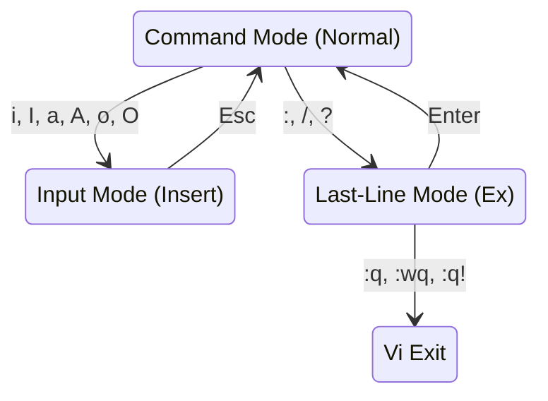

# Week 5 Lecture — Vi Editor

[Repository Guide](../../README.md) | [English](Concepts_Lecture.md) | [한국어](Concepts_Lecture.ko.md)

> **Last Updated:** 2026-11-19
>
> 우분투 리눅스, 이종원, Ch 3

> **Learning Objectives:**
> 1. Distinguish modal editors from modeless editors
> 2. Navigate and edit files using the vi/vim editor
> 3. Apply vi command mode, insert mode, and ex mode
> 4. Copy, delete, and replace text over a line range in last-line mode
> 5. Configure vi with .vimrc settings
> 6. Predict the results of editing commands from the rules for combining operators and motions

---

## Table of Contents

- [1. Linux Text Editors](#1-linux-text-editors)
  - [1.1 Types of Editors](#11-types-of-editors)
  - [1.2 Modal vs. Modeless Editors](#12-modal-vs-modeless-editors)
  - [1.3 The nano Editor](#13-the-nano-editor)
- [2. Vi Operating Modes](#2-vi-operating-modes)
  - [2.1 Three Modes](#21-three-modes)
  - [2.2 Switching Modes](#22-switching-modes)
- [3. Starting and Exiting Vi](#3-starting-and-exiting-vi)
  - [3.1 Starting Vi](#31-starting-vi)
  - [3.2 Saving and Exiting](#32-saving-and-exiting)
- [4. Cursor Movement](#4-cursor-movement)
  - [4.1 Basic Movement](#41-basic-movement)
  - [4.2 Line Movement](#42-line-movement)
  - [4.3 Word Movement](#43-word-movement)
  - [4.4 Screen Movement](#44-screen-movement)
  - [4.5 Jump to Specific Locations](#45-jump-to-specific-locations)
- [5. Editing Commands](#5-editing-commands)
  - [5.1 Entering Insert Mode](#51-entering-insert-mode)
  - [5.2 Deleting Text](#52-deleting-text)
  - [5.3 Undo and Redo](#53-undo-and-redo)
  - [5.4 Replacing Text](#54-replacing-text)
  - [5.5 Combining Operators and Motions](#55-combining-operators-and-motions)
- [6. Copy, Cut, and Paste](#6-copy-cut-and-paste)
  - [6.1 Yank (Copy) and Put (Paste)](#61-yank-copy-and-put-paste)
  - [6.2 Named Buffers (Registers)](#62-named-buffers-registers)
  - [6.3 Copy, Cut, and Paste in Last-Line Mode](#63-copy-cut-and-paste-in-last-line-mode)
- [7. Search and Replace](#7-search-and-replace)
  - [7.1 Searching](#71-searching)
  - [7.2 Search and Replace (Substitution)](#72-search-and-replace-substitution)
  - [7.3 Ranges, the Global Command, and Special Characters in Substitution](#73-ranges-the-global-command-and-special-characters-in-substitution)
- [8. Working with Files and Shell Commands](#8-working-with-files-and-shell-commands)
  - [8.1 Reading Files and Editing Multiple Files](#81-reading-files-and-editing-multiple-files)
  - [8.2 Running Shell Commands from Vi](#82-running-shell-commands-from-vi)
  - [8.3 Other Command Keys](#83-other-command-keys)
  - [8.4 Other Useful Commands](#84-other-useful-commands)
  - [8.5 Swap Files and Recovery, and Saving Files Without Permission](#85-swap-files-and-recovery-and-saving-files-without-permission)
- [9. Vi Environment Settings](#9-vi-environment-settings)
  - [9.1 Set Commands](#91-set-commands)
  - [9.2 Persistent Configuration (~/.vimrc)](#92-persistent-configuration-vimrc)
  - [9.3 The .exrc File and the EXINIT Environment Variable](#93-the-exrc-file-and-the-exinit-environment-variable)
- [10. Best Practices](#10-best-practices)
  - [10.1 Productivity Tips](#101-productivity-tips)
  - [10.2 Vi vs. Nano vs. Emacs](#102-vi-vs-nano-vs-emacs)
  - [10.3 Vim Practice: Writing and Running a Program](#103-vim-practice-writing-and-running-a-program)
- [Concept Applications](#concept-applications)
- [Summary](#summary)
- [Self-Check Questions](#self-check-questions)

---

<br>

## 1. Linux Text Editors

### 1.1 Types of Editors

Linux editors are divided into GUI editors used in a graphical environment and editors used in a terminal. Terminal editors are further divided into line editors, which handle one line at a time, and screen editors, which handle the whole screen.

| Category | Editors | Description |
|----------|---------|-------------|
| Line editors | `ed`, `ex`, `sed` | Edit one line at a time. |
| Screen editors | `vi`, `emacs` | Edit on the full screen (modal / modeless). |
| GUI editors | `gedit`, `kate` | Edit through a graphical interface. |

*Table 1. Categories of Linux editors*

### 1.2 Modal vs. Modeless Editors

- A **modal editor** distinguishes an input mode from a command mode. In input mode you type text, and in command mode you run editing commands that modify, delete, copy, or paste text. vim is the typical example.
- A **modeless editor** has no modes. Like word processors such as Hangul or Word, it runs editing commands when you press a special key such as Alt, Ctrl, or Shift together with another key. In the terminal, nano is the typical example.

| Feature | Modal (vi/vim) | Modeless (nano, notepad) |
|---------|---------------|-------------------------|
| Input Mode | Text entry | Text entry |
| Copy | `yy` (command mode) | `Ctrl+C` |
| Paste | `p` (command mode) | `Ctrl+V` |
| Save | `:wq` or `ZZ` | `Ctrl+S` |
| Mode Switch | `i`, `a`, `o`, `Esc` | Not applicable |

*Table 2. Operations in modal and modeless editors*

> **Key Point:** `vim` is an upgraded version of `vi` (Vi IMproved). They share the same core usage.

> **Note:** The copy and paste keys in the modeless column of Table 2 are those of GUI editors such as Notepad. The terminal editor nano uses different shortcuts, as shown in Section 1.3.

### 1.3 The nano Editor

**nano** is a modeless text editor used in the terminal. Unlike vi, it has no command mode or last-line mode, and every command is a shortcut made of Ctrl or Alt plus another key. Running it with a file name, as in `nano a.txt`, opens that file, and the arrow keys move the cursor up, down, left, and right. The `^` in the help lines at the bottom of the screen means the Ctrl key.

| Shortcut | Function | Shortcut | Function |
|----------|----------|----------|----------|
| `Ctrl+G` | Help | `Ctrl+X` | Exit |
| `Ctrl+S` | Save | `Ctrl+O` | Save after confirming the file name |
| `Ctrl+R` | Read a file | `Ctrl+\` | Search and replace |
| `Ctrl+K` | Cut the current line | `Ctrl+U` | Paste |
| `Ctrl+Y` | Previous page (Page Up) | `Ctrl+V` | Next page (Page Down) |

*Table 3. Main shortcuts of nano*

---

<br>

## 2. Vi Operating Modes

### 2.1 Three Modes



*Figure 1. The three operating modes of vi and the transitions between them*

- **Command Mode (Normal):** Keystrokes are interpreted as commands that move the cursor, move by pages, delete characters or lines, copy, and so on. vi starts in this mode.
- **Input Mode (Insert):** Keystrokes are entered as text content.
- **Last-Line Mode (Ex):** Commands typed after `:`, `/`, or `?` at the bottom of the screen handle special operations such as search, replace, save, and quit.

### 2.2 Switching Modes

- **From command mode to input mode:** Press one of `i`, `I`, `a`, `A`, `o`, `O`. Each key starts text entry at a different position (Section 5.1).
- **From input mode to command mode:** Press the `Esc` key. You cannot go directly from input mode to last-line mode, so to save or quit you must first return to command mode with `Esc`.
- **From command mode to last-line mode:** Press one of `:`, `/`, `?`, and the cursor moves to the bottom line of the screen.
- **From last-line mode to command mode:** Type a command and press `Enter`; the command runs and vi returns to command mode. To return without running a command, press `Esc`.
- **Exiting vi:** Quit with `:q`, `:q!`, `:wq`, or `:wq!` in last-line mode, or press `ZZ` in command mode to save and quit.

The difference between `i` and `a` is easiest to see relative to the character under the cursor. On the line `linux` with the cursor on the last character `x`, pressing `i` and typing ` ubuntu` inserts the text before `x` and gives `linu ubuntux`, while pressing `a` and typing the same text appends it after `x` and gives `linux ubuntu`.

---

<br>

## 3. Starting and Exiting Vi

### 3.1 Starting Vi

```bash
vi filename              # Open file (create if not exists)
vi                       # Open empty buffer
vi +10 filename          # Open file at line 10
vi +/pattern filename    # Open file at first occurrence of pattern
vi -R filename           # Open in read-only mode
vim filename             # Use vim (enhanced vi)
```

If the file given in `vi filename` does not exist, an empty file opens and is created under that name when you first save it. Running `vi` without a file name opens an empty file, and you can name it later with `:w filename`.

### 3.2 Saving and Exiting

| Mode | Command | Action |
|------|---------|--------|
| Last-line | `:q` | Quit (only if no changes) |
| Last-line | `:q!` | Quit without saving |
| Last-line | `:w` | Save |
| Last-line | `:w filename` | Save as different file |
| Last-line | `:wq` | Save and quit |
| Last-line | `:wq!` | Force save and quit |
| Command | `ZZ` | Save and quit (Shift+z, Shift+z) |

*Table 4. Save and quit commands of vi*

> **Caution:** If you type `:q` while there are unsaved changes, vim prints the error `E37: No write since last change (add ! to override)` and does not quit. Use `:q!` to discard the changes or `:wq` to save them.

---

<br>

## 4. Cursor Movement

All cursor movement commands are typed in command mode. Prefixing most commands with a number repeats them that many times (for example, `5j` moves down five lines).

### 4.1 Basic Movement

| Key | Action |
|-----|--------|
| `h` | Move left one character |
| `j` | Move down one line |
| `k` | Move up one line |
| `l` | Move right one character |
| Arrow keys | Same as h/j/k/l |

*Table 5. Basic cursor movement keys*

### 4.2 Line Movement

| Key | Action |
|-----|--------|
| `0` or `^` | Move to beginning of line |
| `$` | Move to end of line |
| `-` | Move to beginning of previous line |
| `+` or `Enter` | Move to beginning of next line |

*Table 6. Line-wise cursor movement keys*

> **Note:** In vim, `0` moves to the first column of the line and `^` moves to the first non-blank character. On a line without indentation, both keys give the same result.

### 4.3 Word Movement

| Key | Action |
|-----|--------|
| `w` | Move to beginning of next word |
| `W` | Move to next word (space-delimited) |
| `e` | Move to end of current word |
| `E` | Move to end of word (space-delimited) |
| `b` | Move to beginning of previous word |
| `B` | Move to previous word (space-delimited) |

*Table 7. Word-wise cursor movement keys*

The lowercase `w`, `e`, and `b` treat a run of letters, digits, and underscores, or a run of punctuation, as one word. The uppercase `W`, `E`, and `B` treat a whole whitespace-separated chunk as one word. For example, in `user1@myubuntu`, `w` stops before and after `@`, but `W` does not.

### 4.4 Screen Movement

| Key | Action |
|-----|--------|
| `Ctrl+f` | Forward one full page (Page Down) |
| `Ctrl+b` | Backward one full page (Page Up) |
| `Ctrl+d` | Forward half page |
| `Ctrl+u` | Backward half page |
| `Ctrl+e` | Scroll down one line |
| `Ctrl+y` | Scroll up one line |

*Table 8. Screen-wise movement keys*

### 4.5 Jump to Specific Locations

| Key | Action |
|-----|--------|
| `G` | Go to last line of file |
| `1G` or `gg` | Go to first line of file |
| `nG` | Go to line n (e.g., `20G`) |
| `:n` | Go to line n (last-line mode) |
| `:0` or `:1` | Go to the first line (last-line mode) |
| `:$` | Go to last line |
| `H` | Go to top of screen |
| `M` | Go to middle of screen |
| `L` | Go to bottom of screen |

*Table 9. Keys that jump to specific locations*

---

<br>

## 5. Editing Commands

### 5.1 Entering Insert Mode

| Key | Action |
|-----|--------|
| `i` | Insert before cursor |
| `I` | Insert at beginning of line |
| `a` | Append after cursor |
| `A` | Append at end of line |
| `o` | Open new line below |
| `O` | Open new line above |

*Table 10. Keys that switch to input mode*

### 5.2 Deleting Text

| Key | Action |
|-----|--------|
| `x` | Delete character under cursor |
| `nx` | Delete n characters from the cursor (e.g., `3x`) |
| `X` | Delete character before cursor |
| `dw` | Delete from cursor to end of word |
| `ndw` | Delete n words from the cursor (e.g., `3dw`) |
| `dd` | Delete entire line |
| `d$` or `D` | Delete from cursor to end of line |
| `d0` | Delete from cursor to beginning of line |
| `ndd` | Delete n lines (e.g., `5dd`) |
| `dG` | Delete from current line to end of file |
| `d1G` | Delete from current line to beginning of file |

*Table 11. Text deletion commands*

### 5.3 Undo and Redo

| Key | Action |
|-----|--------|
| `u` | Undo last change |
| `U` | Undo all changes on current line |
| `Ctrl+r` | Redo (vim only) |
| `.` | Repeat last command |
| `:e!` | Discard all changes since the last save and reopen the file (last-line mode) |

*Table 12. Undo and repeat commands*

### 5.4 Replacing Text

| Key | Action |
|-----|--------|
| `r` | Replace single character under cursor |
| `R` | Enter replace mode (overwrite until `Esc` is pressed) |
| `cw` | Change word (delete word + enter insert mode) |
| `ncw` | Change n words from the cursor (e.g., `3cw`) |
| `s` | Delete the character under the cursor and enter insert mode |
| `ns` | Delete n characters from the cursor and enter insert mode (e.g., `5s`) |
| `cc` or `S` | Change entire line |
| `c$` or `C` | Change from cursor to end of line |
| `~` | Toggle case of character under cursor |
| `J` | Join current line with next line |

*Table 13. Text replacement commands*

For example, with the cursor on the `w` of `winux`, typing `cw` or `5s`, then `editor`, then `Esc` changes `winux` to `editor`. The difference is that `cw` deletes to the end of the word while `5s` deletes exactly five characters.

### 5.5 Combining Operators and Motions

The commands of Sections 5.2 and 5.4 are not separate lists to memorize but are built from a single grammar. Most editing commands in command mode have the following form.

```text
[count] operator [count] motion
```

The **operator** decides what to do (`d` delete, `c` change, `y` copy), and the **motion** decides how far (`w` start of the next word, `e` end of the word, `b` back to the start of the word, `$` end of the line, `0` start of the line, `G` end of the file, `gg` start of the file). Doubling the operator (`dd`, `cc`, `yy`) targets the whole line. A count multiplies wherever it is placed, before or after, so `3dw` and `d3w` both delete three words.

| Operator + motion | Target | Equivalent short command |
|:-----|:-----|:-----|
| `dw` | From the cursor to just before the start of the next word | |
| `de` | From the cursor to the end of the current word | |
| `d$` | From the cursor to the end of the line | `D` |
| `d0` | From before the cursor to the start of the line | |
| `dG` | From the current line to the end of the file (linewise) | |
| `cw` | Change from the cursor to the end of the current word | |
| `c$` | Change from the cursor to the end of the line | `C` |
| `y$` | Copy from the cursor to the end of the line | |
| `yy` | Copy the current line | `Y` |

*Table 14. Commands that combine operators and motions*

With the cursor on the `q` of the following line, the result of each command is as follows (`^` is the cursor position after the command).

```text
start:   The quick brown fox jumps
             ^
dw  →    The brown fox jumps
             ^
de  →    The  brown fox jumps
             ^
d2w →    The fox jumps
             ^
d$  →    The
            ^
d0  →    quick brown fox jumps
         ^
```

*Figure 2. Results of deletion commands executed at the same position*

`dw` deletes up to just before the start of the next word, so it also deletes the space after the word, while `de` deletes only up to the last character of the word, so the space remains. Despite its name, `cw` behaves like `ce` and leaves the space after the word. This is an exception defined by vi so that the space need not be retyped when one word is replaced by another.

`.` repeats the last change command, including its count and motion. For example, after `cw` has changed `fox` into `cat`, moving to another word and pressing `.` changes that word into `cat` as well. Repeating the sequence of finding the next `fox` with `/fox` (`n`) and pressing `.` makes it possible to replace occurrences one at a time while checking each, without the substitution of Section 7.2.

---

<br>

## 6. Copy, Cut, and Paste

### 6.1 Yank (Copy) and Put (Paste)

| Key | Action |
|-----|--------|
| `yy` or `Y` | Yank (copy) current line |
| `nyy` | Yank n lines (e.g., `5yy`) |
| `yw` | Yank word |
| `y$` | Yank from cursor to end of line |
| `dd`, `ndd` | Cut one line or n lines from the current line (the same command as delete) |
| `p` | Put (paste) after cursor / below current line |
| `P` | Put (paste) before cursor / above current line |

*Table 15. Copy, cut, and paste commands*

In vi, cutting is not a separate command but deletion. Text removed with `dd` or `x` is stored in a buffer, so it can be pasted back with `p` or `P`. Text copied or deleted by lines is pasted below (`p`) or above (`P`) the current line, and text copied by characters or words is pasted after (`p`) or before (`P`) the cursor.

### 6.2 Named Buffers (Registers)

```text
"ayy        # Yank current line into register 'a'
"ap         # Paste from register 'a'
"bdd        # Delete (cut) current line into register 'b'
```

The default buffer used without a name is the **unnamed buffer**. A buffer used by putting `"` and a name before a command is a **named buffer**, and the 26 letters `"a` through `"z` are available. The numbered buffers `"1` through `"9` hold the most recently deleted lines in order. Named buffers let you keep several pieces of text separately and paste each where you want. For example, `"bP` pastes the contents of buffer `"b` above the current line.

### 6.3 Copy, Cut, and Paste in Last-Line Mode

After typing `:` to switch to last-line mode, you can copy, cut, and paste by giving a line number or a range. A range is written with the following symbols.

| Range | Meaning |
|-------|---------|
| `1,$` or `%` | From line 1 to the last line |
| `1,.` | From line 1 to the line with the cursor |
| `.,$` | From the line with the cursor to the last line |
| `.-3,.` | The line with the cursor and the three lines before it (four lines in total) |
| `10,20` | From line 10 to line 20 |

*Table 16. Ranges in last-line mode*

`.` means the line with the cursor and `$` means the last line. Ranges are usually written without spaces around the comma, as in `10,20`.

| Command | Function |
|---------|----------|
| `:#y` | Copies line # (e.g., `:3y` copies the third line). |
| `:{range}y` | Copies the lines in the range (e.g., `:2,4y` copies lines 2-4). |
| `:#d` | Cuts line # (e.g., `:3d` deletes the third line). |
| `:{range}d` | Cuts the lines in the range (e.g., `:1,4d` deletes lines 1-4). |
| `:pu` | Pastes the buffer contents after the current line. |
| `:#pu` | Pastes the buffer contents after line # (e.g., `:4pu`). |

*Table 17. Copy, cut, and paste commands in last-line mode*

For example, `:2,3d` cuts lines 2 and 3, and `:1,2y` copies lines 1 and 2. Typing `:2pu` next pastes the buffer contents after line 2, and `:4pu` pastes them after line 4.

---

<br>

## 7. Search and Replace

### 7.1 Searching

| Command | Action |
|---------|--------|
| `/pattern` | Search forward for pattern |
| `?pattern` | Search backward for pattern |
| `n` | Repeat search in same direction |
| `N` | Repeat search in opposite direction |
| `*` | Search forward for word under cursor |
| `#` | Search backward for word under cursor |

*Table 18. Search commands*

Pressing `/` moves the cursor to the last line; after you type the search string and press `Enter`, the cursor goes to the next match. When the search reaches the end of the file, vim prints the message `search hit BOTTOM, continuing at TOP` and continues from the beginning of the file. When an upward search with `?` reaches the beginning of the file, it continues from the end.

### 7.2 Search and Replace (Substitution)

```vim
:s/old/new/              # Replace first occurrence on current line
:s/old/new/g             # Replace all occurrences on current line
:n,ms/old/new/g          # Replace all occurrences from line n to m
:%s/old/new/g            # Replace all occurrences in entire file
:%s/old/new/gc           # Replace all with confirmation
:1,$s/old/new/g          # Same as :%s/old/new/g
```

The general form of the substitute command is `:{range}s/string1/string2/flags`. Without a range only the current line is affected, and without the `g` flag only the first string1 on each line is replaced. The `c` flag asks for confirmation before each replacement. For example, `:3,4s/editor/ubuntu/` replaces only the first `editor` on each of lines 3 and 4 with `ubuntu`, and `:%s/like/LIKE/g` replaces every `like` in the file with `LIKE`.

### 7.3 Ranges, the Global Command, and Special Characters in Substitution

A **range** in last-line mode is written with line numbers and the following symbols.

| Range | Meaning |
|:-----|:-----|
| `.` | The current line |
| `$` | The last line |
| `%` | The whole file (same as `1,$`) |
| `5,$` | From line 5 to the last line |
| `.,+3` | From the current line to three lines below it (four lines in all) |
| `'a,'b` | From the line with mark `a` to the line with mark `b` (marked with `ma` and `mb`) |

*Table 19. Range notation in last-line mode*

For example, `:5,$ s/linux/LINUX/g` replaces every `linux` with `LINUX` in each line from line 5 to the last line. Without `g`, only the first `linux` of each line changes, and with `gc`, one chooses at each replacement among `y` (replace), `n` (skip), `a` (all the rest), and `q` (quit).

**The global command.** `:g/pattern/command` runs the command on every line that matches the pattern, and `:v/pattern/command` runs it on every line that does not match.

| Command | Result |
|:-----|:-----|
| `:g/^$/d` | Deletes all empty lines |
| `:g/^#/d` | Deletes all comment lines starting with `#` |
| `:v/error/d` | Deletes every line not containing `error`, leaving only the lines with `error` |
| `:g/TODO/s/old/new/g` | Replaces `old` with `new` only in lines containing `TODO` |

*Table 20. Examples of the global command*

**Special characters.** The search string is a regular expression (Week 4, Section 4.2), so `.`, `*`, `[`, `^`, `$`, and `/` must be preceded by `\` to be searched for literally. For strings with many `/` characters, such as paths, changing the delimiter to another character makes the command easier to read. `:s` uses the first character after `s` as the delimiter, so `:%s#/usr/local#/opt#g` is the same as `:%s/\/usr\/local/\/opt/g`. `&` in the replacement means the whole matched string, so `:%s/[0-9][0-9]*/<&>/g` wraps every number in `<...>`. In Vim, `\<` and `\>` mean the start and end of a word, so `:%s/\<is\>/IS/g` replaces only the word `is` and leaves the `is` in `this` alone.

> **Caution:** The `.` in `:s/a.b/x/` is any single character, so it replaces not only `a.b` but also `acb` and `a b`. To search for the character `.` itself, write `:s/a\.b/x/`. If the result of a substitution is not what was expected, undo it at once with `u` and correct the pattern.

---

<br>

## 8. Working with Files and Shell Commands

### 8.1 Reading Files and Editing Multiple Files

| Command | Function |
|---------|----------|
| `:r file` | Reads the given file and inserts it at the cursor position (after the current line). |
| `:e file` | Switches to the given file. The current file must be saved with `:w` first. |
| `:e! file` | Discards the unsaved changes of the current file and switches to the given file. |
| `:n` | Moves to the next file when several files were given at startup. |

*Table 21. File-related commands*

When vi starts with several files, as in `vi a.txt b.txt`, it edits the first file, and `:n` moves to the next one. Trying to move to another file with `:e` or `:n` without saving the current file causes an error, so save with `:w` first or add `!` to discard the changes.

### 8.2 Running Shell Commands from Vi

| Command | Function |
|---------|----------|
| `:!shell command` | Suspends vi and runs the shell command. Press `Enter` to return to vi. |
| `:sh` | Leaves vi temporarily and starts a shell. Type `exit` to return to vi. |

*Table 22. Commands that run shell commands from vi*

Use `:!` to run one command and return immediately, and `:sh` when you need to run several commands in the shell. For example, after saving the file, typing `:!pwd` shows the path of the current directory without leaving vi.

### 8.3 Other Command Keys

| Command Key | Function |
|-------------|----------|
| `Ctrl+l` (lowercase L) | Redraws the current screen. |
| `Ctrl+g` | Shows the line number of the cursor position on the last line. |
| `J` (Shift+j) | Joins the current line and the line below into one line. |
| `.` (period) | Repeats the command just executed. |
| `~` (tilde) | Changes the character at the cursor to uppercase or lowercase. |

*Table 23. Other command keys*

For example, pressing `J` on line 1 joins lines 1 and 2 into one line, and pressing `.` next performs the same join once more. With the cursor on `u`, pressing `~` changes it to `U`.

### 8.4 Other Useful Commands

```vim
:!command                # Execute shell command without leaving vi
:r filename              # Read and insert file contents
:r !command              # Insert command output
:n                       # Go to next file (when editing multiple)
:prev                    # Go to previous file
:split filename          # Split window horizontally
:vsplit filename         # Split window vertically
Ctrl+w w                 # Switch between split windows
```

### 8.5 Swap Files and Recovery, and Saving Files Without Permission

Vim continuously records the content being edited in a **swap file** `.filename.swp` in the same directory as the original. If the terminal is disconnected or the system hangs so that Vim cannot finish normally, the swap file remains, and the next time the same file is opened, the warning `E325: ATTENTION` appears with the message `Found a swap file by the name ".memo.txt.swp"`. The choices offered at that point are as follows.

| Choice | Meaning |
|:-----|:-----|
| `(O)pen Read-Only` | Open the file read-only |
| `(E)dit anyway` | Ignore the swap file and edit |
| `(R)ecover` | Restore the unsaved content from the swap file (same as `vim -r file`) |
| `(D)elete it` | Delete the swap file |
| `(Q)uit`, `(A)bort` | Quit without opening |

*Table 24. Actions available at the swap file warning*

After restoring the content with `R`, checking it, and saving it with `:w`, the remaining swap file must be deleted manually, or the same warning appears next time. The warning also appears when the same file is already being edited in another terminal; in that case, quit with `Q` and finish editing on the other side.

**Saving a file without permission.** When an ordinary user opens a root-owned file such as `/etc/hosts`, edits it, and runs `:w`, the error `E45: 'readonly' option is set` or a write permission error appears. The `!` of `:w!` only means "ignore the `readonly` flag" and cannot override file permissions (Week 7), so it is of no use to an ordinary user. The file should have been opened with `sudo vi /etc/hosts` from the start, but to keep the edits already made, save with the following command.

```text
:w !sudo tee % > /dev/null
```

`:w !command` sends the buffer's content to the standard input of the command instead of writing it to a file, and `%` is the name of the current file. `sudo tee /etc/hosts` therefore writes the buffer's content to the file with root privileges (Week 12, Section 7.2). `> /dev/null` discards what `tee` also sends to the screen. If Vim then warns that "the file has changed", choose `L` (load).

---

<br>

## 9. Vi Environment Settings

### 9.1 Set Commands

| Command | Action |
|---------|--------|
| `:set nu` or `:set number` | Show line numbers (only displayed, not saved in the file) |
| `:set nonu` | Hide line numbers |
| `:set list` | Show invisible special characters (tab as `^I`, end of line as `$`) |
| `:set nolist` | Hide special characters |
| `:set ai` | Auto-indent |
| `:set noai` | Disable auto-indent |
| `:set ic` | Ignore case in searches |
| `:set noic` | Case-sensitive searches |
| `:set ts=4` | Set tab stop to 4 spaces |
| `:set showmode` | Show current mode |
| `:set noshowmode` | Hide current mode |
| `:set` | Show all vi settings changed with set |
| `:set all` | Show all settings |
| `:set syntax=on` | Enable syntax highlighting |

*Table 25. vi environment setting commands*

### 9.2 Persistent Configuration (~/.vimrc)

```vim
" ~/.vimrc - Vim configuration file
set number              " Show line numbers
set autoindent          " Auto-indent new lines
set tabstop=4           " Tab width = 4 spaces
set shiftwidth=4        " Indent width = 4 spaces
set expandtab           " Convert tabs to spaces
set hlsearch            " Highlight search results
set ignorecase          " Case-insensitive search
set smartcase           " Case-sensitive if uppercase used
set showmatch           " Highlight matching brackets
syntax on               " Enable syntax highlighting
set encoding=utf-8      " UTF-8 encoding
```

Settings changed with `:set` disappear when vi exits. Writing them in a configuration file applies them automatically every time vi starts, and inside the file they are written without the leading colon, as in `set number`.

### 9.3 The .exrc File and the EXINIT Environment Variable

Saving vi settings in the `.exrc` file in the user's home directory applies the same settings to every file the user opens. The settings can also be put in the shell environment variable `EXINIT`.

```text
set nu
set list
set showmode
```

```bash
EXINIT='set nu list'
export EXINIT
```

> **Note:** At startup, vim looks for the `VIMINIT` environment variable, `~/.vimrc`, the `EXINIT` environment variable, and `~/.exrc` in that order and uses only the first one it finds. Therefore, if `~/.vimrc` exists, the settings in `EXINIT` and `~/.exrc` are not read.

---

<br>

## 10. Best Practices

### 10.1 Productivity Tips

- In vim, `gg=G` auto-indents the entire file.
- Repeating the last command with `.` applies the same edit to many places quickly.
- `ciw` changes the whole word (inner word) at once even when the cursor is in the middle of the word.
- In vim, the visual modes `v`, `V`, and `Ctrl+v` select characters, lines, and rectangular blocks.
- Mastering `hjkl` navigation instead of the arrow keys lets you move the cursor without leaving the home row.

### 10.2 Vi vs. Nano vs. Emacs

| Feature | Vi/Vim | Nano | Emacs |
|---------|--------|------|-------|
| Learning Curve | Steep | Easy | Steep |
| Available Everywhere | Yes | Usually | Usually |
| Extensibility | High (Vim) | Low | Very High |
| Modal Editing | Yes | No | No |
| Speed (experienced user) | Very Fast | Moderate | Fast |

*Table 26. Comparison of Vi, Nano, and Emacs*

### 10.3 Vim Practice: Writing and Running a Program

vi is also used to write program source code. For example, you can write and run a **C program** or **Python program** that prints the multiplication tables (1-9). C code is compiled with `gcc`, and Python code is run with `python3`. If the compiler or interpreter is missing, install it first with root privileges.

```bash
# apt install gcc          # Install the C compiler (root)
$ vim a.c                  # Write the source code, then :wq
$ gcc -o a a.c             # Compile a.c into the executable a
$ ./a                      # Run

# apt install python3      # Install Python (root)
$ vim a.py
$ python3 a.py
```

```c
#include <stdio.h>

int main(void)
{
    for (int i = 1; i <= 9; i++) {
        for (int j = 1; j <= 9; j++)
            printf("%d x %d = %2d\n", i, j, i * j);
        printf("\n");
    }
    return 0;
}
```

```python
for i in range(1, 10):
    for j in range(1, 10):
        print(f"{i} x {j} = {i * j:2d}")
    print()
```

Both programs print the same output. The outer loop runs over the table number (`i`) and the inner loop over the multiplier (`j`) from 1 to 9, and an empty line is printed after each table. The output starts with `1 x 1 =  1` and ends with `9 x 9 = 81`.

---

<br>

## Concept Applications

**True/False Check:**

| Statement | Judgment and Reason |
|:-----|:-----|
| `d3w` and `3dw` give the same result. | **T.** A count multiplies whether it is placed before the operator or before the motion, so both delete three words. |
| `cw`, like `dw`, deletes the space after the word before entering insert mode. | **F.** `cw` changes only up to the end of the word, like `ce`, so the space remains. |
| `:5,$ s/linux/LINUX/` replaces every `linux` from line 5 to the end. | **F.** Without `g`, only the first `linux` in each line is replaced. |
| `:v/error/d` deletes all lines containing `error`. | **F.** `:v` runs the command on non-matching lines, so only the lines containing `error` remain. |
| An ordinary user can save to a root-owned file with `:w!`. | **F.** `!` only ignores the `readonly` flag and cannot override file permissions. Use `:w !sudo tee %`. |
| The swap file warning also appears when the same file is being edited in another terminal. | **T.** The Vim that is editing keeps the swap file, so a second Vim that opens the file finds it. |

---

<br>

## Summary

| Concept | Key Summary |
|---------|-------------|
| Vi Modes | vi has command mode (default), input mode (`i/a/o`), and last-line mode (`:`), and `Esc` returns to command mode. |
| Exit | vi is closed with `:q` (quit), `:wq` (save and quit), `:q!` (quit without saving), or `ZZ` (save and quit). |
| Movement | The cursor moves with `hjkl` (basic), `w/b/e` (word), `0/$` (line), and `G/gg` (file). |
| Insert | `i` (before), `a` (after), `o` (new line below), and their variants `I/A/O` enter input mode. |
| Delete | `x` (char), `dw` (word), `dd` (line), and `D` (to end of line) delete text, and the deleted text stays in a buffer. |
| Copy/Paste | `yy` (copy line), `p` (paste after), and `P` (paste before) are used, and a named buffer such as `"a` can be specified. |
| Last-Line Mode Editing | Commands such as `:2,4y`, `:3d`, and `:4pu` copy, cut, and paste by line numbers and ranges (`.`, `$`, `%`). |
| Search | `/pattern` (forward), `?pattern` (backward), and `n/N` (next/previous) find strings. |
| Replace | `:%s/old/new/g` replaces in the whole file, and `:%s/old/new/gc` asks for confirmation. |
| Files and Shell | `:r`, `:e`, and `:n` handle other files, and `:!` and `:sh` run shell commands. |
| Settings | `:set nu` applies only to the current session, while `~/.vimrc` or `~/.exrc` applies permanently. |
| Operators and motions | Commands follow the grammar `[count] operator [count] motion`, combining `d`, `c`, and `y` with `w`, `e`, `$`, `0`, and `G`, and `cw` behaves like `ce`. |
| Ranges and the global command | Ranges are written with `.`, `$`, `%`, `5,$`, and `.,+3`; `:g/pattern/command` runs on matching lines and `:v` on non-matching lines. |
| Swap files | Vim records the content being edited in `.name.swp`, and after an abnormal exit the content is restored with `R` or `vim -r`. |

---

<br>

## Self-Check Questions

1. **Last-line mode editing:** In a file of five lines `one`, `two`, `three`, `four`, `five`, you type `:2,3d`, `:1y`, and `:$pu` in order. Write the final contents of the file.

   <details>
   <summary>Answer</summary>

   `:2,3d` cuts line 2 `two` and line 3 `three`, leaving `one`, `four`, `five`. `:1y` copies line 1 `one` into the buffer, and `:$pu` pastes the buffer contents after the last line `five`. The final contents are therefore the four lines `one`, `four`, `five`, `one`.

   </details>

2. **Named buffers:** In a file of four lines `A`, `B`, `C`, `D`, you put the cursor on line 2 and type `"add` and `"bdd`, then go to line 1 with `gg` and type `"bP` and `"ap`. Write the final contents of the file.

   <details>
   <summary>Answer</summary>

   `"add` cuts line 2 `B` into buffer `"a`, and the cursor lands on the new line 2 `C`. `"bdd` cuts `C` into buffer `"b`, leaving `A`, `D`. On line 1, `"bP` pastes `C` above the current line, giving `C`, `A`, `D` with the cursor on `C`. `"ap` pastes `B` below the current line. The final contents are therefore `C`, `B`, `A`, `D`.

   </details>

3. **Comparing change commands:** In `abc winux def` with the cursor on the `w` of `winux`, you press one of `cw`, `5s`, or `R`, type `editor`, and press `Esc`. Explain the result of each case and the difference.

   <details>
   <summary>Answer</summary>

   `cw` deletes from the cursor to the end of the word (`winux`) and enters insert mode, so the result is `abc editor def`. `5s` deletes exactly five characters (`winux`) from the cursor and enters insert mode, so the result is the same. `R` deletes nothing and overwrites as many existing characters as you type, so the six characters of `editor` overwrite `winux` and the following space, giving `abc editordef`.

   </details>

4. **Switching files:** After modifying `test.txt`, you type `:e exec.txt` without saving. What happens, and what are two ways to move to `exec.txt`?

   <details>
   <summary>Answer</summary>

   Because there are unsaved changes, vim prints the error `E37: No write since last change (add ! to override)` and does not switch files. To keep the changes, save with `:w` and then type `:e exec.txt`; if the changes can be discarded, type `:e! exec.txt`.

   </details>

5. **Substitution commands:** Write the last-line mode command for each task. (a) Replace `/usr/local/bin` with `/opt/bin` throughout the file (b) Replace every `foo` with `bar` from the current line through the five lines below it (six lines in all) (c) Delete every line starting with `#`

   <details>
   <summary>Answer</summary>

   (a) Change the delimiter to `#` and write `:%s#/usr/local/bin#/opt/bin#g`. With `/` as the delimiter, it is `:%s/\/usr\/local\/bin/\/opt\/bin/g`. (b) `:.,+5s/foo/bar/g`. (c) `:g/^#/d`.

   </details>
