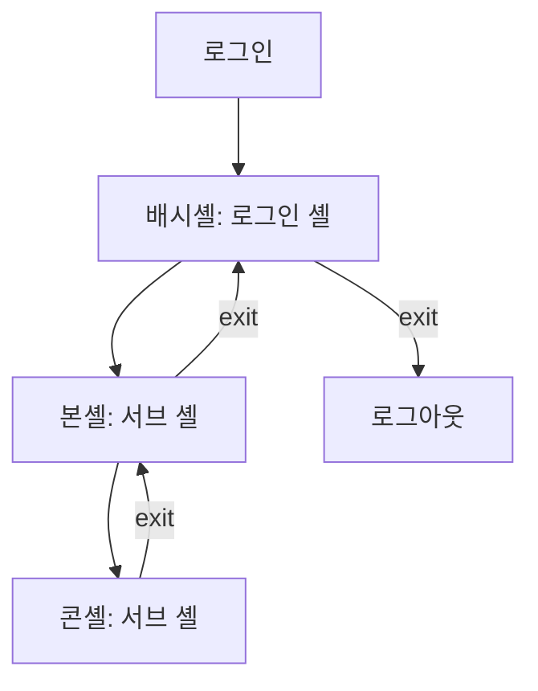
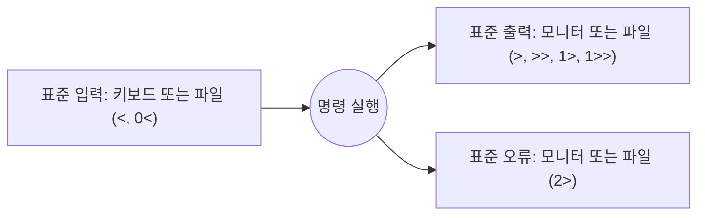

# 6주차 이론 — 셸 사용법

[레포지토리 안내](../../README.ko.md) | [English](Concepts_Lecture.md) | [한국어](Concepts_Lecture.ko.md)

> **최종 수정일:** 2026-10-19
>
> 우분투 리눅스, 이종원, Ch 4

> **학습 목표:**
> 1. 셸의 기능과 종류를 설명할 수 있다
> 2. 셸 특수문자와 인용 규칙을 구분하여 사용할 수 있다
> 3. I/O 리다이렉션과 파이핑을 적용할 수 있다
> 4. 변수와 별칭으로 셸 환경을 커스터마이즈할 수 있다
> 5. 명령 히스토리와 탭 완성을 효과적으로 사용할 수 있다
> 6. 시스템 환경 설정 파일과 사용자 환경 설정 파일을 구분할 수 있다

---

## 목차

- [1. 셸이란?](#1-셸이란)
  - [1.1 셸의 역할](#11-셸의-역할)
- [2. 셸의 종류](#2-셸의-종류)
  - [2.1 주요 셸](#21-주요-셸)
  - [2.2 셸 확인 및 변경](#22-셸-확인-및-변경)
  - [2.3 로그인 셸과 서브 셸](#23-로그인-셸과-서브-셸)
  - [2.4 셸 내장 명령](#24-셸-내장-명령)
  - [2.5 출력 명령](#25-출력-명령)
- [3. 셸 메타문자](#3-셸-메타문자)
  - [3.1 특수 문자](#31-특수-문자)
  - [3.2 명령 실행 제어](#32-명령-실행-제어)
- [4. 인용 규칙](#4-인용-규칙)
  - [4.1 인용 유형](#41-인용-유형)
- [5. 입출력 방향 변경](#5-입출력-방향-변경)
  - [5.1 표준 입출력 장치](#51-표준-입출력-장치)
  - [5.2 출력 리다이렉션](#52-출력-리다이렉션)
  - [5.3 오류 리다이렉션](#53-오류-리다이렉션)
  - [5.4 입력 리다이렉션](#54-입력-리다이렉션)
- [6. 셸 환경 변수](#6-셸-환경-변수)
  - [6.1 셸 변수와 환경 변수](#61-셸-변수와-환경-변수)
  - [6.2 주요 환경 변수](#62-주요-환경-변수)
  - [6.3 변수 다루기](#63-변수-다루기)
- [7. 별칭(Alias)](#7-별칭alias)
  - [7.1 별칭 생성 및 관리](#71-별칭-생성-및-관리)
  - [7.2 유용한 별칭](#72-유용한-별칭)
- [8. 명령어 히스토리](#8-명령어-히스토리)
  - [8.1 히스토리 명령어](#81-히스토리-명령어)
  - [8.2 히스토리 설정](#82-히스토리-설정)
  - [8.3 명령 편집과 탭 완성](#83-명령-편집과-탭-완성)
- [9. 프롬프트 설정](#9-프롬프트-설정)
  - [9.1 PS1 프롬프트 커스터마이징](#91-ps1-프롬프트-커스터마이징)
  - [9.2 컬러 프롬프트](#92-컬러-프롬프트)
- [10. 셸 초기화 파일](#10-셸-초기화-파일)
  - [10.1 Bash 시작 파일](#101-bash-시작-파일)
  - [10.2 로딩 순서 (로그인 셸)](#102-로딩-순서-로그인-셸)
- [11. 작업 제어](#11-작업-제어)
  - [11.1 포그라운드 및 백그라운드 작업](#111-포그라운드-및-백그라운드-작업)
  - [11.2 프로세스 우선순위](#112-프로세스-우선순위)
- [12. 모범 사례](#12-모범-사례)
  - [12.1 셸 효율성](#121-셸-효율성)
  - [12.2 보안 고려사항](#122-보안-고려사항)
- [요약](#요약)
- [점검 문제](#점검-문제)

---

<br>

## 1. 셸이란?

**셸(Shell)** 은 사용자와 Linux 커널 사이의 인터페이스 역할을 하는 명령줄 해석기이다.

```text
사용자 입력 --> 셸 (해석) --> 커널 (실행) --> 하드웨어
            <-- 셸 (표시) <-- 커널 (반환) <--
```

*그림 1. 사용자, 셸, 커널, 하드웨어 사이의 명령 처리 흐름*

### 1.1 셸의 역할

셸의 기능은 크게 세 가지이다. 사용자가 입력한 명령을 해석하여 실행하는 **명령어 해석기 기능**, 명령을 모은 셸 스크립트를 작성하고 실행하는 **프로그래밍 기능**, 그리고 프롬프트, 경로, 별칭 같은 사용자 환경을 정하는 **사용자 환경 설정 기능**이다. 구체적으로 셸은 다음 일을 한다.

- 사용자 명령을 읽고 구문을 분석한다.
- 와일드카드, 별칭, 변수를 확장한다.
- I/O 리다이렉션과 파이프를 처리한다.
- 백그라운드 프로세스를 관리한다.
- 자식 프로세스를 fork하여 외부 프로그램을 실행한다.
- 스크립팅 기능을 제공한다.

---

<br>

## 2. 셸의 종류

### 2.1 주요 셸

| 셸 | 경로 | 설명 |
|-------|------|-------------|
| **bash** | `/bin/bash` | Bourne Again Shell; 대부분의 Linux 배포판에서 기본 셸 |
| **sh** | `/bin/sh` | Bourne Shell; 유닉스 V7에서 처음 등장한 표준 셸 |
| **dash** | `/bin/dash` | Debian Almquist Shell; 본셸 기반의 작고 빠른 POSIX 셸 (Ubuntu의 `/bin/sh`) |
| **csh** | `/bin/csh` | C Shell; C 언어와 유사한 문법 |
| **tcsh** | `/bin/tcsh` | 향상된 C Shell |
| **ksh** | `/bin/ksh` | Korn Shell; sh와 csh의 기능을 결합 |
| **zsh** | `/bin/zsh` | Z Shell; sh 계열 셸에 다양한 개선 기능을 더한 셸 |
| **fish** | `/usr/bin/fish` | Friendly Interactive Shell |

*표 1. 주요 셸과 경로*

각 셸이 나온 배경은 다음과 같다.

- **본셸(sh)** 은 유닉스 V7에서 처음 등장한 표준 셸이며, 지금은 배시셸 같은 다른 셸로 대체되었다.
- **C셸(csh)** 은 캘리포니아대학교의 빌 조이(Bill Joy)가 개발하여 2BSD 유닉스에서 발표했다. 별칭과 히스토리 기능을 처음 포함했고, 셸 스크립트의 구문 형식이 C 언어와 같다.
- **콘셸(ksh)** 은 1980년대 중반 AT&T 벨 연구소에서 개발하여 SVR4 유닉스에서 발표했다. 본셸과 호환성을 유지하면서 별칭과 히스토리 기능을 제공한다.
- **배시셸(bash)** 은 1988년 브라이언 폭스(Brian Fox)가 개발했다. 본셸과 호환성을 유지하면서 C셸과 콘셸의 편리한 기능을 모두 포함하며, Linux의 기본 셸로 제공된다.
- **대시셸(dash)** 은 1997년 허버트 수(Herbert Xu)가 Linux에 이식했다. 본셸을 기반으로 POSIX 표준을 준수하며 작은 크기로 개발되었다.

### 2.2 셸 확인 및 변경

```bash
# 현재 셸 확인
echo $SHELL

# 사용 가능한 셸 목록 확인
cat /etc/shells

# 기본 셸 변경
chsh -s /bin/zsh

# 임시 셸 전환
bash            # bash 세션 시작
zsh             # zsh 세션 시작
exit            # 이전 셸로 복귀
```

사용자의 기본 셸(로그인 셸)은 `/etc/passwd` 파일의 각 줄 마지막 필드에 저장된다(예: `root:x:0:0:root:/root:/bin/bash`). `chsh -s`로 기본 셸을 바꿀 때는 바꾸려는 셸의 절대 경로를 지정하며, 그 셸은 `/etc/shells`에 등록되어 있어야 한다. `$SHELL`은 로그인 셸을 나타내므로, 프롬프트에서 다른 셸을 실행한 뒤에도 값이 바뀌지 않는다. 지금 실행 중인 셸의 이름은 `echo $0`으로 확인한다.

### 2.3 로그인 셸과 서브 셸

로그인할 때 처음 실행되는 셸을 **로그인 셸(login shell)** 이라 하고, 사용자가 프롬프트에서 다른 셸을 실행하여 생성한 셸을 **서브 셸(subshell)** 이라고 한다. 서브 셸 안에서 또 다른 셸을 실행할 수 있으므로 여러 서브 셸을 사슬처럼 연결할 수 있다. 서브 셸은 `Ctrl+d` 또는 `exit`로 종료하며, 그러면 그 셸을 실행한 이전 셸로 돌아온다.



*그림 2. 로그인 셸에서 서브 셸을 연이어 실행하고 exit로 돌아오는 과정*

셸 프롬프트의 마지막 기호로 사용자를 구분할 수 있다. 일반 사용자의 프롬프트는 `$`, root 사용자의 프롬프트는 `#`으로 끝난다.

### 2.4 셸 내장 명령

**셸 내장 명령(shell builtin)** 은 셸 자체가 가지고 있는 명령이다. 대표적인 내장 명령은 `cd`이다. 일반적인 Linux 명령은 `/bin`이나 `/usr/bin` 같은 디렉터리에 별도의 실행 파일로 존재하며, `file` 명령으로 실행 파일임을 확인할 수 있다.

```bash
$ file /usr/bin/pwd
/usr/bin/pwd: ELF 64-bit LSB pie executable, x86-64, version 1 (SYSV), dynamically linked, ...
$ type cd
cd is a shell builtin
```

> **참고:** bash에서는 `pwd`와 `echo`도 내장 명령으로 제공되며, 같은 이름의 실행 파일(`/usr/bin/pwd`, `/usr/bin/echo`)도 따로 있다. 이름만 입력하면 내장 명령이 먼저 실행된다. 어느 쪽이 실행되는지는 `type` 명령으로 확인한다.

### 2.5 출력 명령

| 명령 | 형식 | 기능 |
|------|------|------|
| `echo` | `echo [-n] [문자열]` | 화면에 한 줄의 문자열을 출력한다. `-n` 옵션을 주면 마지막에 줄을 바꾸지 않는다. |
| `printf` | `printf [형식] [인수]` | 자료를 형식화하여 화면에 출력한다. 형식에는 C 언어의 `printf` 함수처럼 `%d`, `\n` 등을 쓴다. |

*표 2. 셸의 출력 명령*

```bash
$ echo "linux ubuntu"
linux ubuntu
$ printf "linux ubuntu \n"
linux ubuntu
$ printf "%d + %d = %d\n" 10 10 20
10 + 10 = 20
```

`printf`는 형식 문자열에 `\n`이 없으면 줄을 바꾸지 않으므로, `printf linux`를 실행하면 출력 바로 뒤에 다음 프롬프트가 이어 붙는다.

---

<br>

## 3. 셸 메타문자

### 3.1 특수 문자

| 문자 | 의미 |
|-----------|---------|
| `~` | 홈 디렉터리 |
| `#` | 주석 |
| `$` | 변수 확장 |
| `&` | 백그라운드에서 명령 실행 |
| `*` | 와일드카드: 임의의 문자열 |
| `?` | 와일드카드: 단일 문자 |
| `;` | 명령 구분자 |
| `\|` | 파이프 |
| `>` `>>` | 출력 리다이렉션 |
| `<` `<<` | 입력 리다이렉션 |
| `\` | 이스케이프 문자 |
| `` ` `` | 명령 치환 (백틱) |
| `$()` | 명령 치환 (권장 형식) |
| `()` | 서브셸 실행 |
| `{}` | 중괄호 확장 |
| `[]` | 와일드카드에서의 문자 클래스 |

*표 3. 셸 메타문자와 의미*

| 특수문자 | 기능 | 예 |
|----------|------|-----|
| `*` | 임의의 문자열 | `ls h*` |
| `?` | 임의의 한 문자 | `ls dir?` |
| `[]` | 대괄호 안에 포함된 문자 중 하나 | `ls [a-f]*` |
| `~` | 홈 디렉터리 (`~user1`은 user1의 홈 디렉터리) | `cd ~user1` |
| `-` | 이전 작업 디렉터리 (`cd`의 인수) | `cd -` |
| `;` | 명령을 연결하여 왼쪽부터 차례로 실행 | `date;cal;ls` |
| `\|` | 왼쪽 명령의 실행 결과를 오른쪽 명령의 입력으로 전달 | `ls -l /etc \| more` |
| `' '` | 모든 셸 특수문자를 무시 | `echo '$SHELL'` |
| `" "` | `$`, `` ` ``, `\`를 제외한 모든 셸 특수문자를 무시 | `echo "$SHELL"` |
| `` ` ` `` | 셸 명령을 수행하고 그 결과로 대체 | ``echo `date` `` |
| `\` | 바로 뒤 특수문자의 기능을 제거 | `echo "\$SHELL"` |

*표 4. 특수문자의 기능과 사용 예*

와일드카드는 셸이 명령을 실행하기 전에 일치하는 파일 이름으로 확장한다. 경로에서 `.`은 현재 디렉터리, `..`은 상위 디렉터리를 뜻한다.

```bash
ls *              # 현재 디렉터리의 모든 파일과 하위 디렉터리의 내용 출력
cp * /tmp         # 현재 디렉터리의 모든 파일을 /tmp 아래로 복사
ls -F t*          # t, tmp, temp처럼 t로 시작하는 모든 이름과 파일 종류 출력 (t도 해당)
cp *.txt ../ch3   # 확장자가 txt인 모든 파일을 상위 디렉터리 아래 ch3로 복사
ls -l h*d         # h로 시작하고 d로 끝나는 이름 (hd, had, hard, h12345d 등)
cp ~user2/linux.txt .   # user2의 홈 디렉터리 아래 linux.txt를 현재 디렉터리로 복사
```

### 3.2 명령 실행 제어

```bash
# 순차 실행
command1 ; command2              # 성공 여부와 관계없이 모두 실행

# 조건부 실행
command1 && command2             # command1이 성공해야 command2 실행
command1 || command2             # command1이 실패해야 command2 실행

# 명령 그룹화
{ command1; command2; }          # 현재 셸에서 실행
( command1; command2 )           # 서브셸에서 실행
```

`date;cal;ls`는 날짜를 출력한 뒤 달력과 현재 디렉터리의 파일 목록을 차례로 출력하고, `ls -l / | more`는 루트 디렉터리의 상세 목록을 `more`에 넘겨 한 화면씩 보여 준다.

---

<br>

## 4. 인용 규칙

### 4.1 인용 유형

| 인용 부호 | 유형 | 변수 확장 | 예시 |
|-------|------|-------------------|---------|
| `' '` | 작은따옴표 | 안 됨 | `echo '$HOME'`은 `$HOME`을 출력 |
| `" "` | 큰따옴표 | 됨 | `echo "$HOME"`은 `/home/user1`을 출력 |
| `` ` ` `` | 백틱 | 명령 치환 | `` echo `date` ``은 현재 날짜를 출력 |
| `$()` | 명령 치환 | 됨 | `echo $(date)`은 현재 날짜를 출력 |
| `\` | 이스케이프 | 다음 문자를 이스케이프 | `echo \$HOME`은 `$HOME`을 출력 |

*표 5. 인용 부호의 종류와 동작*

```bash
name="Linux"
echo 'Hello $name'      # 출력: Hello $name
echo "Hello $name"      # 출력: Hello Linux
echo "Today is $(date)" # 출력: Today is Fri Mar 21 ...
echo "Files: $(ls)"     # 출력: Files: file1 file2 ...
```

큰따옴표 안에서도 `$`, `` ` ``, `\`는 특수한 의미를 유지하므로 ``echo "Today is `date`"``는 백틱 부분이 `date` 명령의 실행 결과로 바뀌어 출력되고, `echo "\$SHELL"`은 `$SHELL`이라는 문자열을 출력하여 `echo '$SHELL'`과 결과가 같다. 백틱은 파일 이름에도 쓸 수 있어서 ``ls /usr/bin/`uname -m` ``은 `uname -m`의 실행 결과를 디렉터리 이름으로 사용한다. `ls -l t\*`처럼 `\`로 `*`의 기능을 없애면 이름이 정확히 `t*`인 파일만 찾는다.

---

<br>

## 5. 입출력 방향 변경

### 5.1 표준 입출력 장치

Linux에서 명령은 실행될 때 세 가지 표준 입출력 장치를 가진다. 각 장치에는 **파일 디스크립터(file descriptor)** 번호가 붙어 있다.

| 장치 | 디스크립터 | 기본 장치 | 방향을 바꾸는 기호 |
|------|------------|-----------|---------------------|
| 표준 입력 (stdin) | 0 | 키보드 | `<`, `0<` |
| 표준 출력 (stdout) | 1 | 모니터 | `>`, `>>`, `1>`, `1>>` |
| 표준 오류 (stderr) | 2 | 모니터 | `2>` |

*표 6. 표준 입출력 장치와 리다이렉션 기호*



*그림 3. 표준 입출력 장치의 방향 변경*

입출력의 방향을 키보드나 모니터가 아닌 파일로 바꾸는 것을 **리다이렉션(redirection)** 이라고 한다. 파이프(`|`)와 `tee`를 포함한 리다이렉션의 기초는 4주차에서도 다룬다.

### 5.2 출력 리다이렉션

출력 리다이렉션은 명령의 결과를 화면이 아닌 파일에 저장한다.

- **`>` (파일 덮어쓰기):** `명령 > 파일명` 또는 `명령 1> 파일명` 형식이다. 파일이 없으면 새로 만들고, 있으면 기존 내용을 지우고 명령의 실행 결과로 덮어쓴다.
- **`>>` (파일에 내용 추가):** `명령 >> 파일명` 형식이다. 파일이 없으면 새로 만들고, 있으면 기존 내용의 끝에 결과를 추가한다.

```bash
$ ls -al > out1          # ls -al의 결과를 out1에 저장
$ cat out1               # 저장된 목록 확인
$ date > out1            # date의 결과로 out1을 덮어씀 (ls 결과는 사라짐)
$ date >> out1           # date의 결과를 out1의 끝에 추가
```

### 5.3 오류 리다이렉션

명령의 오류 메시지는 표준 오류로 출력되므로, `>`로 표준 출력만 리다이렉션하면 오류 메시지는 여전히 화면에 나타난다. 오류 메시지를 파일에 저장하려면 `2>`를 쓴다.

```bash
$ ls /abc > ls.err                # 표준 출력만 리다이렉션: 오류는 화면에 출력되고 ls.err는 비어 있음
ls: cannot access '/abc': No such file or directory
$ ls /abc 2> ls.err               # 표준 오류를 ls.err에 저장
$ ls . /abc > ls.out 2> ls.err    # 표준 출력은 ls.out, 표준 오류는 ls.err에 저장
$ ls /abc 2> /dev/null            # 오류 메시지 버리기
$ ls . /abc > ls.out 2>&1         # 표준 출력과 표준 오류를 한 파일에 저장
```

`/dev/null`은 쓰는 내용을 모두 버리는 특수 파일이다. `2>&1`은 표준 오류(2)를 표준 출력(1)이 가리키는 곳으로 보낸다는 뜻이며, 셸은 리다이렉션을 왼쪽부터 처리하므로 `> ls.out` 뒤에 써야 두 출력이 모두 `ls.out`에 들어간다.

### 5.4 입력 리다이렉션

입력 리다이렉션은 키보드 대신 파일에서 표준 입력을 읽는다. 형식은 `명령 < 파일명` 또는 `명령 0< 파일명`이다.

```bash
$ cat < out1             # out1의 내용을 표준 입력으로 읽어 출력
$ cat 0< out1            # 위와 같음
```

---

<br>

## 6. 셸 환경 변수

### 6.1 셸 변수와 환경 변수

- **셸 변수(shell variable)** 는 현재 셸에서만 사용할 수 있고 서브 셸로는 전달되지 않는 변수이다.
- **환경 변수(environment variable)** 는 현재 셸뿐만 아니라 서브 셸과 자식 프로세스로도 전달되는 변수이다.

셸 변수와 환경 변수의 이름은 관례적으로 대문자로 쓴다(예: `NAME='tmskim'`). 변수의 값은 `set`과 `env`로 확인할 수 있는데, `set`은 셸 변수와 환경 변수를 모두 출력하고 `env`는 환경 변수만 출력한다. 특정 변수의 값은 `echo $변수명`으로 출력한다.

### 6.2 주요 환경 변수

| 변수 | 설명 | 예시 |
|----------|-------------|---------|
| `HOME` | 사용자 홈 디렉터리 | `/home/user1` |
| `PATH` | 명령어 검색 경로 | `/usr/bin:/usr/local/bin` |
| `SHELL` | 현재 셸 경로 | `/bin/bash` |
| `USER` | 현재 사용자 이름 | `user1` |
| `LOGNAME` | 사용자 계정 이름 | `user1` |
| `HOSTNAME` | 시스템 호스트 이름 | `myubuntu` |
| `PWD` | 현재 작업 디렉터리 | `/home/user1` |
| `OLDPWD` | 이전 작업 디렉터리 | `/tmp` |
| `PS1` | 기본 프롬프트 문자열 | `\u@\h:\w\$` |
| `PS2` | 보조 프롬프트 (연속 입력) | `>` |
| `LANG` | 시스템 로캘 | `en_US.UTF-8` |
| `TERM` | 터미널 유형 | `xterm-256color` |
| `EDITOR` | 기본 텍스트 편집기 | `/usr/bin/vim` |
| `HISTSIZE` | 히스토리에 저장되는 명령어 수 | `1000` |
| `HISTFILE` | 히스토리 파일 위치 | `~/.bash_history` |

*표 7. 주요 환경 변수*

> **참고:** `SHELL`에는 실행 중인 서브 셸이 아니라 로그인 셸의 경로가 들어 있다(2.2절).

### 6.3 변수 다루기

```bash
# 변수 표시
echo $HOME
echo $PATH

# 지역 변수 설정 (현재 셸에서만 유효)
MY_VAR="Hello World"
echo $MY_VAR

# 환경 변수로 내보내기 (자식 프로세스에서도 사용 가능)
export MY_VAR="Hello World"

# 변수 해제
unset MY_VAR

# 모든 환경 변수 보기
env
printenv
export

# PATH 수정
export PATH=$PATH:/opt/myapp/bin
```

| 작업 | 형식 | 예 |
|------|------|-----|
| 셸 변수 정의 | `변수=값` (등호 앞뒤에 공백 없음) | `NAME='tmskim'` |
| 환경 변수로 설정 | `변수=값; export 변수` | `NAME='tmskim'; export NAME` |
| 정의와 동시에 환경 변수로 설정 | `export 변수=값` | `export NAME='tmskim'` |
| 환경 변수를 다시 셸 변수로 변경 | `export -n 변수` | `export -n NAME` |
| 변수 값 확인 | `set`, `env`, `echo $변수명` | `echo $NAME` |
| 변수 해제 | `unset 변수명` | `unset NAME` |

*표 8. 변수의 정의, 확인, 해제 방법*

예를 들어 `SOME=test`로 정의한 셸 변수는 `set | grep SOME`으로는 보이지만 `env | grep SOME`으로는 검색되지 않는다. `export SOME`을 실행하면 `env`에서도 `SOME=test`가 검색되고, `export -n SOME`을 실행하면 다시 `env`에서 사라진다. `export -n`은 변수를 지우지 않으므로 `echo $SOME`은 여전히 `test`를 출력한다. `unset`으로 해제한 변수는 `echo`로도 출력되지 않는다.

---

<br>

## 7. 별칭(Alias)

**별칭(alias)** 은 기존 명령을 대신하여 다른 이름을 붙이는 기능이다. 긴 명령이나 자주 쓰는 옵션 조합을 짧은 이름으로 실행할 수 있다.

### 7.1 별칭 생성 및 관리

```bash
# 별칭 생성
alias ll='ls -la'
alias grep='grep --color=auto'
alias rm='rm -i'
alias ..='cd ..'
alias ...='cd ../..'

# 모든 별칭 보기
alias

# 별칭 제거
unalias ll

# 별칭을 영구적으로 만들기 (~/.bashrc에 추가)
echo "alias ll='ls -la'" >> ~/.bashrc
```

별칭은 `alias 이름='명령'` 형식으로 정의한다. 명령에 공백이 있으면 작은따옴표로 감싸야 하며, 여러 명령을 `alias 이름='명령1;명령2'`처럼 하나의 이름으로 묶을 수도 있다. 인수 없이 `alias`만 입력하면 현재 설정된 별칭 목록을 출력한다. 예를 들어 `alias rm='rm -i'`를 정의한 뒤 `rm out1`을 실행하면 `rm: remove regular empty file 'out1'?`처럼 삭제할지 먼저 묻는다.

### 7.2 유용한 별칭

```bash
alias la='ls -la'
alias lt='ls -lt'
alias mkdir='mkdir -pv'
alias ports='netstat -tulanp'
alias df='df -h'
alias du='du -sh'
alias free='free -m'
alias update='sudo apt update && sudo apt upgrade -y'
```

---

<br>

## 8. 명령어 히스토리

**히스토리(history)** 는 사용자가 이전에 입력한 명령을 다시 불러내어 사용하는 기능이다. `history` 명령은 저장된 명령을 번호와 함께 출력한다.

### 8.1 히스토리 명령어

```bash
history                 # 명령어 히스토리 보기
history 20              # 최근 20개 명령어 보기
!n                      # n번 명령어 실행
!!                      # 마지막 명령어 실행
!string                 # string으로 시작하는 마지막 명령어 실행
!?string                # string을 포함하는 마지막 명령어 실행
^old^new                # 마지막 명령어에서 old를 new로 교체

# 히스토리 검색
Ctrl+r                  # 역방향 검색 (입력하면서 검색)
Ctrl+s                  # 정방향 검색
```

예를 들어 `history`의 출력에서 347번이 `ls`였다면 `!347`은 `ls`를 다시 실행하고, `!l`은 `l`로 시작하는 가장 최근 명령을 다시 실행한다. 셸은 히스토리 확장 결과를 먼저 화면에 보여 준 뒤 실행한다.

### 8.2 히스토리 설정

```bash
# ~/.bashrc에 추가
export HISTSIZE=10000           # 메모리에 저장할 명령어 수
export HISTFILESIZE=20000       # 히스토리 파일에 저장할 명령어 수
export HISTCONTROL=ignoredups   # 중복 명령어 무시
export HISTTIMEFORMAT="%F %T "  # 타임스탬프 추가
```

히스토리는 셸이 실행되는 동안 메모리에 보관되고, 셸을 종료할 때 홈 디렉터리 아래의 숨김 파일 `.bash_history`에 저장된다. 다음에 로그인하면 이 파일을 읽어 이전 세션의 명령도 다시 불러올 수 있다.

### 8.3 명령 편집과 탭 완성

방향키 `↑`, `↓`로 이전 명령을 불러온 다음 `←`, `→`로 커서를 옮겨 잘못된 부분만 고쳐 다시 실행할 수 있다. 예를 들어 `man hisdory`로 잘못 입력하여 `No manual entry for hisdory`가 출력되었으면, `↑`로 명령을 불러와 `d`를 `t`로 고친 뒤 `Enter`를 누른다.

`Tab` 키를 누르면 셸이 입력 중인 명령 이름이나 파일 이름을 자동으로 완성한다. 후보가 여러 개이면 공통된 부분까지만 완성하며, `Tab`을 한 번 더 누르면 가능한 후보 목록을 보여 준다.

---

<br>

## 9. 프롬프트 설정

### 9.1 PS1 프롬프트 커스터마이징

프롬프트 문자열은 환경 변수 `PS1`에 저장되어 있으며, `PS1`의 값을 바꾸면 프롬프트가 바뀐다. 현재 값은 `echo $PS1`로 확인한다. `PS1`에는 `\u`처럼 백슬래시로 시작하는 **이스케이프 문자**를 쓸 수 있고, 셸은 프롬프트를 출력할 때 이 문자의 의미를 해석하여 실제 값으로 바꾼다.

| 이스케이프 코드 | 의미 |
|-------------|---------|
| `\u` | 사용자 이름 |
| `\h` | 호스트 이름 (짧은 형식) |
| `\H` | 호스트 이름 (전체) |
| `\w` | 현재 작업 디렉터리 (전체 경로) |
| `\W` | 현재 디렉터리 (기본 이름) |
| `\d` | 날짜 |
| `\t` | 시간 (24시간 형식) |
| `\$` | 일반 사용자는 `$`, root는 `#` |
| `\n` | 줄 바꿈 |
| `\a` | ASCII 종소리 문자 (07) |
| `\e` | ASCII 이스케이프 문자 (033, 터미널 제어의 시작) |
| `\s` | 셸 이름 |
| `\T` | 시간 (12시간 형식, HH:MM:SS) |
| `\@` | 시간 (12시간 형식, 오전/오후) |
| `\v` | bash의 버전 |
| `\!` | 현재 명령의 히스토리 번호 |
| `\[` | 출력하지 않을 문자열의 시작 |
| `\]` | 출력하지 않을 문자열의 끝 |

*표 9. PS1에 쓰는 이스케이프 문자*

```bash
# 프롬프트 커스터마이징 예시
export PS1="\u@\h:\w\$ "         # user@host:/path$
export PS1="[\t] \u:\W\$ "      # [14:30:00] user:dir$
```

프롬프트를 바꾸기 전에 `OLDPS1=$PS1`처럼 현재 값을 다른 변수에 저장해 두면, 나중에 `PS1=$OLDPS1`로 처음 설정을 되돌릴 수 있다.

### 9.2 컬러 프롬프트

컬러 프롬프트의 형식은 `PS1='\[\e[x;y;nm\]프롬프트\[\e[0m\]'`이다.

- **`\[`와 `\]`:** 이 사이의 문자들은 화면에 출력되지 않는 제어 문자임을 셸에 알린다.
- **`\e[`와 `m`:** `\e`는 터미널 제어의 시작을 알리는 이스케이프 문자이며, `\e[`와 `m` 사이에 색상을 지정한다.
- **`x;y`:** 컬러 번호이다. 글자색과 배경색을 지정한다.
- **`n`:** 굵게, 밑줄, 역상 같은 특수 기능 번호이다.
- **프롬프트:** 프롬프트로 사용할 문자열이다. 끝의 `\e[0m`은 색상을 기본값으로 되돌린다.

| 컬러 | 글자색 번호 | 배경색 번호 |
|------|-------------|-------------|
| 검은색 | 30 | 40 |
| 빨간색 | 31 | 41 |
| 녹색 | 32 | 42 |
| 갈색 | 33 | 43 |
| 파란색 | 34 | 44 |
| 보라색 | 35 | 45 |
| 청록색 | 36 | 46 |
| 흰색 | 37 | 47 |

*표 10. 프롬프트의 컬러 번호*

| 번호 | 기능 |
|------|------|
| 0 | 기본 색 |
| 1 | 굵게 |
| 4 | 흑백에서 밑줄 |
| 5 | 반짝임 |
| 7 | 역상 |
| 10 | 기본 폰트 |
| 38 | 밑줄 사용 가능 |
| 39 | 밑줄 사용 불가능 |

*표 11. 프롬프트의 특수 기능 번호*

```bash
PS1='\[\e[34m\]Linux $\[\e[0m\] '             # 파란색 프롬프트
PS1='\[\e[34;1m\]Linux $\[\e[0m\] '           # 파란색, 굵게
PS1='\[\e[31;4m\]Linux $\[\e[0m\] '           # 빨간색, 밑줄
PS1='\[\e[35;43m\]\u@\h $\[\e[0m\] '          # 갈색 배경, 보라색 글자
```

> **주의:** 색상 코드를 `\[`와 `\]`로 감싸지 않으면 셸이 화면에 보이지 않는 제어 문자까지 프롬프트 길이에 포함하여 계산한다. 그러면 긴 명령을 입력할 때 터미널의 화면 끝에 가기 전에 커서가 줄 앞으로 돌아와 같은 줄을 겹쳐 쓰게 된다.

---

<br>

## 10. 셸 초기화 파일

셸의 환경 설정 파일은 시스템을 사용하는 전체 사용자에게 공통으로 적용되는 **시스템 환경 설정 파일**과 사용자별로 프롬프트, 경로, 별칭 등을 정하는 **사용자 환경 설정 파일**로 나뉜다.

### 10.1 Bash 시작 파일

| 파일 | 읽히는 시점 | 범위 |
|------|-----------|-------|
| `/etc/profile` | 로그인 셸 | 시스템 전체 |
| `/etc/bash.bashrc` | 모든 대화형 셸 | 시스템 전체 |
| `~/.profile` | 로그인 셸 | 사용자별 |
| `~/.bash_profile` | 로그인 셸 | 사용자별 |
| `~/.bashrc` | 모든 대화형 셸 | 사용자별 |
| `~/.bash_logout` | 로그아웃 시 | 사용자별 |

*표 12. bash 시작 파일이 읽히는 시점과 범위*

| 파일 | 주요 내용 |
|------|-----------|
| `/etc/profile` | 본셸이나 본셸과 호환되는 모든 셸에 공통으로 적용된다. 배시셸이면 `/etc/bash.bashrc`를 실행하고, 배시셸이 아니면 프롬프트를 `#`(root)나 `$`(일반 사용자)로 정하며, `/etc/profile.d/*.sh`를 실행한다. |
| `/etc/bash.bashrc` | 시스템 공통으로 적용되는 `.bashrc`이며, 기본 프롬프트와 `sudo` 사용에 관한 안내를 설정한다. |
| `/etc/profile.d/*.sh` | 언어나 명령별로 필요한 환경을 설정하며, 필요하면 설정 파일을 추가한다. |
| `~/.profile` | `.bashrc`가 있으면 실행하고, 경로 추가 같은 사용자 정의 환경을 설정한다. |
| `~/.bashrc` | 히스토리의 크기, 기본 별칭이나 함수 등을 설정한다. |
| `~/.bash_logout` | 로그아웃할 때 실행할 명령을 설정한다. |
| `~/.bash_aliases` | 사용자가 정의한 별칭을 별도 파일로 저장한다 (`~/.bashrc`가 읽어 들인다). |

*표 13. 시스템과 사용자 환경 설정 파일의 주요 내용*

### 10.2 로딩 순서 (로그인 셸)

```text
/etc/profile
    └── /etc/bash.bashrc
    └── ~/.bash_profile (또는 ~/.profile)
            └── ~/.bashrc
```

*그림 4. 로그인 셸에서 환경 설정 파일이 읽히는 순서*

```bash
# 로그아웃 없이 설정 다시 불러오기
source ~/.bashrc
# 또는
. ~/.bashrc
```

> **참고:** 로그인 셸의 bash는 `~/.bash_profile`, `~/.bash_login`, `~/.profile` 가운데 처음 발견한 파일 하나만 읽는다. `~/.bashrc`는 비로그인 대화형 셸(예: 데스크톱에서 새로 연 터미널 창)이 직접 읽고, 로그인 셸에서는 Ubuntu의 기본 `~/.profile`이 `~/.bashrc`를 실행하므로 결과적으로 모든 대화형 셸에 적용된다.

사용자 환경 설정 파일을 수정한 뒤에는 `.`(점) 또는 `source` 명령으로 그 파일을 실행하여 로그아웃하지 않고도 바로 적용할 수 있다. 예를 들어 `~/.profile`에 `PATH=$PATH:/etc`를 추가하고 `. ~/.profile`을 실행하면 `echo $PATH`의 끝에 `/etc`가 붙는다.

---

<br>

## 11. 작업 제어

작업 제어와 프로세스 우선순위는 9주차에서 프로세스 관리와 함께 자세히 다룬다.

### 11.1 포그라운드 및 백그라운드 작업

```bash
# 백그라운드에서 명령 실행
command &

# 작업 목록 보기
jobs
jobs -l                         # PID 포함

# 백그라운드 작업을 포그라운드로 전환
fg %1                           # 작업 번호 1

# 포그라운드 작업을 백그라운드로 전환
Ctrl+Z                          # 현재 작업 일시 중지
bg %1                           # 작업 1을 백그라운드에서 재개

# 작업 종료
kill %1                         # 작업 1에 SIGTERM 전송
kill -9 %1                      # SIGKILL 전송 (강제 종료)
```

### 11.2 프로세스 우선순위

```bash
nice -n 10 command              # 낮은 우선순위로 실행
renice -n 5 -p PID              # 실행 중인 프로세스의 우선순위 변경
```

---

<br>

## 12. 모범 사례

### 12.1 셸 효율성

- `Tab` 자동 완성을 활용하면 명령과 파일 이름을 빠르고 정확하게 입력할 수 있다.
- 전체 명령어를 다시 입력하는 대신 `Ctrl+R`로 히스토리를 검색한다.
- 자주 사용하는 명령어에는 별칭을 만들어 둔다.
- 가독성을 위해 백틱 대신 `$()` 명령 치환을 사용한다.
- 단어 분리를 방지하기 위해 변수를 큰따옴표로 감싼다.

### 12.2 보안 고려사항

- 기록될 수 있는 환경 변수에 비밀번호를 저장하지 않는다.
- `PATH`를 수정할 때 주의하며, 특히 `PATH` 앞에 `.`을 추가하지 않는다.
- 민감한 변수는 `export -n`으로 내보내기를 해제한다.
- 셸 히스토리에 민감한 정보가 남아 있지 않은지 확인한다.

---

<br>

## 요약

| 개념 | 핵심 요약 |
|---------|-----------|
| 셸 | 사용자와 커널 사이의 명령 해석기이며, 프로그래밍과 사용자 환경 설정 기능도 제공한다. |
| Bash | 본셸과 호환되면서 C셸과 콘셸의 기능을 포함한 셸로, 대부분의 Linux 시스템에서 기본 셸(`/bin/bash`)이다. |
| 로그인 셸과 서브 셸 | 로그인할 때 실행되는 셸이 로그인 셸이고, 그 안에서 실행한 셸은 서브 셸이며 `exit`로 돌아온다. |
| 메타문자 | `*`, `?`, `[]`, `\|`, `>`, `>>`, `&`, `;`, `$` 같은 문자는 셸이 특별하게 해석한다. |
| 인용 | 작은따옴표는 모든 특수문자를 무시하고, 큰따옴표는 `$`, `` ` ``, `\`만 해석한다. |
| 리다이렉션 | `>`와 `>>`는 표준 출력을, `2>`는 표준 오류를, `<`는 표준 입력을 파일로 바꾸며 `2>&1`은 두 출력을 합친다. |
| 환경 변수 | `$HOME`, `$PATH`, `$SHELL`, `$USER`, `$PS1` 같은 환경 변수는 `export`로 만들고 서브 셸에 전달된다. |
| 별칭 | `alias ll='ls -la'`처럼 명령에 다른 이름을 붙이며, `unalias`로 제거한다. |
| 히스토리 | `history`, `!!`, `!n`으로 이전 명령을 다시 실행하고 `Ctrl+R`로 검색하며, 기록은 `~/.bash_history`에 저장된다. |
| 프롬프트 | `PS1`에 `\u`, `\h`, `\w` 같은 이스케이프 문자와 `\[\e[...m\]` 색상 코드를 넣어 프롬프트를 바꾼다. |
| 초기화 파일 | `/etc/profile`, `/etc/bash.bashrc`는 시스템 전체에, `~/.profile`, `~/.bashrc`는 사용자별로 적용된다. |
| 작업 제어 | `&`(백그라운드), `fg`/`bg`, `Ctrl+Z`(일시 중지)로 작업을 제어한다. |

---

<br>

## 점검 문제

1. **리다이렉션:** 현재 디렉터리는 존재하고 `/abc`는 존재하지 않는다. `ls . /abc > ls.out 2> ls.err`, `ls /abc > ls.out`, `ls . /abc > ls.out 2>&1`을 각각 실행했을 때 화면, `ls.out`, `ls.err`에 무엇이 나타나는지 설명하라.

   <details>
   <summary>정답</summary>

   첫 번째 명령은 현재 디렉터리의 목록(표준 출력)을 `ls.out`에, `/abc`에 대한 오류 메시지(표준 오류)를 `ls.err`에 저장하고 화면에는 아무것도 출력하지 않는다. 두 번째 명령은 표준 출력만 리다이렉션하므로 오류 메시지가 화면에 출력되고, 출력할 정상 결과가 없으므로 `ls.out`은 빈 파일로 덮어써진다. 세 번째 명령은 표준 오류를 표준 출력이 가리키는 `ls.out`으로 보내므로 오류 메시지와 목록이 모두 `ls.out`에 저장된다.

   </details>

2. **export -n:** `export SOME=test`를 실행한 뒤 `export -n SOME`을 실행했다. 이때 `env | grep SOME`과 `echo $SOME`의 결과는 무엇이며, 그 이유는 무엇인가?

   <details>
   <summary>정답</summary>

   `env | grep SOME`은 아무것도 출력하지 않고, `echo $SOME`은 `test`를 출력한다. `export -n`은 환경 변수를 다시 셸 변수로 바꿀 뿐 변수를 지우지 않는다. 따라서 환경 변수만 보여 주는 `env`에서는 사라지지만, 현재 셸에서는 여전히 값이 남아 있다. 변수를 완전히 없애려면 `unset SOME`을 쓴다.

   </details>

3. **와일드카드:** 현재 디렉터리에 `hd`, `had`, `hard`, `h12345d`, `dir1`, `dir10`, `apple`, `zoo` 파일이 있다. `ls h*d`, `ls dir?`, `ls [a-f]*`가 각각 출력하는 파일을 쓰라.

   <details>
   <summary>정답</summary>

   `h*d`는 `h`로 시작하고 `d`로 끝나는 이름이므로 `h12345d`, `had`, `hard`, `hd`가 출력된다(`*`는 빈 문자열과도 일치한다). `dir?`는 `dir` 뒤에 정확히 한 글자가 오는 이름이므로 `dir1`만 출력된다. `[a-f]*`는 첫 글자가 `a`부터 `f` 사이인 이름이므로 `apple`, `dir1`, `dir10`이 출력된다.

   </details>

4. **컬러 프롬프트:** 사용자 이름, 호스트 이름, 현재 디렉터리의 전체 경로를 파란색으로 보여 주는 프롬프트를 `PS1`로 설정하라. 색상 코드를 `\[`와 `\]`로 감싸야 하는 이유도 설명하라.

   <details>
   <summary>정답</summary>

   `PS1='\[\e[34m\]\u@\h:\w\$ \[\e[0m\]'`처럼 설정한다. `\e[34m`은 글자색을 파란색(34)으로, 끝의 `\e[0m`은 기본 색으로 되돌린다. `\[`와 `\]`는 그 사이의 문자가 화면에 출력되지 않는다는 것을 셸에 알린다. 감싸지 않으면 셸이 제어 문자까지 프롬프트 길이로 계산하여, 긴 명령을 입력할 때 커서가 화면 끝에 가기 전에 줄 앞으로 돌아와 같은 줄을 겹쳐 쓴다.

   </details>
