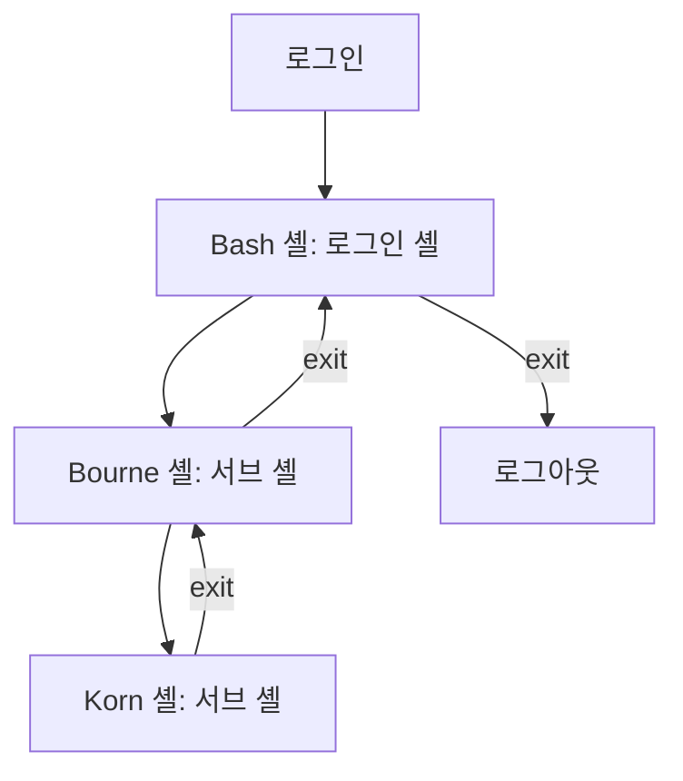
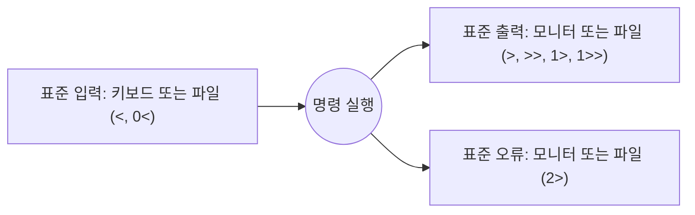
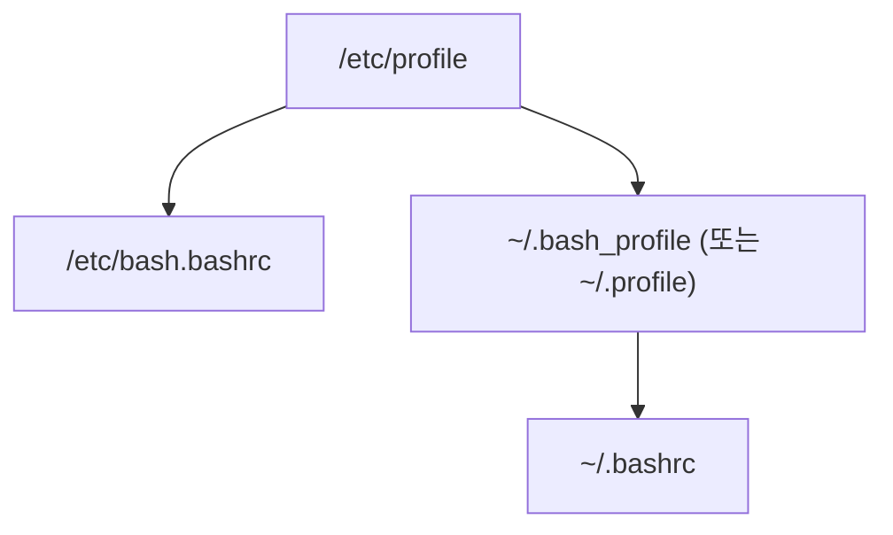

# 6주차 이론 — 셸 사용법

[레포지토리 안내](../../README.ko.md) | [English](Concepts_Lecture.md) | [한국어](Concepts_Lecture.ko.md)

> **최종 수정일:** 2026-11-27
>
> 우분투 리눅스, 이종원, Ch 1, 4

> **학습 목표:**
> 1. 셸의 기능과 종류, 명령의 구조를 설명할 수 있다
> 2. 셸 특수문자와 인용 규칙을 구분하여 사용할 수 있다
> 3. I/O 리다이렉션과 파이핑을 적용할 수 있다
> 4. 변수와 별칭으로 셸 환경을 커스터마이즈할 수 있다
> 5. 명령 히스토리, 탭 완성, 명령줄 편집 단축키를 효과적으로 사용할 수 있다
> 6. 시스템 환경 설정 파일과 사용자 환경 설정 파일을 구분할 수 있다

---

## 목차

- [1. 셸의 개념](#1-셸의-개념)
  - [1.1 셸의 역할](#11-셸의-역할)
  - [1.2 터미널과 프롬프트](#12-터미널과-프롬프트)
  - [1.3 명령의 구조](#13-명령의-구조)
  - [1.4 기초 명령과 도움말](#14-기초-명령과-도움말)
- [2. 셸의 종류](#2-셸의-종류)
  - [2.1 주요 셸](#21-주요-셸)
  - [2.2 셸 확인 및 변경](#22-셸-확인-및-변경)
  - [2.3 로그인 셸과 서브 셸](#23-로그인-셸과-서브-셸)
  - [2.4 셸 내장 명령](#24-셸-내장-명령)
  - [2.5 출력 명령](#25-출력-명령)
  - [2.6 명령을 찾는 순서와 type](#26-명령을-찾는-순서와-type)
- [3. 셸 메타문자](#3-셸-메타문자)
  - [3.1 특수 문자](#31-특수-문자)
  - [3.2 명령 실행 제어](#32-명령-실행-제어)
- [4. 인용 규칙](#4-인용-규칙)
  - [4.1 인용 유형](#41-인용-유형)
  - [4.2 셸 확장의 순서](#42-셸-확장의-순서)
- [5. 입출력 방향 변경](#5-입출력-방향-변경)
  - [5.1 표준 입출력 장치](#51-표준-입출력-장치)
  - [5.2 출력 리다이렉션](#52-출력-리다이렉션)
  - [5.3 오류 리다이렉션](#53-오류-리다이렉션)
  - [5.4 입력 리다이렉션](#54-입력-리다이렉션)
- [6. 셸 환경 변수](#6-셸-환경-변수)
  - [6.1 셸 변수와 환경 변수](#61-셸-변수와-환경-변수)
  - [6.2 주요 환경 변수](#62-주요-환경-변수)
  - [6.3 변수 다루기](#63-변수-다루기)
  - [6.4 환경 변수의 상속과 source](#64-환경-변수의-상속과-source)
- [7. 별칭(Alias)](#7-별칭alias)
  - [7.1 별칭 생성 및 관리](#71-별칭-생성-및-관리)
  - [7.2 유용한 별칭](#72-유용한-별칭)
- [8. 명령어 히스토리](#8-명령어-히스토리)
  - [8.1 히스토리 명령어](#81-히스토리-명령어)
  - [8.2 히스토리 설정](#82-히스토리-설정)
  - [8.3 명령 편집과 탭 완성](#83-명령-편집과-탭-완성)
- [9. 프롬프트 설정](#9-프롬프트-설정)
  - [9.1 PS1 프롬프트 커스터마이징](#91-ps1-프롬프트-커스터마이징)
  - [9.2 컬러 프롬프트](#92-컬러-프롬프트)
- [10. 셸 초기화 파일](#10-셸-초기화-파일)
  - [10.1 Bash 시작 파일](#101-bash-시작-파일)
  - [10.2 로딩 순서 (로그인 셸)](#102-로딩-순서-로그인-셸)
- [11. 작업 제어](#11-작업-제어)
  - [11.1 포그라운드 및 백그라운드 작업](#111-포그라운드-및-백그라운드-작업)
  - [11.2 프로세스 우선순위](#112-프로세스-우선순위)
- [12. 모범 사례](#12-모범-사례)
  - [12.1 셸 효율성](#121-셸-효율성)
  - [12.2 보안 고려사항](#122-보안-고려사항)
- [개념 적용](#개념-적용)
- [요약](#요약)
- [점검 문제](#점검-문제)
- [참고 문헌](#참고-문헌)

---

<br>

## 1. 셸의 개념

**셸(Shell)** 은 사용자와 Linux 커널 사이의 인터페이스 역할을 하는 명령줄 해석기이다.


*그림 1. 사용자, 셸, 커널, 하드웨어 사이의 명령 처리 흐름*

### 1.1 셸의 역할

셸의 기능은 크게 세 가지이다. 사용자가 입력한 명령을 해석하여 실행하는 **명령어 해석기 기능**, 명령을 모은 셸 스크립트를 작성하고 실행하는 **프로그래밍 기능**, 그리고 프롬프트, 경로, 별칭 같은 사용자 환경을 정하는 **사용자 환경 설정 기능**이다. 구체적으로 셸은 다음 일을 한다.

- 사용자 명령을 읽고 구문을 분석한다.
- 와일드카드, 별칭, 변수를 확장한다.
- I/O 리다이렉션과 파이프를 처리한다.
- 백그라운드 프로세스를 관리한다.
- 자식 프로세스를 fork하여 외부 프로그램을 실행한다.
- 스크립팅 기능을 제공한다.

### 1.2 터미널과 프롬프트

**터미널(terminal)** 은 명령을 입력하여 시스템을 다루는 창이며, 터미널 안에서 셸이 실행되어 사용자의 입력을 받는다. Ubuntu의 GNOME 데스크톱에서는 프로그램 표시에서 터미널을 골라 열거나 `Ctrl + Alt + T`로 연다.

```text
username@hostname:~$    # Prompt of a regular user
root@hostname:~#        # Prompt of the root user
```

**프롬프트(prompt)** 는 셸이 사용자의 명령 입력을 기다리고 있음을 나타내는 표시이다. Ubuntu의 기본 프롬프트는 `사용자 이름@호스트 이름:현재 디렉터리` 뒤에 `$`나 `#`을 붙인 형태이며, 그 형식은 환경 변수 `PS1`로 바꿀 수 있다(9.1절). 프롬프트의 `~`는 **홈 디렉터리(home directory)** 를 뜻한다. 홈 디렉터리는 사용자 계정의 기본 디렉터리로서 터미널을 열면 처음 위치하는 곳이며, 현재 위치는 `pwd` 명령으로 확인한다(3주차). 터미널은 창의 닫기 버튼을 누르거나, `exit`를 입력하거나, 빈 명령줄에서 `Ctrl + D`를 눌러 닫는다.

> **핵심:** `$` 프롬프트는 일반 사용자를, `#`은 root(슈퍼유저)를 나타낸다.

### 1.3 명령의 구조

Linux 명령은 `명령 [옵션] [인자]` 형식으로 입력한다. 대괄호는 생략할 수 있다는 뜻이다.

- **명령:** 사용자가 실행하려는 프로그램의 이름이며, `date`, `man`, `ls`, `cp`, `mv` 등 수백 가지가 있다.
- **옵션:** 명령의 세부 기능을 선택한다. `-`나 `--`로 시작하며 영문 소문자나 대문자로 이루어진다. 어떤 옵션이 있고 무슨 기능을 하는지는 명령마다 다르므로 해당 명령의 사용법을 참조한다.
- **인자:** 명령에 전달하는 값으로, 주로 파일 이름이나 디렉터리 이름이다. 인자가 없는 명령도 있고, 필요한 인자도 명령마다 다르다.

```bash
ls              # Command only: list the current directory
ls -a           # Command and option: include hidden files
ls /tmp         # Command and argument: list the /tmp directory
ls -a /tmp      # Command, option, and argument: list /tmp including hidden files
```

셸은 입력된 줄을 공백 문자로 나누어 첫 단어를 실행할 명령으로 삼고 나머지 단어를 그 명령에 넘기며, 넘겨받은 단어 가운데 무엇을 옵션으로 해석할지는 각 명령이 정한다.

### 1.4 기초 명령과 도움말

다음은 시스템의 기본 정보를 보여 주는 명령이다.

```bash
date                # Print the current date and time
# Output: Fri Mar 21 14:30:00 KST 2025
cal                 # Print the calendar of this month
cal 2025            # Print the calendar of the whole year 2025
clear               # Clear the screen
hostname            # Print the hostname
uname -r            # Print the kernel release
uname -a            # Print all information, including the kernel name, hostname, release, and architecture
uptime              # Print the system uptime and load averages
```

한국어 환경에서는 `date`가 `2025. 03. 21. (금) 14:30:00 KST`처럼 출력된다. 부하 평균은 9주차에서 다룬다.

명령의 사용법은 다음 명령으로 찾는다.

```bash
man ls              # Manual page for ls
man -k keyword      # Search manual pages by keyword
ls --help           # Short help built into most commands
info ls             # GNU info documentation
```

**매뉴얼 페이지(manual page)** 는 NAME(명령의 간략한 설명), SYNOPSIS(사용법 요약), DESCRIPTION(자세한 설명) 같은 절로 나뉘며, `q`를 누르면 빠져나온다. 명령이 셸 내장 명령인지 실행 파일인지는 `type`으로 확인한다(2.4절).

---

<br>

## 2. 셸의 종류

### 2.1 주요 셸

| 셸 | 경로 | 설명 |
|-------|------|-------------|
| **bash** | `/bin/bash` | Bourne Again Shell; 대부분의 Linux 배포판에서 기본 셸 |
| **sh** | `/bin/sh` | Bourne Shell; Unix V7에서 처음 등장한 표준 셸 |
| **dash** | `/bin/dash` | Debian Almquist Shell; Bourne 셸 기반의 작고 빠른 POSIX 셸 (Ubuntu의 `/bin/sh`) |
| **csh** | `/bin/csh` | C Shell; C 언어와 유사한 문법 |
| **tcsh** | `/bin/tcsh` | 향상된 C Shell |
| **ksh** | `/bin/ksh` | Korn Shell; sh와 csh의 기능을 결합 |
| **zsh** | `/bin/zsh` | Z Shell; sh 계열 셸에 다양한 개선 기능을 더한 셸 |
| **fish** | `/usr/bin/fish` | Friendly Interactive Shell |

*표 1. 주요 셸과 경로*

각 셸이 나온 배경은 다음과 같다.

- **Bourne 셸(sh)** 은 Unix V7에서 처음 등장한 표준 셸이며, 지금은 Bash 셸 같은 다른 셸로 대체되었다.
- **C 셸(csh)** 은 캘리포니아대학교의 Bill Joy가 개발하여 2BSD Unix에서 발표했다. 별칭과 히스토리 기능을 처음 포함했고, 셸 스크립트의 구문 형식이 C 언어와 같다.
- **Korn 셸(ksh)** 은 1980년대 중반 AT&T 벨 연구소에서 개발하여 SVR4 Unix에서 발표했다. Bourne 셸과 호환성을 유지하면서 별칭과 히스토리 기능을 제공한다.
- **Bash 셸(bash)** 은 1988년 Brian Fox가 개발했다. Bourne 셸과 호환성을 유지하면서 C 셸과 Korn 셸의 편리한 기능을 모두 포함하며, Linux의 기본 셸로 제공된다.
- **Dash 셸(dash)** 은 1997년 Herbert Xu가 Linux에 이식했다. Bourne 셸을 기반으로 POSIX 표준을 준수하며 작은 크기로 개발되었다.

### 2.2 셸 확인 및 변경

```bash
# Check current shell
echo $SHELL

# List available shells
cat /etc/shells

# Change default shell
chsh -s /bin/zsh

# Temporarily switch shell
bash            # Start bash session
zsh             # Start zsh session
exit            # Return to previous shell
```

사용자의 기본 셸(로그인 셸)은 `/etc/passwd` 파일의 각 줄 마지막 필드에 저장된다(예: `root:x:0:0:root:/root:/bin/bash`). `chsh -s`로 기본 셸을 바꿀 때는 바꾸려는 셸의 절대 경로를 지정하며, 그 셸은 `/etc/shells`에 등록되어 있어야 한다. `$SHELL`은 로그인 셸을 나타내므로, 프롬프트에서 다른 셸을 실행한 뒤에도 값이 바뀌지 않는다. 지금 실행 중인 셸의 이름은 `echo $0`으로 확인한다.

### 2.3 로그인 셸과 서브 셸

로그인할 때 처음 실행되는 셸을 **로그인 셸(login shell)** 이라 하고, 사용자가 프롬프트에서 다른 셸을 실행하여 생성한 셸을 **서브 셸(subshell)** 이라고 한다. 서브 셸 안에서 또 다른 셸을 실행할 수 있으므로 여러 서브 셸을 사슬처럼 연결할 수 있다. 서브 셸은 `Ctrl+d` 또는 `exit`로 종료하며, 그러면 그 셸을 실행한 이전 셸로 돌아온다.



*그림 2. 로그인 셸에서 서브 셸을 연이어 실행하고 exit로 돌아오는 과정*

셸 프롬프트의 마지막 기호로 사용자를 구분할 수 있다. 일반 사용자의 프롬프트는 `$`, root 사용자의 프롬프트는 `#`으로 끝난다.

### 2.4 셸 내장 명령

**셸 내장 명령(shell builtin)** 은 셸 자체가 가지고 있는 명령이다. 대표적인 내장 명령은 `cd`이다. 일반적인 Linux 명령은 `/bin`이나 `/usr/bin` 같은 디렉터리에 별도의 실행 파일로 존재하며, `file` 명령으로 실행 파일임을 확인할 수 있다.

```bash
$ file /usr/bin/pwd
/usr/bin/pwd: ELF 64-bit LSB pie executable, x86-64, version 1 (SYSV), dynamically linked, ...
$ type cd
cd is a shell builtin
```

> **참고:** bash에서는 `pwd`와 `echo`도 내장 명령으로 제공되며, 같은 이름의 실행 파일(`/usr/bin/pwd`, `/usr/bin/echo`)도 따로 있다. 이름만 입력하면 내장 명령이 먼저 실행된다. 어느 쪽이 실행되는지는 `type` 명령으로 확인한다.

### 2.5 출력 명령

| 명령 | 형식 | 기능 |
|------|------|------|
| `echo` | `echo [-n] [문자열]` | 화면에 한 줄의 문자열을 출력한다. `-n` 옵션을 주면 마지막에 줄을 바꾸지 않는다. |
| `printf` | `printf [형식] [인수]` | 자료를 형식화하여 화면에 출력한다. 형식에는 C 언어의 `printf` 함수처럼 `%d`, `\n` 등을 쓴다. |

*표 2. 셸의 출력 명령*

```bash
$ echo "linux ubuntu"
linux ubuntu
$ printf "linux ubuntu \n"
linux ubuntu
$ printf "%d + %d = %d\n" 10 10 20
10 + 10 = 20
```

`printf`는 형식 문자열에 `\n`이 없으면 줄을 바꾸지 않으므로, `printf linux`를 실행하면 출력 바로 뒤에 다음 프롬프트가 이어 붙는다.

### 2.6 명령을 찾는 순서와 type

셸은 명령줄의 첫 단어를 다음 순서로 찾아 처음 찾은 것을 실행한다 [1].

1. **별칭(alias):** `alias`로 정의한 이름 (7절)
2. **예약어(keyword):** `if`, `for`, `while`처럼 셸 문법을 이루는 단어 (13주차)
3. **함수(function):** 셸에 정의된 함수 (13주차)
4. **내장 명령(builtin):** `cd`, `echo`, `type` 같은 셸 자신의 명령 (2.4절)
5. **실행 파일:** 환경 변수 `PATH`의 디렉터리를 왼쪽부터 차례로 찾아 처음 발견한 파일

`type`은 이 순서에 따라 이름이 무엇으로 해석되는지 알려 주고, `type -a`는 찾을 수 있는 모든 후보를 순서대로 보여 준다. Ubuntu의 기본 `~/.bashrc`는 `ls`에 색상 옵션을 붙인 별칭을 정의하므로 다음과 같이 나온다.

```text
$ type ls
ls is aliased to `ls --color=auto'
$ type -a echo
echo is a shell builtin
echo is /usr/bin/echo
echo is /bin/echo
$ type if
if is a shell keyword
```

`echo`는 내장 명령이 먼저 쓰이므로 `/usr/bin/echo`가 실행되지 않는다. `/bin`이 `/usr/bin`을 가리키는 심볼릭 링크이고(3주차 2.1절) `PATH`에 두 디렉터리가 모두 들어 있어서 같은 파일이 두 번 나온다. `PATH`에서 찾은 실행 파일의 위치는 셸이 기억해 두었다가(해시) 다음에 다시 찾지 않으며, `hash`로 그 목록을 보고 `hash -r`로 지운다.

현재 디렉터리 `.`은 보통 `PATH`에 없으므로, 현재 디렉터리의 스크립트는 `myscript.sh`가 아니라 `./myscript.sh`처럼 경로를 붙여 실행한다. 명령 이름에 `/`가 들어 있으면 셸은 `PATH`를 찾지 않고 그 경로의 파일을 바로 실행한다. 12.2절이 `PATH` 앞에 `.`을 넣지 말라고 한 것은, 다른 사용자가 공용 디렉터리에 `ls`라는 악성 프로그램을 두면 그 디렉터리에서 `ls`를 입력하는 순간 실행되기 때문이다.

---

<br>

## 3. 셸 메타문자

### 3.1 특수 문자

| 문자 | 의미 |
|-----------|---------|
| `~` | 홈 디렉터리 |
| `#` | 주석 |
| `$` | 변수 확장 |
| `&` | 백그라운드에서 명령 실행 |
| `*` | 와일드카드: 임의의 문자열 |
| `?` | 와일드카드: 단일 문자 |
| `;` | 명령 구분자 |
| `\|` | 파이프 |
| `>` `>>` | 출력 리다이렉션 |
| `<` `<<` | 입력 리다이렉션 |
| `\` | 이스케이프 문자 |
| `` ` `` | 명령 치환 (백틱) |
| `$()` | 명령 치환 (권장 형식) |
| `()` | 서브셸 실행 |
| `{}` | 중괄호 확장 |
| `[]` | 와일드카드에서의 문자 클래스 |

*표 3. 셸 메타문자와 의미*

| 특수문자 | 기능 | 예 |
|----------|------|-----|
| `*` | 임의의 문자열 | `ls h*` |
| `?` | 임의의 한 문자 | `ls dir?` |
| `[]` | 대괄호 안에 포함된 문자 중 하나 | `ls [a-f]*` |
| `~` | 홈 디렉터리 (`~user1`은 user1의 홈 디렉터리) | `cd ~user1` |
| `-` | 이전 작업 디렉터리 (`cd`의 인수) | `cd -` |
| `;` | 명령을 연결하여 왼쪽부터 차례로 실행 | `date;cal;ls` |
| `\|` | 왼쪽 명령의 실행 결과를 오른쪽 명령의 입력으로 전달 | `ls -l /etc \| more` |
| `' '` | 모든 셸 특수문자를 무시 | `echo '$SHELL'` |
| `" "` | `$`, `` ` ``, `\`를 제외한 모든 셸 특수문자를 무시 | `echo "$SHELL"` |
| `` ` ` `` | 셸 명령을 수행하고 그 결과로 대체 | ``echo `date` `` |
| `\` | 바로 뒤 특수문자의 기능을 제거 | `echo "\$SHELL"` |

*표 4. 특수문자의 기능과 사용 예*

와일드카드는 셸이 명령을 실행하기 전에 일치하는 파일 이름으로 확장한다. 경로에서 `.`은 현재 디렉터리, `..`은 상위 디렉터리를 뜻한다.

```bash
ls *              # List all files in the current directory and the contents of its subdirectories
cp * /tmp         # Copy all files in the current directory under /tmp
ls -F t*          # Names starting with t, such as t, tmp, temp, with file types (t itself also matches)
cp *.txt ../ch3   # Copy all files with the txt extension to ch3 under the parent directory
ls -l h*d         # Names starting with h and ending with d (hd, had, hard, h12345d, etc.)
cp ~user2/linux.txt .   # Copy linux.txt under user2's home directory to the current directory
```

### 3.2 명령 실행 제어

```bash
# Sequential execution
command1 ; command2              # Run both regardless of success

# Conditional execution
command1 && command2             # Run command2 only if command1 succeeds
command1 || command2             # Run command2 only if command1 fails

# Grouping commands
{ command1; command2; }          # Run in current shell
( command1; command2 )           # Run in subshell
```

`date;cal;ls`는 날짜를 출력한 뒤 달력과 현재 디렉터리의 파일 목록을 차례로 출력하고, `ls -l / | more`는 루트 디렉터리의 상세 목록을 `more`에 넘겨 한 화면씩 보여 준다.

---

<br>

## 4. 인용 규칙

### 4.1 인용 유형

| 인용 부호 | 유형 | 변수 확장 | 예시 |
|-------|------|-------------------|---------|
| `' '` | 작은따옴표 | 안 됨 | `echo '$HOME'`은 `$HOME`을 출력 |
| `" "` | 큰따옴표 | 됨 | `echo "$HOME"`은 `/home/user1`을 출력 |
| `` ` ` `` | 백틱 | 명령 치환 | `` echo `date` ``은 현재 날짜를 출력 |
| `$()` | 명령 치환 | 됨 | `echo $(date)`은 현재 날짜를 출력 |
| `\` | 이스케이프 | 다음 문자를 이스케이프 | `echo \$HOME`은 `$HOME`을 출력 |

*표 5. 인용 부호의 종류와 동작*

```bash
name="Linux"
echo 'Hello $name'      # Output: Hello $name
echo "Hello $name"      # Output: Hello Linux
echo "Today is $(date)" # Output: Today is Fri Mar 21 ...
echo "Files: $(ls)"     # Output: Files: file1 file2 ...
```

큰따옴표 안에서도 `$`, `` ` ``, `\`는 특수한 의미를 유지하므로 ``echo "Today is `date`"``는 백틱 부분이 `date` 명령의 실행 결과로 바뀌어 출력되고, `echo "\$SHELL"`은 `$SHELL`이라는 문자열을 출력하여 `echo '$SHELL'`과 결과가 같다. 백틱은 파일 이름에도 쓸 수 있어서 ``ls /usr/bin/`uname -m` ``은 `uname -m`의 실행 결과를 디렉터리 이름으로 사용한다. `ls -l t\*`처럼 `\`로 `*`의 기능을 없애면 이름이 정확히 `t*`인 파일만 찾는다.

### 4.2 셸 확장의 순서

셸은 명령줄을 단어로 나눈 뒤 다음 순서로 확장하고, 마지막에 남은 인용 부호를 지운 다음 명령을 실행한다 [1].

| 순서 | 확장 | 예 |
|-----:|:-----|:-----|
| 1 | 중괄호 확장 | `{a,b}` → `a b` |
| 2 | 물결표 확장 | `~` → `/home/user1` |
| 3 | 변수 확장, 명령 치환, 산술 확장 | `$USER`, `$(date)`, `$((3+4*2))` |
| 4 | 단어 분리 | 따옴표 밖에서 확장된 결과를 공백, 탭, 줄바꿈에서 나눔 |
| 5 | 경로 이름 확장 (글로빙) | `*.txt` → `a.txt b.txt` (4주차 6절) |
| 6 | 인용 부호 제거 | 남은 `'`, `"`, `\`를 지움 |

*표 6. 셸 확장의 순서*

`HOME=/home/user1`, `USER=user1`이고 현재 디렉터리에 `report_user1.txt`, `report_user1.log`가 있을 때 다음과 같이 확장된다.

```text
$ echo ~/{a,b}_$USER
/home/user1/a_user1 /home/user1/b_user1
$ echo report_$USER*
report_user1.log report_user1.txt
$ echo $((3+4*2))
11
```

첫 명령은 중괄호 확장으로 `~/a_$USER ~/b_$USER`가 되고, 물결표와 변수가 차례로 확장된다. 둘째 명령은 변수 확장으로 `report_user1*`가 된 뒤 글로빙으로 두 파일 이름이 된다. 셋째 명령의 산술 확장은 곱셈을 먼저 하여 3 + 8 = 11이다.

단어 분리와 글로빙은 **따옴표 밖의 확장 결과**에만 적용된다. 그래서 변수를 따옴표 없이 쓰면 값이 바뀔 수 있다.

```text
$ v="a   b"
$ echo $v
a b
$ echo "$v"
a   b
$ f="*.txt"
$ echo $f
report_user1.txt
$ echo "$f"
*.txt
```

`$v`는 단어 분리로 `a`와 `b` 두 인자가 되어 공백 세 칸이 한 칸으로 출력되고, `"$v"`는 한 인자로 그대로 넘어간다. `$f`는 확장된 `*.txt`가 다시 글로빙되어 파일 이름이 된다. 변수에 공백이나 `*`가 들어 있을 수 있으면 언제나 `"$변수"`처럼 큰따옴표로 감싸야 하며, 특히 파일 이름을 담은 변수를 `rm $file`처럼 쓰면 이름에 공백이 있을 때 다른 파일이 지워질 수 있다.

---

<br>

## 5. 입출력 방향 변경

### 5.1 표준 입출력 장치

Linux에서 명령은 실행될 때 세 가지 표준 입출력 장치를 가진다. 각 장치에는 **파일 디스크립터(file descriptor)** 번호가 붙어 있다.

| 장치 | 디스크립터 | 기본 장치 | 방향을 바꾸는 기호 |
|------|------------|-----------|---------------------|
| 표준 입력 (stdin) | 0 | 키보드 | `<`, `0<` |
| 표준 출력 (stdout) | 1 | 모니터 | `>`, `>>`, `1>`, `1>>` |
| 표준 오류 (stderr) | 2 | 모니터 | `2>` |

*표 7. 표준 입출력 장치와 리다이렉션 기호*



*그림 3. 표준 입출력 장치의 방향 변경*

입출력의 방향을 키보드나 모니터가 아닌 파일로 바꾸는 것을 **리다이렉션(redirection)** 이라고 한다. 파이프(`|`)와 `tee`를 포함한 리다이렉션의 기초는 4주차에서도 다룬다.

### 5.2 출력 리다이렉션

출력 리다이렉션은 명령의 결과를 화면이 아닌 파일에 저장한다.

- **`>` (파일 덮어쓰기):** `명령 > 파일명` 또는 `명령 1> 파일명` 형식이다. 파일이 없으면 새로 만들고, 있으면 기존 내용을 지우고 명령의 실행 결과로 덮어쓴다.
- **`>>` (파일에 내용 추가):** `명령 >> 파일명` 형식이다. 파일이 없으면 새로 만들고, 있으면 기존 내용의 끝에 결과를 추가한다.

```bash
$ ls -al > out1          # Save the output of ls -al to out1
$ cat out1               # Check the saved list
$ date > out1            # Overwrite out1 with the output of date (the ls output is gone)
$ date >> out1           # Append the output of date to the end of out1
```

### 5.3 오류 리다이렉션

명령의 오류 메시지는 표준 오류로 출력되므로, `>`로 표준 출력만 리다이렉션하면 오류 메시지는 여전히 화면에 나타난다. 오류 메시지를 파일에 저장하려면 `2>`를 쓴다.

```bash
$ ls /abc > ls.err                # Redirect only stdout: the error appears on screen and ls.err is empty
ls: cannot access '/abc': No such file or directory
$ ls /abc 2> ls.err               # Save standard error to ls.err
$ ls . /abc > ls.out 2> ls.err    # Save stdout to ls.out and stderr to ls.err
$ ls /abc 2> /dev/null            # Discard error messages
$ ls . /abc > ls.out 2>&1         # Save stdout and stderr to one file
```

`/dev/null`은 쓰는 내용을 모두 버리는 특수 파일이다. `2>&1`은 표준 오류(2)를 표준 출력(1)이 가리키는 곳으로 보낸다는 뜻이며, 셸은 리다이렉션을 왼쪽부터 처리하므로 `> ls.out` 뒤에 써야 두 출력이 모두 `ls.out`에 들어간다.

### 5.4 입력 리다이렉션

입력 리다이렉션은 키보드 대신 파일에서 표준 입력을 읽는다. 형식은 `명령 < 파일명` 또는 `명령 0< 파일명`이다.

```bash
$ cat < out1             # Read out1 as standard input and print it
$ cat 0< out1            # Same as above
```

---

<br>

## 6. 셸 환경 변수

### 6.1 셸 변수와 환경 변수

- **셸 변수(shell variable)** 는 현재 셸에서만 사용할 수 있고 서브 셸로는 전달되지 않는 변수이다.
- **환경 변수(environment variable)** 는 현재 셸뿐만 아니라 서브 셸과 자식 프로세스로도 전달되는 변수이다.

셸 변수와 환경 변수의 이름은 관례적으로 대문자로 쓴다(예: `NAME='tmskim'`). 변수의 값은 `set`과 `env`로 확인할 수 있는데, `set`은 셸 변수와 환경 변수를 모두 출력하고 `env`는 환경 변수만 출력한다. 특정 변수의 값은 `echo $변수명`으로 출력한다.

### 6.2 주요 환경 변수

| 변수 | 설명 | 예시 |
|----------|-------------|---------|
| `HOME` | 사용자 홈 디렉터리 | `/home/user1` |
| `PATH` | 명령어 검색 경로 | `/usr/bin:/usr/local/bin` |
| `SHELL` | 현재 셸 경로 | `/bin/bash` |
| `USER` | 현재 사용자 이름 | `user1` |
| `LOGNAME` | 사용자 계정 이름 | `user1` |
| `HOSTNAME` | 시스템 호스트 이름 | `myubuntu` |
| `PWD` | 현재 작업 디렉터리 | `/home/user1` |
| `OLDPWD` | 이전 작업 디렉터리 | `/tmp` |
| `PS1` | 기본 프롬프트 문자열 | `\u@\h:\w\$` |
| `PS2` | 보조 프롬프트 (연속 입력) | `>` |
| `LANG` | 시스템 로캘 | `en_US.UTF-8` |
| `TERM` | 터미널 유형 | `xterm-256color` |
| `EDITOR` | 기본 텍스트 편집기 | `/usr/bin/vim` |
| `HISTSIZE` | 히스토리에 저장되는 명령어 수 | `1000` |
| `HISTFILE` | 히스토리 파일 위치 | `~/.bash_history` |

*표 8. 주요 환경 변수*

> **참고:** `SHELL`에는 실행 중인 서브 셸이 아니라 로그인 셸의 경로가 들어 있다(2.2절).

### 6.3 변수 다루기

```bash
# Display a variable
echo $HOME
echo $PATH

# Set a local variable (current shell only)
MY_VAR="Hello World"
echo $MY_VAR

# Export as environment variable (available to child processes)
export MY_VAR="Hello World"

# Unset a variable
unset MY_VAR

# View all environment variables
env
printenv
export

# Modify PATH
export PATH=$PATH:/opt/myapp/bin
```

| 작업 | 형식 | 예 |
|------|------|-----|
| 셸 변수 정의 | `변수=값` (등호 앞뒤에 공백 없음) | `NAME='tmskim'` |
| 환경 변수로 설정 | `변수=값; export 변수` | `NAME='tmskim'; export NAME` |
| 정의와 동시에 환경 변수로 설정 | `export 변수=값` | `export NAME='tmskim'` |
| 환경 변수를 다시 셸 변수로 변경 | `export -n 변수` | `export -n NAME` |
| 변수 값 확인 | `set`, `env`, `echo $변수명` | `echo $NAME` |
| 변수 해제 | `unset 변수명` | `unset NAME` |

*표 9. 변수의 정의, 확인, 해제 방법*

예를 들어 `SOME=test`로 정의한 셸 변수는 `set | grep SOME`으로는 보이지만 `env | grep SOME`으로는 검색되지 않는다. `export SOME`을 실행하면 `env`에서도 `SOME=test`가 검색되고, `export -n SOME`을 실행하면 다시 `env`에서 사라진다. `export -n`은 변수를 지우지 않으므로 `echo $SOME`은 여전히 `test`를 출력한다. `unset`으로 해제한 변수는 `echo`로도 출력되지 않는다.

### 6.4 환경 변수의 상속과 source

환경 변수는 부모에서 자식으로만 전달된다. 자식 프로세스는 fork할 때 부모의 환경을 복사해 받으므로(9주차 1.4절), 자식이 바꾼 값은 부모에게 돌아가지 않는다.

```text
$ export COLOR=blue
$ bash -c 'echo $COLOR; COLOR=red; echo $COLOR'
blue
red
$ echo $COLOR
blue
$ COLOR=green bash -c 'echo $COLOR'
green
$ echo $COLOR
blue
```

- 자식 Bash는 물려받은 `blue`를 출력하고 자신의 사본을 `red`로 바꾸지만, 부모의 `COLOR`는 그대로 `blue`이다.
- `변수=값 명령` 형식은 그 명령 하나의 환경에만 변수를 넣는다. 셸의 변수는 바뀌지 않는다.

그래서 변수를 정하는 스크립트를 `./setenv.sh`처럼 실행하면 그 스크립트를 실행한 자식 셸에서만 변수가 바뀌고 끝난다. 현재 셸의 변수를 바꾸려면 스크립트를 자식 프로세스로 실행하지 않고 현재 셸에서 읽어 실행하는 `source setenv.sh`(또는 `. setenv.sh`)를 써야 한다. 10절의 시작 파일을 고친 뒤 `source ~/.bashrc`로 바로 적용하는 것도 같은 원리이며, 3주차 5.8절에서 `cd`가 내장 명령이어야 하는 이유와도 같다.

---

<br>

## 7. 별칭(Alias)

**별칭(alias)** 은 기존 명령을 대신하여 다른 이름을 붙이는 기능이다. 긴 명령이나 자주 쓰는 옵션 조합을 짧은 이름으로 실행할 수 있다.

### 7.1 별칭 생성 및 관리

```bash
# Create alias
alias ll='ls -la'
alias grep='grep --color=auto'
alias rm='rm -i'
alias ..='cd ..'
alias ...='cd ../..'

# View all aliases
alias

# Remove an alias
unalias ll

# Make aliases persistent (add to ~/.bashrc)
echo "alias ll='ls -la'" >> ~/.bashrc
```

별칭은 `alias 이름='명령'` 형식으로 정의한다. 명령에 공백이 있으면 작은따옴표로 감싸야 하며, 여러 명령을 `alias 이름='명령1;명령2'`처럼 하나의 이름으로 묶을 수도 있다. 인수 없이 `alias`만 입력하면 현재 설정된 별칭 목록을 출력한다. 예를 들어 `alias rm='rm -i'`를 정의한 뒤 `rm out1`을 실행하면 `rm: remove regular empty file 'out1'?`처럼 삭제할지 먼저 묻는다.

### 7.2 유용한 별칭

```bash
alias la='ls -la'
alias lt='ls -lt'
alias mkdir='mkdir -pv'
alias ports='netstat -tulanp'
alias df='df -h'
alias du='du -sh'
alias free='free -m'
alias update='sudo apt update && sudo apt upgrade -y'
```

---

<br>

## 8. 명령어 히스토리

**히스토리(history)** 는 사용자가 이전에 입력한 명령을 다시 불러내어 사용하는 기능이다. `history` 명령은 저장된 명령을 번호와 함께 출력한다.

### 8.1 히스토리 명령어

```bash
history                 # Show command history
history 20              # Show last 20 commands
!n                      # Execute command number n
!!                      # Execute last command
!string                 # Execute last command starting with string
!?string                # Execute last command containing string
^old^new                # Replace old with new in last command

# History search
Ctrl+r                  # Reverse search (type to search)
Ctrl+s                  # Forward search
```

예를 들어 `history`의 출력에서 347번이 `ls`였다면 `!347`은 `ls`를 다시 실행하고, `!l`은 `l`로 시작하는 가장 최근 명령을 다시 실행한다. 셸은 히스토리 확장 결과를 먼저 화면에 보여 준 뒤 실행한다.

### 8.2 히스토리 설정

```bash
# In ~/.bashrc
export HISTSIZE=10000           # Commands in memory
export HISTFILESIZE=20000       # Commands in history file
export HISTCONTROL=ignoredups   # Ignore duplicate commands
export HISTTIMEFORMAT="%F %T "  # Add timestamps
```

히스토리는 셸이 실행되는 동안 메모리에 보관되고, 셸을 종료할 때 홈 디렉터리 아래의 숨김 파일 `.bash_history`에 저장된다. 다음에 로그인하면 이 파일을 읽어 이전 세션의 명령도 다시 불러올 수 있다.

### 8.3 명령 편집과 탭 완성

방향키 `↑`, `↓`로 이전 명령을 불러온 다음 `←`, `→`로 커서를 옮겨 잘못된 부분만 고쳐 다시 실행할 수 있다. 예를 들어 `man hisdory`로 잘못 입력하여 `No manual entry for hisdory`가 출력되었으면, `↑`로 명령을 불러와 `d`를 `t`로 고친 뒤 `Enter`를 누른다.

`Tab` 키를 누르면 셸이 입력 중인 명령 이름이나 파일 이름을 자동으로 완성한다. 후보가 여러 개이면 공통된 부분까지만 완성하며, `Tab`을 한 번 더 누르면 가능한 후보 목록을 보여 준다.

커서를 옮기거나 입력한 내용을 지울 때는 다음 단축키를 쓴다.

| 단축키 | 동작 |
|--------|------|
| `Backspace`, `Delete` | 커서 앞이나 커서 위치의 문자 삭제 |
| `Ctrl + A` | 줄의 시작으로 커서 이동 |
| `Ctrl + E` | 줄의 끝으로 커서 이동 |
| `Ctrl + W` | 커서 앞의 단어 하나 삭제 |
| `Ctrl + U` | 커서에서 줄의 시작까지 삭제 |
| `Ctrl + K` | 커서에서 줄의 끝까지 삭제 |
| `Ctrl + L` | 화면 지우기 |
| `Ctrl + C` | 입력 중인 명령 취소 |
| `Ctrl + D` | 입력의 끝(EOF) 알림, 빈 명령줄에서는 셸 종료(로그아웃) |

*표 10. 명령줄 편집 단축키*

---

<br>

## 9. 프롬프트 설정

### 9.1 PS1 프롬프트 커스터마이징

프롬프트 문자열은 환경 변수 `PS1`에 저장되어 있으며, `PS1`의 값을 바꾸면 프롬프트가 바뀐다. 현재 값은 `echo $PS1`로 확인한다. `PS1`에는 `\u`처럼 백슬래시로 시작하는 **이스케이프 문자**를 쓸 수 있고, 셸은 프롬프트를 출력할 때 이 문자의 의미를 해석하여 실제 값으로 바꾼다.

| 이스케이프 코드 | 의미 |
|-------------|---------|
| `\u` | 사용자 이름 |
| `\h` | 호스트 이름 (짧은 형식) |
| `\H` | 호스트 이름 (전체) |
| `\w` | 현재 작업 디렉터리 (전체 경로) |
| `\W` | 현재 디렉터리 (기본 이름) |
| `\d` | 날짜 |
| `\t` | 시간 (24시간 형식) |
| `\$` | 일반 사용자는 `$`, root는 `#` |
| `\n` | 줄 바꿈 |
| `\a` | ASCII 종소리 문자 (07) |
| `\e` | ASCII 이스케이프 문자 (033, 터미널 제어의 시작) |
| `\s` | 셸 이름 |
| `\T` | 시간 (12시간 형식, HH:MM:SS) |
| `\@` | 시간 (12시간 형식, 오전/오후) |
| `\v` | bash의 버전 |
| `\!` | 현재 명령의 히스토리 번호 |
| `\[` | 출력하지 않을 문자열의 시작 |
| `\]` | 출력하지 않을 문자열의 끝 |

*표 11. PS1에 쓰는 이스케이프 문자*

```bash
# Custom prompt examples
export PS1="\u@\h:\w\$ "         # user@host:/path$
export PS1="[\t] \u:\W\$ "      # [14:30:00] user:dir$
```

프롬프트를 바꾸기 전에 `OLDPS1=$PS1`처럼 현재 값을 다른 변수에 저장해 두면, 나중에 `PS1=$OLDPS1`로 처음 설정을 되돌릴 수 있다.

### 9.2 컬러 프롬프트

컬러 프롬프트의 형식은 `PS1='\[\e[x;y;nm\]프롬프트\[\e[0m\]'`이다.

- **`\[`와 `\]`:** 이 사이의 문자들은 화면에 출력되지 않는 제어 문자임을 셸에 알린다.
- **`\e[`와 `m`:** `\e`는 터미널 제어의 시작을 알리는 이스케이프 문자이며, `\e[`와 `m` 사이에 색상을 지정한다.
- **`x;y`:** 컬러 번호이다. 글자색과 배경색을 지정한다.
- **`n`:** 굵게, 밑줄, 역상 같은 특수 기능 번호이다.
- **프롬프트:** 프롬프트로 사용할 문자열이다. 끝의 `\e[0m`은 색상을 기본값으로 되돌린다.

| 컬러 | 글자색 번호 | 배경색 번호 |
|------|-------------|-------------|
| 검은색 | 30 | 40 |
| 빨간색 | 31 | 41 |
| 녹색 | 32 | 42 |
| 갈색 | 33 | 43 |
| 파란색 | 34 | 44 |
| 보라색 | 35 | 45 |
| 청록색 | 36 | 46 |
| 흰색 | 37 | 47 |

*표 12. 프롬프트의 컬러 번호*

| 번호 | 기능 |
|------|------|
| 0 | 기본 색 |
| 1 | 굵게 |
| 4 | 흑백에서 밑줄 |
| 5 | 반짝임 |
| 7 | 역상 |
| 10 | 기본 폰트 |
| 38 | 밑줄 사용 가능 |
| 39 | 밑줄 사용 불가능 |

*표 13. 프롬프트의 특수 기능 번호*

```bash
PS1='\[\e[34m\]Linux $\[\e[0m\] '             # Blue prompt
PS1='\[\e[34;1m\]Linux $\[\e[0m\] '           # Blue, bold
PS1='\[\e[31;4m\]Linux $\[\e[0m\] '           # Red, underlined
PS1='\[\e[35;43m\]\u@\h $\[\e[0m\] '          # Brown background, purple text
```

> **주의:** 색상 코드를 `\[`와 `\]`로 감싸지 않으면 셸이 화면에 보이지 않는 제어 문자까지 프롬프트 길이에 포함하여 계산한다. 그러면 긴 명령을 입력할 때 터미널의 화면 끝에 가기 전에 커서가 줄 앞으로 돌아와 같은 줄을 겹쳐 쓰게 된다.

---

<br>

## 10. 셸 초기화 파일

셸의 환경 설정 파일은 시스템을 사용하는 전체 사용자에게 공통으로 적용되는 **시스템 환경 설정 파일**과 사용자별로 프롬프트, 경로, 별칭 등을 정하는 **사용자 환경 설정 파일**로 나뉜다.

### 10.1 Bash 시작 파일

| 파일 | 읽히는 시점 | 범위 |
|------|-----------|-------|
| `/etc/profile` | 로그인 셸 | 시스템 전체 |
| `/etc/bash.bashrc` | 모든 대화형 셸 | 시스템 전체 |
| `~/.profile` | 로그인 셸 | 사용자별 |
| `~/.bash_profile` | 로그인 셸 | 사용자별 |
| `~/.bashrc` | 모든 대화형 셸 | 사용자별 |
| `~/.bash_logout` | 로그아웃 시 | 사용자별 |

*표 14. bash 시작 파일이 읽히는 시점과 범위*

| 파일 | 주요 내용 |
|------|-----------|
| `/etc/profile` | Bourne 셸이나 Bourne 셸과 호환되는 모든 셸에 공통으로 적용된다. Bash 셸이면 `/etc/bash.bashrc`를 실행하고, Bash 셸이 아니면 프롬프트를 `#`(root)나 `$`(일반 사용자)로 정하며, `/etc/profile.d/*.sh`를 실행한다. |
| `/etc/bash.bashrc` | 시스템 공통으로 적용되는 `.bashrc`이며, 기본 프롬프트와 `sudo` 사용에 관한 안내를 설정한다. |
| `/etc/profile.d/*.sh` | 언어나 명령별로 필요한 환경을 설정하며, 필요하면 설정 파일을 추가한다. |
| `~/.profile` | `.bashrc`가 있으면 실행하고, 경로 추가 같은 사용자 정의 환경을 설정한다. |
| `~/.bashrc` | 히스토리의 크기, 기본 별칭이나 함수 등을 설정한다. |
| `~/.bash_logout` | 로그아웃할 때 실행할 명령을 설정한다. |
| `~/.bash_aliases` | 사용자가 정의한 별칭을 별도 파일로 저장한다 (`~/.bashrc`가 읽어 들인다). |

*표 15. 시스템과 사용자 환경 설정 파일의 주요 내용*

### 10.2 로딩 순서 (로그인 셸)



*그림 4. 로그인 셸에서 환경 설정 파일이 읽히는 순서*

```bash
# Reload configuration without logging out
source ~/.bashrc
# or
. ~/.bashrc
```

> **참고:** 로그인 셸의 bash는 `~/.bash_profile`, `~/.bash_login`, `~/.profile` 가운데 처음 발견한 파일 하나만 읽는다. `~/.bashrc`는 비로그인 대화형 셸(예: 데스크톱에서 새로 연 터미널 창)이 직접 읽고, 로그인 셸에서는 Ubuntu의 기본 `~/.profile`이 `~/.bashrc`를 실행하므로 결과적으로 모든 대화형 셸에 적용된다.

사용자 환경 설정 파일을 수정한 뒤에는 `.`(점) 또는 `source` 명령으로 그 파일을 실행하여 로그아웃하지 않고도 바로 적용할 수 있다. 예를 들어 `~/.profile`에 `PATH=$PATH:/etc`를 추가하고 `. ~/.profile`을 실행하면 `echo $PATH`의 끝에 `/etc`가 붙는다.

---

<br>

## 11. 작업 제어

작업 제어와 프로세스 우선순위는 9주차에서 프로세스 관리와 함께 자세히 다룬다.

### 11.1 포그라운드 및 백그라운드 작업

```bash
# Run command in background
command &

# List jobs
jobs
jobs -l                         # With PID

# Bring background job to foreground
fg %1                           # Job number 1

# Send foreground job to background
Ctrl+Z                          # Suspend current job
bg %1                           # Resume job 1 in background

# Terminate a job
kill %1                         # Send SIGTERM to job 1
kill -9 %1                      # Send SIGKILL (force kill)
```

### 11.2 프로세스 우선순위

```bash
nice -n 10 command              # Run with lower priority
renice -n 5 -p PID              # Change priority of running process
```

---

<br>

## 12. 모범 사례

### 12.1 셸 효율성

- `Tab` 자동 완성을 활용하면 명령과 파일 이름을 빠르고 정확하게 입력할 수 있다.
- 전체 명령어를 다시 입력하는 대신 `Ctrl+R`로 히스토리를 검색한다.
- 자주 사용하는 명령어에는 별칭을 만들어 둔다.
- 가독성을 위해 백틱 대신 `$()` 명령 치환을 사용한다.
- 단어 분리를 방지하기 위해 변수를 큰따옴표로 감싼다.

### 12.2 보안 고려사항

- 기록될 수 있는 환경 변수에 비밀번호를 저장하지 않는다.
- `PATH`를 수정할 때 주의하며, 특히 `PATH` 앞에 `.`을 추가하지 않는다.
- 민감한 변수는 `export -n`으로 내보내기를 해제한다.
- 셸 히스토리에 민감한 정보가 남아 있지 않은지 확인한다.

---

<br>

## 개념 적용

**T/F 점검:**

| 문장 | 판단과 근거 |
|:-----|:-----|
| 같은 이름의 별칭과 실행 파일이 있으면 실행 파일이 먼저 실행된다. | **F.** 셸은 별칭, 예약어, 함수, 내장 명령, `PATH`의 실행 파일 순서로 찾는다. |
| `v="a   b"; echo $v`는 공백 세 칸을 그대로 출력한다. | **F.** 따옴표 밖의 변수 확장 결과는 단어 분리되므로 `a b`가 출력된다. |
| 글로빙은 변수 확장보다 먼저 일어난다. | **F.** 경로 이름 확장은 변수 확장과 단어 분리 뒤에 일어나므로 변수에 담긴 `*`도 펼쳐진다. |
| 자식 프로세스에서 `export`로 바꾼 변수는 부모 셸에도 반영된다. | **F.** 환경은 fork할 때 복사되어 부모에서 자식으로만 전달된다. |
| `./setenv.sh`와 `source setenv.sh`는 현재 셸의 변수에 같은 영향을 준다. | **F.** 앞의 것은 자식 셸에서 실행되어 현재 셸을 바꾸지 못하고, `source`만 현재 셸에서 실행된다. |

---

<br>

## 요약

| 개념 | 핵심 요약 |
|---------|-----------|
| 셸 | 사용자와 커널 사이의 명령 해석기이며, 프로그래밍과 사용자 환경 설정 기능도 제공한다. |
| 프롬프트 기호 | `$`는 일반 사용자를, `#`은 root 사용자를 나타내며, 프롬프트의 `~`는 홈 디렉터리를 뜻한다. |
| 명령의 구조 | 명령은 `명령 [옵션] [인자]` 형식이며, 옵션은 `-`나 `--`로 시작한다. |
| 매뉴얼 페이지 | `man 명령`으로 여는 내장 문서이며, NAME, SYNOPSIS, DESCRIPTION 같은 절로 나뉜다. |
| Bash | Bourne 셸과 호환되면서 C 셸과 Korn 셸의 기능을 포함한 셸로, 대부분의 Linux 시스템에서 기본 셸(`/bin/bash`)이다. |
| 로그인 셸과 서브 셸 | 로그인할 때 실행되는 셸이 로그인 셸이고, 그 안에서 실행한 셸은 서브 셸이며 `exit`로 돌아온다. |
| 메타문자 | `*`, `?`, `[]`, `\|`, `>`, `>>`, `&`, `;`, `$` 같은 문자는 셸이 특별하게 해석한다. |
| 인용 | 작은따옴표는 모든 특수문자를 무시하고, 큰따옴표는 `$`, `` ` ``, `\`만 해석한다. |
| 리다이렉션 | `>`와 `>>`는 표준 출력을, `2>`는 표준 오류를, `<`는 표준 입력을 파일로 바꾸며 `2>&1`은 두 출력을 합친다. |
| 환경 변수 | `$HOME`, `$PATH`, `$SHELL`, `$USER`, `$PS1` 같은 환경 변수는 `export`로 만들고 서브 셸에 전달된다. |
| 별칭 | `alias ll='ls -la'`처럼 명령에 다른 이름을 붙이며, `unalias`로 제거한다. |
| 히스토리 | `history`, `!!`, `!n`으로 이전 명령을 다시 실행하고 `Ctrl+R`로 검색하며, 기록은 `~/.bash_history`에 저장된다. |
| 프롬프트 | `PS1`에 `\u`, `\h`, `\w` 같은 이스케이프 문자와 `\[\e[...m\]` 색상 코드를 넣어 프롬프트를 바꾼다. |
| 초기화 파일 | `/etc/profile`, `/etc/bash.bashrc`는 시스템 전체에, `~/.profile`, `~/.bashrc`는 사용자별로 적용된다. |
| 작업 제어 | `&`(백그라운드), `fg`/`bg`, `Ctrl+Z`(일시 중지)로 작업을 제어한다. |
| 명령을 찾는 순서 | 별칭, 예약어, 함수, 내장 명령, `PATH`의 실행 파일 순서로 찾으며, `type -a`로 확인한다. |
| 셸 확장의 순서 | 중괄호, 물결표, 변수와 명령 치환과 산술, 단어 분리, 글로빙, 인용 부호 제거의 순서이다. |
| 환경의 상속 | 환경 변수는 부모에서 자식으로만 복사되며, 현재 셸을 바꾸려면 `source`로 스크립트를 실행한다. |

---

<br>

## 점검 문제

1. **리다이렉션:** 현재 디렉터리는 존재하고 `/abc`는 존재하지 않는다. `ls . /abc > ls.out 2> ls.err`, `ls /abc > ls.out`, `ls . /abc > ls.out 2>&1`을 각각 실행했을 때 화면, `ls.out`, `ls.err`에 무엇이 나타나는지 설명하라.

   <details>
   <summary>정답</summary>

   첫 번째 명령은 현재 디렉터리의 목록(표준 출력)을 `ls.out`에, `/abc`에 대한 오류 메시지(표준 오류)를 `ls.err`에 저장하고 화면에는 아무것도 출력하지 않는다. 두 번째 명령은 표준 출력만 리다이렉션하므로 오류 메시지가 화면에 출력되고, 출력할 정상 결과가 없으므로 `ls.out`은 빈 파일로 덮어써진다. 세 번째 명령은 표준 오류를 표준 출력이 가리키는 `ls.out`으로 보내므로 오류 메시지와 목록이 모두 `ls.out`에 저장된다.

   </details>

2. **export -n:** `export SOME=test`를 실행한 뒤 `export -n SOME`을 실행했다. 이때 `env | grep SOME`과 `echo $SOME`의 결과는 무엇이며, 그 이유는 무엇인가?

   <details>
   <summary>정답</summary>

   `env | grep SOME`은 아무것도 출력하지 않고, `echo $SOME`은 `test`를 출력한다. `export -n`은 환경 변수를 다시 셸 변수로 바꿀 뿐 변수를 지우지 않는다. 따라서 환경 변수만 보여 주는 `env`에서는 사라지지만, 현재 셸에서는 여전히 값이 남아 있다. 변수를 완전히 없애려면 `unset SOME`을 쓴다.

   </details>

3. **와일드카드:** 현재 디렉터리에 `hd`, `had`, `hard`, `h12345d`, `dir1`, `dir10`, `apple`, `zoo` 파일이 있다. `ls h*d`, `ls dir?`, `ls [a-f]*`가 각각 출력하는 파일을 쓰라.

   <details>
   <summary>정답</summary>

   `h*d`는 `h`로 시작하고 `d`로 끝나는 이름이므로 `h12345d`, `had`, `hard`, `hd`가 출력된다(`*`는 빈 문자열과도 일치한다). `dir?`는 `dir` 뒤에 정확히 한 글자가 오는 이름이므로 `dir1`만 출력된다. `[a-f]*`는 첫 글자가 `a`부터 `f` 사이인 이름이므로 `apple`, `dir1`, `dir10`이 출력된다.

   </details>

4. **컬러 프롬프트:** 사용자 이름, 호스트 이름, 현재 디렉터리의 전체 경로를 파란색으로 보여 주는 프롬프트를 `PS1`로 설정하라. 색상 코드를 `\[`와 `\]`로 감싸야 하는 이유도 설명하라.

   <details>
   <summary>정답</summary>

   `PS1='\[\e[34m\]\u@\h:\w\$ \[\e[0m\]'`처럼 설정한다. `\e[34m`은 글자색을 파란색(34)으로, 끝의 `\e[0m`은 기본 색으로 되돌린다. `\[`와 `\]`는 그 사이의 문자가 화면에 출력되지 않는다는 것을 셸에 알린다. 감싸지 않으면 셸이 제어 문자까지 프롬프트 길이로 계산하여, 긴 명령을 입력할 때 커서가 화면 끝에 가기 전에 줄 앞으로 돌아와 같은 줄을 겹쳐 쓴다.

   </details>

5. **명령의 구조:** `ls -a /tmp`에서 명령, 옵션, 인자를 각각 찾고, 이 명령이 출력하는 내용을 설명하라.

   <details>
   <summary>정답</summary>

   명령은 `ls`, 옵션은 `-a`, 인자는 `/tmp`이다. `ls`는 디렉터리의 내용을 출력하는 명령이고, 인자 `/tmp`가 대상 디렉터리를 지정하며, 옵션 `-a`가 `.`으로 시작하는 숨김 파일까지 출력하게 한다. 따라서 `/tmp` 디렉터리에 있는 모든 파일과 디렉터리를 숨김 파일을 포함하여 출력한다.

   </details>

6. **명령의 유형:** Ubuntu에서 `type cd`는 `cd is a shell builtin`을 출력하지만 `which cd`는 아무것도 출력하지 않는다. 그 이유를 설명하라.

   <details>
   <summary>정답</summary>

   `cd`는 별도의 실행 파일이 아니라 셸에 내장된 명령이다. `type`은 셸의 내장 명령, 별칭, 외부 명령을 모두 구분하여 알려 주지만, `which`는 PATH에 있는 디렉터리에서 실행 파일만 찾는다. `cd`라는 실행 파일이 없으므로 `which cd`는 아무것도 출력하지 않고 실패한다.

   </details>

7. **확장의 결과:** `USER=user1`이고 현재 디렉터리에 `a.txt`, `b.txt`만 있다. 다음 명령의 출력을 쓰라. (가) `echo {1..3}_$USER` (나) `echo '$USER' "$USER" \$USER` (다) `x="*"; echo "$x" $x`

   <details>
   <summary>정답</summary>

   (가) 중괄호 확장으로 `1_$USER 2_$USER 3_$USER`가 된 뒤 변수가 확장되어 `1_user1 2_user1 3_user1`이다. (나) 작은따옴표 안은 확장되지 않고, 큰따옴표 안은 변수가 확장되며, `\$`는 문자 `$`이므로 `$USER user1 $USER`이다. (다) `"$x"`는 `*` 그대로, 따옴표 없는 `$x`는 글로빙되어 `* a.txt b.txt`이다.

   </details>

8. **명령 찾기:** `type -a pwd`의 출력이 `pwd is a shell builtin`, `pwd is /usr/bin/pwd`, `pwd is /bin/pwd`이다. `pwd`를 입력하면 무엇이 실행되며, `/usr/bin/pwd`를 실행하려면 어떻게 하는가?

   <details>
   <summary>정답</summary>

   내장 명령이 실행 파일보다 먼저 찾아지므로 Bash 내장 `pwd`가 실행된다. 실행 파일을 쓰려면 `/usr/bin/pwd`처럼 경로를 붙여 실행한다. 이름에 `/`가 있으면 셸은 별칭, 내장 명령, `PATH`를 찾지 않고 그 파일을 바로 실행한다.

   </details>

---

<br>

## 참고 문헌

1. C. Ramey and B. Fox, "bash(1), GNU Bash 5.3 manual page." [Online]. Available: https://man7.org/linux/man-pages/man1/bash.1.html
