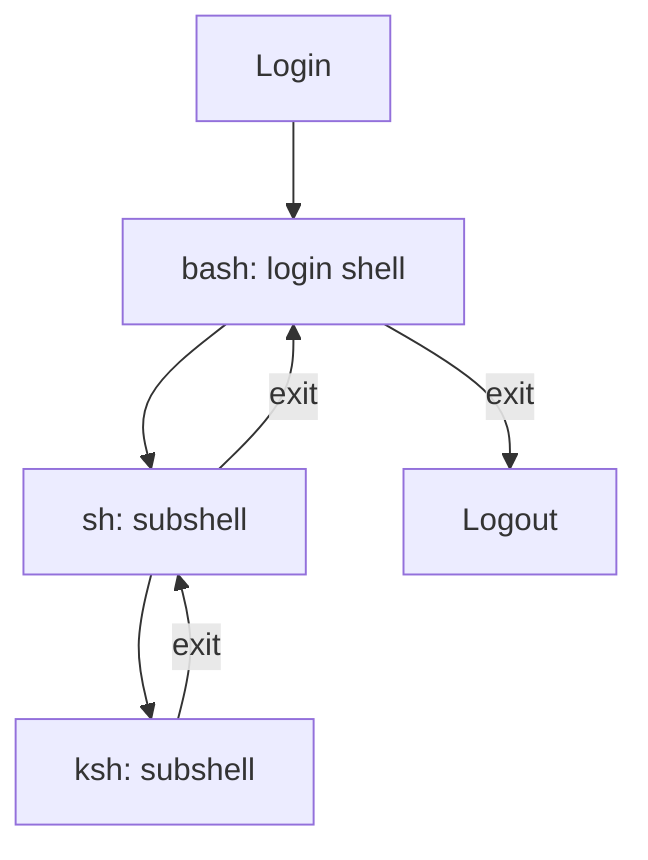
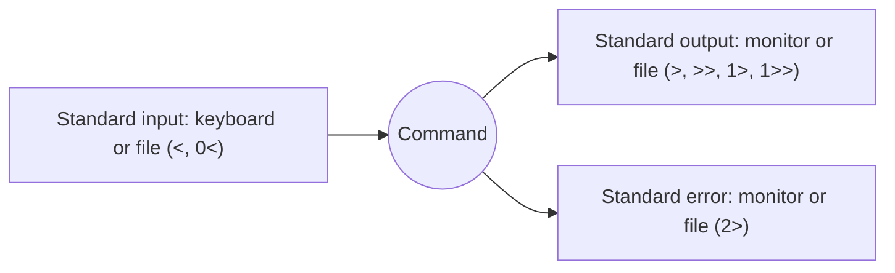

# Week 6 Lecture — Shell Usage

[Repository Guide](../../README.md) | [English](Concepts_Lecture.md) | [한국어](Concepts_Lecture.ko.md)

> **Last Updated:** 2026-10-19
>
> 우분투 리눅스, 이종원, Ch 4

> **Learning Objectives:**
> 1. Explain the functions and types of shells
> 2. Distinguish and use shell special characters and quoting rules
> 3. Apply I/O redirection and piping
> 4. Customize the shell environment with variables and aliases
> 5. Use command history and tab completion effectively
> 6. Distinguish system configuration files from user configuration files

---

## Table of Contents

- [1. What is a Shell?](#1-what-is-a-shell)
  - [1.1 Shell Responsibilities](#11-shell-responsibilities)
- [2. Types of Shells](#2-types-of-shells)
  - [2.1 Common Shells](#21-common-shells)
  - [2.2 Checking and Changing Your Shell](#22-checking-and-changing-your-shell)
  - [2.3 Login Shells and Subshells](#23-login-shells-and-subshells)
  - [2.4 Shell Builtins](#24-shell-builtins)
  - [2.5 Output Commands](#25-output-commands)
- [3. Shell Metacharacters](#3-shell-metacharacters)
  - [3.1 Special Characters](#31-special-characters)
  - [3.2 Command Execution Control](#32-command-execution-control)
- [4. Quoting Rules](#4-quoting-rules)
  - [4.1 Types of Quoting](#41-types-of-quoting)
- [5. Input/Output Redirection](#5-inputoutput-redirection)
  - [5.1 Standard Input/Output Devices](#51-standard-inputoutput-devices)
  - [5.2 Output Redirection](#52-output-redirection)
  - [5.3 Error Redirection](#53-error-redirection)
  - [5.4 Input Redirection](#54-input-redirection)
- [6. Shell Environment Variables](#6-shell-environment-variables)
  - [6.1 Shell Variables and Environment Variables](#61-shell-variables-and-environment-variables)
  - [6.2 Common Environment Variables](#62-common-environment-variables)
  - [6.3 Working with Variables](#63-working-with-variables)
- [7. Aliases](#7-aliases)
  - [7.1 Creating and Managing Aliases](#71-creating-and-managing-aliases)
  - [7.2 Useful Aliases](#72-useful-aliases)
- [8. Command History](#8-command-history)
  - [8.1 History Commands](#81-history-commands)
  - [8.2 History Configuration](#82-history-configuration)
  - [8.3 Command Editing and Tab Completion](#83-command-editing-and-tab-completion)
- [9. Prompt Settings](#9-prompt-settings)
  - [9.1 PS1 Prompt Customization](#91-ps1-prompt-customization)
  - [9.2 Color Prompts](#92-color-prompts)
- [10. Shell Initialization Files](#10-shell-initialization-files)
  - [10.1 Bash Startup Files](#101-bash-startup-files)
  - [10.2 Loading Order (Login Shell)](#102-loading-order-login-shell)
- [11. Job Control](#11-job-control)
  - [11.1 Foreground and Background Jobs](#111-foreground-and-background-jobs)
  - [11.2 Process Priority](#112-process-priority)
- [12. Best Practices](#12-best-practices)
  - [12.1 Shell Efficiency](#121-shell-efficiency)
  - [12.2 Security Considerations](#122-security-considerations)
- [Summary](#summary)
- [Self-Check Questions](#self-check-questions)

---

<br>

## 1. What is a Shell?

The **shell** is a command-line interpreter that acts as an interface between the user and the Linux kernel.

```text
User Input --> Shell (interprets) --> Kernel (executes) --> Hardware
           <-- Shell (displays)  <-- Kernel (returns)  <--
```

*Figure 1. Command processing flow among the user, shell, kernel, and hardware*

### 1.1 Shell Responsibilities

The shell has three main functions: the **command interpreter function**, which interprets and runs the commands the user types; the **programming function**, which writes and runs shell scripts made of commands; and the **user environment function**, which sets the user environment such as the prompt, paths, and aliases. Specifically, the shell does the following.

- It reads and parses user commands.
- It expands wildcards, aliases, and variables.
- It handles I/O redirection and pipes.
- It manages background processes.
- It executes external programs by forking child processes.
- It provides scripting capabilities.

---

<br>

## 2. Types of Shells

### 2.1 Common Shells

| Shell | Path | Description |
|-------|------|-------------|
| **bash** | `/bin/bash` | Bourne Again Shell; default on most Linux distributions |
| **sh** | `/bin/sh` | Bourne Shell; the standard shell first introduced in Unix V7 |
| **dash** | `/bin/dash` | Debian Almquist Shell; a small, fast POSIX shell based on the Bourne shell (`/bin/sh` on Ubuntu) |
| **csh** | `/bin/csh` | C Shell; C-like syntax |
| **tcsh** | `/bin/tcsh` | Enhanced C Shell |
| **ksh** | `/bin/ksh` | Korn Shell; combines features of sh and csh |
| **zsh** | `/bin/zsh` | Z Shell; an sh-family shell with many added improvements |
| **fish** | `/usr/bin/fish` | Friendly Interactive Shell |

*Table 1. Common shells and their paths*

The background of each shell is as follows.

- The **Bourne shell (sh)** is the standard shell first introduced in Unix V7, and it has since been replaced by other shells such as bash.
- The **C shell (csh)** was developed by Bill Joy at the University of California and released with 2BSD Unix. It was the first to include aliases and history, and its shell script syntax follows the C language.
- The **Korn shell (ksh)** was developed at AT&T Bell Labs in the mid-1980s and released with SVR4 Unix. It keeps compatibility with the Bourne shell and provides aliases and history.
- **bash** was developed by Brian Fox in 1988. It keeps compatibility with the Bourne shell, includes the convenient features of the C shell and the Korn shell, and is provided as the default shell of Linux.
- **dash** was ported to Linux by Herbert Xu in 1997. It is based on the Bourne shell, follows the POSIX standard, and was built to be small.

### 2.2 Checking and Changing Your Shell

```bash
# Check current shell
echo $SHELL

# List available shells
cat /etc/shells

# Change default shell
chsh -s /bin/zsh

# Temporarily switch shell
bash            # Start bash session
zsh             # Start zsh session
exit            # Return to previous shell
```

A user's default shell (login shell) is stored in the last field of each line of `/etc/passwd` (e.g., `root:x:0:0:root:/root:/bin/bash`). When changing the default shell with `chsh -s`, give the absolute path of the new shell, which must be registered in `/etc/shells`. Because `$SHELL` holds the login shell, its value does not change after you start another shell at the prompt. The name of the shell currently running is shown by `echo $0`.

### 2.3 Login Shells and Subshells

The shell started first at login is the **login shell**, and a shell created when the user runs another shell at the prompt is a **subshell**. Because another shell can be started inside a subshell, several subshells can be chained. A subshell is ended with `Ctrl+d` or `exit`, which returns to the shell that started it.



*Figure 2. Starting subshells one after another from the login shell and returning with exit*

The last symbol of the shell prompt tells the user type. The prompt of a regular user ends with `$`, and the prompt of the root user ends with `#`.

### 2.4 Shell Builtins

A **shell builtin** is a command contained in the shell itself. The typical builtin is `cd`. Most Linux commands exist as separate executable files in directories such as `/bin` or `/usr/bin`, and the `file` command confirms that they are executables.

```bash
$ file /usr/bin/pwd
/usr/bin/pwd: ELF 64-bit LSB pie executable, x86-64, version 1 (SYSV), dynamically linked, ...
$ type cd
cd is a shell builtin
```

> **Note:** In bash, `pwd` and `echo` are also provided as builtins, and executables with the same names (`/usr/bin/pwd`, `/usr/bin/echo`) exist as well. Typing just the name runs the builtin first. The `type` command shows which one runs.

### 2.5 Output Commands

| Command | Form | Function |
|---------|------|----------|
| `echo` | `echo [-n] [string]` | Prints one line of text to the screen. With the `-n` option, it does not end with a newline. |
| `printf` | `printf [format] [arguments]` | Prints formatted data to the screen. The format uses `%d`, `\n`, and so on, like the C `printf` function. |

*Table 2. Output commands of the shell*

```bash
$ echo "linux ubuntu"
linux ubuntu
$ printf "linux ubuntu \n"
linux ubuntu
$ printf "%d + %d = %d\n" 10 10 20
10 + 10 = 20
```

`printf` does not print a newline unless the format string contains `\n`, so running `printf linux` puts the next prompt right after the output.

---

<br>

## 3. Shell Metacharacters

### 3.1 Special Characters

| Character | Meaning |
|-----------|---------|
| `~` | Home directory |
| `#` | Comment |
| `$` | Variable expansion |
| `&` | Run command in background |
| `*` | Wildcard: any characters |
| `?` | Wildcard: single character |
| `;` | Command separator |
| `\|` | Pipe |
| `>` `>>` | Output redirection |
| `<` `<<` | Input redirection |
| `\` | Escape character |
| `` ` `` | Command substitution (backtick) |
| `$()` | Command substitution (preferred) |
| `()` | Subshell execution |
| `{}` | Brace expansion |
| `[]` | Character class in wildcards |

*Table 3. Shell metacharacters and their meanings*

| Character | Function | Example |
|-----------|----------|---------|
| `*` | Any string | `ls h*` |
| `?` | Any single character | `ls dir?` |
| `[]` | One of the characters in the brackets | `ls [a-f]*` |
| `~` | Home directory (`~user1` is the home directory of user1) | `cd ~user1` |
| `-` | Previous working directory (argument of `cd`) | `cd -` |
| `;` | Joins commands and runs them in order from the left | `date;cal;ls` |
| `\|` | Passes the output of the left command as input to the right command | `ls -l /etc \| more` |
| `' '` | Ignores all shell special characters | `echo '$SHELL'` |
| `" "` | Ignores all shell special characters except `$`, `` ` ``, and `\` | `echo "$SHELL"` |
| `` ` ` `` | Runs a shell command and substitutes its output | ``echo `date` `` |
| `\` | Removes the function of the special character right after it | `echo "\$SHELL"` |

*Table 4. Functions and examples of special characters*

The shell expands wildcards into the matching file names before running the command. In a path, `.` means the current directory and `..` means the parent directory.

```bash
ls *              # List all files in the current directory and the contents of its subdirectories
cp * /tmp         # Copy all files in the current directory under /tmp
ls -F t*          # Names starting with t, such as t, tmp, temp, with file types (t itself also matches)
cp *.txt ../ch3   # Copy all files with the txt extension to ch3 under the parent directory
ls -l h*d         # Names starting with h and ending with d (hd, had, hard, h12345d, etc.)
cp ~user2/linux.txt .   # Copy linux.txt under user2's home directory to the current directory
```

### 3.2 Command Execution Control

```bash
# Sequential execution
command1 ; command2              # Run both regardless of success

# Conditional execution
command1 && command2             # Run command2 only if command1 succeeds
command1 || command2             # Run command2 only if command1 fails

# Grouping commands
{ command1; command2; }          # Run in current shell
( command1; command2 )           # Run in subshell
```

`date;cal;ls` prints the date and then the calendar and the file list of the current directory in order, and `ls -l / | more` passes the detailed list of the root directory to `more`, which shows it one screen at a time.

---

<br>

## 4. Quoting Rules

### 4.1 Types of Quoting

| Quote | Type | Variable Expansion | Example |
|-------|------|-------------------|---------|
| `' '` | Single quotes | No | `echo '$HOME'` prints `$HOME` |
| `" "` | Double quotes | Yes | `echo "$HOME"` prints `/home/user1` |
| `` ` ` `` | Backticks | Command substitution | `` echo `date` `` prints current date |
| `$()` | Command substitution | Yes | `echo $(date)` prints current date |
| `\` | Escape | Escapes next character | `echo \$HOME` prints `$HOME` |

*Table 5. Kinds of quotes and their behavior*

```bash
name="Linux"
echo 'Hello $name'      # Output: Hello $name
echo "Hello $name"      # Output: Hello Linux
echo "Today is $(date)" # Output: Today is Fri Mar 21 ...
echo "Files: $(ls)"     # Output: Files: file1 file2 ...
```

Inside double quotes, `$`, `` ` ``, and `\` keep their special meanings, so in ``echo "Today is `date`"`` the backtick part is replaced by the output of the `date` command, and `echo "\$SHELL"` prints the string `$SHELL`, the same result as `echo '$SHELL'`. Backticks can also be used in file names, so ``ls /usr/bin/`uname -m` `` uses the output of `uname -m` as a directory name. Removing the function of `*` with `\`, as in `ls -l t\*`, finds only a file named exactly `t*`.

---

<br>

## 5. Input/Output Redirection

### 5.1 Standard Input/Output Devices

In Linux, a command has three standard input/output devices when it runs. Each device has a **file descriptor** number.

| Device | Descriptor | Default Device | Redirection Symbols |
|--------|------------|----------------|---------------------|
| Standard input (stdin) | 0 | Keyboard | `<`, `0<` |
| Standard output (stdout) | 1 | Monitor | `>`, `>>`, `1>`, `1>>` |
| Standard error (stderr) | 2 | Monitor | `2>` |

*Table 6. Standard input/output devices and redirection symbols*



*Figure 3. Redirecting the standard input/output devices*

Changing the direction of input or output to a file instead of the keyboard or monitor is called **redirection**. The basics of redirection, including pipes (`|`) and `tee`, are also covered in Week 4.

### 5.2 Output Redirection

Output redirection saves the output of a command to a file instead of the screen.

- **`>` (overwrite a file):** The form is `command > filename` or `command 1> filename`. If the file does not exist, it is created; if it exists, its contents are erased and overwritten with the command output.
- **`>>` (append to a file):** The form is `command >> filename`. If the file does not exist, it is created; if it exists, the output is added to the end of the existing contents.

```bash
$ ls -al > out1          # Save the output of ls -al to out1
$ cat out1               # Check the saved list
$ date > out1            # Overwrite out1 with the output of date (the ls output is gone)
$ date >> out1           # Append the output of date to the end of out1
```

### 5.3 Error Redirection

Error messages of a command go to standard error, so redirecting only standard output with `>` still shows error messages on the screen. To save error messages to a file, use `2>`.

```bash
$ ls /abc > ls.err                # Redirect only stdout: the error appears on screen and ls.err is empty
ls: cannot access '/abc': No such file or directory
$ ls /abc 2> ls.err               # Save standard error to ls.err
$ ls . /abc > ls.out 2> ls.err    # Save stdout to ls.out and stderr to ls.err
$ ls /abc 2> /dev/null            # Discard error messages
$ ls . /abc > ls.out 2>&1         # Save stdout and stderr to one file
```

`/dev/null` is a special file that discards everything written to it. `2>&1` means sending standard error (2) to where standard output (1) points, and because the shell processes redirections from left to right, it must come after `> ls.out` for both outputs to go into `ls.out`.

### 5.4 Input Redirection

Input redirection reads standard input from a file instead of the keyboard. The form is `command < filename` or `command 0< filename`.

```bash
$ cat < out1             # Read out1 as standard input and print it
$ cat 0< out1            # Same as above
```

---

<br>

## 6. Shell Environment Variables

### 6.1 Shell Variables and Environment Variables

- A **shell variable** can be used only in the current shell and is not passed to subshells.
- An **environment variable** is passed not only to the current shell but also to subshells and child processes.

Shell and environment variable names are conventionally written in uppercase (e.g., `NAME='tmskim'`). Variable values can be checked with `set` and `env`: `set` prints both shell variables and environment variables, while `env` prints only environment variables. The value of a specific variable is printed with `echo $name`.

### 6.2 Common Environment Variables

| Variable | Description | Example |
|----------|-------------|---------|
| `HOME` | User's home directory | `/home/user1` |
| `PATH` | Command search path | `/usr/bin:/usr/local/bin` |
| `SHELL` | Current shell path | `/bin/bash` |
| `USER` | Current username | `user1` |
| `LOGNAME` | User account name | `user1` |
| `HOSTNAME` | System hostname | `myubuntu` |
| `PWD` | Current working directory | `/home/user1` |
| `OLDPWD` | Previous working directory | `/tmp` |
| `PS1` | Primary prompt string | `\u@\h:\w\$` |
| `PS2` | Secondary prompt (continuation) | `>` |
| `LANG` | System locale | `en_US.UTF-8` |
| `TERM` | Terminal type | `xterm-256color` |
| `EDITOR` | Default text editor | `/usr/bin/vim` |
| `HISTSIZE` | Number of commands in history | `1000` |
| `HISTFILE` | History file location | `~/.bash_history` |

*Table 7. Common environment variables*

> **Note:** `SHELL` holds the path of the login shell, not of a subshell that is running (Section 2.2).

### 6.3 Working with Variables

```bash
# Display a variable
echo $HOME
echo $PATH

# Set a local variable (current shell only)
MY_VAR="Hello World"
echo $MY_VAR

# Export as environment variable (available to child processes)
export MY_VAR="Hello World"

# Unset a variable
unset MY_VAR

# View all environment variables
env
printenv
export

# Modify PATH
export PATH=$PATH:/opt/myapp/bin
```

| Task | Form | Example |
|------|------|---------|
| Define a shell variable | `name=value` (no spaces around the equals sign) | `NAME='tmskim'` |
| Make it an environment variable | `name=value; export name` | `NAME='tmskim'; export NAME` |
| Define and export at once | `export name=value` | `export NAME='tmskim'` |
| Turn an environment variable back into a shell variable | `export -n name` | `export -n NAME` |
| Check a value | `set`, `env`, `echo $name` | `echo $NAME` |
| Unset a variable | `unset name` | `unset NAME` |

*Table 8. Defining, checking, and unsetting variables*

For example, a shell variable defined with `SOME=test` appears in `set | grep SOME` but is not found by `env | grep SOME`. After `export SOME`, `env` also finds `SOME=test`, and after `export -n SOME`, it disappears from `env` again. `export -n` does not delete the variable, so `echo $SOME` still prints `test`. A variable removed with `unset` is not printed even by `echo`.

---

<br>

## 7. Aliases

An **alias** gives another name to an existing command. A long command or a frequently used combination of options can be run with a short name.

### 7.1 Creating and Managing Aliases

```bash
# Create alias
alias ll='ls -la'
alias grep='grep --color=auto'
alias rm='rm -i'
alias ..='cd ..'
alias ...='cd ../..'

# View all aliases
alias

# Remove an alias
unalias ll

# Make aliases persistent (add to ~/.bashrc)
echo "alias ll='ls -la'" >> ~/.bashrc
```

An alias is defined in the form `alias name='command'`. If the command contains spaces, it must be enclosed in single quotes, and several commands can be bound to one name, as in `alias name='command1;command2'`. Typing `alias` without arguments prints the list of current aliases. For example, after defining `alias rm='rm -i'`, running `rm out1` first asks whether to delete, as in `rm: remove regular empty file 'out1'?`.

### 7.2 Useful Aliases

```bash
alias la='ls -la'
alias lt='ls -lt'
alias mkdir='mkdir -pv'
alias ports='netstat -tulanp'
alias df='df -h'
alias du='du -sh'
alias free='free -m'
alias update='sudo apt update && sudo apt upgrade -y'
```

---

<br>

## 8. Command History

**History** is the feature that recalls and reuses commands the user typed before. The `history` command prints the saved commands with their numbers.

### 8.1 History Commands

```bash
history                 # Show command history
history 20              # Show last 20 commands
!n                      # Execute command number n
!!                      # Execute last command
!string                 # Execute last command starting with string
!?string                # Execute last command containing string
^old^new                # Replace old with new in last command

# History search
Ctrl+r                  # Reverse search (type to search)
Ctrl+s                  # Forward search
```

For example, if entry 347 in the output of `history` was `ls`, `!347` runs `ls` again, and `!l` reruns the most recent command starting with `l`. The shell first shows the result of the history expansion on the screen and then runs it.

### 8.2 History Configuration

```bash
# In ~/.bashrc
export HISTSIZE=10000           # Commands in memory
export HISTFILESIZE=20000       # Commands in history file
export HISTCONTROL=ignoredups   # Ignore duplicate commands
export HISTTIMEFORMAT="%F %T "  # Add timestamps
```

History is kept in memory while the shell runs and is saved to the hidden file `.bash_history` under the home directory when the shell exits. At the next login, the shell reads this file, so commands from previous sessions can be recalled as well.

### 8.3 Command Editing and Tab Completion

You can recall a previous command with the arrow keys `↑` and `↓`, move the cursor with `←` and `→`, fix only the wrong part, and run it again. For example, if you mistyped `man hisdory` and got `No manual entry for hisdory`, recall the command with `↑`, change `d` to `t`, and press `Enter`.

Pressing the `Tab` key makes the shell complete the command name or file name being typed. If there are several candidates, it completes only the common part, and pressing `Tab` once more shows the list of possible candidates.

---

<br>

## 9. Prompt Settings

### 9.1 PS1 Prompt Customization

The prompt string is stored in the environment variable `PS1`, and changing the value of `PS1` changes the prompt. The current value is shown by `echo $PS1`. `PS1` can contain **escape characters** that start with a backslash, such as `\u`, and the shell interprets them and replaces them with actual values when it prints the prompt.

| Escape Code | Meaning |
|-------------|---------|
| `\u` | Username |
| `\h` | Hostname (short) |
| `\H` | Hostname (full) |
| `\w` | Current working directory (full) |
| `\W` | Current directory (basename) |
| `\d` | Date |
| `\t` | Time (24h) |
| `\$` | `$` for user, `#` for root |
| `\n` | Newline |
| `\a` | ASCII bell character (07) |
| `\e` | ASCII escape character (033, starts terminal control) |
| `\s` | Shell name |
| `\T` | Time (12h, HH:MM:SS) |
| `\@` | Time (12h, am/pm) |
| `\v` | bash version |
| `\!` | History number of the current command |
| `\[` | Start of a string that is not printed |
| `\]` | End of a string that is not printed |

*Table 9. Escape characters used in PS1*

```bash
# Custom prompt examples
export PS1="\u@\h:\w\$ "         # user@host:/path$
export PS1="[\t] \u:\W\$ "      # [14:30:00] user:dir$
```

Saving the current value in another variable before changing the prompt, as in `OLDPS1=$PS1`, lets you restore the original setting later with `PS1=$OLDPS1`.

### 9.2 Color Prompts

The form of a color prompt is `PS1='\[\e[x;y;nm\]prompt\[\e[0m\]'`.

- **`\[` and `\]`:** They tell the shell that the characters between them are control characters that are not printed on the screen.
- **`\e[` and `m`:** `\e` is the escape character that starts terminal control, and the color is specified between `\e[` and `m`.
- **`x;y`:** Color numbers for the text color and the background color.
- **`n`:** A special function number such as bold, underline, or reverse video.
- **prompt:** The string used as the prompt. The trailing `\e[0m` resets the colors to the default.

| Color | Text Color Number | Background Color Number |
|-------|-------------------|-------------------------|
| Black | 30 | 40 |
| Red | 31 | 41 |
| Green | 32 | 42 |
| Brown | 33 | 43 |
| Blue | 34 | 44 |
| Purple | 35 | 45 |
| Cyan | 36 | 46 |
| White | 37 | 47 |

*Table 10. Color numbers for the prompt*

| Number | Function |
|--------|----------|
| 0 | Default color |
| 1 | Bold |
| 4 | Underline on monochrome |
| 5 | Blink |
| 7 | Reverse video |
| 10 | Default font |
| 38 | Underline enabled |
| 39 | Underline disabled |

*Table 11. Special function numbers for the prompt*

```bash
PS1='\[\e[34m\]Linux $\[\e[0m\] '             # Blue prompt
PS1='\[\e[34;1m\]Linux $\[\e[0m\] '           # Blue, bold
PS1='\[\e[31;4m\]Linux $\[\e[0m\] '           # Red, underlined
PS1='\[\e[35;43m\]\u@\h $\[\e[0m\] '          # Brown background, purple text
```

> **Caution:** If color codes are not enclosed in `\[` and `\]`, the shell counts the invisible control characters as part of the prompt length. Then, when you type a long command, the cursor returns to the start of the line before reaching the edge of the terminal and overwrites the same line.

---

<br>

## 10. Shell Initialization Files

Shell configuration files are divided into **system configuration files**, which apply to all users of the system, and **user configuration files**, which set the prompt, paths, aliases, and so on for each user.

### 10.1 Bash Startup Files

| File | When Read | Scope |
|------|-----------|-------|
| `/etc/profile` | Login shell | System-wide |
| `/etc/bash.bashrc` | Every interactive shell | System-wide |
| `~/.profile` | Login shell | User-specific |
| `~/.bash_profile` | Login shell | User-specific |
| `~/.bashrc` | Every interactive shell | User-specific |
| `~/.bash_logout` | On logout | User-specific |

*Table 12. When and for whom bash startup files are read*

| File | Main Contents |
|------|---------------|
| `/etc/profile` | Applies to the Bourne shell and all compatible shells. For bash it runs `/etc/bash.bashrc`; for other shells it sets the prompt to `#` (root) or `$` (regular user); and it runs `/etc/profile.d/*.sh`. |
| `/etc/bash.bashrc` | The system-wide `.bashrc`, which sets the default prompt and the hint about using `sudo`. |
| `/etc/profile.d/*.sh` | Set up the environment needed by each language or command; add configuration files here when needed. |
| `~/.profile` | Runs `.bashrc` if it exists and sets user-defined environment such as added paths. |
| `~/.bashrc` | Sets the history size, default aliases, functions, and so on. |
| `~/.bash_logout` | Sets commands to run at logout. |
| `~/.bash_aliases` | Stores user-defined aliases in a separate file (read by `~/.bashrc`). |

*Table 13. Main contents of system and user configuration files*

### 10.2 Loading Order (Login Shell)

```text
/etc/profile
    └── /etc/bash.bashrc
    └── ~/.bash_profile (or ~/.profile)
            └── ~/.bashrc
```

*Figure 4. Order in which configuration files are read by a login shell*

```bash
# Reload configuration without logging out
source ~/.bashrc
# or
. ~/.bashrc
```

> **Note:** A bash login shell reads only the first file it finds among `~/.bash_profile`, `~/.bash_login`, and `~/.profile`. `~/.bashrc` is read directly by non-login interactive shells (e.g., a new terminal window on the desktop), and in a login shell Ubuntu's default `~/.profile` runs `~/.bashrc`, so in effect it applies to every interactive shell.

After editing a user configuration file, you can apply it immediately without logging out by running the file with the `.` (dot) or `source` command. For example, after adding `PATH=$PATH:/etc` to `~/.profile` and running `. ~/.profile`, `/etc` appears at the end of `echo $PATH`.

---

<br>

## 11. Job Control

Job control and process priority are covered in detail with process management in Week 9.

### 11.1 Foreground and Background Jobs

```bash
# Run command in background
command &

# List jobs
jobs
jobs -l                         # With PID

# Bring background job to foreground
fg %1                           # Job number 1

# Send foreground job to background
Ctrl+Z                          # Suspend current job
bg %1                           # Resume job 1 in background

# Terminate a job
kill %1                         # Send SIGTERM to job 1
kill -9 %1                      # Send SIGKILL (force kill)
```

### 11.2 Process Priority

```bash
nice -n 10 command              # Run with lower priority
renice -n 5 -p PID              # Change priority of running process
```

---

<br>

## 12. Best Practices

### 12.1 Shell Efficiency

- Using `Tab` completion lets you type commands and file names quickly and accurately.
- Search the history with `Ctrl+R` instead of typing full commands again.
- Create aliases for frequently used commands.
- Use command substitution `$()` instead of backticks for readability.
- Enclose variables in double quotes to prevent word splitting.

### 12.2 Security Considerations

- Do not store passwords in environment variables that might be logged.
- Be careful when modifying `PATH`, and in particular do not prepend `.` to `PATH`.
- Un-export sensitive variables with `export -n`.
- Check that no sensitive information remains in the shell history.

---

<br>

## Summary

| Concept | Key Summary |
|---------|-------------|
| Shell | The shell is a command interpreter between the user and the kernel and also provides programming and user environment functions. |
| Bash | bash is compatible with the Bourne shell, includes features of the C shell and the Korn shell, and is the default shell (`/bin/bash`) on most Linux systems. |
| Login Shell and Subshell | The shell started at login is the login shell, a shell started inside it is a subshell, and `exit` returns to the previous shell. |
| Metacharacters | Characters such as `*`, `?`, `[]`, `\|`, `>`, `>>`, `&`, `;`, and `$` are interpreted specially by the shell. |
| Quoting | Single quotes ignore all special characters, while double quotes interpret only `$`, `` ` ``, and `\`. |
| Redirection | `>` and `>>` redirect standard output, `2>` redirects standard error, `<` redirects standard input, and `2>&1` merges the two outputs. |
| Environment Variables | Environment variables such as `$HOME`, `$PATH`, `$SHELL`, `$USER`, and `$PS1` are created with `export` and passed to subshells. |
| Aliases | `alias ll='ls -la'` gives a command another name, and `unalias` removes it. |
| History | `history`, `!!`, and `!n` rerun previous commands, `Ctrl+R` searches them, and the record is saved in `~/.bash_history`. |
| Prompt | Putting escape characters such as `\u`, `\h`, `\w` and color codes `\[\e[...m\]` in `PS1` changes the prompt. |
| Initialization Files | `/etc/profile` and `/etc/bash.bashrc` apply system-wide, while `~/.profile` and `~/.bashrc` apply per user. |
| Job Control | Jobs are controlled with `&` (background), `fg`/`bg`, and `Ctrl+Z` (suspend). |

---

<br>

## Self-Check Questions

1. **Redirection:** The current directory exists and `/abc` does not. Explain what appears on the screen, in `ls.out`, and in `ls.err` when you run `ls . /abc > ls.out 2> ls.err`, `ls /abc > ls.out`, and `ls . /abc > ls.out 2>&1`.

   <details>
   <summary>Answer</summary>

   The first command saves the list of the current directory (standard output) to `ls.out` and the error message about `/abc` (standard error) to `ls.err`, and prints nothing on the screen. The second command redirects only standard output, so the error message appears on the screen, and because there is no normal output, `ls.out` is overwritten as an empty file. The third command sends standard error to `ls.out`, where standard output points, so both the error message and the list are saved in `ls.out`.

   </details>

2. **export -n:** You run `export SOME=test` and then `export -n SOME`. What are the results of `env | grep SOME` and `echo $SOME`, and why?

   <details>
   <summary>Answer</summary>

   `env | grep SOME` prints nothing, and `echo $SOME` prints `test`. `export -n` only turns the environment variable back into a shell variable and does not delete it. It therefore disappears from `env`, which shows only environment variables, but the value remains in the current shell. To remove the variable completely, use `unset SOME`.

   </details>

3. **Wildcards:** The current directory contains the files `hd`, `had`, `hard`, `h12345d`, `dir1`, `dir10`, `apple`, and `zoo`. Write the files printed by `ls h*d`, `ls dir?`, and `ls [a-f]*`.

   <details>
   <summary>Answer</summary>

   `h*d` matches names that start with `h` and end with `d`, so `h12345d`, `had`, `hard`, and `hd` are printed (`*` also matches the empty string). `dir?` matches names with exactly one character after `dir`, so only `dir1` is printed. `[a-f]*` matches names whose first character is between `a` and `f`, so `apple`, `dir1`, and `dir10` are printed.

   </details>

4. **Color prompt:** Set `PS1` to a prompt that shows the username, hostname, and full path of the current directory in blue. Also explain why color codes must be enclosed in `\[` and `\]`.

   <details>
   <summary>Answer</summary>

   Set it as `PS1='\[\e[34m\]\u@\h:\w\$ \[\e[0m\]'`. `\e[34m` sets the text color to blue (34), and the trailing `\e[0m` resets it to the default color. `\[` and `\]` tell the shell that the characters between them are not printed on the screen. Without them, the shell counts the control characters as part of the prompt length, so when you type a long command, the cursor returns to the start of the line before reaching the edge of the screen and overwrites the same line.

   </details>
