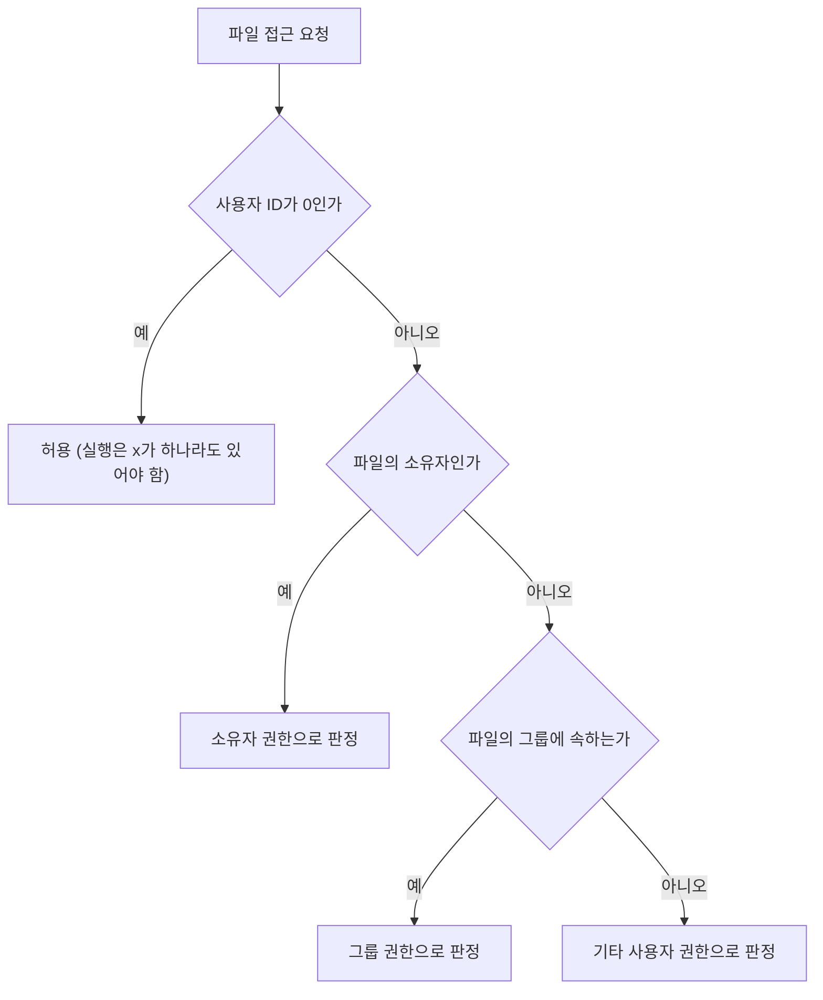

# 7주차 이론 — 파일 접근 권한

[레포지토리 안내](../../README.ko.md) | [English](Concepts_Lecture.md) | [한국어](Concepts_Lecture.ko.md)

> **최종 수정일:** 2026-11-27
>
> 우분투 리눅스, 이종원, Ch 5

> **학습 목표:**
> 1. `ls -l`과 `stat`으로 파일의 속성을 확인하고 해석할 수 있다
> 2. 파일 권한 표기법(rwx, 8진수)을 해석할 수 있다
> 3. chmod, chown, chgrp 명령을 적용할 수 있다
> 4. umask로 기본 권한을 설정할 수 있다
> 5. SetUID, SetGID, sticky bit의 효과를 설명할 수 있다
> 6. 권한 검사의 순서와 비트 연산으로 접근 가능 여부와 새 파일의 권한을 계산할 수 있다

---

## 목차

- [1. 파일 권한 이해](#1-파일-권한-이해)
  - [1.1 파일 속성](#11-파일-속성)
  - [1.2 사용자 범주](#12-사용자-범주)
  - [1.3 권한 유형](#13-권한-유형)
  - [1.4 커널의 권한 검사 순서](#14-커널의-권한-검사-순서)
- [2. 권한 표현 방식](#2-권한-표현-방식)
  - [2.1 기호 표기법](#21-기호-표기법)
  - [2.2 8진수(숫자) 표기법](#22-8진수숫자-표기법)
  - [2.3 12비트 권한과 4자리 8진수](#23-12비트-권한과-4자리-8진수)
- [3. chmod로 권한 변경](#3-chmod로-권한-변경)
  - [3.1 기호 모드](#31-기호-모드)
  - [3.2 8진수 모드](#32-8진수-모드)
  - [3.3 chmod의 세부 규칙](#33-chmod의-세부-규칙)
- [4. 소유권 변경](#4-소유권-변경)
  - [4.1 chown: 소유자 변경](#41-chown-소유자-변경)
  - [4.2 chgrp: 그룹 변경](#42-chgrp-그룹-변경)
  - [4.3 소유권 확인](#43-소유권-확인)
  - [4.4 소유권 변경의 세부 규칙](#44-소유권-변경의-세부-규칙)
- [5. 기본 권한과 umask](#5-기본-권한과-umask)
  - [5.1 umask 동작 원리](#51-umask-동작-원리)
  - [5.2 일반적인 umask 값](#52-일반적인-umask-값)
  - [5.3 umask의 비트 연산](#53-umask의-비트-연산)
- [6. 특수 권한](#6-특수-권한)
  - [6.1 SetUID (SUID)](#61-setuid-suid)
  - [6.2 SetGID (SGID)](#62-setgid-sgid)
  - [6.3 Sticky Bit](#63-sticky-bit)
  - [6.4 특수 권한 요약](#64-특수-권한-요약)
  - [6.5 특수 권한의 동작 원리와 활용](#65-특수-권한의-동작-원리와-활용)
- [7. 모범 사례](#7-모범-사례)
  - [7.1 보안 지침](#71-보안-지침)
  - [7.2 일반적인 보안 점검](#72-일반적인-보안-점검)
- [개념 적용](#개념-적용)
- [요약](#요약)
- [점검 문제](#점검-문제)
- [참고 문헌](#참고-문헌)

---

<br>

## 1. 파일 권한 이해

### 1.1 파일 속성

`ls -l` 명령은 파일의 종류, 접근 권한, 소유자 같은 **파일 속성** 정보를 한 줄로 출력한다.

```bash
$ ls -l /etc/hosts
-rw-r--r-- 1 root root 172 Oct 18 14:53 /etc/hosts
```

| 번호 | 속성 값 | 의미 |
|------|---------|------|
| 1 | `-` | 파일의 종류 (`-`는 일반 파일, `d`는 디렉터리) |
| 2 | `rw-r--r--` | 파일을 읽고 쓰고 실행할 수 있는 접근 권한 |
| 3 | `1` | 하드 링크의 개수 |
| 4 | `root` | 파일 소유자의 로그인 ID |
| 5 | `root` | 파일이 속한 그룹 이름 |
| 6 | `172` | 파일의 크기 (바이트 단위) |
| 7 | `Oct 18 14:53` | 파일이 마지막으로 수정된 날짜 |
| 8 | `/etc/hosts` | 파일 이름 |

*표 1. `ls -l` 출력의 파일 속성*

`stat` 명령은 같은 속성을 더 자세히 보여 준다. 접근 권한을 8진수와 기호로 함께 표시하고, 소유자와 그룹을 번호(UID, GID)와 이름으로 함께 보여 주며, 마지막 접근(Access), 수정(Modify), 속성 변경(Change) 시각을 따로 출력한다.

```bash
$ stat /etc/hosts
  File: /etc/hosts
  Size: 172       	Blocks: 8          IO Block: 4096   regular file
Device: 253,17	Inode: 1076018     Links: 1
Access: (0644/-rw-r--r--)  Uid: (    0/    root)   Gid: (    0/    root)
Access: 2026-10-18 14:53:38.599276403 +0000
Modify: 2026-10-18 14:53:38.655276264 +0000
Change: 2026-10-18 14:53:38.655276264 +0000
 Birth: 2026-10-18 14:53:38.599276403 +0000
```

### 1.2 사용자 범주

모든 파일에는 세 가지 사용자 범주가 있으며, `a`는 세 범주 모두를 가리킨다.

| 범주 | 기호 | 설명 |
|----------|--------|-------------|
| **소유자 (User)** | `u` | 파일을 소유한 사용자 (기본적으로 파일을 생성한 사용자) |
| **그룹 (Group)** | `g` | 파일의 그룹에 속한 사용자들 |
| **기타 (Others)** | `o` | 시스템의 모든 다른 사용자 |
| **전체 (All)** | `a` | 세 범주 모두 |

*표 2. 권한의 사용자 범주*

### 1.3 권한 유형

| 권한 | 기호 | 파일에 대한 의미 | 디렉터리에 대한 의미 |
|-----------|--------|-----------|-----------------|
| **읽기** | `r` (4) | 파일 내용 보기 | 디렉터리 내용 나열 (`ls`) |
| **쓰기** | `w` (2) | 파일 내용 수정 | 디렉터리 내에 파일 생성/삭제 |
| **실행** | `x` (1) | 프로그램으로 실행 | 디렉터리 진입 (`cd`) |

*표 3. 파일과 디렉터리에 대한 권한의 의미*

```bash
$ ls -l myfile.txt
-rw-r--r-- 1 user1 group1 1024 Mar 21 10:00 myfile.txt
```

파일의 읽기 권한이 있으면 파일을 읽거나 복사할 수 있고, 실행 권한이 있으면 셸 스크립트나 실행 파일을 실행할 수 있다. 디렉터리에서는 세 권한이 함께 작동한다.

- 디렉터리의 **읽기** 권한만 있으면 `ls`로 안에 있는 이름은 볼 수 있지만, `ls -l`처럼 각 파일의 정보를 확인하는 옵션은 실행 권한이 있어야 쓸 수 있다.
- 디렉터리의 **실행** 권한이 있어야 `cd`로 그 디렉터리에 들어가고, 안에 있는 파일에 접근하거나 파일을 그 디렉터리로 이동, 복사할 수 있다.
- 디렉터리의 **쓰기** 권한이 있으면 그 안에서 파일을 생성하거나 삭제할 수 있다. 실제로 생성과 삭제를 하려면 실행 권한도 함께 있어야 한다.

> **주의:** 파일을 삭제하거나 이름을 바꾸는 데 필요한 것은 파일 자체의 쓰기 권한이 아니라 그 파일이 있는 **디렉터리의 쓰기 권한**이다. 따라서 읽기 전용(`r--r--r--`) 파일이라도 쓰기 권한이 있는 디렉터리 안에 있으면 삭제할 수 있고, 반대로 디렉터리에 쓰기 권한이 없으면 파일의 권한과 관계없이 삭제할 수 없다.

### 1.4 커널의 권한 검사 순서

프로세스가 파일에 접근하면 커널은 세 범주의 권한 가운데 **하나만** 골라 검사한다. 고르는 순서는 다음과 같다 [1].

1. 프로세스의 사용자 ID가 0(root)이면 권한 비트와 관계없이 읽기와 쓰기를 허용한다. 다만 일반 파일의 실행은 세 범주 가운데 적어도 한 곳에 `x`가 있어야 허용한다.
2. 프로세스의 사용자 ID가 파일의 소유자와 같으면 **소유자 권한만** 검사한다.
3. 그렇지 않고 파일의 그룹이 프로세스의 그룹(기본 그룹 또는 보조 그룹) 가운데 하나이면 **그룹 권한만** 검사한다.
4. 둘 다 아니면 **기타 사용자 권한**을 검사한다.



*그림 1. 커널이 검사할 권한 범주를 고르는 순서*

검사는 위에서 처음 맞는 범주에서 끝나며, 그 범주의 권한이 없으면 다른 범주에 권한이 있어도 거부된다. 그래서 권한이 `077`(`----rwxrwx`)인 파일은 다른 모든 사용자가 읽을 수 있는데도 소유자 자신은 읽지 못한다.

```text
$ echo x > f
$ chmod 077 f
$ ls -l f
----rwxrwx 1 user1 user1 2 Mar 21 13:00 f
$ cat f
cat: f: Permission denied
$ chmod u+r f
$ cat f
x
```

소유자는 권한이 없어도 `chmod`로 자기 파일의 권한을 바꿀 수 있으므로 이 상태는 언제든 고칠 수 있다. 권한을 바꾸는 것은 파일의 내용이 아니라 inode를 바꾸는 일이며, 소유자와 root에게만 허락된 일이기 때문이다.

경로를 따라 파일에 접근할 때는 경로 위의 모든 디렉터리에 실행 권한이 있어야 한다. `/home/user2/notes.txt`를 읽으려면 `/`, `/home`, `/home/user2`에 각각 `x`가 있고 `notes.txt`에 `r`이 있어야 한다. 홈 디렉터리의 권한이 `750`(`rwxr-x---`)이나 `700`처럼 기타 사용자의 `x`를 막고 있으면, 다른 사용자는 파일 자체의 권한이 `644`라도 홈 디렉터리를 지나가지 못해 그 파일을 읽을 수 없다.

---

<br>

## 2. 권한 표현 방식

### 2.1 기호 표기법

```text
-  rwx  r-x  r--
│  └┬┘  └┬┘  └┬┘
│   │    │    └── Others: read only
│   │    └── Group: read + execute
│   └── Owner: read + write + execute
└── File type: regular file
```

*그림 2. 기호로 표기한 권한 문자열의 구성*

권한 문자열은 파일 유형을 나타내는 첫 글자 뒤에 소유자, 그룹, 기타 사용자의 권한을 세 글자씩 차례로 쓴다. 각 자리에 권한이 있으면 `r`, `w`, `x`를, 없으면 `-`를 쓴다. 예를 들어 `rw-r--r--`는 소유자가 읽기와 쓰기, 그룹과 기타 사용자가 읽기 권한을 가진다는 뜻이다.

### 2.2 8진수(숫자) 표기법

권한이 있으면 1, 없으면 0으로 표기하면 세 글자의 권한이 3비트 2진수가 되고, 이를 10진수로 환산하면 0~7의 숫자 하나가 된다. 예를 들어 `r-x`는 2진수 `101`이고 $1 \times 2^2 + 0 \times 2^1 + 1 \times 2^0 = 4 + 0 + 1 = 5$이다. 소유자, 그룹, 기타 사용자의 숫자를 이어 쓰면 세 자리 8진수가 되어, `rwxr-xr--`는 `754`가 된다.

| 권한 | 2진수 | 8진수 |
|-----------|--------|-------|
| `---` | 000 | 0 |
| `--x` | 001 | 1 |
| `-w-` | 010 | 2 |
| `-wx` | 011 | 3 |
| `r--` | 100 | 4 |
| `r-x` | 101 | 5 |
| `rw-` | 110 | 6 |
| `rwx` | 111 | 7 |

*표 4. 권한과 2진수, 8진수의 대응*

**자주 사용되는 권한 값:**

| 8진수 | 기호 | 일반적인 용도 |
|-------|----------|-------------|
| `755` | `rwxr-xr-x` | 실행 파일, 디렉터리 |
| `644` | `rw-r--r--` | 일반 파일 |
| `700` | `rwx------` | 개인 디렉터리/스크립트 |
| `600` | `rw-------` | 개인 파일 (예: SSH 키) |
| `777` | `rwxrwxrwx` | 전체 접근 (운영 환경에서 사용 금지) |
| `666` | `rw-rw-rw-` | 모든 사용자가 읽기와 쓰기 가능 |
| `555` | `r-xr-xr-x` | 모든 사용자가 읽기와 실행만 가능 |
| `640` | `rw-r-----` | 소유자는 읽기와 쓰기, 그룹은 읽기만 가능 |
| `400` | `r--------` | 소유자만 읽기 가능 |
| `000` | `---------` | 접근 불가 |

*표 5. 자주 사용되는 권한 값과 용도*

### 2.3 12비트 권한과 4자리 8진수

inode의 모드(mode)에는 파일 유형을 나타내는 4비트와 권한을 나타내는 12비트가 들어 있다. 권한 12비트는 특수 권한 3비트와 일반 권한 9비트로 이루어지며, 3비트씩 묶으면 8진수 네 자리가 된다.

```text
bit position  11   10     9   │ 8   7   6 │  5  4  3 │  2  1  0
meaning      SUID SGID sticky │ r   w   x │  r  w  x │  r  w  x
category       special        │  owner    │  group   │  others
octal value  4000 2000 1000   │400 200 100│ 40 20 10 │ 4  2  1
```

*그림 3. 권한 12비트의 배치와 각 비트의 8진수 값*

8진수 권한은 켜진 비트의 값을 더한 것이다. 기호 표기에서는 특수 권한이 별도의 자리를 갖지 않고 각 범주의 실행 자리에 겹쳐 표시된다. 특수 비트가 켜져 있고 그 자리의 `x`도 켜져 있으면 소문자(`s`, `t`), `x`가 꺼져 있으면 대문자(`S`, `T`)이다. 다음은 기호 표기를 8진수로 바꾸는 예이다.

| 기호 표기 | 특수 권한 | 소유자 | 그룹 | 기타 | 8진수 |
|:-----|:-----|:-----|:-----|:-----|:-----|
| `rwsr-x--T` | SUID(4) + sticky(1) = 5 | `rws` → r, w, x = 7 | `r-x` = 5 | `--T` → x 없음 = 0 | `5750` |
| `rw-r-Sr--` | SGID(2) = 2 | `rw-` = 6 | `r-S` → x 없음 = 4 | `r--` = 4 | `2644` |
| `rwxrwxrwt` | sticky(1) = 1 | `rwx` = 7 | `rwx` = 7 | `rwt` → x 있음 = 7 | `1777` |
| `--------T` | sticky(1) = 1 | `---` = 0 | `---` = 0 | `--T` → x 없음 = 0 | `1000` |

*표 6. 기호 표기를 4자리 8진수로 바꾸는 예*

`chmod 5750 s`를 실행한 뒤 확인하면 다음과 같다.

```text
$ chmod 5750 s
$ stat -c '%A %a' s
-rwsr-x--T 5750
$ chmod 2644 s
$ stat -c '%A %a' s
-rw-r-Sr-- 2644
```

`stat -c '%A %a'`는 기호 표기와 8진수를 함께 출력한다. 대문자 `S`나 `T`는 "특수 비트는 켜져 있지만 그 자리의 실행 권한이 없어 효과가 없다"는 경고로 읽는다. 예를 들어 `rw-r-Sr--`의 SGID는 실행 파일이 아니므로 아무 일도 하지 않는다.

---

<br>

## 3. chmod로 권한 변경

`chmod` 명령은 접근 권한을 바꾼다. 문자와 기호로 권한을 표시하는 **기호 모드**와 숫자로 표시하는 **8진수 모드**(숫자 모드)가 있다. 파일의 권한은 그 파일의 소유자나 root만 바꿀 수 있다.

### 3.1 기호 모드

기호 모드의 형식은 `chmod [사용자 범주][연산자][권한] 파일명`이다. 사용자 범주는 `u`, `g`, `o`, `a`(표 2), 권한은 `r`, `w`, `x`(표 3)로 쓴다.

```bash
chmod u+x file.sh            # Add execute for owner
chmod g+rw file.txt           # Add read+write for group
chmod o-w file.txt            # Remove write for others
chmod a+r file.txt            # Add read for all
chmod u=rwx,g=rx,o=r file     # Set exact permissions
chmod u+x,g-w file            # Multiple changes
chmod -R 755 directory/       # Recursive permission change
```

**연산자:**
- `+`는 권한을 추가한다.
- `-`는 권한을 제거한다.
- `=`는 지정한 권한으로 정확히 설정한다.

| 권한 표기 | 의미 |
|-----------|------|
| `u+w` | 소유자(u)에게 쓰기(w) 권한 부여(+) |
| `u-x` | 소유자(u)의 실행(x) 권한 제거(-) |
| `g+w` | 그룹(g)에 쓰기(w) 권한 부여(+) |
| `o-r` | 기타 사용자(o)의 읽기(r) 권한 제거(-) |
| `g+wx` | 그룹(g)에 쓰기(w)와 실행(x) 권한 부여(+) |
| `+wx` | 모든 사용자에게 쓰기(w)와 실행(x) 권한 부여(+), 단 umask에 설정된 권한은 제외 |
| `a+rwx` | 모든 사용자에게 읽기(r), 쓰기(w), 실행(x) 권한 부여(+) |
| `u=rwx` | 소유자(u)의 권한을 읽기(r), 쓰기(w), 실행(x)으로 설정(=) |
| `go+w` | 그룹(g)과 기타 사용자(o)에게 쓰기(w) 권한 부여(+) |
| `u+x,go+w` | 소유자(u)에게 실행(x) 권한을 부여하고 그룹(g)과 기타 사용자(o)에게 쓰기(w) 권한 부여(+) |

*표 7. 기호 모드를 사용한 권한 설정의 예*

예를 들어 권한이 `rw-r--r--`인 `test.txt`에 `chmod u-w test.txt`를 실행하면 소유자의 쓰기 권한이 제거되어 `r--r--r--`가 된다.

> **주의:** `chmod +wx`처럼 사용자 범주를 생략하면 `a`와 비슷하게 모든 사용자가 대상이 되지만, 현재 umask(5절)에 설정된 권한은 바뀌지 않는다. 예를 들어 umask가 `022`일 때 권한이 `rw-------`인 파일에 `chmod +wx`를 실행하면 결과는 `rwx--x--x`이며, 그룹과 기타 사용자에게는 쓰기 권한이 추가되지 않는다. 모든 사용자에게 확실히 부여하려면 `a+wx`라고 쓴다.

### 3.2 8진수 모드

8진수 모드의 형식은 `chmod 숫자 파일명`이며, 숫자는 소유자, 그룹, 기타 사용자의 권한을 나타내는 0~7의 숫자 세 개이다.

```bash
chmod 755 script.sh           # rwxr-xr-x
chmod 644 document.txt        # rw-r--r--
chmod 700 private/            # rwx------
chmod 600 id_rsa              # rw-------
chmod -R 755 /var/www/html/   # Recursive
```

예를 들어 권한이 `644`(`rw-r--r--`)인 파일에 `chmod 444`를 실행하면 `r--r--r--`가 되고, 다시 `chmod 474`를 실행하면 `r--rwxr--`가 된다. 8진수 모드는 지정한 값으로 세 범주의 권한을 한꺼번에 설정하므로 umask의 영향을 받지 않는다.

### 3.3 chmod의 세부 규칙

- **여러 변경의 적용 순서.** `chmod u+x,g-w,o=r f`처럼 쉼표로 이은 변경은 왼쪽부터 차례로 적용된다. `=`는 그 범주의 권한을 지정한 것으로 바꾸고 나머지를 끈다. `chmod o= f`는 기타 사용자의 권한을 모두 끈다.
- **대문자 `X`.** 기호 모드의 `X`는 대상이 디렉터리이거나 이미 어느 범주에든 실행 권한이 있는 파일일 때만 실행 권한을 준다 [2]. 디렉터리 전체의 권한을 정리할 때 유용하다.

```text
$ chmod -R u=rwX,go=rX proj
$ stat -c '%A %a %n' proj proj/a.txt proj/src proj/src/b.c proj/run.sh
drwxr-xr-x 755 proj
-rw-r--r-- 644 proj/a.txt
drwxr-xr-x 755 proj/src
-rw-r--r-- 644 proj/src/b.c
-rwxr-xr-x 755 proj/run.sh
```

실행 전에 `proj/src`는 `700`, `a.txt`는 `600`, `run.sh`는 `744`였다. 디렉터리는 모두 진입 권한(`x`)을 받고, 일반 파일 가운데 이미 실행 권한이 있던 `run.sh`만 모든 범주에 `x`를 받았다. 같은 일을 `chmod -R 755 proj`로 하면 `a.txt`와 `b.c`까지 실행 파일이 되어 버린다.

- **디렉터리의 SUID, SGID 보존.** GNU `chmod`는 8진수 모드가 다섯 자리 미만이면 디렉터리의 SUID와 SGID 비트를 바꾸지 않는다 [2]. 그래서 SGID가 켜진 디렉터리에 `chmod 755 dir`를 실행해도 SGID는 남는다. 끄려면 `chmod g-s dir`처럼 기호로 명시하거나 `chmod 00755 dir`처럼 다섯 자리로 쓴다.

---

<br>

## 4. 소유권 변경

### 4.1 chown: 소유자 변경

```bash
sudo chown newuser file.txt               # Change owner
sudo chown newuser:newgroup file.txt      # Change owner and group
sudo chown :newgroup file.txt             # Change group only
sudo chown -R newuser:newgroup directory/ # Recursive
```

### 4.2 chgrp: 그룹 변경

```bash
sudo chgrp newgroup file.txt              # Change group
sudo chgrp -R newgroup directory/         # Recursive
```

> **참고:** 파일의 소유자를 다른 사용자로 바꾸는 것은 root만 할 수 있으므로 `chown`에는 보통 `sudo`가 필요하다. 반면 파일의 소유자는 자신이 속한 그룹으로는 `sudo` 없이 `chgrp`를 실행할 수 있다.

### 4.3 소유권 확인

```bash
ls -l file.txt
# -rw-r--r-- 1 user1 group1 1024 Mar 21 10:00 file.txt
#               ^^^^^  ^^^^^^
#               owner  group

# Check your groups
groups
id
```

### 4.4 소유권 변경의 세부 규칙

- `chown user1: file`처럼 사용자 이름 뒤에 콜론만 쓰면 소유자를 `user1`로 바꾸고 그룹을 `user1`의 로그인 그룹으로 바꾼다. `chown user1:staff file`은 두 가지를 함께, `chown :staff file`은 그룹만 바꾼다.
- 파일의 소유자는 그 파일의 그룹을 자신이 속한 그룹 가운데 하나로만 바꿀 수 있다. 다른 그룹이나 다른 소유자로 바꾸는 것은 root만 할 수 있다.
- 실행 파일의 소유자나 그룹을 바꾸면 SUID와 SGID 비트가 꺼진다. Linux 2.2.13부터는 root가 바꾸어도 마찬가지이다 [3]. SUID 프로그램을 다른 사용자에게 넘겨 그 사용자의 권한으로 실행되는 프로그램을 몰래 만드는 일을 막기 위해서이다. 소유자를 바꾼 뒤 특수 권한이 필요하면 `chmod`로 다시 켠다.
- `chown`과 `chgrp`는 심볼릭 링크를 만나면 기본적으로 링크가 가리키는 파일을 바꾼다. 링크 자체의 소유자를 바꾸려면 `-h`를 쓴다.

---

<br>

## 5. 기본 권한과 umask

### 5.1 umask 동작 원리

**umask**(사용자 파일 생성 마스크)는 새 파일과 디렉터리의 기본 권한을 결정한다.

```text
Default file permission:      666 (rw-rw-rw-)
Default directory permission: 777 (rwxrwxrwx)

Actual permission = Default - umask
```

파일과 디렉터리를 만들 때 요청되는 최대 권한은 일반 파일이 `666`, 디렉터리가 `777`이다. 마스크 값은 파일이나 디렉터리를 생성할 때 **부여하지 않을 권한**을 지정해 놓은 값이다. 예를 들어 마스크 값 `002`는 기타 사용자의 쓰기 권한을 부여하지 않는다는 뜻이다. 실제 권한은 요청된 권한의 비트 중에서 마스크에 1로 켜진 비트를 끈 값, 즉 요청 권한 AND (NOT 마스크)이다.

| 요청 권한 비트 | 1 | 1 | 0 | 0 |
|----------------|---|---|---|---|
| 마스크 비트 | 1 | 0 | 1 | 0 |
| 부여된 권한 비트 | 0 | 1 | 0 | 0 |

*표 8. umask 적용의 진리표*

```text
                 Regular file           Directory
Maximum          rw-rw-rw- (666)        rwxrwxrwx (777)
Binary           110 110 110            111 111 111
Mask (002)       000 000 010            000 000 010
Masked result    110 110 100            111 111 101
Granted          rw-rw-r-- (664)        rwxrwxr-x (775)
```

*그림 4. 마스크 값 002를 적용하여 기본 권한을 계산하는 과정*

> **주의:** 위의 텍스트 블록에 쓴 "기본값 - umask"는 자리마다 빼는 방식이며, 마스크의 비트가 모두 기본값에 켜져 있을 때만 맞는다. 예를 들어 umask가 `033`이면 일반 파일에 대해 666 - 033은 `633`이 되지만, 실제로는 기본값에 없는 실행 비트를 끌 수 없으므로 결과는 `644`(`rw-r--r--`)이고 디렉터리는 `744`이다. 일반적으로는 AND NOT으로 계산한다.

### 5.2 일반적인 umask 값

| umask | 파일 결과 | 디렉터리 결과 | 의미 |
|-------|-------------|-----------------|------|
| `022` | `644` (rw-r--r--) | `755` (rwxr-xr-x) | 그룹과 기타 사용자는 읽기(디렉터리는 읽기와 진입)만 가능하다. |
| `002` | `664` (rw-rw-r--) | `775` (rwxrwxr-x) | 기타 사용자의 쓰기 권한만 제거한다. |
| `077` | `600` (rw-------) | `700` (rwx------) | 그룹과 기타 사용자의 접근 권한을 모두 제거한다. |
| `027` | `640` (rw-r-----) | `750` (rwxr-x---) | 그룹은 읽기(디렉터리는 읽기와 진입)만 가능하고 기타 사용자의 접근 권한은 모두 제거한다. |
| `000` | `666` (rw-rw-rw-) | `777` (rwxrwxrwx) | 최대 권한을 그대로 부여한다. |

*표 9. 일반적인 umask 값과 생성되는 권한*

```bash
# View current umask
umask              # Octal format
umask -S           # Symbolic format

# Set umask
umask 022          # Standard for most systems
umask 077          # Restrictive (private files)

# Make permanent (add to ~/.bashrc)
echo "umask 022" >> ~/.bashrc
```

`umask` 명령의 형식은 `umask [옵션] [마스크 값]`이다. 인수 없이 실행하면 `0022`나 `0002`처럼 네 자리로 출력하는데, 맨 앞자리는 6절의 특수 권한에 대한 마스크이다. `-S` 옵션은 마스크 값이 아니라 부여될 권한을 문자로 출력하므로, umask가 `002`이면 `u=rwx,g=rwx,o=rx`가 출력된다. 예를 들어 `umask 077`을 실행한 뒤 `touch`로 만든 파일은 `rw-------`가 되어 그룹과 기타 사용자에게 아무 권한도 주지 않는다. umask는 이후에 새로 만드는 파일에만 적용되고, 이미 있는 파일의 권한은 바꾸지 않는다.

### 5.3 umask의 비트 연산

umask는 "빼는 수"가 아니라 "끄는 비트"이다. 파일을 만드는 시스템 콜(`open`, `mkdir`)은 프로그램이 요청한 모드에서 umask에 켜진 비트를 끈다 [4]. 이를 식으로 쓰면 다음과 같다.

```math
\text{생성 권한} = \text{요청 모드} \mathbin{\&} \lnot\,\text{umask}
```

umask `027`로 일반 파일을 만드는 계산을 비트 단위로 쓰면 다음과 같다.

```text
requested mode  666 = 110 110 110
umask           027 = 000 010 111
NOT umask           = 111 101 000
AND result          = 110 100 000 = 640 (rw-r-----)
octal subtraction 666 - 027 = 637 (rw--wxrwx)   ← wrong result
```

*그림 5. umask 027에서 일반 파일의 권한을 비트 연산으로 구하는 과정*

666에서 umask를 8진수로 빼는 계산은 umask의 비트가 요청 모드에서 모두 켜져 있을 때만 맞는다. `027`의 기타 실행 비트(1)는 요청 모드 `6`(110)에서 원래 꺼져 있으므로, 빼면 자리 내림이 일어나 다른 비트가 켜지는 틀린 결과가 나온다. 여러 umask에 대해 계산하면 다음과 같다.

| umask | 일반 파일 (666 AND NOT umask) | 디렉터리 (777 AND NOT umask) | 8진수 뺄셈 666 - umask |
|:-----|:-----|:-----|:-----|
| `022` | `644` | `755` | `644` (umask의 비트가 666에 모두 있어 같음) |
| `002` | `664` | `775` | `664` (umask의 비트가 666에 모두 있어 같음) |
| `027` | `640` | `750` | `637` (틀림) |
| `033` | `644` | `744` | `633` (틀림) |
| `077` | `600` | `700` | `567` (틀림) |
| `007` | `660` | `770` | `657` (틀림) |

*표 10. 여러 umask에서 비트 연산과 자리별 뺄셈의 결과*

요청 모드는 프로그램마다 다르다. `touch`와 셸의 `>`는 `666`을, `mkdir`은 `777`을 요청한다. C 컴파일러 `gcc`는 만든 실행 파일에 `777`을 요청하므로 umask가 `022`이면 컴파일한 프로그램은 `755`가 되어 바로 실행할 수 있다. 반면 `cp`는 원본 파일의 모드를 요청하므로 `600`인 파일을 복사하면 umask와 관계없이 `600` 이하가 된다. 즉 umask는 권한을 더하지 못하고 끄기만 한다.

umask는 프로세스마다 하나씩 있는 값으로, 자식 프로세스에게 물려진다. 셸에서 `umask 077`을 실행하면 그 셸과 그 셸에서 실행한 명령에만 적용되고, 다른 터미널이나 다음 로그인에는 적용되지 않는다. 그래서 영구히 바꾸려면 5.2절처럼 `~/.bashrc`에 적는다. Ubuntu는 사용자마다 같은 이름의 개인 그룹을 만들어 주므로, 일반 사용자의 기본 umask를 `002`로 두어 그룹에 쓰기 권한을 주어도 다른 사용자에게 열리지 않는다.

---

<br>

## 6. 특수 권한

특수 권한은 8진수 권한 앞에 한 자리를 더 붙여 4자리로 지정한다(SetUID는 `4***`, SetGID는 `2***`, sticky bit는 `1***`).

### 6.1 SetUID (SUID)

실행 파일에 설정하면, 프로그램이 호출자의 권한이 아닌 **소유자의 권한**으로 실행된다.

```bash
# Set SUID
chmod u+s program           # Symbolic
chmod 4755 program          # Octal (4 prefix)

# Example: passwd command
$ ls -l /usr/bin/passwd
-rwsr-xr-x 1 root root 68208 Mar 14 2022 /usr/bin/passwd
#   ^
#   s = SUID is set (runs as root)
```

`passwd` 명령에 SetUID가 필요한 이유는 비밀번호가 root만 쓸 수 있는 `/etc/shadow`에 저장되기 때문이다. 일반 사용자가 `passwd`를 실행하면 SetUID 덕분에 실행되는 동안 소유자인 root의 권한이 적용되어 자신의 비밀번호를 바꿀 수 있다. 예를 들어 권한이 `rwxr-xr-x`인 `set.exe`에 `chmod 4755 set.exe`를 실행하면 `ls -l`에 `-rwsr-xr-x`로 표시된다.

### 6.2 SetGID (SGID)

- **파일:** 프로그램이 실행되는 동안 파일 소유 그룹의 권한으로 실행된다.
- **디렉터리:** 디렉터리 안에서 새로 만든 파일이 디렉터리의 그룹을 상속한다.

```bash
# Set SGID
chmod g+s directory/        # Symbolic
chmod 2755 directory/       # Octal (2 prefix)
```

예를 들어 `chmod 2755 set.exe`를 실행하면 그룹의 실행 위치에 `s`가 표시되어 `-rwxr-sr-x`가 된다.

### 6.3 Sticky Bit

디렉터리에 설정하면, 해당 디렉터리 안의 파일은 그 파일의 소유자, 디렉터리의 소유자, root만 삭제하거나 이름을 바꿀 수 있다.

```bash
# Set sticky bit
chmod +t directory/         # Symbolic
chmod 1755 directory/       # Octal (1 prefix)

# Example: /tmp directory
$ ls -ld /tmp
drwxrwxrwt 15 root root 4096 Mar 21 10:00 /tmp
#         ^
#         t = sticky bit (only owner can delete their files)
```

`/tmp`처럼 권한이 `777`인 디렉터리에는 누구나 파일을 생성할 수 있는데, sticky bit가 없으면 다른 사용자의 파일도 지울 수 있다. sticky bit는 생성은 그대로 허용하면서 삭제를 소유자로 제한한다. 예를 들어 `chmod 1755 temp`를 실행하면 기타 사용자의 실행 위치에 `t`가 표시되어 `drwxr-xr-t`가 된다.

> **참고:** 특수 권한의 `s`와 `t`는 실행 권한(`x`) 자리에 표시된다. 그 자리의 실행 권한도 있으면 소문자(`s`, `t`), 실행 권한이 없으면 대문자(`S`, `T`)로 표시된다. 예를 들어 `chmod 4644 file`의 결과는 `-rwSr--r--`이고, `chmod 1770 dir`의 결과는 `drwxrwx--T`이다.

### 6.4 특수 권한 요약

| 권한 | 8진수 | 파일에 대한 효과 | 디렉터리에 대한 효과 |
|-----------|-------|-----------------|----------------------|
| SUID | 4000 | 파일 소유자 권한으로 실행 | (효과 없음) |
| SGID | 2000 | 파일 그룹 권한으로 실행 | 새 파일이 그룹 상속 |
| Sticky | 1000 | (효과 없음) | 파일 소유자, 디렉터리 소유자, root만 삭제 가능 |

*표 11. 특수 권한의 효과*

### 6.5 특수 권한의 동작 원리와 활용

프로세스는 두 가지 사용자 ID를 가진다. **실제 사용자 ID(real UID)** 는 프로세스를 실행한 사용자이고, **유효 사용자 ID(effective UID)** 는 권한 검사(1.4절)에 쓰이는 사용자이다. 보통 둘은 같지만, SUID가 켜진 프로그램을 실행하면 커널이 유효 사용자 ID를 그 파일의 소유자로 바꾼다 [5]. `passwd`를 user1이 실행하면 실제 사용자 ID는 user1이고 유효 사용자 ID는 root이므로 `/etc/shadow`를 고칠 수 있으며, `passwd` 프로그램은 실제 사용자 ID를 보고 user1의 비밀번호만 바꾸게 한다. SGID도 같은 방식으로 유효 그룹 ID를 파일의 그룹으로 바꾼다.

Linux는 셸 스크립트 같은 인터프리터 스크립트의 SUID와 SGID를 무시한다 [5]. 스크립트는 셸이 읽어 해석하므로, 실행 도중 환경 변수나 파일을 바꾸어 root 권한의 셸을 얻는 공격이 쉽기 때문이다. 따라서 `chmod u+s script.sh`를 해도 스크립트는 실행한 사용자의 권한으로 실행된다.

**SGID 디렉터리로 팀 공유 디렉터리 만들기.** 그룹 `team`의 구성원이 함께 쓰는 디렉터리는 다음과 같이 만든다.

```text
$ sudo mkdir /srv/team
$ sudo chgrp team /srv/team
$ sudo chmod 2775 /srv/team
$ ls -ld /srv/team
drwxrwsr-x 2 root team 4096 Mar 21 14:00 /srv/team
$ touch /srv/team/plan.txt
$ ls -l /srv/team/plan.txt
-rw-rw-r-- 1 user1 team 0 Mar 21 14:01 /srv/team/plan.txt
```

SGID가 없으면 user1이 만든 파일의 그룹은 user1의 기본 그룹 `user1`이 되어 다른 팀원이 고칠 수 없다. SGID가 켜진 디렉터리에서는 새 파일이 디렉터리의 그룹 `team`을 물려받고, 새 하위 디렉터리는 SGID 비트까지 물려받는다 [6]. 여기에 umask `002`가 더해지면 새 파일이 `rw-rw-r--`가 되어 팀원 모두가 고칠 수 있다.

**sticky bit의 효과.** `/tmp`(`1777`)에 user2가 만든 파일 `/tmp/x`를 user1이 지우려 하면 다음과 같이 거부된다.

```text
$ ls -l /tmp/x
-rw-rw-rw- 1 user2 user2 0 Mar 21 14:10 /tmp/x
$ rm /tmp/x
rm: cannot remove '/tmp/x': Operation not permitted
$ mv /tmp/x /tmp/y
mv: cannot move '/tmp/x' to '/tmp/y': Operation not permitted
```

파일 자체의 권한이 `666`이므로 user1은 파일을 읽을 수 있지만, sticky bit 때문에 이름을 지우거나 바꿀 수는 없다. sticky bit는 디렉터리 표의 변경만 제한하고 파일 내용에 대한 권한에는 관여하지 않는다.

> **참고:** **공용 sticky 디렉터리의 쓰기 보호.** Linux 4.19부터 있는 커널 설정 `fs.protected_regular`가 1 이상이면, 누구나 쓸 수 있는 sticky 디렉터리 안에서 자신이 소유하지 않은 일반 파일을 `O_CREAT`로 여는 것을 막는다(그 파일이 디렉터리 소유자의 것이면 예외) [7]. 셸의 `>`와 `>>`는 `O_CREAT`로 파일을 열므로, 이 설정이 켜진 시스템에서는 위의 `/tmp/x`처럼 권한이 `666`인 남의 파일이라도 `echo hi > /tmp/x`가 `Permission denied`로 거부된다. 같은 이름의 파일을 미리 만들어 두고 다른 사용자가 그 파일에 쓰게 하는 공격을 막기 위한 장치이다.

---

<br>

## 7. 모범 사례

### 7.1 보안 지침

- 운영 환경에서는 `chmod 777`을 사용하지 않는다.
- 민감한 파일은 `600`으로 유지한다 (예: SSH 개인 키, 비밀번호가 포함된 설정 파일).
- 기본적으로 디렉터리는 `755`, 일반 파일은 `644`를 사용한다.
- SUID/SGID 프로그램은 잠재적인 보안 위험이므로 최소한으로 둔다.
- 광범위한 권한을 부여하는 대신 그룹을 활용하여 접근을 공유한다.

> **[정보보호]** 정보보호에서 배우는 접근 제어로 보면, Linux의 파일 권한은 파일의 소유자가 누가 무엇을 할 수 있는지 정하는 임의적 접근 제어(DAC, discretionary access control)이다. 위의 지침은 사용자와 프로그램에 필요한 최소한의 권한만 주는 최소 권한 원칙(principle of least privilege)을 따른 것이다. root 소유의 SetUID 프로그램은 누가 실행하든 root의 권한으로 동작하므로(6.1절), 결함이 있으면 일반 사용자가 root 권한을 얻는 권한 상승(privilege escalation)에 이용될 수 있다.

### 7.2 일반적인 보안 점검

```bash
# Find all SUID files on the system
find / -perm -4000 -type f 2>/dev/null

# Find all SGID files
find / -perm -2000 -type f 2>/dev/null

# Find world-writable files
find / -perm -o+w -type f 2>/dev/null

# Find files with no owner
find / -nouser 2>/dev/null
```

`find`의 `-perm -모드`는 지정한 권한 비트가 모두 설정된 파일을 찾는다. `2>/dev/null`은 접근할 수 없는 디렉터리에서 생기는 `Permission denied` 오류 메시지를 버린다(6주차의 오류 리다이렉션).

---

<br>

## 개념 적용

**T/F 점검:**

| 문장 | 판단과 근거 |
|:-----|:-----|
| 권한이 `047`인 파일은 소유자도 읽을 수 있다. | **F.** 소유자에게는 소유자 권한 `0`만 검사되므로 그룹과 기타에 권한이 있어도 읽을 수 없다. |
| umask가 `027`이면 새 일반 파일의 권한은 `666 - 027 = 637`이다. | **F.** 비트 연산 `666 AND NOT 027`에 따라 `640`이다. |
| `chmod 755 dir`은 디렉터리의 SGID 비트를 끈다. | **F.** GNU `chmod`는 다섯 자리 미만의 8진수 모드로 디렉터리의 SUID, SGID를 바꾸지 않는다. |
| SUID를 켠 셸 스크립트는 파일 소유자의 권한으로 실행된다. | **F.** Linux는 인터프리터 스크립트의 SUID와 SGID를 무시한다. |
| 권한 표기의 대문자 `S`는 특수 비트가 켜져 있지만 그 자리의 실행 권한이 없다는 뜻이다. | **T.** 소문자는 실행 권한이 함께 있을 때, 대문자는 없을 때 쓴다. |
| sticky bit가 켜진 `/tmp`에서는 다른 사용자의 파일 내용을 고칠 수 없다. | **F.** sticky bit는 삭제와 이름 바꾸기만 막으며, 내용 수정은 파일 자체의 권한이 정한다. |
| root는 실행 권한이 하나도 없는 파일도 실행할 수 있다. | **F.** root는 읽기와 쓰기 검사를 건너뛰지만, 실행은 세 범주 가운데 하나라도 `x`가 있어야 한다. |

---

<br>

## 요약

| 개념 | 핵심 요약 |
|---------|-----------|
| 파일 속성 | `ls -l`은 종류, 권한, 링크 수, 소유자, 그룹, 크기, 수정 날짜, 이름을 출력하고 `stat`은 더 자세히 보여 준다. |
| 권한 유형 | 읽기(4), 쓰기(2), 실행(1)의 세 가지 권한이 있으며, 디렉터리에서는 각각 목록 보기, 파일 생성과 삭제, 진입을 뜻한다. |
| 사용자 범주 | 권한은 소유자(u), 그룹(g), 기타(o)별로 지정하며 전체(a)는 세 범주를 모두 가리킨다. |
| chmod | 기호 모드(`u+x`)나 8진수 모드(`755`)로 권한을 변경한다. |
| chown/chgrp | `chown`은 파일 소유자와 그룹을, `chgrp`는 그룹을 변경한다. |
| umask | 새 파일과 디렉터리에서 뺄 권한을 지정하며, `022`이면 파일은 `644`, 디렉터리는 `755`가 된다. |
| SUID (4000) | 실행 파일을 소유자 권한으로 실행하게 한다 (예: `passwd`). |
| SGID (2000) | 실행 파일을 그룹 권한으로 실행하게 하고, 디렉터리에서는 새 파일이 그룹을 상속하게 한다. |
| Sticky Bit (1000) | 디렉터리에서 파일 소유자, 디렉터리 소유자, root만 파일을 삭제할 수 있게 한다 (예: `/tmp`). |
| 권한 검사 순서 | root가 아니면 소유자, 그룹, 기타 가운데 처음 해당하는 범주의 권한 하나만 검사한다. |
| 12비트 권한 | 특수 권한 3비트와 일반 권한 9비트를 4자리 8진수로 쓰며, 대문자 `S`, `T`는 실행 권한 없이 켜진 특수 비트이다. |
| umask의 연산 | 생성 권한은 요청 모드 AND NOT umask이며, 자리별 뺄셈은 일부 경우에만 맞는다. |
| chmod의 세부 규칙 | 범주를 생략하면 umask를 존중하고, `X`는 디렉터리와 이미 실행 가능한 파일에만 실행 권한을 준다. |
| 실제 사용자 ID와 유효 사용자 ID | SUID 프로그램은 유효 사용자 ID를 파일 소유자로 바꾸어 실행하며, 스크립트의 SUID는 무시된다. |

---

<br>

## 점검 문제

1. **umask 계산:** umask가 `033`일 때 새로 만든 일반 파일과 디렉터리의 권한을 8진수와 기호로 쓰고, 666 - 033처럼 자리마다 빼는 방법이 왜 틀린지 설명하라.

   <details>
   <summary>정답</summary>

   일반 파일은 `644`(`rw-r--r--`), 디렉터리는 `744`(`rwxr--r--`)이다. 마스크 `033`은 2진수 `000 011 011`로, 그룹과 기타 사용자의 쓰기와 실행 비트를 끈다. 일반 파일의 최대 권한 `666`(`110 110 110`)에는 처음부터 실행 비트가 없으므로 쓰기 비트만 꺼져 `110 100 100` = `644`가 된다. 자리마다 빼면 6 - 3 = 3이 되어 `633`이라는 틀린 값이 나오는데, 이는 없는 실행 비트까지 빼면서 읽기 비트를 잘못 끄기 때문이다.

   </details>

2. **디렉터리 권한:** 디렉터리 `d3`의 권한이 `rw-r--r--`(644)이고 그 안에 파일 `f`가 있다. 소유자가 `ls d3`, `ls -l d3`, `cd d3`를 실행하면 각각 어떻게 되는가?

   <details>
   <summary>정답</summary>

   `ls d3`는 읽기 권한이 있으므로 파일 이름 `f`를 출력한다. `ls -l d3`는 각 파일의 정보에 접근하려면 디렉터리의 실행 권한이 필요하므로 `Permission denied` 오류와 함께 `f`의 속성을 `?`로 표시한다. `cd d3`는 실행 권한이 없으므로 실패한다.

   </details>

3. **기호 모드 추적:** 권한이 `rw-r--r--`인 파일에 `chmod g+wx`, `chmod o+x`, `chmod go-x`, `chmod a+x`, `chmod u+w,g-w`를 차례로 실행했다. 각 단계 뒤의 권한과 최종 8진수 값을 쓰라.

   <details>
   <summary>정답</summary>

   `g+wx` 뒤에는 `rw-rwxr--`(674), `o+x` 뒤에는 `rw-rwxr-x`(675), `go-x` 뒤에는 `rw-rw-r--`(664), `a+x` 뒤에는 `rwxrwxr-x`(775), `u+w,g-w` 뒤에는 `rwxr-xr-x`가 된다. 소유자는 이미 쓰기 권한이 있으므로 `u+w`는 바뀌는 것이 없다. 최종 값은 `755`이다.

   </details>

4. **읽기 전용 파일의 삭제:** 사용자 `u1`이 만든 디렉터리 `d`(권한 `755`)에 권한이 `444`인 파일 `d/f`가 있다. `u1`은 이 파일을 삭제할 수 있는가? `d`의 권한이 `555`라면 어떤가?

   <details>
   <summary>정답</summary>

   삭제할 수 있다. 삭제는 디렉터리 항목을 지우는 작업이므로 파일이 아니라 디렉터리의 쓰기와 실행 권한이 필요하다. `rm`은 읽기 전용 파일을 지울지 한 번 묻고, `rm -f`는 묻지 않고 지운다. `d`의 권한이 `555`이면 디렉터리에 쓰기 권한이 없으므로 `rm: cannot remove 'd/f': Permission denied` 오류가 발생한다.

   </details>

5. **권한 검사:** 파일 `f`의 소유자는 user1, 그룹은 `dev`이고 권한은 `-r--rw-rw-`이다. user1이 `dev` 그룹에도 속해 있을 때, user1이 `echo x >> f`를 실행하면 성공하는가? `dev`에 속한 user2와 어느 그룹에도 속하지 않은 user3은 어떤가?

   <details>
   <summary>정답</summary>

   user1은 소유자이므로 소유자 권한 `r--`만 검사되어, 그룹 권한에 `w`가 있어도 쓰기가 거부된다. user2는 소유자가 아니고 그룹 `dev`에 속하므로 그룹 권한 `rw-`로 쓰기가 허용된다. user3은 기타 사용자 권한 `rw-`로 쓰기가 허용된다.

   </details>

6. **8진수 변환:** `ls -l`의 권한이 (가) `-rwxr-s---` (나) `drwxrwxrwt` (다) `-rwSr--r--`일 때 각각을 4자리 8진수로 쓰고, (다)의 SUID가 효과가 있는지 판단하라.

   <details>
   <summary>정답</summary>

   (가) 특수 권한은 SGID 2, 소유자 `rwx` 7, 그룹 `r-s`는 `x`가 있으므로 5, 기타 0이므로 `2750`이다. (나) sticky 1, 세 범주 모두 7이므로 `1777`이다. (다) SUID 4, 소유자 `rwS`는 `x`가 없으므로 6, 그룹 4, 기타 4이므로 `4644`이다. 소유자 자리에 실행 권한이 없어 실행 파일이 아니므로 SUID는 효과가 없다.

   </details>

7. **umask 계산:** umask가 `026`일 때 `touch`로 만든 파일, `mkdir`로 만든 디렉터리, `gcc`가 만든 실행 파일의 권한을 각각 구하라.

   <details>
   <summary>정답</summary>

   `026`은 `000 010 110`이므로 NOT umask는 `111 101 001`이다. `touch`는 666을 요청하므로 `110 110 110 AND 111 101 001 = 110 100 000`, 곧 `640`이다. `mkdir`과 `gcc`는 777을 요청하므로 `111 111 111 AND 111 101 001 = 111 101 001`, 곧 `751`이다.

   </details>

8. **팀 디렉터리:** 그룹 `team`의 구성원이 함께 쓰는 `/srv/team`을 만들었는데, 팀원이 만든 파일을 다른 팀원이 고치지 못한다는 문제가 생겼다. `ls -ld /srv/team`의 출력은 `drwxrwxr-x 2 root team ...`이고 팀원의 umask는 `022`이다. 원인 두 가지와 해결 방법을 쓰라.

   <details>
   <summary>정답</summary>

   첫째, 디렉터리에 SGID가 없으므로 새 파일의 그룹이 `team`이 아니라 만든 사람의 기본 그룹이 된다. `chmod g+s /srv/team`(또는 `chmod 2775`)으로 해결한다. 둘째, umask `022`가 그룹의 쓰기 권한을 끄므로 새 파일이 `644`가 된다. 팀원의 umask를 `002`로 바꾼다.

   </details>

---

<br>

## 참고 문헌

1. M. Kerrisk et al., "path_resolution(7), Linux manual page," *The Linux man-pages project*. [Online]. Available: https://man7.org/linux/man-pages/man7/path_resolution.7.html
2. D. MacKenzie and J. Meyering, "chmod(1), GNU coreutils manual page." [Online]. Available: https://man7.org/linux/man-pages/man1/chmod.1.html
3. M. Kerrisk et al., "chown(2), Linux manual page," *The Linux man-pages project*. [Online]. Available: https://man7.org/linux/man-pages/man2/chown.2.html
4. M. Kerrisk et al., "umask(2), Linux manual page," *The Linux man-pages project*. [Online]. Available: https://man7.org/linux/man-pages/man2/umask.2.html
5. M. Kerrisk et al., "execve(2), Linux manual page," *The Linux man-pages project*. [Online]. Available: https://man7.org/linux/man-pages/man2/execve.2.html
6. M. Kerrisk et al., "inode(7), Linux manual page," *The Linux man-pages project*. [Online]. Available: https://man7.org/linux/man-pages/man7/inode.7.html
7. M. Kerrisk et al., "proc_sys_fs(5), Linux manual page," *The Linux man-pages project*. [Online]. Available: https://man7.org/linux/man-pages/man5/proc_sys_fs.5.html
