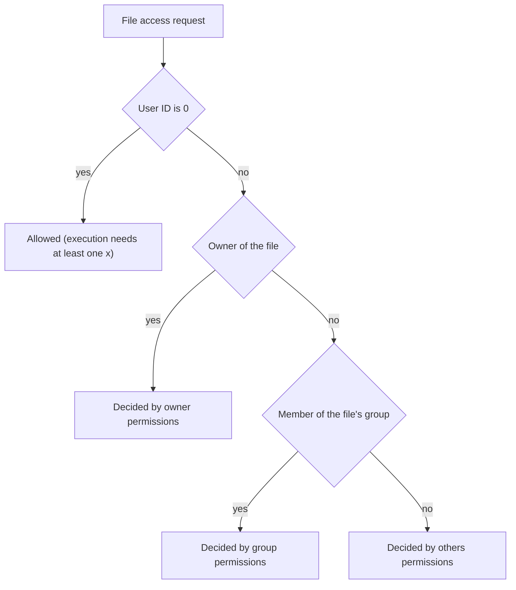

# Week 7 Lecture — File Access Permissions

[Repository Guide](../../README.md) | [English](Concepts_Lecture.md) | [한국어](Concepts_Lecture.ko.md)

> **Last Updated:** 2026-11-27
>
> 우분투 리눅스, 이종원, Ch 5

> **Learning Objectives:**
> 1. Check and interpret file attributes with `ls -l` and `stat`
> 2. Interpret file permission notation (rwx, octal)
> 3. Apply chmod, chown, and chgrp commands
> 4. Configure default permissions with umask
> 5. Explain the effects of SetUID, SetGID, and the sticky bit
> 6. Determine access rights and the permissions of new files with the order of permission checks and bit operations

---

## Table of Contents

- [1. Understanding File Permissions](#1-understanding-file-permissions)
  - [1.1 File Attributes](#11-file-attributes)
  - [1.2 User Categories](#12-user-categories)
  - [1.3 Permission Types](#13-permission-types)
  - [1.4 Order of Permission Checks in the Kernel](#14-order-of-permission-checks-in-the-kernel)
- [2. Permission Representation](#2-permission-representation)
  - [2.1 Symbolic Notation](#21-symbolic-notation)
  - [2.2 Octal (Numeric) Notation](#22-octal-numeric-notation)
  - [2.3 Twelve Permission Bits and Four-Digit Octal](#23-twelve-permission-bits-and-four-digit-octal)
- [3. Changing Permissions with chmod](#3-changing-permissions-with-chmod)
  - [3.1 Symbolic Mode](#31-symbolic-mode)
  - [3.2 Octal Mode](#32-octal-mode)
  - [3.3 Detailed Rules of chmod](#33-detailed-rules-of-chmod)
- [4. Changing Ownership](#4-changing-ownership)
  - [4.1 chown: Change Owner](#41-chown-change-owner)
  - [4.2 chgrp: Change Group](#42-chgrp-change-group)
  - [4.3 Viewing Ownership](#43-viewing-ownership)
  - [4.4 Detailed Rules of Ownership Changes](#44-detailed-rules-of-ownership-changes)
- [5. Default Permissions and umask](#5-default-permissions-and-umask)
  - [5.1 How umask Works](#51-how-umask-works)
  - [5.2 Common umask Values](#52-common-umask-values)
  - [5.3 Bit Operations of umask](#53-bit-operations-of-umask)
- [6. Special Permissions](#6-special-permissions)
  - [6.1 SetUID (SUID)](#61-setuid-suid)
  - [6.2 SetGID (SGID)](#62-setgid-sgid)
  - [6.3 Sticky Bit](#63-sticky-bit)
  - [6.4 Special Permission Summary](#64-special-permission-summary)
  - [6.5 How Special Permissions Work and How They Are Used](#65-how-special-permissions-work-and-how-they-are-used)
- [7. Best Practices](#7-best-practices)
  - [7.1 Security Guidelines](#71-security-guidelines)
  - [7.2 Common Security Checks](#72-common-security-checks)
- [Concept Applications](#concept-applications)
- [Summary](#summary)
- [Self-Check Questions](#self-check-questions)
- [References](#references)

---

<br>

## 1. Understanding File Permissions

### 1.1 File Attributes

The `ls -l` command prints **file attributes** such as the file type, access permissions, and owner on one line.

```bash
$ ls -l /etc/hosts
-rw-r--r-- 1 root root 172 Oct 18 14:53 /etc/hosts
```

| No. | Value | Meaning |
|-----|-------|---------|
| 1 | `-` | File type (`-` is a regular file, `d` is a directory) |
| 2 | `rw-r--r--` | Access permissions for reading, writing, and executing the file |
| 3 | `1` | Number of hard links |
| 4 | `root` | Login ID of the file owner |
| 5 | `root` | Name of the group the file belongs to |
| 6 | `172` | File size (in bytes) |
| 7 | `Oct 18 14:53` | Date of the last modification |
| 8 | `/etc/hosts` | File name |

*Table 1. File attributes in the output of `ls -l`*

The `stat` command shows the same attributes in more detail. It displays the access permissions in both octal and symbolic form, shows the owner and group by both number (UID, GID) and name, and prints the times of the last access (Access), modification (Modify), and attribute change (Change) separately.

```bash
$ stat /etc/hosts
  File: /etc/hosts
  Size: 172       	Blocks: 8          IO Block: 4096   regular file
Device: 253,17	Inode: 1076018     Links: 1
Access: (0644/-rw-r--r--)  Uid: (    0/    root)   Gid: (    0/    root)
Access: 2026-10-18 14:53:38.599276403 +0000
Modify: 2026-10-18 14:53:38.655276264 +0000
Change: 2026-10-18 14:53:38.655276264 +0000
 Birth: 2026-10-18 14:53:38.599276403 +0000
```

### 1.2 User Categories

Every file has three categories of users, and `a` refers to all three.

| Category | Symbol | Description |
|----------|--------|-------------|
| **Owner (User)** | `u` | The user who owns the file (by default, the user who created it) |
| **Group** | `g` | Users belonging to the file's group |
| **Others** | `o` | All other users on the system |
| **All** | `a` | All three categories combined |

*Table 2. User categories of permissions*

### 1.3 Permission Types

| Permission | Symbol | For Files | For Directories |
|-----------|--------|-----------|-----------------|
| **Read** | `r` (4) | View file contents | List directory contents (`ls`) |
| **Write** | `w` (2) | Modify file contents | Create/delete files in directory |
| **Execute** | `x` (1) | Run as program | Enter directory (`cd`) |

*Table 3. Meaning of permissions for files and directories*

```bash
$ ls -l myfile.txt
-rw-r--r-- 1 user1 group1 1024 Mar 21 10:00 myfile.txt
```

With read permission on a file you can read or copy it, and with execute permission you can run it as a shell script or executable. On a directory, the three permissions work together.

- With only **read** permission on a directory, `ls` shows the names inside, but options that check each file's information, such as `ls -l`, require execute permission.
- **Execute** permission on a directory is required to enter it with `cd`, to access the files inside, and to move or copy files into it.
- **Write** permission on a directory allows creating and deleting files in it. Actually creating and deleting also requires execute permission.

> **Caution:** Deleting or renaming a file requires write permission on the **directory that contains the file**, not on the file itself. Therefore, even a read-only (`r--r--r--`) file can be deleted if it is in a directory with write permission, and conversely, without write permission on the directory, the file cannot be deleted regardless of its own permissions.

### 1.4 Order of Permission Checks in the Kernel

When a process accesses a file, the kernel selects **only one** of the three categories of permissions to check. The order of selection is as follows [1].

1. If the process's user ID is 0 (root), reading and writing are allowed regardless of the permission bits. Execution of a regular file, however, is allowed only if at least one of the three categories has `x`.
2. If the process's user ID equals the owner of the file, **only the owner permissions** are checked.
3. Otherwise, if the group of the file is one of the process's groups (its primary group or a supplementary group), **only the group permissions** are checked.
4. If neither holds, the **others permissions** are checked.



*Figure 1. Order in which the kernel selects the permission category to check*

The check stops at the first category that applies from the top, and if that category lacks the permission, access is denied even if another category has it. A file with permissions `077` (`----rwxrwx`) can therefore be read by every other user but not by its owner.

```text
$ echo x > f
$ chmod 077 f
$ ls -l f
----rwxrwx 1 user1 user1 2 Mar 21 13:00 f
$ cat f
cat: f: Permission denied
$ chmod u+r f
$ cat f
x
```

The owner can change the permissions of his or her own file with `chmod` even without any permission bits, so this state can be fixed at any time. Changing permissions modifies the inode, not the file's contents, and it is an operation allowed only to the owner and root.

When a file is accessed through a path, every directory on the path must have execute permission. To read `/home/user2/notes.txt`, `x` is needed on each of `/`, `/home`, and `/home/user2`, and `r` on `notes.txt`. If the home directory's permission blocks the `x` of others, as `750` (`rwxr-x---`) or `700` does, other users cannot read the file even if its own permission is `644`, because they cannot pass through the home directory.

---

<br>

## 2. Permission Representation

### 2.1 Symbolic Notation

```text
-  rwx  r-x  r--
│  └┬┘  └┬┘  └┬┘
│   │    │    └── Others: read only
│   │    └── Group: read + execute
│   └── Owner: read + write + execute
└── File type: regular file
```

*Figure 2. Structure of a symbolic permission string*

A permission string writes, after the first character for the file type, three characters each for the permissions of the owner, the group, and others. Each position holds `r`, `w`, or `x` if the permission is granted and `-` if not. For example, `rw-r--r--` means the owner can read and write, and the group and others can read.

### 2.2 Octal (Numeric) Notation

Writing 1 for a granted permission and 0 for a missing one turns a three-character permission into a 3-bit binary number, which converts to a single number from 0 to 7. For example, `r-x` is binary `101`, and $1 \times 2^2 + 0 \times 2^1 + 1 \times 2^0 = 4 + 0 + 1 = 5$. Writing the numbers of the owner, the group, and others in a row gives a three-digit octal number, so `rwxr-xr--` becomes `754`.

| Permission | Binary | Octal |
|-----------|--------|-------|
| `---` | 000 | 0 |
| `--x` | 001 | 1 |
| `-w-` | 010 | 2 |
| `-wx` | 011 | 3 |
| `r--` | 100 | 4 |
| `r-x` | 101 | 5 |
| `rw-` | 110 | 6 |
| `rwx` | 111 | 7 |

*Table 4. Permissions and their binary and octal values*

**Common Permission Values:**

| Octal | Symbolic | Typical Use |
|-------|----------|-------------|
| `755` | `rwxr-xr-x` | Executable files, directories |
| `644` | `rw-r--r--` | Regular files |
| `700` | `rwx------` | Private directories/scripts |
| `600` | `rw-------` | Private files (e.g., SSH keys) |
| `777` | `rwxrwxrwx` | Full access (AVOID in production) |
| `666` | `rw-rw-rw-` | Everyone can read and write |
| `555` | `r-xr-xr-x` | Everyone can only read and execute |
| `640` | `rw-r-----` | Owner can read and write, group can only read |
| `400` | `r--------` | Only the owner can read |
| `000` | `---------` | No access |

*Table 5. Common permission values and their uses*

### 2.3 Twelve Permission Bits and Four-Digit Octal

The mode of an inode contains 4 bits for the file type and 12 bits for the permissions. The 12 permission bits consist of 3 special permission bits and 9 ordinary permission bits, and grouping them in threes gives four octal digits.

```text
bit position  11   10     9   │ 8   7   6 │  5  4  3 │  2  1  0
meaning      SUID SGID sticky │ r   w   x │  r  w  x │  r  w  x
category       special        │  owner    │  group   │  others
octal value  4000 2000 1000   │400 200 100│ 40 20 10 │ 4  2  1
```

*Figure 3. Layout of the twelve permission bits and the octal value of each bit*

An octal permission is the sum of the values of the bits that are set. In symbolic notation, special permissions have no position of their own and are shown on top of the execute position of each category. If a special bit is set and the `x` at that position is also set, the letter is lowercase (`s`, `t`); if the `x` is off, it is uppercase (`S`, `T`). The following are examples of converting symbolic notation to octal.

| Symbolic notation | Special | Owner | Group | Others | Octal |
|:-----|:-----|:-----|:-----|:-----|:-----|
| `rwsr-x--T` | SUID (4) + sticky (1) = 5 | `rws` → r, w, x = 7 | `r-x` = 5 | `--T` → no x = 0 | `5750` |
| `rw-r-Sr--` | SGID (2) = 2 | `rw-` = 6 | `r-S` → no x = 4 | `r--` = 4 | `2644` |
| `rwxrwxrwt` | sticky (1) = 1 | `rwx` = 7 | `rwx` = 7 | `rwt` → x set = 7 | `1777` |
| `--------T` | sticky (1) = 1 | `---` = 0 | `---` = 0 | `--T` → no x = 0 | `1000` |

*Table 6. Examples of converting symbolic notation to four-digit octal*

Checking after running `chmod 5750 s` gives the following.

```text
$ chmod 5750 s
$ stat -c '%A %a' s
-rwsr-x--T 5750
$ chmod 2644 s
$ stat -c '%A %a' s
-rw-r-Sr-- 2644
```

`stat -c '%A %a'` prints the symbolic notation and the octal value together. An uppercase `S` or `T` should be read as a warning that "the special bit is set but has no effect because the execute permission at that position is missing". For example, the SGID in `rw-r-Sr--` does nothing because the file is not executable.

---

<br>

## 3. Changing Permissions with chmod

The `chmod` command changes access permissions. It has a **symbolic mode**, which expresses permissions with letters and symbols, and an **octal mode** (numeric mode), which uses numbers. Only the owner of a file or root can change its permissions.

### 3.1 Symbolic Mode

The form of symbolic mode is `chmod [user category][operator][permission] filename`. The user category is written as `u`, `g`, `o`, or `a` (Table 2), and the permission as `r`, `w`, or `x` (Table 3).

```bash
chmod u+x file.sh            # Add execute for owner
chmod g+rw file.txt           # Add read+write for group
chmod o-w file.txt            # Remove write for others
chmod a+r file.txt            # Add read for all
chmod u=rwx,g=rx,o=r file     # Set exact permissions
chmod u+x,g-w file            # Multiple changes
chmod -R 755 directory/       # Recursive permission change
```

**Operators:**
- `+` adds a permission.
- `-` removes a permission.
- `=` sets exactly the given permissions.

| Notation | Meaning |
|----------|---------|
| `u+w` | Grant (+) write (w) to the owner (u) |
| `u-x` | Remove (-) execute (x) from the owner (u) |
| `g+w` | Grant (+) write (w) to the group (g) |
| `o-r` | Remove (-) read (r) from others (o) |
| `g+wx` | Grant (+) write (w) and execute (x) to the group (g) |
| `+wx` | Grant (+) write (w) and execute (x) to all users, except permissions set in the umask |
| `a+rwx` | Grant (+) read (r), write (w), and execute (x) to all users |
| `u=rwx` | Set (=) the owner's (u) permissions to read (r), write (w), and execute (x) |
| `go+w` | Grant (+) write (w) to the group (g) and others (o) |
| `u+x,go+w` | Grant execute (x) to the owner (u) and grant (+) write (w) to the group (g) and others (o) |

*Table 7. Examples of setting permissions in symbolic mode*

For example, running `chmod u-w test.txt` on `test.txt` with permissions `rw-r--r--` removes the owner's write permission and gives `r--r--r--`.

> **Caution:** If the user category is omitted, as in `chmod +wx`, all users are targeted much as with `a`, but permissions set in the current umask (Section 5) are not changed. For example, with umask `022`, running `chmod +wx` on a file with permissions `rw-------` gives `rwx--x--x`, and write permission is not added for the group and others. To grant to all users for certain, write `a+wx`.

### 3.2 Octal Mode

The form of octal mode is `chmod number filename`, where the number is three digits from 0 to 7 for the permissions of the owner, the group, and others.

```bash
chmod 755 script.sh           # rwxr-xr-x
chmod 644 document.txt        # rw-r--r--
chmod 700 private/            # rwx------
chmod 600 id_rsa              # rw-------
chmod -R 755 /var/www/html/   # Recursive
```

For example, running `chmod 444` on a file with permissions `644` (`rw-r--r--`) gives `r--r--r--`, and running `chmod 474` next gives `r--rwxr--`. Octal mode sets the permissions of all three categories at once to the given value, so it is not affected by the umask.

### 3.3 Detailed Rules of chmod

- **Order of several changes.** Changes joined with commas, as in `chmod u+x,g-w,o=r f`, are applied from left to right. `=` replaces the permissions of the category with those given and turns off the rest. `chmod o= f` turns off all permissions of others.
- **Uppercase `X`.** The `X` of a symbolic mode grants execute permission only when the target is a directory or a file that already has execute permission for some category [2]. It is useful for tidying the permissions of a whole directory tree.

```text
$ chmod -R u=rwX,go=rX proj
$ stat -c '%A %a %n' proj proj/a.txt proj/src proj/src/b.c proj/run.sh
drwxr-xr-x 755 proj
-rw-r--r-- 644 proj/a.txt
drwxr-xr-x 755 proj/src
-rw-r--r-- 644 proj/src/b.c
-rwxr-xr-x 755 proj/run.sh
```

Before the command, `proj/src` was `700`, `a.txt` was `600`, and `run.sh` was `744`. All directories received search permission (`x`), and among the regular files only `run.sh`, which already had execute permission, received `x` for every category. Doing the same with `chmod -R 755 proj` would turn `a.txt` and `b.c` into executable files as well.

- **Preservation of SUID and SGID on directories.** GNU `chmod` does not change the SUID and SGID bits of a directory when the octal mode has fewer than five digits [2]. Running `chmod 755 dir` on a directory with SGID set therefore leaves the SGID in place. To turn it off, state it symbolically, as in `chmod g-s dir`, or use five digits, as in `chmod 00755 dir`.

---

<br>

## 4. Changing Ownership

### 4.1 chown: Change Owner

```bash
sudo chown newuser file.txt               # Change owner
sudo chown newuser:newgroup file.txt      # Change owner and group
sudo chown :newgroup file.txt             # Change group only
sudo chown -R newuser:newgroup directory/ # Recursive
```

### 4.2 chgrp: Change Group

```bash
sudo chgrp newgroup file.txt              # Change group
sudo chgrp -R newgroup directory/         # Recursive
```

> **Note:** Only root can give a file to another user, so `chown` usually needs `sudo`. On the other hand, the owner of a file can run `chgrp` without `sudo` to change its group to a group the owner belongs to.

### 4.3 Viewing Ownership

```bash
ls -l file.txt
# -rw-r--r-- 1 user1 group1 1024 Mar 21 10:00 file.txt
#               ^^^^^  ^^^^^^
#               owner  group

# Check your groups
groups
id
```

### 4.4 Detailed Rules of Ownership Changes

- Writing only a colon after the user name, as in `chown user1: file`, changes the owner to `user1` and the group to `user1`'s login group. `chown user1:staff file` changes both, and `chown :staff file` changes only the group.
- The owner of a file can change the file's group only to one of the groups to which the owner belongs. Changing it to another group or to another owner is allowed only to root.
- Changing the owner or group of an executable file turns off its SUID and SGID bits, and since Linux 2.2.13 this happens even when root makes the change [3]. This prevents someone from secretly creating a program that runs with another user's privileges by handing an SUID program over to that user. If special permissions are needed after the owner is changed, turn them on again with `chmod`.
- When `chown` and `chgrp` meet a symbolic link, they change the file the link points to by default. To change the owner of the link itself, use `-h`.

---

<br>

## 5. Default Permissions and umask

### 5.1 How umask Works

The **umask** (user file-creation mask) determines default permissions for new files and directories.

```text
Default file permission:      666 (rw-rw-rw-)
Default directory permission: 777 (rwxrwxrwx)

Actual permission = Default - umask
```

The maximum permissions requested when files and directories are created are `666` for regular files and `777` for directories. The mask value specifies the **permissions not to grant** when a file or directory is created. For example, the mask value `002` means that write permission is not granted to others. The actual permission is the requested permission with every bit that is 1 in the mask turned off, that is, requested AND (NOT mask).

| Requested bit | 1 | 1 | 0 | 0 |
|---------------|---|---|---|---|
| Mask bit | 1 | 0 | 1 | 0 |
| Granted bit | 0 | 1 | 0 | 0 |

*Table 8. Truth table for applying the umask*

```text
                 Regular file           Directory
Maximum          rw-rw-rw- (666)        rwxrwxrwx (777)
Binary           110 110 110            111 111 111
Mask (002)       000 000 010            000 000 010
Masked result    110 110 100            111 111 101
Granted          rw-rw-r-- (664)        rwxrwxr-x (775)
```

*Figure 4. Computing default permissions by applying the mask value 002*

> **Caution:** The "Default - umask" written in the text block above is digit-wise subtraction and is correct only when every bit of the mask is set in the default. For example, with umask `033`, 666 - 033 gives `633` for a regular file, but the execute bits absent from the default cannot be turned off, so the actual result is `644` (`rw-r--r--`), and a directory gets `744`. In general, compute with AND NOT.

### 5.2 Common umask Values

| umask | File Result | Directory Result | Meaning |
|-------|-------------|-----------------|---------|
| `022` | `644` (rw-r--r--) | `755` (rwxr-xr-x) | The group and others can only read (read and enter for directories). |
| `002` | `664` (rw-rw-r--) | `775` (rwxrwxr-x) | Only write permission for others is removed. |
| `077` | `600` (rw-------) | `700` (rwx------) | All access for the group and others is removed. |
| `027` | `640` (rw-r-----) | `750` (rwxr-x---) | The group can only read (read and enter for directories), and all access for others is removed. |
| `000` | `666` (rw-rw-rw-) | `777` (rwxrwxrwx) | The maximum permissions are granted as they are. |

*Table 9. Common umask values and the resulting permissions*

```bash
# View current umask
umask              # Octal format
umask -S           # Symbolic format

# Set umask
umask 022          # Standard for most systems
umask 077          # Restrictive (private files)

# Make permanent (add to ~/.bashrc)
echo "umask 022" >> ~/.bashrc
```

The form of the `umask` command is `umask [option] [mask value]`. Without arguments it prints four digits such as `0022` or `0002`, where the first digit is the mask for the special permissions of Section 6. The `-S` option prints the permissions that will be granted rather than the mask value, so with umask `002` it prints `u=rwx,g=rwx,o=rx`. For example, a file created with `touch` after running `umask 077` gets `rw-------`, giving no permission to the group or others. The umask applies only to files created afterwards and does not change the permissions of existing files.

### 5.3 Bit Operations of umask

A umask is not "a number to subtract" but "bits to turn off". The system calls that create files (`open`, `mkdir`) turn off, in the mode requested by the program, the bits that are set in the umask [4]. Written as a formula, this is as follows.

```math
\text{created permission} = \text{requested mode} \mathbin{\&} \lnot\,\text{umask}
```

Writing the computation for a regular file created with umask `027` bit by bit gives the following.

```text
requested mode  666 = 110 110 110
umask           027 = 000 010 111
NOT umask           = 111 101 000
AND result          = 110 100 000 = 640 (rw-r-----)
octal subtraction 666 - 027 = 637 (rw--wxrwx)   ← wrong result
```

*Figure 5. Computing the permissions of a regular file under umask 027 with bit operations*

Subtracting the umask from 666 in octal is correct only when all bits of the umask are set in the requested mode. The others execute bit (1) of `027` is already off in the requested mode `6` (110), so subtracting it causes a borrow, turns on other bits, and gives a wrong result. Computing for several umasks gives the following.

| umask | Regular file (666 AND NOT umask) | Directory (777 AND NOT umask) | Octal subtraction 666 - umask |
|:-----|:-----|:-----|:-----|
| `022` | `644` | `755` | `644` (equal, since every umask bit is in 666) |
| `002` | `664` | `775` | `664` (equal, since every umask bit is in 666) |
| `027` | `640` | `750` | `637` (wrong) |
| `033` | `644` | `744` | `633` (wrong) |
| `077` | `600` | `700` | `567` (wrong) |
| `007` | `660` | `770` | `657` (wrong) |

*Table 10. Results of bit operations and digit-wise subtraction for several umasks*

The requested mode differs from program to program. `touch` and the shell's `>` request `666`, and `mkdir` requests `777`. The C compiler `gcc` requests `777` for the executable it creates, so with umask `022` a compiled program becomes `755` and can be run immediately. `cp`, on the other hand, requests the mode of the source file, so copying a `600` file gives `600` or less regardless of the umask. In other words, a umask cannot add permissions; it can only turn them off.

A umask is a value that each process has, and it is inherited by child processes. Running `umask 077` in a shell applies only to that shell and to the commands run from it, not to other terminals or the next login. To change it permanently, write it in `~/.bashrc` as in Section 5.2. Because Ubuntu creates a private group with the same name for each user, the default umask of ordinary users can be `002`, giving the group write permission without opening files to other users.

---

<br>

## 6. Special Permissions

Special permissions are set by adding one more digit in front of the octal permission, making four digits (`4***` for SetUID, `2***` for SetGID, and `1***` for the sticky bit).

### 6.1 SetUID (SUID)

When set on an executable, the program runs with the **owner's privileges** instead of the caller's.

```bash
# Set SUID
chmod u+s program           # Symbolic
chmod 4755 program          # Octal (4 prefix)

# Example: passwd command
$ ls -l /usr/bin/passwd
-rwsr-xr-x 1 root root 68208 Mar 14 2022 /usr/bin/passwd
#   ^
#   s = SUID is set (runs as root)
```

`passwd` needs SetUID because passwords are stored in `/etc/shadow`, which only root can write. When a regular user runs `passwd`, SetUID applies the privileges of the owner, root, while it runs, so the user can change their own password. For example, running `chmod 4755 set.exe` on `set.exe` with permissions `rwxr-xr-x` makes `ls -l` show `-rwsr-xr-x`.

### 6.2 SetGID (SGID)

- **Files:** The program runs with the privileges of the file's group while it runs.
- **Directories:** Files newly created in the directory inherit the directory's group.

```bash
# Set SGID
chmod g+s directory/        # Symbolic
chmod 2755 directory/       # Octal (2 prefix)
```

For example, running `chmod 2755 set.exe` shows `s` in the group's execute position, giving `-rwxr-sr-x`.

### 6.3 Sticky Bit

When set on a directory, a file in that directory can be deleted or renamed only by the file's owner, the directory's owner, or root.

```bash
# Set sticky bit
chmod +t directory/         # Symbolic
chmod 1755 directory/       # Octal (1 prefix)

# Example: /tmp directory
$ ls -ld /tmp
drwxrwxrwt 15 root root 4096 Mar 21 10:00 /tmp
#         ^
#         t = sticky bit (only owner can delete their files)
```

Anyone can create files in a directory with permissions `777` such as `/tmp`, and without the sticky bit anyone could also delete other users' files. The sticky bit keeps creation allowed while restricting deletion to owners. For example, running `chmod 1755 temp` shows `t` in the execute position for others, giving `drwxr-xr-t`.

> **Note:** The `s` and `t` of special permissions are shown in the execute (`x`) position. If execute permission is also set in that position, they appear in lowercase (`s`, `t`); if not, in uppercase (`S`, `T`). For example, `chmod 4644 file` gives `-rwSr--r--`, and `chmod 1770 dir` gives `drwxrwx--T`.

### 6.4 Special Permission Summary

| Permission | Octal | Effect on Files | Effect on Directories |
|-----------|-------|-----------------|----------------------|
| SUID | 4000 | Run as file owner | (no effect) |
| SGID | 2000 | Run as file group | New files inherit group |
| Sticky | 1000 | (no effect) | Only the file owner, directory owner, or root can delete |

*Table 11. Effects of special permissions*

### 6.5 How Special Permissions Work and How They Are Used

A process has two user IDs. The **real user ID (real UID)** is the user who ran the process, and the **effective user ID (effective UID)** is the user used in permission checks (Section 1.4). The two are usually the same, but when a program with SUID set is executed, the kernel changes the effective user ID to the owner of the file [5]. When user1 runs `passwd`, the real user ID is user1 and the effective user ID is root, so the program can modify `/etc/shadow`, and the `passwd` program looks at the real user ID to allow only user1's password to be changed. SGID likewise changes the effective group ID to the group of the file.

Linux ignores SUID and SGID on interpreted scripts such as shell scripts [5]. A script is read and interpreted by the shell, so attacks that obtain a root shell by changing environment variables or files during execution would be easy. Even after `chmod u+s script.sh`, the script therefore runs with the privileges of the user who ran it.

**Building a team shared directory with an SGID directory.** A directory shared by the members of the group `team` is created as follows.

```text
$ sudo mkdir /srv/team
$ sudo chgrp team /srv/team
$ sudo chmod 2775 /srv/team
$ ls -ld /srv/team
drwxrwsr-x 2 root team 4096 Mar 21 14:00 /srv/team
$ touch /srv/team/plan.txt
$ ls -l /srv/team/plan.txt
-rw-rw-r-- 1 user1 team 0 Mar 21 14:01 /srv/team/plan.txt
```

Without SGID, the group of a file created by user1 would be user1's primary group `user1`, and other team members could not modify it. In a directory with SGID set, new files inherit the directory's group `team`, and new subdirectories also inherit the SGID bit [6]. Combined with umask `002`, new files become `rw-rw-r--`, so every team member can modify them.

**The effect of the sticky bit.** When user1 tries to delete the file `/tmp/x` created by user2 in `/tmp` (`1777`), the request is refused as follows.

```text
$ ls -l /tmp/x
-rw-rw-rw- 1 user2 user2 0 Mar 21 14:10 /tmp/x
$ rm /tmp/x
rm: cannot remove '/tmp/x': Operation not permitted
$ mv /tmp/x /tmp/y
mv: cannot move '/tmp/x' to '/tmp/y': Operation not permitted
```

Because the file's own permission is `666`, user1 can read the file, but the sticky bit prevents removing or renaming the name. The sticky bit restricts only changes to the directory table and has nothing to do with permissions on the file's contents.

> **Note:** **Write protection in shared sticky directories.** When the kernel setting `fs.protected_regular`, available since Linux 4.19, is 1 or more, the kernel refuses an `O_CREAT` open of a regular file that the caller does not own in a world-writable sticky directory (unless the file belongs to the owner of the directory) [7]. The shell's `>` and `>>` open files with `O_CREAT`, so on a system with this setting `echo hi > /tmp/x` is refused with `Permission denied` even for another user's file with permissions `666`, such as `/tmp/x` above. This mechanism defends against attacks that create a file of the same name in advance and make another user write to it.

---

<br>

## 7. Best Practices

### 7.1 Security Guidelines

- Do not use `chmod 777` in production.
- Keep sensitive files at `600` (e.g., SSH private keys, config files with passwords).
- Use `755` for directories and `644` for regular files as defaults.
- Keep SUID/SGID programs to a minimum because they are potential security risks.
- Use groups to share access rather than granting broad permissions.

> **[Information Security]** In terms of the access control taught in Information Security, Linux file permissions are discretionary access control (DAC), in which the owner of a file decides who can do what with it. The guidelines above follow the principle of least privilege, which gives users and programs only the minimum permissions they need. A root-owned SetUID program runs with root's privileges no matter who runs it (Section 6.1), so if it has a flaw, an ordinary user can exploit it for privilege escalation to root.

### 7.2 Common Security Checks

```bash
# Find all SUID files on the system
find / -perm -4000 -type f 2>/dev/null

# Find all SGID files
find / -perm -2000 -type f 2>/dev/null

# Find world-writable files
find / -perm -o+w -type f 2>/dev/null

# Find files with no owner
find / -nouser 2>/dev/null
```

`-perm -mode` in `find` matches files that have all the given permission bits set. `2>/dev/null` discards the `Permission denied` error messages from directories that cannot be accessed (error redirection in Week 6).

---

<br>

## Concept Applications

**True/False Check:**

| Statement | Judgment and Reason |
|:-----|:-----|
| A file with permissions `047` can be read by its owner. | **F.** Only the owner permissions `0` are checked for the owner, so the owner cannot read it even though the group and others have permissions. |
| With umask `027`, a new regular file has permissions `666 - 027 = 637`. | **F.** By the bit operation `666 AND NOT 027`, it is `640`. |
| `chmod 755 dir` turns off the SGID bit of a directory. | **F.** GNU `chmod` does not change the SUID and SGID of a directory with an octal mode of fewer than five digits. |
| A shell script with SUID set runs with the privileges of the file's owner. | **F.** Linux ignores SUID and SGID on interpreted scripts. |
| An uppercase `S` in the permission notation means that the special bit is set but the execute permission at that position is missing. | **T.** Lowercase is used when the execute permission is also present, and uppercase when it is not. |
| In `/tmp` with the sticky bit set, the contents of other users' files cannot be modified. | **F.** The sticky bit prevents only deletion and renaming; modifying contents is governed by the file's own permissions. |
| root can execute a file that has no execute permission at all. | **F.** root bypasses the read and write checks, but execution requires `x` in at least one of the three categories. |

---

<br>

## Summary

| Concept | Key Summary |
|---------|-------------|
| File Attributes | `ls -l` prints the type, permissions, link count, owner, group, size, modification date, and name, and `stat` shows them in more detail. |
| Permission Types | There are three permissions, read (4), write (2), and execute (1), which on a directory mean listing, creating and deleting files, and entering. |
| User Categories | Permissions are set for the owner (u), group (g), and others (o), and all (a) refers to all three categories. |
| chmod | Permissions are changed in symbolic mode (`u+x`) or octal mode (`755`). |
| chown/chgrp | `chown` changes the file owner and group, and `chgrp` changes the group. |
| umask | The umask specifies permissions to remove from new files and directories, and with `022` files get `644` and directories `755`. |
| SUID (4000) | It makes an executable run with the owner's privileges (e.g., `passwd`). |
| SGID (2000) | It makes an executable run with the group's privileges, and in a directory it makes new files inherit the group. |
| Sticky Bit (1000) | In a directory, it allows only the file owner, directory owner, or root to delete files (e.g., `/tmp`). |
| Order of permission checks | Unless the process is root, only the permissions of the first applicable category among owner, group, and others are checked. |
| Twelve permission bits | The 3 special and 9 ordinary bits are written as four octal digits, and uppercase `S` and `T` are special bits set without execute permission. |
| umask arithmetic | The created permission is the requested mode AND NOT umask, and digit-wise subtraction is correct only in some cases. |
| Detailed rules of chmod | Omitting the category respects the umask, and `X` grants execute permission only to directories and files that are already executable. |
| Real and effective user IDs | An SUID program runs with its effective user ID changed to the file's owner, and SUID on scripts is ignored. |

---

<br>

## Self-Check Questions

1. **umask calculation:** With umask `033`, write the permissions of a newly created regular file and directory in octal and symbolic form, and explain why digit-wise subtraction such as 666 - 033 is wrong.

   <details>
   <summary>Answer</summary>

   A regular file gets `644` (`rw-r--r--`) and a directory gets `744` (`rwxr--r--`). The mask `033` is binary `000 011 011`, which turns off the write and execute bits of the group and others. The maximum permission of a regular file, `666` (`110 110 110`), has no execute bits to begin with, so only the write bits are turned off, giving `110 100 100` = `644`. Digit-wise subtraction gives 6 - 3 = 3 and the wrong value `633`, because subtracting the absent execute bits wrongly turns off the read bits.

   </details>

2. **Directory permissions:** A directory `d3` has permissions `rw-r--r--` (644) and contains a file `f`. What happens when the owner runs `ls d3`, `ls -l d3`, and `cd d3`?

   <details>
   <summary>Answer</summary>

   `ls d3` prints the file name `f` because read permission is set. `ls -l d3` needs execute permission on the directory to access each file's information, so it shows a `Permission denied` error and displays the attributes of `f` as `?`. `cd d3` fails because execute permission is missing.

   </details>

3. **Tracing symbolic mode:** On a file with permissions `rw-r--r--`, you run `chmod g+wx`, `chmod o+x`, `chmod go-x`, `chmod a+x`, and `chmod u+w,g-w` in order. Write the permissions after each step and the final octal value.

   <details>
   <summary>Answer</summary>

   After `g+wx` it is `rw-rwxr--` (674), after `o+x` it is `rw-rwxr-x` (675), after `go-x` it is `rw-rw-r--` (664), after `a+x` it is `rwxrwxr-x` (775), and after `u+w,g-w` it is `rwxr-xr-x`. The owner already has write permission, so `u+w` changes nothing. The final value is `755`.

   </details>

4. **Deleting a read-only file:** In a directory `d` (permissions `755`) created by user `u1`, there is a file `d/f` with permissions `444`. Can `u1` delete this file? What if the permissions of `d` are `555`?

   <details>
   <summary>Answer</summary>

   Yes, it can be deleted. Deletion removes a directory entry, so it needs write and execute permission on the directory, not on the file. `rm` asks once whether to remove the write-protected file, and `rm -f` removes it without asking. If the permissions of `d` are `555`, there is no write permission on the directory, so the error `rm: cannot remove 'd/f': Permission denied` occurs.

   </details>

5. **Permission checks:** The file `f` has owner user1, group `dev`, and permissions `-r--rw-rw-`. When user1 also belongs to the group `dev`, does `echo x >> f` run by user1 succeed? What about user2, who belongs to `dev`, and user3, who belongs to neither?

   <details>
   <summary>Answer</summary>

   user1 is the owner, so only the owner permissions `r--` are checked, and writing is denied even though the group permissions include `w`. user2 is not the owner but belongs to the group `dev`, so writing is allowed by the group permissions `rw-`. user3 is allowed to write by the others permissions `rw-`.

   </details>

6. **Octal conversion:** Write each of the following `ls -l` permissions as four octal digits: (a) `-rwxr-s---` (b) `drwxrwxrwt` (c) `-rwSr--r--`, and decide whether the SUID of (c) has any effect.

   <details>
   <summary>Answer</summary>

   (a) The special permission is SGID 2, the owner `rwx` is 7, the group `r-s` has `x` and is 5, and others are 0, so it is `2750`. (b) Sticky 1 and 7 for all three categories give `1777`. (c) SUID 4, the owner `rwS` has no `x` and is 6, the group 4, and others 4, so it is `4644`. There is no execute permission at the owner position, so the file is not executable and the SUID has no effect.

   </details>

7. **umask computation:** With umask `026`, find the permissions of a file created by `touch`, a directory created by `mkdir`, and an executable created by `gcc`.

   <details>
   <summary>Answer</summary>

   `026` is `000 010 110`, so NOT umask is `111 101 001`. `touch` requests 666, so `110 110 110 AND 111 101 001 = 110 100 000`, that is, `640`. `mkdir` and `gcc` request 777, so `111 111 111 AND 111 101 001 = 111 101 001`, that is, `751`.

   </details>

8. **Team directory:** `/srv/team` was created to be shared by the members of the group `team`, but a problem arose: files created by one member cannot be modified by other members. The output of `ls -ld /srv/team` is `drwxrwxr-x 2 root team ...`, and the members' umask is `022`. Give the two causes and how to fix them.

   <details>
   <summary>Answer</summary>

   First, the directory has no SGID, so the group of a new file is not `team` but the creator's primary group. This is fixed with `chmod g+s /srv/team` (or `chmod 2775`). Second, the umask `022` turns off group write permission, so new files become `644`. Change the members' umask to `002`.

   </details>

---

<br>

## References

1. M. Kerrisk et al., "path_resolution(7), Linux manual page," *The Linux man-pages project*. [Online]. Available: https://man7.org/linux/man-pages/man7/path_resolution.7.html
2. D. MacKenzie and J. Meyering, "chmod(1), GNU coreutils manual page." [Online]. Available: https://man7.org/linux/man-pages/man1/chmod.1.html
3. M. Kerrisk et al., "chown(2), Linux manual page," *The Linux man-pages project*. [Online]. Available: https://man7.org/linux/man-pages/man2/chown.2.html
4. M. Kerrisk et al., "umask(2), Linux manual page," *The Linux man-pages project*. [Online]. Available: https://man7.org/linux/man-pages/man2/umask.2.html
5. M. Kerrisk et al., "execve(2), Linux manual page," *The Linux man-pages project*. [Online]. Available: https://man7.org/linux/man-pages/man2/execve.2.html
6. M. Kerrisk et al., "inode(7), Linux manual page," *The Linux man-pages project*. [Online]. Available: https://man7.org/linux/man-pages/man7/inode.7.html
7. M. Kerrisk et al., "proc_sys_fs(5), Linux manual page," *The Linux man-pages project*. [Online]. Available: https://man7.org/linux/man-pages/man5/proc_sys_fs.5.html
