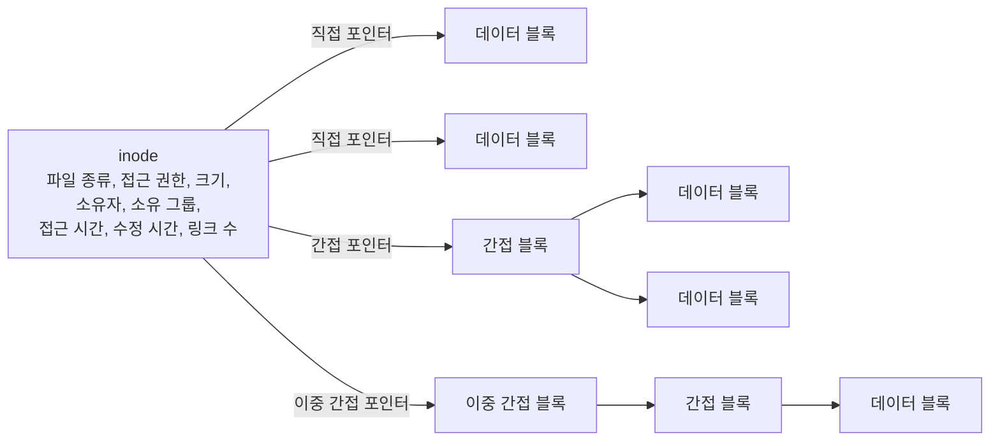
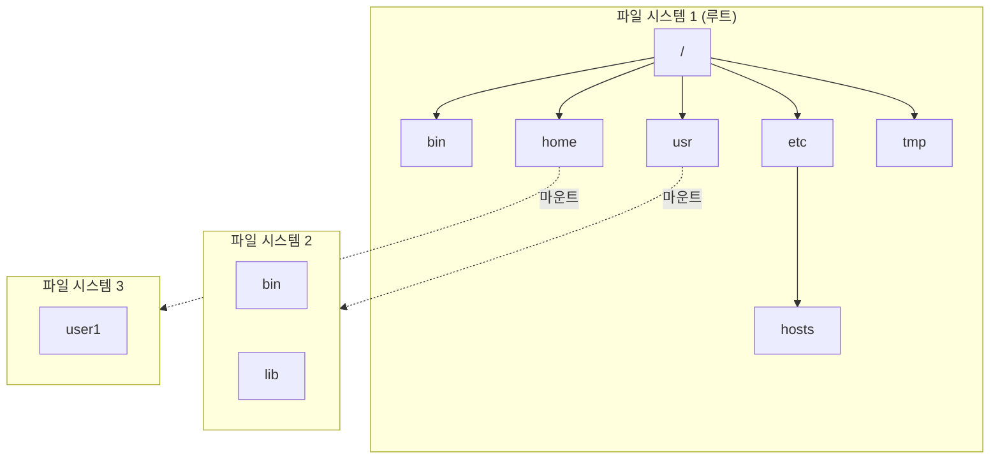
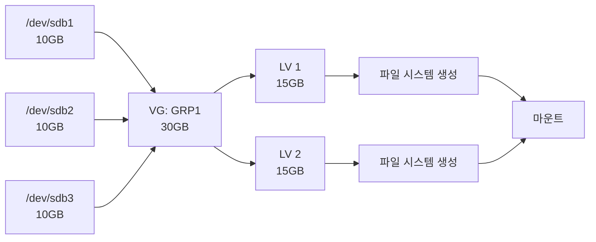

# 10주차 이론 — 파일 시스템

[레포지토리 안내](../../README.ko.md) | [English](Concepts_Lecture.md) | [한국어](Concepts_Lecture.ko.md)

> **최종 수정일:** 2026-10-26
>
> 우분투 리눅스, 이종원, Ch 7

> **학습 목표:**
> 1. Linux 파일 시스템 유형(ext4, xfs, btrfs)을 설명할 수 있다
> 2. ext4의 블록 그룹 구조와 inode의 역할을 설명할 수 있다
> 3. 디스크를 파티셔닝하고 파일 시스템을 만들어 마운트하고 언마운트할 수 있다
> 4. LVM의 개념을 설명하고 논리 볼륨을 만들 수 있다
> 5. df와 du 명령으로 디스크 사용량을 모니터링할 수 있다
> 6. fsck와 백업 슈퍼블록으로 파일 시스템을 검사하고 복구할 수 있다

---

## 목차

- [1. Linux 파일 시스템 개요](#1-linux-파일-시스템-개요)
  - [1.1 파일 시스템이란?](#11-파일-시스템이란)
  - [1.2 디스크 장치 이름 규칙](#12-디스크-장치-이름-규칙)
  - [1.3 inode와 데이터 블록](#13-inode와-데이터-블록)
  - [1.4 ext4 파일 시스템의 구조](#14-ext4-파일-시스템의-구조)
  - [1.5 파일 시스템과 디렉터리 계층 구조](#15-파일-시스템과-디렉터리-계층-구조)
- [2. 디스크 파티셔닝](#2-디스크-파티셔닝)
  - [2.1 파티션 유형](#21-파티션-유형)
  - [2.2 파티셔닝 도구](#22-파티셔닝-도구)
  - [2.3 디스크 추가와 파티션 생성 절차](#23-디스크-추가와-파티션-생성-절차)
  - [2.4 MBR vs. GPT](#24-mbr-vs-gpt)
- [3. 파일 시스템 유형](#3-파일-시스템-유형)
  - [3.1 Linux 파일 시스템](#31-linux-파일-시스템)
  - [3.2 비Linux 파일 시스템](#32-비linux-파일-시스템)
  - [3.3 가상 파일 시스템](#33-가상-파일-시스템)
  - [3.4 저널링](#34-저널링)
- [4. 파일 시스템 생성 및 관리](#4-파일-시스템-생성-및-관리)
  - [4.1 mkfs: 파일 시스템 생성](#41-mkfs-파일-시스템-생성)
  - [4.2 파일 시스템 정보 확인](#42-파일-시스템-정보-확인)
- [5. 마운트와 언마운트](#5-마운트와-언마운트)
  - [5.1 마운트의 개념](#51-마운트의-개념)
  - [5.2 mount: 파일 시스템 연결](#52-mount-파일-시스템-연결)
  - [5.3 umount: 파일 시스템 분리](#53-umount-파일-시스템-분리)
  - [5.4 /etc/fstab: 영구 마운트](#54-etcfstab-영구-마운트)
  - [5.5 이동식 장치 마운트](#55-이동식-장치-마운트)
- [6. LVM (Logical Volume Manager)](#6-lvm-logical-volume-manager)
  - [6.1 LVM의 개념과 용어](#61-lvm의-개념과-용어)
  - [6.2 LVM 관련 명령](#62-lvm-관련-명령)
  - [6.3 LVM 생성 절차](#63-lvm-생성-절차)
- [7. 디스크 사용량 모니터링](#7-디스크-사용량-모니터링)
  - [7.1 df: 디스크 여유 공간](#71-df-디스크-여유-공간)
  - [7.2 du: 디스크 사용량](#72-du-디스크-사용량)
- [8. 파일 시스템 검사와 복구](#8-파일-시스템-검사와-복구)
  - [8.1 fsck와 e2fsck](#81-fsck와-e2fsck)
  - [8.2 badblocks: 배드 블록 검사](#82-badblocks-배드-블록-검사)
  - [8.3 백업 슈퍼블록을 이용한 복구](#83-백업-슈퍼블록을-이용한-복구)
- [9. 스왑 공간](#9-스왑-공간)
  - [9.1 스왑이란?](#91-스왑이란)
  - [9.2 스왑 관리](#92-스왑-관리)
- [10. 모범 사례](#10-모범-사례)
- [요약](#요약)
- [점검 문제](#점검-문제)

---

<br>

## 1. Linux 파일 시스템 개요

### 1.1 파일 시스템이란?

**파일 시스템(file system)** 은 저장 장치에 파일을 조직하고 저장하는 방법이다. 파일 시스템은 다음을 정의한다.

- 데이터를 저장하고 검색하는 방법
- 디렉터리 구조와 이름 지정 방식
- 메타데이터(권한, 타임스탬프, 소유권)
- 공간 할당과 관리 방법

### 1.2 디스크 장치 이름 규칙

Linux는 디스크를 `/dev` 아래의 장치 파일로 나타낸다. SCSI/SATA 디스크는 `/dev/sd` 뒤에 디스크 순서를 나타내는 문자(a, b, c, ...)를 붙이고, 파티션은 그 뒤에 1부터 시작하는 번호를 붙인다.

| 장치 | 설명 |
|--------|-------------|
| `/dev/sda` | 첫 번째 SCSI/SATA 디스크(디스크 전체) |
| `/dev/sdb` | 두 번째 SCSI/SATA 디스크 |
| `/dev/sdc` | 세 번째 SCSI/SATA 디스크 |
| `/dev/sda1` | 첫 번째 디스크의 첫 번째 파티션 |
| `/dev/sda2` | 첫 번째 디스크의 두 번째 파티션 |
| `/dev/nvme0n1` | 첫 번째 NVMe SSD |
| `/dev/nvme0n1p1` | NVMe SSD의 첫 번째 파티션 |

*표 1. 디스크와 파티션의 장치 이름*

### 1.3 inode와 데이터 블록

```text
+--------+     +---------+     +------------+
| Inode  | --> | Direct  | --> | Data Block |
| Table  |     | Pointers|     | (4KB)      |
+--------+     +---------+     +------------+
                    |
               +---------+     +------------+
               | Indirect| --> | Data Block |
               | Pointer |     +------------+
               +---------+
```

*그림 1. inode에서 직접 포인터와 간접 포인터를 거쳐 데이터 블록에 이르는 구조*

- **inode:** 파일 메타데이터(크기, 권한, 타임스탬프, 데이터 블록 포인터)를 저장한다.
- **데이터 블록:** 실제 파일 내용을 저장한다.
- **디렉터리 엔트리:** 파일 이름을 inode 번호에 매핑한다.

파일마다 inode가 하나씩 있고, 각 inode는 파일 시스템 안에서 고유한 **inode 번호**로 식별된다. inode에는 파일 종류, 접근 권한, 크기, 소유자, 소유 그룹, 접근 시간, 수정 시간, 링크 수가 들어 있고, 파일 이름은 들어 있지 않다. 데이터 블록의 위치는 다음 세 종류의 포인터로 기록한다.

- **직접 블록 포인터:** 데이터 블록을 직접 가리킨다. 작은 파일은 직접 포인터만으로 모든 블록을 가리킬 수 있다.
- **간접 블록 포인터:** 데이터 블록의 주소들을 담은 블록(간접 블록)을 가리킨다.
- **이중 간접 블록 포인터:** 간접 블록들의 주소를 담은 블록을 가리켜 한 단계를 더 거친다.



*그림 2. inode의 메타데이터와 직접, 간접, 이중 간접 블록 포인터*

> **참고:** **ext4의 익스텐트.** 직접, 간접 블록 포인터는 ext2와 ext3가 쓰는 방식이다. ext4는 기본적으로 연속된 블록 범위를 (시작 블록, 길이)로 기록하는 **익스텐트(extent)** 를 써서 큰 파일의 블록 위치를 더 적은 메타데이터로 나타낸다. ext4도 호환을 위해 블록 포인터 방식의 파일을 읽을 수 있다.

### 1.4 ext4 파일 시스템의 구조

ext4는 저장 장치를 일정한 크기의 **블록(block)** 으로 나누고, 연속된 블록을 다시 **블록 그룹(block group)** 으로 묶어 관리한다. 블록 크기는 파일 시스템을 만들 때 정하며 일반적으로 4KB이다. 블록 그룹의 개수는 장치 크기를 블록 그룹의 크기로 나눈 값이다.

블록 그룹은 구성에 따라 세 가지 유형으로 나뉘며, 표 2는 각 유형이 가진 구성 요소를 디스크에 놓이는 순서대로 보여 준다.

- **블록 그룹 0:** 파일 시스템의 첫 번째 블록 그룹이다. 그룹 0 패딩, 슈퍼블록, 그룹 디스크립터로 시작한다.
- **블록 그룹 a:** 첫 번째가 아닌 블록 그룹 가운데 슈퍼블록과 그룹 디스크립터의 복사본을 가진 그룹이다. 그룹 0 패딩은 없다.
- **블록 그룹 b:** 첫 번째가 아니고 복사본도 없는 블록 그룹이다. 바로 데이터 블록 비트맵으로 시작한다.

| 구성 요소 | 크기 | 블록 그룹 0 | 블록 그룹 a | 블록 그룹 b |
|:-----|:-----|:-----|:-----|:-----|
| 그룹 0 패딩 | 1,024B | 있음 | 없음 | 없음 |
| 슈퍼블록 | 1블록 | 원본 | 복사본 | 없음 |
| 그룹 디스크립터 | n블록 | 원본 | 복사본 | 없음 |
| GDT 예약 블록 | n블록 | 있음 | 있음 | 없음 |
| 데이터 블록 비트맵 | 1블록 | 있음 | 있음 | 있음 |
| inode 비트맵 | 1블록 | 있음 | 있음 | 있음 |
| inode 테이블 | n블록 | 있음 | 있음 | 있음 |
| 데이터 블록 | n블록 | 있음 | 있음 | 있음 |

*표 2. 블록 그룹 유형별 구성 요소*

- **그룹 0 패딩:** 블록 그룹 0의 처음 1,024바이트로, x86 부트 섹터와 부가 정보를 저장하는 데 쓰인다.
- **슈퍼블록(superblock):** 파일 시스템 전체의 정보를 저장한다. 전체 inode 수, 전체 블록 수, 할당되지 않은 블록(free block) 수, 할당되지 않은 inode(free inode) 수, 첫 번째 데이터 블록의 주소, 블록 크기, 그룹당 블록 수, 마운트 시간, 파일 시스템의 상태, 그룹 디스크립터의 크기 등이 들어 있다. 슈퍼블록이 손상되면 파일 시스템 전체를 읽을 수 없으므로 복구용 **백업 슈퍼블록**을 다른 블록 그룹에 둔다.
- **그룹 디스크립터와 GDT 예약 블록:** 블록 그룹 0에서 슈퍼블록 다음에 놓인다. 그룹 디스크립터는 블록 그룹마다 블록 비트맵의 주소, inode 비트맵의 주소, inode 테이블의 주소, 할당되지 않은 블록 수, 할당되지 않은 inode 수, 디렉터리 수, 블록 비트맵과 inode 비트맵의 체크섬을 저장한다. GDT 예약 블록은 나중에 파일 시스템을 키울 때 늘어날 그룹 디스크립터를 위해 비워 둔 블록이다.
- **데이터 블록 비트맵과 inode 비트맵:** 블록 그룹 안의 각 데이터 블록과 inode가 사용 중인지를 비트 하나로 표시한다.
- **inode 테이블:** 블록 그룹에 속한 inode들을 저장한다.
- **데이터 블록:** 파일의 실제 내용을 저장한다. 블록 크기는 1KB, 2KB, 4KB 등에서 정할 수 있으며, 일반적인 기본값은 4KB이다.

> **참고:** **백업 슈퍼블록의 위치.** 블록 크기가 4KB이면 블록 비트맵 한 블록(4,096바이트 = 32,768비트)이 블록 32,768개를 표시하므로 블록 그룹 하나는 32,768블록(128MiB)이다. 따라서 첫 번째 백업 슈퍼블록은 블록 그룹 1이 시작하는 블록 32768에 있다. ext4는 기본적으로 sparse_super 기능을 켜서 그룹 0과 1, 그리고 3, 5, 7의 거듭제곱 번째 그룹에만 슈퍼블록을 둔다(8.3절).

### 1.5 파일 시스템과 디렉터리 계층 구조

사용자는 파일 시스템을 `/`에서 시작하는 디렉터리 계층 구조를 통해 사용한다. 계층 구조 전체를 파일 시스템 하나로 구성할 수도 있고, 여러 파일 시스템을 연결하여 구성할 수도 있다. 여러 파일 시스템으로 구성할 때는 루트 파일 시스템의 특정 디렉터리(예: `/usr`, `/home`)에 다른 파일 시스템을 연결하며, 이 연결을 **마운트(mount)** 라고 한다(5.1절).



*그림 3. 여러 파일 시스템을 마운트하여 구성한 디렉터리 계층 구조*

그림 3에서 `/usr/bin`, `/usr/lib`은 파일 시스템 2에, `/home/user1`은 파일 시스템 3에 저장되지만, 사용자에게는 하나의 트리로 보인다.

---

<br>

## 2. 디스크 파티셔닝

### 2.1 파티션 유형

**파티션(partition)** 은 디스크 하나를 논리적으로 나눈 영역이며, 파티션마다 별도의 파일 시스템을 만들 수 있다. MBR 방식의 파티션은 다음 세 가지로 나뉜다.

| 유형 | 설명 |
|------|-------------|
| **주 파티션 (Primary)** | 디스크당 최대 4개 (MBR) |
| **확장 파티션 (Extended)** | 논리 파티션의 컨테이너 (주 파티션 1개로 계산) |
| **논리 파티션 (Logical)** | 확장 파티션 내부에 생성 |

*표 3. MBR 파티션의 유형*

### 2.2 파티셔닝 도구

```bash
# fdisk - MBR 파티션 도구 (최대 2TB 디스크)
sudo fdisk /dev/sdb
# 명령: n (생성), d (삭제), p (출력), w (저장), q (종료)

# gdisk - GPT 파티션 도구 (2TB 초과 디스크)
sudo gdisk /dev/sdb

# parted - MBR과 GPT 모두 지원
sudo parted /dev/sdb

# 모든 파티션 나열
sudo fdisk -l
lsblk
```

> **참고:** 위 주석의 구분은 전통적인 것이다. 최신 util-linux의 `fdisk`는 GPT 파티션 테이블도 만들고 편집할 수 있다(내부 명령 `g`).

`fdisk`의 형식은 `fdisk [옵션] [장치명]`이다. `-l`은 파티션 테이블을 출력하고, `-b 크기`는 섹터 크기(512, 1024, 2048, 4096)를 지정한다. `fdisk /dev/sdb`처럼 장치명을 주어 실행하면 대화형 모드로 들어가며, 다음 내부 명령을 쓴다.

| 명령 | 기능 |
|:-----|:-----|
| `a` | 부팅 파티션을 설정한다 |
| `b` | BSD 디스크 라벨을 편집한다 |
| `c` | 도스 호환성을 설정한다 |
| `d` | 파티션을 삭제한다 |
| `g` | 새로운 빈 GPT 파티션 테이블을 만든다 |
| `l` | 사용 가능한 파티션 종류를 출력한다 |
| `m` | 도움말을 출력한다 |
| `n` | 새로운 파티션을 추가한다 |
| `o` | 새로운 빈 DOS(MBR) 파티션 테이블을 만든다 |
| `p` | 파티션 테이블을 출력한다 |
| `q` | 작업 내용을 저장하지 않고 종료한다 |
| `s` | 새로운 빈 Sun 디스크 라벨을 만든다 |
| `t` | 파티션의 시스템 ID(파티션 종류)를 바꾼다 |
| `u` | 표시 단위를 바꾼다 |
| `v` | 파티션 테이블을 검사한다 |
| `w` | 파티션 정보를 디스크에 저장하고 종료한다 |
| `x` | 실린더 개수 변경 등 전문가를 위한 부가 기능으로 들어간다 |

*표 4. fdisk의 내부 명령*

`t`로 지정하는 시스템 ID는 파티션의 용도를 나타내는 16진수 코드이며, 83은 Linux, 82는 Linux swap, 8e는 Linux LVM, fd는 Linux RAID 자동 감지이다.

### 2.3 디스크 추가와 파티션 생성 절차

새 디스크를 시스템에 추가하여 쓰려면 다음 네 단계를 거친다. 가상 머신에서는 가상 머신 설정에서 디스크 종류(예: SCSI)와 용량을 정해 새 가상 디스크를 추가하는 것이 첫 단계에 해당한다.


*그림 4. 디스크 추가 단계*

`fdisk`로 두 번째 디스크 `/dev/sdb`에 파티션을 만드는 과정은 다음과 같다.

1. `sudo fdisk /dev/sdb`로 fdisk를 실행한다.
2. `n`을 입력하여 새 파티션을 만든다.
3. 파티션 종류로 기본(primary, `p`) 또는 확장(extended, `e`)을 고른다.
4. 파티션 번호(예: 1)를 고른다.
5. 시작 섹터는 기본값을 쓰고, 마지막 섹터에 `+500M`처럼 크기를 지정한다.
6. `p`로 파티션 정보를 확인한다.
7. 필요하면 `n`으로 두 번째 파티션을 같은 방법으로 만든다.
8. `w`로 파티션 정보를 디스크에 저장하고 종료한다.

`w`를 입력하기 전에는 디스크에 아무것도 기록되지 않으므로, 잘못 입력했으면 `q`로 저장하지 않고 종료하면 된다.

### 2.4 MBR vs. GPT

| 특성 | MBR | GPT |
|---------|-----|-----|
| 최대 디스크 크기 | 2 TB | 9.4 ZB |
| 최대 파티션 수 | 4개 주 파티션 (또는 3개 주 + 1개 확장) | 128개 |
| 부팅 모드 | BIOS | UEFI |
| 백업 | 없음 | 디스크 끝에 백업 |

*표 5. MBR과 GPT의 비교*

최대 디스크 크기는 섹터 크기가 512바이트일 때의 값이다(MBR은 $2^{32}$섹터, GPT는 $2^{64}$섹터). 부팅 모드는 흔히 함께 쓰는 조합을 나타내며, GRUB 같은 부트 로더를 쓰면 BIOS 시스템에서도 GPT 디스크로 부팅할 수 있다.

---

<br>

## 3. 파일 시스템 유형

### 3.1 Linux 파일 시스템

Linux의 대표적인 디스크 기반 파일 시스템은 ext 계열이다. ext(ext1)는 1992년에 발표되었고 최대 크기가 2GB였으며 현재는 쓰이지 않는다. ext2(1993)는 ext1의 문제를 해결하고 확장성을 높였다. ext3(2001)는 ext2와 호환되면서 **저널링(journaling)** 을 도입하여 디스크에 기록하는 데이터의 복구 기능을 강화했다. ext4(2008)는 1EB 볼륨과 16TB 파일을 지원하고, ext2, ext3와 호환되며, 디렉터리 하나에 서브디렉터리를 기본적으로 64,000개까지 둘 수 있다. XFS는 1993년 실리콘 그래픽스(SGI)가 개발하여 2001년 Linux에 이식한 64비트 파일 시스템이다.

| 파일 시스템 | 설명 | 최대 파일 크기 | 최대 볼륨 |
|-------------|-------------|---------------|------------|
| **ext4** | 대부분의 Linux에서 기본, 저널링 지원 | 16 TB | 1 EB |
| **ext3** | 이전 기본 파일 시스템, 저널링 지원 | 2 TB | 32 TB |
| **ext2** | 저널링 없음, 플래시 저장소에 적합 | 2 TB | 32 TB |
| **xfs** | 고성능, RHEL/CentOS에서 기본 | 8 EB | 8 EB |
| **btrfs** | Copy-on-Write, 스냅샷과 압축 지원 | 16 EB | 16 EB |
| **tmpfs** | RAM 기반 파일 시스템 | (RAM 크기) | (RAM 크기) |

*표 6. Linux 파일 시스템의 특성과 최대 크기*

최대 크기는 블록 크기에 따라 달라지며, 표는 대표적인 최댓값이다(ext4는 블록 크기 4KB 기준).

### 3.2 비Linux 파일 시스템

Linux는 다른 운영체제의 파일 시스템과 네트워크 파일 시스템도 지원한다. `mount -t`에 쓰는 유형 이름이 표기와 다르면 괄호 안에 적는다.

| 파일 시스템 | 설명 |
|-------------|-------------|
| **msdos** | MS-DOS 파티션을 사용하기 위한 파일 시스템 |
| **FAT32** (`vfat`) | 크로스 플랫폼, 4 GB 파일 크기 제한, Windows 95, 98, NT를 지원하기 위한 유형 |
| **exFAT** | 확장 FAT, USB 드라이브에 적합 |
| **NTFS** | Windows 기본, ntfs-3g를 통해 읽기/쓰기 지원 |
| **iso9660** | CD-ROM과 DVD의 표준 파일 시스템, 읽기 전용으로 사용 |
| **NFS** | 네트워크 파일 시스템, 네트워크를 통해 원격 서버의 디스크를 연결 |
| **ufs** | Unix File System, 유닉스의 표준 파일 시스템 |
| **sysv** | 유닉스 System V를 지원하기 위한 파일 시스템 |
| **hpfs** | OS/2의 HPFS를 지원하기 위한 파일 시스템 |
| **hfs** | Mac 컴퓨터의 HFS 파일 시스템을 지원하기 위한 파일 시스템 |

*표 7. Linux가 지원하는 비Linux 파일 시스템*

### 3.3 가상 파일 시스템

디스크에 저장되지 않고 메모리나 커널의 정보를 파일 형태로 보여 주는 특수 용도의 **가상 파일 시스템**도 있다.

| 파일 시스템 | 기능 |
|:-----|:-----|
| **swap** | 스왑 영역을 관리하기 위한 유형이다(9절) |
| **tmpfs** | 메모리에 임시 파일을 저장하는 Temporary File System이며, 시스템을 재시작할 때마다 기존 내용이 없어진다(예: `/run`, `/dev/shm`, 배포판에 따라 `/tmp`) |
| **proc** | `/proc` 디렉터리에 마운트되며, 프로세스와 커널의 현재 상태를 나타내는 파일을 가진다 |
| **sysfs** | `/sys` 디렉터리에 마운트되며, 장치와 드라이버의 정보를 보여 준다 |
| **devtmpfs** | `/dev` 디렉터리에 장치 파일을 자동으로 만든다 |
| **ramfs** | 램디스크를 지원하는 파일 시스템이다 |
| **rootfs** | `/` 디렉터리의 Root File System이며, 시스템 초기화와 관리에 필요한 내용을 관리한다 |

*표 8. 특수 용도의 가상 파일 시스템*

현재 커널이 지원하는 파일 시스템의 종류는 `/proc/filesystems` 파일에서 확인할 수 있다. 앞에 `nodev`가 붙은 항목은 블록 장치 없이 마운트하는 가상 파일 시스템이고, ext4 같은 디스크 기반 파일 시스템은 `nodev` 없이 이름만 나온다.

```text
$ cat /proc/filesystems
nodev   sysfs
nodev   tmpfs
nodev   bdev
nodev   proc
nodev   cgroup
nodev   cgroup2
nodev   cpuset
nodev   devtmpfs
...
```

### 3.4 저널링

**저널(Journal)** 은 메인 파일 시스템에 쓰기 전에 변경 사항을 기록하여 장애 복구를 가능하게 한다.

```text
쓰기 요청 --> 저널 (기록) --> 메인 파일 시스템 --> 저널 삭제
                    |
            전원 장애? --> 부팅 시 저널 재실행
```

*그림 5. 저널링 파일 시스템의 쓰기와 장애 복구 흐름*

쓰기 도중 전원이 꺼져도 부팅할 때 저널에 기록된 변경을 다시 적용하므로, 파일 시스템 전체를 검사하지 않고도 일관된 상태로 빨리 복구할 수 있다.

---

<br>

## 4. 파일 시스템 생성 및 관리

### 4.1 mkfs: 파일 시스템 생성

파티션을 만든 뒤에는 그 위에 파일 시스템을 만들어야(포맷해야) 파일을 저장할 수 있다.

```bash
# ext4 파일 시스템 생성
sudo mkfs.ext4 /dev/sdb1
sudo mkfs -t ext4 /dev/sdb1     # 대안 문법

# XFS 파일 시스템 생성
sudo mkfs.xfs /dev/sdb1

# FAT32 파일 시스템 생성 (USB 드라이브용)
sudo mkfs.vfat /dev/sdb1

# 파일 시스템 검사
sudo fsck /dev/sdb1              # 파일 시스템 검사
sudo e2fsck -f /dev/sdb1         # ext 파일 시스템 강제 검사
```

`mkfs`의 형식은 `mkfs [옵션] [장치명]`이며, `-t 종류`로 파일 시스템의 종류를 지정한다. `-t`를 생략하면 기본값인 ext2로 만든다. `mkfs.ext2`, `mkfs.ext3`, `mkfs.ext4`처럼 종류별 명령도 제공된다.

ext 계열 전용 도구인 `mke2fs`는 형식이 `mke2fs [옵션] [장치명]`이고, 기본 설정을 `/etc/mke2fs.conf`에서 읽는다. 주요 옵션은 다음과 같다.

| 옵션 | 의미 |
|:-----|:-----|
| `-t 종류` | 파일 시스템의 종류(ext2, ext3, ext4)를 지정한다(기본값 ext2) |
| `-b 블록 크기` | 블록 크기를 바이트 수로 지정한다 |
| `-c` | 파일 시스템을 만들기 전에 배드 블록을 검사한다 |
| `-f 프래그먼트 크기` | 프래그먼트 크기를 바이트 수로 지정한다(현재 ext 계열은 프래그먼트를 따로 쓰지 않는다) |
| `-i inode당 바이트 수` | 몇 바이트마다 inode를 하나 만들지 지정한다(기본값은 `/etc/mke2fs.conf`가 정하며 일반적인 크기에서 16,384B, 512MB 미만의 작은 파일 시스템에서 4,096B) |
| `-m 예약 블록 퍼센트` | 슈퍼유저에게 예약해 둘 블록의 비율을 지정한다(기본값 5%) |

*표 9. mke2fs의 주요 옵션*

예를 들어 다음 명령은 `/dev/sdb1`에 ext2를, `/dev/sdb2`와 `/dev/sdc1`에 ext3를 만들고, `/dev/sdc2`에는 블록 크기가 4,096B인 ext4를 만든다.

```bash
sudo mkfs /dev/sdb1                     # 기본값인 ext2 생성
sudo mkfs.ext3 /dev/sdb2                # ext3 생성
sudo mke2fs -t ext3 /dev/sdc1           # mke2fs로 ext3 생성
sudo mke2fs -t ext4 -b 4096 /dev/sdc2   # 블록 크기 4,096B인 ext4 생성
```

### 4.2 파일 시스템 정보 확인

```bash
# 파일 시스템 유형 확인
sudo blkid                        # 블록 장치 ID와 유형 표시
df -Th                            # 마운트된 파일 시스템과 유형 표시
lsblk -f                          # 트리 형식으로 파일 시스템 정보 표시

# ext 파일 시스템 상세 정보
sudo dumpe2fs /dev/sdb1 | head -30
sudo tune2fs -l /dev/sdb1
```

---

<br>

## 5. 마운트와 언마운트

### 5.1 마운트의 개념

**마운트(mount)** 는 파일 시스템을 디렉터리 계층 구조의 특정 디렉터리에 연결하는 것이다. 파일 시스템이 디렉터리 계층 구조와 연결되지 않으면 사용자는 그 파일 시스템에 접근할 수 없다. 파일 시스템이 연결되는 디렉터리를 **마운트 포인트(mount point)** 라고 하고, 연결을 해제하는 것을 **언마운트(unmount)** 라고 한다.

마운트 포인트로 쓰는 디렉터리에 원래 있던 파일은 마운트하는 동안 가려져 보이지 않는다. 예를 들어 `/dev/sdb1`을 `/mnt/hdd1`에 마운트하고 `/etc/hosts`를 `/mnt/hdd1`에 복사하면, 복사한 파일은 `/dev/sdb1`의 파일 시스템에 저장된다.

```bash
sudo cp /etc/hosts /mnt/hdd1
ls /mnt/hdd1                      # hosts  lost+found
```

이 상태에서 `/mnt/hdd1`을 언마운트하면 `ls /mnt/hdd1`은 마운트 전에 그 디렉터리에 있던 내용(보통 빈 디렉터리)만 보여 준다. 복사한 `hosts`와 `lost+found`는 `/dev/sdb1`을 다시 마운트해야 보인다. `lost+found`는 ext 파일 시스템을 만들 때 생기는 디렉터리로, fsck가 복구한 파일 조각을 넣는 곳이다.

### 5.2 mount: 파일 시스템 연결

```bash
# 수동 마운트
sudo mount /dev/sdb1 /mnt/data
sudo mount -t ext4 /dev/sdb1 /mnt/data    # 파일 시스템 유형 지정
sudo mount -o ro /dev/sdb1 /mnt/data       # 읽기 전용으로 마운트

# ISO 이미지 마운트
sudo mount -o loop image.iso /mnt/iso

# USB 드라이브 마운트
sudo mount /dev/sdb1 /media/usb

# 마운트된 모든 파일 시스템 표시
mount
df -h
findmnt
```

`mount`의 형식은 `mount [옵션] [장치명 마운트_포인트]`이며, 주요 옵션은 다음과 같다. `-t`를 생략하면 mount가 장치의 파일 시스템 종류를 자동으로 알아낸다.

- `-t 파일 시스템 종류`: 파일 시스템 종류를 지정한다.
- `-o 마운트 옵션`: 마운트 옵션(5.4절)을 지정한다.
- `-f`: 실제로 마운트하지 않고 마운트 과정만 점검한다.
- `-r`: 읽기 전용으로 마운트한다(`-o ro`와 같다).
- `-w`: 읽기와 쓰기가 가능하게 마운트한다.

인자 없이 `mount`만 실행하면 현재 마운트된 파일 시스템의 목록을 출력하며, 그 내용은 `/etc/mtab` 파일과 같다. 최근 배포판에서 `/etc/mtab`은 커널이 관리하는 `/proc/self/mounts`에 대한 심볼릭 링크이다.

```text
$ mount
sysfs on /sys type sysfs (rw,nosuid,nodev,noexec,relatime)
proc on /proc type proc (rw,nosuid,nodev,noexec,relatime)
...
/dev/sda3 on / type ext4 (rw,relatime,errors=remount-ro)
...
```

장치별 mount 명령의 예는 다음과 같다.

| 장치 | mount 명령의 예 |
|:-----|:-----|
| ext2 파일 시스템 | `mount -t ext2 /dev/sdb1 /mnt` |
| ext3 파일 시스템 | `mount -t ext3 /dev/sdb1 /mnt` |
| ext4 파일 시스템 | `mount -t ext4 /dev/sdb1 /mnt` 또는 `mount /dev/sdb1 /mnt` |
| CD-ROM | `mount -t iso9660 /dev/cdrom /mnt/cdrom` |
| Windows 디스크 | `mount -t vfat /dev/hdc /mnt` (`/dev/hdc`는 예전 IDE 디스크의 이름) |
| USB 메모리 (Linux용) | `mount /dev/sdc1 /mnt` |
| USB 메모리 (Windows용) | `mount -t vfat /dev/sdc1 /mnt` |
| 읽기 전용 마운트 | `mount -r /dev/sdb1 /mnt` |
| 읽기/쓰기 마운트 | `mount -w /dev/sdb1 /mnt` |
| 원격 디스크 (NFS) | `mount -t nfs 서버_주소:/NFS_서버의_디렉터리 /mnt` |

*표 10. 장치별 mount 명령의 예*

### 5.3 umount: 파일 시스템 분리

```bash
sudo umount /mnt/data              # 마운트 포인트로 언마운트
sudo umount /dev/sdb1              # 장치로 언마운트
sudo umount -l /mnt/data           # 지연 언마운트 (사용 중인 경우)
```

형식은 `umount [옵션] 장치명 또는 마운트_포인트`이다. 사용 중인 파일 시스템은 언마운트할 수 없다. 예를 들어 현재 작업 디렉터리가 마운트 포인트 안에 있으면 다음과 같이 "target is busy"(사용 중) 오류가 나므로, `cd`로 다른 디렉터리로 이동한 뒤 다시 언마운트한다.

```text
user1@myubuntu:/mnt$ sudo umount /mnt
umount: /mnt: target is busy.
user1@myubuntu:/mnt$ cd
user1@myubuntu:~$ sudo umount /mnt
```

### 5.4 /etc/fstab: 영구 마운트

`/etc/fstab`은 파일 시스템의 마운트 설정 정보를 담은 파일이며, 시스템은 부팅할 때 이 파일을 읽고 파일 시스템을 마운트한다. 각 줄은 공백으로 구분한 여섯 필드로 이루어진다.

```text
# /etc/fstab 형식:
# 장치              마운트포인트   유형   옵션            dump  pass
/dev/sda1         /             ext4   defaults        0     1
/dev/sda2         /home         ext4   defaults        0     2
/dev/sdb1         /data         ext4   defaults        0     2
UUID=xxxx-xxxx    /backup       ext4   defaults,noauto 0     0
tmpfs             /tmp          tmpfs  defaults        0     0
```

| 순서 | 필드 | 의미 |
|:-----|:-----|:-----|
| 1 | 장치명 | 마운트할 장치이며, `/dev/sdb1` 같은 장치 이름이나 `UUID=...`로 쓴다. UUID는 파일 시스템을 유일하게 구분하는 128비트 숫자이다 |
| 2 | 마운트 포인트 | 파일 시스템을 연결할 디렉터리이다 |
| 3 | 파일 시스템 종류 | ext4, xfs, vfat, swap 등이다 |
| 4 | 옵션 | 쉼표로 구분한 마운트 옵션이다(표 12) |
| 5 | 덤프 관련 설정 | 0이면 `dump` 명령으로 백업하지 않고, 1이면 백업 대상이다 |
| 6 | 파일 점검 옵션 | 0이면 부팅할 때 `fsck`로 점검하지 않는다. 1은 루트 파일 시스템, 2는 루트 외의 파일 시스템에 쓰며 1을 먼저 점검한다 |

*표 11. /etc/fstab의 필드*

Ubuntu를 설치한 직후의 `/etc/fstab`에는 예를 들어 다음 줄이 있다. `errors=remount-ro`는 파일 시스템 오류가 나면 읽기 전용으로 다시 마운트하라는 옵션이다.

```text
UUID=265c8913-ee1e-4034-885f-207969b0a23b /   ext4   errors=remount-ro   0   1
UUID=A7A5-E2E2  /boot/efi  vfat  umask=0077  0  1
/swapfile       none       swap  sw          0  0
```

**마운트 옵션:**

| 옵션 | 설명 |
|--------|-------------|
| `defaults` | rw, suid, dev, exec, auto, nouser, async |
| `ro` | 읽기 전용 |
| `rw` | 읽기-쓰기 |
| `noexec` | 바이너리 실행 방지 |
| `nosuid` | SUID/SGID 비트 무시 |
| `noauto` | 부팅 시 마운트하지 않음 |
| `user` | 비root 사용자도 마운트 허용 |
| `auto` | 부팅 시 자동으로 마운트 |
| `exec` | 실행 파일의 실행 허용 |
| `suid` | SUID/SGID 비트 허용 |
| `nouser` | root만 마운트 가능 |
| `usrquota` | 사용자별 디스크 쿼터 설정 가능 |
| `grpquota` | 그룹별 디스크 쿼터 설정 가능 |

*표 12. 주요 마운트 옵션*

```bash
# 재부팅 없이 fstab 변경사항 적용
sudo mount -a
```

`mount -a`는 `/etc/fstab`에서 `noauto`가 아닌 항목을 모두 마운트한다.

> **주의:** `/etc/fstab`에 잘못된 줄이 있으면 부팅 중에 마운트가 실패하여 시스템이 응급 모드로 들어갈 수 있다. 편집한 뒤에는 재부팅하기 전에 `sudo mount -a`로 오류가 없는지 확인한다.

### 5.5 이동식 장치 마운트

**Linux용 USB 메모리.** USB 메모리를 꽂아 시스템이 인식하게 한 뒤 `sudo fdisk -l`로 장치명(예: `/dev/sdb`)을 확인한다. 자동으로 마운트되어 있으면 먼저 언마운트하고, `fdisk`로 파티션을 만들고 `mkfs`로 ext4 같은 파일 시스템을 만든다. 그다음 `sudo mount /dev/sdb1 /mnt/usb`처럼 마운트하여 디렉터리로 사용한다.

**Windows용 USB 메모리.** FAT32로 포맷되어 있으므로 `sudo mount -t vfat /dev/sdb1 /mnt`처럼 마운트하면 디렉터리로 사용할 수 있다. 다 쓰면 `umount`로 마운트를 해제한다.

**CD-ROM/DVD.** 대부분 자동으로 인식되어 마운트된다. 수동으로 마운트할 때는 장치명으로 `/dev/cdrom`이나 `/dev/sr0`(`/dev/sr#`)을 쓰며, `sudo mount -t iso9660 /dev/cdrom /mnt/cdrom`처럼 마운트하면 읽기 전용으로 연결된다. 다 쓰면 `umount`로 마운트를 해제한다.

---

<br>

## 6. LVM (Logical Volume Manager)

### 6.1 LVM의 개념과 용어

**LVM(Logical Volume Manager)** 은 독립적으로 구성된 여러 디스크 파티션을 하나로 연결하여 한 파티션처럼 사용할 수 있게 하는 기능이다. 관련 용어는 다음과 같다.

- **PV(physical volume, 물리 볼륨):** `/dev/sdb1`, `/dev/sdb2` 같은 실제 하드디스크의 파티션이다.
- **VG(volume group, 볼륨 그룹):** 여러 PV를 그룹으로 묶은 것이다. 예를 들어 `/dev/sdb1`과 `/dev/sdb2`로 GRP1이라는 그룹을 만들면 GRP1이 VG이다.
- **LV(logical volume, 논리 볼륨):** VG를 다시 적절한 크기로 나눈 각 파티션이며, 파일 시스템은 LV 위에 만든다.
- **PE(physical extent):** PV를 나누는 일정한 크기의 블록이다(기본 4MiB).
- **LE(logical extent):** LV를 나누는 일정한 크기의 블록이며, 각 LE는 PE 하나에 대응한다.

예를 들어 10GB 파티션(PV) 3개를 묶어 30GB VG 하나를 만든 뒤, 이를 다시 15GB LV 2개로 나누어 각각 파일 시스템을 만들고 마운트할 수 있다.



*그림 6. PV 3개를 VG 하나로 묶고 LV 2개로 나누는 LVM의 기본 개념*

LVM을 쓰면 VG에 PV를 추가하여 공간을 늘리거나 LV의 크기를 바꿀 수 있으므로, 파티션 크기를 처음부터 정확히 정하지 않아도 된다. LVM의 계층 구조와 볼륨 확장은 11주차 2절에서 더 자세히 다룬다.

### 6.2 LVM 관련 명령

| 구분 | 기능 | 명령 |
|:-----|:-----|:-----|
| PV | PV 생성 | `pvcreate 파티션_이름` |
| PV | PV 삭제 | `pvremove 파티션_이름` |
| PV | PV 상태 확인 | `pvscan` |
| VG | VG 생성 | `vgcreate VG명 PV명1 PV명2 ...` |
| VG | VG 활성화 | `vgchange -a y VG명` |
| VG | VG 비활성화 | `vgchange -a n VG명` |
| VG | VG 삭제 | `vgremove VG명` |
| VG | VG 정보 확인 | `vgdisplay -v VG명` |
| VG | VG에 PV 추가 | `vgextend VG명 PV명` |
| VG | VG에서 PV 삭제 | `vgreduce VG명 PV명` |
| VG | VG명 변경 | `vgrename 기존_VG명 새_VG명` |
| LV | LV 생성 | `lvcreate -l PE_수 VG명 -n LV명` |
| LV | LV 삭제 | `lvremove VG명/LV명` |
| LV | LV 상태 확인 | `lvscan` |
| LV | LV 용량 확대 | `lvextend -l +PE_수 LV_경로` |
| LV | LV 용량 축소 | `lvreduce -l -PE_수 LV_경로` |

*표 13. LVM 관련 명령*

`lvcreate`, `lvextend`, `lvreduce`에서 `-l`은 크기를 PE 수로, `-L`은 `10G`처럼 용량으로 지정한다.

> **주의:** LV를 줄이기 전에는 그 안의 파일 시스템을 먼저 줄여야 한다. ext4는 언마운트한 상태에서만 `resize2fs`로 줄일 수 있고, xfs는 줄일 수 없다.

### 6.3 LVM 생성 절차

크기가 각각 500MB인 `/dev/sdb1`, `/dev/sdb2`를 LVM으로 변환하고, 약 1GB의 LV를 만들어 마운트하는 절차는 다음과 같다.

1. `sudo apt install lvm2`로 lvm2 패키지를 설치한다.
2. `fdisk`의 `t` 명령으로 `/dev/sdb1`, `/dev/sdb2`의 파티션 종류를 83(Linux)에서 8e(Linux LVM)로 바꾼다. 이 단계는 필수는 아니지만 파티션의 용도를 표시하므로 권장된다.
3. `pvcreate`로 두 파티션에 PV를 만들고, `pvscan`으로 상태를 확인한다.
4. 두 PV를 묶어 이름이 grp1인 VG를 만들고 활성화한 뒤 `vgdisplay`로 상태를 확인한다.
5. `vgdisplay`로 확인한 PE(이 예에서는 248개)를 모두 합해 LV mylvm1을 만들고 `lvscan`으로 확인한다.
6. LV에 ext4 파일 시스템을 만들고 `/mnt/lvm`에 마운트한 뒤 파일을 복사하여 사용한다.

```bash
sudo apt install lvm2
sudo pvcreate /dev/sdb1                   # PV 생성
sudo pvcreate /dev/sdb2
sudo pvscan                               # PV 상태 확인
sudo vgcreate grp1 /dev/sdb1 /dev/sdb2    # VG 생성
sudo vgchange -a y grp1                   # VG 활성화
sudo vgdisplay -v grp1                    # VG 상태 확인 (PE 개수 등)
sudo lvcreate -l 248 grp1 -n mylvm1       # PE 248개로 LV 생성
sudo lvscan                               # LV 상태 확인
sudo mke2fs -t ext4 /dev/grp1/mylvm1      # 파일 시스템 생성
sudo mkdir /mnt/lvm
sudo mount /dev/grp1/mylvm1 /mnt/lvm      # 마운트
```

LV의 장치 경로는 `/dev/VG명/LV명` 형식이다. LVM을 지울 때는 생성의 역순으로 `lvremove`, `vgremove`, `pvremove`를 쓴다.

---

<br>

## 7. 디스크 사용량 모니터링

### 7.1 df: 디스크 여유 공간

`df`는 파일 시스템별로 전체 용량, 사용량, 남은 공간을 출력한다. 형식은 `df [옵션] [파일 시스템]`이다.

```bash
df                      # 마운트된 모든 파일 시스템 표시
df -h                   # 사람이 읽기 쉬운 크기
df -T                   # 파일 시스템 유형 표시
df -i                   # inode 사용량 표시
df /home                # 특정 마운트 포인트 표시
```

이 밖에 `-a`는 가상 파일 시스템을 포함한 모든 파일 시스템을, `-k`와 `-m`은 사용량을 KB와 MB 단위로, `-t 종류`는 지정한 종류의 파일 시스템만(예: `df -t ext4`) 출력한다.

### 7.2 du: 디스크 사용량

`du`는 디렉터리나 파일이 차지하는 디스크 공간을 출력한다. 형식은 `du [옵션] [디렉터리]`이며, 디렉터리를 생략하면 현재 디렉터리를 대상으로 한다. `-s`는 지정한 디렉터리의 전체 사용량만, `-a`는 하위 파일까지 모두, `-h`는 알기 쉬운 단위로 출력한다. 특정 사용자의 사용량은 그 사용자의 홈 디렉터리를 지정하여(`du -s ~user1`) 확인한다.

```bash
du -sh /home/user1                # 디렉터리 크기 요약
du -h --max-depth=1 /home         # 1단계 깊이
du -sh *                          # 현재 디렉터리의 각 항목 크기
du -ah /var/log | sort -rh | head -10   # 가장 큰 파일 상위 10개
```

> **참고:** `df`는 파일 시스템의 블록 사용 정보를 읽고 `du`는 파일을 하나씩 따라가며 크기를 더하므로, 두 결과가 다를 수 있다. 예를 들어 삭제했지만 아직 프로세스가 열고 있는 파일의 공간은 `df`에서는 사용 중으로 남고 `du`에는 나타나지 않는다.

---

<br>

## 8. 파일 시스템 검사와 복구

### 8.1 fsck와 e2fsck

`fsck`는 파일 시스템의 일관성을 점검하고 오류를 고친다. 형식은 `fsck [옵션] [장치명]`이며, 파일 시스템 종류별로 `fsck.ext2`, `fsck.ext3`, `fsck.ext4` 명령도 제공된다. ext 계열 전용 도구인 `e2fsck`도 같은 형식으로 쓴다. 주요 옵션은 다음과 같다.

- `-f`: 파일 시스템이 정상으로 표시되어 있어도 강제로 점검한다.
- `-b 슈퍼블록`: 지정한 백업 슈퍼블록을 사용한다(8.3절).
- `-y`: 모든 질문에 yes로 대답한다.
- `-a`: 점검에서 발견한 문제를 묻지 않고 자동으로 복구한다(`fsck`).
- `-j 외부 저널`: 저널을 다른 장치에 둔 ext3, ext4에서 그 저널의 위치를 지정한다(`e2fsck`).

```bash
sudo fsck /dev/sdd1          # 일반적인 검사
sudo fsck -f /dev/sdd1       # 강제 검사
sudo fsck.ext4 /dev/sdd3     # 파일 시스템 종류를 지정한 검사
sudo e2fsck -f /dev/sdd1     # e2fsck로 강제 검사
```

> **주의:** 마운트되어 쓰기가 일어나는 파일 시스템을 검사하면 파일 시스템이 손상될 수 있다. 검사하기 전에 언마운트하고, 루트 파일 시스템은 부팅 과정에서 검사하게 한다.

### 8.2 badblocks: 배드 블록 검사

**배드 블록(bad block)** 은 물리적 손상으로 읽거나 쓸 수 없는 디스크 블록이다. 형식은 `badblocks [옵션] [장치명]`이며, `-v`는 검색 결과를 자세하게 출력하고 `-o 출력_파일`은 찾은 배드 블록 목록을 파일에 저장한다.

```bash
sudo badblocks -v /dev/sdd1              # 배드 블록 검색
sudo badblocks -v -o bad.out /dev/sdd1   # 검색 결과를 bad.out에 저장
```

### 8.3 백업 슈퍼블록을 이용한 복구

기본 슈퍼블록이 손상되면 파일 시스템을 마운트할 수 없으므로, 1.4절의 백업 슈퍼블록으로 복구한다. 백업 슈퍼블록의 위치는 파일 시스템의 정보를 출력하는 `dumpe2fs [장치명]`으로 확인한다.

```text
$ sudo dumpe2fs /dev/sdd1 | grep superblock
dumpe2fs 1.46.3 (27-Jul-2021)
  Primary superblock at 0, Group descriptors at 1-1
  Backup superblock at 32768, Group descriptors at 32769-32769
```

`dumpe2fs`는 기본 슈퍼블록을 읽으므로, 기본 슈퍼블록이 이미 손상되었으면 위치를 읽지 못한다. 따라서 위치를 미리 확인해 두거나, 파일 시스템을 만들 때와 같은 옵션으로 `mke2fs -n`(실제로 만들지 않고 결과만 출력)을 실행하여 확인한다.

다음은 실습용 파일 시스템에서 기본 슈퍼블록을 일부러 지우고 복구하는 과정이다. `dd`는 지정한 블록 크기만큼 데이터를 복사하는 명령으로, `if=파일`은 표준 입력 대신 읽을 파일, `of=파일`은 표준 출력 대신 쓸 파일, `bs=바이트_수`는 한 번에 읽고 쓸 바이트 수, `count=블록_수`는 복사할 블록 수를 지정한다.

1. `dd`로 파일 시스템의 앞부분 20블록을 0으로 채워 기본 슈퍼블록을 지운다.
2. 파일 시스템을 마운트하면 슈퍼블록이 잘못되었다는 오류가 난다.
3. `dumpe2fs`로 확인한 백업 슈퍼블록의 위치를 `e2fsck -b`에 주어 복구한다.

```text
$ sudo dd if=/dev/zero of=/dev/sdd1 bs=4096 count=20
20+0 records in
20+0 records out
81920 bytes (82 kB, 80 KiB) copied, 0.00865865 s, 9.5 MB/s
$ sudo mount /dev/sdd1 /mnt/hdd1
mount: /mnt/hdd1: wrong fs type, bad option, bad superblock on /dev/sdd1, missing codepage or helper program, or other error.
$ sudo e2fsck -b 32768 -y /dev/sdd1
```

> **주의:** 위의 `dd` 명령은 장치의 데이터를 덮어써서 되돌릴 수 없다. 지워도 되는 실습용 장치에서만 실행한다.

---

<br>

## 9. 스왑 공간

### 9.1 스왑이란?

스왑 공간은 물리적 RAM이 부족할 때 사용된다. 커널은 비활성 페이지를 RAM에서 스왑으로 이동시킨다. 스왑 공간은 전용 파티션(파티션 종류 82, Linux swap)이나 스왑 파일로 만들 수 있다.

> **[운영체제]** 운영체제에서 배우는 가상 메모리로 보면, 프로세스의 주소 공간은 **페이지(page)** 라는 고정 크기 단위로 나뉘어 물리 메모리에 올라간다. 메모리가 부족하면 커널은 최근에 쓰지 않은 페이지를 스왑 영역으로 내보내고(page-out), 프로세스가 그 페이지에 다시 접근하면 페이지 폴트(page fault)가 일어나 디스크에서 메모리로 다시 읽어 온다(page-in). 스왑 덕분에 물리 메모리보다 많은 메모리를 쓸 수 있지만 디스크는 RAM보다 훨씬 느리므로, 페이지가 자주 오가면 시스템 전체가 크게 느려진다.

### 9.2 스왑 관리

```bash
# 스왑 사용량 확인
free -h
swapon --show

# 스왑 파일 생성
sudo fallocate -l 2G /swapfile
sudo chmod 600 /swapfile
sudo mkswap /swapfile
sudo swapon /swapfile

# 영구 설정 (/etc/fstab에 추가)
# /swapfile none swap sw 0 0

# 스왑 비활성화
sudo swapoff /swapfile
```

---

<br>

## 10. 모범 사례

- 보안과 관리를 위해 `/home`, `/var`, `/tmp`를 별도의 파티션으로 분리한다.
- 일반 용도에는 `ext4`를, 대용량 파일과 고성능이 필요하면 `xfs`를 사용한다.
- `df -h`로 디스크 사용량을 정기적으로 모니터링한다.
- 장치를 제거하기 전에 항상 언마운트한다.
- 장치 이름은 디스크를 추가하거나 제거하면 바뀔 수 있으므로, 안정성을 위해 `/etc/fstab`에는 장치 이름 대신 UUID를 사용한다.

---

<br>

## 요약

| 개념 | 핵심 요약 |
|---------|-----------|
| 파일 시스템 | 저장 장치에 데이터를 조직하고 저장하는 방법이다. |
| inode | 파일의 메타데이터와 데이터 블록의 위치를 저장하며, 디렉터리 엔트리가 파일 이름을 inode 번호에 매핑한다. |
| ext4 구조 | 장치를 블록 그룹으로 나누고 슈퍼블록, 그룹 디스크립터, 비트맵, inode 테이블, 데이터 블록으로 관리한다. |
| 파티셔닝 | `fdisk`, `gdisk`, `parted`로 디스크를 여러 영역으로 나눈다. |
| ext4 | 저널링을 지원하는 Linux의 기본 파일 시스템이다. |
| 가상 파일 시스템 | proc, tmpfs처럼 디스크 없이 메모리나 커널의 정보를 파일로 보여 준다. |
| `mount`/`umount` | 파일 시스템을 디렉터리 트리의 마운트 포인트에 연결하거나 분리한다. |
| `/etc/fstab` | 부팅할 때 마운트할 파일 시스템을 정하는 영구 마운트 설정 파일이다. |
| LVM | 여러 PV를 VG로 묶고 LV로 나누어 디스크 공간을 유연하게 관리한다. |
| `df` | 파일 시스템별 디스크 사용량과 여유 공간을 표시한다. |
| `du` | 디렉터리별 디스크 사용량을 표시한다. |
| `fsck`/`e2fsck` | 파일 시스템을 검사하고 복구하며, `-b`로 백업 슈퍼블록을 지정할 수 있다. |
| 스왑 | 디스크 공간으로 물리 메모리를 보충하는 가상 메모리 영역이다. |

---

<br>

## 점검 문제

1. **블록 그룹 계산:** 블록 크기가 4KB인 ext4 파일 시스템에서 블록 비트맵은 블록 하나를 쓴다. 블록 그룹 하나의 크기와 1GiB 파티션의 블록 그룹 수를 구하고, 첫 번째 백업 슈퍼블록이 블록 32768에 있는 이유를 설명하라.

   <details>
   <summary>정답</summary>

   비트맵 한 블록은 4,096 × 8 = 32,768비트이므로 블록 그룹 하나는 32,768블록이고, 크기는 32,768 × 4KB = 128MiB이다. 1GiB 파티션의 블록 그룹 수는 1,024MiB / 128MiB = 8개이다. 블록 그룹 0이 블록 0~32767을 차지하므로 블록 그룹 1은 블록 32768에서 시작하고, 백업 슈퍼블록은 그룹 1의 맨 앞에 놓인다.

   </details>

2. **마운트 포인트에 가려진 파일:** `/mnt/data` 디렉터리에 `a.txt`가 있는 상태에서 빈 ext4 파일 시스템인 `/dev/sdb1`을 `/mnt/data`에 마운트하고 `b.txt`를 만든 뒤 언마운트했다. 마운트 직후, `b.txt`를 만든 뒤, 언마운트한 뒤의 `ls /mnt/data` 결과와 `b.txt`가 저장된 위치를 쓰라.

   <details>
   <summary>정답</summary>

   마운트 직후에는 `/dev/sdb1`의 내용인 `lost+found`만 보이고 `a.txt`는 가려진다. `b.txt`를 만든 뒤에는 `b.txt`와 `lost+found`가 보인다. 언마운트한 뒤에는 원래 디렉터리의 `a.txt`만 보인다. `b.txt`는 `/dev/sdb1`의 파일 시스템에 저장되어 있으므로 다시 마운트하면 보인다.

   </details>

3. **fstab 줄 해석:** `/dev/sdb1  /backup  xfs  ro,noexec,noauto  0  0`의 각 필드를 해석하고, 부팅할 때와 `sudo mount /backup`을 실행할 때 일어나는 일을 쓰라.

   <details>
   <summary>정답</summary>

   장치는 `/dev/sdb1`, 마운트 포인트는 `/backup`, 파일 시스템 종류는 xfs이다. 옵션은 읽기 전용(`ro`), 실행 파일 실행 금지(`noexec`), 부팅할 때 자동 마운트하지 않음(`noauto`)이다. 다섯째 필드 0은 dump로 백업하지 않음을, 여섯째 필드 0은 부팅할 때 fsck로 점검하지 않음을 뜻한다. 따라서 부팅할 때는 마운트되지 않는다. `sudo mount /backup`처럼 마운트 포인트만 주면 mount가 `/etc/fstab`에서 해당 줄을 찾아 `/dev/sdb1`을 xfs로, `ro,noexec` 옵션을 적용하여 `/backup`에 마운트한다.

   </details>

4. **LVM 용량 계산:** 1GiB 파티션 3개로 VG를 만들었다. PE 크기는 4MiB이고 PV마다 맨 앞 1MiB를 메타데이터에 쓴다고 하자. VG의 PE 수와, PE를 모두 써서 만든 LV의 크기를 구하라.

   <details>
   <summary>정답</summary>

   PV 하나에서 PE로 쓸 수 있는 공간은 1,024 - 1 = 1,023MiB이고, 1,023 / 4 = 255.75이므로 PE는 255개이다(남는 3MiB는 쓰지 못한다). VG의 PE 수는 3 × 255 = 765개이고, LV의 크기는 765 × 4MiB = 3,060MiB이다. 같은 계산을 500MiB 파티션 2개에 적용하면 (500 - 1) / 4 = 124.75에서 PV당 124개, 합계 248개가 되어 6.3절의 PE 수와 일치한다.

   </details>

5. **슈퍼블록 복구:** 마운트할 때 "bad superblock" 오류가 나는 ext4 파일 시스템을 복구하는 절차를 명령과 함께 쓰고, 백업 슈퍼블록을 여러 블록 그룹에 두는 이유를 설명하라.

   <details>
   <summary>정답</summary>

   파일 시스템을 언마운트한 상태에서 백업 슈퍼블록의 위치를 확인한다. 미리 `dumpe2fs /dev/sdd1 | grep superblock`으로 확인해 둔 값을 쓰거나, 파일 시스템을 만들 때와 같은 옵션으로 `mke2fs -n /dev/sdd1`을 실행하여 확인한다(블록 크기가 4KB이면 첫 백업은 보통 32768). 그다음 `sudo e2fsck -b 32768 -y /dev/sdd1`로 복구하고 다시 마운트한다. 백업을 여러 그룹에 나누어 두면 디스크의 한 영역이 손상되어도 다른 위치의 복사본이 남아 있으므로 복구할 수 있다.

   </details>
