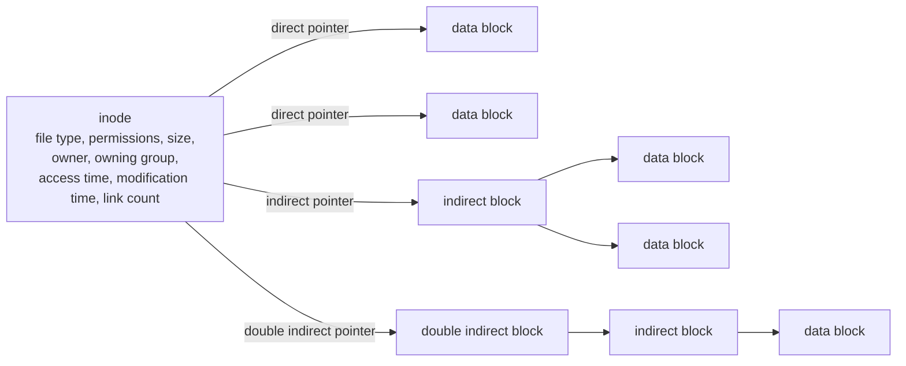
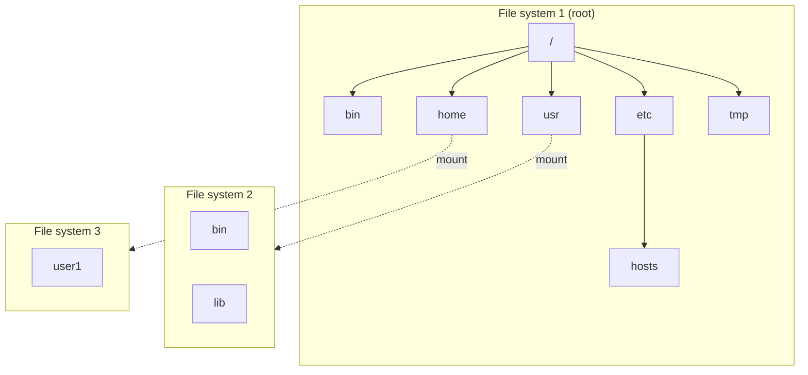
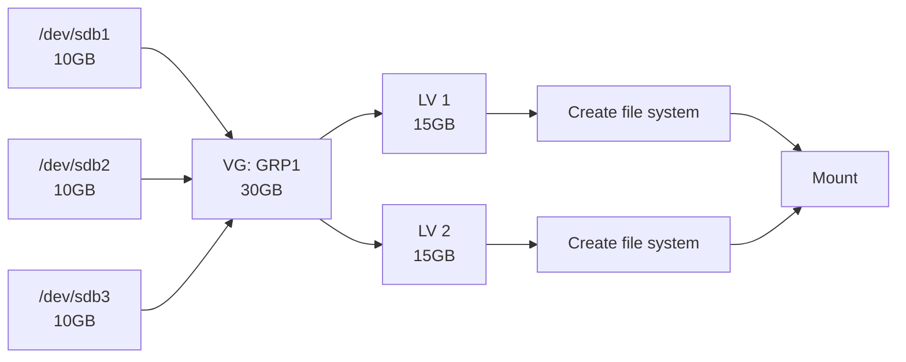

# Week 10 Lecture — File Systems

[Repository Guide](../../README.md) | [English](Concepts_Lecture.md) | [한국어](Concepts_Lecture.ko.md)

> **Last Updated:** 2026-10-19
>
> 우분투 리눅스, 이종원, Ch 7

> **Learning Objectives:**
> 1. Describe Linux file system types (ext4, xfs, btrfs)
> 2. Explain the block group structure of ext4 and the role of inodes
> 3. Partition a disk, create a file system, and mount and unmount it
> 4. Explain the concept of LVM and create logical volumes
> 5. Monitor disk usage with the df and du commands
> 6. Check and repair a file system with fsck and a backup superblock

---

## Table of Contents

- [1. Linux File Systems Overview](#1-linux-file-systems-overview)
  - [1.1 What is a File System?](#11-what-is-a-file-system)
  - [1.2 Disk Device Naming](#12-disk-device-naming)
  - [1.3 Inodes and Data Blocks](#13-inodes-and-data-blocks)
  - [1.4 Structure of the ext4 File System](#14-structure-of-the-ext4-file-system)
  - [1.5 File Systems and the Directory Hierarchy](#15-file-systems-and-the-directory-hierarchy)
- [2. Disk Partitioning](#2-disk-partitioning)
  - [2.1 Partition Types](#21-partition-types)
  - [2.2 Partitioning Tools](#22-partitioning-tools)
  - [2.3 Adding a Disk and Creating Partitions](#23-adding-a-disk-and-creating-partitions)
  - [2.4 MBR vs. GPT](#24-mbr-vs-gpt)
- [3. File System Types](#3-file-system-types)
  - [3.1 Linux File Systems](#31-linux-file-systems)
  - [3.2 Non-Linux File Systems](#32-non-linux-file-systems)
  - [3.3 Virtual File Systems](#33-virtual-file-systems)
  - [3.4 Journaling](#34-journaling)
- [4. Creating and Managing File Systems](#4-creating-and-managing-file-systems)
  - [4.1 mkfs: Create File System](#41-mkfs-create-file-system)
  - [4.2 Viewing File System Information](#42-viewing-file-system-information)
- [5. Mounting and Unmounting](#5-mounting-and-unmounting)
  - [5.1 The Concept of Mounting](#51-the-concept-of-mounting)
  - [5.2 mount: Attach File System](#52-mount-attach-file-system)
  - [5.3 umount: Detach File System](#53-umount-detach-file-system)
  - [5.4 /etc/fstab: Persistent Mounts](#54-etcfstab-persistent-mounts)
  - [5.5 Mounting Removable Devices](#55-mounting-removable-devices)
- [6. LVM (Logical Volume Manager)](#6-lvm-logical-volume-manager)
  - [6.1 Concepts and Terms of LVM](#61-concepts-and-terms-of-lvm)
  - [6.2 LVM Commands](#62-lvm-commands)
  - [6.3 Creating an LVM Volume](#63-creating-an-lvm-volume)
- [7. Disk Usage Monitoring](#7-disk-usage-monitoring)
  - [7.1 df: Disk Free Space](#71-df-disk-free-space)
  - [7.2 du: Disk Usage](#72-du-disk-usage)
- [8. Checking and Repairing File Systems](#8-checking-and-repairing-file-systems)
  - [8.1 fsck and e2fsck](#81-fsck-and-e2fsck)
  - [8.2 badblocks: Checking for Bad Blocks](#82-badblocks-checking-for-bad-blocks)
  - [8.3 Recovery with a Backup Superblock](#83-recovery-with-a-backup-superblock)
- [9. Swap Space](#9-swap-space)
  - [9.1 What is Swap?](#91-what-is-swap)
  - [9.2 Managing Swap](#92-managing-swap)
- [10. Best Practices](#10-best-practices)
- [Summary](#summary)
- [Self-Check Questions](#self-check-questions)

---

<br>

## 1. Linux File Systems Overview

### 1.1 What is a File System?

A **file system** is a method of organizing and storing files on a storage device. It defines the following.

- How data is stored and retrieved
- Directory structure and naming
- Metadata (permissions, timestamps, ownership)
- Space allocation and management

### 1.2 Disk Device Naming

Linux represents disks as device files under `/dev`. A SCSI/SATA disk is named `/dev/sd` followed by a letter for the disk order (a, b, c, ...), and a partition appends a number starting from 1.

| Device | Description |
|--------|-------------|
| `/dev/sda` | First SCSI/SATA disk (the whole disk) |
| `/dev/sdb` | Second SCSI/SATA disk |
| `/dev/sdc` | Third SCSI/SATA disk |
| `/dev/sda1` | First partition on first disk |
| `/dev/sda2` | Second partition on first disk |
| `/dev/nvme0n1` | First NVMe SSD |
| `/dev/nvme0n1p1` | First partition on NVMe SSD |

*Table 1. Device names of disks and partitions*

### 1.3 Inodes and Data Blocks

```text
+--------+     +---------+     +------------+
| Inode  | --> | Direct  | --> | Data Block |
| Table  |     | Pointers|     | (4KB)      |
+--------+     +---------+     +------------+
                    |
               +---------+     +------------+
               | Indirect| --> | Data Block |
               | Pointer |     +------------+
               +---------+
```

*Figure 1. Path from an inode through direct and indirect pointers to data blocks*

- **Inode:** Stores file metadata (size, permissions, timestamps, data block pointers).
- **Data blocks:** Store the actual file content.
- **Directory entries:** Map filenames to inode numbers.

Each file has one inode, and each inode is identified by an **inode number** that is unique within the file system. An inode holds the file type, access permissions, size, owner, owning group, access time, modification time, and link count, but not the filename. The locations of data blocks are recorded with three kinds of pointers.

- **Direct block pointers:** Point to data blocks directly. A small file can address all of its blocks with direct pointers alone.
- **Indirect block pointer:** Points to a block (an indirect block) that holds addresses of data blocks.
- **Double indirect block pointer:** Points to a block that holds addresses of indirect blocks, adding one more level.



*Figure 2. Inode metadata and direct, indirect, and double indirect block pointers*

> **Note:** **Extents in ext4.** Direct and indirect block pointers are the scheme of ext2 and ext3. By default ext4 uses **extents**, which record a run of contiguous blocks as (starting block, length), so the block locations of a large file take less metadata. For compatibility, ext4 can still read files that use block pointers.

### 1.4 Structure of the ext4 File System

ext4 divides a storage device into fixed-size **blocks** and groups consecutive blocks into **block groups**. The block size is chosen when the file system is created and is usually 4KB. The number of block groups is the device size divided by the block group size.

Block groups come in three types by their layout, and Table 2 shows the components of each type in the order they lie on the disk.

- **Block group 0:** The first block group of the file system. It begins with the group 0 padding, the superblock, and the group descriptors.
- **Block group a:** A block group other than the first that holds copies of the superblock and group descriptors. It has no group 0 padding.
- **Block group b:** A block group other than the first without copies. It starts directly with the data block bitmap.

| Component | Size | Block group 0 | Block group a | Block group b |
|:-----|:-----|:-----|:-----|:-----|
| Group 0 padding | 1,024B | Yes | No | No |
| Superblock | 1 block | Original | Copy | No |
| Group descriptors | n blocks | Original | Copy | No |
| Reserved GDT blocks | n blocks | Yes | Yes | No |
| Data block bitmap | 1 block | Yes | Yes | Yes |
| Inode bitmap | 1 block | Yes | Yes | Yes |
| Inode table | n blocks | Yes | Yes | Yes |
| Data blocks | n blocks | Yes | Yes | Yes |

*Table 2. Components of each block group type*

- **Group 0 padding:** The first 1,024 bytes of block group 0, used to store the x86 boot sector and additional information.
- **Superblock:** Stores information about the whole file system: the total number of inodes, the total number of blocks, the number of unallocated (free) blocks, the number of unallocated (free) inodes, the address of the first data block, the block size, the number of blocks per group, the mount time, the file system state, the size of the group descriptors, and so on. Because the whole file system becomes unreadable if the superblock is damaged, **backup superblocks** are kept in other block groups for recovery.
- **Group descriptors and reserved GDT blocks:** Placed after the superblock in block group 0. For each block group, a group descriptor stores the address of the block bitmap, the address of the inode bitmap, the address of the inode table, the number of unallocated blocks, the number of unallocated inodes, the number of directories, and checksums of the block and inode bitmaps. Reserved GDT blocks are left empty for the group descriptors that are added when the file system is grown later.
- **Data block bitmap and inode bitmap:** Mark with one bit whether each data block and each inode in the block group is in use.
- **Inode table:** Stores the inodes that belong to the block group.
- **Data blocks:** Store the actual content of files. The block size can be chosen from 1KB, 2KB, 4KB, and so on, and the usual default is 4KB.

> **Note:** **Location of the backup superblock.** With 4KB blocks, one block of block bitmap (4,096 bytes = 32,768 bits) marks 32,768 blocks, so a block group is 32,768 blocks (128MiB). The first backup superblock therefore lies at block 32768, where block group 1 starts. By default ext4 enables the sparse_super feature and keeps the superblock only in groups 0 and 1 and in groups whose numbers are powers of 3, 5, and 7 (Section 8.3).

### 1.5 File Systems and the Directory Hierarchy

Users access file systems through the directory hierarchy that starts at `/`. The whole hierarchy can consist of a single file system, or it can be built by connecting several file systems. In the latter case, another file system is attached to a specific directory of the root file system (for example, `/usr` or `/home`), and this attachment is called **mounting** (Section 5.1).



*Figure 3. Directory hierarchy built by mounting several file systems*

In Figure 3, `/usr/bin` and `/usr/lib` are stored in file system 2 and `/home/user1` in file system 3, yet the user sees a single tree.

---

<br>

## 2. Disk Partitioning

### 2.1 Partition Types

A **partition** is a logical region of a disk, and each partition can hold its own file system. MBR partitions come in three types.

| Type | Description |
|------|-------------|
| **Primary** | Maximum 4 per disk (MBR) |
| **Extended** | Container for logical partitions (counts as 1 primary) |
| **Logical** | Created inside an extended partition |

*Table 3. Types of MBR partitions*

### 2.2 Partitioning Tools

```bash
# fdisk - MBR partition tool (up to 2TB disks)
sudo fdisk /dev/sdb
# Commands: n (new), d (delete), p (print), w (write), q (quit)

# gdisk - GPT partition tool (over 2TB disks)
sudo gdisk /dev/sdb

# parted - Works with both MBR and GPT
sudo parted /dev/sdb

# List all partitions
sudo fdisk -l
lsblk
```

> **Note:** The division in the comments above is the traditional one. The `fdisk` of recent util-linux can also create and edit GPT partition tables (internal command `g`).

The form of `fdisk` is `fdisk [options] [device]`. `-l` prints the partition table, and `-b size` sets the sector size (512, 1024, 2048, 4096). Running it with a device name, as in `fdisk /dev/sdb`, enters interactive mode, which uses the following internal commands.

| Command | Function |
|:-----|:-----|
| `a` | Toggle the bootable partition |
| `b` | Edit a BSD disk label |
| `c` | Toggle DOS compatibility |
| `d` | Delete a partition |
| `g` | Create a new empty GPT partition table |
| `l` | List the available partition types |
| `m` | Print help |
| `n` | Add a new partition |
| `o` | Create a new empty DOS (MBR) partition table |
| `p` | Print the partition table |
| `q` | Quit without saving changes |
| `s` | Create a new empty Sun disk label |
| `t` | Change the system ID (partition type) of a partition |
| `u` | Change the display units |
| `v` | Verify the partition table |
| `w` | Write the partition information to disk and exit |
| `x` | Enter extra functions for experts, such as changing the number of cylinders |

*Table 4. Internal commands of fdisk*

The system ID set with `t` is a hexadecimal code for the purpose of the partition: 83 is Linux, 82 is Linux swap, 8e is Linux LVM, and fd is Linux RAID autodetect.

### 2.3 Adding a Disk and Creating Partitions

Adding a new disk to a system takes four steps. On a virtual machine, the first step corresponds to adding a new virtual disk in the VM settings with a disk type (for example, SCSI) and a capacity.


*Figure 4. Steps for adding a disk*

Creating partitions on the second disk `/dev/sdb` with `fdisk` goes as follows.

1. Run fdisk with `sudo fdisk /dev/sdb`.
2. Enter `n` to create a new partition.
3. Choose primary (`p`) or extended (`e`) as the partition type.
4. Choose the partition number (for example, 1).
5. Accept the default first sector and give a size such as `+500M` for the last sector.
6. Check the partition information with `p`.
7. If needed, create a second partition the same way with `n`.
8. Write the partition information to disk and exit with `w`.

Nothing is written to the disk before `w` is entered, so after a mistake you can quit without saving with `q`.

### 2.4 MBR vs. GPT

| Feature | MBR | GPT |
|---------|-----|-----|
| Max disk size | 2 TB | 9.4 ZB |
| Max partitions | 4 primary (or 3 primary + 1 extended) | 128 |
| Boot mode | BIOS | UEFI |
| Backup | None | Backup at end of disk |

*Table 5. Comparison of MBR and GPT*

The maximum disk sizes assume 512-byte sectors (MBR addresses $2^{32}$ sectors and GPT $2^{64}$ sectors). The boot mode row shows the usual pairing; with a boot loader such as GRUB, a BIOS system can also boot from a GPT disk.

---

<br>

## 3. File System Types

### 3.1 Linux File Systems

The representative disk-based file systems of Linux are the ext family. ext (ext1) was released in 1992 with a maximum size of 2GB and is no longer used. ext2 (1993) fixed the problems of ext1 and improved scalability. ext3 (2001) stayed compatible with ext2 and introduced **journaling**, strengthening recovery of data written to disk. ext4 (2008) supports 1EB volumes and 16TB files, is compatible with ext2 and ext3, and by default allows up to 64,000 subdirectories in one directory. XFS is a 64-bit file system developed by Silicon Graphics (SGI) in 1993 and ported to Linux in 2001.

| File System | Description | Max File Size | Max Volume |
|-------------|-------------|---------------|------------|
| **ext4** | Default on most Linux; journaling | 16 TB | 1 EB |
| **ext3** | Previous default; journaling | 2 TB | 32 TB |
| **ext2** | No journaling; fast for flash storage | 2 TB | 32 TB |
| **xfs** | High-performance; default on RHEL/CentOS | 8 EB | 8 EB |
| **btrfs** | Copy-on-write; snapshots, compression | 16 EB | 16 EB |
| **tmpfs** | RAM-based filesystem | (RAM size) | (RAM size) |

*Table 6. Characteristics and maximum sizes of Linux file systems*

The maximum sizes depend on the block size, and the table shows typical maximums (4KB blocks for ext4).

### 3.2 Non-Linux File Systems

Linux also supports file systems of other operating systems and network file systems. When the type name used with `mount -t` differs from the usual name, it is given in parentheses.

| File System | Description |
|-------------|-------------|
| **msdos** | File system for using MS-DOS partitions |
| **FAT32** (`vfat`) | Cross-platform; 4 GB file size limit; type for supporting Windows 95, 98, and NT |
| **exFAT** | Extended FAT; good for USB drives |
| **NTFS** | Windows default; read/write support via ntfs-3g |
| **iso9660** | Standard file system of CD-ROMs and DVDs; used read-only |
| **NFS** | Network File System; attaches the disk of a remote server over the network |
| **ufs** | Unix File System; the standard file system of Unix |
| **sysv** | File system for supporting Unix System V |
| **hpfs** | File system for supporting HPFS of OS/2 |
| **hfs** | File system for supporting the HFS file system of Mac computers |

*Table 7. Non-Linux file systems supported by Linux*

### 3.3 Virtual File Systems

There are also special-purpose **virtual file systems** that are not stored on a disk but present memory or kernel information as files.

| File System | Function |
|:-----|:-----|
| **swap** | Type for managing swap areas (Section 9) |
| **tmpfs** | Temporary File System that keeps temporary files in memory; its contents disappear at every restart (for example, `/run`, `/dev/shm`, and `/tmp` on some distributions) |
| **proc** | Mounted on `/proc`; holds files that represent the current state of processes and the kernel |
| **sysfs** | Mounted on `/sys`; shows information about devices and drivers |
| **devtmpfs** | Creates device files in `/dev` automatically |
| **ramfs** | File system that supports RAM disks |
| **rootfs** | Root File System of the `/` directory; manages what is needed for system initialization and management |

*Table 8. Special-purpose virtual file systems*

The file system types the running kernel supports are listed in `/proc/filesystems`. Entries marked `nodev` are virtual file systems mounted without a block device, and disk-based file systems such as ext4 appear by name only, without `nodev`.

```text
$ cat /proc/filesystems
nodev   sysfs
nodev   tmpfs
nodev   bdev
nodev   proc
nodev   cgroup
nodev   cgroup2
nodev   cpuset
nodev   devtmpfs
...
```

### 3.4 Journaling

A **journal** logs changes before writing them to the main filesystem, enabling crash recovery.

```text
Write request --> Journal (log) --> Main filesystem --> Journal cleared
                    |
            Power failure? --> Replay journal on boot
```

*Figure 5. Write and crash recovery flow of a journaling file system*

Even if power fails during a write, the changes recorded in the journal are reapplied at boot, so the file system returns quickly to a consistent state without a full check.

---

<br>

## 4. Creating and Managing File Systems

### 4.1 mkfs: Create File System

After a partition is created, a file system must be created on it (it must be formatted) before files can be stored.

```bash
# Create ext4 filesystem
sudo mkfs.ext4 /dev/sdb1
sudo mkfs -t ext4 /dev/sdb1     # Alternative syntax

# Create XFS filesystem
sudo mkfs.xfs /dev/sdb1

# Create FAT32 filesystem (for USB drives)
sudo mkfs.vfat /dev/sdb1

# Check filesystem
sudo fsck /dev/sdb1              # File system check
sudo e2fsck -f /dev/sdb1         # Force ext filesystem check
```

The form of `mkfs` is `mkfs [options] [device]`, and `-t type` sets the file system type. Without `-t`, it creates the default, ext2. Per-type commands such as `mkfs.ext2`, `mkfs.ext3`, and `mkfs.ext4` are also provided.

`mke2fs`, the dedicated tool for the ext family, has the form `mke2fs [options] [device]` and reads its defaults from `/etc/mke2fs.conf`. Its main options are as follows.

| Option | Meaning |
|:-----|:-----|
| `-t type` | Set the file system type (ext2, ext3, ext4) (default ext2) |
| `-b block-size` | Set the block size in bytes |
| `-c` | Check for bad blocks before creating the file system |
| `-f fragment-size` | Set the fragment size in bytes (the current ext family does not use separate fragments) |
| `-i bytes-per-inode` | Set how many bytes of space get one inode (the default comes from `/etc/mke2fs.conf`: 16,384B for typical sizes and 4,096B for small file systems under 512MB) |
| `-m reserved-percent` | Set the percentage of blocks reserved for the superuser (default 5%) |

*Table 9. Main options of mke2fs*

For example, the following commands create ext2 on `/dev/sdb1`, ext3 on `/dev/sdb2` and `/dev/sdc1`, and ext4 with a 4,096B block size on `/dev/sdc2`.

```bash
sudo mkfs /dev/sdb1                     # Create the default, ext2
sudo mkfs.ext3 /dev/sdb2                # Create ext3
sudo mke2fs -t ext3 /dev/sdc1           # Create ext3 with mke2fs
sudo mke2fs -t ext4 -b 4096 /dev/sdc2   # Create ext4 with 4,096B blocks
```

### 4.2 Viewing File System Information

```bash
# Show filesystem type
sudo blkid                        # Show block device IDs and types
df -Th                            # Show mounted filesystems with types
lsblk -f                          # Show filesystem info in tree format

# Show ext filesystem details
sudo dumpe2fs /dev/sdb1 | head -30
sudo tune2fs -l /dev/sdb1
```

---

<br>

## 5. Mounting and Unmounting

### 5.1 The Concept of Mounting

**Mounting** attaches a file system to a specific directory of the directory hierarchy. A file system that is not attached to the hierarchy cannot be accessed by users. The directory to which a file system is attached is the **mount point**, and detaching it is **unmounting**.

Files that were already in the directory used as a mount point are hidden while the mount is in place. For example, if `/dev/sdb1` is mounted on `/mnt/hdd1` and `/etc/hosts` is copied to `/mnt/hdd1`, the copy is stored in the file system of `/dev/sdb1`.

```bash
sudo cp /etc/hosts /mnt/hdd1
ls /mnt/hdd1                      # hosts  lost+found
```

If `/mnt/hdd1` is then unmounted, `ls /mnt/hdd1` shows only what the directory held before the mount (usually nothing). The copied `hosts` and `lost+found` become visible again only when `/dev/sdb1` is mounted again. `lost+found` is a directory created with an ext file system, where fsck places recovered file fragments.

### 5.2 mount: Attach File System

```bash
# Manual mounting
sudo mount /dev/sdb1 /mnt/data
sudo mount -t ext4 /dev/sdb1 /mnt/data    # Specify filesystem type
sudo mount -o ro /dev/sdb1 /mnt/data       # Mount read-only

# Mount ISO image
sudo mount -o loop image.iso /mnt/iso

# Mount USB drive
sudo mount /dev/sdb1 /media/usb

# Show all mounted filesystems
mount
df -h
findmnt
```

The form of `mount` is `mount [options] [device mount_point]`, and its main options are as follows. Without `-t`, mount detects the file system type of the device automatically.

- `-t fs-type`: Set the file system type.
- `-o mount-options`: Set mount options (Section 5.4).
- `-f`: Check the mount process without actually mounting.
- `-r`: Mount read-only (same as `-o ro`).
- `-w`: Mount read-write.

Running `mount` with no arguments lists the currently mounted file systems, and the output matches the file `/etc/mtab`. On recent distributions `/etc/mtab` is a symbolic link to `/proc/self/mounts`, which the kernel maintains.

```text
$ mount
sysfs on /sys type sysfs (rw,nosuid,nodev,noexec,relatime)
proc on /proc type proc (rw,nosuid,nodev,noexec,relatime)
...
/dev/sda3 on / type ext4 (rw,relatime,errors=remount-ro)
...
```

Examples of mount commands for various devices are as follows.

| Device | Example mount command |
|:-----|:-----|
| ext2 file system | `mount -t ext2 /dev/sdb1 /mnt` |
| ext3 file system | `mount -t ext3 /dev/sdb1 /mnt` |
| ext4 file system | `mount -t ext4 /dev/sdb1 /mnt` or `mount /dev/sdb1 /mnt` |
| CD-ROM | `mount -t iso9660 /dev/cdrom /mnt/cdrom` |
| Windows disk | `mount -t vfat /dev/hdc /mnt` (`/dev/hdc` is an old IDE disk name) |
| USB memory (Linux) | `mount /dev/sdc1 /mnt` |
| USB memory (Windows) | `mount -t vfat /dev/sdc1 /mnt` |
| Read-only mount | `mount -r /dev/sdb1 /mnt` |
| Read-write mount | `mount -w /dev/sdb1 /mnt` |
| Remote disk (NFS) | `mount -t nfs server_address:/directory_on_NFS_server /mnt` |

*Table 10. Example mount commands for various devices*

### 5.3 umount: Detach File System

```bash
sudo umount /mnt/data              # Unmount by mount point
sudo umount /dev/sdb1              # Unmount by device
sudo umount -l /mnt/data           # Lazy unmount (if busy)
```

The form is `umount [options] device_or_mount_point`. A file system in use cannot be unmounted. For example, if the current working directory is inside the mount point, the "target is busy" error appears as below, so move to another directory with `cd` and unmount again.

```text
user1@myubuntu:/mnt$ sudo umount /mnt
umount: /mnt: target is busy.
user1@myubuntu:/mnt$ cd
user1@myubuntu:~$ sudo umount /mnt
```

### 5.4 /etc/fstab: Persistent Mounts

`/etc/fstab` holds the mount configuration of file systems, and the system reads this file at boot and mounts the file systems. Each line consists of six fields separated by whitespace.

```text
# /etc/fstab format:
# device          mount-point   type   options         dump  pass
/dev/sda1         /             ext4   defaults        0     1
/dev/sda2         /home         ext4   defaults        0     2
/dev/sdb1         /data         ext4   defaults        0     2
UUID=xxxx-xxxx    /backup       ext4   defaults,noauto 0     0
tmpfs             /tmp          tmpfs  defaults        0     0
```

| Order | Field | Meaning |
|:-----|:-----|:-----|
| 1 | Device | The device to mount, written as a device name such as `/dev/sdb1` or as `UUID=...`. A UUID is a 128-bit number that uniquely identifies a file system |
| 2 | Mount point | The directory to which the file system is attached |
| 3 | File system type | ext4, xfs, vfat, swap, and so on |
| 4 | Options | Comma-separated mount options (Table 12) |
| 5 | Dump setting | 0 excludes the file system from backup by the `dump` command, and 1 includes it |
| 6 | Check order | 0 skips the `fsck` check at boot. 1 is for the root file system and 2 for other file systems, and 1 is checked first |

*Table 11. Fields of /etc/fstab*

Right after Ubuntu is installed, `/etc/fstab` contains lines like the following. `errors=remount-ro` remounts the file system read-only when a file system error occurs.

```text
UUID=265c8913-ee1e-4034-885f-207969b0a23b /   ext4   errors=remount-ro   0   1
UUID=A7A5-E2E2  /boot/efi  vfat  umask=0077  0  1
/swapfile       none       swap  sw          0  0
```

**Mount options:**

| Option | Description |
|--------|-------------|
| `defaults` | rw, suid, dev, exec, auto, nouser, async |
| `ro` | Read-only |
| `rw` | Read-write |
| `noexec` | Prevent execution of binaries |
| `nosuid` | Ignore SUID/SGID bits |
| `noauto` | Do not mount at boot |
| `user` | Allow non-root users to mount |
| `auto` | Mount automatically at boot |
| `exec` | Allow execution of binaries |
| `suid` | Allow SUID/SGID bits |
| `nouser` | Only root can mount |
| `usrquota` | Enable per-user disk quotas |
| `grpquota` | Enable per-group disk quotas |

*Table 12. Main mount options*

```bash
# Apply fstab changes without reboot
sudo mount -a
```

`mount -a` mounts every entry in `/etc/fstab` that is not marked `noauto`.

> **Caution:** A wrong line in `/etc/fstab` can make a mount fail during boot and drop the system into emergency mode. After editing, check for errors with `sudo mount -a` before rebooting.

### 5.5 Mounting Removable Devices

**USB memory for Linux.** Plug in the USB memory so that the system recognizes it, and find the device name (for example, `/dev/sdb`) with `sudo fdisk -l`. If it was mounted automatically, unmount it first, create a partition with `fdisk`, and create a file system such as ext4 with `mkfs`. Then mount it, as in `sudo mount /dev/sdb1 /mnt/usb`, and use it as a directory.

**USB memory for Windows.** It is formatted as FAT32, so mounting it as in `sudo mount -t vfat /dev/sdb1 /mnt` makes it usable as a directory. When finished, unmount it with `umount`.

**CD-ROM/DVD.** In most cases it is recognized and mounted automatically. To mount it manually, use `/dev/cdrom` or `/dev/sr0` (`/dev/sr#`) as the device name; mounting it as in `sudo mount -t iso9660 /dev/cdrom /mnt/cdrom` attaches it read-only. When finished, unmount it with `umount`.

---

<br>

## 6. LVM (Logical Volume Manager)

### 6.1 Concepts and Terms of LVM

**LVM (Logical Volume Manager)** joins several independently configured disk partitions so that they can be used as one partition. The related terms are as follows.

- **PV (physical volume):** A partition of an actual hard disk, such as `/dev/sdb1` or `/dev/sdb2`.
- **VG (volume group):** A group of several PVs. For example, if `/dev/sdb1` and `/dev/sdb2` form a group named GRP1, GRP1 is a VG.
- **LV (logical volume):** Each partition carved out of a VG at a suitable size; file systems are created on LVs.
- **PE (physical extent):** A fixed-size block into which a PV is divided (4MiB by default).
- **LE (logical extent):** A fixed-size block into which an LV is divided; each LE corresponds to one PE.

For example, three 10GB partitions (PVs) can be combined into one 30GB VG, which is then divided into two 15GB LVs, each with its own file system and mount.



*Figure 6. Basic concept of LVM: three PVs combined into one VG and divided into two LVs*

With LVM, space can be added by adding PVs to the VG and LVs can be resized, so partition sizes do not have to be fixed exactly at the start. Week 11, Section 2 covers the LVM hierarchy and volume extension in more detail.

### 6.2 LVM Commands

| Category | Function | Command |
|:-----|:-----|:-----|
| PV | Create a PV | `pvcreate partition_name` |
| PV | Remove a PV | `pvremove partition_name` |
| PV | Check PV status | `pvscan` |
| VG | Create a VG | `vgcreate VG_name PV_name1 PV_name2 ...` |
| VG | Activate a VG | `vgchange -a y VG_name` |
| VG | Deactivate a VG | `vgchange -a n VG_name` |
| VG | Remove a VG | `vgremove VG_name` |
| VG | Show VG information | `vgdisplay -v VG_name` |
| VG | Add a PV to a VG | `vgextend VG_name PV_name` |
| VG | Remove a PV from a VG | `vgreduce VG_name PV_name` |
| VG | Rename a VG | `vgrename old_VG_name new_VG_name` |
| LV | Create an LV | `lvcreate -l number_of_PEs VG_name -n LV_name` |
| LV | Remove an LV | `lvremove VG_name/LV_name` |
| LV | Check LV status | `lvscan` |
| LV | Extend an LV | `lvextend -l +number_of_PEs LV_path` |
| LV | Shrink an LV | `lvreduce -l -number_of_PEs LV_path` |

*Table 13. LVM commands*

In `lvcreate`, `lvextend`, and `lvreduce`, `-l` gives the size as a number of PEs and `-L` as a capacity such as `10G`.

> **Caution:** Before shrinking an LV, shrink the file system inside it first. ext4 can be shrunk with `resize2fs` only while unmounted, and xfs cannot be shrunk.

### 6.3 Creating an LVM Volume

The procedure for converting `/dev/sdb1` and `/dev/sdb2`, 500MB each, to LVM and creating and mounting an LV of about 1GB is as follows.

1. Install the lvm2 package with `sudo apt install lvm2`.
2. Change the partition type of `/dev/sdb1` and `/dev/sdb2` from 83 (Linux) to 8e (Linux LVM) with the `t` command of `fdisk`. This step is not required, but it is recommended because it marks the purpose of the partitions.
3. Create PVs on the two partitions with `pvcreate` and check their status with `pvscan`.
4. Combine the two PVs into a VG named grp1, activate it, and check its status with `vgdisplay`.
5. Create the LV mylvm1 from all the PEs shown by `vgdisplay` (248 in this example) and check it with `lvscan`.
6. Create an ext4 file system on the LV, mount it on `/mnt/lvm`, and copy files to use it.

```bash
sudo apt install lvm2
sudo pvcreate /dev/sdb1                   # Create PV
sudo pvcreate /dev/sdb2
sudo pvscan                               # Check PV status
sudo vgcreate grp1 /dev/sdb1 /dev/sdb2    # Create VG
sudo vgchange -a y grp1                   # Activate VG
sudo vgdisplay -v grp1                    # Check VG status (number of PEs, etc.)
sudo lvcreate -l 248 grp1 -n mylvm1       # Create LV from 248 PEs
sudo lvscan                               # Check LV status
sudo mke2fs -t ext4 /dev/grp1/mylvm1      # Create file system
sudo mkdir /mnt/lvm
sudo mount /dev/grp1/mylvm1 /mnt/lvm      # Mount
```

The device path of an LV has the form `/dev/VG_name/LV_name`. To remove LVM, use `lvremove`, `vgremove`, and `pvremove` in the reverse order of creation.

---

<br>

## 7. Disk Usage Monitoring

### 7.1 df: Disk Free Space

`df` prints the total capacity, usage, and remaining space of each file system. The form is `df [options] [file_system]`.

```bash
df                      # Show all mounted filesystems
df -h                   # Human-readable sizes
df -T                   # Show filesystem type
df -i                   # Show inode usage
df /home                # Show specific mount point
```

In addition, `-a` includes all file systems including virtual ones, `-k` and `-m` print usage in KB and MB, and `-t type` prints only file systems of the given type (for example, `df -t ext4`).

### 7.2 du: Disk Usage

`du` prints the disk space used by directories and files. The form is `du [options] [directory]`, and without a directory it works on the current directory. `-s` prints only the total of the given directory, `-a` includes every file below it, and `-h` uses readable units. The usage of a particular user is checked by giving that user's home directory (`du -s ~user1`).

```bash
du -sh /home/user1                # Summary of directory size
du -h --max-depth=1 /home         # One level deep
du -sh *                          # Size of each item in current directory
du -ah /var/log | sort -rh | head -10   # Top 10 largest files
```

> **Note:** `df` reads the block usage information of the file system, while `du` walks the files one by one and adds their sizes, so the two results can differ. For example, the space of a file that has been deleted but is still held open by a process remains in use for `df` but does not appear in `du`.

---

<br>

## 8. Checking and Repairing File Systems

### 8.1 fsck and e2fsck

`fsck` checks the consistency of a file system and repairs errors. The form is `fsck [options] [device]`, and per-type commands `fsck.ext2`, `fsck.ext3`, and `fsck.ext4` are also provided. `e2fsck`, the dedicated tool for the ext family, takes the same form. The main options are as follows.

- `-f`: Force a check even if the file system is marked clean.
- `-b superblock`: Use the given backup superblock (Section 8.3).
- `-y`: Answer yes to every question.
- `-a`: Repair problems found during the check automatically without asking (`fsck`).
- `-j external-journal`: For ext3 or ext4 with its journal on another device, give the location of that journal (`e2fsck`).

```bash
sudo fsck /dev/sdd1          # Normal check
sudo fsck -f /dev/sdd1       # Forced check
sudo fsck.ext4 /dev/sdd3     # Check with the file system type given
sudo e2fsck -f /dev/sdd1     # Forced check with e2fsck
```

> **Caution:** Checking a file system that is mounted and being written to can damage it. Unmount the file system before checking it, and let the root file system be checked during boot.

### 8.2 badblocks: Checking for Bad Blocks

A **bad block** is a disk block that cannot be read or written because of physical damage. The form is `badblocks [options] [device]`; `-v` prints the results in detail, and `-o output_file` saves the list of bad blocks found to a file.

```bash
sudo badblocks -v /dev/sdd1              # Search for bad blocks
sudo badblocks -v -o bad.out /dev/sdd1   # Save the results to bad.out
```

### 8.3 Recovery with a Backup Superblock

If the primary superblock is damaged, the file system cannot be mounted, so it is recovered with a backup superblock from Section 1.4. The location of the backup superblocks is found with `dumpe2fs [device]`, which prints file system information.

```text
$ sudo dumpe2fs /dev/sdd1 | grep superblock
dumpe2fs 1.46.3 (27-Jul-2021)
  Primary superblock at 0, Group descriptors at 1-1
  Backup superblock at 32768, Group descriptors at 32769-32769
```

Because `dumpe2fs` reads the primary superblock, it cannot report the locations once the primary superblock is damaged. Record the locations in advance, or run `mke2fs -n` (print the result without creating anything) with the same options used to create the file system.

The following procedure deliberately erases the primary superblock of a practice file system and recovers it. `dd` copies data in blocks of a given size: `if=file` sets the file to read instead of standard input, `of=file` the file to write instead of standard output, `bs=bytes` the number of bytes read and written at a time, and `count=blocks` the number of blocks to copy.

1. Fill the first 20 blocks of the file system with zeros using `dd`, erasing the primary superblock.
2. Mounting the file system now fails with an error about a bad superblock.
3. Recover it by passing the backup superblock location found with `dumpe2fs` to `e2fsck -b`.

```text
$ sudo dd if=/dev/zero of=/dev/sdd1 bs=4096 count=20
20+0 records in
20+0 records out
81920 bytes (82 kB, 80 KiB) copied, 0.00865865 s, 9.5 MB/s
$ sudo mount /dev/sdd1 /mnt/hdd1
mount: /mnt/hdd1: wrong fs type, bad option, bad superblock on /dev/sdd1, missing codepage or helper program, or other error.
$ sudo e2fsck -b 32768 -y /dev/sdd1
```

> **Caution:** The `dd` command above overwrites data on the device and cannot be undone. Run it only on a practice device that may be erased.

---

<br>

## 9. Swap Space

### 9.1 What is Swap?

Swap space is used when physical RAM runs short. The kernel moves inactive pages from RAM to swap. Swap space can be a dedicated partition (partition type 82, Linux swap) or a swap file.

### 9.2 Managing Swap

```bash
# View swap usage
free -h
swapon --show

# Create swap file
sudo fallocate -l 2G /swapfile
sudo chmod 600 /swapfile
sudo mkswap /swapfile
sudo swapon /swapfile

# Make permanent (add to /etc/fstab)
# /swapfile none swap sw 0 0

# Disable swap
sudo swapoff /swapfile
```

---

<br>

## 10. Best Practices

- Separate `/home`, `/var`, and `/tmp` on different partitions for security and management.
- Use `ext4` for general use and `xfs` for large files and high performance.
- Monitor disk usage regularly with `df -h`.
- Always unmount a device before removing it.
- Device names can change when disks are added or removed, so for reliability use UUIDs in `/etc/fstab` instead of device names.

---

<br>

## Summary

| Concept | Key Summary |
|---------|-----------|
| File System | It is the method of organizing and storing data on a storage device. |
| Inodes | They store file metadata and the locations of data blocks, and directory entries map filenames to inode numbers. |
| ext4 structure | It divides the device into block groups and manages them with the superblock, group descriptors, bitmaps, inode tables, and data blocks. |
| Partitioning | It divides a disk into regions with `fdisk`, `gdisk`, or `parted`. |
| ext4 | It is the default Linux file system and supports journaling. |
| Virtual file systems | Like proc and tmpfs, they present memory or kernel information as files without a disk. |
| `mount`/`umount` | They attach a file system to a mount point in the directory tree or detach it. |
| `/etc/fstab` | It is the persistent mount configuration file that defines the file systems mounted at boot. |
| LVM | It combines PVs into a VG and divides it into LVs for flexible management of disk space. |
| `df` | It shows the disk usage and free space of each file system. |
| `du` | It shows disk usage by directory. |
| `fsck`/`e2fsck` | They check and repair file systems, and `-b` selects a backup superblock. |
| Swap | It is a virtual memory area that supplements physical memory with disk space. |

---

<br>

## Self-Check Questions

1. **Block group calculation:** In an ext4 file system with 4KB blocks, the block bitmap uses one block. Find the size of one block group and the number of block groups in a 1GiB partition, and explain why the first backup superblock is at block 32768.

   <details>
   <summary>Answer</summary>

   One bitmap block has 4,096 × 8 = 32,768 bits, so a block group is 32,768 blocks, and its size is 32,768 × 4KB = 128MiB. A 1GiB partition has 1,024MiB / 128MiB = 8 block groups. Block group 0 occupies blocks 0-32767, so block group 1 starts at block 32768, and the backup superblock sits at the beginning of group 1.

   </details>

2. **Files hidden by a mount point:** The directory `/mnt/data` contains `a.txt`. `/dev/sdb1`, an empty ext4 file system, is mounted on `/mnt/data`, `b.txt` is created, and the file system is unmounted. Give the output of `ls /mnt/data` right after mounting, after creating `b.txt`, and after unmounting, and state where `b.txt` is stored.

   <details>
   <summary>Answer</summary>

   Right after mounting, only `lost+found`, the content of `/dev/sdb1`, is visible, and `a.txt` is hidden. After creating `b.txt`, `b.txt` and `lost+found` are visible. After unmounting, only `a.txt` of the original directory is visible. `b.txt` is stored in the file system of `/dev/sdb1`, so it appears again when that file system is mounted.

   </details>

3. **Reading an fstab line:** Interpret each field of `/dev/sdb1  /backup  xfs  ro,noexec,noauto  0  0`, and state what happens at boot and when `sudo mount /backup` is run.

   <details>
   <summary>Answer</summary>

   The device is `/dev/sdb1`, the mount point is `/backup`, and the file system type is xfs. The options are read-only (`ro`), no execution of binaries (`noexec`), and no automatic mount at boot (`noauto`). The fifth field 0 means no backup by dump, and the sixth field 0 means no fsck check at boot. Therefore it is not mounted at boot. When only the mount point is given, as in `sudo mount /backup`, mount finds the line in `/etc/fstab` and mounts `/dev/sdb1` on `/backup` as xfs with the `ro,noexec` options.

   </details>

4. **LVM capacity calculation:** A VG is built from three 1GiB partitions. Assume the PE size is 4MiB and each PV uses its first 1MiB for metadata. Find the number of PEs in the VG and the size of an LV that uses all of them.

   <details>
   <summary>Answer</summary>

   The space for PEs in one PV is 1,024 - 1 = 1,023MiB, and 1,023 / 4 = 255.75, so each PV has 255 PEs (the remaining 3MiB cannot be used). The VG has 3 × 255 = 765 PEs, and the LV is 765 × 4MiB = 3,060MiB. Applying the same calculation to two 500MiB partitions gives (500 - 1) / 4 = 124.75, so 124 per PV and 248 in total, which matches the PE count in Section 6.3.

   </details>

5. **Superblock recovery:** Write the procedure, with commands, for recovering an ext4 file system that fails to mount with a "bad superblock" error, and explain why backup superblocks are spread over several block groups.

   <details>
   <summary>Answer</summary>

   With the file system unmounted, find the location of a backup superblock. Use the value recorded earlier with `dumpe2fs /dev/sdd1 | grep superblock`, or run `mke2fs -n /dev/sdd1` with the same options used to create the file system (with 4KB blocks the first backup is usually at 32768). Then recover with `sudo e2fsck -b 32768 -y /dev/sdd1` and mount again. Spreading the backups over several groups means that if one region of the disk is damaged, copies in other locations remain for recovery.

   </details>
