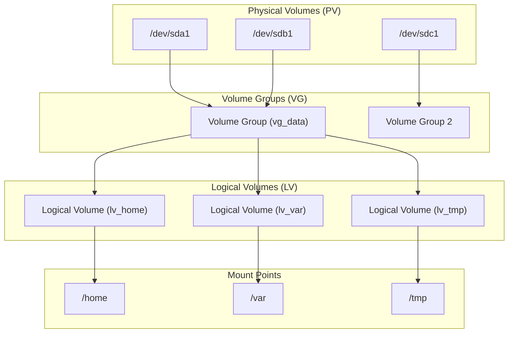
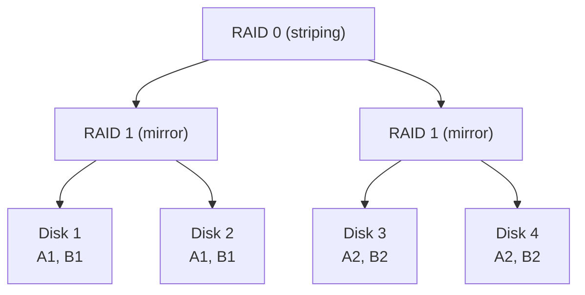

# 11주차 이론 — 디스크 관리와 RAID

[레포지토리 안내](../../README.ko.md) | [English](Concepts_Lecture.md) | [한국어](Concepts_Lecture.ko.md)

> **최종 수정일:** 2026-11-27
>
> 우분투 리눅스, 이종원, Ch 7

> **학습 목표:**
> 1. fdisk와 parted로 디스크를 파티셔닝할 수 있다
> 2. 논리 볼륨 관리자(LVM)를 관리할 수 있다
> 3. RAID 레벨(0, 1, 5, 6, 10)의 저장 방식, 용량, 장애 허용을 비교할 수 있다
> 4. RAID 5가 패리티로 고장 난 디스크의 데이터를 복구하는 원리를 설명할 수 있다
> 5. mdadm으로 RAID 레벨(0, 1, 5, 6, 10)을 구성하고 고장 난 디스크를 교체할 수 있다
> 6. 디스크 쿼터를 설정할 수 있다

---

## 목차

- [1. 고급 디스크 관리](#1-고급-디스크-관리)
  - [1.1 새 디스크 추가](#11-새-디스크-추가)
  - [1.2 USB/외장 드라이브 관리](#12-usb외장-드라이브-관리)
  - [1.3 블록 장치와 UUID의 확인](#13-블록-장치와-uuid의-확인)
- [2. LVM (Logical Volume Manager)](#2-lvm-logical-volume-manager)
  - [2.1 LVM 아키텍처](#21-lvm-아키텍처)
  - [2.2 LVM 명령어](#22-lvm-명령어)
  - [2.3 LVM의 장점](#23-lvm의-장점)
  - [2.4 익스텐트로 본 LVM의 용량 계산](#24-익스텐트로-본-lvm의-용량-계산)
- [3. RAID 개요](#3-raid-개요)
  - [3.1 RAID의 개념](#31-raid의-개념)
  - [3.2 하드웨어 RAID vs. 소프트웨어 RAID](#32-하드웨어-raid-vs-소프트웨어-raid)
  - [3.3 저장 방식의 비교](#33-저장-방식의-비교)
  - [3.4 용량과 장애 허용의 일반식](#34-용량과-장애-허용의-일반식)
- [4. RAID 레벨](#4-raid-레벨)
  - [4.1 RAID 0 (스트라이핑)](#41-raid-0-스트라이핑)
  - [4.2 RAID 1 (미러링)](#42-raid-1-미러링)
  - [4.3 RAID 5 (분산 패리티 스트라이핑)](#43-raid-5-분산-패리티-스트라이핑)
  - [4.4 RAID 6 (이중 분산 패리티)](#44-raid-6-이중-분산-패리티)
  - [4.5 RAID 10 (미러링 후 스트라이핑)](#45-raid-10-미러링-후-스트라이핑)
  - [4.6 RAID 레벨 비교](#46-raid-레벨-비교)
  - [4.7 XOR 패리티의 계산과 쓰기 비용](#47-xor-패리티의-계산과-쓰기-비용)
- [5. mdadm을 이용한 소프트웨어 RAID](#5-mdadm을-이용한-소프트웨어-raid)
  - [5.1 RAID 배열 생성](#51-raid-배열-생성)
  - [5.2 RAID 관리](#52-raid-관리)
  - [5.3 장애 테스트와 복구](#53-장애-테스트와-복구)
  - [5.4 /proc/mdstat 읽기](#54-procmdstat-읽기)
- [6. 디스크 쿼터](#6-디스크-쿼터)
  - [6.1 쿼터 설정](#61-쿼터-설정)
- [7. 모범 사례](#7-모범-사례)
- [개념 적용](#개념-적용)
- [요약](#요약)
- [점검 문제](#점검-문제)
- [참고 문헌](#참고-문헌)

---

<br>

## 1. 고급 디스크 관리

### 1.1 새 디스크 추가

새 디스크를 추가하여 쓰는 과정(10주차 2.3절)을 명령으로 정리하면 다음과 같다.

```bash
# 1. Identify new disk
lsblk
sudo fdisk -l

# 2. Partition the disk
sudo fdisk /dev/sdb
# n -> new partition
# p -> primary
# 1 -> partition number
# Enter -> default first sector
# Enter -> default last sector
# w -> write and exit

# 3. Create filesystem
sudo mkfs.ext4 /dev/sdb1

# 4. Create mount point and mount
sudo mkdir /data
sudo mount /dev/sdb1 /data

# 5. Add to fstab for persistence
echo '/dev/sdb1 /data ext4 defaults 0 2' | sudo tee -a /etc/fstab
```

장치 이름은 디스크를 추가하거나 제거하면 바뀔 수 있으므로, 5단계에서는 `/dev/sdb1` 대신 `blkid`로 확인한 `UUID=...`를 쓰는 편이 안전하다(10주차 5.4절).

### 1.2 USB/외장 드라이브 관리

```bash
# Identify USB device
lsblk
dmesg | tail -20          # Check kernel messages

# Mount USB
sudo mount /dev/sdb1 /media/usb

# Safely remove
sync                       # Flush buffers
sudo umount /media/usb
```

`sync`는 메모리 버퍼에 남아 있는 쓰기 데이터를 디스크에 기록한다. `umount`도 언마운트하기 전에 버퍼를 비우므로, 장치를 뽑기 전에 반드시 언마운트한다.

### 1.3 블록 장치와 UUID의 확인

`lsblk`는 커널이 인식한 블록 장치를 디스크와 파티션의 나무 구조로 보여 준다. 20GB 시스템 디스크 `sda`에 1GB 디스크 세 개(`sdb`, `sdc`, `sdd`)를 추가하고 `sdb`에 파티션을 하나 만든 가상 머신에서는 다음과 같다.

```text
$ lsblk
NAME   MAJ:MIN RM  SIZE RO TYPE MOUNTPOINTS
sda      8:0    0   20G  0 disk
├─sda1   8:1    0    1M  0 part
└─sda2   8:2    0   20G  0 part /
sdb      8:16   0    1G  0 disk
└─sdb1   8:17   0 1023M  0 part
sdc      8:32   0    1G  0 disk
sdd      8:48   0    1G  0 disk
sr0     11:0    1  5.8G  0 rom
```

- `MAJ:MIN`은 장치 파일의 주 번호와 부 번호이다(3주차 1.5절). SCSI 디스크 드라이버의 주 번호는 8이고, 디스크마다 부 번호가 16씩 떨어져 있어 `sdb`는 16, 그 첫 파티션 `sdb1`은 17이다. 디스크 하나가 파티션을 15개까지 부 번호로 구분할 수 있다는 뜻이다.
- `RM`은 이동식 장치 여부, `RO`는 읽기 전용 여부이며, `sr0`은 가상 CD-ROM이다.
- `sda1`(1M)은 GPT 디스크에서 BIOS 부팅을 위해 Ubuntu 설치 프로그램이 만드는 작은 파티션이다(10주차).

`blkid`는 파일 시스템이 만들어진 장치의 UUID와 종류를 출력한다.

```text
$ sudo mkfs.ext4 -q /dev/sdb1
$ sudo blkid /dev/sdb1
/dev/sdb1: UUID="2f3c8e1a-6b7d-4c55-9a1e-0d4b7c9e2a10" BLOCK_SIZE="4096" TYPE="ext4" PARTUUID="6a1f2c3d-01"
```

UUID는 `mkfs`가 파일 시스템을 만들 때 정하는 128비트 식별자이므로, 디스크를 다른 포트에 꽂아 이름이 `sdb`에서 `sdc`로 바뀌어도 같다. 그래서 1.1절의 5단계를 `/etc/fstab`에 다음과 같이 쓴다.

```text
UUID=2f3c8e1a-6b7d-4c55-9a1e-0d4b7c9e2a10  /data  ext4  defaults  0  2
```

> **주의:** `/etc/fstab`에 잘못된 줄을 넣으면 다음 부팅 때 마운트에 실패하여 긴급 모드로 들어갈 수 있다. 줄을 넣은 뒤에는 다시 부팅하기 전에 `sudo mount -a`를 실행하여 오류가 없는지, `findmnt /data`로 마운트되었는지 먼저 확인한다.

---

<br>

## 2. LVM (Logical Volume Manager)

### 2.1 LVM 아키텍처

LVM은 물리 볼륨(PV)을 볼륨 그룹(VG)으로 묶고, VG에서 논리 볼륨(LV)을 나누어 마운트한다. LVM의 용어(PV, VG, LV, PE)와 생성 절차는 10주차 6절에서 다룬다.



*그림 1. LVM의 물리 볼륨, 볼륨 그룹, 논리 볼륨 계층*

### 2.2 LVM 명령어

```bash
# Physical Volume (PV)
sudo pvcreate /dev/sdb1 /dev/sdc1       # Create PVs
sudo pvdisplay                            # Display PV info
sudo pvs                                  # Summary

# Volume Group (VG)
sudo vgcreate vg_data /dev/sdb1 /dev/sdc1  # Create VG
sudo vgdisplay                              # Display VG info
sudo vgextend vg_data /dev/sdd1             # Add disk to VG

# Logical Volume (LV)
sudo lvcreate -L 10G -n lv_home vg_data    # Create 10GB LV
sudo lvcreate -l 100%FREE -n lv_data vg_data  # Use all free space
sudo lvdisplay                               # Display LV info

# Format and mount
sudo mkfs.ext4 /dev/vg_data/lv_home
sudo mount /dev/vg_data/lv_home /home

# Resize LV (extend)
sudo lvextend -L +5G /dev/vg_data/lv_home   # Add 5GB
sudo resize2fs /dev/vg_data/lv_home          # Resize filesystem
```

`lvcreate`의 `-L`은 크기를 용량으로, `-l`은 PE 수나 `100%FREE` 같은 비율로 지정한다. LV를 늘린 뒤에는 그 안의 파일 시스템도 늘려야 하며, ext 계열은 `resize2fs`, xfs는 `xfs_growfs`를 쓴다.

### 2.3 LVM의 장점

- **동적 크기 조정:** 볼륨을 마운트한 채로 확장할 수 있다(ext4, xfs). 축소는 ext4에서 언마운트한 뒤에 할 수 있고, xfs는 축소할 수 없다.
- **디스크 스패닝:** 단일 디스크보다 큰 볼륨을 만들 수 있다.
- **스냅샷:** 백업을 위한 특정 시점의 복사본을 만들 수 있다.
- **스트라이핑:** 여러 디스크에 걸쳐 데이터를 나누어 써서 I/O 성능을 높일 수 있다.

### 2.4 익스텐트로 본 LVM의 용량 계산

LVM은 PV를 같은 크기의 조각인 **물리 익스텐트(physical extent, PE)** 로 나누고, LV는 PE를 몇 개 모아 만든다. LV에서 본 조각을 논리 익스텐트(LE)라 하며, LE 하나가 PE 하나에 대응한다. 따라서 VG와 LV의 크기는 모두 PE 크기의 정수배이다. PE 크기는 `vgcreate -s`로 VG를 만들 때 정하며, 한번 정하면 VG를 다시 만들지 않고는 바꾸기 어렵다 [1].

PE 크기가 4 MiB인 VG `vg_data`를 1 GiB 디스크 두 개로 만들었다고 하자. PV마다 메타데이터 영역이 앞부분을 차지하므로 PV 하나에서 쓸 수 있는 PE는 256개보다 조금 적은 255개이다.

| 단계 | 명령 | PE 계산 | 결과 |
|:-----|:-----|:-----|:-----|
| VG 생성 | `vgcreate -s 4M vg_data /dev/sdb1 /dev/sdc1` | 255 + 255 = 510 PE | VG 크기 510 × 4 MiB = 2040 MiB |
| LV 생성 | `lvcreate -L 1.5G -n lv_home vg_data` | 1536 MiB ÷ 4 MiB = 384 PE | 남은 PE 510 - 384 = 126개 |
| 비율로 생성 | `lvcreate -l 50%FREE -n lv_log vg_data` | 126 × 0.5 = 63 PE | 63 × 4 MiB = 252 MiB |
| 확장 | `lvextend -l +100%FREE -r /dev/vg_data/lv_home` | 남은 63 PE를 모두 추가 | 447 PE = 1788 MiB |

*표 1. PE 크기 4 MiB인 VG에서 LV를 만들고 늘릴 때의 익스텐트 계산*

`-L`로 준 크기가 PE 크기의 배수가 아니면 LVM은 다음 PE 경계까지 올려서 만든다. 예를 들어 `-L 10M`은 4 MiB PE 세 개, 곧 12 MiB가 된다. `lvextend`의 `-r`(`--resizefs`)은 LV를 늘린 뒤 그 안의 파일 시스템도 함께 늘리므로 2.2절의 `resize2fs`를 따로 실행할 필요가 없다.

> **주의:** LV를 줄일 때는 순서가 늘릴 때와 반대이다. 파일 시스템을 먼저 줄이고 LV를 줄여야 하며, LV를 먼저 줄이면 파일 시스템의 끝부분이 잘려 데이터가 손상된다. `lvreduce -r`을 쓰면 LVM이 이 순서를 지켜 준다. xfs는 줄일 수 없으므로(2.3절) xfs를 담은 LV는 줄이지 않는다.

---

<br>

## 3. RAID 개요

### 3.1 RAID의 개념

**RAID** (Redundant Array of Independent Disks)는 여러 물리 디스크를 하나의 논리적 단위로 결합하는 기술로, 다음을 목적으로 한다.

- **성능:** 여러 디스크에 걸쳐 병렬로 읽고 쓴다.
- **이중화:** 디스크에 장애가 나도 데이터를 보존한다.
- **용량:** 여러 개의 작은 디스크를 하나로 결합한다.

RAID라는 이름은 처음에 Redundant Array of Inexpensive Disks의 약자로 제안되었다. 값싼 디스크 여러 개를 하나처럼 써서 비용을 줄이면서 신뢰성과 성능을 함께 높인다는 뜻이며, 지금은 Independent로 풀어 쓰는 경우가 많다.

### 3.2 하드웨어 RAID vs. 소프트웨어 RAID

| 특징 | 하드웨어 RAID | 소프트웨어 RAID |
|------|--------------|---------------|
| 컨트롤러 | 전용 RAID 카드 | CPU/OS가 관리 |
| 성능 | 우수 (전용 프로세서) | 약간 낮음 |
| 비용 | 높음 (RAID 컨트롤러) | 무료 (OS 내장) |
| 유연성 | 컨트롤러 기능에 제한 | OS 수준의 완전한 제어 |
| 도구 | 컨트롤러 BIOS | Linux의 `mdadm` |

*표 2. 하드웨어 RAID와 소프트웨어 RAID의 비교*

하드웨어 RAID는 제조업체가 여러 하드디스크로 만든 장비를 그대로 공급하는 방식으로, 더 안정적이지만 상당히 비싸다. 소프트웨어 RAID는 운영체제가 지원하는 방식으로, 비싼 하드웨어 RAID의 대안이며 적은 비용으로 데이터를 더 안전하게 저장할 수 있다. 5절에서는 Linux의 소프트웨어 RAID를 다룬다.

### 3.3 저장 방식의 비교

용량이 1GB인 디스크 N개로 구성한 저장 방식을 비교하면 다음과 같다. 단순 볼륨과 LVM은 RAID에 포함되지 않지만, RAID와 저장 방식을 비교하기 위해 함께 적는다.

| 방식 | 디스크 수 | 사용 가능 용량 | 저장 방식과 특징 |
|:-----|:-----|:-----|:-----|
| 단순 볼륨 | 1개 | 1GB | 하드디스크 하나를 볼륨 하나로 쓴다 |
| LVM (선형) | 2개 이상 | N GB | 첫 번째 디스크부터 차례로 채우며, 디스크를 추가할 수 있다 |
| RAID 0 | 2개 이상 | N GB | 모든 디스크에 동시에 나누어 저장하며 가장 빠르다(스트라이핑) |
| RAID 1 | 2개 이상 | 1GB (디스크 1개 분량) | 모든 디스크에 같은 데이터를 동시에 저장하여 결함 허용을 제공한다(미러링) |
| RAID 5 | 3개 이상 | (N-1) GB | 패리티 정보를 써서 결함 허용을 제공하며 공간 효율이 좋다 |
| RAID 6 | 4개 이상 | (N-2) GB | RAID 5를 개선하여 패리티를 두 개 쓰며 결함 허용을 제공한다 |

*표 3. 1GB 디스크 N개로 구성한 저장 방식의 비교*

### 3.4 용량과 장애 허용의 일반식

크기가 S인 디스크 N개로 배열을 만들 때의 용량과 장애 허용은 다음 식으로 정리된다.

| 레벨 | 사용 가능 용량 | 공간 효율 | 반드시 견디는 고장 디스크 수 |
|:-----|:-----|:-----|:-----|
| RAID 0 | N × S | 100% | 0 |
| RAID 1 (N개 미러) | S | 1/N | N - 1 |
| RAID 5 | (N - 1) × S | (N - 1)/N | 1 |
| RAID 6 | (N - 2) × S | (N - 2)/N | 2 |
| RAID 10 (2개씩 미러) | N/2 × S | 50% | 1 (쌍이 다르면 최대 N/2) |

*표 4. 크기 S인 디스크 N개로 만든 배열의 용량과 장애 허용*

1 TB 디스크 4개로 계산하면 RAID 0은 4 TB, RAID 1은 1 TB, RAID 5는 3 TB, RAID 6은 2 TB, RAID 10은 2 TB이다. 디스크 수가 늘면 RAID 5와 RAID 6의 공간 효율은 각각 (N - 1)/N, (N - 2)/N으로 100%에 가까워지지만, 디스크가 많을수록 그중 하나가 고장 날 확률도 커진다.

크기가 다른 디스크를 섞으면 Linux 소프트웨어 RAID는 각 디스크에서 가장 작은 디스크의 크기만큼만 쓴다. 1 TB, 2 TB, 2 TB 디스크로 RAID 5를 만들면 S를 1 TB로 보아 (3 - 1) × 1 TB = 2 TB이고, 2 TB 디스크 두 개의 남은 1 TB씩은 배열에 쓰이지 않는다.

---

<br>

## 4. RAID 레벨

### 4.1 RAID 0 (스트라이핑)

```text
     Data: ABCDEFGH

     Disk 1: A C E G    Disk 2: B D F H
```

*그림 2. 데이터 블록을 두 디스크에 번갈아 나누어 저장하는 RAID 0의 스트라이핑*

| 속성 | 값 |
|------|-----|
| 최소 디스크 수 | 2 |
| 이중화 | 없음 |
| 용량 | N x 디스크 크기 |
| 읽기 속도 | N x 단일 디스크 |
| 쓰기 속도 | N x 단일 디스크 |
| 장애 허용 | 없음 (디스크 하나라도 고장나면 전체 손실) |

*표 5. RAID 0의 속성*

RAID 0은 LVM과 비슷해 보이지만 저장 방식이 다르다. LVM(선형)은 첫 번째 디스크를 다 채운 뒤 다음 디스크에 저장하지만, RAID 0은 모든 디스크에 동시에 나누어 저장한다. 따라서 저장 속도가 크게 향상되고 공간 효율은 100%이지만, 디스크 하나만 고장 나도 모든 데이터를 잃으므로 신뢰성이 낮다. 빠른 성능이 필요하면서 모두 잃어도 큰 문제가 되지 않는 자료에 적당하다.

### 4.2 RAID 1 (미러링)

```text
     Data: ABCD

     Disk 1: A B C D    Disk 2: A B C D  (exact copy)
```

*그림 3. 같은 데이터를 두 디스크에 복사하는 RAID 1의 미러링*

| 속성 | 값 |
|------|-----|
| 최소 디스크 수 | 2 |
| 이중화 | 완전 미러 |
| 용량 | 1개 디스크 크기 (50% 효율) |
| 읽기 속도 | 최대 2배 |
| 쓰기 속도 | 1배 (양쪽에 동시 기록) |
| 장애 허용 | 1개 디스크 장애 가능 |

*표 6. RAID 1의 속성*

RAID 1은 데이터를 저장하는 데 두 배의 용량이 필요하므로 비용이 두 배이고 공간 효율이 나쁘지만, 디스크 하나가 고장 나도 데이터가 남는 **결함 허용(fault tolerance)** 을 제공하여 신뢰성이 높다. 쓰기는 두 디스크에 모두 해야 하므로 저장 속도는 단일 디스크와 같다. 중요한 데이터를 저장하기에 적절하다. 표의 50% 효율은 디스크 2개로 구성할 때의 값이며, 디스크를 더 넣어도 사용 가능 용량은 디스크 1개 분량이다.

| 항목 | RAID 0 | RAID 1 |
|:-----|:-----|:-----|
| 성능(저장 속도) | 뛰어남 | 변화 없음 |
| 데이터 안전성(결함 허용) | 보장하지 못함 | 보장함 |
| 공간 효율 | 좋음 | 나쁨 |

*표 7. RAID 0과 RAID 1의 비교*

### 4.3 RAID 5 (분산 패리티 스트라이핑)

```text
     Disk 1    Disk 2    Disk 3
     A1        A2        Ap (parity)
     Bp        B1        B2
     C1        Cp        C2
```

*그림 4. 패리티 블록을 디스크마다 돌아가며 두는 RAID 5의 분산 패리티 배치*

| 속성 | 값 |
|------|-----|
| 최소 디스크 수 | 3 |
| 이중화 | 분산 패리티 |
| 용량 | (N-1) x 디스크 크기 |
| 읽기 속도 | (N-1) x 단일 디스크 |
| 쓰기 속도 | 느림 (패리티 계산) |
| 장애 허용 | 1개 디스크 장애 가능 |

*표 8. RAID 5의 속성*

RAID 5는 RAID 1의 데이터 안전성과 RAID 0의 공간 효율을 함께 얻기 위한 방식으로, 최소 3개의 디스크가 필요하다. 각 줄(스트라이프)마다 데이터 비트와 합쳐 1의 개수가 짝수가 되도록 **패리티(parity)** 비트를 정하고(데이터 비트들의 XOR와 같다), 패리티를 저장하는 디스크를 줄마다 바꾼다. 디스크 하나가 고장 나면 나머지 디스크의 값으로 사라진 값을 계산하여 복구한다.

예를 들어 12비트 데이터 000 111 010 011을 디스크 4개(sda, sdb, sdc, sdd)에 세 비트씩 나누어 저장하면 다음과 같다.

| 줄 | sda | sdb | sdc | sdd | 데이터 | 패리티 위치와 값 |
|:-----|:-----|:-----|:-----|:-----|:-----|:-----|
| 1 | 0 | 0 | 0 | **0** | 000 | sdd, 0 |
| 2 | 1 | 1 | **1** | 1 | 111 | sdc, 1 |
| 3 | 0 | **1** | 1 | 0 | 010 | sdb, 1 |
| 4 | **0** | 0 | 1 | 1 | 011 | sda, 0 |

*표 9. 데이터 000 111 010 011을 RAID 5로 저장한 결과(굵은 값이 패리티)*

sdb가 고장 나면 각 줄에서 남은 세 값과 합쳐 1의 개수가 짝수가 되도록 sdb의 값을 정한다. 줄 1은 0, 0, 0이므로 0, 줄 2는 1, 1, 1이므로 1, 줄 3은 0, 1, 0이므로 1, 줄 4는 0, 1, 1이므로 0이 되어 원래 값 0, 1, 1, 0을 그대로 복구한다. 이처럼 RAID 5는 어느 정도 결함 허용을 제공하면서 저장 공간의 효율도 좋다(디스크 개수 - 1만큼의 공간을 쓴다). 그러나 디스크 2개가 동시에 고장 나면 한 줄에 모르는 값이 두 개가 되어 복구할 수 없다.

### 4.4 RAID 6 (이중 분산 패리티)

```text
     Disk 1    Disk 2    Disk 3    Disk 4
     A1        A2        Ap        Aq
     B1        Bp        Bq        B2
     Cp        Cq        C1        C2
```

*그림 5. 두 패리티 P와 Q를 분산하여 배치한 RAID 6의 예*

RAID 6은 RAID 5를 개선한 방식으로, 스트라이프마다 서로 다른 방식으로 계산한 패리티 두 개(P, Q)를 분산 저장한다. P는 RAID 5와 같은 XOR 패리티이고, Q는 Reed-Solomon 부호 같은 다른 계산으로 만들어 두 디스크의 값을 모두 복원할 수 있게 한다. 최소 4개의 디스크가 필요하고 사용 가능 용량은 (N-2) x 디스크 크기이다. 공간 효율과 성능(속도)은 RAID 5보다 약간 떨어지지만, 디스크 2개가 동시에 고장 나도 데이터에 이상이 없으므로 신뢰도가 더 높다.

### 4.5 RAID 10 (미러링 후 스트라이핑)



*그림 6. 미러 쌍 두 개를 스트라이핑한 RAID 10의 구성*

RAID 10(RAID 1+0)은 디스크를 둘씩 RAID 1로 미러링한 뒤, 그 미러 쌍들을 다시 RAID 0으로 스트라이핑하는 방식이다. 신뢰성(안전성)과 성능(속도)이 동시에 뛰어나지만 공간 효율은 50%(사용 가능 용량 N/2 x 디스크 크기)이고, 최소 4개의 디스크가 필요하다.

> **주의:** RAID 10은 디스크 2개가 고장 나도 두 디스크가 서로 다른 미러 쌍에 속하면 데이터가 안전하지만, 같은 미러 쌍의 두 디스크가 함께 고장 나면 그 쌍의 데이터를 모두 잃는다. 따라서 어떤 경우에도 보장되는 장애 허용은 디스크 1개이다.

### 4.6 RAID 레벨 비교

| 레벨 | 최소 디스크 | 이중화 | 용량 | 사용 사례 |
|------|------------|--------|------|----------|
| RAID 0 | 2 | 없음 | 100% | 성능 (임시 데이터) |
| RAID 1 | 2 | 미러 | 50% | 부팅 드라이브, 중요 데이터 |
| RAID 5 | 3 | 1개 패리티 | (N-1)/N | 범용 서버 |
| RAID 6 | 4 | 2개 패리티 | (N-2)/N | 높은 안정성 |
| RAID 10 | 4 | 미러 + 스트라이프 | 50% | 데이터베이스, 높은 I/O |

*표 10. RAID 레벨별 최소 디스크 수, 이중화, 용량과 사용 사례*

### 4.7 XOR 패리티의 계산과 쓰기 비용

4.3절의 "1의 개수가 짝수가 되도록 정한 패리티"는 비트마다 XOR(배타적 논리합, ⊕)을 한 것과 같다. XOR는 두 비트가 다르면 1, 같으면 0이며, 교환 법칙과 결합 법칙이 성립하고 $`x \oplus x = 0`$, $`x \oplus 0 = x`$이다. 따라서 데이터 블록 $`D_1, \dots, D_{N-1}`$의 패리티를 다음과 같이 정하면,

```math
P = D_1 \oplus D_2 \oplus \cdots \oplus D_{N-1}
```

어느 블록 하나가 사라져도 나머지를 모두 XOR하여 되살릴 수 있다. 예를 들어 사라진 $`D_2`$는 $`P \oplus D_1 \oplus D_3 \oplus \cdots`$이다. 실제 RAID 5는 비트가 아니라 청크(mdadm의 기본값 512 KiB [2]) 단위로 이 계산을 한다. 디스크 4개 배열의 한 줄에 바이트 세 개를 저장하는 경우로 계산하면 다음과 같다.

```text
D1 = 0x5A = 0101 1010
D2 = 0x3C = 0011 1100
D3 = 0xF0 = 1111 0000
P  = D1 ⊕ D2 ⊕ D3 = 1001 0110 = 0x96

disk holding D2 fails → D2 = P ⊕ D1 ⊕ D3
   = 1001 0110 ⊕ 0101 1010 ⊕ 1111 0000 = 0011 1100 = 0x3C
```

*그림 7. 바이트 단위로 계산한 RAID 5의 패리티와 복구*

**작은 쓰기의 비용.** 한 줄의 데이터 블록 하나만 바꿀 때 RAID 5는 줄의 모든 블록을 다시 읽지 않고, XOR의 성질을 이용해 다음 식으로 새 패리티를 구한다.

```math
P_{\text{new}} = P_{\text{old}} \oplus D_{\text{old}} \oplus D_{\text{new}}
```

그림 7에서 D2를 `0x0F`로 바꾸면 $`P_{\text{new}}`$ = 0x96 ⊕ 0x3C ⊕ 0x0F = `0xA5`이며, 이는 0x5A ⊕ 0x0F ⊕ 0xF0을 직접 계산한 값과 같다. 이 방법은 옛 데이터 읽기, 옛 패리티 읽기, 새 데이터 쓰기, 새 패리티 쓰기의 네 번의 디스크 입출력이 필요하다. 그래서 작은 쓰기가 많은 작업(데이터베이스 등)에서는 RAID 5의 쓰기가 느리고, 패리티가 둘인 RAID 6은 더 느리다. 4.6절에서 데이터베이스에 RAID 10을 권한 이유가 여기에 있다.

> **참고:** **쓰기 구멍(write hole).** 데이터와 패리티를 쓰는 도중 전원이 꺼지면 한 줄의 데이터와 패리티가 서로 맞지 않는 상태로 남을 수 있다. 이 상태에서 디스크가 하나 고장 나면 잘못된 패리티로 잘못된 값을 복구하게 된다. Linux md는 Linux 4.4부터 데이터와 패리티를 먼저 별도의 저널 장치에 기록하는 방법으로 이 문제를 막을 수 있다 [3].

---

<br>

## 5. mdadm을 이용한 소프트웨어 RAID

### 5.1 RAID 배열 생성

```bash
# Install mdadm
sudo apt install mdadm

# Create RAID 1 (mirror)
sudo mdadm --create /dev/md0 --level=1 --raid-devices=2 /dev/sdb1 /dev/sdc1

# Create RAID 5
sudo mdadm --create /dev/md0 --level=5 --raid-devices=3 /dev/sdb1 /dev/sdc1 /dev/sdd1

# Format and mount
sudo mkfs.ext4 /dev/md0
sudo mkdir /mnt/raid
sudo mount /dev/md0 /mnt/raid
```

RAID 0을 처음부터 만드는 실습 절차는 다음과 같다.

1. RAID에 쓸 디스크마다 파티션을 하나 만들고, `t` 명령으로 파티션 종류를 fd(Linux RAID 자동 감지)로 바꾼다. `fdisk /dev/sdb`를 실행하여 `n`, `p`, `1`, Enter, Enter, `t`, `fd`, `p`, `w` 순서로 입력한다.
2. `mknod`로 RAID 장치 파일을 만든다. `mknod /dev/md0 b 9 0`은 주 번호(major) 9(md 드라이버), 부 번호(minor) 0인 블록(`b`) 장치 `/dev/md0`을 만든다. 최근 배포판에서는 mdadm과 udev가 장치 파일을 자동으로 만들므로 생략해도 된다.
3. `mdadm --create`로 배열을 만들고, `mdadm --detail --scan`과 `mdadm --query --detail`로 결과를 확인한다.
4. `mkfs.ext4`로 파일 시스템을 만들고 마운트 포인트에 마운트한다.

```bash
sudo fdisk /dev/sdb                 # n, p, 1, Enter, Enter, t, fd, p, w
sudo mknod /dev/md0 b 9 0           # Can be skipped on recent distributions
sudo mdadm --create /dev/md0 --level=0 --raid-devices=2 /dev/sdb1 /dev/sdc1
sudo mdadm --detail --scan
sudo mdadm --query --detail /dev/md0
sudo mkfs.ext4 /dev/md0
sudo mkdir /mnt/raid0data
sudo mount /dev/md0 /mnt/raid0data
```

같은 방법으로 RAID 1은 `--level=1 --raid-devices=2`, RAID 5는 `--level=5 --raid-devices=3`, RAID 6은 `--level=6 --raid-devices=4`, RAID 10은 `--level=10 --raid-devices=4`로 만든다.

### 5.2 RAID 관리

```bash
# Check RAID status
cat /proc/mdstat
sudo mdadm --detail /dev/md0

# Add spare disk
sudo mdadm --add /dev/md0 /dev/sde1

# Remove failed disk
sudo mdadm --remove /dev/md0 /dev/sdb1

# Stop RAID array
sudo mdadm --stop /dev/md0

# Save configuration
sudo mdadm --detail --scan >> /etc/mdadm/mdadm.conf
```

`--remove`는 장애 상태이거나 예비인 디스크만 뺄 수 있다. 정상 동작 중인 디스크를 빼려면 먼저 `sudo mdadm /dev/md0 --fail /dev/sdb1`로 장애 표시를 한다. 설정 저장 명령의 `>>`는 root 권한이 필요한 리다이렉션이므로, root 셸에서 실행하거나 `sudo mdadm --detail --scan | sudo tee -a /etc/mdadm/mdadm.conf`처럼 쓴다.

### 5.3 장애 테스트와 복구

RAID 1, 5, 6, 10은 결함 허용 기능이 있으므로 디스크 일부를 제거해도 배열이 계속 동작한다. 디스크가 빠진 채로 동작하는 상태를 **성능 저하(degraded)** 상태라고 한다. RAID 1과 RAID 5는 디스크 1개를, RAID 6은 아무 디스크나 2개를 잃어도 데이터가 안전하다.

성능 저하 상태의 RAID 5에서 사라진 디스크의 데이터를 읽으려면 남은 디스크의 값으로 매번 계산해야 하므로 속도가 약간 느려질 수 있다. 고장 난 디스크를 새 디스크로 교체하고 배열에 추가하면 mdadm이 데이터를 다시 만들어 새 디스크에 기록하는 **재구성(rebuild)** 을 하며, 재구성이 끝나면 값을 계산할 필요가 없으므로 속도 저하도 없어진다. RAID 1은 남은 디스크의 데이터를 새 디스크에 복사하여 다시 두 디스크 모두에 같은 파일이 있게 된다.

```bash
sudo mdadm --query --detail /dev/md1      # Check status (degraded or not)
sudo mdadm /dev/md1 --add /dev/sdj1       # Add a new disk and rebuild
sudo mdadm /dev/md5 --add /dev/sdk1
```

RAID 배열을 없앨 때는 언마운트하고 배열을 멈춘 뒤, 구성 디스크에 남은 RAID 메타데이터(슈퍼블록)를 지운다. 설정 파일에 등록되지 않은 배열은 부팅할 때 `/dev/md127`처럼 큰 번호로 자동 조립되기도 한다.

```bash
sudo umount /dev/md127
sudo mdadm --stop /dev/md127
sudo mdadm --zero-superblock /dev/sdb1 /dev/sdc1
```

### 5.4 /proc/mdstat 읽기

`/proc/mdstat`은 커널의 md 드라이버가 모든 배열의 상태를 보여 주는 가상 파일이다. 1 GiB 디스크 세 개로 만든 RAID 5 배열 `md5`의 정상 상태, 디스크 하나가 고장 난 성능 저하 상태, 새 디스크를 넣어 재구성하는 상태를 차례로 보면 다음과 같다(출력 예).

```text
$ cat /proc/mdstat
Personalities : [raid0] [raid1] [raid6] [raid5] [raid4] [raid10]
md5 : active raid5 sdd1[3] sdc1[1] sdb1[0]
      2093056 blocks super 1.2 level 5, 512k chunk, algorithm 2 [3/3] [UUU]

unused devices: <none>

$ sudo mdadm /dev/md5 --fail /dev/sdc1
$ cat /proc/mdstat
md5 : active raid5 sdd1[3] sdc1[1](F) sdb1[0]
      2093056 blocks super 1.2 level 5, 512k chunk, algorithm 2 [3/2] [U_U]

$ sudo mdadm /dev/md5 --remove /dev/sdc1
$ sudo mdadm /dev/md5 --add /dev/sde1
$ cat /proc/mdstat
md5 : active raid5 sde1[4] sdd1[3] sdb1[0]
      2093056 blocks super 1.2 level 5, 512k chunk, algorithm 2 [3/2] [U_U]
      [====>................]  recovery = 23.4% (245120/1046528) finish=0.4min speed=30640K/sec
```

| 표시 | 뜻 |
|:-----|:-----|
| `sdb1[0]` | 구성 장치와 배열 안의 번호 |
| `(F)` | 장애(faulty)로 표시된 장치 |
| `2093056 blocks` | 배열의 크기(1 KiB 단위). 디스크 3개 가운데 2개 분량 |
| `super 1.2` | 디스크에 기록된 RAID 메타데이터(슈퍼블록)의 형식 |
| `512k chunk` | 한 디스크에 연속으로 쓰는 단위 |
| `[3/2]` | 배열에 필요한 장치 수 / 지금 동작하는 장치 수 |
| `[U_U]` | 장치마다 동작(`U`)과 빠짐(`_`) |
| `recovery = 23.4%` | 재구성의 진행률 |

*표 11. /proc/mdstat에 나오는 표시의 뜻*

md 드라이버는 쓰기 오류를 낸 장치를 즉시 장애로 표시하고 남은 장치로 계속 동작하며, 예비 디스크가 있으면 곧바로 그 디스크에 사라진 데이터를 재구성하기 시작한다 [3]. 그래서 5.2절의 `--add`로 예비 디스크를 미리 넣어 두면 관리자가 없어도 성능 저하 상태가 오래가지 않는다.

---

<br>

## 6. 디스크 쿼터

### 6.1 쿼터 설정

디스크 쿼터는 사용자나 그룹이 쓸 수 있는 디스크 용량과 파일 수를 제한한다. 쿼터의 개념(하드 리미트, 소프트 리미트)과 각 명령의 자세한 사용법은 12주차 8절에서 다룬다.

```bash
# Install quota tools
sudo apt install quota

# Enable quotas in /etc/fstab
# /dev/sda2 /home ext4 defaults,usrquota,grpquota 0 2

# Remount and initialize
sudo mount -o remount /home
sudo quotacheck -cugm /home
sudo quotaon /home

# Set user quota
sudo edquota -u user1
# Set soft limit, hard limit for blocks and inodes

# Set group quota
sudo edquota -g developers

# View quota usage
sudo repquota /home
quota -u user1
```

---

<br>

## 7. 모범 사례

- 부팅/OS 드라이브에는 RAID 1을, 데이터 저장소에는 RAID 5나 RAID 6을 사용한다.
- RAID는 백업이 아니므로 항상 별도의 백업을 유지한다.
- 유연한 볼륨 관리를 위해 RAID 위에 LVM을 사용한다.
- `mdadm --detail`로 RAID 상태를 정기적으로 모니터링한다.
- 자동 재구성을 위해 핫 스페어 디스크를 유지한다.
- 실제로 필요하기 전에 디스크 복구 절차를 테스트한다.

---

<br>

## 개념 적용

**T/F 점검:**

| 문장 | 판단과 근거 |
|:-----|:-----|
| 1 TB, 2 TB, 2 TB 디스크로 만든 RAID 5의 사용 가능 용량은 4 TB이다. | **F.** 가장 작은 디스크 1 TB를 기준으로 (3 - 1) × 1 TB = 2 TB이다. |
| RAID 6은 디스크 6개 가운데 아무 디스크 2개가 고장 나도 데이터가 안전하다. | **T.** 서로 다른 두 패리티 P, Q로 두 블록을 함께 복원할 수 있다. |
| RAID 5에서 데이터 블록 하나를 바꾸려면 그 줄의 모든 디스크를 읽어야 한다. | **F.** 새 패리티는 옛 패리티 ⊕ 옛 데이터 ⊕ 새 데이터로 구하므로 두 블록만 읽으면 된다. |
| LV를 줄일 때는 LV를 먼저 줄인 뒤 파일 시스템을 줄인다. | **F.** 파일 시스템을 먼저 줄여야 하며, 순서가 바뀌면 데이터가 손상된다. |
| `lvcreate -L 10M`은 PE 크기가 4 MiB인 VG에서 10 MiB짜리 LV를 만든다. | **F.** PE 경계로 올림하여 PE 3개, 곧 12 MiB가 된다. |
| `/proc/mdstat`의 `[U_U]`는 세 장치 가운데 가운데 장치가 빠진 성능 저하 상태이다. | **T.** `U`는 동작, `_`는 빠진 장치이다. |
| RAID 1로 미러링하면 실수로 지운 파일도 다른 디스크에서 되살릴 수 있다. | **F.** 삭제도 두 디스크에 함께 기록되므로 RAID는 백업을 대신하지 못한다. |

---

<br>

## 요약

| 개념 | 핵심 요약 |
|------|----------|
| LVM | PV를 VG로 묶고 VG에서 LV를 나누는(PV -> VG -> LV) 유연한 볼륨 관리 방식이다. |
| RAID 0 | 스트라이핑으로 성능은 좋지만 이중화가 없다. |
| RAID 1 | 미러링으로 완전한 이중화를 제공하며, 디스크 2개일 때 용량 효율은 50%이다. |
| RAID 5 | 분산 패리티로 성능과 이중화의 균형을 맞추며 디스크 1개의 장애를 허용한다. |
| RAID 6 | 패리티 두 개를 분산 저장하여 디스크 2개의 동시 장애를 허용한다. |
| RAID 10 | 미러 쌍을 스트라이핑하여 성능과 신뢰성을 함께 얻으며 용량 효율은 50%이다. |
| mdadm | Linux 소프트웨어 RAID를 만들고 관리하는 도구이다. |
| 디스크 쿼터 | 사용자나 그룹별로 디스크 사용량을 제한한다. |
| fstab | 영구 마운트와 쿼터 옵션을 설정하는 파일이다. |
| UUID | `mkfs`가 정하는 파일 시스템의 식별자로, 장치 이름이 바뀌어도 같으므로 `/etc/fstab`에 쓴다. |
| PE와 LE | LVM의 할당 단위로, VG와 LV의 크기는 PE 크기의 정수배이며 지정한 크기는 PE 경계로 올림된다. |
| RAID 용량 일반식 | 크기 S인 디스크 N개에서 RAID 0은 NS, RAID 1은 S, RAID 5는 (N-1)S, RAID 6은 (N-2)S, RAID 10은 NS/2이다. |
| XOR 패리티 | P는 데이터 블록의 XOR이며, 사라진 블록은 남은 블록의 XOR로, 새 패리티는 옛 패리티 ⊕ 옛 데이터 ⊕ 새 데이터로 구한다. |
| /proc/mdstat | `[필요 수/동작 수]`와 `[U_]` 표시로 배열의 정상, 성능 저하, 재구성 상태를 보여 준다. |

---

<br>

## 점검 문제

1. **RAID 5 패리티 복구:** 디스크 4개(sda, sdb, sdc, sdd)로 된 RAID 5의 한 줄에서 sda=1, sdc=0이고 패리티가 저장된 sdd=0인데 sdb가 고장 났다. 짝수 패리티를 쓴다고 할 때 sdb의 값을 구하고, 같은 줄의 sdc도 함께 고장 나면 복구할 수 없는 이유를 설명하라.

   <details>
   <summary>정답</summary>

   네 값을 합친 1의 개수가 짝수여야 하므로 1 + x + 0 + 0이 짝수가 되는 x = 1이다(1 XOR 0 XOR 0 = 1). sdc도 고장 나면 sdb와 sdc의 값 x, y에 대해 x + y가 홀수라는 조건 하나만 남아 (0, 1)과 (1, 0)을 구분할 수 없으므로 복구할 수 없다.

   </details>

2. **RAID 6과 RAID 10의 비교:** 2TB 디스크 6개로 RAID 6과 RAID 10을 각각 구성할 때 사용 가능 용량과, 어떤 디스크가 고장 나더라도 보장되는 장애 허용 디스크 수를 구하라.

   <details>
   <summary>정답</summary>

   RAID 6의 용량은 (6 - 2) × 2TB = 8TB이고, 아무 디스크나 2개가 고장 나도 데이터가 안전하다. RAID 10의 용량은 6 / 2 × 2TB = 6TB이고, 보장되는 장애 허용은 1개이다. RAID 10은 고장 난 디스크가 모두 서로 다른 미러 쌍에 속하면 최대 3개까지 견딜 수 있지만, 같은 쌍의 두 디스크가 고장 나면 데이터를 잃는다.

   </details>

3. **RAID 10의 두 디스크 장애:** 디스크 4개를 (D1, D2), (D3, D4)의 미러 쌍으로 묶은 RAID 10에서 디스크 2개가 무작위로 동시에 고장 날 때 데이터가 살아남을 확률을 구하라.

   <details>
   <summary>정답</summary>

   고장 날 디스크 2개를 고르는 경우는 $\binom{4}{2} = 6$가지이다. 데이터를 잃는 경우는 같은 쌍이 함께 고장 나는 (D1, D2)와 (D3, D4)의 2가지뿐이므로, 살아남을 확률은 4 / 6 = 2/3이다.

   </details>

4. **성능 저하 상태와 재구성:** RAID 5에서 디스크 하나가 고장 난 뒤 교체하기 전까지 읽기 속도가 느려질 수 있는 이유와, `sudo mdadm /dev/md5 --add /dev/sdk1`을 실행했을 때 일어나는 일을 설명하라.

   <details>
   <summary>정답</summary>

   고장 난 디스크에 있던 데이터 블록을 읽으려면 같은 줄의 나머지 디스크를 모두 읽어 XOR로 계산해야 하므로 느려진다. `--add`로 새 디스크를 추가하면 mdadm이 각 줄의 값을 나머지 디스크로 계산하여 새 디스크에 기록하는 재구성을 시작하고, 재구성이 끝나면 배열은 정상 상태로 돌아가 계산 없이 읽을 수 있다.

   </details>

5. **mknod의 인자:** `mknod /dev/md1 b 9 1`의 각 인자의 뜻을 쓰고, 최근 배포판에서 이 명령을 생략할 수 있는 이유를 설명하라.

   <details>
   <summary>정답</summary>

   `/dev/md1`은 만들 장치 파일의 이름, `b`는 블록 장치, 9는 md(소프트웨어 RAID) 드라이버를 가리키는 주 번호, 1은 그 드라이버 안의 장치 번호인 부 번호이다. 최근 배포판에서는 `mdadm --create`가 배열을 만들 때 커널과 udev가 `/dev/md1` 같은 장치 파일을 자동으로 만들기 때문에 생략할 수 있다.

   </details>

6. **XOR 복구:** 디스크 4개로 된 RAID 5의 한 줄에 데이터 `D1 = 0xC3`, `D2 = 0x5A`, `D3 = 0x0F`가 있다. 패리티 P를 구하고, D3이 든 디스크가 고장 났을 때 D3을 복구하는 계산을 쓰라.

   <details>
   <summary>정답</summary>

   P = 0xC3 ⊕ 0x5A ⊕ 0x0F이다. 0xC3 ⊕ 0x5A = 1100 0011 ⊕ 0101 1010 = 1001 1001 = 0x99이고, 0x99 ⊕ 0x0F = 1001 1001 ⊕ 0000 1111 = 1001 0110 = 0x96이므로 P = 0x96이다. D3 = P ⊕ D1 ⊕ D2 = 0x96 ⊕ 0xC3 ⊕ 0x5A이며, 0x96 ⊕ 0xC3 = 0x55, 0x55 ⊕ 0x5A = 0x0F로 원래 값이 나온다.

   </details>

7. **LVM 익스텐트:** PE 크기가 8 MiB인 VG에 여유 PE가 500개 있다. `lvcreate -L 1G -n a vg`와 `lvcreate -L 100M -n b vg`를 차례로 실행한 뒤 남은 PE 수와, 이어서 `lvcreate -l 100%FREE -n c vg`로 만든 LV의 크기를 구하라.

   <details>
   <summary>정답</summary>

   1 GiB = 1024 MiB는 1024 ÷ 8 = 128 PE이다. 100 MiB는 100 ÷ 8 = 12.5이므로 올림하여 13 PE(104 MiB)가 된다. 남은 PE는 500 - 128 - 13 = 359개이고, LV `c`는 359 × 8 = 2872 MiB이다.

   </details>

8. **배열 상태 해석:** `/proc/mdstat`에 `md1 : active raid6 sdf1[4] sde1[3] sdd1[2](F) sdc1[1] sdb1[0](F)`와 `[5/3] [_U_UU]`가 나타났다. 배열의 상태와 지금 데이터가 안전한지, 디스크가 하나 더 고장 나면 어떻게 되는지 설명하라.

   <details>
   <summary>정답</summary>

   RAID 6에 필요한 장치 5개 가운데 3개만 동작하며, `sdd1`과 `sdb1`이 장애로 표시된 성능 저하 상태이다. RAID 6은 디스크 2개의 고장까지 견디므로 지금 데이터는 남은 3개로 모두 계산할 수 있다. 그러나 더 견딜 여유가 없으므로 디스크가 하나 더 고장 나면 데이터를 잃는다. 고장 난 두 디스크를 바로 교체해 재구성해야 한다.

   </details>

---

<br>

## 참고 문헌

1. "vgcreate(8), Linux manual page," *LVM2*. [Online]. Available: https://man7.org/linux/man-pages/man8/vgcreate.8.html
2. "mdadm(8), Linux manual page," *mdadm*. [Online]. Available: https://man7.org/linux/man-pages/man8/mdadm.8.html
3. "md(4), Linux manual page," *The Linux man-pages project*. [Online]. Available: https://man7.org/linux/man-pages/man4/md.4.html
