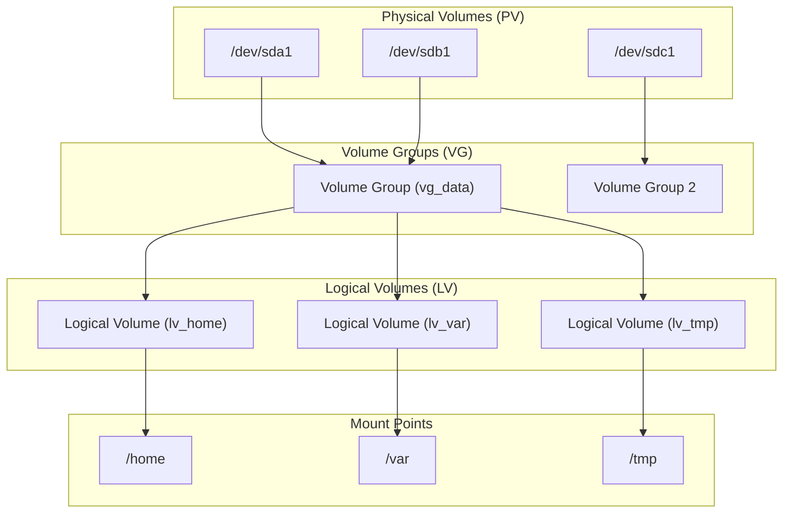
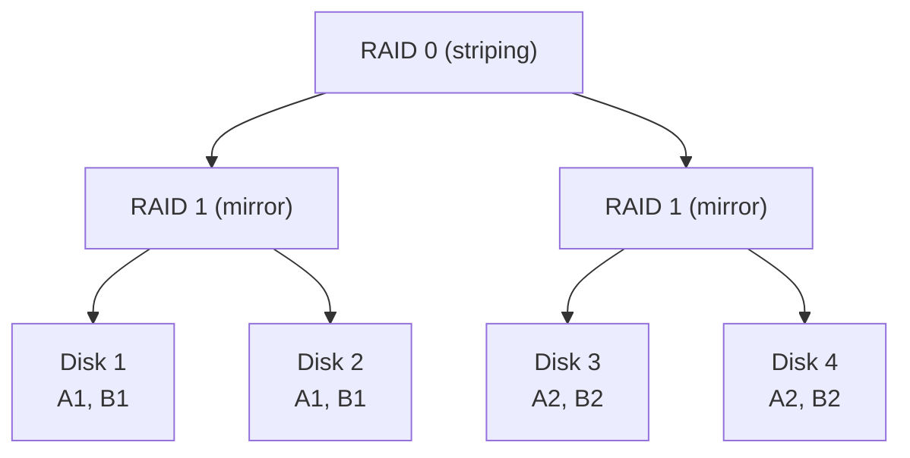

# Week 11 Lecture — Disk Management and RAID

[Repository Guide](../../README.md) | [English](Concepts_Lecture.md) | [한국어](Concepts_Lecture.ko.md)

> **Last Updated:** 2026-11-19
>
> 우분투 리눅스, 이종원, Ch 7

> **Learning Objectives:**
> 1. Partition disks using fdisk and parted
> 2. Manage the Logical Volume Manager (LVM)
> 3. Compare the storage layout, capacity, and fault tolerance of RAID levels (0, 1, 5, 6, 10)
> 4. Explain how RAID 5 recovers the data of a failed disk using parity
> 5. Configure RAID levels (0, 1, 5, 6, 10) with mdadm and replace a failed disk
> 6. Set up disk quotas

---

## Table of Contents

- [1. Advanced Disk Management](#1-advanced-disk-management)
  - [1.1 Adding New Disks](#11-adding-new-disks)
  - [1.2 USB/External Drive Management](#12-usbexternal-drive-management)
  - [1.3 Inspecting Block Devices and UUIDs](#13-inspecting-block-devices-and-uuids)
- [2. LVM (Logical Volume Manager)](#2-lvm-logical-volume-manager)
  - [2.1 LVM Architecture](#21-lvm-architecture)
  - [2.2 LVM Commands](#22-lvm-commands)
  - [2.3 LVM Advantages](#23-lvm-advantages)
  - [2.4 LVM Capacity in Terms of Extents](#24-lvm-capacity-in-terms-of-extents)
- [3. RAID Overview](#3-raid-overview)
  - [3.1 The Concept of RAID](#31-the-concept-of-raid)
  - [3.2 Hardware vs. Software RAID](#32-hardware-vs-software-raid)
  - [3.3 Comparison of Storage Layouts](#33-comparison-of-storage-layouts)
  - [3.4 General Formulas for Capacity and Fault Tolerance](#34-general-formulas-for-capacity-and-fault-tolerance)
- [4. RAID Levels](#4-raid-levels)
  - [4.1 RAID 0 (Striping)](#41-raid-0-striping)
  - [4.2 RAID 1 (Mirroring)](#42-raid-1-mirroring)
  - [4.3 RAID 5 (Striping with Distributed Parity)](#43-raid-5-striping-with-distributed-parity)
  - [4.4 RAID 6 (Double Distributed Parity)](#44-raid-6-double-distributed-parity)
  - [4.5 RAID 10 (Mirroring then Striping)](#45-raid-10-mirroring-then-striping)
  - [4.6 RAID Level Comparison](#46-raid-level-comparison)
  - [4.7 Computing XOR Parity and the Cost of Writes](#47-computing-xor-parity-and-the-cost-of-writes)
- [5. Software RAID with mdadm](#5-software-raid-with-mdadm)
  - [5.1 Creating RAID Arrays](#51-creating-raid-arrays)
  - [5.2 Managing RAID](#52-managing-raid)
  - [5.3 Failure Testing and Recovery](#53-failure-testing-and-recovery)
  - [5.4 Reading /proc/mdstat](#54-reading-procmdstat)
- [6. Disk Quotas](#6-disk-quotas)
  - [6.1 Setting Up Quotas](#61-setting-up-quotas)
- [7. Best Practices](#7-best-practices)
- [Concept Applications](#concept-applications)
- [Summary](#summary)
- [Self-Check Questions](#self-check-questions)
- [References](#references)

---

<br>

## 1. Advanced Disk Management

### 1.1 Adding New Disks

The process of adding and using a new disk (Week 10, Section 2.3) can be summarized in commands as follows.

```bash
# 1. Identify new disk
lsblk
sudo fdisk -l

# 2. Partition the disk
sudo fdisk /dev/sdb
# n -> new partition
# p -> primary
# 1 -> partition number
# Enter -> default first sector
# Enter -> default last sector
# w -> write and exit

# 3. Create filesystem
sudo mkfs.ext4 /dev/sdb1

# 4. Create mount point and mount
sudo mkdir /data
sudo mount /dev/sdb1 /data

# 5. Add to fstab for persistence
echo '/dev/sdb1 /data ext4 defaults 0 2' | sudo tee -a /etc/fstab
```

Device names can change when disks are added or removed, so in step 5 it is safer to use the `UUID=...` shown by `blkid` instead of `/dev/sdb1` (Week 10, Section 5.4).

### 1.2 USB/External Drive Management

```bash
# Identify USB device
lsblk
dmesg | tail -20          # Check kernel messages

# Mount USB
sudo mount /dev/sdb1 /media/usb

# Safely remove
sync                       # Flush buffers
sudo umount /media/usb
```

`sync` writes data still held in memory buffers to the disk. `umount` also flushes the buffers before unmounting, so always unmount a device before unplugging it.

### 1.3 Inspecting Block Devices and UUIDs

`lsblk` shows the block devices recognized by the kernel as a tree of disks and partitions. On a virtual machine with a 20 GB system disk `sda`, three added 1 GB disks (`sdb`, `sdc`, `sdd`), and one partition created on `sdb`, it gives the following.

```text
$ lsblk
NAME   MAJ:MIN RM  SIZE RO TYPE MOUNTPOINTS
sda      8:0    0   20G  0 disk
├─sda1   8:1    0    1M  0 part
└─sda2   8:2    0   20G  0 part /
sdb      8:16   0    1G  0 disk
└─sdb1   8:17   0 1023M  0 part
sdc      8:32   0    1G  0 disk
sdd      8:48   0    1G  0 disk
sr0     11:0    1  5.8G  0 rom
```

- `MAJ:MIN` is the major and minor number of the device file (Week 3, Section 1.5). The major number of the SCSI disk driver is 8, and the minor numbers of the disks are 16 apart, so `sdb` is 16 and its first partition `sdb1` is 17. This means that one disk can distinguish up to 15 partitions by minor number.
- `RM` tells whether the device is removable and `RO` whether it is read-only; `sr0` is the virtual CD-ROM.
- `sda1` (1M) is a small partition that the Ubuntu installer creates on a GPT disk for BIOS booting (Week 10).

`blkid` prints the UUID and type of devices on which a file system has been created.

```text
$ sudo mkfs.ext4 -q /dev/sdb1
$ sudo blkid /dev/sdb1
/dev/sdb1: UUID="2f3c8e1a-6b7d-4c55-9a1e-0d4b7c9e2a10" BLOCK_SIZE="4096" TYPE="ext4" PARTUUID="6a1f2c3d-01"
```

A UUID is a 128-bit identifier that `mkfs` assigns when it creates the file system, so it stays the same even if the disk is plugged into another port and its name changes from `sdb` to `sdc`. Step 5 of Section 1.1 is therefore written in `/etc/fstab` as follows.

```text
UUID=2f3c8e1a-6b7d-4c55-9a1e-0d4b7c9e2a10  /data  ext4  defaults  0  2
```

> **Caution:** A wrong line in `/etc/fstab` can make mounting fail at the next boot and drop the system into emergency mode. After adding a line, run `sudo mount -a` before rebooting to check that there is no error, and check with `findmnt /data` that the file system is mounted.

---

<br>

## 2. LVM (Logical Volume Manager)

### 2.1 LVM Architecture

LVM combines physical volumes (PVs) into volume groups (VGs) and carves logical volumes (LVs) out of a VG to mount them. The terms of LVM (PV, VG, LV, PE) and the creation procedure are covered in Week 10, Section 6.



*Figure 1. Hierarchy of physical volumes, volume groups, and logical volumes in LVM*

### 2.2 LVM Commands

```bash
# Physical Volume (PV)
sudo pvcreate /dev/sdb1 /dev/sdc1       # Create PVs
sudo pvdisplay                            # Display PV info
sudo pvs                                  # Summary

# Volume Group (VG)
sudo vgcreate vg_data /dev/sdb1 /dev/sdc1  # Create VG
sudo vgdisplay                              # Display VG info
sudo vgextend vg_data /dev/sdd1             # Add disk to VG

# Logical Volume (LV)
sudo lvcreate -L 10G -n lv_home vg_data    # Create 10GB LV
sudo lvcreate -l 100%FREE -n lv_data vg_data  # Use all free space
sudo lvdisplay                               # Display LV info

# Format and mount
sudo mkfs.ext4 /dev/vg_data/lv_home
sudo mount /dev/vg_data/lv_home /home

# Resize LV (extend)
sudo lvextend -L +5G /dev/vg_data/lv_home   # Add 5GB
sudo resize2fs /dev/vg_data/lv_home          # Resize filesystem
```

In `lvcreate`, `-L` gives the size as a capacity, and `-l` as a number of PEs or a percentage such as `100%FREE`. After an LV is extended, the file system inside it must be grown as well: `resize2fs` for the ext family and `xfs_growfs` for xfs.

### 2.3 LVM Advantages

- **Dynamic resizing:** A volume can be grown while it is mounted (ext4, xfs). Shrinking is possible for ext4 after unmounting, and xfs cannot be shrunk.
- **Spanning disks:** Volumes larger than a single disk can be created.
- **Snapshots:** Point-in-time copies can be created for backups.
- **Striping:** Spreading data across multiple disks can improve I/O performance.

### 2.4 LVM Capacity in Terms of Extents

LVM divides a PV into equal-sized pieces called **physical extents (PE)**, and an LV is built by collecting some number of PEs. A piece as seen from the LV is called a logical extent (LE), and one LE corresponds to one PE. The sizes of VGs and LVs are therefore integer multiples of the PE size. The PE size is set with `vgcreate -s` when the VG is created, and once set it is difficult to change without recreating the VG [1].

Suppose a VG `vg_data` with a PE size of 4 MiB has been created from two 1 GiB disks. Because each PV reserves its beginning for a metadata area, the number of usable PEs on one PV is 255, slightly fewer than 256.

| Step | Command | PE computation | Result |
|:-----|:-----|:-----|:-----|
| Create the VG | `vgcreate -s 4M vg_data /dev/sdb1 /dev/sdc1` | 255 + 255 = 510 PE | VG size 510 × 4 MiB = 2040 MiB |
| Create an LV | `lvcreate -L 1.5G -n lv_home vg_data` | 1536 MiB ÷ 4 MiB = 384 PE | Remaining PEs 510 - 384 = 126 |
| Create by ratio | `lvcreate -l 50%FREE -n lv_log vg_data` | 126 × 0.5 = 63 PE | 63 × 4 MiB = 252 MiB |
| Extend | `lvextend -l +100%FREE -r /dev/vg_data/lv_home` | All remaining 63 PE added | 447 PE = 1788 MiB |

*Table 1. Extent computation when creating and extending LVs in a VG with a PE size of 4 MiB*

If the size given with `-L` is not a multiple of the PE size, LVM rounds it up to the next PE boundary. For example, `-L 10M` becomes three 4 MiB PEs, that is, 12 MiB. The `-r` (`--resizefs`) option of `lvextend` also grows the file system inside the LV after extending the LV, so the `resize2fs` of Section 2.2 need not be run separately.

> **Caution:** When shrinking an LV, the order is the reverse of extending. The file system must be shrunk first and the LV afterwards; shrinking the LV first cuts off the end of the file system and corrupts data. With `lvreduce -r`, LVM keeps this order. xfs cannot be shrunk (Section 2.3), so an LV containing xfs is not shrunk.

---

<br>

## 3. RAID Overview

### 3.1 The Concept of RAID

**RAID** (Redundant Array of Independent Disks) combines multiple physical disks into a single logical unit for the following purposes.

- **Performance:** Reads and writes run in parallel across disks.
- **Redundancy:** Data survives disk failures.
- **Capacity:** Multiple smaller disks are combined into one.

The name RAID was first proposed as Redundant Array of Inexpensive Disks. It meant using several cheap disks as one to cut cost while improving both reliability and performance, and today the letter I is often expanded as Independent.

### 3.2 Hardware vs. Software RAID

| Feature | Hardware RAID | Software RAID |
|---------|--------------|---------------|
| Controller | Dedicated RAID card | CPU/OS manages |
| Performance | Better (dedicated processor) | Slightly lower |
| Cost | Higher (RAID controller) | Free (built into OS) |
| Flexibility | Limited to controller features | Full OS control |
| Tool | Controller BIOS | `mdadm` on Linux |

*Table 2. Comparison of hardware RAID and software RAID*

Hardware RAID is supplied as equipment that a manufacturer builds from several hard disks; it is more stable but considerably more expensive. Software RAID is provided by the operating system; it is an alternative to expensive hardware RAID and stores data more safely at low cost. Section 5 covers software RAID on Linux.

### 3.3 Comparison of Storage Layouts

The following compares storage layouts built from N disks of 1GB each. A simple volume and LVM are not RAID, but they are listed together to compare their storage layout with RAID.

| Layout | Disks | Usable capacity | Storage method and characteristics |
|:-----|:-----|:-----|:-----|
| Simple volume | 1 | 1GB | Uses one hard disk as one volume |
| LVM (linear) | 2 or more | N GB | Fills the disks in order starting from the first, and disks can be added |
| RAID 0 | 2 or more | N GB | Stores data split across all disks at once and is the fastest (striping) |
| RAID 1 | 2 or more | 1GB (one disk's worth) | Stores the same data on all disks at once and provides fault tolerance (mirroring) |
| RAID 5 | 3 or more | (N-1) GB | Provides fault tolerance using parity information with good space efficiency |
| RAID 6 | 4 or more | (N-2) GB | Improves on RAID 5 with two parities and provides fault tolerance |

*Table 3. Comparison of storage layouts built from N disks of 1GB*

### 3.4 General Formulas for Capacity and Fault Tolerance

The capacity and fault tolerance of an array built from N disks of size S are summarized by the following formulas.

| Level | Usable capacity | Space efficiency | Number of failed disks always tolerated |
|:-----|:-----|:-----|:-----|
| RAID 0 | N × S | 100% | 0 |
| RAID 1 (N-way mirror) | S | 1/N | N - 1 |
| RAID 5 | (N - 1) × S | (N - 1)/N | 1 |
| RAID 6 | (N - 2) × S | (N - 2)/N | 2 |
| RAID 10 (mirrors of two) | N/2 × S | 50% | 1 (up to N/2 if in different pairs) |

*Table 4. Capacity and fault tolerance of an array built from N disks of size S*

With four 1 TB disks, RAID 0 gives 4 TB, RAID 1 1 TB, RAID 5 3 TB, RAID 6 2 TB, and RAID 10 2 TB. As the number of disks grows, the space efficiency of RAID 5 and RAID 6, (N - 1)/N and (N - 2)/N, approaches 100%, but the more disks there are, the higher the probability that one of them fails.

When disks of different sizes are mixed, Linux software RAID uses from each disk only as much as the size of the smallest disk. A RAID 5 built from 1 TB, 2 TB, and 2 TB disks takes S as 1 TB and gives (3 - 1) × 1 TB = 2 TB, and the remaining 1 TB on each of the two 2 TB disks is not used by the array.

---

<br>

## 4. RAID Levels

### 4.1 RAID 0 (Striping)

```text
     Data: ABCDEFGH

     Disk 1: A C E G    Disk 2: B D F H
```

*Figure 2. RAID 0 striping that stores data blocks alternately on two disks*

| Property | Value |
|----------|-------|
| Min Disks | 2 |
| Redundancy | None |
| Capacity | N x disk size |
| Read Speed | N x single disk |
| Write Speed | N x single disk |
| Fault Tolerance | None (any disk failure = total loss) |

*Table 5. Properties of RAID 0*

RAID 0 looks similar to LVM but stores data differently. LVM (linear) fills the first disk before writing to the next, whereas RAID 0 splits data across all disks at once. Storage speed therefore improves greatly and space efficiency is 100%, but losing a single disk loses all data, so reliability is low. It suits data that needs high speed and whose total loss would not be a serious problem.

### 4.2 RAID 1 (Mirroring)

```text
     Data: ABCD

     Disk 1: A B C D    Disk 2: A B C D  (exact copy)
```

*Figure 3. RAID 1 mirroring that copies the same data to two disks*

| Property | Value |
|----------|-------|
| Min Disks | 2 |
| Redundancy | Full mirror |
| Capacity | 1 disk size (50% efficiency) |
| Read Speed | Up to 2x |
| Write Speed | 1x (writes to both) |
| Fault Tolerance | 1 disk can fail |

*Table 6. Properties of RAID 1*

RAID 1 needs twice the capacity to store data, so it costs twice as much and has poor space efficiency, but it provides **fault tolerance**, keeping the data when one disk fails, so its reliability is high. Every write must go to both disks, so storage speed equals that of a single disk. It is suitable for storing important data. The 50% efficiency in the table is for two disks; adding more disks still leaves one disk's worth of usable capacity.

| Item | RAID 0 | RAID 1 |
|:-----|:-----|:-----|
| Performance (write speed) | Excellent | Unchanged |
| Data safety (fault tolerance) | Not guaranteed | Guaranteed |
| Space efficiency | Good | Poor |

*Table 7. Comparison of RAID 0 and RAID 1*

### 4.3 RAID 5 (Striping with Distributed Parity)

```text
     Disk 1    Disk 2    Disk 3
     A1        A2        Ap (parity)
     Bp        B1        B2
     C1        Cp        C2
```

*Figure 4. RAID 5 distributed parity layout that rotates the parity block across disks*

| Property | Value |
|----------|-------|
| Min Disks | 3 |
| Redundancy | Distributed parity |
| Capacity | (N-1) x disk size |
| Read Speed | (N-1) x single disk |
| Write Speed | Slower (parity calculation) |
| Fault Tolerance | 1 disk can fail |

*Table 8. Properties of RAID 5*

RAID 5 aims to combine the data safety of RAID 1 with the space efficiency of RAID 0 and needs at least three disks. For each row (stripe), a **parity** bit is chosen so that the number of 1s, counting the data bits, is even (equal to the XOR of the data bits), and the disk that stores the parity changes from row to row. When one disk fails, the missing values are computed from the remaining disks.

For example, storing the 12-bit data 000 111 010 011 three bits at a time on four disks (sda, sdb, sdc, sdd) gives the following.

| Row | sda | sdb | sdc | sdd | Data | Parity location and value |
|:-----|:-----|:-----|:-----|:-----|:-----|:-----|
| 1 | 0 | 0 | 0 | **0** | 000 | sdd, 0 |
| 2 | 1 | 1 | **1** | 1 | 111 | sdc, 1 |
| 3 | 0 | **1** | 1 | 0 | 010 | sdb, 1 |
| 4 | **0** | 0 | 1 | 1 | 011 | sda, 0 |

*Table 9. Data 000 111 010 011 stored with RAID 5 (bold values are parity)*

If sdb fails, its value in each row is chosen so that, together with the three remaining values, the number of 1s is even. Row 1 has 0, 0, 0, giving 0; row 2 has 1, 1, 1, giving 1; row 3 has 0, 1, 0, giving 1; and row 4 has 0, 1, 1, giving 0, which restores the original values 0, 1, 1, 0 exactly. In this way RAID 5 provides some fault tolerance with good space efficiency (it uses the space of the number of disks minus 1). If two disks fail at the same time, however, a row has two unknown values and cannot be recovered.

### 4.4 RAID 6 (Double Distributed Parity)

```text
     Disk 1    Disk 2    Disk 3    Disk 4
     A1        A2        Ap        Aq
     B1        Bp        Bq        B2
     Cp        Cq        C1        C2
```

*Figure 5. Example of RAID 6 with the two parities P and Q distributed*

RAID 6 improves on RAID 5 by storing, in a distributed way, two parities (P and Q) computed differently for each stripe. P is the same XOR parity as in RAID 5, and Q is produced by a different computation such as a Reed-Solomon code so that the values of two disks can both be restored. It needs at least four disks, and the usable capacity is (N-2) x disk size. Its space efficiency and performance (speed) are slightly lower than RAID 5, but the data stays intact even when two disks fail at once, so its reliability is higher.

### 4.5 RAID 10 (Mirroring then Striping)



*Figure 6. Structure of RAID 10 striping two mirrored pairs*

RAID 10 (RAID 1+0) mirrors disks in pairs with RAID 1 and then stripes the mirrored pairs with RAID 0. It is excellent in both reliability (safety) and performance (speed), but its space efficiency is 50% (usable capacity N/2 x disk size), and it needs at least four disks.

> **Caution:** RAID 10 keeps the data safe when two disks fail if they belong to different mirrored pairs, but if both disks of the same pair fail, the data of that pair is lost. The fault tolerance guaranteed in every case is therefore one disk.

### 4.6 RAID Level Comparison

| Level | Min Disks | Redundancy | Capacity | Use Case |
|-------|-----------|-----------|----------|----------|
| RAID 0 | 2 | None | 100% | Performance (temp data) |
| RAID 1 | 2 | Mirror | 50% | Boot drives, critical data |
| RAID 5 | 3 | 1 parity | (N-1)/N | General purpose servers |
| RAID 6 | 4 | 2 parity | (N-2)/N | High reliability |
| RAID 10 | 4 | Mirror + stripe | 50% | Databases, high I/O |

*Table 10. Minimum disks, redundancy, capacity, and use cases of RAID levels*

### 4.7 Computing XOR Parity and the Cost of Writes

The "parity chosen so that the number of 1s is even" in Section 4.3 is the same as a bitwise XOR (exclusive or, ⊕). XOR gives 1 when two bits differ and 0 when they are equal; it is commutative and associative, and $`x \oplus x = 0`$ and $`x \oplus 0 = x`$. Therefore, if the parity of the data blocks $`D_1, \dots, D_{N-1}`$ is defined as follows,

```math
P = D_1 \oplus D_2 \oplus \cdots \oplus D_{N-1}
```

any one block that disappears can be restored by XOR-ing all the others. For example, a lost $`D_2`$ is $`P \oplus D_1 \oplus D_3 \oplus \cdots`$. A real RAID 5 performs this computation not per bit but per chunk (512 KiB by default in mdadm [2]). Computing for the case of storing three bytes in one stripe of a four-disk array gives the following.

```text
D1 = 0x5A = 0101 1010
D2 = 0x3C = 0011 1100
D3 = 0xF0 = 1111 0000
P  = D1 ⊕ D2 ⊕ D3 = 1001 0110 = 0x96

disk holding D2 fails → D2 = P ⊕ D1 ⊕ D3
   = 1001 0110 ⊕ 0101 1010 ⊕ 1111 0000 = 0011 1100 = 0x3C
```

*Figure 7. Parity and recovery of RAID 5 computed per byte*

**The cost of small writes.** When only one data block of a stripe changes, RAID 5 does not reread every block of the stripe but uses the properties of XOR to obtain the new parity with the following formula.

```math
P_{\text{new}} = P_{\text{old}} \oplus D_{\text{old}} \oplus D_{\text{new}}
```

Changing D2 in Figure 7 to `0x0F` gives $`P_{\text{new}}`$ = 0x96 ⊕ 0x3C ⊕ 0x0F = `0xA5`, which equals 0x5A ⊕ 0x0F ⊕ 0xF0 computed directly. This method requires four disk I/O operations: reading the old data, reading the old parity, writing the new data, and writing the new parity. RAID 5 writes are therefore slow for workloads with many small writes (databases and the like), and RAID 6, with two parities, is slower still. This is why Section 4.6 recommends RAID 10 for databases.

> **Note:** **The write hole.** If power fails while data and parity are being written, the data and the parity of a stripe may be left inconsistent with each other. If a disk then fails in this state, the wrong parity restores a wrong value. Since Linux 4.4, Linux md can prevent this problem by first writing the data and parity to a separate journal device [3].

---

<br>

## 5. Software RAID with mdadm

### 5.1 Creating RAID Arrays

```bash
# Install mdadm
sudo apt install mdadm

# Create RAID 1 (mirror)
sudo mdadm --create /dev/md0 --level=1 --raid-devices=2 /dev/sdb1 /dev/sdc1

# Create RAID 5
sudo mdadm --create /dev/md0 --level=5 --raid-devices=3 /dev/sdb1 /dev/sdc1 /dev/sdd1

# Format and mount
sudo mkfs.ext4 /dev/md0
sudo mkdir /mnt/raid
sudo mount /dev/md0 /mnt/raid
```

The practice procedure for building RAID 0 from scratch is as follows.

1. Create one partition on each disk used for RAID and change its partition type to fd (Linux RAID autodetect) with the `t` command. Run `fdisk /dev/sdb` and enter `n`, `p`, `1`, Enter, Enter, `t`, `fd`, `p`, `w` in that order.
2. Create the RAID device file with `mknod`. `mknod /dev/md0 b 9 0` creates the block (`b`) device `/dev/md0` with major number 9 (the md driver) and minor number 0. On recent distributions mdadm and udev create device files automatically, so this step can be skipped.
3. Create the array with `mdadm --create` and check the result with `mdadm --detail --scan` and `mdadm --query --detail`.
4. Create a file system with `mkfs.ext4` and mount it on a mount point.

```bash
sudo fdisk /dev/sdb                 # n, p, 1, Enter, Enter, t, fd, p, w
sudo mknod /dev/md0 b 9 0           # Can be skipped on recent distributions
sudo mdadm --create /dev/md0 --level=0 --raid-devices=2 /dev/sdb1 /dev/sdc1
sudo mdadm --detail --scan
sudo mdadm --query --detail /dev/md0
sudo mkfs.ext4 /dev/md0
sudo mkdir /mnt/raid0data
sudo mount /dev/md0 /mnt/raid0data
```

In the same way, RAID 1 is created with `--level=1 --raid-devices=2`, RAID 5 with `--level=5 --raid-devices=3`, RAID 6 with `--level=6 --raid-devices=4`, and RAID 10 with `--level=10 --raid-devices=4`.

### 5.2 Managing RAID

```bash
# Check RAID status
cat /proc/mdstat
sudo mdadm --detail /dev/md0

# Add spare disk
sudo mdadm --add /dev/md0 /dev/sde1

# Remove failed disk
sudo mdadm --remove /dev/md0 /dev/sdb1

# Stop RAID array
sudo mdadm --stop /dev/md0

# Save configuration
sudo mdadm --detail --scan >> /etc/mdadm/mdadm.conf
```

`--remove` can remove only failed or spare disks. To remove a disk that is working normally, first mark it as failed with `sudo mdadm /dev/md0 --fail /dev/sdb1`. The `>>` in the save command is a redirection that needs root privileges, so run it from a root shell or write `sudo mdadm --detail --scan | sudo tee -a /etc/mdadm/mdadm.conf`.

### 5.3 Failure Testing and Recovery

RAID 1, 5, 6, and 10 have fault tolerance, so the array keeps working when some disks are removed. Running with a disk missing is called the **degraded** state. RAID 1 and RAID 5 keep the data safe after losing one disk, and RAID 6 after losing any two disks.

In a degraded RAID 5, reading the data of the missing disk requires computing it from the remaining disks every time, so reads can slow down somewhat. When the failed disk is replaced with a new one and added to the array, mdadm performs a **rebuild**, regenerating the data and writing it to the new disk, and once the rebuild finishes no computation is needed and the slowdown disappears. For RAID 1, the data of the remaining disk is copied to the new disk, so both disks again hold the same files.

```bash
sudo mdadm --query --detail /dev/md1      # Check status (degraded or not)
sudo mdadm /dev/md1 --add /dev/sdj1       # Add a new disk and rebuild
sudo mdadm /dev/md5 --add /dev/sdk1
```

To remove a RAID array, unmount it, stop the array, and erase the RAID metadata (superblock) left on the member disks. An array that is not registered in the configuration file may be assembled automatically at boot under a high number such as `/dev/md127`.

```bash
sudo umount /dev/md127
sudo mdadm --stop /dev/md127
sudo mdadm --zero-superblock /dev/sdb1 /dev/sdc1
```

### 5.4 Reading /proc/mdstat

`/proc/mdstat` is a virtual file in which the kernel's md driver shows the state of all arrays. Viewing in turn the normal state of a RAID 5 array `md5` built from three 1 GiB disks, the degraded state after one disk has failed, and the state of rebuilding onto a new disk gives the following (example output).

```text
$ cat /proc/mdstat
Personalities : [raid0] [raid1] [raid6] [raid5] [raid4] [raid10]
md5 : active raid5 sdd1[3] sdc1[1] sdb1[0]
      2093056 blocks super 1.2 level 5, 512k chunk, algorithm 2 [3/3] [UUU]

unused devices: <none>

$ sudo mdadm /dev/md5 --fail /dev/sdc1
$ cat /proc/mdstat
md5 : active raid5 sdd1[3] sdc1[1](F) sdb1[0]
      2093056 blocks super 1.2 level 5, 512k chunk, algorithm 2 [3/2] [U_U]

$ sudo mdadm /dev/md5 --remove /dev/sdc1
$ sudo mdadm /dev/md5 --add /dev/sde1
$ cat /proc/mdstat
md5 : active raid5 sde1[4] sdd1[3] sdb1[0]
      2093056 blocks super 1.2 level 5, 512k chunk, algorithm 2 [3/2] [U_U]
      [====>................]  recovery = 23.4% (245120/1046528) finish=0.4min speed=30640K/sec
```

| Notation | Meaning |
|:-----|:-----|
| `sdb1[0]` | A member device and its number in the array |
| `(F)` | A device marked faulty |
| `2093056 blocks` | Size of the array (in 1 KiB units), the capacity of 2 of the 3 disks |
| `super 1.2` | Format of the RAID metadata (superblock) written on the disks |
| `512k chunk` | The unit written contiguously to one disk |
| `[3/2]` | Number of devices the array needs / number of devices working now |
| `[U_U]` | For each device, working (`U`) or missing (`_`) |
| `recovery = 23.4%` | Progress of the rebuild |

*Table 11. Meaning of the notation in /proc/mdstat*

The md driver immediately marks a device that reports a write error as faulty and keeps operating on the remaining devices, and if a spare disk exists, it immediately starts rebuilding the lost data onto that disk [3]. Adding a spare disk in advance with the `--add` of Section 5.2 therefore keeps the degraded state short even without an administrator.

---

<br>

## 6. Disk Quotas

### 6.1 Setting Up Quotas

Disk quotas limit the disk space and the number of files that a user or group can use. The concepts of quotas (hard limit, soft limit) and the detailed use of each command are covered in Week 12, Section 8.

```bash
# Install quota tools
sudo apt install quota

# Enable quotas in /etc/fstab
# /dev/sda2 /home ext4 defaults,usrquota,grpquota 0 2

# Remount and initialize
sudo mount -o remount /home
sudo quotacheck -cugm /home
sudo quotaon /home

# Set user quota
sudo edquota -u user1
# Set soft limit, hard limit for blocks and inodes

# Set group quota
sudo edquota -g developers

# View quota usage
sudo repquota /home
quota -u user1
```

---

<br>

## 7. Best Practices

- Use RAID 1 for boot/OS drives and RAID 5 or RAID 6 for data storage.
- RAID is not a backup, so always maintain separate backups.
- Use LVM on top of RAID for flexible volume management.
- Monitor RAID health regularly with `mdadm --detail`.
- Keep hot spare disks for automatic rebuilds.
- Test disk recovery procedures before they are needed.

---

<br>

## Concept Applications

**True/False Check:**

| Statement | Judgment and Reason |
|:-----|:-----|
| A RAID 5 built from 1 TB, 2 TB, and 2 TB disks has 4 TB of usable capacity. | **F.** It is based on the smallest disk, 1 TB, giving (3 - 1) × 1 TB = 2 TB. |
| RAID 6 keeps data safe even if any two of its six disks fail. | **T.** The two different parities P and Q can restore two blocks together. |
| In RAID 5, changing one data block requires reading every disk of the stripe. | **F.** The new parity is the old parity ⊕ the old data ⊕ the new data, so only two blocks need to be read. |
| When shrinking an LV, the LV is shrunk first and then the file system. | **F.** The file system must be shrunk first; reversing the order corrupts data. |
| `lvcreate -L 10M` creates a 10 MiB LV in a VG with a PE size of 4 MiB. | **F.** The size is rounded up to the PE boundary, giving 3 PEs, that is, 12 MiB. |
| `[U_U]` in `/proc/mdstat` is a degraded state in which the middle one of three devices is missing. | **T.** `U` means working and `_` a missing device. |
| Mirroring with RAID 1 makes it possible to recover an accidentally deleted file from the other disk. | **F.** The deletion is also written to both disks, so RAID does not replace backups. |

---

<br>

## Summary

| Concept | Key Summary |
|---------|-----------|
| LVM | It is a flexible volume management scheme that combines PVs into a VG and carves LVs out of the VG (PV -> VG -> LV). |
| RAID 0 | It uses striping for performance but has no redundancy. |
| RAID 1 | It provides full redundancy by mirroring, with 50% capacity efficiency for two disks. |
| RAID 5 | It balances performance and redundancy with distributed parity and tolerates one disk failure. |
| RAID 6 | It distributes two parities and tolerates two simultaneous disk failures. |
| RAID 10 | It stripes mirrored pairs for both performance and reliability, with 50% capacity efficiency. |
| mdadm | It is the tool for creating and managing Linux software RAID. |
| Disk Quotas | They limit disk usage per user or group. |
| fstab | It is the file that configures persistent mounts and quota options. |
| UUID | It is the file system identifier set by `mkfs`, which stays the same when the device name changes, so it is used in `/etc/fstab`. |
| PE and LE | They are the allocation units of LVM; VG and LV sizes are integer multiples of the PE size, and requested sizes are rounded up to a PE boundary. |
| General RAID capacity formulas | With N disks of size S, RAID 0 gives NS, RAID 1 S, RAID 5 (N-1)S, RAID 6 (N-2)S, and RAID 10 NS/2. |
| XOR parity | P is the XOR of the data blocks; a lost block is the XOR of the remaining blocks, and the new parity is the old parity ⊕ old data ⊕ new data. |
| /proc/mdstat | It shows normal, degraded, and rebuilding states with `[needed/working]` and `[U_]` notation. |

---

<br>

## Self-Check Questions

1. **RAID 5 parity recovery:** In one row of a RAID 5 with four disks (sda, sdb, sdc, sdd), sda=1, sdc=0, the parity on sdd is 0, and sdb has failed. Assuming even parity, find the value of sdb, and explain why the row cannot be recovered if sdc in the same row also fails.

   <details>
   <summary>Answer</summary>

   The number of 1s among the four values must be even, so x = 1 makes 1 + x + 0 + 0 even (1 XOR 0 XOR 0 = 1). If sdc also fails, the values x and y of sdb and sdc are constrained only by x + y being odd, which cannot distinguish (0, 1) from (1, 0), so the row cannot be recovered.

   </details>

2. **RAID 6 vs. RAID 10:** For six 2TB disks configured as RAID 6 and as RAID 10, find the usable capacity of each and the number of disk failures tolerated no matter which disks fail.

   <details>
   <summary>Answer</summary>

   RAID 6 has (6 - 2) × 2TB = 8TB, and the data is safe when any two disks fail. RAID 10 has 6 / 2 × 2TB = 6TB, and the guaranteed fault tolerance is one disk. RAID 10 can survive up to three failures if every failed disk belongs to a different mirrored pair, but it loses data if both disks of one pair fail.

   </details>

3. **Two disk failures in RAID 10:** In a RAID 10 whose four disks form the mirrored pairs (D1, D2) and (D3, D4), two disks fail at random at the same time. Find the probability that the data survives.

   <details>
   <summary>Answer</summary>

   There are $\binom{4}{2} = 6$ ways to choose the two failed disks. Data is lost only when both disks of a pair fail, which happens in 2 cases, (D1, D2) and (D3, D4), so the probability of survival is 4 / 6 = 2/3.

   </details>

4. **Degraded state and rebuild:** Explain why reads can slow down in a RAID 5 after one disk fails and before it is replaced, and what happens when `sudo mdadm /dev/md5 --add /dev/sdk1` is run.

   <details>
   <summary>Answer</summary>

   Reading a data block that was on the failed disk requires reading all the other disks in the same row and computing the XOR, which is slower. Adding a new disk with `--add` makes mdadm start a rebuild, computing each row's value from the other disks and writing it to the new disk, and when the rebuild finishes the array returns to the normal state and reads need no computation.

   </details>

5. **Arguments of mknod:** Give the meaning of each argument of `mknod /dev/md1 b 9 1`, and explain why the command can be skipped on recent distributions.

   <details>
   <summary>Answer</summary>

   `/dev/md1` is the name of the device file to create, `b` means a block device, 9 is the major number of the md (software RAID) driver, and 1 is the minor number identifying the device within that driver. On recent distributions, when `mdadm --create` builds an array, the kernel and udev create device files such as `/dev/md1` automatically, so the command can be skipped.

   </details>

6. **XOR recovery:** One stripe of a four-disk RAID 5 holds the data `D1 = 0xC3`, `D2 = 0x5A`, and `D3 = 0x0F`. Find the parity P, and write the computation that recovers D3 when the disk holding D3 fails.

   <details>
   <summary>Answer</summary>

   P = 0xC3 ⊕ 0x5A ⊕ 0x0F. 0xC3 ⊕ 0x5A = 1100 0011 ⊕ 0101 1010 = 1001 1001 = 0x99, and 0x99 ⊕ 0x0F = 1001 1001 ⊕ 0000 1111 = 1001 0110 = 0x96, so P = 0x96. D3 = P ⊕ D1 ⊕ D2 = 0x96 ⊕ 0xC3 ⊕ 0x5A; 0x96 ⊕ 0xC3 = 0x55 and 0x55 ⊕ 0x5A = 0x0F, which is the original value.

   </details>

7. **LVM extents:** A VG with a PE size of 8 MiB has 500 free PEs. Find the number of remaining PEs after `lvcreate -L 1G -n a vg` and `lvcreate -L 100M -n b vg` are run in turn, and the size of the LV then created with `lvcreate -l 100%FREE -n c vg`.

   <details>
   <summary>Answer</summary>

   1 GiB = 1024 MiB is 1024 ÷ 8 = 128 PE. 100 MiB is 100 ÷ 8 = 12.5, which is rounded up to 13 PE (104 MiB). The remaining PEs number 500 - 128 - 13 = 359, and the LV `c` is 359 × 8 = 2872 MiB.

   </details>

8. **Interpreting array state:** `/proc/mdstat` shows `md1 : active raid6 sdf1[4] sde1[3] sdd1[2](F) sdc1[1] sdb1[0](F)` and `[5/3] [_U_UU]`. Explain the state of the array, whether the data is safe now, and what happens if one more disk fails.

   <details>
   <summary>Answer</summary>

   Only 3 of the 5 devices that the RAID 6 needs are working; it is in a degraded state with `sdd1` and `sdb1` marked faulty. RAID 6 tolerates up to two failed disks, so all data can still be computed from the remaining three. There is no more margin, however, so if one more disk fails, data is lost. The two failed disks should be replaced and rebuilt at once.

   </details>

---

<br>

## References

1. "vgcreate(8), Linux manual page," *LVM2*. [Online]. Available: https://man7.org/linux/man-pages/man8/vgcreate.8.html
2. "mdadm(8), Linux manual page," *mdadm*. [Online]. Available: https://man7.org/linux/man-pages/man8/mdadm.8.html
3. "md(4), Linux manual page," *The Linux man-pages project*. [Online]. Available: https://man7.org/linux/man-pages/man4/md.4.html
