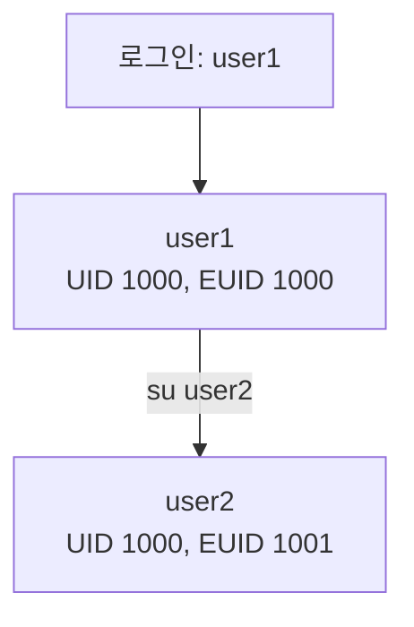

# 12주차 이론 — 사용자 관리

[레포지토리 안내](../../README.ko.md) | [English](Concepts_Lecture.md) | [한국어](Concepts_Lecture.ko.md)

> **최종 수정일:** 2026-10-19
>
> 우분투 리눅스, 이종원, Ch 10

> **학습 목표:**
> 1. 사용자 계정 파일(/etc/passwd, /etc/shadow, /etc/group, /etc/gshadow)의 구조를 설명할 수 있다
> 2. 사용자 계정과 그룹을 생성하고 관리할 수 있다
> 3. 비밀번호 정책과 계정 만료를 설정할 수 있다
> 4. UID와 EUID의 차이를 설명하고 사용자 정보를 확인할 수 있다
> 5. sudo와 권한 상승을 안전하게 적용할 수 있다
> 6. 사용자와 그룹별로 디스크 쿼터를 설정할 수 있다

---

## 목차

- [1. 사용자와 그룹 개념](#1-사용자와-그룹-개념)
  - [1.1 사용자 유형](#11-사용자-유형)
  - [1.2 그룹](#12-그룹)
- [2. 사용자 계정 파일](#2-사용자-계정-파일)
  - [2.1 /etc/passwd](#21-etcpasswd)
  - [2.2 /etc/shadow](#22-etcshadow)
  - [2.3 /etc/group](#23-etcgroup)
  - [2.4 /etc/gshadow](#24-etcgshadow)
  - [2.5 /etc/login.defs](#25-etclogindefs)
- [3. 사용자 관리](#3-사용자-관리)
  - [3.1 useradd: 사용자 생성](#31-useradd-사용자-생성)
  - [3.2 adduser: 대화형 사용자 생성 (Debian/Ubuntu)](#32-adduser-대화형-사용자-생성-debianubuntu)
  - [3.3 usermod: 사용자 수정](#33-usermod-사용자-수정)
  - [3.4 userdel: 사용자 삭제](#34-userdel-사용자-삭제)
- [4. 그룹 관리](#4-그룹-관리)
  - [4.1 그룹 명령 요약](#41-그룹-명령-요약)
  - [4.2 groupadd, addgroup, groupmod, groupdel](#42-groupadd-addgroup-groupmod-groupdel)
  - [4.3 그룹 암호와 newgrp](#43-그룹-암호와-newgrp)
- [5. 비밀번호 관리](#5-비밀번호-관리)
  - [5.1 비밀번호 설정](#51-비밀번호-설정)
  - [5.2 비밀번호 만료 관리](#52-비밀번호-만료-관리)
- [6. 사용자 정보 확인](#6-사용자-정보-확인)
  - [6.1 UID와 EUID](#61-uid와-euid)
  - [6.2 로그인 정보 확인: who, w, last](#62-로그인-정보-확인-who-w-last)
  - [6.3 UID, EUID, 그룹 확인](#63-uid-euid-그룹-확인)
  - [6.4 파일 소유자 변경: chown, chgrp](#64-파일-소유자-변경-chown-chgrp)
- [7. sudo 설정](#7-sudo-설정)
  - [7.1 /etc/sudoers](#71-etcsudoers)
- [8. 디스크 쿼터](#8-디스크-쿼터)
  - [8.1 쿼터의 개념](#81-쿼터의-개념)
  - [8.2 쿼터 설정 준비](#82-쿼터-설정-준비)
  - [8.3 쿼터 명령](#83-쿼터-명령)
- [9. 모범 사례](#9-모범-사례)
- [요약](#요약)
- [점검 문제](#점검-문제)

---

<br>

## 1. 사용자와 그룹 개념

### 1.1 사용자 유형

| 유형 | UID 범위 | 설명 |
|------|----------|------|
| **Root** | 0 | 시스템 전체 접근 권한을 가진 슈퍼유저 |
| **시스템 사용자** | 1-999 | 서비스 계정 (daemon, www-data) |
| **일반 사용자** | 1000+ | 일반 사용자 |

*표 1. UID 범위에 따른 사용자 유형*

**UID(user ID)** 는 시스템이 사용자를 구별하는 번호이다. 일반적으로 0~999번과 65534번(nobody)은 시스템 사용자를 위해 예약되고, 일반 사용자에게는 1000번부터 할당된다. 정확한 범위는 `/etc/login.defs`(2.5절)에서 정한다.

### 1.2 그룹

- 모든 사용자는 최소 하나의 **주 그룹(primary group)** 에 소속되며, 주 그룹은 `/etc/passwd`의 GID 필드로 정한다.
- 사용자는 **보조 그룹(supplementary group)** 에도 소속될 수 있으며, 보조 그룹(2차 그룹)은 `/etc/group`에 기록한다.
- 그룹은 공유 파일에 대한 접근을 제어한다.

---

<br>

## 2. 사용자 계정 파일

### 2.1 /etc/passwd

`/etc/passwd`는 사용자 계정 정보가 저장된 기본 파일이며, 한 줄에 계정 하나를 콜론으로 구분한 7개 필드로 적는다.

```text
username:x:UID:GID:comment:home_directory:login_shell
```

```text
root:x:0:0:root:/root:/bin/bash
user1:x:1001:1001::/home/user1:/bin/bash
www-data:x:33:33:www-data:/var/www:/usr/sbin/nologin
```

1. **로그인 ID:** 사용자 계정의 이름이다.
2. **x:** 초기 유닉스 시스템에서 암호를 저장하던 필드이며, 지금은 암호를 `/etc/shadow`에 저장하고 이 자리에는 `x`만 둔다.
3. **UID:** 시스템이 사용자를 구별하는 번호이다.
4. **GID:** 사용자의 기본 그룹의 ID이다. Linux에서 사용자는 반드시 하나 이상의 그룹에 속한다.
5. **설명(comment, GECOS):** 사용자의 실명이나 부서명, 연락처 같은 일반 정보를 기록한다. `adduser`로 만든 계정은 `user1,,,`처럼 쉼표로 구분한 여러 항목으로 채워진다.
6. **홈 디렉터리:** 사용자 계정에 할당된 홈 디렉터리의 절대 경로이다.
7. **로그인 셸:** 사용자의 로그인 셸이다. `/usr/sbin/nologin`이면 그 계정으로 로그인할 수 없다.

### 2.2 /etc/shadow

`/etc/shadow`는 사용자 암호에 관한 정보를 별도로 관리하는 파일이다. Ubuntu에서는 root만 읽고 쓸 수 있고 shadow 그룹은 읽기만 할 수 있다.

```text
username:encrypted_password:lastchange:min:max:warn:inactive:expire:reserved
```

- 암호화된 비밀번호를 저장한다(root와 shadow 그룹만 읽을 수 있다).
- 비밀번호 만료 정보를 포함한다.

1. **로그인 ID:** 사용자 계정의 이름이다.
2. **암호:** 암호화(해시)된 비밀번호이다. `$6$`로 시작하면 SHA-512 해시이고, `!`나 `*`이면 암호로 로그인할 수 없다.
3. **최종 변경일:** 암호를 마지막으로 바꾼 날짜이며, 1970년 1월 1일부터 센 날수로 적는다.
4. **MIN:** 암호를 바꾼 뒤 다시 바꿀 수 있기까지 지나야 하는 최소 일수이다.
5. **MAX:** 암호를 사용할 수 있는 최대 일수이다.
6. **WARNING:** 암호가 만료되기 며칠 전부터 경고할지 정한다.
7. **INACTIVE:** 암호가 만료된 뒤에도 이 일수 동안은 로그인할 수 있다(로그인할 때 암호를 바꿔야 한다).
8. **EXPIRE:** 사용자 계정이 만료되는 날짜이며, 1970년 1월 1일부터 센 날수로 적는다.
9. **Flag:** 앞으로 사용하기 위해 비워 둔 필드이다.

```text
root:!:18952:0:99999:7:::
daemon:*:18912:0:99999:7:::
user1:$6$NUpbDb6gYEQAhMyz$uqKHta1vl.nhPPe1u9pmPrd9Nq...:18994:0:99999:7:::
```

user1의 줄은 SHA-512 해시가 저장되어 있고, 18994일(2022-01-02)에 암호를 바꾸었으며, MIN 0일, MAX 99999일, WARNING 7일이고 나머지 필드는 비어 있음을 뜻한다. Ubuntu는 root 계정의 암호를 잠가 두므로(`!`) root로 직접 로그인할 수 없고 `sudo`를 쓴다.

### 2.3 /etc/group

`/etc/group`은 그룹의 정보가 저장된 파일이다. 사용자가 속한 그룹 가운데 `/etc/passwd`의 GID 필드에 지정된 그룹이 기본 그룹이고, 2차 그룹은 `/etc/group`의 멤버 목록에 기록된다.

```text
groupname:x:GID:member_list
```

```text
sudo:x:27:user1
developers:x:1002:user1,user2,user3
```

1. **그룹 이름:** 그룹의 이름이다.
2. **x:** 그룹 암호의 자리이며, 실제 암호는 `/etc/gshadow`에 저장한다. 그룹 암호는 `newgrp`로 자신이 속하지 않은 그룹으로 전환할 때 필요하다(4.3절).
3. **GID:** 그룹을 식별하는 번호이다.
4. **그룹 멤버:** 그룹에 속한 사용자 계정 이름을 쉼표로 구분하여 적는다. 이 그룹을 기본 그룹으로 쓰는 사용자는 여기에 적히지 않는다.

Ubuntu는 계정을 만들 때 `user1:x:1000:`처럼 사용자 이름과 같은 그룹을 만들어 그 사용자의 기본 그룹으로 쓴다. `adm:x:4:syslog,user1`은 syslog와 user1이 adm 그룹에 2차 그룹으로 속한다는 뜻이다.

### 2.4 /etc/gshadow

`/etc/gshadow`는 그룹 암호가 저장된 파일이며, 각 줄은 다음 네 필드로 이루어진다.

1. **그룹 이름:** 그룹의 이름이다.
2. **그룹 암호:** 암호화된 그룹 암호이다. `!`나 `*`이면 그룹 암호가 설정되지 않은 것이다.
3. **관리자:** 그룹의 암호나 멤버를 바꿀 수 있는 사용자 계정이며, 여럿이면 쉼표로 구분한다.
4. **그룹 멤버:** 그룹에 속한 멤버들의 사용자 계정 이름이며, 쉼표로 구분한다.

```text
root:*::
adm:*::syslog,user1
user1:!::
sambashare:!::user1
```

### 2.5 /etc/login.defs

`/etc/login.defs`는 사용자 계정의 설정과 관련된 기본값을 정의한 파일이며, `useradd` 같은 명령이 계정을 만들 때 참고한다.

| 항목 | 기본값 | 의미 |
|:-----|:-----|:-----|
| MAIL_DIR | /var/mail | 기본 메일 디렉터리 |
| PASS_MAX_DAYS | 99999 | 암호를 사용할 수 있는 최대 일수 |
| PASS_MIN_DAYS | 0 | 암호를 바꾼 뒤 다시 바꿀 수 있기까지의 최소 일수 |
| PASS_WARN_AGE | 7 | 암호가 만료되기 전에 경고하는 일수 |
| UID_MIN, UID_MAX | 1000~60000 | 일반 사용자 계정의 UID 범위 |
| SYS_UID_MIN, SYS_UID_MAX | 100~999 | 시스템 계정의 UID 범위 |
| GID_MIN, GID_MAX | 1000~60000 | 일반 사용자 계정의 GID 범위 |
| SYS_GID_MIN, SYS_GID_MAX | 100~999 | 시스템 계정의 GID 범위 |
| DEFAULT_HOME | yes | 홈 디렉터리로 이동할 수 없을 때도 로그인을 허용할지 여부 |
| UMASK | 022 | 기본 umask 값 |
| USERGROUPS_ENAB | yes | 사용자 이름과 같은 그룹을 만들고, 사용자를 삭제할 때 그 그룹에 다른 멤버가 없으면 함께 삭제할지 여부 |
| ENCRYPT_METHOD | SHA512 | 암호를 저장할 때 쓰는 암호화(해시) 기법 |

*표 2. /etc/login.defs의 주요 항목*

표의 기본값은 Ubuntu 21.10 기준이며, 배포판과 버전에 따라 다르다(예: 최근 Ubuntu는 ENCRYPT_METHOD로 YESCRYPT를 쓴다).

---

<br>

## 3. 사용자 관리

### 3.1 useradd: 사용자 생성

```bash
sudo useradd username                        # 사용자 생성 (최소 설정)
sudo useradd -m username                     # 홈 디렉터리와 함께 생성
sudo useradd -m -s /bin/bash username        # 셸 지정
sudo useradd -m -G sudo,developers username  # 그룹에 추가
sudo useradd -m -c "John Doe" -s /bin/bash -G sudo john
```

`useradd`의 형식은 `useradd [옵션] [로그인 ID]`이며, 주요 옵션은 다음과 같다.

| 옵션 | 의미 |
|:-----|:-----|
| `-u uid` | UID를 지정한다 |
| `-o` | UID의 중복을 허용한다(`-u`와 함께 쓴다) |
| `-g gid` | 기본 그룹의 GID(또는 그룹 이름)를 지정한다 |
| `-G gid` | 2차 그룹을 지정한다(쉼표로 여러 개) |
| `-d 디렉터리` | 홈 디렉터리를 지정한다 |
| `-m` | 홈 디렉터리를 만든다 |
| `-s 셸` | 기본 셸을 절대 경로로 지정한다 |
| `-c 설명` | 사용자의 이름 등 부가 설명을 지정한다 |
| `-D` | 기본값을 출력하거나 설정한다 |
| `-e 날짜` | 계정 만료일(EXPIRE)을 YYYY-MM-DD 형식으로 지정한다 |
| `-f 일수` | 암호가 만료된 뒤 계정이 비활성화되기까지의 일수(INACTIVE)를 지정한다 |
| `-k 디렉터리` | 홈 디렉터리에 복사할 초기 파일이 있는 디렉터리를 지정한다(기본 `/etc/skel`) |
| `-b 디렉터리` | 홈 디렉터리를 만들 기본 위치를 지정한다(기본 `/home`) |

*표 3. useradd의 주요 옵션*

옵션 없이 `useradd`를 실행하면 홈 디렉터리가 만들어지지 않고 기본 셸은 본 셸(`/bin/sh`)로 지정된다(Ubuntu 기준). 계정을 만든 뒤에는 `passwd`로 암호도 만들어야 로그인할 수 있으며, 홈 디렉터리가 없으므로 로그인하면 `/` 디렉터리에서 시작한다.

```text
$ sudo useradd user2
$ tail -2 /etc/passwd
postfix:x:128:134::/var/spool/postfix:/usr/sbin/nologin
user2:x:1001:1001::/home/user2:/bin/sh
$ ls /home
user1
```

옵션을 지정하면 다음과 같이 원하는 값으로 계정을 만든다. user3은 UID 2000, 기본 그룹 GID 1000, 2차 그룹 GID 3(sys)으로 만들어졌다. user4의 `/etc/shadow` 줄에서 INACTIVE는 5이고, EXPIRE는 2022-12-31을 1970-01-01부터 센 19357일로 저장되었다. 암호를 아직 정하지 않았으므로 암호 필드는 `!`이다.

```text
$ sudo useradd -s /bin/bash -m -d /home/user3 -u 2000 -g 1000 -G 3 user3
$ grep user3 /etc/passwd
user3:x:2000:1000::/home/user3:/bin/bash
$ grep user3 /etc/group
sys:x:3:user3
$ sudo useradd -e 2022-12-31 -f 5 -c "user4 test" user4
$ sudo grep user4 /etc/shadow
user4:!:18995:0:99999:7:5:19357:
```

`useradd -D`는 기본 설정값을 출력한다.

```text
$ useradd -D
GROUP=100
HOME=/home
INACTIVE=-1
EXPIRE=
SHELL=/bin/sh
SKEL=/etc/skel
CREATE_MAIL_SPOOL=no
```

- **GROUP:** 기본 등록 그룹의 GID이며, 100은 users 그룹이다. `USERGROUPS_ENAB`이 yes이면 사용자 이름과 같은 그룹을 만들어 기본 그룹으로 쓰므로, 이 값은 그 기능을 쓰지 않을 때(`-N`) 적용된다.
- **HOME:** 홈 디렉터리를 만들 위치이다.
- **INACTIVE:** -1이면 INACTIVE 기능을 쓰지 않고, 0이면 암호가 만료되자마자 계정이 잠긴다.
- **EXPIRE:** 계정 만료일이다.
- **SHELL:** 기본 로그인 셸이다.
- **SKEL:** 홈 디렉터리에 복사할 기본 환경 파일의 위치이다.
- **CREATE_MAIL_SPOOL:** 메일 스풀 디렉터리를 만들지 여부이다.

이 기본값은 `/etc/default/useradd` 파일에 저장된다. vi로 이 파일을 고칠 수도 있지만, `useradd -D` 다음에 `-b 홈_위치`, `-e 만료일`, `-f 비활성_일수`, `-g GID`, `-s 셸`을 지정하여 바꾸는 것이 바람직하다(예: `sudo useradd -D -s /bin/bash`).

사용자 계정의 홈 디렉터리에 공통으로 배포해야 할 파일을 `/etc/skel` 디렉터리에 만들어 두면, 계정을 만들 때(`-m`) 자동으로 복사된다.

```text
$ ls -a /etc/skel
.  ..  .bash_logout  .bashrc  .profile
```

### 3.2 adduser: 대화형 사용자 생성 (Debian/Ubuntu)

```bash
sudo adduser username    # 대화형: 비밀번호, 이름 등을 입력 요청
```

`adduser`는 Debian 계열에서 `useradd`를 감싸는 상위 수준 명령으로, 홈 디렉터리를 만들고 암호와 사용자 정보를 대화형으로 묻는다. 형식은 `adduser [옵션] 로그인 ID`이며, 옵션은 긴 형식으로 쓴다.

- `--uid UID`: UID를 지정한다.
- `--gid GID`: 기본 그룹의 GID를 지정한다.
- `--home 디렉터리`: 홈 디렉터리를 지정한다.
- `--shell 셸`: 기본 셸을 지정한다.
- `--gecos 설명`: 사용자의 이름 등 부가 설명을 지정한다.

```bash
sudo adduser --uid 2001 user5
sudo adduser --home /home/user5 --uid 2001 --gid 2100 --shell /bin/sh user5
```

`adduser`의 기본 설정은 `/etc/adduser.conf`에 저장된다. 기본 로그인 셸 `DSHELL=/bin/bash`, 홈 디렉터리를 둘 위치 `DHOME=/home`, 동적으로 할당하는 UID의 범위(`FIRST_UID=1000`부터 `LAST_UID=59999`까지)와 GID의 범위(`FIRST_GID=1000`부터 `LAST_GID=59999`까지) 등이 있다.

### 3.3 usermod: 사용자 수정

```bash
sudo usermod -aG sudo username            # 보조 그룹에 추가
sudo usermod -s /bin/zsh username          # 셸 변경
sudo usermod -d /new/home username         # 홈 디렉터리 변경
sudo usermod -l newname oldname            # 사용자 이름 변경
sudo usermod -L username                   # 계정 잠금
sudo usermod -U username                   # 계정 잠금 해제
sudo usermod -e 2025-12-31 username        # 만료일 설정
```

형식은 `usermod [옵션] [로그인 ID]`이며, 옵션은 `useradd`와 비슷하다. `-u`(UID), `-o`(UID 중복 허용), `-g`(기본 그룹), `-G`(2차 그룹), `-d`(홈 디렉터리), `-s`(셸), `-c`(설명), `-f`(INACTIVE), `-e`(EXPIRE), `-l`(계정 이름)을 바꿀 수 있다.

```bash
sudo usermod -u 1003 user3                      # UID를 2000에서 1003으로 변경
sudo usermod -u 1001 -o user3                   # user2의 UID인 1001을 중복하여 지정
sudo usermod -d /home/user31 user3              # /etc/passwd의 홈 디렉터리 값만 변경
sudo usermod -l user44 -d /home/user44 user4    # 로그인 ID와 홈 디렉터리 변경
```

UID를 바꾸면 홈 디렉터리 안에 있는 파일의 소유자는 `usermod`가 함께 바꾸지만, 홈 디렉터리 밖의 파일은 직접 바꿔야 한다.

> **주의:** `usermod -d`와 `-l`은 `/etc/passwd`의 값만 바꾸며, 새 홈 디렉터리를 만들거나 기존 파일을 옮기지 않는다. 디렉터리를 직접 만들고 파일을 옮기거나, `-d`와 함께 `-m`을 주어(`usermod -d /home/user44 -m user44`) 기존 홈 디렉터리의 내용을 옮긴다.

### 3.4 userdel: 사용자 삭제

```bash
sudo userdel username                      # 사용자 삭제 (홈 디렉터리 유지)
sudo userdel -r username                   # 사용자와 홈 디렉터리 삭제
```

`-f`는 사용자가 로그인 중이어도 강제로 삭제한다. 홈 디렉터리 밖에 있는 사용자 소유 파일은 `-r`로도 지워지지 않으므로, 삭제하기 전에 `find`로 찾아 확인한 뒤 정리한다. 계정을 지운 뒤에는 파일에 소유자 이름 대신 UID 숫자만 남으므로 `-nouser`로 찾는다.

```bash
sudo find / -user username            # 삭제 전: 사용자 소유 파일 찾기
sudo find / -nouser                   # 삭제 후: 소유자가 없는 파일 찾기
```

---

<br>

## 4. 그룹 관리

### 4.1 그룹 명령 요약

```bash
# 그룹 생성
sudo groupadd developers

# 그룹 삭제
sudo groupdel developers

# 그룹 수정
sudo groupmod -n newname oldname           # 그룹 이름 변경

# 사용자를 그룹에 추가
sudo usermod -aG groupname username        # -a = 추가 (중요!)
sudo gpasswd -a username groupname         # 대안

# 그룹에서 사용자 제거
sudo gpasswd -d username groupname

# 그룹 멤버십 확인
groups username
id username
getent group groupname
```

> **핵심:** `usermod`로 보조 그룹을 추가할 때는 항상 `-aG`(추가 + 그룹)를 사용한다. `-a` 없이 `-G`만 쓰면 사용자의 보조 그룹 목록이 지정한 그룹으로 교체된다.

### 4.2 groupadd, addgroup, groupmod, groupdel

- `groupadd [옵션] [그룹명]`은 그룹을 만든다. `-g gid`로 GID를 지정하고 `-o`로 GID의 중복을 허용하며, GID를 지정하지 않으면 마지막 번호의 다음 번호로 자동 설정된다.
- `addgroup [옵션] 그룹명`은 Debian 계열의 그룹 생성 명령이며, `--gid GID`로 GID를 지정한다.
- `groupmod [옵션] [그룹명]`은 그룹 정보를 수정한다. `-g gid`로 GID를 바꾸고, `-o`로 중복을 허용하며, `-n 새_이름`으로 그룹 이름을 바꾼다.
- `groupdel 그룹명`은 그룹을 삭제한다. 어떤 사용자의 기본 그룹으로 쓰이는 그룹은 삭제할 수 없다.

```bash
sudo groupadd -g 2020 gtest          # GID 2020으로 그룹 생성
sudo groupadd -g 2020 -o gtest2      # 같은 GID를 중복하여 지정
sudo addgroup --gid 2013 gtest3      # addgroup으로 GID 지정
sudo groupmod -g 3001 gtest          # GID 변경
sudo groupmod -n gtest1 gtest        # 그룹 이름 변경
sudo groupdel gtest1                 # 그룹 삭제
```

### 4.3 그룹 암호와 newgrp

`gpasswd [옵션] [그룹명]`은 `/etc/group`과 `/etc/gshadow`를 관리한다. 옵션 없이 실행하면 그룹 암호를 설정하고, `-a 사용자`는 사용자를 그룹에 추가하고, `-d 사용자`는 그룹에서 삭제하며, `-r`은 그룹 암호를 삭제한다.

```bash
sudo gpasswd gtest01                 # 그룹 암호 설정
sudo gpasswd -a test01 gtest01       # 멤버 추가
sudo gpasswd -d test01 gtest01       # 멤버 삭제
sudo gpasswd -r gtest01              # 그룹 암호 삭제
```

`newgrp [그룹명]`은 작업 중인 사용자의 현재 소속 그룹을 기본 그룹이 아닌 다른 그룹으로 바꾸며, 바꾼 뒤에 만드는 파일은 그 그룹을 소유 그룹으로 갖는다. 자신이 2차 그룹으로 속한 그룹(예: `newgrp adm`)으로는 암호 없이 바꿀 수 있고, 속하지 않은 그룹으로 바꿀 때는 그 그룹의 암호를 입력해야 한다. `newgrp`는 새 셸을 시작하므로 `exit`로 원래 그룹의 셸로 돌아온다.

---

<br>

## 5. 비밀번호 관리

### 5.1 비밀번호 설정

```bash
sudo passwd username               # 사용자 비밀번호 설정
passwd                             # 자신의 비밀번호 변경
sudo passwd -l username            # 계정 잠금
sudo passwd -u username            # 계정 잠금 해제
sudo passwd -d username            # 비밀번호 삭제 (비밀번호 없이 로그인)
sudo passwd -e username            # 다음 로그인 시 비밀번호 변경 강제
```

`passwd -l`은 `/etc/shadow`의 암호 앞에 `!`를 붙여 암호로 로그인할 수 없게 하고, `-u`는 이를 되돌린다. `-d`로 암호를 지우면 암호 없이 로그인할 수 있게 되므로 주의해야 한다. `-n`, `-x`, `-w`로 MIN, MAX, WARNING 일수도 설정할 수 있다(5.2절).

### 5.2 비밀번호 만료 관리

```bash
sudo chage -l username             # 비밀번호 만료 정보 확인
sudo chage -M 90 username          # 비밀번호 변경 간 최대 일수
sudo chage -m 7 username           # 비밀번호 변경 간 최소 일수
sudo chage -W 14 username          # 만료 전 경고 일수
sudo chage -E 2025-12-31 username  # 계정 만료일
```

**패스워드 에이징(password aging)** 은 `/etc/shadow`의 MIN, MAX, WARNING, INACTIVE, EXPIRE 필드로 암호와 계정의 유효 기간을 관리하는 것이며, `useradd`, `usermod`, `passwd`, `chage` 명령으로 설정할 수 있다.

| 항목 | useradd, usermod, passwd 명령 | chage 명령 |
|:-----|:-----|:-----|
| MIN | `passwd -n 일수` | `chage -m` |
| MAX | `passwd -x 일수` | `chage -M` |
| WARNING | `passwd -w 일수` | `chage -W` |
| INACTIVE | `useradd -f 일수`, `usermod -f 일수` | `chage -I` (대문자 i) |
| EXPIRE | `useradd -e 날짜`, `usermod -e 날짜` (YYYY-MM-DD) | `chage -E` |

*표 4. 패스워드 에이징 항목별 설정 명령*

다음은 `chage`로 user44의 패스워드 에이징을 한 번에 설정하고 확인한 예이다.

```text
$ sudo chage -m 2 -M 100 -W 5 -I 10 -E 2022-11-30 user44
$ sudo grep user44 /etc/shadow
user44:!:18995:2:100:5:10:19326:
$ sudo chage -l user44
마지막으로 암호를 바꾼 날                       : 1월 03, 2022
암호 만료                                       : 4월 13, 2022
암호가 비활성화 기간                            : 4월 23, 2022
계정 만료                                       : 11월 30, 2022
암호를 바꿀 수 있는 최소 날 수                  : 2
암호를 바꿔야 하는 최대 날 수                   : 100
암호 만료 예고를 하는 날 수                     : 5
```

최종 변경일 18995는 2022-01-03이다. 암호는 그로부터 MAX 100일 뒤인 2022-04-13에 만료되고, 만료 뒤 INACTIVE 10일 동안인 2022-04-23까지는 로그인하여 암호를 바꿀 수 있다. 계정 만료일 19326은 2022-11-30이다.

---

<br>

## 6. 사용자 정보 확인

### 6.1 UID와 EUID

**UID**는 사용자가 로그인할 때 사용한 계정의 UID이며, 실제 사용자 ID(RUID)라고도 부른다. **EUID**(effective UID, 유효 사용자 ID)는 현재 명령을 수행하는 주체의 UID이며, 파일 접근 같은 권한 검사에 쓰인다. user1(UID 1000)로 로그인한 뒤 `su user2`로 user2(UID 1001)로 전환하면, 로그인한 계정은 여전히 user1이지만 명령을 수행하는 주체는 user2가 되어 EUID가 1001이 된다.



*그림 1. su로 사용자를 전환할 때 UID와 EUID의 변화*

> **참고:** 커널이 프로세스마다 관리하는 실제 UID는 `su`가 실행한 새 셸에서 user2의 UID로 바뀐다(6.3절에서 `id`가 `uid=1001`을 출력하는 이유). 로그인한 계정은 터미널의 로그인 기록(utmp)에 남아 있으며, `who am i`는 이 기록을 보여 준다. 프로세스의 실제 UID와 유효 UID가 서로 달라지는 대표적인 경우는 SetUID 비트가 설정된 `passwd` 같은 프로그램을 실행할 때이다(7주차).

### 6.2 로그인 정보 확인: who, w, last

- `who [옵션]`은 현재 시스템을 사용하는 사용자의 정보를 출력한다. `-q`는 로그인한 사용자 이름과 수를, `-H`는 출력 항목의 제목을, `-b`는 마지막으로 부팅한 날짜와 시간을, `-m`은 현재 터미널의 사용자 정보를, `-r`은 현재 런레벨을 출력한다.
- `w [사용자명]`은 현재 시스템을 사용하는 사용자의 정보와 각 사용자가 실행 중인 작업 정보를 출력한다.
- `last`는 시스템에 로그인하고 로그아웃한 기록을 출력한다.

```text
$ w
 14:14:33 up 1 day, 43 min,  2 users,  load average: 0.08, 0.03, 0.01
USER     TTY      FROM             LOGIN@   IDLE   JCPU   PCPU WHAT
user1    pts/0    192.168.147.1    10:14    0.00s  0.12s  0.01s w
$ last
user1    pts/0        192.168.147.1    Wed Jan  5 10:14   still logged in
user2    pts/2        192.168.147.1    Mon Jan  3 20:52 - 20:54  (00:01)
reboot   system boot  5.13.0-21-generi Sun Nov 21 12:05 - 17:23 (35+05:17)
```

### 6.3 UID, EUID, 그룹 확인

- 로그인한 계정의 UID는 `who am i`나 `who -m`으로 확인한다.
- EUID는 `whoami`나 `id`로 확인한다. `id`는 실제 UID와 유효 UID가 다르면 `euid=` 항목을 따로 보여 준다.
- `groups [사용자]`는 사용자가 속한 그룹을 출력하며, 사용자를 지정하지 않으면 현재 사용자를 대상으로 한다.

user1로 로그인한 뒤 `su`로 user2로 전환하여 세 명령을 실행하면 다음과 같다.

```text
user1@myubuntu:~$ su - user2
암호:
su: warning: cannot change directory to /home/user2: 그런 파일이나 디렉터리가 없습니다
$ whoami
user2
$ who am i
user1    pts/0        2022-01-05 10:14 (192.168.147.1)
$ id
uid=1001(user2) gid=1001(user2) 그룹들=1001(user2)
$ who -m
user1    pts/0        2022-01-05 10:14 (192.168.147.1)
```

### 6.4 파일 소유자 변경: chown, chgrp

파일과 디렉터리의 소유자는 `chown`, 소유 그룹은 `chgrp`로 바꾸며, 자세한 내용은 7주차에서 다룬다. `-R`을 주면 서브 디렉터리까지 바꾼다.

```bash
sudo chown user2 file.txt              # 소유자 변경
sudo chown user2:gtest file.txt        # 소유자와 그룹 변경
sudo chown -R user2:gtest dir/         # 서브 디렉터리까지 소유자와 그룹 변경
sudo chgrp -R gtest dir/               # 서브 디렉터리까지 그룹 변경
```

---

<br>

## 7. sudo 설정

### 7.1 /etc/sudoers

`sudo`는 `/etc/sudoers`에서 허용한 사용자가 다른 사용자(기본은 root)의 권한으로 명령을 실행하게 한다. 각 줄은 `사용자 호스트=(실행_사용자:실행_그룹) 명령`의 형식이며, `%`로 시작하는 이름은 그룹을 뜻한다.

```bash
# sudoers 파일을 안전하게 편집
sudo visudo

# 사용자에게 전체 sudo 접근 허용
username ALL=(ALL:ALL) ALL

# 그룹에 sudo 접근 허용
%developers ALL=(ALL:ALL) ALL

# 특정 명령어에 대해 비밀번호 없이 허용
username ALL=(ALL) NOPASSWD: /usr/bin/apt, /usr/bin/systemctl
```

`visudo`는 저장하기 전에 문법을 검사하므로, 잘못된 설정 때문에 `sudo`를 아예 쓸 수 없게 되는 사고를 막는다.

---

<br>

## 8. 디스크 쿼터

### 8.1 쿼터의 개념

**디스크 쿼터(disk quota)** 는 사용자나 그룹이 쓸 수 있는 디스크 사용량을 제한하는 것이다. 제한하는 방법은 다음 두 가지이다.

- 사용자가 사용할 수 있는 파일의 전체 용량(블록 수)을 제한한다.
- 사용자가 사용할 수 있는 파일의 총수(inode 수)를 제한한다.

각 제한에는 다음 두 값을 둔다.

- **하드 리미트(hard limit):** 사용자가 절대로 넘을 수 없는 최대치이다.
- **소프트 리미트(soft limit):** 일정 시간(유예 기간, grace period, 기본 7일) 안에는 넘을 수 있는 한계치이다. 유예 기간이 지나도록 사용량을 소프트 리미트 아래로 줄이지 않으면 더 이상 쓸 수 없다.

### 8.2 쿼터 설정 준비

쿼터 도구는 `sudo apt install quota`로 설치한다. 쿼터는 파일 시스템 단위로 사용자별 또는 그룹별로 설정하며, 그 파일 시스템의 마운트 옵션에 쿼터 속성을 지정해야 한다.

- `usrquota`: 개별 사용자의 쿼터를 제한할 수 있게 하는 속성이다.
- `grpquota`: 개별 그룹의 쿼터를 제한할 수 있게 하는 속성이다.

예를 들어 `/dev/sdd2`를 `/home2`에 마운트하여 쓰는 경우, `/etc/fstab`의 해당 줄에 `usrquota`를 추가하고(그룹 쿼터도 쓰려면 이어서 `grpquota`) 다시 마운트한 뒤 옵션이 적용되었는지 확인한다.

```bash
# /etc/fstab
# /dev/sdd2  /home2  ext4  defaults,usrquota,grpquota  0  0
sudo mount -o remount /home2      # 다시 마운트
mount | grep home2                # 쿼터 속성 확인
```

디스크 쿼터를 관리하는 데이터베이스는 사용자 쿼터 데이터베이스 파일 `aquota.user`와 그룹 쿼터 데이터베이스 파일 `aquota.group`으로 이루어지며, 해당 파일 시스템의 최상위 디렉터리(예: `/home2`)에 만들어진다.

### 8.3 쿼터 명령

| 명령 | 기능 | 주요 옵션 |
|:-----|:-----|:-----|
| `quotacheck [옵션] [파일 시스템]` | 쿼터 파일을 만들거나 확인하고 고치기 위해 파일 시스템을 스캔한다 | `-a` 전체 파일 시스템, `-u` 사용자 쿼터, `-g` 그룹 쿼터, `-m` 읽기 전용으로 다시 마운트하지 않음, `-v` 진행 상황 출력, `-c` 기존 파일을 읽지 않고 새로 만듦 |
| `quotaon [옵션] [파일 시스템]` | 쿼터 기능을 활성화한다 | `-a`, `-u`, `-g`, `-v` (quotacheck와 같은 뜻) |
| `quotaoff [옵션] [파일 시스템]` | 쿼터 기능을 비활성화한다 | quotaon과 같다 |
| `edquota [옵션] [사용자 또는 그룹]` | 편집기를 열어 쿼터를 설정한다 | `-u` 사용자 쿼터(기본값), `-g` 그룹 쿼터, `-p 원본` 원본의 쿼터 설정을 복사 |
| `quota [사용자]` | 사용자의 쿼터 정보를 출력한다 | `-u` 사용자, `-g` 그룹 |
| `repquota [옵션] [파일 시스템]` | 파일 시스템의 쿼터 정보를 요약하여 출력한다 | `-a`, `-u`, `-g` |

*표 5. 디스크 쿼터 관련 명령*

```bash
sudo quotacheck -ugvm /home2          # 쿼터 데이터베이스 생성
sudo quotaon -ugv /home2              # 쿼터 활성화
sudo edquota -u qtest1                # qtest1의 쿼터 설정
sudo edquota -p qtest1 qtest2         # qtest1의 설정을 qtest2로 복사
sudo quota qtest1                     # qtest1의 쿼터 확인
sudo repquota /home2                  # 쿼터 정보 요약
```

`edquota -u qtest1`을 실행하면 편집기에 다음 내용이 열린다. 블록 수는 KB 단위이며, soft와 hard 값을 고쳐 저장하면 쿼터가 할당된다. 다음은 qtest1에게 소프트 리미트 20KB, 하드 리미트 22KB를 지정한 결과이며, 값이 0이면 제한하지 않는다는 뜻이다.

```text
Disk quotas for user qtest1 (uid 2102):
  Filesystem                   blocks       soft       hard     inodes     soft     hard
  /dev/sdd2                        16         20         22          4        0        0
```

`quota`로 설정을 확인할 수 있고, 할당된 쿼터를 넘어 디스크를 쓰려고 하면 오류가 난다.

```text
$ sudo quota qtest1
Disk quotas for user qtest1 (uid 2102):
     Filesystem  blocks   quota   limit   grace   files   quota   limit   grace
      /dev/sdd2      16      20      22               4       0       0
$ cp /etc/services .
cp: './services'에 쓰는 도중 오류 발생: 디스크 할당량이 초과됨
```

그룹 쿼터는 `/etc/fstab`에 `grpquota`를 추가하여 다시 마운트하고 마운트 옵션을 확인한 뒤, `quotacheck`로 그룹 쿼터 데이터베이스를 만들고 `quotaon -g`로 활성화한다. 그다음 `edquota -g 그룹명`으로 설정하고 `quota -g 그룹명`으로 확인한다.

---

<br>

## 9. 모범 사례

- 최소 권한 원칙을 준수한다.
- 개별 권한보다 그룹을 통해 접근을 관리한다.
- 비밀번호 만료 정책을 설정한다.
- 사용하지 않는 계정은 비활성화한다(`usermod -L`).
- 사용자 계정을 정기적으로 감사한다.
- 서비스 계정에는 `nologin` 셸을 사용한다.

---

<br>

## 요약

| 개념 | 핵심 요약 |
|------|----------|
| `/etc/passwd` | 사용자 계정 정보를 `username:x:UID:GID:comment:home:shell`의 7개 필드로 저장한다. |
| `/etc/shadow` | 암호화된 비밀번호와 만료 정보를 저장하며 일반 사용자는 읽을 수 없다. |
| `/etc/group` | 그룹 정의와 2차 그룹 멤버십을 저장한다. |
| `/etc/login.defs` | UID 범위와 패스워드 에이징 같은 계정 생성의 기본값을 정의한다. |
| `useradd`/`adduser` | 새 사용자 계정을 생성하며, `adduser`는 대화형으로 홈 디렉터리와 암호까지 만든다. |
| `usermod` | 그룹, 셸, 홈 디렉터리, UID 같은 사용자 속성을 수정한다. |
| `userdel` | 사용자 계정을 삭제하며, `-r`을 주면 홈 디렉터리도 함께 삭제한다. |
| `groupadd`/`groupdel` | 그룹을 생성하거나 삭제한다. |
| `gpasswd`/`newgrp` | 그룹 암호와 멤버를 관리하고, 현재 소속 그룹을 바꾼다. |
| `passwd` | 비밀번호를 설정하고 잠그거나 해제한다. |
| `chage` | 비밀번호 만료 정책(MIN, MAX, WARNING, INACTIVE, EXPIRE)을 설정한다. |
| UID/EUID | 로그인한 계정의 UID와 현재 명령을 수행하는 주체의 UID이며, `who am i`와 `whoami`로 확인한다. |
| `sudo`/`visudo` | 다른 사용자의 권한으로 명령을 실행하는 권한 상승을 설정한다. |
| 디스크 쿼터 | 사용자나 그룹별로 블록 수와 파일 수를 하드 리미트와 소프트 리미트로 제한한다. |

---

<br>

## 점검 문제

1. **shadow 줄 해석:** `test01:$6$abc...:19000:7:90:14:5:19400:`에서 암호를 마지막으로 바꾼 날짜, 다시 바꿀 수 있는 가장 이른 날짜, 암호 만료일, 경고가 시작되는 날짜, 로그인할 수 있는 마지막 날짜, 계정 만료일을 구하라. 19000일은 2022-01-08이다.

   <details>
   <summary>정답</summary>

   최종 변경일은 19000일인 2022-01-08이다. MIN이 7이므로 7일 뒤인 2022-01-15부터 다시 바꿀 수 있다. MAX가 90이므로 암호는 2022-04-08(19090일)에 만료되고, WARNING 14일에 따라 2022-03-25부터 경고한다. INACTIVE 5일 동안 로그인할 수 있으므로 2022-04-13까지 로그인하여 암호를 바꿀 수 있다. 계정 만료일 19400일은 2023-02-12이다.

   </details>

2. **-a 없는 usermod -G:** 보조 그룹으로 docker와 sudo에 속한 dev1에게 `sudo usermod -G video dev1`을 실행했다. 실행 뒤 dev1의 기본 그룹과 보조 그룹은 어떻게 되며, 원래의 보조 그룹을 유지하면서 video를 추가하려면 어떻게 했어야 하는가?

   <details>
   <summary>정답</summary>

   `-G`는 보조 그룹 목록 전체를 지정한 값으로 바꾸므로 dev1의 보조 그룹은 video 하나만 남고 docker와 sudo에서는 빠진다. 기본 그룹은 `/etc/passwd`의 GID로 정해지므로 바뀌지 않는다. 원래 그룹을 유지하려면 `sudo usermod -aG video dev1`처럼 `-a`를 함께 주어야 하며, 이미 빠진 그룹은 `sudo usermod -aG docker,sudo dev1`로 다시 추가한다.

   </details>

3. **whoami와 who am i:** user1로 로그인한 터미널에서 `su - user2`를 실행한 뒤 `whoami`, `who am i`, `id -un`을 실행하면 각각 무엇이 출력되는지 쓰고, 결과가 다른 이유를 설명하라.

   <details>
   <summary>정답</summary>

   `whoami`와 `id -un`은 현재 명령을 수행하는 주체인 user2를 출력하고, `who am i`는 user1을 출력한다. `whoami`와 `id`는 현재 프로세스의 유효 사용자 ID(EUID)를 보지만, `who am i`는 터미널에 기록된 로그인 정보를 보기 때문이다. `su`는 새 셸의 사용자를 바꿀 뿐 그 터미널에 로그인한 계정 기록은 바꾸지 않는다.

   </details>

4. **소프트 리미트와 하드 리미트:** qtest1의 블록 쿼터가 소프트 리미트 20KB, 하드 리미트 22KB이고 현재 16KB를 쓰고 있다. (a) 5KB 파일을 만들 때, (b) 이어서 2KB 파일을 더 만들 때, (c) (a)의 상태로 유예 기간이 지났을 때 각각 어떻게 되는지 쓰라.

   <details>
   <summary>정답</summary>

   (a) 사용량이 21KB가 되어 소프트 리미트를 넘지만 하드 리미트보다 작으므로 파일이 만들어지고, 경고와 함께 유예 기간이 시작된다. (b) 23KB가 되어 하드 리미트 22KB를 넘으므로 쓰기가 거부되고 디스크 할당량 초과 오류가 난다. (c) 유예 기간이 지나도록 20KB 아래로 줄이지 않았으므로 소프트 리미트가 하드 리미트처럼 동작하여, 사용량을 20KB 아래로 줄이기 전에는 새로 쓸 수 없다.

   </details>

5. **useradd의 기본 동작:** 3.1절의 `useradd -D` 기본값과 `USERGROUPS_ENAB yes`인 Ubuntu에서 `sudo useradd user9`만 실행했다. user9의 홈 디렉터리, 로그인 셸, 기본 그룹, 로그인 가능 여부를 쓰고, 홈 디렉터리와 bash 셸을 갖춘 계정을 만드는 명령을 쓰라.

   <details>
   <summary>정답</summary>

   `/etc/passwd`에는 홈 디렉터리가 `/home/user9`로 기록되지만 디렉터리는 만들어지지 않는다. 로그인 셸은 `/bin/sh`이고, 기본 그룹은 새로 만들어진 user9 그룹이다(`GROUP=100`은 적용되지 않는다). 암호가 설정되지 않아 암호 필드가 `!`이므로 `passwd user9`로 암호를 정하기 전에는 암호로 로그인할 수 없다. 홈 디렉터리와 bash 셸을 갖춘 계정은 `sudo useradd -m -s /bin/bash user9`로 만들고 `sudo passwd user9`로 암호를 정한다.

   </details>
