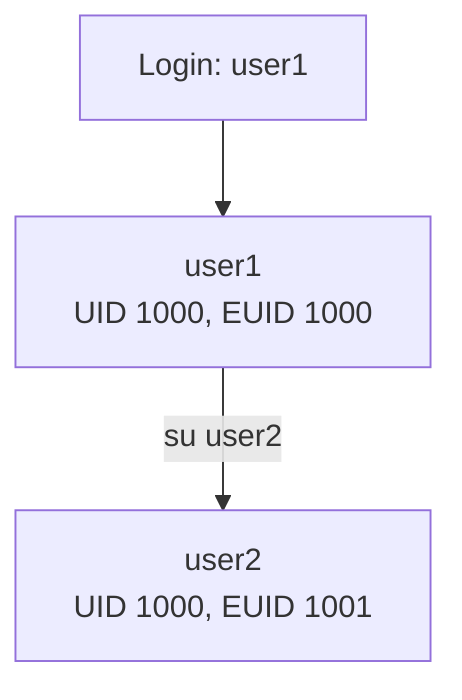

# Week 12 Lecture — User Management

[Repository Guide](../../README.md) | [English](Concepts_Lecture.md) | [한국어](Concepts_Lecture.ko.md)

> **Last Updated:** 2026-10-19
>
> 우분투 리눅스, 이종원, Ch 10

> **Learning Objectives:**
> 1. Explain the structure of the user account files (/etc/passwd, /etc/shadow, /etc/group, /etc/gshadow)
> 2. Create and manage user accounts and groups
> 3. Configure password policies and account expiration
> 4. Explain the difference between UID and EUID and check user information
> 5. Apply sudo and privilege escalation securely
> 6. Set up disk quotas per user and per group

---

## Table of Contents

- [1. User and Group Concepts](#1-user-and-group-concepts)
  - [1.1 User Types](#11-user-types)
  - [1.2 Groups](#12-groups)
- [2. User Account Files](#2-user-account-files)
  - [2.1 /etc/passwd](#21-etcpasswd)
  - [2.2 /etc/shadow](#22-etcshadow)
  - [2.3 /etc/group](#23-etcgroup)
  - [2.4 /etc/gshadow](#24-etcgshadow)
  - [2.5 /etc/login.defs](#25-etclogindefs)
- [3. Managing Users](#3-managing-users)
  - [3.1 useradd: Create Users](#31-useradd-create-users)
  - [3.2 adduser: Interactive User Creation (Debian/Ubuntu)](#32-adduser-interactive-user-creation-debianubuntu)
  - [3.3 usermod: Modify Users](#33-usermod-modify-users)
  - [3.4 userdel: Delete Users](#34-userdel-delete-users)
- [4. Managing Groups](#4-managing-groups)
  - [4.1 Summary of Group Commands](#41-summary-of-group-commands)
  - [4.2 groupadd, addgroup, groupmod, groupdel](#42-groupadd-addgroup-groupmod-groupdel)
  - [4.3 Group Passwords and newgrp](#43-group-passwords-and-newgrp)
- [5. Password Management](#5-password-management)
  - [5.1 Setting Passwords](#51-setting-passwords)
  - [5.2 Password Aging](#52-password-aging)
- [6. Checking User Information](#6-checking-user-information)
  - [6.1 UID and EUID](#61-uid-and-euid)
  - [6.2 Login Information: who, w, last](#62-login-information-who-w-last)
  - [6.3 Checking UID, EUID, and Groups](#63-checking-uid-euid-and-groups)
  - [6.4 Changing File Ownership: chown, chgrp](#64-changing-file-ownership-chown-chgrp)
- [7. sudo Configuration](#7-sudo-configuration)
  - [7.1 /etc/sudoers](#71-etcsudoers)
- [8. Disk Quotas](#8-disk-quotas)
  - [8.1 The Concept of Quotas](#81-the-concept-of-quotas)
  - [8.2 Preparing Quotas](#82-preparing-quotas)
  - [8.3 Quota Commands](#83-quota-commands)
- [9. Best Practices](#9-best-practices)
- [Summary](#summary)
- [Self-Check Questions](#self-check-questions)

---

<br>

## 1. User and Group Concepts

### 1.1 User Types

| Type | UID Range | Description |
|------|-----------|-------------|
| **Root** | 0 | Superuser with full system access |
| **System Users** | 1-999 | Service accounts (daemon, www-data) |
| **Regular Users** | 1000+ | Normal human users |

*Table 1. User types by UID range*

A **UID (user ID)** is the number the system uses to distinguish users. Usually UIDs 0-999 and 65534 (nobody) are reserved for system users, and regular users are assigned UIDs from 1000. The exact ranges are set in `/etc/login.defs` (Section 2.5).

### 1.2 Groups

- Every user belongs to at least one **primary group**, which is set by the GID field of `/etc/passwd`.
- Users can also belong to **supplementary groups**, which (as secondary groups) are recorded in `/etc/group`.
- Groups control access to shared files.

---

<br>

## 2. User Account Files

### 2.1 /etc/passwd

`/etc/passwd` is the basic file that stores user account information, with one account per line in seven colon-separated fields.

```text
username:x:UID:GID:comment:home_directory:login_shell
```

```text
root:x:0:0:root:/root:/bin/bash
user1:x:1001:1001::/home/user1:/bin/bash
www-data:x:33:33:www-data:/var/www:/usr/sbin/nologin
```

1. **Login ID:** The name of the user account.
2. **x:** The field where early Unix systems stored the password. Passwords are now stored in `/etc/shadow`, and only `x` is left here.
3. **UID:** The number the system uses to distinguish the user.
4. **GID:** The ID of the user's default group. In Linux every user belongs to at least one group.
5. **Comment (GECOS):** General information such as the user's real name, department, or contact. Accounts created with `adduser` fill it with several comma-separated items, as in `user1,,,`.
6. **Home directory:** The absolute path of the home directory assigned to the account.
7. **Login shell:** The user's login shell. With `/usr/sbin/nologin`, nobody can log in to the account.

### 2.2 /etc/shadow

`/etc/shadow` keeps information about user passwords separately. On Ubuntu only root can read and write it, and the shadow group can only read it.

```text
username:encrypted_password:lastchange:min:max:warn:inactive:expire:reserved
```

- Stores encrypted passwords (readable only by root and the shadow group).
- Contains password aging information.

1. **Login ID:** The name of the user account.
2. **Password:** The encrypted (hashed) password. A value starting with `$6$` is a SHA-512 hash, and `!` or `*` means password login is impossible.
3. **Last change:** The date the password was last changed, written as the number of days since January 1, 1970.
4. **MIN:** The minimum number of days that must pass after a change before the password can be changed again.
5. **MAX:** The maximum number of days the password can be used.
6. **WARNING:** How many days before expiration warnings start.
7. **INACTIVE:** For this many days after the password expires, login is still possible (the password must be changed at login).
8. **EXPIRE:** The date the account expires, written as the number of days since January 1, 1970.
9. **Flag:** A field left empty for future use.

```text
root:!:18952:0:99999:7:::
daemon:*:18912:0:99999:7:::
user1:$6$NUpbDb6gYEQAhMyz$uqKHta1vl.nhPPe1u9pmPrd9Nq...:18994:0:99999:7:::
```

The line for user1 holds a SHA-512 hash and means that the password was changed on day 18994 (2022-01-02), with MIN 0 days, MAX 99999 days, and WARNING 7 days, and that the remaining fields are empty. Ubuntu locks the password of the root account (`!`), so one cannot log in as root directly and uses `sudo` instead.

### 2.3 /etc/group

`/etc/group` stores group information. Among the groups a user belongs to, the group given in the GID field of `/etc/passwd` is the default group, and secondary groups are recorded in the member lists of `/etc/group`.

```text
groupname:x:GID:member_list
```

```text
sudo:x:27:user1
developers:x:1002:user1,user2,user3
```

1. **Group name:** The name of the group.
2. **x:** The place of the group password; the actual password is stored in `/etc/gshadow`. A group password is needed to switch with `newgrp` to a group one does not belong to (Section 4.3).
3. **GID:** The number that identifies the group.
4. **Group members:** The account names of the group's members, separated by commas. Users who have this group as their default group are not listed here.

When Ubuntu creates an account, it creates a group with the same name as the user, as in `user1:x:1000:`, and uses it as that user's default group. `adm:x:4:syslog,user1` means that syslog and user1 belong to the adm group as a secondary group.

### 2.4 /etc/gshadow

`/etc/gshadow` stores group passwords, and each line consists of the following four fields.

1. **Group name:** The name of the group.
2. **Group password:** The encrypted group password. `!` or `*` means no group password is set.
3. **Administrators:** User accounts that can change the group's password or members, separated by commas if there are several.
4. **Group members:** The account names of the group's members, separated by commas.

```text
root:*::
adm:*::syslog,user1
user1:!::
sambashare:!::user1
```

### 2.5 /etc/login.defs

`/etc/login.defs` defines default values related to user account settings, and commands such as `useradd` consult it when creating accounts.

| Item | Default | Meaning |
|:-----|:-----|:-----|
| MAIL_DIR | /var/mail | Default mail directory |
| PASS_MAX_DAYS | 99999 | Maximum number of days a password can be used |
| PASS_MIN_DAYS | 0 | Minimum number of days before a changed password can be changed again |
| PASS_WARN_AGE | 7 | Number of days of warning before a password expires |
| UID_MIN, UID_MAX | 1000-60000 | UID range of regular user accounts |
| SYS_UID_MIN, SYS_UID_MAX | 100-999 | UID range of system accounts |
| GID_MIN, GID_MAX | 1000-60000 | GID range of regular user accounts |
| SYS_GID_MIN, SYS_GID_MAX | 100-999 | GID range of system accounts |
| DEFAULT_HOME | yes | Whether login is allowed when the home directory cannot be entered |
| UMASK | 022 | Default umask value |
| USERGROUPS_ENAB | yes | Whether to create a group with the same name as the user, and to delete that group with the user if it has no other members |
| ENCRYPT_METHOD | SHA512 | Encryption (hashing) method used to store passwords |

*Table 2. Main items of /etc/login.defs*

The defaults in the table are those of Ubuntu 21.10 and differ by distribution and version (for example, recent Ubuntu uses YESCRYPT as ENCRYPT_METHOD).

---

<br>

## 3. Managing Users

### 3.1 useradd: Create Users

```bash
sudo useradd username                        # Create user (minimal)
sudo useradd -m username                     # Create with home directory
sudo useradd -m -s /bin/bash username        # Specify shell
sudo useradd -m -G sudo,developers username  # Add to groups
sudo useradd -m -c "John Doe" -s /bin/bash -G sudo john
```

The form of `useradd` is `useradd [options] [login ID]`, and its main options are as follows.

| Option | Meaning |
|:-----|:-----|
| `-u uid` | Set the UID |
| `-o` | Allow a duplicate UID (used with `-u`) |
| `-g gid` | Set the GID (or name) of the default group |
| `-G gid` | Set secondary groups (several, separated by commas) |
| `-d directory` | Set the home directory |
| `-m` | Create the home directory |
| `-s shell` | Set the default shell as an absolute path |
| `-c comment` | Set additional information such as the user's name |
| `-D` | Print or set the default values |
| `-e date` | Set the account expiration date (EXPIRE) in YYYY-MM-DD form |
| `-f days` | Set the number of days after password expiration until the account is disabled (INACTIVE) |
| `-k directory` | Set the directory holding the initial files copied to the home directory (default `/etc/skel`) |
| `-b directory` | Set the base location where home directories are created (default `/home`) |

*Table 3. Main options of useradd*

Running `useradd` without options creates no home directory and sets the default shell to the Bourne shell (`/bin/sh`) (on Ubuntu). After creating the account, a password must also be set with `passwd` before the user can log in, and because there is no home directory, a login starts in the `/` directory.

```text
$ sudo useradd user2
$ tail -2 /etc/passwd
postfix:x:128:134::/var/spool/postfix:/usr/sbin/nologin
user2:x:1001:1001::/home/user2:/bin/sh
$ ls /home
user1
```

With options, the account is created with the desired values as below. user3 was created with UID 2000, default group GID 1000, and secondary group GID 3 (sys). In the `/etc/shadow` line of user4, INACTIVE is 5 and EXPIRE stores 2022-12-31 as 19357 days counted from 1970-01-01. No password has been set yet, so the password field is `!`.

```text
$ sudo useradd -s /bin/bash -m -d /home/user3 -u 2000 -g 1000 -G 3 user3
$ grep user3 /etc/passwd
user3:x:2000:1000::/home/user3:/bin/bash
$ grep user3 /etc/group
sys:x:3:user3
$ sudo useradd -e 2022-12-31 -f 5 -c "user4 test" user4
$ sudo grep user4 /etc/shadow
user4:!:18995:0:99999:7:5:19357:
```

`useradd -D` prints the default settings.

```text
$ useradd -D
GROUP=100
HOME=/home
INACTIVE=-1
EXPIRE=
SHELL=/bin/sh
SKEL=/etc/skel
CREATE_MAIL_SPOOL=no
```

- **GROUP:** The GID of the default group; 100 is the users group. When `USERGROUPS_ENAB` is yes, a group with the user's name is created and used as the default group, so this value applies only when that feature is not used (`-N`).
- **HOME:** The location where home directories are created.
- **INACTIVE:** -1 disables the INACTIVE feature, and 0 locks the account as soon as the password expires.
- **EXPIRE:** The account expiration date.
- **SHELL:** The default login shell.
- **SKEL:** The location of the default environment files copied to the home directory.
- **CREATE_MAIL_SPOOL:** Whether to create a mail spool directory.

These defaults are stored in `/etc/default/useradd`. The file can be edited with vi, but it is better to change the values by giving `-b home_location`, `-e expire_date`, `-f inactive_days`, `-g GID`, or `-s shell` after `useradd -D` (for example, `sudo useradd -D -s /bin/bash`).

Files that should be distributed to every user's home directory can be placed in `/etc/skel`, and they are copied automatically when an account is created (`-m`).

```text
$ ls -a /etc/skel
.  ..  .bash_logout  .bashrc  .profile
```

### 3.2 adduser: Interactive User Creation (Debian/Ubuntu)

```bash
sudo adduser username    # Interactive: prompts for password, name, etc.
```

`adduser` is a higher-level command on Debian-based systems that wraps `useradd`; it creates the home directory and asks for the password and user information interactively. The form is `adduser [options] login_ID`, and the options are written in long form.

- `--uid UID`: Set the UID.
- `--gid GID`: Set the GID of the default group.
- `--home directory`: Set the home directory.
- `--shell shell`: Set the default shell.
- `--gecos comment`: Set additional information such as the user's name.

```bash
sudo adduser --uid 2001 user5
sudo adduser --home /home/user5 --uid 2001 --gid 2100 --shell /bin/sh user5
```

The defaults of `adduser` are stored in `/etc/adduser.conf`. They include the default login shell `DSHELL=/bin/bash`, the location of home directories `DHOME=/home`, the range of dynamically allocated UIDs (from `FIRST_UID=1000` to `LAST_UID=59999`), and the range of GIDs (from `FIRST_GID=1000` to `LAST_GID=59999`).

### 3.3 usermod: Modify Users

```bash
sudo usermod -aG sudo username            # Add to supplementary group
sudo usermod -s /bin/zsh username          # Change shell
sudo usermod -d /new/home username         # Change home directory
sudo usermod -l newname oldname            # Rename user
sudo usermod -L username                   # Lock account
sudo usermod -U username                   # Unlock account
sudo usermod -e 2025-12-31 username        # Set expiry date
```

The form is `usermod [options] [login ID]`, and the options resemble those of `useradd`. It can change `-u` (UID), `-o` (allow duplicate UID), `-g` (default group), `-G` (secondary groups), `-d` (home directory), `-s` (shell), `-c` (comment), `-f` (INACTIVE), `-e` (EXPIRE), and `-l` (account name).

```bash
sudo usermod -u 1003 user3                      # Change the UID from 2000 to 1003
sudo usermod -u 1001 -o user3                   # Assign 1001, the UID of user2, as a duplicate
sudo usermod -d /home/user31 user3              # Change only the home directory value in /etc/passwd
sudo usermod -l user44 -d /home/user44 user4    # Change the login ID and home directory
```

When the UID changes, `usermod` also updates the owner of files inside the home directory, but files outside it must be changed manually.

> **Caution:** `usermod -d` and `-l` change only the values in `/etc/passwd`; they neither create the new home directory nor move existing files. Create the directory and move the files yourself, or give `-m` together with `-d` (`usermod -d /home/user44 -m user44`) to move the contents of the old home directory.

### 3.4 userdel: Delete Users

```bash
sudo userdel username                      # Delete user (keep home)
sudo userdel -r username                   # Delete user and home directory
```

`-f` deletes the user even while the user is logged in. Files owned by the user outside the home directory are not removed even with `-r`, so find and check them with `find` before deleting the account and then clean them up. After the account is deleted, such files show only the numeric UID instead of an owner name, so they are found with `-nouser`.

```bash
sudo find / -user username            # Before deletion: find files owned by the user
sudo find / -nouser                   # After deletion: find files without an owner
```

---

<br>

## 4. Managing Groups

### 4.1 Summary of Group Commands

```bash
# Create group
sudo groupadd developers

# Delete group
sudo groupdel developers

# Modify group
sudo groupmod -n newname oldname           # Rename group

# Add user to group
sudo usermod -aG groupname username        # -a = append (important!)
sudo gpasswd -a username groupname         # Alternative

# Remove user from group
sudo gpasswd -d username groupname

# View group membership
groups username
id username
getent group groupname
```

> **Key Point:** When adding supplementary groups with `usermod`, always use `-aG` (append + group). With `-G` alone, without `-a`, the user's supplementary group list is replaced by the given groups.

### 4.2 groupadd, addgroup, groupmod, groupdel

- `groupadd [options] [group]` creates a group. `-g gid` sets the GID and `-o` allows a duplicate GID; without a GID, the next number after the last one is assigned automatically.
- `addgroup [options] group` is the Debian-family command for creating groups, and `--gid GID` sets the GID.
- `groupmod [options] [group]` modifies group information. `-g gid` changes the GID, `-o` allows duplicates, and `-n new_name` renames the group.
- `groupdel group` deletes a group. A group used as some user's default group cannot be deleted.

```bash
sudo groupadd -g 2020 gtest          # Create a group with GID 2020
sudo groupadd -g 2020 -o gtest2      # Assign the same GID as a duplicate
sudo addgroup --gid 2013 gtest3      # Set the GID with addgroup
sudo groupmod -g 3001 gtest          # Change the GID
sudo groupmod -n gtest1 gtest        # Rename the group
sudo groupdel gtest1                 # Delete the group
```

### 4.3 Group Passwords and newgrp

`gpasswd [options] [group]` manages `/etc/group` and `/etc/gshadow`. Without options it sets the group password; `-a user` adds a user to the group, `-d user` removes a user from it, and `-r` removes the group password.

```bash
sudo gpasswd gtest01                 # Set the group password
sudo gpasswd -a test01 gtest01       # Add a member
sudo gpasswd -d test01 gtest01       # Remove a member
sudo gpasswd -r gtest01              # Remove the group password
```

`newgrp [group]` changes the current group of the working user from the default group to another group, and files created afterwards have that group as their owning group. Switching to a group the user belongs to as a secondary group (for example, `newgrp adm`) needs no password, while switching to a group the user does not belong to requires that group's password. `newgrp` starts a new shell, so `exit` returns to the shell with the original group.

---

<br>

## 5. Password Management

### 5.1 Setting Passwords

```bash
sudo passwd username               # Set password for user
passwd                             # Change own password
sudo passwd -l username            # Lock account
sudo passwd -u username            # Unlock account
sudo passwd -d username            # Delete password (no password login)
sudo passwd -e username            # Force password change on next login
```

`passwd -l` prepends `!` to the password in `/etc/shadow` so that password login becomes impossible, and `-u` reverses it. Deleting the password with `-d` allows login without a password, so it must be used with care. `-n`, `-x`, and `-w` also set the MIN, MAX, and WARNING days (Section 5.2).

### 5.2 Password Aging

```bash
sudo chage -l username             # View password aging info
sudo chage -M 90 username          # Max days between changes
sudo chage -m 7 username           # Min days between changes
sudo chage -W 14 username          # Warning days before expiry
sudo chage -E 2025-12-31 username  # Account expiration date
```

**Password aging** manages the validity periods of passwords and accounts through the MIN, MAX, WARNING, INACTIVE, and EXPIRE fields of `/etc/shadow`, and it can be set with the `useradd`, `usermod`, `passwd`, and `chage` commands.

| Item | useradd, usermod, passwd commands | chage command |
|:-----|:-----|:-----|
| MIN | `passwd -n days` | `chage -m` |
| MAX | `passwd -x days` | `chage -M` |
| WARNING | `passwd -w days` | `chage -W` |
| INACTIVE | `useradd -f days`, `usermod -f days` | `chage -I` (uppercase i) |
| EXPIRE | `useradd -e date`, `usermod -e date` (YYYY-MM-DD) | `chage -E` |

*Table 4. Commands that set each password aging item*

The following example sets the password aging of user44 at once with `chage` and checks it.

```text
$ sudo chage -m 2 -M 100 -W 5 -I 10 -E 2022-11-30 user44
$ sudo grep user44 /etc/shadow
user44:!:18995:2:100:5:10:19326:
$ sudo chage -l user44
Last password change                                    : Jan 03, 2022
Password expires                                        : Apr 13, 2022
Password inactive                                       : Apr 23, 2022
Account expires                                         : Nov 30, 2022
Minimum number of days between password change          : 2
Maximum number of days between password change          : 100
Number of days of warning before password expires       : 5
```

The last change, day 18995, is 2022-01-03. The password expires MAX 100 days later, on 2022-04-13, and for INACTIVE 10 days after expiration, until 2022-04-23, the user can still log in and change it. The account expiration date, day 19326, is 2022-11-30.

---

<br>

## 6. Checking User Information

### 6.1 UID and EUID

The **UID** is the UID of the account the user logged in with, also called the real user ID (RUID). The **EUID** (effective UID) is the UID of the subject executing the current command and is used for permission checks such as file access. If a user logs in as user1 (UID 1000) and switches to user2 (UID 1001) with `su user2`, the logged-in account is still user1, but the subject executing commands becomes user2, so the EUID becomes 1001.



*Figure 1. Change of UID and EUID when switching users with su*

> **Note:** The real UID that the kernel keeps for each process changes to user2's UID in the new shell started by `su` (which is why `id` prints `uid=1001` in Section 6.3). The logged-in account remains in the terminal's login record (utmp), and `who am i` shows this record. A typical case where a process's real UID and effective UID actually differ is running a program with the SetUID bit, such as `passwd` (Week 7).

### 6.2 Login Information: who, w, last

- `who [options]` prints information about the users currently on the system. `-q` prints the names and number of logged-in users, `-H` the headings of the output columns, `-b` the date and time of the last boot, `-m` the user of the current terminal, and `-r` the current runlevel.
- `w [user]` prints information about the users currently on the system together with the tasks each user is running.
- `last` prints the record of logins to and logouts from the system.

```text
$ w
 14:14:33 up 1 day, 43 min,  2 users,  load average: 0.08, 0.03, 0.01
USER     TTY      FROM             LOGIN@   IDLE   JCPU   PCPU WHAT
user1    pts/0    192.168.147.1    10:14    0.00s  0.12s  0.01s w
$ last
user1    pts/0        192.168.147.1    Wed Jan  5 10:14   still logged in
user2    pts/2        192.168.147.1    Mon Jan  3 20:52 - 20:54  (00:01)
reboot   system boot  5.13.0-21-generi Sun Nov 21 12:05 - 17:23 (35+05:17)
```

### 6.3 Checking UID, EUID, and Groups

- The UID of the logged-in account is checked with `who am i` or `who -m`.
- The EUID is checked with `whoami` or `id`. When the real UID and effective UID differ, `id` shows a separate `euid=` item.
- `groups [user]` prints the groups a user belongs to; without a user, it applies to the current user.

Logging in as user1, switching to user2 with `su`, and running the three commands gives the following.

```text
user1@myubuntu:~$ su - user2
Password:
su: warning: cannot change directory to /home/user2: No such file or directory
$ whoami
user2
$ who am i
user1    pts/0        2022-01-05 10:14 (192.168.147.1)
$ id
uid=1001(user2) gid=1001(user2) groups=1001(user2)
$ who -m
user1    pts/0        2022-01-05 10:14 (192.168.147.1)
```

### 6.4 Changing File Ownership: chown, chgrp

The owner of files and directories is changed with `chown` and the owning group with `chgrp`, which Week 7 covers in detail. With `-R`, subdirectories are changed as well.

```bash
sudo chown user2 file.txt              # Change the owner
sudo chown user2:gtest file.txt        # Change the owner and group
sudo chown -R user2:gtest dir/         # Change the owner and group including subdirectories
sudo chgrp -R gtest dir/               # Change the group including subdirectories
```

---

<br>

## 7. sudo Configuration

### 7.1 /etc/sudoers

`sudo` lets users permitted in `/etc/sudoers` run commands with the privileges of another user (root by default). Each line has the form `user host=(run_as_user:run_as_group) commands`, and a name starting with `%` means a group.

```bash
# Edit sudoers file safely
sudo visudo

# Allow user full sudo access
username ALL=(ALL:ALL) ALL

# Allow group sudo access
%developers ALL=(ALL:ALL) ALL

# Allow specific commands without password
username ALL=(ALL) NOPASSWD: /usr/bin/apt, /usr/bin/systemctl
```

`visudo` checks the syntax before saving, which prevents accidents in which a wrong setting makes `sudo` unusable altogether.

---

<br>

## 8. Disk Quotas

### 8.1 The Concept of Quotas

A **disk quota** limits the disk usage available to a user or group. There are two ways to limit it.

- Limit the total size of files (number of blocks) a user can use.
- Limit the total number of files (number of inodes) a user can use.

Each limit has two values.

- **Hard limit:** The maximum a user can never exceed.
- **Soft limit:** A limit that may be exceeded for a certain time (the grace period, 7 days by default). If usage is not brought back below the soft limit before the grace period ends, no more data can be written.

### 8.2 Preparing Quotas

The quota tools are installed with `sudo apt install quota`. Quotas are set per file system, per user or per group, and the quota attributes must be given in the mount options of that file system.

- `usrquota`: The attribute that enables limiting the quota of individual users.
- `grpquota`: The attribute that enables limiting the quota of individual groups.

For example, when `/dev/sdd2` is mounted on `/home2`, add `usrquota` to its line in `/etc/fstab` (followed by `grpquota` to use group quotas as well), remount it, and check that the options are applied.

```bash
# /etc/fstab
# /dev/sdd2  /home2  ext4  defaults,usrquota,grpquota  0  0
sudo mount -o remount /home2      # Remount
mount | grep home2                # Check the quota attributes
```

The database that manages disk quotas consists of the user quota database file `aquota.user` and the group quota database file `aquota.group`, which are created in the top-level directory of the file system (for example, `/home2`).

### 8.3 Quota Commands

| Command | Function | Main options |
|:-----|:-----|:-----|
| `quotacheck [options] [file_system]` | Scans the file system to create, check, and repair quota files | `-a` all file systems, `-u` user quotas, `-g` group quotas, `-m` do not remount read-only, `-v` show progress, `-c` create new files without reading the old ones |
| `quotaon [options] [file_system]` | Enables quotas | `-a`, `-u`, `-g`, `-v` (same meaning as in quotacheck) |
| `quotaoff [options] [file_system]` | Disables quotas | Same as quotaon |
| `edquota [options] [user_or_group]` | Opens an editor to set quotas | `-u` user quota (default), `-g` group quota, `-p source` copy the quota settings of the source |
| `quota [user]` | Prints a user's quota information | `-u` user, `-g` group |
| `repquota [options] [file_system]` | Prints a summary of the file system's quota information | `-a`, `-u`, `-g` |

*Table 5. Disk quota commands*

```bash
sudo quotacheck -ugvm /home2          # Create the quota database
sudo quotaon -ugv /home2              # Enable quotas
sudo edquota -u qtest1                # Set the quota of qtest1
sudo edquota -p qtest1 qtest2         # Copy the settings of qtest1 to qtest2
sudo quota qtest1                     # Check the quota of qtest1
sudo repquota /home2                  # Summarize quota information
```

Running `edquota -u qtest1` opens the following in an editor. Block counts are in KB, and editing and saving the soft and hard values assigns the quota. The following shows qtest1 given a soft limit of 20KB and a hard limit of 22KB, and a value of 0 means no limit.

```text
Disk quotas for user qtest1 (uid 2102):
  Filesystem                   blocks       soft       hard     inodes     soft     hard
  /dev/sdd2                        16         20         22          4        0        0
```

The settings can be checked with `quota`, and an attempt to use more disk than the assigned quota fails with an error.

```text
$ sudo quota qtest1
Disk quotas for user qtest1 (uid 2102):
     Filesystem  blocks   quota   limit   grace   files   quota   limit   grace
      /dev/sdd2      16      20      22               4       0       0
$ cp /etc/services .
cp: error writing './services': Disk quota exceeded
```

For group quotas, add `grpquota` to `/etc/fstab`, remount, and check the mount options; then create the group quota database with `quotacheck` and enable it with `quotaon -g`. After that, set the quota with `edquota -g group` and check it with `quota -g group`.

---

<br>

## 9. Best Practices

- Follow the principle of least privilege.
- Manage access through groups rather than individual permissions.
- Set password aging policies.
- Disable unused accounts (`usermod -L`).
- Audit user accounts regularly.
- Use the `nologin` shell for service accounts.

---

<br>

## Summary

| Concept | Key Summary |
|---------|-----------|
| `/etc/passwd` | It stores user account information in the seven fields `username:x:UID:GID:comment:home:shell`. |
| `/etc/shadow` | It stores encrypted passwords and aging information and cannot be read by regular users. |
| `/etc/group` | It stores group definitions and secondary group membership. |
| `/etc/login.defs` | It defines defaults for account creation such as UID ranges and password aging. |
| `useradd`/`adduser` | They create new user accounts, and `adduser` interactively sets up the home directory and password as well. |
| `usermod` | It modifies user properties such as groups, shell, home directory, and UID. |
| `userdel` | It deletes user accounts, and with `-r` it also deletes the home directory. |
| `groupadd`/`groupdel` | They create or delete groups. |
| `gpasswd`/`newgrp` | They manage group passwords and members and change the current group. |
| `passwd` | It sets passwords and locks or unlocks them. |
| `chage` | It configures password aging policies (MIN, MAX, WARNING, INACTIVE, EXPIRE). |
| UID/EUID | They are the UID of the logged-in account and the UID of the subject executing the current command, checked with `who am i` and `whoami`. |
| `sudo`/`visudo` | They configure privilege escalation that runs commands with another user's privileges. |
| Disk Quotas | They limit the number of blocks and files per user or group with hard and soft limits. |

---

<br>

## Self-Check Questions

1. **Reading a shadow line:** From `test01:$6$abc...:19000:7:90:14:5:19400:`, find the date the password was last changed, the earliest date it can be changed again, the password expiration date, the date warnings start, the last date login is possible, and the account expiration date. Day 19000 is 2022-01-08.

   <details>
   <summary>Answer</summary>

   The last change is day 19000, 2022-01-08. MIN is 7, so the password can be changed again from 2022-01-15, seven days later. MAX is 90, so the password expires on 2022-04-08 (day 19090), and with WARNING 14 the warnings start on 2022-03-25. Login remains possible for INACTIVE 5 days, so the user can log in and change the password until 2022-04-13. The account expiration date, day 19400, is 2023-02-12.

   </details>

2. **usermod -G without -a:** `sudo usermod -G video dev1` was run for dev1, who belongs to docker and sudo as supplementary groups. What are dev1's default group and supplementary groups afterwards, and what should have been done to add video while keeping the original supplementary groups?

   <details>
   <summary>Answer</summary>

   `-G` replaces the whole supplementary group list with the given value, so dev1's only supplementary group becomes video, and dev1 is removed from docker and sudo. The default group is set by the GID in `/etc/passwd`, so it does not change. To keep the original groups, `-a` must be given as well, as in `sudo usermod -aG video dev1`, and the groups already lost are added back with `sudo usermod -aG docker,sudo dev1`.

   </details>

3. **whoami vs. who am i:** On a terminal logged in as user1, `su - user2` is run, followed by `whoami`, `who am i`, and `id -un`. State what each prints and explain why the results differ.

   <details>
   <summary>Answer</summary>

   `whoami` and `id -un` print user2, the subject executing the current command, and `who am i` prints user1. `whoami` and `id` look at the effective user ID (EUID) of the current process, whereas `who am i` looks at the login information recorded for the terminal. `su` only changes the user of the new shell and does not change the record of the account logged in on that terminal.

   </details>

4. **Soft and hard limits:** The block quota of qtest1 has a soft limit of 20KB and a hard limit of 22KB, and 16KB is currently used. State what happens (a) when a 5KB file is created, (b) when a further 2KB file is then created, and (c) when the grace period passes in the state of (a).

   <details>
   <summary>Answer</summary>

   (a) Usage becomes 21KB, which exceeds the soft limit but is below the hard limit, so the file is created, and a warning is given and the grace period starts. (b) Usage would become 23KB, above the hard limit of 22KB, so the write is refused with a disk quota exceeded error. (c) Usage was not brought below 20KB before the grace period ended, so the soft limit acts like a hard limit, and nothing new can be written until usage drops below 20KB.

   </details>

5. **Default behavior of useradd:** On Ubuntu with the `useradd -D` defaults of Section 3.1 and `USERGROUPS_ENAB yes`, only `sudo useradd user9` was run. State the home directory, login shell, default group, and login availability of user9, and give the commands that create an account with a home directory and the bash shell.

   <details>
   <summary>Answer</summary>

   `/etc/passwd` records the home directory as `/home/user9`, but the directory is not created. The login shell is `/bin/sh`, and the default group is the newly created user9 group (`GROUP=100` does not apply). No password is set, so the password field is `!`, and password login is impossible until a password is set with `passwd user9`. An account with a home directory and the bash shell is created with `sudo useradd -m -s /bin/bash user9`, followed by `sudo passwd user9` to set the password.

   </details>
