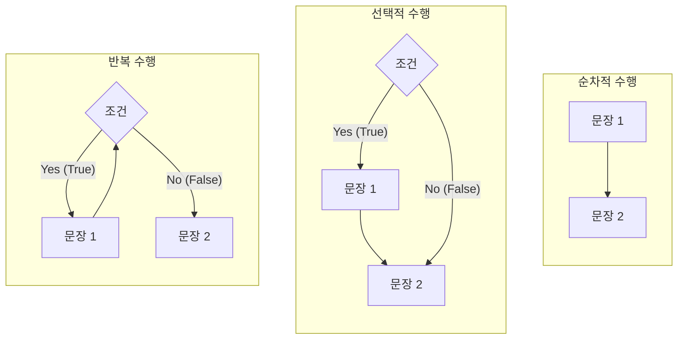

# 13주차 이론 — Bash 셸 프로그래밍

[레포지토리 안내](../../README.ko.md) | [English](Concepts_Lecture.md) | [한국어](Concepts_Lecture.ko.md)

> **최종 수정일:** 2026-10-19

> **학습 목표:**
> 1. 변수, 조건문, 반복문으로 bash 스크립트를 작성할 수 있다
> 2. 스크립트에서 명령줄 인자를 처리할 수 있다
> 3. 변수 확장 표현식과 산술, 문자열, 파일 테스트 연산자를 적용할 수 있다
> 4. 함수를 정의하고 호출하여 스크립트를 구성할 수 있다
> 5. bash -x와 trap으로 스크립트의 실행 오류를 찾을 수 있다

---

## 목차

- [1. 셸 스크립트 기초](#1-셸-스크립트-기초)
  - [1.1 스크립트와 셸 스크립트](#11-스크립트와-셸-스크립트)
  - [1.2 스크립트 작성](#12-스크립트-작성)
  - [1.3 스크립트 실행](#13-스크립트-실행)
  - [1.4 셔뱅(Shebang) 라인](#14-셔뱅shebang-라인)
  - [1.5 스크립트의 구성 요소](#15-스크립트의-구성-요소)
- [2. 변수와 데이터 타입](#2-변수와-데이터-타입)
  - [2.1 변수 할당](#21-변수-할당)
  - [2.2 변수 사용](#22-변수-사용)
  - [2.3 조건부 변수 확장](#23-조건부-변수-확장)
  - [2.4 패턴을 이용한 문자열 제거](#24-패턴을-이용한-문자열-제거)
  - [2.5 특수 변수](#25-특수-변수)
  - [2.6 인용 부호와 명령 대체](#26-인용-부호와-명령-대체)
  - [2.7 산술 연산](#27-산술-연산)
- [3. 입력과 출력](#3-입력과-출력)
  - [3.1 read: 사용자 입력](#31-read-사용자-입력)
  - [3.2 echo와 printf](#32-echo와-printf)
  - [3.3 Here Document](#33-here-document)
- [4. 조건문](#4-조건문)
  - [4.1 if-then-else](#41-if-then-else)
  - [4.2 if-elif-else](#42-if-elif-else)
  - [4.3 테스트 연산자](#43-테스트-연산자)
  - [4.4 case 문](#44-case-문)
- [5. 반복문](#5-반복문)
  - [5.1 for 반복문](#51-for-반복문)
  - [5.2 while 반복문](#52-while-반복문)
  - [5.3 until 반복문](#53-until-반복문)
  - [5.4 select 메뉴](#54-select-메뉴)
  - [5.5 반복문 제어](#55-반복문-제어)
- [6. 함수](#6-함수)
  - [6.1 함수 정의](#61-함수-정의)
  - [6.2 반환 값](#62-반환-값)
  - [6.3 함수 확인과 삭제](#63-함수-확인과-삭제)
- [7. 문자열 및 파일 연산](#7-문자열-및-파일-연산)
  - [7.1 문자열 연산](#71-문자열-연산)
  - [7.2 파일 유형 테스트](#72-파일-유형-테스트)
- [8. 고급 기능](#8-고급-기능)
  - [8.1 시그널 트래핑](#81-시그널-트래핑)
  - [8.2 종료 상태](#82-종료-상태)
  - [8.3 주석과 자기 출력 스크립트](#83-주석과-자기-출력-스크립트)
  - [8.4 디버깅](#84-디버깅)
- [9. 모범 사례](#9-모범-사례)
- [요약](#요약)
- [점검 문제](#점검-문제)

---

<br>

## 1. 셸 스크립트 기초

### 1.1 스크립트와 셸 스크립트

**스크립트(script)** 는 미리 기계어로 컴파일해 두는 프로그램이 아니라, **인터프리터(interpreter)** 라고 부르는 다른 프로그램이 실행 시점에 읽고 해석하면서 실행하는 프로그램이다. Perl, Python, 셸 스크립트, JavaScript가 대표적인 스크립트 언어이다.

**셸 스크립트(shell script)** 는 셸이 실행하는 프로그램이다. 리눅스 명령과 셸이 제공하는 프로그래밍 구성 요소(변수, 조건문, 반복문, 함수 등)를 텍스트 파일에 적어 두면, 셸이 이를 위에서부터 차례로 읽어 실행한다. 여러 명령을 반복해서 실행해야 할 때 스크립트 파일로 저장해 두면 한 번의 실행으로 같은 작업을 되풀이할 수 있다.

셸은 사용자가 입력한 명령 이름을 그림 1의 순서로 찾는다. 따라서 스크립트 파일 이름은 앨리어스, 키워드, 내장 명령과 같은 이름을 피하는 것이 바람직하다. 예를 들어 스크립트 이름을 `test`로 지은 뒤 경로 없이 `test`라고 입력하면 내장 명령 `test`가 먼저 실행된다.


*그림 1. 셸이 명령 이름을 찾는 순서*

### 1.2 스크립트 작성

셸 스크립트는 vi 같은 텍스트 편집기로 작성한다. 다음은 인사말과 현재 작업 디렉터리를 출력하는 간단한 스크립트이다.

```bash
#!/bin/bash
# My first script
echo "Hello Linux World."
pwd
```

첫 줄 `#!/bin/bash`는 이 파일을 bash로 실행하도록 지정한다(1.4절). `#`으로 시작하는 둘째 줄은 주석이다(1.5절). `echo`는 인자로 받은 문자열을 출력하고, `pwd`는 현재 작업 디렉터리의 절대 경로를 출력한다. [Lab_basic_script.sh](../../Coursework/Lab13_Bash-Shell-Programming/Lab_basic_script.sh)는 같은 방식으로 현재 디렉터리, 사용자, 날짜, 호스트 이름을 출력한다.

### 1.3 스크립트 실행

```bash
chmod +x script.sh          # 실행 권한 부여
./script.sh                  # ./로 실행

bash script.sh               # bash를 명시적으로 지정하여 실행
source script.sh             # 현재 셸에서 실행 (환경에 영향)
. script.sh                  # source와 동일
```

스크립트를 새 셸에서 실행하는 방법은 두 가지이다.

- **셸의 인자로 지정:** `bash script.sh`처럼 셸을 실행하면서 스크립트 이름을 인자로 준다. 이때 파일에 실행 권한이 없어도 된다.
- **파일을 직접 실행:** `chmod +x`로 실행 권한을 준 뒤 `./script.sh`처럼 경로를 붙여 실행한다. 셸은 경로가 없는 명령 이름을 `PATH` 환경 변수에 등록된 디렉터리에서만 찾으므로, `PATH`에 현재 디렉터리(`.`)가 없으면 반드시 `./`를 붙여야 한다.

두 방법 모두 자식 프로세스로 생성된 새 셸이 스크립트를 실행하므로, 스크립트 안에서 바꾼 변수나 현재 디렉터리는 스크립트가 끝나면 원래 셸에 남지 않는다. 반면 `source script.sh`와 `. script.sh`는 현재 셸이 스크립트를 직접 실행하므로 스크립트가 바꾼 환경이 현재 셸에 그대로 남는다. 셸 설정 파일(`~/.bashrc` 등)을 수정한 뒤 바로 적용할 때 이 방법을 쓴다.

### 1.4 셔뱅(Shebang) 라인

스크립트 파일의 가장 처음에 오는 `#!`를 **셔뱅(shebang)** 또는 **매직 넘버(magic number)** 라고 한다. `#!` 뒤에는 스크립트를 실행할 프로그램(인터프리터)의 절대 경로를 쓴다. 셸마다 제공하는 스크립트 언어의 문법이 조금씩 다르므로, 이 스크립트를 실행할 셸을 지정해야 스크립트가 올바르게 실행된다. 파일을 직접 실행하면 커널이 첫 줄의 `#!`를 읽고, 그 뒤에 적힌 프로그램을 실행하면서 스크립트 파일의 경로를 인자로 넘긴다.

```bash
#!/bin/bash                  # bash 인터프리터 사용
#!/bin/sh                    # POSIX 셸 사용
#!/usr/bin/env bash          # 이식성: PATH에서 bash 탐색
#!/usr/bin/env python3       # Python 스크립트
```

`#!/usr/bin/env bash`는 `env` 명령이 `PATH`에서 `bash`를 찾아 실행하게 하므로, bash가 `/bin/bash`가 아닌 곳에 설치된 시스템에서도 동작한다.

셔뱅에는 셸이 아닌 프로그램도 지정할 수 있다. 다음 `test_sharp`는 셔뱅을 `#!/bin/more`로 지정한다. 이 파일을 실행하면 bash 대신 `more`가 스크립트 파일을 인자로 받아 실행되므로, 명령은 하나도 실행되지 않고 주석을 포함한 파일 내용 전체가 화면에 출력된다.

```bash
#!/bin/more
# test_sharp: 스스로를 출력하는 스크립트
# 이 스크립트를 실행하면 자기 자신을 화면에 출력한다.
# 주석문도 모두 출력된다.

echo "This line is printed."
```

[Lab_comments.sh](../../Coursework/Lab13_Bash-Shell-Programming/Lab_comments.sh)가 이 예이고, [Lab_comments_advanced.sh](../../Coursework/Lab13_Bash-Shell-Programming/Lab_comments_advanced.sh)는 셔뱅을 `#!/bin/rm`으로 지정하면 스크립트가 실행되는 대신 자기 파일이 삭제되는 원리를 설명한다(8.3절).

### 1.5 스크립트의 구성 요소

셸 스크립트 파일은 다음 네 가지 요소로 이루어진다.

- **`#!`:** 파일의 첫 줄에서 스크립트를 실행할 프로그램을 지정한다(1.4절).
- **`#` 주석(comment):** 프로그램에 대한 설명이다. 단어의 처음에 오는 `#`부터 그 줄의 끝까지가 주석이므로, 행 전체 또는 행의 일부를 주석으로 처리할 수 있다. 따옴표 안의 `#`이나 `$#`, `${#name}`의 `#`은 주석이 아니다.
- **셸 명령:** 셸이 실행할 수 있는 모든 명령을 쓸 수 있다.
- **셸 프로그래밍 구문:** 셸 변수, 인자 처리, 각종 연산자, 제어문처럼 셸이 프로그램 작성을 위해 제공하는 구문이다.

다음 `test_sharp2`는 행 전체 주석과 행의 일부 주석을 함께 보여 준다. 실행하면 주석은 출력되지 않고 `이 부분은 출력됩니다.`만 출력되며, 스크립트는 종료 상태 65로 끝난다. 종료 상태는 `echo $?`로 확인한다(8.2절).

```bash
#!/bin/bash
# test_sharp2 : 주석 예제
# 이 스크립트를 실행하면 주석은 출력되지 않는다.

WHATEVER=65
echo 이 부분은 출력됩니다.
exit $WHATEVER # exit 문 실행. $?로 확인할 수 있다.
```

다음 `find_script`는 `/bin`과 `/usr/bin`에서 셸 스크립트를 찾는다. `file *`은 디렉터리의 각 파일이 어떤 종류인지 출력하고, `grep "script"`는 그중 `script`라는 낱말이 들어 있는 줄만 남긴다. 이처럼 자주 실행하는 명령의 조합을 스크립트로 저장해 두면 이름 하나로 다시 실행할 수 있다.

```bash
#!/bin/bash
# find_script : /bin, /usr/bin에 있는 셸 스크립트 검색

cd /bin
file * | grep "script"

cd /usr/bin
file * | grep "script"
```

```text
$ ./find_script
2to3:           executable /usr/bin/python2.6 script
aalib-config:   executable shell script
adrgen:         executable /bin/ksh script
afmtodit:       executable /usr/bin/perl script
(중략)
xslt-config:    executable shell script
zipgrep:        executable shell script
```

시스템도 셸 스크립트를 많이 쓴다. 예를 들어 전통적인 System V 방식 시스템은 부팅할 때 `/etc/rc2.d/` 아래의 스크립트를 실행하여 서비스를 시작하며, 이 스크립트들은 셸 변수와 `case` 문 같은 셸 프로그래밍 구문으로 작성되어 있다.

---

<br>

## 2. 변수와 데이터 타입

### 2.1 변수 할당

**변수(variable)** 는 프로그램이 처리하는 정보를 저장하는 곳이다. 셸 변수는 `변수명=값` 형식으로 정의하며, `=`의 앞뒤에 공백이 있으면 안 된다. 공백이 있으면 셸은 `name`을 명령 이름으로, `=`와 값을 그 명령의 인자로 해석한다. bash의 변수는 기본적으로 문자열로 저장되며, 산술 연산이 필요할 때만 정수로 해석된다(2.7절).

```bash
name="Linux"                 # = 주위에 공백 없음
count=42
path="/home/user1"
readonly CONSTANT="fixed"    # 읽기 전용 변수
```

변수는 현재 셸에서만 쓸 수 있는 **셸 변수**와, `export`하여 그 셸이 실행하는 모든 자식 프로세스에서도 쓸 수 있는 **환경 변수**로 나뉜다. `readonly`로 선언한 변수는 값을 바꾸거나 `unset`으로 삭제할 수 없다.

### 2.2 변수 사용

```bash
echo $name                   # 단순 확장
echo ${name}                 # 명시적 확장
echo "Hello, $name"          # 큰따옴표 내부
echo "Length: ${#name}"      # 문자열 길이
```

변수 이름 앞에 `$`를 붙이면 셸이 그 자리를 변수의 값으로 바꾼다. 이를 **변수 확장(variable expansion)** 이라 한다. `${name}`처럼 중괄호로 감싸면 변수 이름이 어디서 끝나는지 명확해지므로, `${name}_v2`처럼 변수 바로 뒤에 다른 문자가 붙을 때 필요하다. 변수를 큰따옴표로 감싸 `"$name"`으로 쓰면 값에 공백이 있어도 하나의 단어로 유지된다.

### 2.3 조건부 변수 확장

변수가 정의되어 있는지, 값이 널(빈 문자열)인지에 따라 다른 값을 쓰는 표현식이 있다. 다음 표의 `:`을 빼고 `${name-word}`처럼 쓰면 변수에 널 값이 들어 있어도 정의된 것으로 간주한다.

| 형식 | 의미 |
|------|------|
| `$name` | `name`의 값으로 대체한다. |
| `"$name"` | `name`의 값으로 대체한다. 변수 이름이 다른 구문과 인접해 있을 때 사용한다. |
| `${name:-word}` | `name`이 정의되어 있고 널이 아니면 그 값을, 그렇지 않으면 `word`를 사용한다. |
| `${name:=word}` | `name`이 정의되지 않았거나 널이면 `word`를 대입하고 그 값을 사용한다. |
| `${name:+word}` | `name`이 정의되어 있고 널이 아니면 `word`를 사용하고, 그렇지 않으면 빈 문자열을 사용한다. |
| `${name:?word}` | `name`이 정의되어 있고 널이 아니면 그 값을 사용하고, 그렇지 않으면 `word`를 출력한 뒤 종료한다. |

*표 1. 셸 변수 표현식*

```text
$ test=cookbook
$ echo $test
cookbook
$ echo ${test:-word}
cookbook
$ echo ${test1:-word}
word
$ echo ${test:=word}
cookbook
$ echo ${test1:=word}
word
$ echo ${test1:=word1}
word
$ echo ${test:+word}
word
$ echo ${test:?word}
cookbook
$ echo ${test2:?word}
-bash: test2: word
```

위 실행 과정을 차례로 보면 다음과 같다.

1. `test` 변수에 문자열 `cookbook`을 저장하고 그 값을 출력한다.
2. `${test:-word}`는 `test`가 정의되어 있으므로 그 값 `cookbook`을 출력한다. `${test1:-word}`는 `test1`이 없으므로 `word`를 출력하지만, `test1`에 값을 대입하지는 않는다.
3. `${test:=word}`는 `test`가 정의되어 있으므로 그 값을 출력한다. `${test1:=word}`는 `test1`이 없으므로 `word`를 `test1`에 저장하고 출력한다.
4. `${test1:=word1}`은 앞 단계에서 `test1`에 `word`가 저장되었으므로 `word1`이 아니라 `word`를 출력한다.
5. `${test:+word}`는 `test`가 정의되어 있으므로 `word`를 출력한다. `${test:?word}`도 `test`가 정의되어 있으므로 그 값을 출력한다.
6. `${test2:?word}`는 `test2`가 없으므로 `word`를 오류 메시지로 출력한다. 스크립트 안이라면 스크립트가 여기서 종료된다.

### 2.4 패턴을 이용한 문자열 제거

변수의 값이 문자열일 때, 문자열의 앞이나 뒤에서 패턴과 일치하는 부분을 찾아 제거하는 표현식이다. 패턴에는 파일 이름 확장과 같은 와일드카드(`*`, `?`, `[...]`)를 쓸 수 있다.

| 표현식 | 기능 |
|--------|------|
| `${variable%pattern}` | `variable` 값의 뒤에서부터 패턴과 일치하는 가장 짧은 부분을 찾아 제거한다. |
| `${variable%%pattern}` | `variable` 값의 뒤에서부터 패턴과 일치하는 가장 긴 부분을 찾아 제거한다. |
| `${variable#pattern}` | `variable` 값의 앞에서부터 패턴과 일치하는 가장 짧은 부분을 찾아 제거한다. |
| `${variable##pattern}` | `variable` 값의 앞에서부터 패턴과 일치하는 가장 긴 부분을 찾아 제거한다. |
| `${#variable}` | `variable`에 저장된 문자의 개수(길이)이다. |

*표 2. 패턴을 이용한 문자열 제거와 길이 표현식*

```text
$ path1="/usr/bin/local/bin"
$ echo ${path1%/bin}
/usr/bin/local
$ echo ${path1%%/bin*}
/usr
$ path2="/home/user1/.profile"
$ echo ${path2#/home}
/user1/.profile
$ echo ${path2##*/}
.profile
$ echo ${#path1}
18
$ echo ${#path2}
20
```

`${path1%/bin}`은 뒤에서 `/bin`을 한 번 제거한다. `%%`로 가장 긴 부분을 제거할 때, 지정한 패턴이 값의 중간에 있으면 패턴 뒤에 임의의 문자열이 올 수 있음을 `*`로 표시해야 한다. `/bin*`은 첫 번째 `/bin`부터 끝까지와 일치하므로 `/usr`만 남는다. 마찬가지로 `##`을 쓸 때는 패턴 앞에 `*`를 붙인다. `${path2##*/}`는 마지막 `/`까지를 모두 제거하여 경로에서 파일 이름만 추출하는 관용구이다. `${#path1}`은 `/usr/bin/local/bin`의 길이 18이다.

### 2.5 특수 변수

| 변수 | 설명 |
|------|------|
| `$0` | 스크립트 이름 |
| `$1` ~ `$9` | 위치 매개변수 |
| `$#` | 인자 개수 |
| `$*` | 모든 인자를 하나의 문자열로 |
| `$@` | 모든 인자를 개별 문자열로 |
| `$?` | 마지막 명령의 종료 상태 |
| `$$` | 현재 스크립트의 PID |
| `$!` | 마지막 백그라운드 프로세스의 PID |

*표 3. 특수 변수*

스크립트를 실행할 때 이름 뒤에 준 값을 **명령줄 인자(command-line argument)** 라 하고, 명령줄 인자를 저장하는 변수를 **위치 매개변수(positional parameter)** 라 한다. 위치 매개변수의 이름은 인자의 위치에 따라 `$1`, `$2`, ...로 정해진다. 10번째 이후의 인자는 `$10`이 아니라 `${10}`처럼 중괄호로 감싸야 한다. `$10`은 `$1` 뒤에 문자 `0`을 붙인 것으로 해석되기 때문이다.

`$*`와 `$@`는 따옴표 없이 쓰면 같지만, 큰따옴표로 감싸면 다르게 확장된다. `"$*"`는 `"$1 $2 $3"`처럼 모든 인자를 하나의 문자열로, `"$@"`는 `"$1" "$2" "$3"`처럼 각 인자를 별개의 문자열로 확장한다. 따라서 공백이 들어 있는 인자를 하나씩 처리하려면 `"$@"`를 쓴다.

```bash
#!/bin/bash
# test_position: 명령줄 인자를 테스트
echo '$* : ' $*
echo '$# : ' $#
echo '$@ : ' $@
echo $1 $2 $3

set --
echo '$* : ' $*
echo '$# : ' $#
echo '$@ : ' $@
echo $1 $2 $3
```

```text
$ ./test_position one two three
$* :  one two three
$# :  3
$@ :  one two three
one two three
$* :
$# :  0
$@ :
```

`set --`는 위치 매개변수를 모두 지우므로, 그 뒤에는 `$#`이 0이 되고 `$*`, `$@`, `$1` 등은 빈 값이 된다(마지막 `echo $1 $2 $3`은 빈 줄을 출력한다). [Lab_positional_params.sh](../../Coursework/Lab13_Bash-Shell-Programming/Lab_positional_params.sh)는 특수 변수와 `"$*"`, `"$@"`의 차이를 함께 보여 준다.

### 2.6 인용 부호와 명령 대체

**인용 부호(quoting)** 는 셸 특수 문자의 의미를 없애기 위해 사용한다. 다음 표의 예는 `test=100`으로 정의한 뒤 실행한 결과이다.

| 인용 부호 | 기능 | 사용 예와 결과 |
|-----------|------|----------------|
| 작은따옴표 (`' '`) | 모든 특수 문자가 해석되는 것을 막는다. | `echo '$test'` → `$test` |
| 큰따옴표 (`" "`) | 변수와 명령의 대체만 허용한다. | `echo "$test"` → `100` |
| 역슬래시 (`\`) | 바로 뒤의 문자 하나가 해석되는 것을 막는다. | `echo \$test` → `$test` |

*표 4. 인용 부호의 종류와 기능*

**명령 대체(command substitution)** 는 명령의 실행 결과(표준 출력)를 문자열로 바꾸어 그 자리에 넣는 기능이다. 백쿼트(`` `명령` ``)와 `$(명령)`의 두 가지 형식이 있으며, `$(명령)`은 중첩해 쓰기 쉬워 더 권장된다.

```text
$ echo `date`
Sunday, April 15, 2024 11:05:06 AM KST
$ echo $(date)
Sunday, April 15, 2024 11:15:11 AM KST
```

### 2.7 산술 연산

bash는 산술, 비교, 논리, 비트 연산자를 제공한다. 변수는 문자열로 저장되므로, 수치 연산을 하려면 `let` 뒤에 쓰거나 `(( ))` 안에 써야 한다. 다음 표는 우선순위가 높은 것부터 나열한 것이다.

| 연산자 | 의미 | 사용 예 |
|--------|------|---------|
| `-` | 음수 (단항 연산) | `-5` |
| `!` | 논리 부정 (NOT) | `(( ! x < y ))` |
| `~` | 비트 반전 (NOT) | `~y` |
| `*` `/` `%` | 곱셈, 나눗셈, 나머지 연산 | `let y=3*5` |
| `+` `-` | 덧셈, 뺄셈 | `let x=x+1` |
| `<<` `>>` | 비트 왼쪽 시프트, 비트 오른쪽 시프트 | `(( y = x << 3 ))` |
| `<=` `>=` `<` `>` `==` `!=` | 비교 연산 | `(( x < y ))` |
| `&` `^` `\|` | 비트 AND, XOR, OR 연산 | `let "z = x ^ y"` |
| `&&` `\|\|` | 논리 AND, OR | `(( x<y \|\| x==3 ))` |
| `=` | 변수 값 지정 | `let z=1` |
| `*=` `/=` `%=` `+=` `-=` `<<=` `>>=` `&=` `^=` `\|=` | 단축 연산 | `let z+=1` |

*표 5. bash의 연산자*

```bash
# (( )) 사용
(( sum = 5 + 3 ))
(( count++ ))
echo $(( 10 * 5 ))          # 출력: 50

# let 사용
let "result = 5 + 3"

# expr 사용 (외부 명령어)
result=$(expr 5 + 3)

# bc를 사용한 부동소수점 연산
echo "scale=2; 10 / 3" | bc  # 출력: 3.33
```

`(( 식 ))`은 식을 계산하고, `$(( 식 ))`은 계산 결과를 그 자리에 넣는다. `(( ))` 안에서는 변수 이름 앞에 `$`를 붙이지 않아도 된다. `expr`은 외부 명령이므로 연산자와 피연산자를 공백으로 구분해야 하고 실행이 느리다. bash의 산술 연산은 정수만 다루므로, 소수점이 필요하면 `bc`처럼 별도 프로그램을 쓴다. `scale=2`는 소수점 아래 두 자리까지 계산하라는 뜻이다.

```text
$ a=5
$ echo $a
5
$ let a = 20
-bash: let: =: syntax error: operand expected (error token is "=")
$ let "a = 20"
$ echo $a
20
$ (( a = 30 ))
$ echo $a
30
$ a=$a*5
$ echo $a
30*5
$ echo $((5*6))
30
$ echo $(( ! 2 + 3 * 4 ))
12
$ echo $(( 2 << 1 ))
4
$ echo $(( 3 ^ 5 ))
6
```

이 실행 결과에서 다음을 확인할 수 있다.

- `let`은 공백으로 나뉜 각 단어를 별개의 식으로 처리하므로 `let a = 20`은 오류이다. 공백을 넣으려면 `let "a = 20"`처럼 큰따옴표로 감싼다. `(( ))` 안에서는 공백을 자유롭게 쓸 수 있다.
- `let`이나 `(( ))`를 쓰지 않은 `a=$a*5`는 문자열로 처리되어 `30*5`가 저장된다.
- `$(( ))`로 계산 결과를 바로 출력할 수 있다.
- `! 2 + 3 * 4`에서는 우선순위가 가장 높은 `!`가 먼저 수행되어 `!2`가 0이 되므로 결과는 0 + 12 = 12이다.
- 왼쪽 시프트 한 번은 2를 곱하는 것과 같으므로 `2 << 1`은 4이다. 두 번 시프트하면 4를 곱한다.
- `3 ^ 5`는 011과 101의 비트 XOR이므로 110, 즉 6이다.

[Lab_arithmetic.sh](../../Coursework/Lab13_Bash-Shell-Programming/Lab_arithmetic.sh)는 두 정수 인자로 `(( ))`, `$(( ))`, `let`, `expr`의 계산 방법을 비교한다.

---

<br>

## 3. 입력과 출력

### 3.1 read: 사용자 입력

`read`는 터미널이나 파일에서 입력을 받는 셸 내장 명령이다. 표준 입력에서 한 행을 읽어 공백 기준으로 나눈 뒤 변수에 차례로 저장한다.

```bash
read name                    # 변수에 읽기
echo "Name: $name"

read -p "Enter name: " name # 프롬프트 메시지
read -s password             # 무음 입력 (비밀번호)
read -t 10 answer            # 10초 후 타임아웃
read -n 1 choice             # 한 글자만 읽기

# 여러 변수에 읽기
read first last
echo "First: $first, Last: $last"

# 변수 없이 읽기 ($REPLY에 저장)
read -p "Input: "
echo "You entered: $REPLY"
```

| 형식 | 의미 |
|------|------|
| `read x` | 표준 입력에서 한 행을 입력받아 `x`에 저장한다. |
| `read first last` | 표준 입력에서 한 행을 입력받아 첫 번째 단어를 `first`에, 나머지 모두를 `last`에 저장한다. |
| `read -p prompt` | `prompt`를 출력하고 입력을 기다린다. 변수를 지정하지 않으면 입력된 값은 `REPLY` 변수에 저장된다. |

*표 6. read의 사용 형식*

변수보다 단어가 많으면 남은 단어는 모두 마지막 변수에 들어가고, 단어가 적으면 남는 변수는 빈 값이 된다. `-s`는 입력한 글자를 화면에 표시하지 않으며, `-t 10`은 10초 안에 입력이 없으면 실패 상태로 끝나고, `-n 1`은 한 글자를 입력받는 즉시 끝난다. [Lab_read_input.sh](../../Coursework/Lab13_Bash-Shell-Programming/Lab_read_input.sh)는 이 옵션들을 차례로 실습한다.

### 3.2 echo와 printf

```bash
echo "Hello World"
echo -n "No newline"         # 개행 억제
echo -e "Tab:\there"         # 이스케이프 시퀀스 활성화

printf "%-10s %5d\n" "Alice" 95
printf "Name: %s, Score: %d\n" "$name" "$score"
```

bash의 `echo`는 기본적으로 `\t`, `\n` 같은 이스케이프 시퀀스를 해석하지 않으므로, 해석하게 하려면 `-e`를 준다. `printf`는 C의 `printf`처럼 형식 문자열에 따라 출력하며 끝에 개행을 자동으로 붙이지 않는다. `%-10s`는 문자열을 10칸에 왼쪽 정렬하고, `%5d`는 정수를 5칸에 오른쪽 정렬하므로 첫 `printf`는 `Alice         95`를 출력한다.

### 3.3 Here Document

**here 문서(here document)** 는 명령의 표준 입력을 키보드에서 받지 않고 스크립트 안에 적은 내용으로 자동 처리하는 방법이다. `명령 << TERMINATOR` 다음 줄부터 `TERMINATOR`만 있는 줄이 나올 때까지의 내용이 명령의 표준 입력이 된다. 키보드 입력의 끝을 알리는 EOF 문자(`Ctrl+D`)는 파일 안에 쓸 수 없으므로, 입력의 끝을 나타내는 문자열을 직접 정해 쓰는 것이다.

```bash
cat << EOF
This is a here document.
Variables like $HOME are expanded.
Multiple lines are supported.
EOF

cat << 'EOF'
Variables like $HOME are NOT expanded.
EOF

cat -n << END
Line 1
Line 2
Line 3
END
```

종료 문자열을 `'EOF'`처럼 따옴표로 감싸면 본문의 변수와 명령 대체가 확장되지 않는다. 종료 문자열은 `EOF`, `END`처럼 본문에 나오지 않는 아무 낱말이나 쓸 수 있다. 다음 `test_here`는 here 문서로 메일 본문을 입력하여 `user1`에게 메일을 보낸다.

```bash
#!/bin/bash
# here 문서 테스트. user1에게 메일을 보냄

mail user1 << END
This is a test mail for here document
END
```

[Lab_here_document.sh](../../Coursework/Lab13_Bash-Shell-Programming/Lab_here_document.sh)는 앞의 탭을 제거하는 `<<-`와 한 줄짜리 입력인 here 문자열(`<<<`)도 함께 보여 준다.

---

<br>

## 4. 조건문

**제어문**은 프로그램 안의 문장이 실행되는 순서를 제어한다. 문장은 기본적으로 위에서 아래로 순차적으로 수행되며, 제어문을 쓰면 조건에 따라 일부 문장만 실행하는 **선택적 실행문**(`if`, `case`, `select`)과, 정해진 횟수나 조건에 따라 문장을 되풀이하는 **반복 실행문**(`for`, `while`, `until`)을 만들 수 있다. 이 절은 선택적 실행문을, 5절은 반복 실행문을 다룬다.



*그림 2. 순차적 수행, 선택적 수행, 반복 수행의 흐름*

### 4.1 if-then-else

`if`는 주어진 조건의 참, 거짓에 따라 명령을 실행한다. 셸의 `if` 다음에는 식이 아니라 **조건 명령**이 오며, `if`는 그 명령을 실행한 **종료 상태(exit status)** 로 참과 거짓을 판단한다. 종료 상태가 0(성공)이면 `then` 다음의 명령을, 0이 아니면(실패) `else` 다음의 명령을 실행한다. `else` 부분은 생략할 수 있고, `if` 문은 `fi`로 끝난다.

```text
if 조건명령
then
    명령
[ else
    명령 ]
fi
```

```bash
if (( x < y )); then
    echo "$x is less than $y"
else
    echo "$y is less than or equal to $x"
fi
```

`(( x < y ))`는 식이 참이면 종료 상태 0, 거짓이면 1을 돌려주는 명령이다. `then`을 `if`와 같은 줄에 쓰려면 앞에 `;`을 붙인다. 다음 `test_if`는 두 값을 입력받아 비교한다.

```bash
#!/bin/bash
# test_if : if 문을 테스트하는 스크립트

echo "Input x : "
read x                 # x 값을 입력받음
echo "Input y : "
read y                 # y 값을 입력받음

if (( x < y ))
then
   echo "x is less than y"
else
   echo "y is less than x"
fi
```

```text
$ ./test_if
Input x :
100
Input y :
200
x is less than y
```

이 스크립트의 `else` 부분은 x와 y가 같을 때도 실행되므로, 출력 문구는 정확히는 "y is less than or equal to x"이다. [Lab_if_test.sh](../../Coursework/Lab13_Bash-Shell-Programming/Lab_if_test.sh)는 같음과 큼을 `elif`로 나누어 세 경우를 모두 구분한다.

### 4.2 if-elif-else

조건이 거짓일 때 새로운 조건으로 다시 분기하려면 `elif`를 쓴다. 위에서부터 차례로 조건 명령을 실행하여 처음으로 성공한 조건의 명령만 실행하고, 모두 실패하면 `else`의 명령을 실행한다.

```bash
if (( score >= 90 )); then
    echo "Grade: A"
elif (( score >= 80 )); then
    echo "Grade: B"
elif (( score >= 70 )); then
    echo "Grade: C"
else
    echo "Grade: F"
fi
```

예를 들어 `score`가 85이면 첫 조건은 실패하고 두 번째 조건이 성공하므로 `Grade: B`만 출력된다. 점수를 입력받는 `test_elif`에 50을 입력하면 모든 조건이 실패하여 `else` 부분이 실행된다.

```bash
#!/bin/bash
# test_elif: if-elif 문 테스트

echo "Input Score : "
read score

if (( $score > 90 ))
then
   echo "Your score is great."
elif (( $score >= 80 ))
then
   echo "Your score is good."
else
   echo "Your score is not good."
fi
```

```text
$ ./test_elif
Input Score :
50
Your score is not good.
```

[Lab_elif_test.sh](../../Coursework/Lab13_Bash-Shell-Programming/Lab_elif_test.sh)는 입력이 0~100의 정수인지 검사한 뒤 A부터 F까지 학점을 매긴다.

### 4.3 테스트 연산자

조건 명령으로는 산술 비교에 `(( ))`를, 문자열과 파일 검사에 bash 내장 명령 `[[ ]]`를 주로 쓴다. `[ ]`는 POSIX 표준의 `test` 명령과 같으며, `[[ ]]`는 그보다 기능이 많은 bash 확장이다. `[ ]`와 `[[ ]]`는 괄호 안쪽에 반드시 공백을 두어야 한다.

**숫자 비교 (`(( ))` 내부 또는 `-eq` 등 사용):**

| 연산자 | `(( ))` | `[ ]` / `[[ ]]` |
|--------|---------|------------------|
| 같음 | `==` | `-eq` |
| 같지 않음 | `!=` | `-ne` |
| 미만 | `<` | `-lt` |
| 초과 | `>` | `-gt` |
| 이하 | `<=` | `-le` |
| 이상 | `>=` | `-ge` |

*표 7. 숫자 비교 연산자*

**문자열 비교 (`[[ ]]` 내부):**

| 연산자 | 설명 |
|--------|------|
| `==` 또는 `=` | 같음 |
| `!=` | 같지 않음 |
| `<` | 사전순으로 앞 |
| `>` | 사전순으로 뒤 |
| `-z` | 문자열이 비어 있음 |
| `-n` | 문자열이 비어 있지 않음 |

*표 8. 문자열 비교 연산자*

`[[ ]]` 안에서 `string = pattern`이나 `string == pattern`의 오른쪽을 따옴표 없이 쓰면 패턴으로 해석되어, `[[ $ans = [Yy]* ]]`는 `ans`가 `y`나 `Y`로 시작하면 참이다. `=` 연산자의 양쪽에는 공백이 있어야 한다. `[[ string ]]`처럼 문자열만 쓰면 그 문자열이 널이 아닐 때 참이다.

> **참고:** **ksh의 `-l` 연산자.** 일부 자료는 문자열 연산자로 문자열의 길이를 뜻하는 `-l string`을 소개하는데, 이는 ksh의 연산자이며 bash의 `[[ ]]`에서는 구문 오류이다. bash에서 문자열의 길이는 `${#string}`으로 구한다(2.4절).

다음 `test_string`은 응답이 y나 Y로 시작하는지 검사한다. [Lab_string_operations.sh](../../Coursework/Lab13_Bash-Shell-Programming/Lab_string_operations.sh)는 n으로 시작하는 응답까지 구분한다.

```bash
#!/bin/bash
# test_string: 문자열 테스트 스크립트

echo "Are you OK (y/n) ? "
read ans                                 # ans 변수에 값 저장

if [[ $ans = [Yy]* ]]                    # y로 시작하는 문자열인가
then
     echo Happy to hear it.              # y로 시작하면
else
     echo That is too bad.               # y로 시작하지 않으면
fi
```

**파일 테스트:**

| 연산자 | 설명 |
|--------|------|
| `-e file` | 파일 존재 |
| `-f file` | 일반 파일 존재 |
| `-d file` | 디렉터리 존재 |
| `-r file` | 파일 읽기 가능 |
| `-w file` | 파일 쓰기 가능 |
| `-x file` | 파일 실행 가능 |
| `-s file` | 파일이 비어 있지 않음 |
| `-L file` | 파일이 심볼릭 링크 |

*표 9. 자주 쓰는 파일 테스트 연산자*

이 밖에도 파일의 종류, 소유자, 특수 권한을 검사하는 플래그가 있다.

| 플래그 | 기능 |
|--------|------|
| `-a file` | 파일이 존재한다(`-e`와 같다). |
| `-O file` | 스크립트를 실행한 사용자가 파일의 소유자이다. |
| `-G file` | 파일의 그룹 ID가 스크립트의 그룹 ID와 같다. |
| `-S file` | 소켓 파일이다. |
| `-b file` | 블록 장치 특수 파일이다. |
| `-c file` | 문자 장치 특수 파일이다. |
| `-p file` | 파이프 파일이다. |
| `-u file` | setuid 권한이 부여된 파일이다. |
| `-g file` | setgid 권한이 부여된 파일이다. |
| `-k file` | sticky bit 접근 권한이 부여된 파일이다. |

*표 10. 그 밖의 파일 테스트 플래그*

`-a`는 `[ ]` 안에서 두 조건의 AND를 뜻하기도 하므로, 파일 존재 검사에는 `-e`를 쓰는 편이 안전하다. 다음 `test_file`은 입력한 파일의 그룹 ID와 종류를 검사한다.

```bash
#!/bin/bash
# test_file: 파일 연산자 테스트

echo "파일 이름을 입력하세요 : "
read file
if [[ -G $file ]]
then
    echo 그룹ID가 같습니다.
else
    echo 그룹ID가 같지 않습니다.
fi

if [[ ! -a $file ]]
then
    echo 파일이 존재하지 않습니다. 파일 이름을 다시 확인하세요.
elif [[ -f $file ]]
then
    echo 일반 파일입니다.
elif [[ -d $file ]]
then
    echo 디렉터리 파일입니다.
else
    echo 특수 파일입니다.
fi
```

```text
$ ./test_file
파일 이름을 입력하세요 :
/dev/null
그룹ID가 같지 않습니다.
특수 파일입니다.
$ ./test_file
파일 이름을 입력하세요 :
.
그룹ID가 같습니다.
디렉터리 파일입니다.
$ ./test_file
파일 이름을 입력하세요 :
/etc/hosts
그룹ID가 같지 않습니다.
일반 파일입니다.
```

`/dev/null`은 root 그룹 소유의 문자 장치 파일이므로 일반 사용자에게는 그룹 ID가 다르고 특수 파일로 판정된다. 현재 디렉터리(`.`)는 사용자 자신의 그룹 소유인 디렉터리이다.

### 4.4 case 문

`case`는 주어진 변수의 값에 따라 실행할 명령을 따로 지정한다. 변수의 값이 `value1`과 일치하면 `value1)` 다음부터 `;;`을 만날 때까지의 명령을 실행하고 `case` 문을 빠져나온다. 값에는 와일드카드 같은 특수 기호와 `|`(OR 연산자)를 쓸 수 있으며, 일치하는 값이 없으면 기본값인 `*)`의 명령을 실행한다. `case` 문은 `esac`으로 끝난다.

```text
case 변수 in
value1)
    명령 ;;
value2)
    명령 ;;
*)
    명령 ;;
esac
```

```bash
case $cmd in
    [0-9])
        date
        ;;
    cd|CD)
        echo "$HOME"
        ;;
    quit|exit)
        echo "Goodbye!"
        exit 0
        ;;
    *)
        echo "Unknown command"
        ;;
esac
```

이 예에서 `[0-9]`는 숫자 한 글자와, `cd|CD`는 `cd` 또는 `CD`와 일치한다. 패턴은 위에서부터 차례로 비교하므로 `*)`는 항상 마지막에 둔다. 다음 `test_case`는 `[aA-C]*` 패턴으로 소문자 `a` 또는 대문자 `A`, `B`, `C`로 시작하는 임의의 문자열도 처리한다.

```bash
#!/bin/bash
# case 테스트 스크립트

echo 명령을 선택하세요 :
read cmd

case $cmd in
[0-9])            # 0부터 9까지 임의의 숫자
   date
   ;;
"cd" | "CD")      # cd 또는 CD
   echo $HOME
   ;;
[aA-C]*)          # 소문자 a, 대문자 A, B, C로 시작하는 임의의 문자열
   pwd
   ;;
*)
   echo Usage : 명령을 선택하세요
   ;;
esac
```

```text
$ ./test_case
명령을 선택하세요 :
5
Sunday, August 19, 2024 12:31:35 AM KST
$ ./test_case
명령을 선택하세요 :
cd
/home/user1
$ ./test_case
명령을 선택하세요 :
a
/home/user1/Linux/ch11
```

[Lab_case_statement.sh](../../Coursework/Lab13_Bash-Shell-Programming/Lab_case_statement.sh)는 같은 패턴에 종료 명령(`quit|exit|q`)을 더한 것이다.

---

<br>

## 5. 반복문

### 5.1 for 반복문

`for 변수 in list`는 `list` 안의 각 값을 차례로 변수에 저장하면서 `do`와 `done` 사이의 명령을 실행한다.

```bash
# 리스트 기반
for num in 0 1 2 3 4; do
    echo "Number: $num"
done

# 범위 기반 (bash)
for i in {1..10}; do
    echo "Count: $i"
done

# C 스타일
for (( i=0; i<10; i++ )); do
    echo "Index: $i"
done

# 명령어 출력 순회
for file in $(ls *.sh); do
    echo "Script: $file"
done

# 명령줄 인자 순회
for arg in "$@"; do
    echo "Argument: $arg"
done
```

- **리스트 기반:** `in` 뒤에 나열한 단어를 하나씩 처리한다. `for num in 0 1 2`이면 `number is 0`, `number is 1`, `number is 2`처럼 세 번 반복한다.
- **범위 기반:** `{1..10}`은 bash의 중괄호 확장으로, 1부터 10까지의 정수 목록이 된다.
- **C 스타일:** `(( 초기식; 조건식; 증감식 ))`으로 C의 `for`처럼 반복한다.
- **명령 출력 순회:** `$(명령)`의 출력을 공백 기준으로 나눈 단어를 하나씩 처리한다. `list` 자리에 `$(<file)`을 쓰면 외부 파일의 내용을 입력으로 받아 처리하며, 이는 `` `cat file` ``과 같다. 파일 이름에 공백이 있을 수 있으면 `$(ls *.sh)` 대신 `for file in *.sh`처럼 와일드카드를 직접 쓰는 편이 안전하다.
- **명령줄 인자 순회:** `"$@"`로 각 인자를 하나씩 처리한다. `in "$@"` 부분을 생략하고 `for arg`만 써도 같다.

다음 `test_for3`은 명령줄 인자로 받은 각 사용자에게 `letter` 파일의 내용을 메일로 보낸다.

```bash
#!/bin/bash
# test_for3: 명령줄 인자 처리

for person in $*
do
   mailx $person < letter
   echo ${person}에게 메일을 보냈습니다.
done

echo ----------------------------
echo 모든 메일을 보냈습니다.
```

```text
$ ./test_for3 user1 user2 user3
user1에게 메일을 보냈습니다.
user2에게 메일을 보냈습니다.
user3에게 메일을 보냈습니다.
----------------------------
모든 메일을 보냈습니다.
```

반복 예제는 [Lab_for_loop.sh](../../Coursework/Lab13_Bash-Shell-Programming/Lab_for_loop.sh)(단어 목록), [Lab_for_loop_range.sh](../../Coursework/Lab13_Bash-Shell-Programming/Lab_for_loop_range.sh)(`$(<file)`과 중괄호 확장), [Lab_for_loop_files.sh](../../Coursework/Lab13_Bash-Shell-Programming/Lab_for_loop_files.sh)(`$*`와 `"$@"`)에 있다.

### 5.2 while 반복문

`while`은 조건 명령이 정상 실행되는 동안, 즉 종료 상태가 0인 동안 명령을 반복한다. 다음은 1부터 10까지의 합을 구한다.

```bash
count=1
sum=0
while (( count <= 10 )); do
    (( sum += count ))
    (( count++ ))
done
echo "Sum(1~10): $sum"
```

`count`가 1부터 10까지일 때 조건이 참이어서 본문이 10번 실행되고, `count`가 11이 되면 조건이 거짓이 되어 반복이 끝난다. 출력은 `Sum(1~10): 55`이다. [Lab_while_loop.sh](../../Coursework/Lab13_Bash-Shell-Programming/Lab_while_loop.sh)는 상한 N을 입력받아 같은 계산을 하고, [Lab_while_loop_menu.sh](../../Coursework/Lab13_Bash-Shell-Programming/Lab_while_loop_menu.sh)는 플래그 변수로 메뉴를 반복한다.

### 5.3 until 반복문

`until`은 `while`과 반대로 조건 명령이 실패하는 동안, 즉 조건 명령이 정상 실행될 때까지 명령을 반복한다.

```bash
# 사용자 로그인 대기
until who | grep -q "$person"; do
    sleep 5
done
echo "$person has logged in!"
```

`who`는 로그인한 사용자 목록을 출력하고, `grep -q`는 일치하는 줄이 있으면 아무것도 출력하지 않고 종료 상태 0으로 끝난다. 따라서 `person`이 로그인하지 않은 동안에는 5초씩 쉬며 반복하고, 로그인하면 반복을 끝내고 메시지를 출력한다. 다음 `test_until`은 로그인 이름을 입력받아 같은 일을 하고, 사용자가 로그인하면 `who`의 해당 줄을 출력한 뒤 벨 소리를 낸다.

```bash
#!/bin/bash
# test_until: 지정한 사용자가 로그인하면 알리는 스크립트

echo "로그인 이름: "            # 입력 안내문 출력
read person                    # 사용자 이름을 person에 저장

until who | grep $person # > /dev/null
do
   sleep 5                     # 사용자가 접속 중이 아니면 5초 쉼
done
echo -e "\007"                 # beep. 삑 소리를 냄
```

```text
$ ./test_until
로그인 이름:
hanb
hanb pts/3 Aug 19 01:07 (192.168.0.2)
```

`grep`의 출력을 버리는 `> /dev/null`이 주석 처리되어 있으므로 일치한 줄이 화면에 출력된다. `\007`은 벨 문자이며, bash의 `echo`는 `-e`가 있어야 이를 해석한다(3.2절). [Lab_until_loop.sh](../../Coursework/Lab13_Bash-Shell-Programming/Lab_until_loop.sh)가 이 스크립트의 실습 버전이다.

### 5.4 select 메뉴

`select 변수 in list`는 메뉴를 만드는 반복문이다. `list`의 항목에 번호를 붙여 선택 가능한 메뉴로 화면에 출력하고, 환경 변수 `PS3`의 값을 프롬프트로 출력한 뒤 입력을 기다린다. 사용자가 번호를 입력하면 선택한 번호는 `REPLY` 변수에, 그 번호에 해당하는 `list`의 값은 `select`와 `in` 사이의 변수에 저장된다. 목록에 없는 번호를 입력하면 변수는 빈 값이 된다. 선택에 따른 동작은 보통 `case` 문으로 지정하며, `break`를 만날 때까지 반복한다.

```bash
PS3="Choose an option (1-3): "
select cmd in pwd date quit; do
    case $cmd in
        pwd)  pwd ;;
        date) date ;;
        quit) break ;;
        *)    echo "Invalid option" ;;
    esac
done
```

다음 `test_select`는 본문 끝에서 `REPLY=`로 `REPLY`를 빈 값으로 만든다. bash는 본문을 실행한 뒤 `REPLY`가 비어 있으면 메뉴를 다시 출력하므로, 선택할 때마다 메뉴가 다시 표시된다. 이 줄이 없으면 처음 한 번만 메뉴가 출력되고 이후에는 프롬프트만 출력된다.

```bash
#!/bin/bash
# test_select: 사용자 입력에 따라 pwd, date 명령 실행

PS3="명령을 입력하세요 : "

select cmd in pwd date quit
do
  case $cmd in
  pwd)
     pwd ;;
  date)
     date ;;
  quit)
     break ;;
  *)
     echo 잘못 입력하셨습니다. 번호를 선택하세요. ;;
  esac
  REPLY=       # REPLY 변수값 초기화
done
```

```text
$ ./test_select
1) pwd
2) date
3) quit
명령을 입력하세요 : 1
/export/home/user1/Linux/ch11
1) pwd
2) date
3) quit
명령을 입력하세요 : 3
$
```

[Lab_select_menu.sh](../../Coursework/Lab13_Bash-Shell-Programming/Lab_select_menu.sh)는 `whoami`를 더한 네 항목 메뉴이다.

### 5.5 반복문 제어

```bash
# break -- 반복문 완전히 종료
# continue -- 다음 반복으로 건너뛰기

for name in alice bob charlie dave; do
    if [[ $name == "charlie" ]]; then
        continue        # charlie 건너뛰기
    fi
    echo "Hello, $name"
done
```

이 예는 `Hello, alice`, `Hello, bob`, `Hello, dave`를 출력한다. `continue`는 루프 안에서 이후의 명령을 건너뛰고 루프의 처음(다음 반복)으로 돌아가며, `break`는 루프를 완전히 빠져나간다. 둘 다 숫자를 지정할 수 있어서, 중첩된 루프에서 `continue 2`는 바깥쪽 두 번째 루프의 다음 반복으로, `break 2`는 두 겹의 루프를 한꺼번에 빠져나간다.

다음 `test_cont`는 `list` 파일의 사용자 중 `user2`만 건너뛰고 나머지에게 메일을 보낸다. `$(< list)`는 `` `cat list` ``와 같다.

```bash
#!/bin/bash
# test_cont: continue 테스트

for person in $(< list)       # `cat list`와 동일
do
   if [[ $person == user2 ]]
   then
      continue                 # user2이면 건너뜀
   fi
   mailx -s "continue test" $person < letter
   echo ${person}에게 메일을 보냈습니다.
done

echo --------------------------
echo 모든 메일을 보냈습니다.
```

[Lab_continue_test.sh](../../Coursework/Lab13_Bash-Shell-Programming/Lab_continue_test.sh)는 같은 방식으로 특정 사용자를 건너뛰고, 짝수를 건너뛰어 홀수만 출력한다.

---

<br>

## 6. 함수

### 6.1 함수 정의

**함수(function)** 는 하나의 목적으로 사용되는 명령들의 집합에 이름을 붙인 것이다. 앨리어스도 명령에 이름을 붙이지만, 함수는 조건에 따라 다르게 처리할 수 있고 인자를 받아 처리할 수 있다는 점이 다르다. 함수 안에서 `$1`, `$2`, ...와 `$#`은 스크립트의 인자가 아니라 함수를 호출할 때 준 인자를 가리킨다.

```bash
function greet {
    echo "Hello, $1!"
}

# 대안 문법
add() {
    local sum=$(( $1 + $2 ))
    echo $sum
}

# 함수 호출
greet "World"
result=$(add 5 3)
echo "Result: $result"
```

`function 이름 { 명령들 }`과 `이름() { 명령들 }`은 같은 뜻이다. 함수는 정의한 뒤에야 호출할 수 있으며, 명령처럼 이름 뒤에 인자를 나열하여 호출한다. 이 예는 `Hello, World!`와 `Result: 8`을 출력한다. `local`로 선언한 변수는 함수 안에서만 유효한 지역 변수이고, 선언하지 않은 변수는 스크립트 전체에서 공유된다. 함수가 `echo`로 출력한 값은 `$(add 5 3)`처럼 명령 대체로 받는다.

함수는 셸에서 직접 정의할 수도 있다. 다음은 지운 파일을 `~/.TRASH` 디렉터리로 옮기는 `trash` 함수를 정의하고 호출한다.

```text
$ mkdir ~/.TRASH
$ function trash {
> mv $* ~/.TRASH
> }
$ touch a b c
$ ls
a b c
$ trash a b c
$ ls
$ ls ~/.TRASH
a b c
```

### 6.2 반환 값

함수는 본문의 마지막 문장을 실행하거나 `return [n]` 문을 실행하면 끝난다. `return`에 지정한 값은 함수의 종료 상태가 되어 `$?`에 저장되며, 값을 생략하면 마지막으로 실행한 명령의 종료 상태가 된다.

```bash
function is_even {
    if (( $1 % 2 == 0 )); then
        return 0    # 성공 (참)
    else
        return 1    # 실패 (거짓)
    fi
}

if is_even 4; then
    echo "4 is even"
fi
```

종료 상태 0은 성공(참)이므로 `if is_even 4`처럼 함수를 조건 명령으로 바로 쓸 수 있다. 다음 `test_add`는 두 인자의 합을 `return`으로 돌려준다. `typeset sum`은 함수 안에서 `local sum`과 같은 지역 변수 선언이다.

```bash
#!/bin/bash
# 함수 리턴값 테스트

function sum {
  typeset sum     # 지역 변수 정의

  (( sum = $1 + $2 ))
  return $sum
}

sum $1 $2
echo $1 + $2 = $?
```

```text
$ ./test_add 3 4
3 + 4 = 7
```

> **주의:** 종료 상태는 0~255의 정수이므로 `return`으로 돌려줄 수 있는 값도 이 범위로 제한된다. 범위를 넘는 값은 256으로 나눈 나머지가 되어, 예를 들어 `return 300`은 `$?`를 44로 만든다. 큰 수나 문자열을 돌려주려면 [Lab_arithmetic.sh](../../Coursework/Lab13_Bash-Shell-Programming/Lab_arithmetic.sh)처럼 `echo`로 출력하고 명령 대체로 받는다.

### 6.3 함수 확인과 삭제

정의된 함수는 `typeset -f`(bash에서는 `declare -f`와 같다)로 확인하고, `unset -f 함수명`으로 삭제한다.

```text
$ typeset -f
trash ()
{
    mv $* ~/.TRASH
}
$ unset -f trash
$ typeset -f
$
```

`unset -f trash`를 실행한 뒤에는 `typeset -f`가 아무것도 출력하지 않는다. ksh에는 `typeset -f`의 앨리어스인 `functions` 명령이 있지만 bash에는 기본으로 없다.

---

<br>

## 7. 문자열 및 파일 연산

### 7.1 문자열 연산

```bash
str="Hello World"
echo ${#str}              # 길이: 11
echo ${str:0:5}           # 부분 문자열: Hello
echo ${str/World/Linux}   # 치환: Hello Linux
echo ${str^^}             # 대문자: HELLO WORLD
echo ${str,,}             # 소문자: hello world
```

`${str:시작:길이}`는 0부터 센 `시작` 위치에서 `길이`만큼의 부분 문자열이고, 길이를 생략한 `${str:7}`은 7번 위치부터 끝까지이다. `${str/찾을것/바꿀것}`은 처음 일치하는 부분 하나를, `${str//찾을것/바꿀것}`은 일치하는 부분 전체를 바꾼다. `${str^^}`와 `${str,,}`는 bash 4 이상에서 쓸 수 있다.

### 7.2 파일 유형 테스트

```bash
echo "Enter filename: "
read file

if [[ ! -e $file ]]; then
    echo "$file does not exist."
elif [[ -f $file ]]; then
    echo "$file is a regular file."
elif [[ -d $file ]]; then
    echo "$file is a directory."
else
    echo "$file is a special file."
fi
```

먼저 `! -e`로 파일이 없는 경우를 걸러 낸 뒤, 일반 파일과 디렉터리를 차례로 검사하고, 둘 다 아니면 장치 파일이나 소켓 같은 특수 파일로 판정한다. [Lab_file_operations.sh](../../Coursework/Lab13_Bash-Shell-Programming/Lab_file_operations.sh)는 여기에 심볼릭 링크, 블록 장치, 문자 장치 판정과 읽기, 쓰기, 실행 권한 검사를 더한다.

---

<br>

## 8. 고급 기능

### 8.1 시그널 트래핑

`trap '명령' 시그널`은 지정한 시그널이 스크립트로 전달될 때마다 지정한 명령을 실행한다.

```bash
trap 'echo "Line $LINENO: count=$count"' DEBUG
# DEBUG 트랩은 모든 명령 실행 전에 발동

trap 'echo "Caught SIGINT"; exit 1' INT
# Ctrl+C 캐치

trap 'cleanup_function' EXIT
# 스크립트 종료 시 정리 함수 실행
```

`DEBUG`와 `EXIT`는 운영체제의 시그널이 아니라 bash가 정의한 의사 시그널이다. `DEBUG`는 각 명령이 실행되기 직전마다, `EXIT`는 스크립트가 끝날 때 발생한다. `INT`(SIGINT)는 사용자가 `Ctrl+C`를 눌렀을 때 전달되는 시그널이다. `trap - 시그널`은 지정한 트랩을 해제한다. `DEBUG` 트랩을 디버깅에 쓰는 방법은 8.4절에서 다루며, [Lab_signal_trap.sh](../../Coursework/Lab13_Bash-Shell-Programming/Lab_signal_trap.sh)는 `DEBUG` 트랩과 `INT` 트랩을 모두 실습한다.

### 8.2 종료 상태

스크립트는 파일의 마지막 명령을 실행하거나 `exit [종료상태]` 문을 실행하면 끝난다. 종료 상태는 `$?` 변수에 저장되며, 0은 성공을, 0이 아닌 값은 실패나 오류를 뜻한다. `exit`에 값을 주지 않으면 마지막으로 실행한 명령의 종료 상태로 끝난다.

```bash
#!/bin/bash
# 특정 코드로 종료
command_that_might_fail
if [[ $? -ne 0 ]]; then
    echo "Command failed"
    exit 1
fi
exit 0
```

다음 `test_exit`는 종료 상태 20으로 끝나며, 실행한 직후 `echo $?`로 그 값을 확인할 수 있다.

```bash
#!/bin/bash
# test_exit : exit과 $?를 테스트하는 프로그램

exit 20
```

```text
$ ./test_exit
$ echo $?
20
```

관례적으로 126은 명령을 찾았지만 실행할 수 없음을, 127은 명령을 찾지 못함을, 128+N은 시그널 N으로 종료됨을 뜻한다. [Lab_exit_test.sh](../../Coursework/Lab13_Bash-Shell-Programming/Lab_exit_test.sh)는 종료 상태 30으로 끝나는 예이다.

### 8.3 주석과 자기 출력 스크립트

```bash
#!/bin/bash
# 일반 주석

: '
이것은 콜론 내장 명령과
here-string을 사용한
여러 줄 주석이다.
'

# 재미있는 기법: #!/bin/more를 사용하면 스크립트가 자기 자신을 출력
# 재미있는 기법: #!/bin/rm을 사용하면 스크립트가 자기 자신을 삭제
```

bash에는 여러 줄 주석 문법이 따로 없다. 위의 `: '...'`는 아무 일도 하지 않는 내장 명령 `:`에 작은따옴표로 감싼 여러 줄 문자열을 인자로 주어, 그 문자열이 실행되지 않게 하는 기법이다. 엄밀히는 here-string(`<<<`)이 아니라 작은따옴표 문자열을 인자로 쓰는 것이다. 셔뱅을 `#!/bin/more`로 지정하면 `more`가 스크립트 파일을 출력하고, `#!/bin/rm`으로 지정하면 `rm`이 스크립트 파일을 삭제한다(1.4절).

### 8.4 디버깅

스크립트를 실행하는 도중 발생하는 오류는 두 가지로 나뉜다.

- **구문 오류:** `fi`나 `done`이 빠진 경우처럼 문법이 틀린 오류이다. 셸은 실행 도중 구문 오류가 발생한 라인 번호를 출력한다.
- **실행 오류:** 문법은 맞지만 오류 메시지 없이 원하는 대로 실행되지 않거나 비정상적으로 종료하는 오류이다.

실행 오류를 찾는 가장 간단한 방법은 `bash -x script`로 실행하는 것이다. 스크립트의 각 명령이 실행될 때마다 변수 확장이 적용된 명령이 `+`를 앞에 붙여 표준 오류로 출력된다. 셔뱅을 `#!/bin/bash -x`로 쓰거나 스크립트 안에서 `set -x`를 실행해도 같은 효과가 있으며, `set +x`로 끈다. 다음은 5.2절과 같은 합계 스크립트 `test_while`(`count`를 `let count+=1`로 증가시킨다)을 `bash -x`로 실행한 결과이다.

```text
$ bash -x test_while
+ count=1
+ sum=0
+ ((  count <= 10  ))
+ ((  sum += count  ))
+ let count+=1
+ ((  count <= 10  ))
+ ((  sum += count  ))
+ let count+=1
(중략)
+ echo 1부터 10까지의 합 : 55
1부터 10까지의 합 : 55
```

`trap '명령' DEBUG`를 쓰면 스크립트의 명령이 한 줄씩 실행될 때마다 원하는 변수의 값을 출력할 수 있다. 다음 `test_trap`은 각 명령이 실행되기 직전의 줄 번호와 `count` 값을 출력한다.

```bash
#!/bin/bash
# test_trap: trap 테스트 스크립트

trap 'echo "$LINENO : count=$count"' DEBUG

count=1
sum=0

while (( count <= 10 ))
do
    (( sum += count ))
    let count+=1
done

echo 1부터 10까지의 합 : $sum
```

```text
$ ./test_trap
6 : count=
7 : count=1
9 : count=1
11 : count=1
12 : count=1
9 : count=2
(중략)
9 : count=11
15 : count=11
1부터 10까지의 합 : 55
```

트랩은 명령이 실행되기 전에 발생하므로, 6행(`count=1`) 직전에는 `count`가 아직 비어 있고, 12행(`let count+=1`) 직전의 값은 증가하기 전의 값이다.

---

<br>

## 9. 모범 사례

- 셔뱅으로 항상 `#!/bin/bash` 또는 `#!/usr/bin/env bash`를 사용한다.
- 단어 분리를 방지하기 위해 변수를 `"$variable"`처럼 큰따옴표로 감싼다.
- bash에서 문자열을 비교할 때는 `[ ]` 대신 `[[ ]]`를 사용한다.
- 산술 비교에는 `(( ))`를 사용한다.
- 변수의 유효 범위 문제를 피하기 위해 함수 안의 변수에는 `local`을 사용한다.
- 엄격한 오류 처리를 위해 `set -euo pipefail`을 사용한다. `-e`는 명령이 실패하면 스크립트를 끝내고, `-u`는 정의되지 않은 변수를 쓰면 오류로 처리하며, `-o pipefail`은 파이프라인 중간의 명령이 실패해도 파이프라인 전체를 실패로 처리한다.
- 복잡한 로직에는 의미 있는 주석을 추가한다.
- `shellcheck`로 스크립트를 정적 분석하여 흔한 실수를 찾는다.

---

<br>

## 요약

| 개념 | 핵심 요약 |
|------|----------|
| 셸 스크립트 | 리눅스 명령과 셸 프로그래밍 구문을 담은 텍스트 파일이며, `bash script` 또는 `chmod +x` 후 `./script`로 실행한다. |
| 셔뱅 | 첫 줄의 `#!/bin/bash`처럼 스크립트를 실행할 인터프리터를 지정한다. |
| 변수 | `name="value"`로 정의하고 `$name` 또는 `${name}`으로 값을 쓰며, `=` 앞뒤에 공백을 두지 않는다. |
| 변수 확장 표현식 | `${name:-word}`, `${name:=word}`, `${name%pattern}`, `${name##pattern}`, `${#name}`으로 기본값, 패턴 제거, 길이를 처리한다. |
| 위치 매개변수 | `$1`~`$9`와 `${10}`은 명령줄 인자이고, `$#`은 인자 개수, `"$@"`는 각 인자를 별개의 문자열로 확장한다. |
| 산술 연산 | 정수 연산은 `let` 또는 `(( ))` 안에 쓰며, 쓰지 않으면 문자열로 처리된다. |
| read | `read -p "prompt" var`처럼 사용자 입력을 변수에 저장하며, 변수를 생략하면 `REPLY`에 저장한다. |
| here 문서 | `명령 << TERMINATOR`로 스크립트 안의 내용을 명령의 표준 입력으로 준다. |
| if/elif/else | 조건 명령의 종료 상태가 0이면 `then`을, 0이 아니면 `elif`나 `else`를 실행한다. |
| case | 변수의 값을 패턴과 비교하여 일치하는 부분의 명령을 `;;`까지 실행한다. |
| for | 리스트, 범위, 명령 출력, C 스타일 식으로 값을 차례로 변수에 저장하며 반복한다. |
| while/until | `while`은 조건 명령이 성공하는 동안, `until`은 조건 명령이 성공할 때까지 반복한다. |
| select | 번호가 붙은 메뉴를 만들고 선택 번호는 `REPLY`에, 선택 항목은 변수에 저장하는 반복문이다. |
| 함수 | `function name { }`으로 정의하여 인자를 받고, `local`로 지역 변수를 만들며, `return`은 0~255의 종료 상태를 돌려준다. |
| trap | `trap 'cmd' SIGNAL`로 시그널을 받을 때마다 명령을 실행하며, `DEBUG` 트랩은 각 명령의 실행 직전에 발생한다. |
| 디버깅 | `bash -x script`는 각 명령을 실행 전에 출력하고, `trap 'cmd' DEBUG`는 줄마다 변수 값을 확인하게 한다. |

---

<br>

## 점검 문제

1. **if와 종료 상태:** `if grep -q root /etc/passwd; then echo found; fi`에서 `then` 블록이 실행되는 조건을 종료 상태로 설명하라. 또 `if`의 조건이 식이 아니라 명령이라는 점이 `[ ]`와 어떤 관계가 있는지 쓰라.

   <details>
   <summary>정답</summary>

   `if`는 조건 명령 `grep -q root /etc/passwd`를 실행하고, 그 종료 상태가 0이면 `then` 블록을 실행한다. `grep -q`는 일치하는 줄을 찾으면 0, 찾지 못하면 1로 끝나므로, `/etc/passwd`에 `root`가 들어 있으면 `found`가 출력된다. `[`도 `test`와 같은 명령이며, 검사가 참이면 0, 거짓이면 1을 종료 상태로 돌려준다. 그래서 `if [ -e file ]`처럼 쓸 수 있고, `[` 뒤와 `]` 앞에 공백이 있어야 한다.

   </details>

2. **산술 평가:** 다음 두 명령열의 출력을 각각 쓰고 차이의 이유를 설명하라. (a) `a=5; a=$a*5; echo $a` (b) `a=5; (( a = a * 5 )); echo $a`

   <details>
   <summary>정답</summary>

   (a)는 `5*5`, (b)는 `25`를 출력한다. bash의 변수는 문자열로 저장되므로 (a)의 `a=$a*5`는 `$a`를 5로 바꾼 문자열 `5*5`를 그대로 대입한다. (b)의 `(( ))`는 안의 내용을 산술식으로 계산하므로 25가 대입된다. `let "a = a * 5"`도 (b)와 같다.

   </details>

3. **`"$*"`와 `"$@"`:** 스크립트를 `./s.sh "a b" c`로 실행했다. 스크립트 안의 `for x in "$*"; do echo "[$x]"; done`과 `for x in "$@"; do echo "[$x]"; done`의 출력을 각각 쓰라.

   <details>
   <summary>정답</summary>

   인자는 `a b`와 `c`의 두 개이다. `"$*"`는 모든 인자를 하나의 문자열로 확장하므로 첫 번째 반복문은 한 번만 실행되어 `[a b c]`를 출력한다. `"$@"`는 각 인자를 별개의 문자열로 확장하므로 두 번째 반복문은 두 번 실행되어 `[a b]`와 `[c]`를 출력한다.

   </details>

4. **until 반복문:** `/tmp/done` 파일이 생길 때까지 2초마다 검사하다가, 파일이 생기면 `ready`를 출력하는 스크립트 조각을 `until`로 작성하라. 같은 일을 `while`로 쓰면 조건이 어떻게 바뀌는가?

   <details>
   <summary>정답</summary>

   `until [[ -e /tmp/done ]]; do sleep 2; done; echo ready`이다. `until`은 조건 명령이 실패하는 동안 반복하므로, 파일이 없어 `[[ -e /tmp/done ]]`이 실패하는 동안 2초씩 쉰다. `while`로 쓰려면 조건을 부정하여 `while [[ ! -e /tmp/done ]]; do sleep 2; done`으로 쓴다.

   </details>

5. **함수의 반환 값:** 함수 `f() { return 300; }`를 호출한 직후 `echo $?`의 출력은 무엇인가? 300을 그대로 받으려면 함수를 어떻게 바꾸어야 하는가?

   <details>
   <summary>정답</summary>

   종료 상태는 0~255이므로 300은 256으로 나눈 나머지인 44가 되어 `44`가 출력된다. 300을 그대로 받으려면 `f() { echo 300; }`처럼 값을 표준 출력으로 내보내고, 호출하는 쪽에서 `result=$(f)`처럼 명령 대체로 받는다.

   </details>
