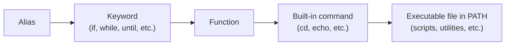
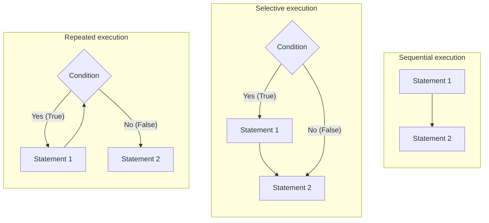

# Week 13 Lecture — Bash Shell Programming

[Repository Guide](../../README.md) | [English](Concepts_Lecture.md) | [한국어](Concepts_Lecture.ko.md)

> **Last Updated:** 2026-10-19

> **Learning Objectives:**
> 1. Write bash scripts with variables, conditionals, and loops
> 2. Process command-line arguments in scripts
> 3. Apply variable expansion expressions and arithmetic, string, and file test operators
> 4. Organize scripts by defining and calling functions
> 5. Find runtime errors in scripts with bash -x and trap

---

## Table of Contents

- [1. Shell Script Basics](#1-shell-script-basics)
  - [1.1 Scripts and Shell Scripts](#11-scripts-and-shell-scripts)
  - [1.2 Creating a Script](#12-creating-a-script)
  - [1.3 Running a Script](#13-running-a-script)
  - [1.4 Shebang Line](#14-shebang-line)
  - [1.5 Components of a Script](#15-components-of-a-script)
- [2. Variables and Data Types](#2-variables-and-data-types)
  - [2.1 Variable Assignment](#21-variable-assignment)
  - [2.2 Variable Usage](#22-variable-usage)
  - [2.3 Conditional Variable Expansion](#23-conditional-variable-expansion)
  - [2.4 Removing Substrings by Pattern](#24-removing-substrings-by-pattern)
  - [2.5 Special Variables](#25-special-variables)
  - [2.6 Quoting and Command Substitution](#26-quoting-and-command-substitution)
  - [2.7 Arithmetic](#27-arithmetic)
- [3. Input and Output](#3-input-and-output)
  - [3.1 read: User Input](#31-read-user-input)
  - [3.2 echo and printf](#32-echo-and-printf)
  - [3.3 Here Document](#33-here-document)
- [4. Conditional Statements](#4-conditional-statements)
  - [4.1 if-then-else](#41-if-then-else)
  - [4.2 if-elif-else](#42-if-elif-else)
  - [4.3 Test Operators](#43-test-operators)
  - [4.4 case Statement](#44-case-statement)
- [5. Loops](#5-loops)
  - [5.1 for Loop](#51-for-loop)
  - [5.2 while Loop](#52-while-loop)
  - [5.3 until Loop](#53-until-loop)
  - [5.4 select Menu](#54-select-menu)
  - [5.5 Loop Control](#55-loop-control)
- [6. Functions](#6-functions)
  - [6.1 Defining Functions](#61-defining-functions)
  - [6.2 Return Values](#62-return-values)
  - [6.3 Listing and Deleting Functions](#63-listing-and-deleting-functions)
- [7. String and File Operations](#7-string-and-file-operations)
  - [7.1 String Operations](#71-string-operations)
  - [7.2 File Type Testing](#72-file-type-testing)
- [8. Advanced Features](#8-advanced-features)
  - [8.1 Signal Trapping](#81-signal-trapping)
  - [8.2 Exit Status](#82-exit-status)
  - [8.3 Comments and Self-printing Scripts](#83-comments-and-self-printing-scripts)
  - [8.4 Debugging](#84-debugging)
- [9. Best Practices](#9-best-practices)
- [Summary](#summary)
- [Self-Check Questions](#self-check-questions)

---

<br>

## 1. Shell Script Basics

### 1.1 Scripts and Shell Scripts

A **script** is not a program compiled into machine code beforehand but a program that another program, called an **interpreter**, reads, interprets, and executes at run time. Perl, Python, shell scripts, and JavaScript are typical scripting languages.

A **shell script** is a program executed by the shell. When Linux commands and the programming constructs the shell provides (variables, conditionals, loops, functions, and so on) are written into a text file, the shell reads and executes them in order from the top. When several commands must be run repeatedly, saving them as a script file lets one execution repeat the same work.

The shell looks up a command name typed by the user in the order of Figure 1. A script file should therefore avoid the names of aliases, keywords, and built-in commands. For example, if a script is named `test` and the user types `test` without a path, the built-in command `test` runs first.



*Figure 1. Order in which the shell looks up a command name*

### 1.2 Creating a Script

A shell script is written with a text editor such as vi. The following simple script prints a greeting and the current working directory.

```bash
#!/bin/bash
# My first script
echo "Hello Linux World."
pwd
```

The first line `#!/bin/bash` specifies that this file is run by bash (Section 1.4). The second line, starting with `#`, is a comment (Section 1.5). `echo` prints the string given as its argument, and `pwd` prints the absolute path of the current working directory. [Lab_basic_script.sh](../../Coursework/Lab13_Bash-Shell-Programming/Lab_basic_script.sh) prints the current directory, user, date, and host name in the same way.

### 1.3 Running a Script

```bash
chmod +x script.sh          # Make executable
./script.sh                  # Run with ./

bash script.sh               # Run with bash explicitly
source script.sh             # Run in current shell (affects environment)
. script.sh                  # Same as source
```

There are two ways to run a script in a new shell.

- **Pass it to a shell as an argument:** Start a shell with the script name as its argument, as in `bash script.sh`. The file does not need execute permission in this case.
- **Run the file directly:** Give execute permission with `chmod +x`, then run it with a path such as `./script.sh`. The shell looks up a command name without a path only in the directories listed in the `PATH` environment variable, so `./` is required when `PATH` does not contain the current directory (`.`).

In both ways a new shell created as a child process runs the script, so variables or the current directory changed inside the script do not remain in the original shell after the script ends. In contrast, `source script.sh` and `. script.sh` make the current shell run the script itself, so the environment changed by the script remains in the current shell. This is used to apply a modified shell configuration file (such as `~/.bashrc`) immediately.

### 1.4 Shebang Line

The `#!` at the very beginning of a script file is called the **shebang** or **magic number**. After `#!` comes the absolute path of the program (interpreter) that runs the script. Since the script language syntax differs slightly from shell to shell, the shell that runs the script must be specified for the script to run correctly. When the file is run directly, the kernel reads the `#!` on the first line and runs the program written after it, passing the path of the script file as an argument.

```bash
#!/bin/bash                  # Use bash interpreter
#!/bin/sh                    # Use POSIX shell
#!/usr/bin/env bash          # Portable: find bash in PATH
#!/usr/bin/env python3       # Python script
```

`#!/usr/bin/env bash` makes the `env` command find `bash` in `PATH` and run it, so it also works on systems where bash is installed somewhere other than `/bin/bash`.

The shebang can also name a program that is not a shell. The following `test_sharp` sets its shebang to `#!/bin/more`. When the file is run, `more` instead of bash receives the script file as its argument, so no command is executed and the whole file, comments included, is printed on the screen.

```bash
#!/bin/more
# test_sharp: a script that prints itself
# Running this script prints the script itself on the screen.
# All comment lines are printed as well.

echo "This line is printed."
```

[Lab_comments.sh](../../Coursework/Lab13_Bash-Shell-Programming/Lab_comments.sh) is this example, and [Lab_comments_advanced.sh](../../Coursework/Lab13_Bash-Shell-Programming/Lab_comments_advanced.sh) explains how setting the shebang to `#!/bin/rm` deletes the script file instead of running it (Section 8.3).

### 1.5 Components of a Script

A shell script file consists of the following four components.

- **`#!`:** Specifies on the first line of the file the program that runs the script (Section 1.4).
- **`#` comment:** A description of the program. A comment runs from a `#` at the start of a word to the end of the line, so a whole line or part of a line can be a comment. A `#` inside quotes or the `#` of `$#` and `${#name}` is not a comment.
- **Shell commands:** Any command the shell can execute can be used.
- **Shell programming constructs:** Constructs the shell provides for writing programs, such as shell variables, argument processing, operators, and control statements.

The following `test_sharp2` shows a whole-line comment and a partial-line comment together. When run, the comments are not printed; only `This part is printed.` is printed, and the script ends with exit status 65. The exit status is checked with `echo $?` (Section 8.2).

```bash
#!/bin/bash
# test_sharp2 : comment example
# Running this script does not print the comments.

WHATEVER=65
echo This part is printed.
exit $WHATEVER # Runs the exit statement. Check it with $?.
```

The following `find_script` searches `/bin` and `/usr/bin` for shell scripts. `file *` prints the type of each file in the directory, and `grep "script"` keeps only the lines containing the word `script`. Saving a frequently used combination of commands as a script lets it be run again by a single name.

```bash
#!/bin/bash
# find_script : search /bin and /usr/bin for shell scripts

cd /bin
file * | grep "script"

cd /usr/bin
file * | grep "script"
```

```text
$ ./find_script
2to3:           executable /usr/bin/python2.6 script
aalib-config:   executable shell script
adrgen:         executable /bin/ksh script
afmtodit:       executable /usr/bin/perl script
(omitted)
xslt-config:    executable shell script
zipgrep:        executable shell script
```

The system itself also uses many shell scripts. For example, a traditional System V style system runs the scripts under `/etc/rc2.d/` at boot to start services, and these scripts are written with shell programming constructs such as shell variables and the `case` statement.

---

<br>

## 2. Variables and Data Types

### 2.1 Variable Assignment

A **variable** is a place that stores information a program processes. A shell variable is defined in the form `name=value`, and there must be no space before or after `=`. With spaces, the shell interprets `name` as a command name and `=` and the value as its arguments. Bash variables are stored as strings by default and are interpreted as integers only when arithmetic is needed (Section 2.7).

```bash
name="Linux"                 # No spaces around =
count=42
path="/home/user1"
readonly CONSTANT="fixed"    # Read-only variable
```

Variables are divided into **shell variables**, usable only in the current shell, and **environment variables**, which are `export`ed and usable in every child process the shell runs. A variable declared with `readonly` cannot be changed or deleted with `unset`.

### 2.2 Variable Usage

```bash
echo $name                   # Simple expansion
echo ${name}                 # Explicit expansion
echo "Hello, $name"          # Inside double quotes
echo "Length: ${#name}"      # String length
```

Putting `$` before a variable name makes the shell replace it with the value of the variable. This is called **variable expansion**. Braces as in `${name}` make clear where the variable name ends, which is needed when other characters follow the variable directly, as in `${name}_v2`. Writing the variable in double quotes as `"$name"` keeps it as one word even if the value contains spaces.

### 2.3 Conditional Variable Expansion

Some expressions use a different value depending on whether a variable is defined and whether its value is null (the empty string). Dropping the `:` in the following table, as in `${name-word}`, treats a variable holding a null value as defined.

| Form | Meaning |
|------|---------|
| `$name` | Replaced with the value of `name`. |
| `"$name"` | Replaced with the value of `name`. Used when the variable name is adjacent to other syntax. |
| `${name:-word}` | Uses the value of `name` if it is defined and not null; otherwise uses `word`. |
| `${name:=word}` | If `name` is undefined or null, assigns `word` to it and uses that value. |
| `${name:+word}` | Uses `word` if `name` is defined and not null; otherwise uses the empty string. |
| `${name:?word}` | Uses the value of `name` if it is defined and not null; otherwise prints `word` and exits. |

*Table 1. Shell variable expressions*

```text
$ test=cookbook
$ echo $test
cookbook
$ echo ${test:-word}
cookbook
$ echo ${test1:-word}
word
$ echo ${test:=word}
cookbook
$ echo ${test1:=word}
word
$ echo ${test1:=word1}
word
$ echo ${test:+word}
word
$ echo ${test:?word}
cookbook
$ echo ${test2:?word}
-bash: test2: word
```

The session above proceeds as follows.

1. The string `cookbook` is stored in the variable `test`, and its value is printed.
2. `${test:-word}` prints the value `cookbook` because `test` is defined. `${test1:-word}` prints `word` because `test1` does not exist, but it does not assign a value to `test1`.
3. `${test:=word}` prints the value of `test` because it is defined. `${test1:=word}` stores `word` in `test1` and prints it because `test1` does not exist.
4. `${test1:=word1}` prints `word`, not `word1`, because `word` was stored in `test1` in the previous step.
5. `${test:+word}` prints `word` because `test` is defined. `${test:?word}` also prints the value of `test` because it is defined.
6. `${test2:?word}` prints `word` as an error message because `test2` does not exist. Inside a script, the script would exit here.

### 2.4 Removing Substrings by Pattern

When a variable holds a string, these expressions find and remove the part that matches a pattern at the front or back of the string. The pattern may use the same wildcards (`*`, `?`, `[...]`) as file name expansion.

| Expression | Function |
|------------|----------|
| `${variable%pattern}` | Removes the shortest part matching the pattern, searching from the back of the value. |
| `${variable%%pattern}` | Removes the longest part matching the pattern, searching from the back of the value. |
| `${variable#pattern}` | Removes the shortest part matching the pattern, searching from the front of the value. |
| `${variable##pattern}` | Removes the longest part matching the pattern, searching from the front of the value. |
| `${#variable}` | The number of characters (length) stored in `variable`. |

*Table 2. Pattern removal and length expressions*

```text
$ path1="/usr/bin/local/bin"
$ echo ${path1%/bin}
/usr/bin/local
$ echo ${path1%%/bin*}
/usr
$ path2="/home/user1/.profile"
$ echo ${path2#/home}
/user1/.profile
$ echo ${path2##*/}
.profile
$ echo ${#path1}
18
$ echo ${#path2}
20
```

`${path1%/bin}` removes `/bin` once from the back. When `%%` removes the longest part and the pattern lies in the middle of the value, a `*` must indicate that any string may follow the pattern. `/bin*` matches from the first `/bin` to the end, leaving only `/usr`. Likewise, with `##` a `*` is placed before the pattern. `${path2##*/}` removes everything up to the last `/` and is the idiom for extracting the file name from a path. `${#path1}` is 18, the length of `/usr/bin/local/bin`.

### 2.5 Special Variables

| Variable | Description |
|----------|-------------|
| `$0` | Script name |
| `$1` to `$9` | Positional parameters |
| `$#` | Number of arguments |
| `$*` | All arguments as single string |
| `$@` | All arguments as separate strings |
| `$?` | Exit status of last command |
| `$$` | PID of current script |
| `$!` | PID of last background process |

*Table 3. Special variables*

The values given after the script name when it is run are **command-line arguments**, and the variables that store them are **positional parameters**. A positional parameter is named by the position of its argument: `$1`, `$2`, and so on. Arguments from the 10th on must be enclosed in braces as `${10}`, not `$10`, because `$10` is interpreted as `$1` followed by the character `0`.

`$*` and `$@` are the same without quotes but expand differently inside double quotes. `"$*"` expands to all arguments as one string, like `"$1 $2 $3"`, while `"$@"` expands to each argument as a separate string, like `"$1" "$2" "$3"`. To process arguments containing spaces one by one, use `"$@"`.

```bash
#!/bin/bash
# test_position: test command-line arguments
echo '$* : ' $*
echo '$# : ' $#
echo '$@ : ' $@
echo $1 $2 $3

set --
echo '$* : ' $*
echo '$# : ' $#
echo '$@ : ' $@
echo $1 $2 $3
```

```text
$ ./test_position one two three
$* :  one two three
$# :  3
$@ :  one two three
one two three
$* :
$# :  0
$@ :
```

`set --` clears all positional parameters, so afterward `$#` is 0 and `$*`, `$@`, `$1`, and the rest are empty (the last `echo $1 $2 $3` prints an empty line). [Lab_positional_params.sh](../../Coursework/Lab13_Bash-Shell-Programming/Lab_positional_params.sh) shows the special variables together with the difference between `"$*"` and `"$@"`.

### 2.6 Quoting and Command Substitution

**Quoting** is used to remove the meaning of shell special characters. The examples in the following table are run after defining `test=100`.

| Quoting | Function | Example and Result |
|---------|----------|--------------------|
| Single quotes (`' '`) | Prevent all special characters from being interpreted. | `echo '$test'` → `$test` |
| Double quotes (`" "`) | Allow only variable and command substitution. | `echo "$test"` → `100` |
| Backslash (`\`) | Prevents the single character right after it from being interpreted. | `echo \$test` → `$test` |

*Table 4. Kinds and functions of quoting*

**Command substitution** replaces a command with its output (standard output) as a string. It has two forms, backquotes (`` `command` ``) and `$(command)`, and `$(command)` is preferred because it nests easily.

```text
$ echo `date`
Sunday, April 15, 2024 11:05:06 AM KST
$ echo $(date)
Sunday, April 15, 2024 11:15:11 AM KST
```

### 2.7 Arithmetic

Bash provides arithmetic, comparison, logical, and bitwise operators. Since variables are stored as strings, numeric operations must be written after `let` or inside `(( ))`. The following table lists the operators from highest to lowest precedence.

| Operator | Meaning | Example |
|----------|---------|---------|
| `-` | Negation (unary) | `-5` |
| `!` | Logical NOT | `(( ! x < y ))` |
| `~` | Bitwise NOT | `~y` |
| `*` `/` `%` | Multiplication, division, remainder | `let y=3*5` |
| `+` `-` | Addition, subtraction | `let x=x+1` |
| `<<` `>>` | Bitwise left shift, bitwise right shift | `(( y = x << 3 ))` |
| `<=` `>=` `<` `>` `==` `!=` | Comparison | `(( x < y ))` |
| `&` `^` `\|` | Bitwise AND, XOR, OR | `let "z = x ^ y"` |
| `&&` `\|\|` | Logical AND, OR | `(( x<y \|\| x==3 ))` |
| `=` | Assignment | `let z=1` |
| `*=` `/=` `%=` `+=` `-=` `<<=` `>>=` `&=` `^=` `\|=` | Compound assignment | `let z+=1` |

*Table 5. Bash operators*

```bash
# Using (( ))
(( sum = 5 + 3 ))
(( count++ ))
echo $(( 10 * 5 ))          # Output: 50

# Using let
let "result = 5 + 3"

# Using expr (external command)
result=$(expr 5 + 3)

# Using bc for floating point
echo "scale=2; 10 / 3" | bc  # Output: 3.33
```

`(( expression ))` evaluates the expression, and `$(( expression ))` substitutes the result in place. Inside `(( ))`, variable names need no `$`. Since `expr` is an external command, its operators and operands must be separated by spaces, and it runs slowly. Bash arithmetic handles only integers, so a separate program such as `bc` is used when decimals are needed. `scale=2` means computing to two decimal places.

```text
$ a=5
$ echo $a
5
$ let a = 20
-bash: let: =: syntax error: operand expected (error token is "=")
$ let "a = 20"
$ echo $a
20
$ (( a = 30 ))
$ echo $a
30
$ a=$a*5
$ echo $a
30*5
$ echo $((5*6))
30
$ echo $(( ! 2 + 3 * 4 ))
12
$ echo $(( 2 << 1 ))
4
$ echo $(( 3 ^ 5 ))
6
```

This session shows the following.

- `let` treats each space-separated word as a separate expression, so `let a = 20` is an error. To include spaces, enclose the expression in double quotes, as in `let "a = 20"`. Inside `(( ))`, spaces can be used freely.
- `a=$a*5` without `let` or `(( ))` is treated as a string, so `30*5` is stored.
- `$(( ))` prints the result of a calculation directly.
- In `! 2 + 3 * 4`, the highest-precedence `!` is applied first, so `!2` becomes 0 and the result is 0 + 12 = 12.
- One left shift equals multiplying by 2, so `2 << 1` is 4. Shifting twice multiplies by 4.
- `3 ^ 5` is the bitwise XOR of 011 and 101, giving 110, that is, 6.

[Lab_arithmetic.sh](../../Coursework/Lab13_Bash-Shell-Programming/Lab_arithmetic.sh) compares the calculation methods `(( ))`, `$(( ))`, `let`, and `expr` with two integer arguments.

---

<br>

## 3. Input and Output

### 3.1 read: User Input

`read` is a shell built-in command that takes input from the terminal or a file. It reads one line from standard input, splits it at whitespace, and stores the words in the variables in order.

```bash
read name                    # Read into variable
echo "Name: $name"

read -p "Enter name: " name # Prompt message
read -s password             # Silent input (passwords)
read -t 10 answer            # Timeout after 10 seconds
read -n 1 choice             # Read single character

# Read multiple variables
read first last
echo "First: $first, Last: $last"

# Read without variable (stored in $REPLY)
read -p "Input: "
echo "You entered: $REPLY"
```

| Form | Meaning |
|------|---------|
| `read x` | Reads one line from standard input and stores it in `x`. |
| `read first last` | Reads one line from standard input, stores the first word in `first`, and stores all the rest in `last`. |
| `read -p prompt` | Prints `prompt` and waits for input. Without a variable, the input is stored in the `REPLY` variable. |

*Table 6. Forms of read*

If there are more words than variables, all remaining words go into the last variable; if there are fewer, the remaining variables are empty. `-s` does not display the typed characters, `-t 10` ends with a failure status if there is no input within 10 seconds, and `-n 1` ends as soon as one character is typed. [Lab_read_input.sh](../../Coursework/Lab13_Bash-Shell-Programming/Lab_read_input.sh) practices these options one by one.

### 3.2 echo and printf

```bash
echo "Hello World"
echo -n "No newline"         # Suppress newline
echo -e "Tab:\there"         # Enable escape sequences

printf "%-10s %5d\n" "Alice" 95
printf "Name: %s, Score: %d\n" "$name" "$score"
```

Bash's `echo` does not interpret escape sequences such as `\t` and `\n` by default; `-e` makes it interpret them. `printf` prints according to a format string like C's `printf` and does not add a newline automatically. `%-10s` left-aligns a string in 10 columns and `%5d` right-aligns an integer in 5 columns, so the first `printf` prints `Alice         95`.

### 3.3 Here Document

A **here document** supplies a command's standard input automatically from text written in the script instead of from the keyboard. The lines from the one after `command << TERMINATOR` up to a line containing only `TERMINATOR` become the command's standard input. Since the EOF character (`Ctrl+D`) that ends keyboard input cannot be written inside a file, a string marking the end of input is chosen instead.

```bash
cat << EOF
This is a here document.
Variables like $HOME are expanded.
Multiple lines are supported.
EOF

cat << 'EOF'
Variables like $HOME are NOT expanded.
EOF

cat -n << END
Line 1
Line 2
Line 3
END
```

Quoting the terminator, as in `'EOF'`, stops variables and command substitutions in the body from being expanded. Any word that does not appear in the body, such as `EOF` or `END`, can be the terminator. The following `test_here` sends mail to `user1`, supplying the message body with a here document.

```bash
#!/bin/bash
# Here document test. Sends mail to user1

mail user1 << END
This is a test mail for here document
END
```

[Lab_here_document.sh](../../Coursework/Lab13_Bash-Shell-Programming/Lab_here_document.sh) also shows `<<-`, which strips leading tabs, and the one-line here string (`<<<`).

---

<br>

## 4. Conditional Statements

**Control statements** control the order in which the statements of a program run. Statements run sequentially from top to bottom by default; control statements create **selection statements** (`if`, `case`, `select`), which run only some statements depending on a condition, and **iteration statements** (`for`, `while`, `until`), which repeat statements a fixed number of times or while a condition holds. This section covers selection statements, and Section 5 covers iteration statements.



*Figure 2. Flow of sequential, selective, and repeated execution*

### 4.1 if-then-else

`if` runs commands depending on whether a condition is true or false. In the shell, `if` is followed not by an expression but by a **condition command**, and `if` decides true or false by the **exit status** of that command. If the exit status is 0 (success), the commands after `then` run; otherwise (failure), the commands after `else` run. The `else` part can be omitted, and an `if` statement ends with `fi`.

```text
if condition_command
then
    commands
[ else
    commands ]
fi
```

```bash
if (( x < y )); then
    echo "$x is less than $y"
else
    echo "$y is less than or equal to $x"
fi
```

`(( x < y ))` is a command that returns exit status 0 if the expression is true and 1 if it is false. To write `then` on the same line as `if`, put `;` before it. The following `test_if` reads two values and compares them.

```bash
#!/bin/bash
# test_if : a script that tests the if statement

echo "Input x : "
read x                 # read the value of x
echo "Input y : "
read y                 # read the value of y

if (( x < y ))
then
   echo "x is less than y"
else
   echo "y is less than x"
fi
```

```text
$ ./test_if
Input x :
100
Input y :
200
x is less than y
```

The `else` part of this script also runs when x and y are equal, so its message should strictly read "y is less than or equal to x". [Lab_if_test.sh](../../Coursework/Lab13_Bash-Shell-Programming/Lab_if_test.sh) separates equality and greater-than with `elif` to distinguish all three cases.

### 4.2 if-elif-else

To branch again on a new condition when a condition is false, use `elif`. The condition commands run in order from the top, only the commands of the first successful condition run, and if all fail, the commands of `else` run.

```bash
if (( score >= 90 )); then
    echo "Grade: A"
elif (( score >= 80 )); then
    echo "Grade: B"
elif (( score >= 70 )); then
    echo "Grade: C"
else
    echo "Grade: F"
fi
```

For example, if `score` is 85, the first condition fails and the second succeeds, so only `Grade: B` is printed. If 50 is entered into `test_elif`, which reads a score, every condition fails and the `else` part runs.

```bash
#!/bin/bash
# test_elif: test the if-elif statement

echo "Input Score : "
read score

if (( $score > 90 ))
then
   echo "Your score is great."
elif (( $score >= 80 ))
then
   echo "Your score is good."
else
   echo "Your score is not good."
fi
```

```text
$ ./test_elif
Input Score :
50
Your score is not good.
```

[Lab_elif_test.sh](../../Coursework/Lab13_Bash-Shell-Programming/Lab_elif_test.sh) checks that the input is an integer from 0 to 100 and then assigns a grade from A to F.

### 4.3 Test Operators

As condition commands, `(( ))` is mainly used for arithmetic comparison and the bash built-in `[[ ]]` for string and file tests. `[ ]` is the same as the POSIX `test` command, and `[[ ]]` is a bash extension with more features. Both `[ ]` and `[[ ]]` require a space just inside the brackets.

**Numeric Comparisons (inside `(( ))` or with `-eq` etc.):**

| Operator | `(( ))` | `[ ]` / `[[ ]]` |
|----------|---------|------------------|
| Equal | `==` | `-eq` |
| Not equal | `!=` | `-ne` |
| Less than | `<` | `-lt` |
| Greater than | `>` | `-gt` |
| Less or equal | `<=` | `-le` |
| Greater or equal | `>=` | `-ge` |

*Table 7. Numeric comparison operators*

**String Comparisons (inside `[[ ]]`):**

| Operator | Description |
|----------|-------------|
| `==` or `=` | Equal |
| `!=` | Not equal |
| `<` | Less than (alphabetical) |
| `>` | Greater than |
| `-z` | String is empty |
| `-n` | String is not empty |

*Table 8. String comparison operators*

Inside `[[ ]]`, an unquoted right side of `string = pattern` or `string == pattern` is interpreted as a pattern, so `[[ $ans = [Yy]* ]]` is true if `ans` starts with `y` or `Y`. The `=` operator needs spaces on both sides. A string alone, as in `[[ string ]]`, is true if the string is not null.

> **Note:** **The ksh `-l` operator.** Some materials introduce `-l string`, meaning the length of a string, as a string operator; it is a ksh operator and a syntax error in bash's `[[ ]]`. In bash, the length of a string is obtained with `${#string}` (Section 2.4).

The following `test_string` checks whether a reply starts with y or Y. [Lab_string_operations.sh](../../Coursework/Lab13_Bash-Shell-Programming/Lab_string_operations.sh) also distinguishes replies starting with n.

```bash
#!/bin/bash
# test_string: string test script

echo "Are you OK (y/n) ? "
read ans                                 # store the value in ans

if [[ $ans = [Yy]* ]]                    # does it start with y?
then
     echo Happy to hear it.              # if it starts with y
else
     echo That is too bad.               # if it does not start with y
fi
```

**File Tests:**

| Operator | Description |
|----------|-------------|
| `-e file` | File exists |
| `-f file` | Regular file exists |
| `-d file` | Directory exists |
| `-r file` | File is readable |
| `-w file` | File is writable |
| `-x file` | File is executable |
| `-s file` | File is not empty |
| `-L file` | File is symbolic link |

*Table 9. Common file test operators*

Other flags test the type, owner, and special permissions of a file.

| Flag | Function |
|------|----------|
| `-a file` | The file exists (same as `-e`). |
| `-O file` | The user running the script owns the file. |
| `-G file` | The group ID of the file equals the group ID of the script. |
| `-S file` | The file is a socket. |
| `-b file` | The file is a block device special file. |
| `-c file` | The file is a character device special file. |
| `-p file` | The file is a pipe. |
| `-u file` | The file has the setuid permission. |
| `-g file` | The file has the setgid permission. |
| `-k file` | The file has the sticky bit permission. |

*Table 10. Other file test flags*

Inside `[ ]`, `-a` can also mean the AND of two conditions, so `-e` is safer for testing existence. The following `test_file` checks the group ID and type of an entered file.

```bash
#!/bin/bash
# test_file: file operator test

echo "Enter a file name : "
read file
if [[ -G $file ]]
then
    echo The group IDs are the same.
else
    echo The group IDs are not the same.
fi

if [[ ! -a $file ]]
then
    echo The file does not exist. Check the file name again.
elif [[ -f $file ]]
then
    echo It is a regular file.
elif [[ -d $file ]]
then
    echo It is a directory file.
else
    echo It is a special file.
fi
```

```text
$ ./test_file
Enter a file name :
/dev/null
The group IDs are not the same.
It is a special file.
$ ./test_file
Enter a file name :
.
The group IDs are the same.
It is a directory file.
$ ./test_file
Enter a file name :
/etc/hosts
The group IDs are not the same.
It is a regular file.
```

`/dev/null` is a character device file owned by the root group, so for an ordinary user the group IDs differ and it is judged a special file. The current directory (`.`) is a directory owned by the user's own group.

### 4.4 case Statement

`case` specifies separate commands to run depending on the value of a variable. If the value matches `value1`, the commands after `value1)` up to `;;` run, and the `case` statement is left. Values may use special symbols such as wildcards and `|` (the OR operator), and if no value matches, the commands of the default `*)` run. A `case` statement ends with `esac`.

```text
case variable in
value1)
    commands ;;
value2)
    commands ;;
*)
    commands ;;
esac
```

```bash
case $cmd in
    [0-9])
        date
        ;;
    cd|CD)
        echo "$HOME"
        ;;
    quit|exit)
        echo "Goodbye!"
        exit 0
        ;;
    *)
        echo "Unknown command"
        ;;
esac
```

In this example, `[0-9]` matches one digit and `cd|CD` matches `cd` or `CD`. Patterns are compared in order from the top, so `*)` always goes last. The following `test_case` also handles any string starting with lowercase `a` or uppercase `A`, `B`, or `C` with the pattern `[aA-C]*`.

```bash
#!/bin/bash
# case test script

echo Select a command :
read cmd

case $cmd in
[0-9])            # any digit from 0 to 9
   date
   ;;
"cd" | "CD")      # cd or CD
   echo $HOME
   ;;
[aA-C]*)          # any string starting with lowercase a or uppercase A, B, C
   pwd
   ;;
*)
   echo Usage : Select a command
   ;;
esac
```

```text
$ ./test_case
Select a command :
5
Sunday, August 19, 2024 12:31:35 AM KST
$ ./test_case
Select a command :
cd
/home/user1
$ ./test_case
Select a command :
a
/home/user1/Linux/ch11
```

[Lab_case_statement.sh](../../Coursework/Lab13_Bash-Shell-Programming/Lab_case_statement.sh) adds exit commands (`quit|exit|q`) to the same patterns.

---

<br>

## 5. Loops

### 5.1 for Loop

`for variable in list` stores each value in `list` in the variable in turn and runs the commands between `do` and `done`.

```bash
# List-based
for num in 0 1 2 3 4; do
    echo "Number: $num"
done

# Range-based (bash)
for i in {1..10}; do
    echo "Count: $i"
done

# C-style
for (( i=0; i<10; i++ )); do
    echo "Index: $i"
done

# Over command output
for file in $(ls *.sh); do
    echo "Script: $file"
done

# Over command-line arguments
for arg in "$@"; do
    echo "Argument: $arg"
done
```

- **List-based:** Processes the words listed after `in` one by one. `for num in 0 1 2` repeats three times, printing `number is 0`, `number is 1`, and `number is 2`.
- **Range-based:** `{1..10}` is bash brace expansion and becomes the list of integers from 1 to 10.
- **C-style:** Repeats like C's `for` with `(( initialization; condition; update ))`.
- **Over command output:** Processes, one by one, the words obtained by splitting the output of `$(command)` at whitespace. Writing `$(<file)` in place of `list` takes the contents of an external file as input, which is the same as `` `cat file` ``. If file names may contain spaces, using a wildcard directly, as in `for file in *.sh`, is safer than `$(ls *.sh)`.
- **Over command-line arguments:** Processes each argument with `"$@"`. Omitting `in "$@"` and writing only `for arg` does the same.

The following `test_for3` mails the contents of the file `letter` to each user given as a command-line argument.

```bash
#!/bin/bash
# test_for3: process command-line arguments

for person in $*
do
   mailx $person < letter
   echo Sent mail to ${person}.
done

echo ----------------------------
echo All mail has been sent.
```

```text
$ ./test_for3 user1 user2 user3
Sent mail to user1.
Sent mail to user2.
Sent mail to user3.
----------------------------
All mail has been sent.
```

Loop examples are in [Lab_for_loop.sh](../../Coursework/Lab13_Bash-Shell-Programming/Lab_for_loop.sh) (word lists), [Lab_for_loop_range.sh](../../Coursework/Lab13_Bash-Shell-Programming/Lab_for_loop_range.sh) (`$(<file)` and brace expansion), and [Lab_for_loop_files.sh](../../Coursework/Lab13_Bash-Shell-Programming/Lab_for_loop_files.sh) (`$*` and `"$@"`).

### 5.2 while Loop

`while` repeats commands as long as the condition command runs successfully, that is, while its exit status is 0. The following computes the sum from 1 to 10.

```bash
count=1
sum=0
while (( count <= 10 )); do
    (( sum += count ))
    (( count++ ))
done
echo "Sum(1~10): $sum"
```

The condition is true while `count` is 1 through 10, so the body runs 10 times; when `count` becomes 11, the condition is false and the loop ends. The output is `Sum(1~10): 55`. [Lab_while_loop.sh](../../Coursework/Lab13_Bash-Shell-Programming/Lab_while_loop.sh) reads an upper limit N for the same calculation, and [Lab_while_loop_menu.sh](../../Coursework/Lab13_Bash-Shell-Programming/Lab_while_loop_menu.sh) repeats a menu with a flag variable.

### 5.3 until Loop

`until`, the opposite of `while`, repeats commands while the condition command fails, that is, until the condition command runs successfully.

```bash
# Wait for a user to log in
until who | grep -q "$person"; do
    sleep 5
done
echo "$person has logged in!"
```

`who` prints the list of logged-in users, and `grep -q` prints nothing and exits with status 0 if a matching line exists. So while `person` is not logged in, the loop repeats with 5-second pauses, and once the user logs in, the loop ends and the message is printed. The following `test_until` does the same after reading a login name, printing the matching line of `who` and ringing the bell when the user logs in.

```bash
#!/bin/bash
# test_until: a script that reports when a given user logs in

echo "Login name: "             # print the input prompt
read person                    # store the user name in person

until who | grep $person # > /dev/null
do
   sleep 5                     # pause 5 seconds while the user is not logged in
done
echo -e "\007"                 # beep
```

```text
$ ./test_until
Login name:
hanb
hanb pts/3 Aug 19 01:07 (192.168.0.2)
```

Because the `> /dev/null` that discards the output of `grep` is commented out, the matching line is printed on the screen. `\007` is the bell character, and bash's `echo` interprets it only with `-e` (Section 3.2). [Lab_until_loop.sh](../../Coursework/Lab13_Bash-Shell-Programming/Lab_until_loop.sh) is the lab version of this script.

### 5.4 select Menu

`select variable in list` is a loop that builds a menu. It prints the items of `list` on the screen as a numbered menu, prints the value of the environment variable `PS3` as the prompt, and waits for input. When the user enters a number, the number is stored in the `REPLY` variable and the corresponding value of `list` in the variable between `select` and `in`. If a number not in the list is entered, the variable becomes empty. The action for each choice is usually specified with a `case` statement, and the loop repeats until it meets `break`.

```bash
PS3="Choose an option (1-3): "
select cmd in pwd date quit; do
    case $cmd in
        pwd)  pwd ;;
        date) date ;;
        quit) break ;;
        *)    echo "Invalid option" ;;
    esac
done
```

The following `test_select` empties `REPLY` with `REPLY=` at the end of the body. After running the body, bash prints the menu again if `REPLY` is empty, so the menu is displayed again after every choice. Without this line, the menu is printed only the first time, and afterward only the prompt is printed.

```bash
#!/bin/bash
# test_select: run pwd or date depending on user input

PS3="Enter a command : "

select cmd in pwd date quit
do
  case $cmd in
  pwd)
     pwd ;;
  date)
     date ;;
  quit)
     break ;;
  *)
     echo Wrong input. Select a number. ;;
  esac
  REPLY=       # reset the REPLY variable
done
```

```text
$ ./test_select
1) pwd
2) date
3) quit
Enter a command : 1
/export/home/user1/Linux/ch11
1) pwd
2) date
3) quit
Enter a command : 3
$
```

[Lab_select_menu.sh](../../Coursework/Lab13_Bash-Shell-Programming/Lab_select_menu.sh) is a four-item menu that adds `whoami`.

### 5.5 Loop Control

```bash
# break -- exit loop entirely
# continue -- skip to next iteration

for name in alice bob charlie dave; do
    if [[ $name == "charlie" ]]; then
        continue        # Skip charlie
    fi
    echo "Hello, $name"
done
```

This example prints `Hello, alice`, `Hello, bob`, and `Hello, dave`. `continue` skips the rest of the commands in the loop and returns to the start of the loop (the next iteration), and `break` leaves the loop entirely. Both accept a number: in nested loops, `continue 2` goes to the next iteration of the second enclosing loop, and `break 2` leaves two levels of loops at once.

The following `test_cont` mails every user in the file `list` except `user2`. `$(< list)` is the same as `` `cat list` ``.

```bash
#!/bin/bash
# test_cont: continue test

for person in $(< list)       # same as `cat list`
do
   if [[ $person == user2 ]]
   then
      continue                 # skip if user2
   fi
   mailx -s "continue test" $person < letter
   echo Sent mail to ${person}.
done

echo --------------------------
echo All mail has been sent.
```

[Lab_continue_test.sh](../../Coursework/Lab13_Bash-Shell-Programming/Lab_continue_test.sh) skips a particular user in the same way and prints only odd numbers by skipping even ones.

---

<br>

## 6. Functions

### 6.1 Defining Functions

A **function** is a named set of commands used for one purpose. An alias also names commands, but a function differs in that it can act differently depending on conditions and can take and process arguments. Inside a function, `$1`, `$2`, ... and `$#` refer not to the script's arguments but to the arguments given when the function is called.

```bash
function greet {
    echo "Hello, $1!"
}

# Alternative syntax
add() {
    local sum=$(( $1 + $2 ))
    echo $sum
}

# Call functions
greet "World"
result=$(add 5 3)
echo "Result: $result"
```

`function name { commands }` and `name() { commands }` mean the same. A function can be called only after it is defined, and it is called like a command by listing arguments after its name. This example prints `Hello, World!` and `Result: 8`. A variable declared with `local` is a local variable valid only inside the function, and an undeclared variable is shared by the whole script. A value the function prints with `echo` is captured by command substitution, as in `$(add 5 3)`.

A function can also be defined directly in the shell. The following defines and calls a `trash` function that moves deleted files to the `~/.TRASH` directory.

```text
$ mkdir ~/.TRASH
$ function trash {
> mv $* ~/.TRASH
> }
$ touch a b c
$ ls
a b c
$ trash a b c
$ ls
$ ls ~/.TRASH
a b c
```

### 6.2 Return Values

A function ends when it runs the last statement of its body or a `return [n]` statement. The value given to `return` becomes the exit status of the function and is stored in `$?`; without a value, it is the exit status of the last command run.

```bash
function is_even {
    if (( $1 % 2 == 0 )); then
        return 0    # Success (true)
    else
        return 1    # Failure (false)
    fi
}

if is_even 4; then
    echo "4 is even"
fi
```

Exit status 0 means success (true), so a function can be used directly as a condition command, as in `if is_even 4`. The following `test_add` returns the sum of two arguments with `return`. `typeset sum` declares a local variable inside the function, the same as `local sum`.

```bash
#!/bin/bash
# Function return value test

function sum {
  typeset sum     # define a local variable

  (( sum = $1 + $2 ))
  return $sum
}

sum $1 $2
echo $1 + $2 = $?
```

```text
$ ./test_add 3 4
3 + 4 = 7
```

> **Caution:** An exit status is an integer from 0 to 255, so the value `return` can give back is limited to this range. A value outside the range becomes its remainder modulo 256; for example, `return 300` makes `$?` 44. To return a large number or a string, print it with `echo` and capture it with command substitution, as [Lab_arithmetic.sh](../../Coursework/Lab13_Bash-Shell-Programming/Lab_arithmetic.sh) does.

### 6.3 Listing and Deleting Functions

Defined functions are listed with `typeset -f` (the same as `declare -f` in bash) and deleted with `unset -f function_name`.

```text
$ typeset -f
trash ()
{
    mv $* ~/.TRASH
}
$ unset -f trash
$ typeset -f
$
```

After `unset -f trash`, `typeset -f` prints nothing. Ksh has a `functions` command, an alias of `typeset -f`, but bash has none by default.

---

<br>

## 7. String and File Operations

### 7.1 String Operations

```bash
str="Hello World"
echo ${#str}              # Length: 11
echo ${str:0:5}           # Substring: Hello
echo ${str/World/Linux}   # Replace: Hello Linux
echo ${str^^}             # Uppercase: HELLO WORLD
echo ${str,,}             # Lowercase: hello world
```

`${str:start:length}` is the substring of `length` characters from position `start`, counted from 0, and `${str:7}` without a length runs from position 7 to the end. `${str/find/replace}` replaces the first match, and `${str//find/replace}` replaces every match. `${str^^}` and `${str,,}` are available in bash 4 and later.

### 7.2 File Type Testing

```bash
echo "Enter filename: "
read file

if [[ ! -e $file ]]; then
    echo "$file does not exist."
elif [[ -f $file ]]; then
    echo "$file is a regular file."
elif [[ -d $file ]]; then
    echo "$file is a directory."
else
    echo "$file is a special file."
fi
```

The script first filters out a missing file with `! -e`, then tests for a regular file and a directory in turn, and if neither, judges it a special file such as a device file or socket. [Lab_file_operations.sh](../../Coursework/Lab13_Bash-Shell-Programming/Lab_file_operations.sh) adds checks for symbolic links, block devices, and character devices, and for read, write, and execute permissions.

---

<br>

## 8. Advanced Features

### 8.1 Signal Trapping

`trap 'command' signal` runs the given command every time the given signal is delivered to the script.

```bash
trap 'echo "Line $LINENO: count=$count"' DEBUG
# DEBUG trap fires before every command

trap 'echo "Caught SIGINT"; exit 1' INT
# Catch Ctrl+C

trap 'cleanup_function' EXIT
# Run cleanup on script exit
```

`DEBUG` and `EXIT` are not operating system signals but pseudo-signals defined by bash. `DEBUG` occurs right before each command runs, and `EXIT` when the script ends. `INT` (SIGINT) is the signal delivered when the user presses `Ctrl+C`. `trap - signal` removes the given trap. Using the `DEBUG` trap for debugging is covered in Section 8.4, and [Lab_signal_trap.sh](../../Coursework/Lab13_Bash-Shell-Programming/Lab_signal_trap.sh) practices both the `DEBUG` trap and the `INT` trap.

### 8.2 Exit Status

A script ends when it runs the last command of the file or an `exit [status]` statement. The exit status is stored in the `$?` variable; 0 means success, and a nonzero value means failure or an error. Without a value, `exit` ends with the exit status of the last command run.

```bash
#!/bin/bash
# Exit with specific code
command_that_might_fail
if [[ $? -ne 0 ]]; then
    echo "Command failed"
    exit 1
fi
exit 0
```

The following `test_exit` ends with exit status 20, which can be checked with `echo $?` right after running it.

```bash
#!/bin/bash
# test_exit : a program that tests exit and $?

exit 20
```

```text
$ ./test_exit
$ echo $?
20
```

By convention, 126 means the command was found but could not be executed, 127 means the command was not found, and 128+N means termination by signal N. [Lab_exit_test.sh](../../Coursework/Lab13_Bash-Shell-Programming/Lab_exit_test.sh) is an example that ends with exit status 30.

### 8.3 Comments and Self-printing Scripts

```bash
#!/bin/bash
# Regular comment

: '
This is a multi-line comment
using the colon builtin with
a here-string.
'

# Interesting trick: #!/bin/more makes a script print itself
# Interesting trick: #!/bin/rm makes a script delete itself
```

Bash has no separate syntax for multi-line comments. The `: '...'` above passes a multi-line string in single quotes as the argument of the built-in command `:`, which does nothing, so the string is never executed. Strictly speaking, it uses a single-quoted string as an argument, not a here-string (`<<<`). Setting the shebang to `#!/bin/more` makes `more` print the script file, and setting it to `#!/bin/rm` makes `rm` delete the script file (Section 1.4).

### 8.4 Debugging

Errors that occur while a script runs fall into two kinds.

- **Syntax errors:** Errors in the grammar, such as a missing `fi` or `done`. The shell prints the line number where the syntax error occurred during execution.
- **Runtime errors:** The grammar is correct, but the script does not behave as intended without any error message or terminates abnormally.

The simplest way to find runtime errors is to run `bash -x script`. Each time a command of the script runs, the command with variable expansions applied is printed to standard error, prefixed with `+`. Writing the shebang as `#!/bin/bash -x` or running `set -x` inside the script has the same effect, and `set +x` turns it off. The following is the result of running `test_while`, the same sum script as in Section 5.2 (it increments `count` with `let count+=1`), with `bash -x`.

```text
$ bash -x test_while
+ count=1
+ sum=0
+ ((  count <= 10  ))
+ ((  sum += count  ))
+ let count+=1
+ ((  count <= 10  ))
+ ((  sum += count  ))
+ let count+=1
(omitted)
+ echo Sum from 1 to 10 : 55
Sum from 1 to 10 : 55
```

With `trap 'command' DEBUG`, the value of any variable can be printed each time a command of the script runs. The following `test_trap` prints the line number and the value of `count` right before each command runs.

```bash
#!/bin/bash
# test_trap: trap test script

trap 'echo "$LINENO : count=$count"' DEBUG

count=1
sum=0

while (( count <= 10 ))
do
    (( sum += count ))
    let count+=1
done

echo Sum from 1 to 10 : $sum
```

```text
$ ./test_trap
6 : count=
7 : count=1
9 : count=1
11 : count=1
12 : count=1
9 : count=2
(omitted)
9 : count=11
15 : count=11
Sum from 1 to 10 : 55
```

Since the trap occurs before a command runs, `count` is still empty right before line 6 (`count=1`), and the value right before line 12 (`let count+=1`) is the value before the increment.

---

<br>

## 9. Best Practices

- Always use `#!/bin/bash` or `#!/usr/bin/env bash` as the shebang.
- Quote variables as `"$variable"` to prevent word splitting.
- Use `[[ ]]` instead of `[ ]` for string comparisons in bash.
- Use `(( ))` for arithmetic comparisons.
- Use `local` for variables inside functions to avoid scope issues.
- Use `set -euo pipefail` for strict error handling. `-e` ends the script when a command fails, `-u` treats the use of an undefined variable as an error, and `-o pipefail` makes a pipeline fail when any command in it fails.
- Add meaningful comments to complex logic.
- Use `shellcheck` to analyze scripts statically and catch common mistakes.

---

<br>

## Summary

| Concept | Key Summary |
|---------|-------------|
| Shell script | A text file containing Linux commands and shell programming constructs, run with `bash script` or with `./script` after `chmod +x`. |
| Shebang | A first line such as `#!/bin/bash` specifies the interpreter that runs the script. |
| Variables | A variable is defined with `name="value"` and used as `$name` or `${name}`, with no spaces around `=`. |
| Variable expansion expressions | `${name:-word}`, `${name:=word}`, `${name%pattern}`, `${name##pattern}`, and `${#name}` handle default values, pattern removal, and length. |
| Positional parameters | `$1`-`$9` and `${10}` are command-line arguments, `$#` is the number of arguments, and `"$@"` expands each argument as a separate string. |
| Arithmetic | Integer arithmetic is written after `let` or inside `(( ))`; otherwise it is treated as a string. |
| read | `read -p "prompt" var` stores user input in a variable, and without a variable it stores the input in `REPLY`. |
| Here document | `command << TERMINATOR` supplies text in the script as the command's standard input. |
| if/elif/else | If the exit status of the condition command is 0, `then` runs; otherwise `elif` or `else` runs. |
| case | The value of a variable is compared with patterns, and the commands of the matching part run up to `;;`. |
| for | The loop stores values from a list, range, command output, or C-style expression in a variable in turn. |
| while/until | `while` repeats while the condition command succeeds, and `until` repeats until it succeeds. |
| select | A loop that builds a numbered menu, storing the chosen number in `REPLY` and the chosen item in the variable. |
| Functions | A function is defined with `function name { }`, takes arguments, uses `local` for local variables, and returns an exit status of 0-255 with `return`. |
| trap | `trap 'cmd' SIGNAL` runs a command each time the signal arrives, and the `DEBUG` trap occurs right before each command. |
| Debugging | `bash -x script` prints each command before running it, and `trap 'cmd' DEBUG` lets variable values be checked line by line. |

---

<br>

## Self-Check Questions

1. **if and exit status:** In `if grep -q root /etc/passwd; then echo found; fi`, explain in terms of exit status when the `then` block runs. Also state how the fact that the condition of `if` is a command, not an expression, relates to `[ ]`.

   <details>
   <summary>Answer</summary>

   `if` runs the condition command `grep -q root /etc/passwd` and runs the `then` block if its exit status is 0. `grep -q` exits with 0 if it finds a matching line and 1 if it does not, so `found` is printed if `/etc/passwd` contains `root`. `[` is also a command, the same as `test`, returning exit status 0 if the test is true and 1 if it is false. That is why `if [ -e file ]` works, and a space is needed after `[` and before `]`.

   </details>

2. **Arithmetic evaluation:** Write the output of each command sequence and explain the difference. (a) `a=5; a=$a*5; echo $a` (b) `a=5; (( a = a * 5 )); echo $a`

   <details>
   <summary>Answer</summary>

   (a) prints `5*5` and (b) prints `25`. Bash variables are stored as strings, so `a=$a*5` in (a) assigns the string `5*5`, obtained by replacing `$a` with 5, as is. `(( ))` in (b) evaluates its contents as an arithmetic expression, so 25 is assigned. `let "a = a * 5"` is the same as (b).

   </details>

3. **`"$*"` and `"$@"`:** A script is run as `./s.sh "a b" c`. Write the output of `for x in "$*"; do echo "[$x]"; done` and of `for x in "$@"; do echo "[$x]"; done` inside the script.

   <details>
   <summary>Answer</summary>

   There are two arguments, `a b` and `c`. `"$*"` expands to all arguments as one string, so the first loop runs once and prints `[a b c]`. `"$@"` expands to each argument as a separate string, so the second loop runs twice and prints `[a b]` and `[c]`.

   </details>

4. **until loop:** Write a script fragment with `until` that checks every 2 seconds until the file `/tmp/done` appears and then prints `ready`. How does the condition change if the same task is written with `while`?

   <details>
   <summary>Answer</summary>

   `until [[ -e /tmp/done ]]; do sleep 2; done; echo ready`. `until` repeats while the condition command fails, so it pauses 2 seconds at a time while the file is missing and `[[ -e /tmp/done ]]` fails. With `while`, the condition is negated: `while [[ ! -e /tmp/done ]]; do sleep 2; done`.

   </details>

5. **Function return value:** What does `echo $?` print right after calling the function `f() { return 300; }`? How must the function change to get 300 as is?

   <details>
   <summary>Answer</summary>

   An exit status is 0-255, so 300 becomes its remainder modulo 256, 44, and `44` is printed. To get 300 as is, write the value to standard output, as in `f() { echo 300; }`, and capture it on the calling side with command substitution, as in `result=$(f)`.

   </details>
