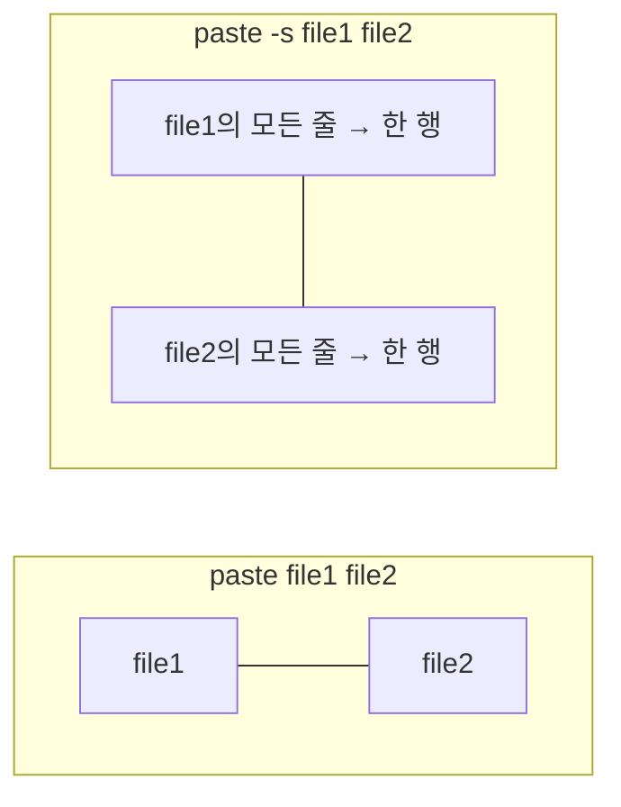

# 15주차 이론 — Linux 유틸리티

[레포지토리 안내](../../README.ko.md) | [English](Concepts_Lecture.md) | [한국어](Concepts_Lecture.ko.md)

> **최종 수정일:** 2026-10-19

> **학습 목표:**
> 1. 텍스트 처리 유틸리티를 파이프로 조합하여 데이터를 처리할 수 있다
> 2. wc로 파일의 줄 수, 단어 수, 문자 수를 구할 수 있다
> 3. sort와 uniq로 파일을 정렬하고 중복된 줄을 제거할 수 있다
> 4. split, cut, paste로 파일을 분할하거나 필드를 잘라 붙일 수 있다
> 5. dd로 파일을 생성, 변환, 복사할 수 있다

---

## 목차

- [1. 텍스트 처리 유틸리티](#1-텍스트-처리-유틸리티)
- [2. cut: 열 추출](#2-cut-열-추출)
  - [2.1 사용법](#21-사용법)
  - [2.2 예제](#22-예제)
- [3. paste: 파일 병합](#3-paste-파일-병합)
  - [3.1 사용법](#31-사용법)
  - [3.2 예제](#32-예제)
- [4. sort: 줄 정렬](#4-sort-줄-정렬)
  - [4.1 사용법](#41-사용법)
  - [4.2 예제](#42-예제)
- [5. uniq: 중복 제거](#5-uniq-중복-제거)
  - [5.1 사용법](#51-사용법)
  - [5.2 예제](#52-예제)
- [6. wc: 단어 수 세기](#6-wc-단어-수-세기)
  - [6.1 사용법](#61-사용법)
  - [6.2 예제](#62-예제)
- [7. split: 파일 분할](#7-split-파일-분할)
  - [7.1 사용법](#71-사용법)
  - [7.2 예제](#72-예제)
- [8. dd: 데이터 복제](#8-dd-데이터-복제)
  - [8.1 사용법](#81-사용법)
  - [8.2 예제](#82-예제)
- [9. 기타 유용한 유틸리티](#9-기타-유용한-유틸리티)
  - [9.1 tr: 문자 변환](#91-tr-문자-변환)
  - [9.2 sed: 스트림 편집기](#92-sed-스트림-편집기)
  - [9.3 awk: 패턴 처리](#93-awk-패턴-처리)
  - [9.4 xargs: 입력으로부터 명령 구성](#94-xargs-입력으로부터-명령-구성)
- [10. 모범 사례](#10-모범-사례)
- [요약](#요약)
- [점검 문제](#점검-문제)

---

<br>

## 1. 텍스트 처리 유틸리티

Linux는 텍스트 데이터를 처리하기 위한 풍부한 명령줄 유틸리티를 제공한다. 이러한 도구들은 하나의 작업을 잘 수행한다는 Unix 철학을 따르며, 파이프와 결합하여 강력한 데이터 처리 파이프라인을 구성할 수 있다.

```bash
# 예시 파이프라인: /var/log에서 가장 큰 파일 상위 10개 찾기
du -ah /var/log 2>/dev/null | sort -rh | head -10
```

이 파이프라인에서 `du -ah`는 디렉터리 아래 모든 파일과 디렉터리의 크기를 사람이 읽기 쉬운 단위(K, M, G)로 출력하고, `2>/dev/null`은 권한이 없어 생기는 오류 메시지를 버린다. `sort -rh`는 이 단위를 해석하여 크기의 내림차순으로 정렬하고, `head -10`은 처음 10줄만 남긴다. 결과의 첫 줄은 `/var/log` 디렉터리 전체의 크기이다.

이 단원에서 다루는 유틸리티는 다음과 같다.

| 기능 | 유틸리티 |
|------|----------|
| 파일 정보 수집 | `wc` |
| 파일 정렬 | `sort` |
| 파일 분할 | `split` |
| 중복 삭제 | `uniq` |
| 필드 잘라내기 | `cut` |
| 두 파일 연결하기 | `paste` |
| 파일 덤프 | `dd` |

*표 1. 이 단원에서 다루는 유틸리티*

예제에는 [Lab15_Linux-Utilities](../../Coursework/Lab15_Linux-Utilities/)의 실습 데이터를 쓴다. `data/s.dat`는 학번, 성, 이름, 점수, 성별의 다섯 필드를 **탭**으로 구분한 7명의 기록이고, `data/u.dat`는 중복된 줄이 섞인 9줄의 파일이며, `data/passwd`는 `/etc/passwd` 형식의 계정 파일이다. 같은 디렉터리의 `Lab_*_example.sh` 스크립트가 각 유틸리티의 예를 실행한다.

```text
$ cat s.dat
001     Hong    Gil-Dong        80      M
002     Park    Ji-Soo  100     M
003     Lee     Na-Young        54      F
004     Kim     Chan-Sook       60      F
005     Han     Ju-Hyun 75      M
006     Jyun    Doo-Ri  49      F
007     Lee     Mi-Ra   59      F
$ cat u.dat
aaaaa
abcde
abcde
bbbbb
abcde
bbbbb
bbbbb
abcde
ccc
```

---

<br>

## 2. cut: 열 추출

### 2.1 사용법

`cut`은 파일의 각 행에서 선택한 문자나 필드를 잘라내어 출력한다. 형식은 `cut [옵션] [파일명]`이며, 파일을 지정하지 않으면 표준 입력을 처리한다.

```bash
cut -c list file          # 문자 위치로 잘라내기
cut -f list file          # 필드로 잘라내기 (탭 구분)
cut -d delim -f list file # 사용자 정의 구분자로 필드 잘라내기
```

- **`-c 리스트`:** 각 줄에서 잘라낼 문자 위치를 지정한다.
- **`-f 필드`:** 지정한 필드를 잘라낸다.
- **`-d 문자`:** 필드 구분자를 지정한다.

리스트는 `3`(하나), `1,3`(나열), `5-8`(범위), `5-`(5번째부터 끝까지), `-3`(처음부터 3번째까지)처럼 쓰며 번호는 1부터 센다. `cut`은 기본적으로 **탭만** 필드 구분자로 사용한다. 반면 `sort`는 공백과 탭을 모두 필드 구분자로 사용하므로(4절), 공백으로 구분된 파일에서 `cut`으로 필드를 자르려면 `-d' '`를 지정해야 한다.

### 2.2 예제

```bash
# 1-3번째 문자 추출
echo "Hello World" | cut -c1-3        # 출력: Hel

# 탭으로 구분된 파일에서 필드 추출
# s.dat: 001\tHong\tGil-Dong\t80\tM
cut -f 2,3 s.dat                      # 출력: Hong  Gil-Dong

# 콜론으로 구분된 파일에서 추출 (/etc/passwd와 같은)
cut -d: -f1,3 /etc/passwd            # 출력: root:0
cut -d: -f1,6 /etc/passwd            # username:homedir

# 특정 문자 범위 추출
cut -c1-5,10-15 filename
```

`cut -f 2,3 s.dat`의 출력에서 두 필드 사이는 원래의 구분자인 탭이다. `/etc/passwd`의 필드는 `사용자명:비밀번호:UID:GID:설명:홈 디렉터리:로그인 셸` 순서이므로, `-f1,3`은 사용자명과 UID를, `-f1,6`은 사용자명과 홈 디렉터리를 출력한다. 출력되는 필드도 지정한 구분자로 이어진다.

문자 위치로 자를 때는 필드의 길이가 줄마다 다르면 결과가 어긋난다. 다음 `cut -c5-8 s.dat`은 다섯 번째부터 여덟 번째 문자, 즉 첫 탭 뒤의 네 글자를 출력하므로, 성이 세 글자인 줄에서는 뒤따르는 탭까지 함께 출력된다.

```text
$ cut -c5-8 s.dat
Hong
Park
Lee
Kim
Han
Jyun
Lee
$ cut -f 2,3 s.dat
Hong    Gil-Dong
Park    Ji-Soo
Lee     Na-Young
Kim     Chan-Sook
Han     Ju-Hyun
Jyun    Doo-Ri
Lee     Mi-Ra
$ cut -d: -f 1 /etc/passwd | more
root
daemon
bin
sys
(생략)
```

`cut`과 다른 유틸리티를 조합하면 파일에서 정보를 뽑아낼 수 있다. 다음은 계정 파일의 7번째 필드(로그인 셸)만 추출하여 `shell.out`에 저장한 뒤, 정렬하고 중복을 제거하여 이 시스템에서 쓰이는 로그인 셸의 종류를 확인한다.

```text
$ cp /etc/passwd .
$ cut -d: -f 7 passwd > shell.out
$ sort shell.out | uniq
/bin/bash
/bin/false
/bin/sh
/bin/sync
/usr/sbin/nologin
```

위 출력은 실습 데이터 `data/passwd`의 결과이다. `/usr/sbin/nologin`과 `/bin/false`는 로그인할 수 없는 시스템 계정에 지정된 셸이다. [Lab_cut_example.sh](../../Coursework/Lab15_Linux-Utilities/Lab_cut_example.sh)는 `-f`, `-c`, `-d:`의 예를 실행한다.

---

<br>

## 3. paste: 파일 병합

### 3.1 사용법

`paste`는 지정한 파일들의 내용을 붙인다. 두 개 이상의 파일에서 같은 번호의 줄끼리 옆으로 붙이거나, `-s`로 각 파일의 내용을 한 줄로 만들어 차례로 붙인다. 형식은 `paste [옵션] [파일1 파일2 ...]`이다.

```bash
paste file1 file2         # 파일을 나란히 병합 (탭 구분)
paste -d delim file1 file2 # 사용자 정의 구분자 사용
paste -s file             # 단일 파일의 줄을 한 줄로 병합
```

- **`-s`:** 각 파일의 모든 줄을 한 줄로 이어 붙인다. 파일이 여럿이면 파일마다 한 줄이 출력된다.
- **`-d문자`:** 필드 구분자를 지정한다. 기본 구분자는 탭이다.
- **`-`:** 파일 이름 대신 쓰면 그 자리에 표준 입력을 사용한다.

### 3.2 예제

```bash
# ID 파일과 이름 파일 병합
# file1: 001\n002\n003
# file2: Hong Gil-Dong\nPark Ji-Soo\nLee Na-Young
paste file1 file2
# 출력:
# 001  Hong Gil-Dong
# 002  Park Ji-Soo
# 003  Lee Na-Young

# 직렬 병합 (모든 줄을 한 줄로)
paste -s file1
# 출력: 001  002  003  004  005  006  007

# 사용자 정의 구분자
paste -d',' file1 file2
# 출력: 001,Hong Gil-Dong
```

이 예의 `file1`은 실제로는 `001`부터 `007`까지 7줄이고 `file2`는 그에 대응하는 7명의 이름이며, 주석과 첫 출력은 앞의 세 줄만 보인 것이다. 그래서 `paste -s file1`은 일곱 값을 탭으로 이은 한 줄을 출력한다. 마지막 예의 출력도 첫 줄이다.

두 파일의 줄 수가 같지 않으면, 짧은 파일이 끝난 뒤의 줄에는 빈 필드가 붙는다. 다음 `test_paste1`은 `001`부터 `007`까지 7줄, `test_paste2`는 7명의 이름 7줄, `test_paste3`은 `001 002 003 004`와 `005 006 007`의 2줄이다.

```text
$ paste test_paste2 test_paste1
Hong Gil-Dong   001
Park Ji-Soo     002
Lee Na-Young    003
Kim Chan-Sook   004
Han Ju-Hyun     005
Jyun Doo-Ri     006
Lee Mi-Ra       007
$ paste test_paste2 test_paste3
Hong Gil-Dong   001 002 003 004
Park Ji-Soo     005 006 007
Lee Na-Young
Kim Chan-Sook
Han Ju-Hyun
Jyun Doo-Ri
Lee Mi-Ra
$ paste -d: test_paste1 test_paste2
001:Hong Gil-Dong
002:Park Ji-Soo
003:Lee Na-Young
004:Kim Chan-Sook
005:Han Ju-Hyun
006:Jyun Doo-Ri
007:Lee Mi-Ra
$ paste -s test_paste1 test_paste2
001     002     003     004     005     006     007
Hong Gil-Dong   Park Ji-Soo     Lee Na-Young    Kim Chan-Sook   Han Ju-Hyun     Jyun Doo-Ri     Lee Mi-Ra
```

`-s`가 없으면 파일들이 열(column)로 나란히 붙고, `-s`가 있으면 각 파일이 행(row) 하나가 되어 위아래로 붙는다. 그래서 `-s`를 수평 붙이기라고도 한다.



*그림 1. paste의 기본 병합과 -s 병합*

`cut`과 `paste`를 함께 쓰면 여러 파일의 필드를 골라 새 파일을 만들 수 있다. 다음은 공백으로 구분된 파일 `s2.dat`(성, 이름, 나이, 성별의 5줄)의 첫 필드를 잘라 표준 입력으로 넘기고, `paste`의 `-` 자리에 받아 `u2.dat`(`u.dat`의 앞 4줄)과 붙인다. `u2.dat`가 한 줄 짧으므로 마지막 줄에는 성만 남는다.

```text
$ cat s2.dat
Kim Ji-Soo 10 F
Lee Gil-Dong 20 M
Lee Gil-San 15 M
Park Ji-Soo 21 F
Choi Na-Na 20 F
$ cut -d' ' -f 1 s2.dat | paste - u2.dat
Kim     aaaaa
Lee     abcde
Lee     abcde
Park    bbbbb
Choi
```

다음은 계정 파일에서 사용자 이름 목록을 만드는 예이다. 첫 번째 필드인 로그인 ID와 다섯 번째 필드인 사용자 설명(이름)을 각각 추출하고, `이름:로그인ID` 형식으로 합친 뒤 정렬한다. `sort -o`는 입력을 모두 읽은 뒤 결과를 쓰므로 입력 파일과 같은 파일을 출력 파일로 지정해도 된다.

```text
$ more /etc/passwd
$ cut -f 1 -d: /etc/passwd > login_list
$ cut -f 5 -d: /etc/passwd > name_list
$ paste -d: name_list login_list > user_list
$ sort -o user_list user_list
```

[Lab_paste_example.sh](../../Coursework/Lab15_Linux-Utilities/Lab_paste_example.sh)는 기본 병합, `-d'|'`, `-s`, `-s -d','`의 결과를 보여 준다.

---

<br>

## 4. sort: 줄 정렬

### 4.1 사용법

`sort`는 텍스트 파일의 내용을 지정한 방법으로 정렬하여 화면에 출력한다. 형식은 `sort [옵션] 파일명`이며, 원본 파일은 바뀌지 않는다.

```bash
sort file                 # 알파벳순 정렬
sort -n file              # 숫자순 정렬
sort -r file              # 역순 정렬
sort -k field file        # 특정 필드로 정렬
sort -t delim file        # 필드 구분자 지정
sort -u file              # 정렬 후 중복 제거
```

| 옵션 | 기능 |
|------|------|
| `-b` | 앞에 붙는 공백을 무시한다. |
| `-c` | 정렬하지 않고, 입력이 이미 정렬되어 있는지만 검사한다. 정렬되어 있지 않으면 처음으로 순서가 어긋난 줄을 알린다. |
| `-d` | 사전순으로 정렬한다. 공백과 영문자, 숫자만 비교하고 특수 문자는 무시한다. |
| `-f` | 대소문자를 구분하지 않는다. |
| `-k N` | N번째 필드부터 줄 끝까지를 기준으로 정렬한다. `-k N,M`이면 N번째부터 M번째 필드까지를 기준으로 한다. |
| `-m` | 이미 정렬된 파일들을 합병한다. |
| `-n` | 숫자를 산술값으로 환산하여 비교한다. |
| `-r` | 역순으로 정렬한다. |
| `-u` | 정렬한 뒤 중복된 줄을 하나만 남긴다. |
| `-o 파일명` | 정렬된 결과를 파일에 저장한다. |
| `-t문자` | 지정한 문자를 필드 구분자로 사용한다. |
| `+번호` | 번호+1번째 필드를 기준으로 정렬한다(`+1`은 `-k 2`와 같다). |
| `+pos1 -pos2` | 정렬 기준 필드를 범위로 지정한다. 0부터 센 pos1번째 필드부터 pos2번째 필드 앞까지를 기준으로 한다(`+1 -2`는 `-k 2,2`와 같다). |

*표 2. sort의 옵션*

`+번호`와 `+pos1 -pos2`는 필드를 0부터 세는 옛 형식이며, 표준 형식은 필드를 1부터 세는 `-k`이다. GNU `sort`는 호환성을 위해 옛 형식도 받아들인다. 필드는 기본적으로 공백이 아닌 문자와 그 뒤에 오는 공백이나 탭 사이에서 나뉘며, 필드 앞의 공백은 그 필드에 포함된다.

정렬 순서는 로캘(환경 변수 `LC_ALL`, `LC_COLLATE`, `LANG`)에 따라 달라진다.

- **UTF-8 로캘(예: `LANG=en_US.UTF-8`):** 공백과 특수 문자를 1차 비교에서 무시하고, 숫자를 영문자보다 앞에 두며, 영문자는 대소문자를 구분하지 않고 비교한다.
- **C 로캘(아스키 코드 순):** 문자 코드 값의 순서로 비교한다. 공백이 가장 앞이고, 그 뒤로 숫자, 영문 대문자, 영문 소문자가 오며, 특수 문자는 그 사이사이에 들어간다.

### 4.2 예제

```bash
# 기본 알파벳순 정렬
sort names.txt

# 숫자순 정렬
sort -n numbers.txt

# 4번째 필드(점수)로 숫자순 역순 정렬
sort -k4 -n -r s.dat
# 출력 (최고 점수 우선):
# 002 Park Ji-Soo 100 M
# 001 Hong Gil-Dong 80 M
# 005 Han Ju-Hyun 75 M

# /etc/passwd를 UID(3번째 필드)로 정렬
sort -t: -k3 -n /etc/passwd

# 대소문자 무시 정렬
sort -f file.txt

# 로캘 인식 정렬 (특수 문자)
LC_ALL=C sort file.txt    # 일관된 결과를 위해 C 로캘 사용
```

`s.dat`는 탭으로 구분되어 있으므로 구분자를 지정하지 않고 `-k4`만 쓴다. `-t' '`로 공백을 구분자로 지정하면 탭으로 구분된 줄에는 공백이 없어 필드가 하나뿐이 되므로, 4번째 필드가 모두 비어 점수로 정렬되지 않는다. `/etc/passwd`의 UID처럼 숫자 필드는 `-n` 없이 정렬하면 `100`이 `2`보다 앞에 오므로 `-n`을 함께 쓴다.

다음 `test_sort1`은 숫자, 영문 대소문자, 특수 문자로 시작하는 줄과 공백으로 시작하는 줄(`  700`, `  abcd`)이 섞인 파일이다. C 로캘에서 기본 정렬하면 아스키 코드 순서가 그대로 드러난다.

```text
$ LC_ALL=C sort test_sort1
  700
  abcd
!abc
#include
&987
1234
50
<love>
@_@
Linux
This is a test file.
^love
_love
`love`
hi
linux
love
{Love
~love
```

공백으로 시작하는 줄이 가장 먼저 오고, `!`, `#`, `&` 같은 특수 문자가 숫자보다 앞에 온다. `<`, `@`는 숫자와 대문자 사이에, `^`, `_`, `` ` ``는 대문자와 소문자 사이에, `{`, `~`는 소문자 다음에 온다. 숫자도 문자로 비교하므로 `1234`가 `50`보다 앞이다.

`-d`를 주면 특수 문자를 무시하고 공백, 영문자, 숫자만 비교한다. 예를 들어 `&987`은 `987`로, `{Love`는 `Love`로, `!abc`는 `abc`로 간주된다. `-r`은 기본 정렬의 역순을 출력한다.

```text
$ LC_ALL=C sort -d test_sort1
@_@
  700
  abcd
1234
50
&987
Linux
{Love
This is a test file.
!abc
hi
#include
linux
<love>
^love
_love
`love`
love
~love
$ LC_ALL=C sort -r test_sort1
~love
{Love
love
linux
hi
`love`
_love
^love
This is a test file.
Linux
@_@
<love>
50
1234
&987
#include
!abc
  abcd
  700
```

`-d`의 결과에서 `@_@`는 비교할 문자가 남지 않아 가장 앞에 오고, 공백으로 시작하는 두 줄은 공백 다음 문자로 비교된다.

필드 기준 정렬의 예에는 `s.dat`와 같은 내용을 공백으로 구분한 `test_sort2`를 쓴다. `+1`과 `-k 2`는 모두 두 번째 필드(성)부터 줄 끝까지를 기준으로 정렬한다.

```text
$ sort -k 2 test_sort2
005 Han Ju-Hyun 75 M
001 Hong Gil-Dong 80 M
006 Jyun Doo-Ri 49 F
004 Kim Chan-Sook 60 F
007 Lee Mi-Ra 59 F
003 Lee Na-Young 54 F
002 Park Ji-Soo 100 M
$ sort +1 -2 test_sort2
005 Han Ju-Hyun 75 M
001 Hong Gil-Dong 80 M
006 Jyun Doo-Ri 49 F
004 Kim Chan-Sook 60 F
003 Lee Na-Young 54 F
007 Lee Mi-Ra 59 F
002 Park Ji-Soo 100 M
```

`sort +1`의 결과는 `sort -k 2`와 같다. 두 Lee의 순서를 보면 기준의 차이가 드러난다. `-k 2`는 줄 끝까지를 비교하므로 `Lee Mi-Ra`가 `Lee Na-Young`보다 앞이다. `+1 -2`(`-k 2,2`)는 두 번째 필드만 비교하므로 두 줄의 기준이 같고, 이때 `sort`는 줄 전체를 비교하여 `003`을 `007`보다 앞에 둔다.

```text
$ sort -k 4 test_sort2
002 Park Ji-Soo 100 M
006 Jyun Doo-Ri 49 F
003 Lee Na-Young 54 F
007 Lee Mi-Ra 59 F
004 Kim Chan-Sook 60 F
005 Han Ju-Hyun 75 M
001 Hong Gil-Dong 80 M
$ sort -n -k 4 test_sort2
006 Jyun Doo-Ri 49 F
003 Lee Na-Young 54 F
007 Lee Mi-Ra 59 F
004 Kim Chan-Sook 60 F
005 Han Ju-Hyun 75 M
001 Hong Gil-Dong 80 M
002 Park Ji-Soo 100 M
```

`-n` 없이 점수 필드로 정렬하면 문자열로 비교하므로 `100`의 첫 글자 `1`이 `4`보다 작아 100점이 가장 앞에 온다. `-n`을 주면 산술값으로 비교하여 49점부터 100점까지 올바르게 정렬된다.

여러 기준을 차례로 지정하면 앞 기준이 같은 줄을 다음 기준으로 정렬하는 2차 정렬이 된다. 다음 `+2 -3 +1 -2`(`-k 3,3 -k 2,2`)는 3번째 필드(이름)만을 기준으로 정렬하고, 3번째 필드가 같으면 2번째 필드(성)를 기준으로 정렬한다. `-o`는 결과를 화면 대신 파일에 저장한다.

```text
$ sort +2 -3 +1 -2 test_sort2
004 Kim Chan-Sook 60 F
006 Jyun Doo-Ri 49 F
001 Hong Gil-Dong 80 M
002 Park Ji-Soo 100 M
005 Han Ju-Hyun 75 M
007 Lee Mi-Ra 59 F
003 Lee Na-Young 54 F
$ sort -n +3 -4 -o sort.out test_sort2
$ cat sort.out
006 Jyun Doo-Ri 49 F
003 Lee Na-Young 54 F
007 Lee Mi-Ra 59 F
004 Kim Chan-Sook 60 F
005 Han Ju-Hyun 75 M
001 Hong Gil-Dong 80 M
002 Park Ji-Soo 100 M
```

`-t`는 필드 구분자를 지정하므로 `-k`와 함께 써야 의미가 있다. `sort -t: /etc/passwd`처럼 `-k` 없이 쓰면 줄 전체를 비교하므로 결과는 사용자 이름순 정렬과 같다.

```text
$ sort -t: /etc/passwd
adm:x:4:4:Admin:/var/adm:
aiuser:x:60003:60001:AI User:/:
bin:x:2:2::/usr/bin:
daemon:x:1:1::/:
(중략)
user1:x:60005:10::/home/user1:/usr/bin/bash
user2:x:60006:10::/home/user2:/usr/bin/bash
uucp:x:5:5:uucp Admin:/usr/lib/uucp:
```

`sort` 실습은 다음 순서로 진행할 수 있다. 실습 데이터를 현재 디렉터리로 복사하여 내용을 확인한 뒤 `sort s.dat`(기본 정렬), `sort -f s.dat`(대소문자 구분 없이), `sort -r s.dat`(역순), `sort +2 s.dat`(3번째 필드 기준), `sort -o sort.out s.dat`(결과를 파일로 저장)을 차례로 실행하고, `sort +2 +3 s.dat`로 3번째 필드부터, 같으면 4번째 필드부터를 기준으로 정렬한다. 마지막으로 `sort -m s.dat sort.out`은 이미 정렬된 두 파일을 합병한다. `s.dat`는 학번순으로 정렬되어 있어 `sort.out`과 내용이 같으므로, 합병 결과에는 각 줄이 두 번씩 나온다. [Lab_sort_example.sh](../../Coursework/Lab15_Linux-Utilities/Lab_sort_example.sh)는 점수 기준 정렬, UID 기준 정렬, `-u`의 예를 실행한다.

---

<br>

## 5. uniq: 중복 제거

### 5.1 사용법

`uniq`는 파일이나 표준 입력으로 입력된 내용 중 같은 내용의 줄이 **연속으로** 있으면 하나만 남기고 삭제한다. 형식은 `uniq [옵션] [입력파일 [출력파일]]`이며, 파일을 지정하지 않으면 표준 입력을 처리하고, 출력 파일을 지정하면 결과를 그 파일에 저장한다. 입력 파일과 출력 파일의 이름은 달라야 한다.

```bash
uniq file                 # 인접 중복 제거
uniq -c file              # 발생 횟수 표시
uniq -d file              # 중복된 줄만 표시
uniq -u file              # 고유한 줄만 표시
uniq -i file              # 대소문자 무시 비교
```

`-d`는 연속으로 중복된 줄의 묶음마다 한 줄만 출력하고, `-u`는 연속으로 중복되지 않는 줄만 출력하며, `-c`는 각 행의 처음에 연속으로 나온 횟수를 출력한다.

### 5.2 예제

```bash
# 중요: uniq는 인접 중복만 제거하므로, 먼저 sort를 해야 함!
sort data.txt | uniq

# 발생 횟수 표시
sort data.txt | uniq -c
# 출력:
#   1 aaaaa
#   4 abcde
#   3 bbbbb
#   1 ccc

# 중복된 줄만 찾기
sort data.txt | uniq -d

# 고유한 (중복되지 않은) 줄 찾기
sort data.txt | uniq -u
```

위 `-c`의 출력은 `data.txt`가 `u.dat`와 같은 내용일 때의 결과이다. `sort`가 같은 줄을 모아 주므로 `abcde` 4개와 `bbbbb` 3개가 각각 한 묶음이 된다.

정렬하지 않은 `u.dat`에 `uniq`를 쓰면 연속된 중복만 제거되므로, 떨어져 있는 같은 줄은 그대로 남는다.

```text
$ uniq u.dat
aaaaa
abcde
bbbbb
abcde
bbbbb
abcde
ccc
$ uniq -u u.dat
aaaaa
bbbbb
abcde
abcde
ccc
```

`uniq u.dat`는 둘째, 셋째 줄의 `abcde`와 여섯째, 일곱째 줄의 `bbbbb`만 하나로 합쳐 7줄을 출력한다. `uniq -u u.dat`는 연속으로 반복되지 않는 줄만 출력하므로, 파일 전체에서는 여러 번 나오는 `bbbbb`와 `abcde`도 출력된다.

```text
$ sort u.dat
aaaaa
abcde
abcde
abcde
abcde
bbbbb
bbbbb
bbbbb
ccc
$ sort u.dat | uniq
aaaaa
abcde
bbbbb
ccc
$ sort u.dat | uniq -d
abcde
bbbbb
$ sort u.dat | uniq -c
      1 aaaaa
      4 abcde
      3 bbbbb
      1 ccc
```

> **핵심:** `uniq`는 인접한 줄만 비교하므로, 파일 전체에서 중복을 제거하려면 항상 `uniq` 전에 `sort`를 수행한다. 중복 제거만 필요하면 `sort -u`로도 같은 결과를 얻는다.

[Lab_uniq_example.sh](../../Coursework/Lab15_Linux-Utilities/Lab_uniq_example.sh)는 `u.dat`로 `uniq`, `-d`, `-u`, `-c`와 `sort | uniq -c | sort -rn`(빈도순 정렬)을 실행한다.

---

<br>

## 6. wc: 단어 수 세기

### 6.1 사용법

`wc`(word count)는 파일의 라인 수, 단어 수, 문자 수를 출력한다. 형식은 `wc [옵션] 파일명`이며, 옵션이 없으면 줄 수, 단어 수, 바이트 수를 차례로 출력한다.

```bash
wc file                   # 줄, 단어, 문자 수
wc -l file                # 줄 수만
wc -w file                # 단어 수만
wc -c file                # 바이트 수
wc -m file                # 문자 수
```

`-w`의 단어는 공백, 탭, 줄 바꿈으로 구분된 문자열이다. `-l`은 줄 바꿈 문자의 개수를 세므로, 마지막 줄이 줄 바꿈으로 끝나지 않으면 그 줄은 세지 않는다. ASCII 문자만 있는 파일에서는 `-c`(바이트 수)와 `-m`(문자 수)이 같지만, 한글처럼 UTF-8에서 한 글자가 여러 바이트인 문자가 있으면 `-c`가 더 크다. Solaris 같은 일부 유닉스의 `wc`에는 `-m`과 같은 `-C` 옵션도 있으나 GNU `wc`에는 없다.

### 6.2 예제

```bash
wc /etc/passwd
#   43   58  2237 /etc/passwd
# 줄수  단어수  바이트수

# 사용자 수 세기
wc -l /etc/passwd

# 디렉터리 내 파일 수 세기
ls | wc -l

# 여러 파일의 줄 수 세기
wc -l *.txt

# 고유한 줄 수 세기
sort data.txt | uniq | wc -l
```

첫 예는 실습 데이터 `data/passwd`와 같은 계정 파일의 결과이다. `/etc/passwd`는 한 줄이 계정 하나이므로 `wc -l`은 시스템 계정을 포함한 전체 계정 수이다. `ls | wc -l`은 숨김 파일을 빼고 세며, 숨김 파일까지 세려면 `ls -A | wc -l`을 쓴다. 여러 파일을 주면 파일마다 한 줄씩 출력하고 마지막에 `total` 줄을 더한다.

`wc`로 다음을 확인할 수 있다.

- `wc /etc/passwd`와 `wc /etc/hosts`는 각 파일의 줄 수, 단어 수, 바이트 수를 출력한다.
- `wc -l /etc/services`는 서비스 목록 파일의 줄 수를 출력한다.
- `cat /etc/hosts | wc -l`은 파일 이름 대신 표준 입력으로 줄 수를 세는 방법이며, 이때는 출력에 파일 이름이 붙지 않는다.
- `ls -l /usr/bin | wc -l`의 결과는 `/usr/bin`의 파일 수보다 1 크다. `ls -l`이 맨 앞에 `total` 줄을 출력하기 때문이다.
- 현재 디렉터리에 파일이 몇 개 있는지 알려면 `ls | wc -l`을 쓴다.

```text
$ ls -l > test_wc
$ wc -c test_wc
70 test_wc
```

이 예는 `ls -l`의 출력을 `test_wc`에 저장한 뒤 그 바이트 수를 센다. [Lab_wc_example.sh](../../Coursework/Lab15_Linux-Utilities/Lab_wc_example.sh)는 `data/passwd`로 각 옵션을 실행하고 `who | wc -l`로 로그인한 사용자 수를 센다.

---

<br>

## 7. split: 파일 분할

### 7.1 사용법

`split`은 큰 파일을 일정한 크기의 여러 작은 파일로 분할한다. 형식은 `split [옵션] [파일명 [접두사]]`이며, 파일을 지정하지 않으면 표준 입력 내용을 분할하여 저장한다.

```bash
split -l lines file prefix    # 줄 수로 분할
split -b size file prefix     # 파일 크기로 분할
split -n chunks file prefix   # N개의 동일한 조각으로 분할
```

- **`-l n`:** n줄씩 분할한다. 옛 형식으로 `split -30`처럼 `-n`(숫자)만 써도 같다.
- **`-b n`:** 크기가 n바이트인 파일로 분할한다. `10K`, `10M`처럼 단위를 붙일 수 있다.
- **`-n 개수`:** GNU `split`의 옵션으로, 파일을 지정한 개수의 같은 크기 조각으로 나눈다.
- 옵션을 지정하지 않으면 1000줄씩 분할한다.
- 분할된 파일의 이름은 접두사 `x` 뒤에 `aa`, `ab`, ...를 붙인 `xaa`, `xab`, ... 순으로 생성된다. 마지막 인자로 접두사를 주면 `x` 대신 그 접두사를 쓴다.

### 7.2 예제

```bash
# 100줄씩 분할
split -l 100 largefile.txt part_
# 생성: part_aa, part_ab, part_ac, ...

# 10MB 단위로 분할
split -b 10M backup.tar.gz chunk_

# 분할된 파일 재조합
cat part_* > reassembled.txt
cat chunk_* > reassembled.tar.gz
```

접미사가 알파벳순으로 붙으므로 `cat part_*`의 와일드카드가 원래 순서대로 파일을 나열하여 원본을 복원한다. 다음은 134줄, 4543바이트인 `/etc/services`를 복사한 `test_split`을 줄 기준과 바이트 기준으로 분할한 예이다.

```text
$ cp /etc/services test_split
$ wc -l test_split
134 test_split
$ split -l 30 test_split
$ ls
test_split xaa xab xac xad xae
$ wc -l x*
 30 xaa
 30 xab
 30 xac
 30 xad
 14 xae
134 total
```

134 = 30 × 4 + 14이므로 30줄짜리 파일 4개와 14줄짜리 파일 1개가 생긴다. 다음은 줄 기준으로 만든 파일을 지운 뒤 같은 파일을 512바이트씩 분할한 결과이다.

```text
$ wc -c test_split
4543 test_split
$ split -b 512 test_split
$ ls
test_split xaa xab xac xad xae xaf xag xah xai
$ wc -c x*
 512 xaa
 512 xab
 512 xac
 512 xad
 512 xae
 512 xaf
 512 xag
 512 xah
 447 xai
4543 total
```

4543 = 512 × 8 + 447이므로 512바이트 파일 8개(`xaa`~`xah`)와 447바이트 파일 1개(`xai`)가 생긴다. 바이트 기준 분할은 줄의 중간에서도 자르므로 텍스트 파일에서는 줄 기준 분할이 더 자연스럽다. [Lab_split_example.sh](../../Coursework/Lab15_Linux-Utilities/Lab_split_example.sh)는 20줄 파일을 5줄씩, 200바이트씩 분할한다.

---

<br>

## 8. dd: 데이터 복제

### 8.1 사용법

`dd`는 지정한 입력 파일을 지정한 옵션에 따라 변환하여 출력 파일로 저장한다. 블록 단위로 읽고 쓰므로 일반 파일뿐 아니라 디스크 같은 장치 파일도 다룰 수 있다. 형식은 `dd [옵션] [if=입력파일] [of=출력파일]`이며, `if`나 `of`를 생략하면 표준 입력이나 표준 출력을 쓴다.

```bash
dd if=input of=output bs=blocksize count=blocks
```

- **`bs=n`:** 입출력 블록의 크기를 n바이트로 지정한다. 기본값은 512바이트이며, `1K`, `1M`처럼 단위를 붙일 수 있다.
- **`count=n`:** n개의 블록만 복사한다.
- **`conv=lcase`, `conv=ucase`:** 알파벳을 소문자 또는 대문자로 변환한다.
- **`conv=ascii`:** EBCDIC 코드를 ASCII 코드로 변환한다.

`dd`는 끝날 때 `a+b records in`, `a+b records out` 형식으로 처리한 블록 수를 표준 오류에 출력한다. `a`는 꽉 찬 블록의 수, `b`는 블록 크기보다 작은 부분 블록의 수이다.

### 8.2 예제

```bash
# 0으로 채워진 1GB 파일 생성
dd if=/dev/zero of=test.img bs=1M count=1024

# 디스크 복제 (주의 - 장치 이름을 매우 신중히 확인!)
sudo dd if=/dev/sda of=/dev/sdb bs=4M status=progress

# ISO로부터 부팅 가능한 USB 생성
sudo dd if=ubuntu.iso of=/dev/sdb bs=4M status=progress

# MBR 백업
sudo dd if=/dev/sda of=mbr_backup.bin bs=512 count=1

# 파일을 대문자로 변환
dd if=input.txt of=output.txt conv=ucase
```

`/dev/zero`는 읽으면 0 바이트를 끝없이 내주는 특수 파일이므로 `bs=1M count=1024`로 1 MiB 블록 1024개, 즉 1 GiB 파일을 만든다. MBR 백업은 디스크의 첫 512바이트 블록 하나를 복사한다(14주차). `status=progress`는 복사 진행 상황을 주기적으로 출력한다.

> **핵심:** `dd`는 원시 장치 수준에서 작동한다. 잘못된 `of=` 매개변수는 데이터를 파괴할 수 있으므로, 실행하기 전에 항상 장치 이름을 다시 확인한다.

다음은 `dd`로 파일의 대소문자를 바꾸고, 파일의 내용을 지우고, 파일을 만들고, 복사하는 예이다.

```text
$ dd conv=lcase if=s.dat of=test_dd1
0+1 records in
0+1 records out
151 bytes copied, 1.0459e-05 s, 14.4 MB/s
$ more test_dd1
001     hong    gil-dong        80      m
002     park    ji-soo  100     m
003     lee     na-young        54      f
004     kim     chan-sook       60      f
005     han     ju-hyun 75      m
006     jyun    doo-ri  49      f
007     lee     mi-ra   59      f
```

`s.dat`는 151바이트로 기본 블록 크기 512바이트보다 작으므로 부분 블록 1개(`0+1`)로 처리된다.

```text
$ dd if=/dev/null of=test_dd2
0+0 records in
0+0 records out
0 bytes copied, 1.1083e-05 s, 0.0 kB/s
$ ls test_dd2
test_dd2
$ dd if=/dev/zero count=100 of=test_dd2
100+0 records in
100+0 records out
51200 bytes (51 kB) copied, 0.000508682 s, 101 MB/s
$ ls -l test_dd2
-rw-r--r-- 1 root root 51200 May 27 09:37 test_dd2
$ dd if=/dev/zero bs=1024 count=100 of=test_dd3
100+0 records in
100+0 records out
102400 bytes (102 kB) copied, 0.00121263 s, 84.4 MB/s
$ ls -l test_dd3
-rw-r--r-- 1 root root 102400 May 27 09:38 test_dd3
```

`/dev/null`은 읽으면 바로 파일 끝이 되는 특수 파일이므로, 이를 입력으로 쓰면 크기가 0인 파일이 만들어진다. 출력 파일이 이미 있으면 내용이 지워지므로 파일 내용을 지우는 데 쓸 수 있다. `bs`를 지정하지 않은 `count=100`은 512바이트 블록 100개이므로 512 × 100 = 51200바이트이고, `bs=1024 count=100`은 1024 × 100 = 102400바이트이다.

```text
$ dd if=s.dat of=test_dd2
0+1 records in
0+1 records out
151 bytes copied, 1.0459e-05 s, 14.4 MB/s
$ ls test_dd2
test_dd2
$ diff s.dat test_dd2
```

`diff`가 아무것도 출력하지 않으므로 두 파일의 내용이 같다. 즉 변환 옵션 없이 쓴 `dd`는 `cp`처럼 파일을 복사한다. [Lab_dd_example.sh](../../Coursework/Lab15_Linux-Utilities/Lab_dd_example.sh)는 임시 디렉터리에서 1 MB 파일 생성, 복사, 대문자 변환을 실행하고 장치에 쓰는 명령은 출력만 한다.

---

<br>

## 9. 기타 유용한 유틸리티

### 9.1 tr: 문자 변환

```bash
echo "hello" | tr 'a-z' 'A-Z'         # HELLO
echo "hello  world" | tr -s ' '       # 중복 공백 제거
echo "hello123" | tr -d '0-9'         # 숫자 제거: hello
```

`tr`은 표준 입력의 문자를 첫 번째 집합에서 두 번째 집합의 대응하는 문자로 바꾸어 출력한다. `-s`는 연속으로 반복되는 문자를 하나로 줄이고(`hello world`), `-d`는 지정한 집합의 문자를 삭제한다. 파일을 인자로 받지 않으므로 `tr ... < file`처럼 입력 재지정을 쓴다.

### 9.2 sed: 스트림 편집기

```bash
sed 's/old/new/' file                  # 각 줄에서 첫 번째 치환
sed 's/old/new/g' file                 # 모두 치환
sed -n '5,10p' file                    # 5-10줄 출력
sed '3d' file                          # 3번째 줄 삭제
sed -i 's/old/new/g' file             # 제자리 편집
```

`sed`는 입력을 한 줄씩 읽어 편집 명령을 적용한 뒤 출력한다. `s/찾을것/바꿀것/`은 치환이고 `g`는 줄 안의 모든 일치를 바꾼다. `-n`은 자동 출력을 끄므로 `5,10p`는 5~10번째 줄만 출력한다. `-i`는 결과를 화면 대신 원본 파일에 직접 쓴다.

### 9.3 awk: 패턴 처리

```bash
awk '{print $1, $3}' file             # 1번째와 3번째 필드 출력
awk -F: '{print $1, $6}' /etc/passwd  # 사용자 정의 구분자
awk 'NR>=5 && NR<=10' file            # 5-10줄 출력
awk '{sum += $1} END {print sum}' file # 첫 번째 열 합산
```

`awk`는 각 줄을 공백 기준의 필드 `$1`, `$2`, ...로 나누어 `패턴 { 동작 }`을 적용한다. `-F:`는 필드 구분자를 지정하고, `NR`은 현재 줄 번호이며, `END` 블록은 모든 줄을 처리한 뒤 한 번 실행된다.

### 9.4 xargs: 입력으로부터 명령 구성

```bash
find . -name "*.tmp" | xargs rm       # 찾은 파일 삭제
echo "a b c" | xargs -n1 echo         # 명령당 인자 1개
```

`xargs`는 표준 입력으로 받은 단어들을 명령의 인자로 붙여 실행한다. 첫 예는 `find`가 찾은 파일 이름들을 `rm`의 인자로 넘기고, 둘째 예는 `-n1`로 인자를 하나씩 넘겨 `echo`를 세 번 실행하므로 `a`, `b`, `c`가 각각 한 줄에 출력된다. 파일 이름에 공백이 있을 수 있으면 `find . -name "*.tmp" -print0 | xargs -0 rm`처럼 널 문자로 구분한다.

---

<br>

## 10. 모범 사례

- 파이프로 유틸리티를 연결하여 복잡한 텍스트 처리를 수행한다.
- `uniq` 전에 `sort`를 실행하는 `sort | uniq` 패턴을 사용한다.
- 복잡한 필드 기반 처리에는 `awk`를 우선 고려한다.
- 제자리 편집 전에 `sed -i.bak`으로 백업 파일을 만든다.
- 오래 걸리는 작업에는 `dd status=progress`를 사용한다.
- `dd`를 실행하기 전에는 항상 장치 이름을 확인한다.

---

<br>

## 요약

| 개념 | 핵심 요약 |
|------|----------|
| cut | 각 줄에서 문자 위치(`-c`)나 필드(`-f`)를 잘라내며, 기본 구분자는 탭이고 `-d`로 바꾼다(예: `cut -d: -f1 /etc/passwd`). |
| paste | 여러 파일의 같은 줄을 탭으로 나란히 붙이며, `-s`는 각 파일을 한 줄로, `-d`는 구분자를 바꾼다(예: `paste file1 file2`). |
| sort | 줄을 로캘 순서로 정렬하며, `-k`로 기준 필드를, `-n`으로 숫자 비교를, `-r`로 역순을, `-t`로 구분자를 지정한다(예: `sort -k2 -n file`). |
| uniq | 연속된 중복 줄을 하나로 줄이므로 보통 `sort` 뒤에 쓰며, `-c`는 횟수, `-d`는 중복 줄, `-u`는 고유한 줄을 출력한다(예: `sort file \| uniq -c`). |
| wc | 줄, 단어, 바이트 수를 세며, `-l`, `-w`, `-c`, `-m`으로 하나만 출력한다(예: `wc -l file`). |
| split | 파일을 기본 1000줄씩 `xaa`, `xab`, ...로 분할하며, `-l`은 줄 수, `-b`는 바이트 수로 나눈다(예: `split -l 1000 file prefix_`). |
| dd | 블록 단위로 데이터를 복사하고 변환하며, `bs`의 기본값은 512바이트이고 `conv`로 대소문자를 바꾼다(예: `dd if=input of=output bs=4M`). |
| tr | 표준 입력의 문자를 다른 문자로 바꾸거나(`-s`로 압축, `-d`로 삭제) 출력한다(예: `tr 'a-z' 'A-Z'`). |
| sed | 줄 단위로 치환, 삭제, 출력 같은 편집 명령을 적용하는 스트림 편집기이다(예: `sed 's/old/new/g' file`). |
| awk | 줄을 필드로 나누어 패턴과 동작을 적용하는 패턴 처리 언어이다(예: `awk '{print $1}' file`). |

---

<br>

## 점검 문제

1. **uniq와 정렬:** `u.dat`(9줄)에 대해 `uniq u.dat | wc -l`과 `sort u.dat | uniq | wc -l`의 출력을 각각 쓰고, 차이의 이유를 설명하라.

   <details>
   <summary>정답</summary>

   `uniq u.dat | wc -l`은 `7`, `sort u.dat | uniq | wc -l`은 `4`이다. `uniq`는 연속된 같은 줄만 하나로 합치므로, 정렬하지 않은 `u.dat`에서는 2, 3번째 줄의 `abcde`와 6, 7번째 줄의 `bbbbb`만 합쳐져 9 - 2 = 7줄이 남는다. 정렬하면 같은 줄이 모두 이웃하게 되어 `aaaaa`, `abcde`, `bbbbb`, `ccc`의 4줄만 남는다.

   </details>

2. **숫자 정렬:** `test_sort2`를 `sort -k 4`로 정렬하면 100점인 줄이 가장 앞에 온다. 그 이유와, 점수 오름차순과 점수 내림차순으로 정렬하는 명령을 각각 쓰라.

   <details>
   <summary>정답</summary>

   `-n`이 없으면 필드를 문자열로 비교하므로, `100`의 첫 글자 `1`이 `49`, `54` 등의 첫 글자보다 작아 가장 앞에 온다. 점수 오름차순은 `sort -n -k 4 test_sort2`, 내림차순은 `sort -n -r -k 4 test_sort2`(또는 `sort -k4 -nr test_sort2`)이다.

   </details>

3. **split의 결과:** 4543바이트인 파일을 `split -b 512`로 분할하면 몇 개의 파일이 생기고, 마지막 파일의 이름과 크기는 무엇인가?

   <details>
   <summary>정답</summary>

   4543 = 512 × 8 + 447이므로 512바이트 파일 8개와 447바이트 파일 1개, 모두 9개가 생긴다. 이름은 `xaa`부터 차례로 붙으므로 아홉 번째인 마지막 파일은 447바이트의 `xai`이다.

   </details>

4. **파이프라인 해석:** `cut -d: -f7 /etc/passwd | sort | uniq -c | sort -rn | head -1`이 출력하는 것은 무엇인가?

   <details>
   <summary>정답</summary>

   `cut`이 각 계정의 로그인 셸(7번째 필드)을 뽑고, `sort | uniq -c`가 셸마다 계정 수를 센다. 이를 `sort -rn`으로 횟수의 내림차순으로 정렬하고 `head -1`로 첫 줄만 남기므로, 가장 많은 계정이 쓰는 로그인 셸과 그 계정 수가 출력된다. 실습 데이터 `data/passwd`에서는 `29 /usr/sbin/nologin`이다.

   </details>

5. **dd의 블록 크기:** `dd if=/dev/zero count=100 of=a`와 `dd if=/dev/zero bs=1K count=100 of=b`로 만든 파일의 크기를 각각 구하라.

   <details>
   <summary>정답</summary>

   `bs`를 지정하지 않으면 블록 크기가 512바이트이므로 `a`는 512 × 100 = 51200바이트이다. `b`는 블록 크기가 1024바이트이므로 1024 × 100 = 102400바이트이다.

   </details>
