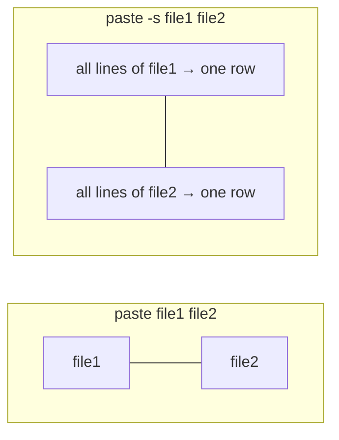

# Week 15 Lecture — Linux Utilities

[Repository Guide](../../README.md) | [English](Concepts_Lecture.md) | [한국어](Concepts_Lecture.ko.md)

> **Last Updated:** 2026-10-19

> **Learning Objectives:**
> 1. Process data by combining text processing utilities with pipes
> 2. Count the lines, words, and characters of a file with wc
> 3. Sort files and remove duplicate lines with sort and uniq
> 4. Split files and cut and paste fields with split, cut, and paste
> 5. Create, convert, and copy files with dd

---

## Table of Contents

- [1. Text Processing Utilities](#1-text-processing-utilities)
- [2. cut: Extract Columns](#2-cut-extract-columns)
  - [2.1 Usage](#21-usage)
  - [2.2 Examples](#22-examples)
- [3. paste: Merge Files](#3-paste-merge-files)
  - [3.1 Usage](#31-usage)
  - [3.2 Examples](#32-examples)
- [4. sort: Sort Lines](#4-sort-sort-lines)
  - [4.1 Usage](#41-usage)
  - [4.2 Examples](#42-examples)
- [5. uniq: Remove Duplicates](#5-uniq-remove-duplicates)
  - [5.1 Usage](#51-usage)
  - [5.2 Examples](#52-examples)
- [6. wc: Word Count](#6-wc-word-count)
  - [6.1 Usage](#61-usage)
  - [6.2 Examples](#62-examples)
- [7. split: Split Files](#7-split-split-files)
  - [7.1 Usage](#71-usage)
  - [7.2 Examples](#72-examples)
- [8. dd: Data Duplicator](#8-dd-data-duplicator)
  - [8.1 Usage](#81-usage)
  - [8.2 Examples](#82-examples)
- [9. Other Useful Utilities](#9-other-useful-utilities)
  - [9.1 tr: Translate Characters](#91-tr-translate-characters)
  - [9.2 sed: Stream Editor](#92-sed-stream-editor)
  - [9.3 awk: Pattern Processing](#93-awk-pattern-processing)
  - [9.4 xargs: Build Commands from Input](#94-xargs-build-commands-from-input)
- [10. Best Practices](#10-best-practices)
- [Summary](#summary)
- [Self-Check Questions](#self-check-questions)

---

<br>

## 1. Text Processing Utilities

Linux provides a rich set of command-line utilities for processing text data. These tools follow the Unix philosophy of doing one thing well and can be combined with pipes for powerful data processing pipelines.

```bash
# Example pipeline: find top 10 largest files in /var/log
du -ah /var/log 2>/dev/null | sort -rh | head -10
```

In this pipeline, `du -ah` prints the size of every file and directory under the directory in human-readable units (K, M, G), and `2>/dev/null` discards error messages caused by missing permissions. `sort -rh` interprets these units and sorts by size in descending order, and `head -10` keeps only the first 10 lines. The first line of the result is the size of the whole `/var/log` directory.

The utilities covered in this unit are as follows.

| Function | Utility |
|----------|---------|
| Gathering file information | `wc` |
| Sorting files | `sort` |
| Splitting files | `split` |
| Removing duplicates | `uniq` |
| Cutting fields | `cut` |
| Joining two files | `paste` |
| Dumping files | `dd` |

*Table 1. Utilities covered in this unit*

The examples use the lab data in [Lab15_Linux-Utilities](../../Coursework/Lab15_Linux-Utilities/). `data/s.dat` holds the records of 7 people with five **tab**-separated fields (ID, last name, first name, score, sex), `data/u.dat` is a 9-line file with duplicate lines mixed in, and `data/passwd` is an account file in the `/etc/passwd` format. The `Lab_*_example.sh` scripts in the same directory run examples of each utility.

```text
$ cat s.dat
001     Hong    Gil-Dong        80      M
002     Park    Ji-Soo  100     M
003     Lee     Na-Young        54      F
004     Kim     Chan-Sook       60      F
005     Han     Ju-Hyun 75      M
006     Jyun    Doo-Ri  49      F
007     Lee     Mi-Ra   59      F
$ cat u.dat
aaaaa
abcde
abcde
bbbbb
abcde
bbbbb
bbbbb
abcde
ccc
```

---

<br>

## 2. cut: Extract Columns

### 2.1 Usage

`cut` cuts out and prints the selected characters or fields of each line of a file. Its form is `cut [options] [file]`, and it processes standard input if no file is given.

```bash
cut -c list file          # Cut by character position
cut -f list file          # Cut by field (tab-delimited)
cut -d delim -f list file # Cut by field with custom delimiter
```

- **`-c list`:** Specifies the character positions to cut from each line.
- **`-f fields`:** Cuts out the given fields.
- **`-d char`:** Specifies the field delimiter.

A list is written as `3` (one), `1,3` (enumeration), `5-8` (range), `5-` (from the 5th to the end), or `-3` (from the start to the 3rd), counting from 1. By default `cut` uses **only the tab** as the field delimiter. In contrast, `sort` uses both spaces and tabs as field delimiters (Section 4), so cutting fields of a space-separated file with `cut` requires `-d' '`.

### 2.2 Examples

```bash
# Extract characters 1-3
echo "Hello World" | cut -c1-3        # Output: Hel

# Extract fields from tab-delimited file
# s.dat: 001\tHong\tGil-Dong\t80\tM
cut -f 2,3 s.dat                      # Output: Hong  Gil-Dong

# Extract from colon-delimited file (like /etc/passwd)
cut -d: -f1,3 /etc/passwd            # Output: root:0
cut -d: -f1,6 /etc/passwd            # username:homedir

# Extract specific character ranges
cut -c1-5,10-15 filename
```

In the output of `cut -f 2,3 s.dat`, the two fields are separated by the original delimiter, a tab. The fields of `/etc/passwd` are, in order, `username:password:UID:GID:comment:home directory:login shell`, so `-f1,3` prints the username and UID and `-f1,6` the username and home directory. The printed fields are also joined with the given delimiter.

When cutting by character position, the result is misaligned if field lengths differ from line to line. The following `cut -c5-8 s.dat` prints the 5th through 8th characters, that is, the four characters after the first tab, so on lines whose last name has three letters the following tab is printed too.

```text
$ cut -c5-8 s.dat
Hong
Park
Lee
Kim
Han
Jyun
Lee
$ cut -f 2,3 s.dat
Hong    Gil-Dong
Park    Ji-Soo
Lee     Na-Young
Kim     Chan-Sook
Han     Ju-Hyun
Jyun    Doo-Ri
Lee     Mi-Ra
$ cut -d: -f 1 /etc/passwd | more
root
daemon
bin
sys
(omitted)
```

Combining `cut` with other utilities extracts information from a file. The following extracts only the 7th field (login shell) of the account file into `shell.out`, then sorts it and removes duplicates to see which login shells are used on this system.

```text
$ cp /etc/passwd .
$ cut -d: -f 7 passwd > shell.out
$ sort shell.out | uniq
/bin/bash
/bin/false
/bin/sh
/bin/sync
/usr/sbin/nologin
```

The output above is the result for the lab data `data/passwd`. `/usr/sbin/nologin` and `/bin/false` are shells assigned to system accounts that cannot log in. [Lab_cut_example.sh](../../Coursework/Lab15_Linux-Utilities/Lab_cut_example.sh) runs examples of `-f`, `-c`, and `-d:`.

---

<br>

## 3. paste: Merge Files

### 3.1 Usage

`paste` joins the contents of the given files. It places the lines with the same number from two or more files side by side, or with `-s` turns the contents of each file into one line and joins them in turn. Its form is `paste [options] [file1 file2 ...]`.

```bash
paste file1 file2         # Merge files side by side (tab-separated)
paste -d delim file1 file2 # Use custom delimiter
paste -s file             # Merge lines of a single file into one line
```

- **`-s`:** Joins all lines of each file into one line. With several files, one line is printed per file.
- **`-dchar`:** Specifies the field delimiter. The default delimiter is the tab.
- **`-`:** Used in place of a file name, reads standard input at that position.

### 3.2 Examples

```bash
# Merge ID file with name file
# file1: 001\n002\n003
# file2: Hong Gil-Dong\nPark Ji-Soo\nLee Na-Young
paste file1 file2
# Output:
# 001  Hong Gil-Dong
# 002  Park Ji-Soo
# 003  Lee Na-Young

# Serial paste (merge all lines into one)
paste -s file1
# Output: 001  002  003  004  005  006  007

# Custom delimiter
paste -d',' file1 file2
# Output: 001,Hong Gil-Dong
```

In this example, `file1` actually has 7 lines, `001` through `007`, and `file2` the 7 corresponding names; the comments and the first output show only the first three lines. That is why `paste -s file1` prints one line joining the seven values with tabs. The output of the last example is also its first line.

If two files have different numbers of lines, empty fields are joined to the lines after the shorter file ends. In the following, `test_paste1` has 7 lines, `001` through `007`, `test_paste2` the 7 names, and `test_paste3` the 2 lines `001 002 003 004` and `005 006 007`.

```text
$ paste test_paste2 test_paste1
Hong Gil-Dong   001
Park Ji-Soo     002
Lee Na-Young    003
Kim Chan-Sook   004
Han Ju-Hyun     005
Jyun Doo-Ri     006
Lee Mi-Ra       007
$ paste test_paste2 test_paste3
Hong Gil-Dong   001 002 003 004
Park Ji-Soo     005 006 007
Lee Na-Young
Kim Chan-Sook
Han Ju-Hyun
Jyun Doo-Ri
Lee Mi-Ra
$ paste -d: test_paste1 test_paste2
001:Hong Gil-Dong
002:Park Ji-Soo
003:Lee Na-Young
004:Kim Chan-Sook
005:Han Ju-Hyun
006:Jyun Doo-Ri
007:Lee Mi-Ra
$ paste -s test_paste1 test_paste2
001     002     003     004     005     006     007
Hong Gil-Dong   Park Ji-Soo     Lee Na-Young    Kim Chan-Sook   Han Ju-Hyun     Jyun Doo-Ri     Lee Mi-Ra
```

Without `-s` the files are joined side by side as columns, and with `-s` each file becomes one row and the rows are stacked. That is why `-s` is also called horizontal pasting.



*Figure 1. Default merging and -s merging of paste*

Using `cut` and `paste` together builds a new file from fields chosen from several files. The following cuts the first field of the space-separated file `s2.dat` (5 lines of last name, first name, age, and sex), passes it through standard input, receives it at the `-` position of `paste`, and joins it with `u2.dat` (the first 4 lines of `u.dat`). Since `u2.dat` is one line shorter, only the last name remains on the last line.

```text
$ cat s2.dat
Kim Ji-Soo 10 F
Lee Gil-Dong 20 M
Lee Gil-San 15 M
Park Ji-Soo 21 F
Choi Na-Na 20 F
$ cut -d' ' -f 1 s2.dat | paste - u2.dat
Kim     aaaaa
Lee     abcde
Lee     abcde
Park    bbbbb
Choi
```

The following builds a list of user names from the account file. It extracts the login ID in the first field and the user comment (name) in the fifth field separately, joins them in the form `name:loginID`, and sorts the result. `sort -o` writes the result after reading all the input, so the output file may be the same as the input file.

```text
$ more /etc/passwd
$ cut -f 1 -d: /etc/passwd > login_list
$ cut -f 5 -d: /etc/passwd > name_list
$ paste -d: name_list login_list > user_list
$ sort -o user_list user_list
```

[Lab_paste_example.sh](../../Coursework/Lab15_Linux-Utilities/Lab_paste_example.sh) shows the results of default merging, `-d'|'`, `-s`, and `-s -d','`.

---

<br>

## 4. sort: Sort Lines

### 4.1 Usage

`sort` sorts the contents of a text file in the specified way and prints them on the screen. Its form is `sort [options] file`, and the original file is not changed.

```bash
sort file                 # Alphabetical sort
sort -n file              # Numeric sort
sort -r file              # Reverse sort
sort -k field file        # Sort by specific field
sort -t delim file        # Specify field delimiter
sort -u file              # Sort and remove duplicates
```

| Option | Function |
|--------|----------|
| `-b` | Ignores leading blanks. |
| `-c` | Does not sort; only checks whether the input is already sorted. If it is not, reports the first line out of order. |
| `-d` | Sorts in dictionary order, comparing only blanks, letters, and digits and ignoring special characters. |
| `-f` | Ignores case. |
| `-k N` | Sorts by the part from the Nth field to the end of the line. With `-k N,M`, sorts by the Nth through Mth fields. |
| `-m` | Merges files that are already sorted. |
| `-n` | Compares numbers by their arithmetic value. |
| `-r` | Sorts in reverse order. |
| `-u` | Keeps only one of each set of duplicate lines after sorting. |
| `-o file` | Saves the sorted result to a file. |
| `-tchar` | Uses the given character as the field delimiter. |
| `+number` | Sorts by field number+1 (`+1` is the same as `-k 2`). |
| `+pos1 -pos2` | Specifies the sort key fields as a range, from field pos1 up to but not including field pos2, counted from 0 (`+1 -2` is the same as `-k 2,2`). |

*Table 2. Options of sort*

`+number` and `+pos1 -pos2` are an old syntax that counts fields from 0, and the standard syntax is `-k`, which counts fields from 1. GNU `sort` still accepts the old syntax for compatibility. By default, fields are separated between a non-blank character and the following space or tab, and the blanks before a field belong to that field.

The sort order depends on the locale (the environment variables `LC_ALL`, `LC_COLLATE`, and `LANG`).

- **UTF-8 locales (e.g., `LANG=en_US.UTF-8`):** Spaces and special characters are ignored in the first-level comparison, digits come before letters, and letters are compared without regard to case.
- **C locale (ASCII code order):** Characters are compared by code value. Spaces come first, followed by digits, uppercase letters, and lowercase letters, with special characters in between.

### 4.2 Examples

```bash
# Basic alphabetical sort
sort names.txt

# Numeric sort
sort -n numbers.txt

# Sort by 4th field (score), numerically, reversed
sort -k4 -n -r s.dat
# Output (highest score first):
# 002 Park Ji-Soo 100 M
# 001 Hong Gil-Dong 80 M
# 005 Han Ju-Hyun 75 M

# Sort /etc/passwd by UID (3rd field)
sort -t: -k3 -n /etc/passwd

# Case-insensitive sort
sort -f file.txt

# Sort locale-aware (special characters)
LC_ALL=C sort file.txt    # Use C locale for consistent results
```

`s.dat` is tab-separated, so only `-k4` is used, without a delimiter. Specifying a space as the delimiter with `-t' '` leaves a tab-separated line with only one field, since it contains no spaces, so the 4th field is empty on every line and the lines are not sorted by score. A numeric field such as the UID of `/etc/passwd` puts `100` before `2` when sorted without `-n`, so `-n` is used with it.

The following `test_sort1` is a file mixing lines that start with digits, uppercase and lowercase letters, and special characters, and lines that start with spaces (`  700`, `  abcd`). Sorting it by default in the C locale reveals the ASCII code order as is.

```text
$ LC_ALL=C sort test_sort1
  700
  abcd
!abc
#include
&987
1234
50
<love>
@_@
Linux
This is a test file.
^love
_love
`love`
hi
linux
love
{Love
~love
```

Lines starting with spaces come first, and special characters such as `!`, `#`, and `&` come before digits. `<` and `@` come between digits and uppercase letters, `^`, `_`, and `` ` `` between uppercase and lowercase letters, and `{` and `~` after lowercase letters. Digits are also compared as characters, so `1234` comes before `50`.

With `-d`, special characters are ignored and only blanks, letters, and digits are compared. For example, `&987` is treated as `987`, `{Love` as `Love`, and `!abc` as `abc`. `-r` prints the reverse of the default sort.

```text
$ LC_ALL=C sort -d test_sort1
@_@
  700
  abcd
1234
50
&987
Linux
{Love
This is a test file.
!abc
hi
#include
linux
<love>
^love
_love
`love`
love
~love
$ LC_ALL=C sort -r test_sort1
~love
{Love
love
linux
hi
`love`
_love
^love
This is a test file.
Linux
@_@
<love>
50
1234
&987
#include
!abc
  abcd
  700
```

In the `-d` result, `@_@` comes first because no character is left to compare, and the two lines starting with spaces are compared by the characters after the spaces.

The examples of sorting by field use `test_sort2`, which has the same contents as `s.dat` separated by spaces. Both `+1` and `-k 2` sort by the part from the second field (last name) to the end of the line.

```text
$ sort -k 2 test_sort2
005 Han Ju-Hyun 75 M
001 Hong Gil-Dong 80 M
006 Jyun Doo-Ri 49 F
004 Kim Chan-Sook 60 F
007 Lee Mi-Ra 59 F
003 Lee Na-Young 54 F
002 Park Ji-Soo 100 M
$ sort +1 -2 test_sort2
005 Han Ju-Hyun 75 M
001 Hong Gil-Dong 80 M
006 Jyun Doo-Ri 49 F
004 Kim Chan-Sook 60 F
003 Lee Na-Young 54 F
007 Lee Mi-Ra 59 F
002 Park Ji-Soo 100 M
```

The result of `sort +1` is the same as that of `sort -k 2`. The order of the two Lees reveals the difference between the keys. `-k 2` compares up to the end of the line, so `Lee Mi-Ra` comes before `Lee Na-Young`. `+1 -2` (`-k 2,2`) compares only the second field, so the two lines have equal keys; `sort` then compares the whole lines and puts `003` before `007`.

```text
$ sort -k 4 test_sort2
002 Park Ji-Soo 100 M
006 Jyun Doo-Ri 49 F
003 Lee Na-Young 54 F
007 Lee Mi-Ra 59 F
004 Kim Chan-Sook 60 F
005 Han Ju-Hyun 75 M
001 Hong Gil-Dong 80 M
$ sort -n -k 4 test_sort2
006 Jyun Doo-Ri 49 F
003 Lee Na-Young 54 F
007 Lee Mi-Ra 59 F
004 Kim Chan-Sook 60 F
005 Han Ju-Hyun 75 M
001 Hong Gil-Dong 80 M
002 Park Ji-Soo 100 M
```

Sorting by the score field without `-n` compares strings, so the first character `1` of `100` is smaller than `4`, and the score 100 comes first. With `-n`, values are compared arithmetically and sorted correctly from 49 to 100.

Specifying several keys in turn gives a secondary sort, where lines with equal earlier keys are sorted by the next key. The following `+2 -3 +1 -2` (`-k 3,3 -k 2,2`) sorts by the 3rd field (first name) only, and if the 3rd fields are equal, by the 2nd field (last name). `-o` saves the result to a file instead of the screen.

```text
$ sort +2 -3 +1 -2 test_sort2
004 Kim Chan-Sook 60 F
006 Jyun Doo-Ri 49 F
001 Hong Gil-Dong 80 M
002 Park Ji-Soo 100 M
005 Han Ju-Hyun 75 M
007 Lee Mi-Ra 59 F
003 Lee Na-Young 54 F
$ sort -n +3 -4 -o sort.out test_sort2
$ cat sort.out
006 Jyun Doo-Ri 49 F
003 Lee Na-Young 54 F
007 Lee Mi-Ra 59 F
004 Kim Chan-Sook 60 F
005 Han Ju-Hyun 75 M
001 Hong Gil-Dong 80 M
002 Park Ji-Soo 100 M
```

`-t` specifies the field delimiter, so it is meaningful only together with `-k`. Used without `-k`, as in `sort -t: /etc/passwd`, it compares whole lines, so the result is the same as sorting by user name.

```text
$ sort -t: /etc/passwd
adm:x:4:4:Admin:/var/adm:
aiuser:x:60003:60001:AI User:/:
bin:x:2:2::/usr/bin:
daemon:x:1:1::/:
(omitted)
user1:x:60005:10::/home/user1:/usr/bin/bash
user2:x:60006:10::/home/user2:/usr/bin/bash
uucp:x:5:5:uucp Admin:/usr/lib/uucp:
```

A `sort` practice can proceed as follows. Copy the lab data to the current directory and check its contents, then run in turn `sort s.dat` (default sort), `sort -f s.dat` (case-insensitive), `sort -r s.dat` (reverse), `sort +2 s.dat` (by the 3rd field), and `sort -o sort.out s.dat` (save the result to a file), and sort with `sort +2 +3 s.dat` by the part from the 3rd field and, if equal, from the 4th field. Finally, `sort -m s.dat sort.out` merges the two already sorted files. Since `s.dat` is sorted by ID and has the same contents as `sort.out`, each line appears twice in the merged result. [Lab_sort_example.sh](../../Coursework/Lab15_Linux-Utilities/Lab_sort_example.sh) runs examples of sorting by score, sorting by UID, and `-u`.

---

<br>

## 5. uniq: Remove Duplicates

### 5.1 Usage

`uniq` keeps only one of each run of **consecutive** identical lines in a file or standard input and deletes the rest. Its form is `uniq [options] [input_file [output_file]]`; it processes standard input if no file is given and saves the result to the output file if one is given. The input and output files must have different names.

```bash
uniq file                 # Remove adjacent duplicates
uniq -c file              # Count occurrences
uniq -d file              # Show only duplicated lines
uniq -u file              # Show only unique lines
uniq -i file              # Case-insensitive comparison
```

`-d` prints one line for each group of consecutive duplicate lines, `-u` prints only lines that are not repeated consecutively, and `-c` prints at the start of each line the number of times it occurred consecutively.

### 5.2 Examples

```bash
# Important: uniq only removes ADJACENT duplicates, so sort first!
sort data.txt | uniq

# Count occurrences
sort data.txt | uniq -c
# Output:
#   1 aaaaa
#   4 abcde
#   3 bbbbb
#   1 ccc

# Find only duplicated lines
sort data.txt | uniq -d

# Find unique (non-duplicated) lines
sort data.txt | uniq -u
```

The `-c` output above is the result when `data.txt` has the same contents as `u.dat`. Since `sort` gathers identical lines, the 4 `abcde` lines and the 3 `bbbbb` lines each form one group.

Running `uniq` on an unsorted `u.dat` removes only consecutive duplicates, so identical lines that are apart remain.

```text
$ uniq u.dat
aaaaa
abcde
bbbbb
abcde
bbbbb
abcde
ccc
$ uniq -u u.dat
aaaaa
bbbbb
abcde
abcde
ccc
```

`uniq u.dat` merges only the `abcde` on the second and third lines and the `bbbbb` on the sixth and seventh lines, printing 7 lines. `uniq -u u.dat` prints only lines that are not repeated consecutively, so `bbbbb` and `abcde`, which occur several times in the whole file, are printed as well.

```text
$ sort u.dat
aaaaa
abcde
abcde
abcde
abcde
bbbbb
bbbbb
bbbbb
ccc
$ sort u.dat | uniq
aaaaa
abcde
bbbbb
ccc
$ sort u.dat | uniq -d
abcde
bbbbb
$ sort u.dat | uniq -c
      1 aaaaa
      4 abcde
      3 bbbbb
      1 ccc
```

> **Key Point:** `uniq` compares only adjacent lines, so always run `sort` before `uniq` to remove duplicates across the whole file. If only removing duplicates is needed, `sort -u` gives the same result.

[Lab_uniq_example.sh](../../Coursework/Lab15_Linux-Utilities/Lab_uniq_example.sh) runs `uniq`, `-d`, `-u`, `-c`, and `sort | uniq -c | sort -rn` (sorting by frequency) on `u.dat`.

---

<br>

## 6. wc: Word Count

### 6.1 Usage

`wc` (word count) prints the number of lines, words, and characters of a file. Its form is `wc [options] file`, and without options it prints the line count, word count, and byte count in turn.

```bash
wc file                   # Lines, words, characters
wc -l file                # Line count only
wc -w file                # Word count only
wc -c file                # Byte count
wc -m file                # Character count
```

A word for `-w` is a string separated by spaces, tabs, or newlines. `-l` counts newline characters, so a last line that does not end with a newline is not counted. In a file containing only ASCII characters, `-c` (bytes) and `-m` (characters) are equal, but if it contains characters that take several bytes in UTF-8, such as Hangul, `-c` is larger. The `wc` of some Unix systems such as Solaris also has a `-C` option equivalent to `-m`, but GNU `wc` does not.

### 6.2 Examples

```bash
wc /etc/passwd
#   43   58  2237 /etc/passwd
# lines words bytes

# Count number of users
wc -l /etc/passwd

# Count files in directory
ls | wc -l

# Count lines in multiple files
wc -l *.txt

# Count unique lines
sort data.txt | uniq | wc -l
```

The first example is the result for an account file like the lab data `data/passwd`. Each line of `/etc/passwd` is one account, so `wc -l` gives the total number of accounts, including system accounts. `ls | wc -l` excludes hidden files; to count them too, use `ls -A | wc -l`. Given several files, `wc` prints one line per file and adds a `total` line at the end.

The following can be checked with `wc`.

- `wc /etc/passwd` and `wc /etc/hosts` print the line, word, and byte counts of each file.
- `wc -l /etc/services` prints the number of lines of the service list file.
- `cat /etc/hosts | wc -l` counts lines through standard input instead of a file name, in which case no file name appears in the output.
- The result of `ls -l /usr/bin | wc -l` is one more than the number of files in `/usr/bin`, because `ls -l` prints a `total` line first.
- To find how many files are in the current directory, use `ls | wc -l`.

```text
$ ls -l > test_wc
$ wc -c test_wc
70 test_wc
```

This example saves the output of `ls -l` to `test_wc` and counts its bytes. [Lab_wc_example.sh](../../Coursework/Lab15_Linux-Utilities/Lab_wc_example.sh) runs each option on `data/passwd` and counts logged-in users with `who | wc -l`.

---

<br>

## 7. split: Split Files

### 7.1 Usage

`split` divides a large file into several smaller files of a fixed size. Its form is `split [options] [file [prefix]]`, and if no file is given, it splits and saves the contents of standard input.

```bash
split -l lines file prefix    # Split by number of lines
split -b size file prefix     # Split by file size
split -n chunks file prefix   # Split into N equal chunks
```

- **`-l n`:** Splits every n lines. The old syntax `-n` (a number alone), as in `split -30`, does the same.
- **`-b n`:** Splits into files of n bytes. Units can be attached, as in `10K` or `10M`.
- **`-n count`:** An option of GNU `split` that divides the file into the given number of equal-sized chunks.
- Without options, it splits every 1000 lines.
- The split files are named `xaa`, `xab`, ..., the prefix `x` followed by `aa`, `ab`, and so on. Giving a prefix as the last argument uses it instead of `x`.

### 7.2 Examples

```bash
# Split into 100-line chunks
split -l 100 largefile.txt part_
# Creates: part_aa, part_ab, part_ac, ...

# Split into 10MB chunks
split -b 10M backup.tar.gz chunk_

# Reassemble split files
cat part_* > reassembled.txt
cat chunk_* > reassembled.tar.gz
```

Since the suffixes are assigned in alphabetical order, the wildcard in `cat part_*` lists the files in their original order and restores the original. The following splits `test_split`, a copy of the 134-line, 4543-byte `/etc/services`, by lines and by bytes.

```text
$ cp /etc/services test_split
$ wc -l test_split
134 test_split
$ split -l 30 test_split
$ ls
test_split xaa xab xac xad xae
$ wc -l x*
 30 xaa
 30 xab
 30 xac
 30 xad
 14 xae
134 total
```

Since 134 = 30 × 4 + 14, four 30-line files and one 14-line file are created. The following is the result of splitting the same file into 512-byte pieces after deleting the files created by line.

```text
$ wc -c test_split
4543 test_split
$ split -b 512 test_split
$ ls
test_split xaa xab xac xad xae xaf xag xah xai
$ wc -c x*
 512 xaa
 512 xab
 512 xac
 512 xad
 512 xae
 512 xaf
 512 xag
 512 xah
 447 xai
4543 total
```

Since 4543 = 512 × 8 + 447, eight 512-byte files (`xaa`-`xah`) and one 447-byte file (`xai`) are created. Splitting by bytes also cuts in the middle of lines, so splitting by lines is more natural for text files. [Lab_split_example.sh](../../Coursework/Lab15_Linux-Utilities/Lab_split_example.sh) splits a 20-line file into 5-line pieces and into 200-byte pieces.

---

<br>

## 8. dd: Data Duplicator

### 8.1 Usage

`dd` converts the given input file according to the given options and saves it to the output file. Since it reads and writes in blocks, it can handle device files such as disks as well as regular files. Its form is `dd [options] [if=input_file] [of=output_file]`, and omitting `if` or `of` uses standard input or standard output.

```bash
dd if=input of=output bs=blocksize count=blocks
```

- **`bs=n`:** Sets the input/output block size to n bytes. The default is 512 bytes, and units can be attached, as in `1K` or `1M`.
- **`count=n`:** Copies only n blocks.
- **`conv=lcase`, `conv=ucase`:** Converts letters to lowercase or uppercase.
- **`conv=ascii`:** Converts EBCDIC code to ASCII code.

When it finishes, `dd` prints the number of blocks processed to standard error in the form `a+b records in` and `a+b records out`. `a` is the number of full blocks, and `b` the number of partial blocks smaller than the block size.

### 8.2 Examples

```bash
# Create a 1GB file filled with zeros
dd if=/dev/zero of=test.img bs=1M count=1024

# Clone a disk (DANGEROUS - be very careful with device names!)
sudo dd if=/dev/sda of=/dev/sdb bs=4M status=progress

# Create a bootable USB from ISO
sudo dd if=ubuntu.iso of=/dev/sdb bs=4M status=progress

# Backup MBR
sudo dd if=/dev/sda of=mbr_backup.bin bs=512 count=1

# Convert file to uppercase
dd if=input.txt of=output.txt conv=ucase
```

`/dev/zero` is a special file that yields zero bytes endlessly when read, so `bs=1M count=1024` creates 1024 blocks of 1 MiB, a 1 GiB file. The MBR backup copies the single 512-byte first block of the disk (Week 14). `status=progress` prints the progress of the copy periodically.

> **Key Point:** `dd` operates at the raw device level. A wrong `of=` parameter can destroy data, so always check the device name again before running it.

The following examples use `dd` to change the case of a file, empty a file, create a file, and copy a file.

```text
$ dd conv=lcase if=s.dat of=test_dd1
0+1 records in
0+1 records out
151 bytes copied, 1.0459e-05 s, 14.4 MB/s
$ more test_dd1
001     hong    gil-dong        80      m
002     park    ji-soo  100     m
003     lee     na-young        54      f
004     kim     chan-sook       60      f
005     han     ju-hyun 75      m
006     jyun    doo-ri  49      f
007     lee     mi-ra   59      f
```

`s.dat` is 151 bytes, smaller than the default block size of 512 bytes, so it is processed as one partial block (`0+1`).

```text
$ dd if=/dev/null of=test_dd2
0+0 records in
0+0 records out
0 bytes copied, 1.1083e-05 s, 0.0 kB/s
$ ls test_dd2
test_dd2
$ dd if=/dev/zero count=100 of=test_dd2
100+0 records in
100+0 records out
51200 bytes (51 kB) copied, 0.000508682 s, 101 MB/s
$ ls -l test_dd2
-rw-r--r-- 1 root root 51200 May 27 09:37 test_dd2
$ dd if=/dev/zero bs=1024 count=100 of=test_dd3
100+0 records in
100+0 records out
102400 bytes (102 kB) copied, 0.00121263 s, 84.4 MB/s
$ ls -l test_dd3
-rw-r--r-- 1 root root 102400 May 27 09:38 test_dd3
```

`/dev/null` is a special file that reaches end of file immediately when read, so using it as input creates a file of size 0. If the output file already exists, its contents are erased, so this can be used to empty a file. `count=100` without `bs` means 100 blocks of 512 bytes, 512 × 100 = 51200 bytes, and `bs=1024 count=100` gives 1024 × 100 = 102400 bytes.

```text
$ dd if=s.dat of=test_dd2
0+1 records in
0+1 records out
151 bytes copied, 1.0459e-05 s, 14.4 MB/s
$ ls test_dd2
test_dd2
$ diff s.dat test_dd2
```

Since `diff` prints nothing, the two files have the same contents. That is, `dd` without conversion options copies a file like `cp`. [Lab_dd_example.sh](../../Coursework/Lab15_Linux-Utilities/Lab_dd_example.sh) creates a 1 MB file, copies it, and converts it to uppercase in a temporary directory, and only prints the commands that write to devices.

---

<br>

## 9. Other Useful Utilities

### 9.1 tr: Translate Characters

```bash
echo "hello" | tr 'a-z' 'A-Z'         # HELLO
echo "hello  world" | tr -s ' '       # Remove duplicate spaces
echo "hello123" | tr -d '0-9'         # Remove digits: hello
```

`tr` translates the characters of standard input from the first set into the corresponding characters of the second set and prints them. `-s` squeezes consecutive repeated characters into one (`hello world`), and `-d` deletes the characters in the given set. Since it does not take a file as an argument, input redirection is used, as in `tr ... < file`.

### 9.2 sed: Stream Editor

```bash
sed 's/old/new/' file                  # Replace first on each line
sed 's/old/new/g' file                 # Replace all
sed -n '5,10p' file                    # Print lines 5-10
sed '3d' file                          # Delete line 3
sed -i 's/old/new/g' file             # In-place edit
```

`sed` reads its input one line at a time, applies the editing commands, and prints the result. `s/find/replace/` is substitution, and `g` replaces every match on the line. `-n` turns off automatic printing, so `5,10p` prints only lines 5-10. `-i` writes the result directly to the original file instead of the screen.

### 9.3 awk: Pattern Processing

```bash
awk '{print $1, $3}' file             # Print fields 1 and 3
awk -F: '{print $1, $6}' /etc/passwd  # Custom delimiter
awk 'NR>=5 && NR<=10' file            # Print lines 5-10
awk '{sum += $1} END {print sum}' file # Sum first column
```

`awk` splits each line into fields `$1`, `$2`, ... at whitespace and applies `pattern { action }`. `-F:` specifies the field separator, `NR` is the current line number, and the `END` block runs once after all lines are processed.

### 9.4 xargs: Build Commands from Input

```bash
find . -name "*.tmp" | xargs rm       # Delete found files
echo "a b c" | xargs -n1 echo         # One arg per command
```

`xargs` runs a command with the words received on standard input appended as arguments. The first example passes the file names found by `find` as arguments of `rm`, and the second passes arguments one at a time with `-n1`, running `echo` three times so that `a`, `b`, and `c` are each printed on their own line. If file names may contain spaces, separate them with null characters, as in `find . -name "*.tmp" -print0 | xargs -0 rm`.

---

<br>

## 10. Best Practices

- Chain utilities with pipes for complex text processing.
- Use the `sort | uniq` pattern, running `sort` before `uniq`.
- Prefer `awk` for complex field-based processing.
- Use `sed -i.bak` to create a backup file before in-place edits.
- Use `dd status=progress` for long operations.
- Always verify device names before running `dd`.

---

<br>

## Summary

| Concept | Key Summary |
|---------|-------------|
| cut | Cuts character positions (`-c`) or fields (`-f`) from each line; the default delimiter is the tab and `-d` changes it (e.g., `cut -d: -f1 /etc/passwd`). |
| paste | Places the same lines of several files side by side with tabs; `-s` turns each file into one line and `-d` changes the delimiter (e.g., `paste file1 file2`). |
| sort | Sorts lines in locale order, with `-k` for the key field, `-n` for numeric comparison, `-r` for reverse order, and `-t` for the delimiter (e.g., `sort -k2 -n file`). |
| uniq | Reduces consecutive duplicate lines to one, so it usually follows `sort`; `-c` prints counts, `-d` duplicate lines, and `-u` unique lines (e.g., `sort file \| uniq -c`). |
| wc | Counts lines, words, and bytes, and `-l`, `-w`, `-c`, and `-m` print only one of them (e.g., `wc -l file`). |
| split | Splits a file into `xaa`, `xab`, ..., 1000 lines each by default, with `-l` dividing by lines and `-b` by bytes (e.g., `split -l 1000 file prefix_`). |
| dd | Copies and converts data in blocks; the default `bs` is 512 bytes and `conv` changes the case (e.g., `dd if=input of=output bs=4M`). |
| tr | Translates characters of standard input into other characters (squeezing with `-s`, deleting with `-d`) and prints them (e.g., `tr 'a-z' 'A-Z'`). |
| sed | A stream editor that applies editing commands such as substitution, deletion, and printing line by line (e.g., `sed 's/old/new/g' file`). |
| awk | A pattern processing language that splits lines into fields and applies patterns and actions (e.g., `awk '{print $1}' file`). |

---

<br>

## Self-Check Questions

1. **uniq and sorting:** For `u.dat` (9 lines), write the output of `uniq u.dat | wc -l` and of `sort u.dat | uniq | wc -l`, and explain the difference.

   <details>
   <summary>Answer</summary>

   `uniq u.dat | wc -l` prints `7` and `sort u.dat | uniq | wc -l` prints `4`. `uniq` merges only consecutive identical lines, so in the unsorted `u.dat` only the `abcde` on lines 2 and 3 and the `bbbbb` on lines 6 and 7 are merged, leaving 9 - 2 = 7 lines. Sorting puts all identical lines next to each other, leaving only the 4 lines `aaaaa`, `abcde`, `bbbbb`, and `ccc`.

   </details>

2. **Numeric sorting:** Sorting `test_sort2` with `sort -k 4` puts the line with a score of 100 first. Explain why, and write commands that sort by score in ascending and in descending order.

   <details>
   <summary>Answer</summary>

   Without `-n`, the field is compared as a string, so the first character `1` of `100` is smaller than the first characters of `49`, `54`, and so on, and it comes first. Ascending order by score is `sort -n -k 4 test_sort2`, and descending order is `sort -n -r -k 4 test_sort2` (or `sort -k4 -nr test_sort2`).

   </details>

3. **Result of split:** When a 4543-byte file is split with `split -b 512`, how many files are created, and what are the name and size of the last one?

   <details>
   <summary>Answer</summary>

   Since 4543 = 512 × 8 + 447, eight 512-byte files and one 447-byte file, nine in all, are created. Names are assigned in order from `xaa`, so the ninth and last file is `xai`, with 447 bytes.

   </details>

4. **Reading a pipeline:** What does `cut -d: -f7 /etc/passwd | sort | uniq -c | sort -rn | head -1` print?

   <details>
   <summary>Answer</summary>

   `cut` extracts the login shell (7th field) of each account, and `sort | uniq -c` counts the accounts for each shell. `sort -rn` sorts these in descending order of count, and `head -1` keeps only the first line, so the output is the login shell used by the most accounts and its account count. For the lab data `data/passwd`, it is `29 /usr/sbin/nologin`.

   </details>

5. **Block size of dd:** Find the sizes of the files created by `dd if=/dev/zero count=100 of=a` and `dd if=/dev/zero bs=1K count=100 of=b`.

   <details>
   <summary>Answer</summary>

   Without `bs`, the block size is 512 bytes, so `a` is 512 × 100 = 51200 bytes. `b` has a block size of 1024 bytes, so it is 1024 × 100 = 102400 bytes.

   </details>
